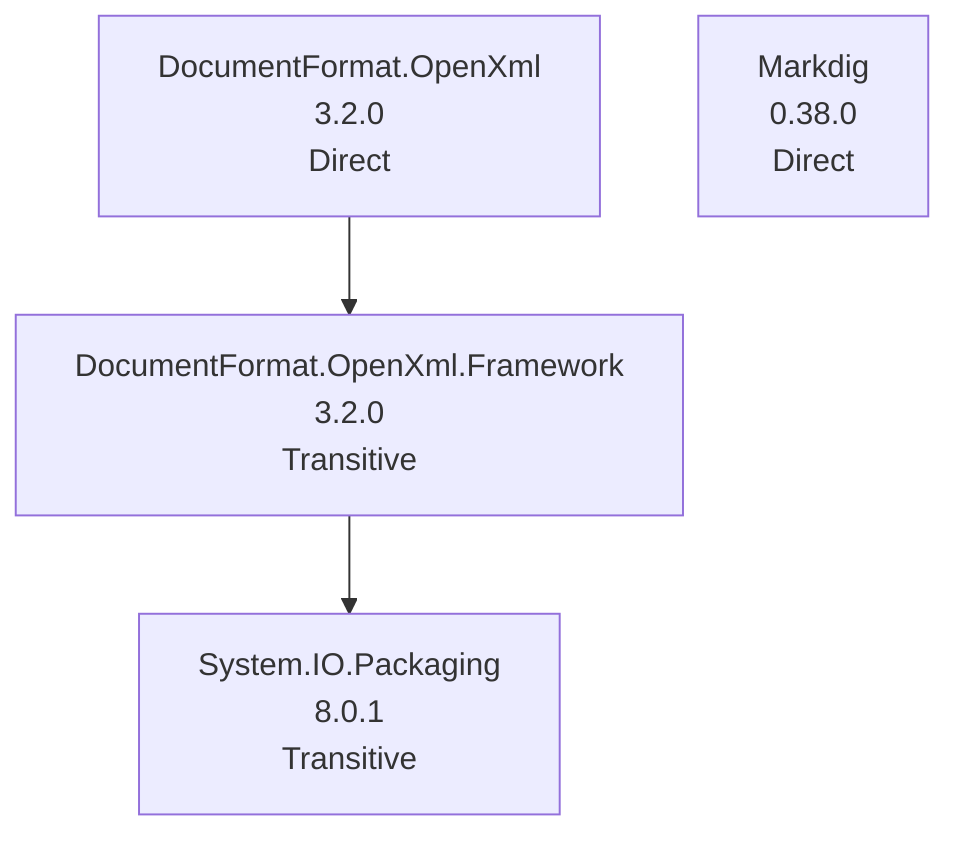

# NuGet Audit Report - MDConverter

- Snapshot ID: `20260405025024_13707614`
- Captured UTC: `2026-04-05T02:50:24.5294057+00:00`
- Solution: `C:\Users\windo\OneDrive\Documents\Development\MarkdownToDocX\MDConverter.slnx`
- Source identity key: `A19784C5D5628D1E`
- Source identity kind: `disk-path`
- Source machine: `SURFACELAPTOP7`
- Repository root: `C:\Users\windo\OneDrive\Documents\Development\MarkdownToDocX`
- Git remote: `-`
- Analysis status: `Complete`
- Projects analysed: `2`
- Packages discovered: `4`
- Direct packages: `2`
- Transitive packages: `2`
- Dependency edges: `2`
- Error diagnostics: `0`
- Warning diagnostics: `4`
- Delta changed: `False`
- Knowledge snapshot generated: `2026-04-05T02:50:24.5294057+00:00`

## Attention Required

| Severity | Project | Package | Message | TFM |
|---|---|---|---|---|
| Warning | MDConverter | DocumentFormat.OpenXml | Package 'DocumentFormat.OpenXml' 3.2.0 is outdated. Latest compatible stable version: 3.5.1. | net8.0 |
| Warning | MDConverter | DocumentFormat.OpenXml.Framework | Package 'DocumentFormat.OpenXml.Framework' 3.2.0 is outdated. Latest compatible stable version: 3.5.1. | net8.0 |
| Warning | MDConverter | Markdig | Package 'Markdig' 0.38.0 is outdated. Latest compatible stable version: 1.1.2. | net8.0 |
| Warning | MDConverter | System.IO.Packaging | Package 'System.IO.Packaging' 8.0.1 is outdated. Latest compatible stable version: 10.0.5. | net8.0 |

## Change Summary

No previous accepted snapshot was available for comparison.

## Knowledge Changes

| Package | Version | Determined UTC | Previous Health | Current Health | Risk | Alert | Remediation | Summary |
|---|---|---|---|---|---|---|---|---|
| DocumentFormat.OpenXml | 3.2.0 | 2026-04-05T02:50:24.5294057+00:00 | - | outdated->3.5.1 | 35.30 (Medium) | 52.40 (High) | Upgrade to 3.5.1. | Attention is now required for this package version. |
| DocumentFormat.OpenXml.Framework | 3.2.0 | 2026-04-05T02:50:24.5294057+00:00 | - | outdated->3.5.1 | 32.10 (Medium) | 49.20 (Medium) | Upgrade to 3.5.1. | Attention is now required for this package version. |
| Markdig | 0.38.0 | 2026-04-05T02:50:24.5294057+00:00 | - | outdated->1.1.2 | 35.30 (Medium) | 52.40 (High) | Upgrade to 1.1.2. | Attention is now required for this package version. |
| System.IO.Packaging | 8.0.1 | 2026-04-05T02:50:24.5294057+00:00 | - | outdated->10.0.5 | 32.10 (Medium) | 49.20 (Medium) | Upgrade to 10.0.5. | Attention is now required for this package version. |

## Security and Health Transitions

No package health transitions were detected relative to the previous accepted snapshot.

## Dependency Relationship Changes

No dependency edge changes were detected relative to the previous accepted snapshot.

## Project Details

### md2docx

- Path: `C:\Users\windo\OneDrive\Documents\Development\MarkdownToDocX\src\md2docx\md2docx.csproj`
- Style: `Unknown`
- Load state: `Loaded`
- Analysis status: `Complete`
- Target frameworks: `net8.0`

No packages detected.

### MDConverter

- Path: `C:\Users\windo\OneDrive\Documents\Development\MarkdownToDocX\src\MDConverter\MDConverter.csproj`
- Style: `PackageReference`
- Load state: `Loaded`
- Analysis status: `Complete`
- Target frameworks: `net8.0`
- Diagnostics:
  - [Warning] Package 'DocumentFormat.OpenXml' 3.2.0 is outdated. Latest compatible stable version: 3.5.1.
  - [Warning] Package 'DocumentFormat.OpenXml.Framework' 3.2.0 is outdated. Latest compatible stable version: 3.5.1.
  - [Warning] Package 'Markdig' 0.38.0 is outdated. Latest compatible stable version: 1.1.2.
  - [Warning] Package 'System.IO.Packaging' 8.0.1 is outdated. Latest compatible stable version: 10.0.5.

| Package | Kind | Requested | Resolved | Health | Vulnerability Detail | Risk | Alert | Knowledge Determined | Status Changed | Remediation | Central | Parents | Path | TFM |
|---|---|---|---|---|---|---|---|---|---|---|---|---|---|---|
| DocumentFormat.OpenXml | Direct | 3.2.0 | 3.2.0 | outdated->3.5.1 | - | 35.30 (Medium) | 52.40 (High) | 2026-04-05T02:50:24.5294057+00:00 | 2026-04-05T02:50:24.5294057+00:00 | Upgrade to 3.5.1. | No | - | DocumentFormat.OpenXml | net8.0 |
| DocumentFormat.OpenXml.Framework | Transitive | - | 3.2.0 | outdated->3.5.1 | - | 32.10 (Medium) | 49.20 (Medium) | 2026-04-05T02:50:24.5294057+00:00 | 2026-04-05T02:50:24.5294057+00:00 | Upgrade to 3.5.1. | No | DocumentFormat.OpenXml | DocumentFormat.OpenXml.Framework -> DocumentFormat.OpenXml | net8.0 |
| Markdig | Direct | 0.38.0 | 0.38.0 | outdated->1.1.2 | - | 35.30 (Medium) | 52.40 (High) | 2026-04-05T02:50:24.5294057+00:00 | 2026-04-05T02:50:24.5294057+00:00 | Upgrade to 1.1.2. | No | - | Markdig | net8.0 |
| System.IO.Packaging | Transitive | - | 8.0.1 | outdated->10.0.5 | - | 32.10 (Medium) | 49.20 (Medium) | 2026-04-05T02:50:24.5294057+00:00 | 2026-04-05T02:50:24.5294057+00:00 | Upgrade to 10.0.5. | No | DocumentFormat.OpenXml.Framework | System.IO.Packaging -> DocumentFormat.OpenXml.Framework -> DocumentFormat.OpenXml | net8.0 |

#### Dependency Graph Table

| From Package | To Package | TFM |
|---|---|---|
| DocumentFormat.OpenXml | DocumentFormat.OpenXml.Framework | net8.0 |
| DocumentFormat.OpenXml.Framework | System.IO.Packaging | net8.0 |

#### Dependency Graph Mermaid

## Snapshot Warnings

- Attention required: 4 package diagnostics are warnings.
