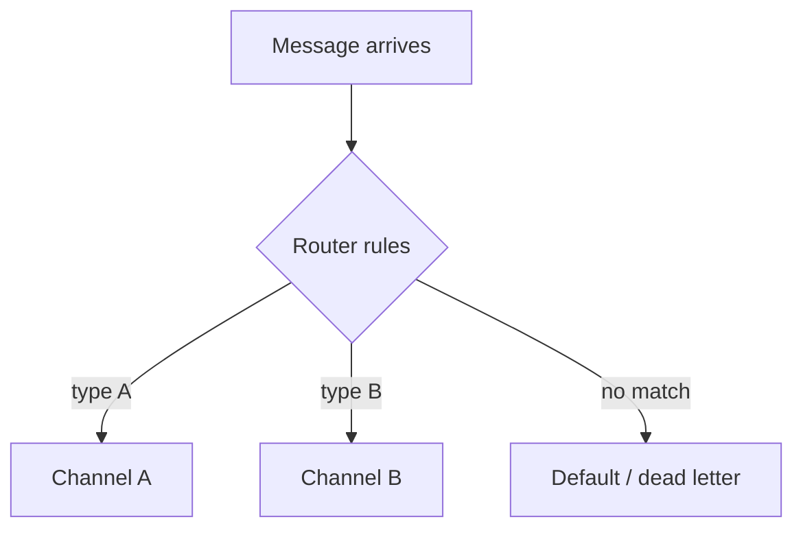
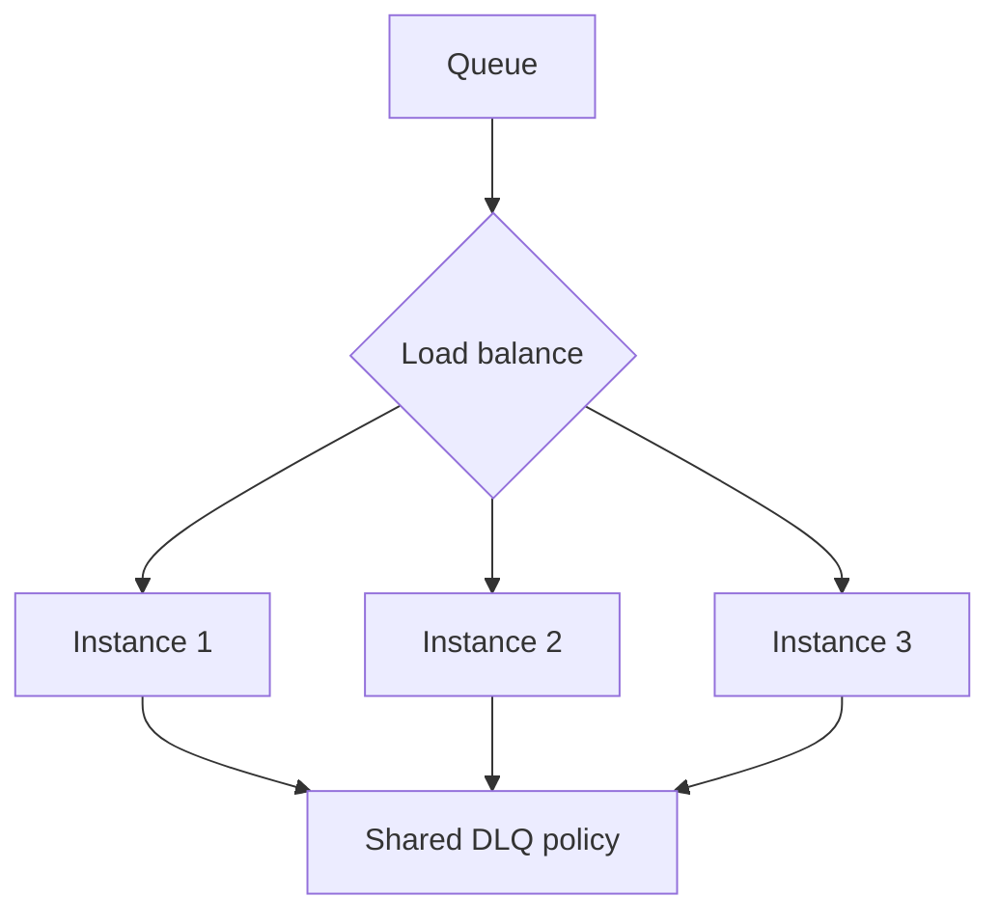
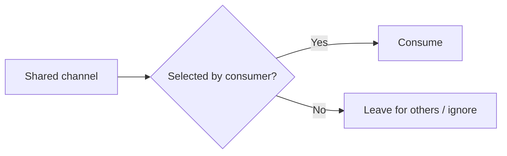
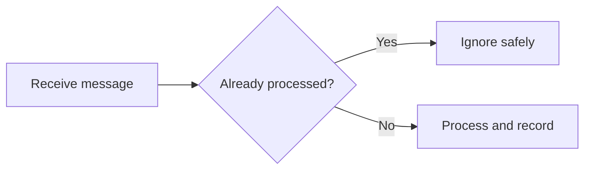
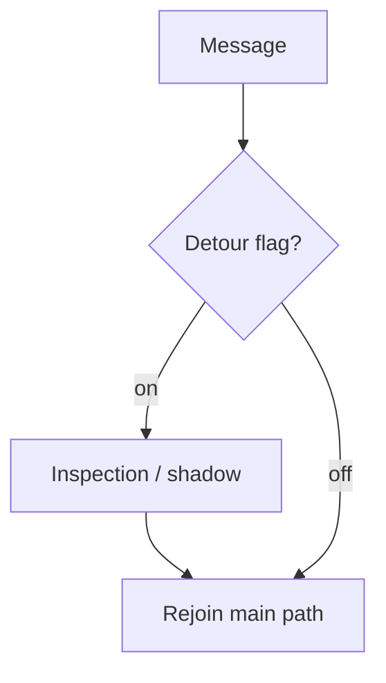

# Focus fixtures (extracted from Stress.md)

These diagrams are copied from `Stress.md` to enable fast, targeted SvgHarness runs.

---

## Router (layered view)

---

## Load balance (layered view)

---

## Selective consumer (primary topology)

---

## Idempotent receiver (primary topology)

---

## Detour (layered view)

