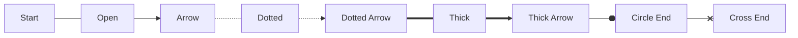

# Mermaid Flowchart Geometry And Line-End Specification

**Status:** Source-traced working specification  
**Target:** Mermaid flowchart rendering, with emphasis on node shapes, edge styles, and line ends  
**Date:** 2026-04-25  
**Scope:** Mermaid `flowchart` / `graph` diagrams, especially the v11.3+ expanded shape syntax.

---

## 1. Purpose

This document replaces the earlier lightweight review with a more useful geometry-oriented specification.

The goal is to describe how to determine, and where possible directly state, the geometry needed to reproduce Mermaid flowchart output in another renderer such as C#, SVG generation, or manual technical drawing.

The important correction is this:

> Mermaid does not have a single universal table of drawing constants. Exact reproduction requires tracing parser output, layout output, label measurement, shape drawing, edge routing, marker placement, and CSS/theme resolution.

Where the official source was visible and specific enough, this document records the confirmed drawing rule. Where the exact source was not visible in the fetched material, the document records the required derivation method and marks the item as **requires source extraction** rather than inventing a formula.

---

## 2. Evidence Used

The following evidence was used:

1. The supplied investigation approach, which correctly frames Mermaid as a renderer pipeline rather than as a static shape table.
2. Mermaid's GitHub repository and source tree.
3. Mermaid's official flowchart syntax documentation.
4. Mermaid's official layout documentation.
5. Source and distribution evidence for:
   - `drawRect.ts`
   - `insertPolygonShape.ts`
   - `shapes.d.ts`
   - `edgeMarker.d.ts`
   - `markers.d.ts`
   - `lineWithOffset.d.ts`
   - `flowchart/styles.ts`

This document deliberately avoids pretending that every shape formula was fully inspected. It gives exact formulae for the source-confirmed primitives and a structured extraction table for the rest.

---

## 3. Version Locking Requirement

Exact drawing is only meaningful after locking these values:

| Item | Required value |
|---|---|
| Mermaid version | A specific release or commit hash |
| Mermaid package | `mermaid` npm package or source checkout |
| Diagram type | `flowchart` / `graph` |
| Renderer | Dagre, ELK, or other configured renderer |
| Theme | `default`, `base`, `dark`, or custom |
| Font family | Exact font list and actual resolved font |
| Font size | Effective CSS font size |
| Browser/runtime | Chromium, Firefox, WebKit, jsdom, or other |
| HTML labels | Enabled/disabled |
| Security level | Mermaid configuration value |

For exact reproduction, the version should be pinned to a commit or npm package version. Mermaid's public distribution showed `11.14.0` as latest at the time of review, while source examples from the CDN and repository may differ by release.

---

## 4. Rendering Pipeline

The drawing cannot be reproduced by reading shape syntax alone.

```text
Mermaid source text
    ↓
Diagram parser
    ↓
Flowchart database / internal model
    ↓
Node, edge, label and subgraph normalisation
    ↓
Label rendering and measurement
    ↓
Layout engine input graph
    ↓
Layout engine output graph
    ↓
Node shape renderer
    ↓
Edge path renderer
    ↓
Marker / arrowhead attachment
    ↓
CSS / theme application
    ↓
Final SVG with viewBox and transforms
```

The decisive rule is:

> Node dimensions usually come from measured label size plus padding, but node positions and routed edge points usually come from the selected layout engine.

---

## 5. Coordinate Model

Mermaid flowchart node shapes are generally drawn inside an SVG group that has already been translated to the node centre.

This means that a shape renderer commonly draws the shape around local origin `(0,0)`.

For a node with final visual width `W` and height `H`:

```text
Local left   = -W / 2
Local right  =  W / 2
Local top    = -H / 2
Local bottom =  H / 2
```

The node group then supplies the global position:

```text
GlobalPoint = NodeGroupTranslate + LocalPoint
```

For technical drawing, this means the node centre is the primary datum point.

---

## 6. Confirmed Rectangle Geometry

The rectangle source establishes the basic pattern used by many other shapes.

### 6.1 Inputs

```text
LabelBBoxWidth
LabelBBoxHeight
LabelPaddingX
LabelPaddingY
OptionalNodeWidth
OptionalNodeHeight
OptionalRx
OptionalRy
```

### 6.2 Derived Dimensions

The confirmed rectangle rule is:

```text
TotalWidth  = max(LabelBBoxWidth  + (LabelPaddingX * 2), OptionalNodeWidth  or 0)
TotalHeight = max(LabelBBoxHeight + (LabelPaddingY * 2), OptionalNodeHeight or 0)
X = -TotalWidth / 2
Y = -TotalHeight / 2
```

### 6.3 SVG Equivalent

```xml
<rect
  x="-TotalWidth / 2"
  y="-TotalHeight / 2"
  width="TotalWidth"
  height="TotalHeight"
  rx="Rx"
  ry="Ry" />
```

### 6.4 Technical Drawing Equivalent

1. Mark the node centre `(Cx, Cy)`.
2. Calculate `W` and `H` from the measured label and padding.
3. Mark corners:
   - top-left `(Cx - W/2, Cy - H/2)`
   - top-right `(Cx + W/2, Cy - H/2)`
   - bottom-right `(Cx + W/2, Cy + H/2)`
   - bottom-left `(Cx - W/2, Cy + H/2)`
4. Draw a rectangle through those four points.
5. If `rx`/`ry` are present, replace each corner with the SVG rounded-rectangle behaviour using those radii.

### 6.5 Boundary Intersection

The rectangle renderer assigns rectangle intersection logic to the node. Therefore, edges entering or leaving a rectangle should be clipped/intersected against the rectangle boundary, not the node centre.

---

## 7. Confirmed Generic Polygon Insertion Rule

Several shapes use polygon drawing. The source helper inserts a `<polygon>` and applies a translation.

### 7.1 Inputs

```text
W
H
Points[] = list of local points supplied by the specific shape module
```

### 7.2 Confirmed SVG Construction

The helper serialises points as:

```text
"x1,y1 x2,y2 x3,y3 ..."
```

It applies this transform:

```text
translate(-W / 2, H / 2)
```

### 7.3 Consequence

For any polygon-based shape, the exact final point must be derived as:

```text
RenderedPointX = ShapeSpecificPointX - W / 2
RenderedPointY = ShapeSpecificPointY + H / 2
```

Then the parent node group translation moves that point to the final diagram position.

### 7.4 Technical Drawing Equivalent

1. Obtain the exact point list from the shape module.
2. Apply the polygon helper transform.
3. Apply the node group transform.
4. Join the transformed points in order.
5. Close the polygon.

---

## 8. Flowchart Shape Catalogue

Mermaid's official flowchart syntax lists expanded shapes introduced in v11.3+ and their short names / aliases. The distribution also shows separate shape modules for the implemented shape renderers.

The following table is not claiming all exact point formulae have been extracted. It states the semantic shape list, likely drawing primitive, source module to inspect, and whether this document has enough source evidence to state the exact geometry.

| Semantic Name | Short Name | Main Aliases | Source Module / Handler | Geometry Status |
|---|---:|---|---|---|
| Process / Rectangle | `rect` | `proc`, `process`, `rectangle` | `drawRect`, `squareRect`, `labelRect` | **Confirmed for rectangle formula** |
| Event / Rounded Rectangle | `rounded` | `event` | `roundedRect`, `drawRect` with radii | Partly confirmed; exact radius must be read from handler/options |
| Terminal / Stadium | `stadium` | `pill`, `terminal` | `stadium` | Requires source extraction |
| Subprocess / Framed Rectangle | `fr-rect` | `subproc`, `subprocess`, `subroutine` | `subroutine` | Requires source extraction |
| Database / Cylinder | `cyl` | `cylinder`, `database`, `db` | `cylinder` | Requires source extraction |
| Start / Circle | `circle` | `circ` | `circle` | Requires source extraction |
| Small Circle | `sm-circ` | `small-circle`, `start` | `stateStart` or circle-related | Requires source extraction |
| Double Circle | `dbl-circ` | `double-circle` | `doubleCircle` | Requires source extraction |
| Framed Circle | `fr-circ` | `stop` | `stateEnd` or circle-related | Requires source extraction |
| Decision / Diamond | `diam` | `decision`, `diamond`, `question` | `question` | Requires source extraction |
| Prepare / Hexagon | `hex` | `hexagon`, `prepare` | `hexagon` | Requires source extraction |
| Lean Right | `lean-r` | `in-out`, `lean-right` | `leanRight` | Requires source extraction |
| Lean Left | `lean-l` | `lean-left`, `out-in` | `leanLeft` | Requires source extraction |
| Trapezoid Bottom | `trap-b` | `priority`, `trapezoid` | `trapezoid` | Requires source extraction |
| Trapezoid Top | `trap-t` | `inv-trapezoid`, `manual` | `invertedTrapezoid` | Requires source extraction |
| Notched Rectangle | `notch-rect` | `card`, `notched-rectangle` | `card` | Requires source extraction |
| Lined Rectangle | `lin-rect` | `lined-process`, `shaded-process` | `shadedProcess` | Requires source extraction |
| Filled Circle | `f-circ` | `junction` | `filledCircle` | Requires source extraction |
| Fork/Join | `fork` | `join` | `forkJoin` | Requires source extraction |
| Hourglass | `hourglass` | `collate` | `hourglass` | Requires source extraction |
| Curly Brace Left | `brace` | `brace-l`, `comment` | `curlyBraceLeft` | Requires source extraction |
| Curly Brace Right | `brace-r` | — | `curlyBraceRight` | Requires source extraction |
| Curly Braces | `braces` | — | `curlyBraces` | Requires source extraction |
| Lightning Bolt | `bolt` | `com-link`, `lightning-bolt` | `lightningBolt` | Requires source extraction |
| Document | `doc` | `document` | `document` | Requires source extraction |
| Lined Document | `lin-doc` | `lined-document` | lined document handler / wave-edged handler | Requires source extraction |
| Stacked Document | `docs` | `documents`, `st-doc` | `multiWaveEdgedRectangle` | Requires source extraction |
| Half-Rounded Rectangle | `delay` | `half-rounded-rectangle` | `halfRoundedRectangle` | Requires source extraction |
| Horizontal Cylinder | `h-cyl` | `das`, `horizontal-cylinder` | `tiltedCylinder` | Requires source extraction |
| Lined Cylinder | `lin-cyl` | `disk`, `lined-cylinder` | `linedCylinder` | Requires source extraction |
| Curved Trapezoid | `curv-trap` | `display` | `curvedTrapezoid` | Requires source extraction |
| Divided Rectangle | `div-rect` | `div-proc`, `divided-process` | `dividedRect` | Requires source extraction |
| Triangle | `tri` | `extract` | `triangle` | Requires source extraction |
| Flipped Triangle | `flip-tri` | `manual-file` | `flippedTriangle` | Requires source extraction |
| Window Pane | `win-pane` | `internal-storage` | `windowPane` | Requires source extraction |
| Notched Pentagon | `notch-pent` | `loop-limit` | `trapezoidalPentagon` | Requires source extraction |
| Sloped Rectangle | `sl-rect` | `manual-input` | `slopedRect` | Requires source extraction |
| Stacked Rectangle | `st-rect` | `processes`, `procs` | `multiRect` | Requires source extraction |
| Flag / Paper Tape | `flag` | `paper-tape` | `waveRectangle` / `waveEdgedRectangle` | Requires source extraction |
| Bow Tie Rectangle | `bow-rect` | `stored-data` | `bowTieRect` | Requires source extraction |
| Crossed Circle | `cross-circ` | `summary` | `crossedCircle` | Requires source extraction |
| Tagged Document | `tag-doc` | `tagged-document` | `taggedWaveEdgedRectangle` | Requires source extraction |
| Tagged Process | `tag-rect` | `tagged-process` | `taggedRect` | Requires source extraction |
| Text Block | `text` | — | `text` | Requires source extraction |
| Odd | `odd` | — | `rectLeftInvArrow` / odd handler | Requires source extraction |
| Bang | `bang` | — | not fully confirmed from distribution list | Requires source extraction |
| Icon | `icon` | — | `icon`, `iconCircle`, `iconRounded`, `iconSquare` | Depends on icon pack and icon metrics |
| Image | `image` | — | `imageSquare` | Depends on supplied image dimensions |

---

## 9. Required Shape Extraction Template

For each shape module, the extraction must produce this table.

```text
ShapeName:
    Mermaid syntax:
    Source module:
    Handler function:
    Label measurement function:
    Padding inputs:
    Width formula:
    Height formula:
    SVG primitive:
    Primary path or points:
    Additional decorative paths:
    Node boundary intersection function:
    Style classes:
    CSS variables used:
```

For example, the completed rectangle entry is:

```text
ShapeName:
    Rectangle / Process
Mermaid syntax:
    A[Label]
    A@{ shape: rect }
Source module:
    drawRect.ts
Width formula:
    W = max(LabelBBoxWidth + 2 * LabelPaddingX, OptionalNodeWidth or 0)
Height formula:
    H = max(LabelBBoxHeight + 2 * LabelPaddingY, OptionalNodeHeight or 0)
SVG primitive:
    rect
Primary geometry:
    x = -W/2
    y = -H/2
    width = W
    height = H
    rx = resolved rx
    ry = resolved ry
Boundary intersection:
    rectangle intersection
```

---

## 10. Common Shape Geometry Patterns

These patterns are not a substitute for reading each module. They are the expected categories to classify each shape into.

### 10.1 Rectangle-Based Shapes

Rectangle-based shapes usually derive from a centre, width and height.

```text
Left   = Cx - W / 2
Right  = Cx + W / 2
Top    = Cy - H / 2
Bottom = Cy + H / 2
```

Decorations may include:

- extra vertical lines for subroutine / framed rectangle;
- horizontal divider lines for divided rectangle;
- tag shapes on one side;
- stacked offsets for multi-process;
- shaded or lined inner paths.

### 10.2 Circle-Based Shapes

Circle-based shapes require the exact handler to determine whether radius is derived from width, height, maximum dimension, minimum dimension, fixed default, or label size.

For a true centred circle:

```text
r = Diameter / 2
cx = 0
cy = 0
```

For an ellipse:

```text
rx = W / 2
ry = H / 2
```

Double/framed/crossed/filled variants add one or more secondary paths or circles.

### 10.3 Polygon-Based Shapes

Polygon-based shapes must be extracted from their module point lists. The helper then applies:

```text
translate(-W / 2, H / 2)
```

Examples of polygon-based families:

- diamond;
- hexagon;
- parallelogram / lean left / lean right;
- trapezoid;
- triangle;
- pentagon;
- bow-tie rectangle;
- lightning bolt.

### 10.4 Path-Based Shapes

Path-based shapes require exact SVG path extraction.

Examples:

- cylinder;
- document;
- paper tape;
- curly braces;
- cloud;
- curved trapezoid;
- wave-edged document variants.

For these, manual drafting requires converting SVG commands:

| SVG Command | Geometry Meaning |
|---|---|
| `M` | move to point |
| `L` | straight line |
| `H` | horizontal line |
| `V` | vertical line |
| `C` | cubic Bézier curve |
| `Q` | quadratic Bézier curve |
| `A` | elliptical arc |
| `Z` | close path |

---

## 11. Edge Syntax And Stroke Styles

Mermaid flowchart edges define both the visual line pattern and marker type.

### 11.1 Common Edge Forms

| Syntax | Meaning | Expected Stroke Pattern | End Marker |
|---|---|---|---|
| `A --- B` | open line | solid | none |
| `A --> B` | arrow line | solid | arrow point at end |
| `A -.- B` | dotted/open line | dotted | none |
| `A -.-> B` | dotted arrow | dotted | arrow point at end |
| `A === B` | thick/open line | solid, thicker | none |
| `A ==> B` | thick arrow | solid, thicker | arrow point at end |
| `A -- text --- B` | labelled open line | solid | none |
| `A -- text --> B` | labelled arrow | solid | arrow point at end |
| `A o-- B` / `A --o B` | circle marker line | solid | circle marker at start/end depending syntax |
| `A x-- B` / `A --x B` | cross marker line | solid | cross marker at start/end depending syntax |

The official documentation warns that `A---oB` and `A---xB` are parsed as circle and cross edge endings, not as IDs starting with `o` or `x`.

### 11.2 Stroke Geometry

The edge path is not merely a straight line between centres. The path is the routed layout path, clipped or offset at markers and node boundaries.

For exact reproduction, capture:

```text
SourceNodeId
TargetNodeId
SourceShapeBoundaryIntersection
TargetShapeBoundaryIntersection
Intermediate route points
Curve function
Generated SVG path `d`
Stroke width
Stroke dash array
Marker start
Marker end
```

---

## 12. Edge Path Generation

Mermaid can use different layout algorithms. The layout engine may return route points, and Mermaid may then generate an SVG path through those points.

The path may be:

- straight line;
- polyline;
- orthogonal route;
- cubic Bézier curve;
- basis curve;
- step curve;
- another configured D3 curve.

Exact edge reproduction requires recording the final SVG path, not only the Mermaid source syntax.

For manual drawing:

1. Read the edge's generated path `d` attribute.
2. Resolve any parent transform.
3. Draw each SVG command in sequence.
4. Attach markers using marker reference point and edge tangent angle.

---

## 13. Marker And Line-End Geometry

Line ends are SVG markers. They are not part of the main edge path itself; the edge path references marker definitions by URL.

### 13.1 Marker Attachment Model

For each marker:

```text
MarkerLocalGeometry = marker path / circle / cross defined in marker co-ordinates
ReferencePoint = (refX, refY)
MarkerOrient = auto or equivalent
EdgeTangentAngle = direction of path at marker attachment point
FinalMarker = rotate(MarkerLocalGeometry, EdgeTangentAngle) and translate so ReferencePoint = EdgeEndpoint
```

### 13.2 Known Marker Offset Evidence

The distributed `lineWithOffset.d.ts` declares offsets used to shorten or adjust edge lines for markers. In current distribution evidence, these include:

```text
markerOffsets:
    aggregation: 17.25
    extension: 17.25
    composition: 17.25
    dependency: 6
    lollipop: 13.5
    arrow_point: 4
    arrow_barb: 0
    arrow_barb_neo: 5.5

markerOffsets2:
    arrow_point: 4
    arrow_cross: 12.5
    arrow_circle: 12.5
```

These offsets are important because they affect where the visible edge line stops relative to the marker.

### 13.3 Flowchart Marker Types

| Marker Type | Syntax Trigger | Geometry Needed | Status |
|---|---|---|---|
| Arrow point | `-->`, `-.->`, `==>` | marker path, viewBox, refX/refY, marker width/height, orientation | Requires source extraction of marker definition |
| Circle | `o--`, `--o` | circle centre/radius or path, viewBox, refX/refY, marker dimensions | Requires source extraction |
| Cross | `x--`, `--x` | two crossing strokes or path, viewBox, refX/refY, marker dimensions | Requires source extraction |
| Open/no marker | `---`, `-.-`, `===` | no marker | Confirmed by syntax category |

### 13.4 Technical Drawing Instruction For A Marker

For each marker instance:

```text
1. Determine whether marker is on path start or end.
2. Determine tangent angle:
   - for marker-end, use tangent from second-last point/control result to final point;
   - for marker-start, use tangent from second point/control result back to first point.
3. Load marker-local geometry from marker definition.
4. Rotate marker-local geometry by tangent angle.
5. Translate so marker ref point coincides with the edge endpoint after offset/clipping.
6. Draw marker fill and stroke using resolved CSS.
```

---

## 14. Node Boundary Intersection

Edges are not supposed to terminate at the node centre. They terminate at the intersection between the routed edge and the node boundary.

Confirmed for rectangle:

```text
node.calcIntersect = intersect.rect
node.intersect = intersect.rect
```

For every other shape, extract:

```text
node.intersect = intersect.<shape-specific-rule>
```

or determine whether it reuses rectangle, ellipse, polygon, or custom intersection logic.

### 14.1 Intersection Categories

| Shape Family | Likely Intersection Rule | Must Confirm From Source |
|---|---|---|
| Rectangle/rounded rectangle | rectangle intersection | Yes, rectangle confirmed; rounded corner clipping nuance needs confirmation |
| Circle/ellipse | ellipse intersection | Yes |
| Polygon | polygon intersection | Yes |
| Path/cylinder/document | may reuse rectangle, polygon, or custom | Yes |
| Text/icon/image | depends on rendered bounds | Yes |

---

## 15. Text Measurement

Text measurement is one of the largest sources of non-identical output.

Rectangle geometry proves that label bounding box drives node width and height. Therefore, exact reproduction requires exact label measurement.

Capture:

```text
Raw label text
Sanitised label text
Rendered label DOM/SVG structure
HTML label enabled/disabled
Font family
Font size
Font weight
Line height
Wrapping width
ForeignObject usage
Measured bbox width
Measured bbox height
Label group transform
```

A C# implementation will not be exact unless it uses the same font and a compatible text shaping/measurement engine.

---

## 16. CSS And Theme Resolution

Mermaid often emits SVG elements with classes and styles rather than absolute drawing values.

For exact reproduction, resolve:

```text
stroke
stroke-width
stroke-dasharray
stroke-linecap
stroke-linejoin
fill
opacity
font-family
font-size
font-weight
marker fill/stroke
```

Do not copy class names only. Convert them to drawing values.

---

## 17. Validation Fixture Set

A proper implementation must include a fixture set that renders every shape and line end, then compares the generated geometry against official Mermaid SVG.

### 17.1 Shape Fixture

```mermaid
flowchart LR
    Rect@{ shape: rect }[Rect]
    Rounded@{ shape: rounded }[Rounded]
    Stadium@{ shape: stadium }[Stadium]
    Subroutine@{ shape: fr-rect }[Subroutine]
    Cylinder@{ shape: cyl }[Cylinder]
    Circle@{ shape: circle }[Circle]
    Diamond@{ shape: diam }[Diamond]
    Hex@{ shape: hex }[Hex]
    LeanR@{ shape: lean-r }[Lean Right]
    LeanL@{ shape: lean-l }[Lean Left]
    TrapB@{ shape: trap-b }[Trap Bottom]
    TrapT@{ shape: trap-t }[Trap Top]
```

### 17.2 Edge Fixture



### 17.3 Extraction Acceptance Test

For each official Mermaid render, extract and compare:

```text
svg viewBox
all group transforms
all node transforms
all rect/circle/ellipse/polygon/path attributes
all marker definitions
all path marker-start / marker-end references
all edge path d values
all text/foreignObject dimensions and transforms
all resolved CSS properties
```

The independent renderer is acceptable only if it reproduces the resolved geometry within a chosen tolerance.

---

## 18. C# Implementation Guidance

For a C# renderer, model the drawing in stages.

```text
MermaidModel
    Nodes
    Edges
    Subgraphs

MeasuredModel
    LabelBounds
    RequestedShape
    Style

LayoutModel
    NodeCentre
    NodeWidth
    NodeHeight
    EdgeRoutePoints

GeometryModel
    ShapePrimitives
    EdgePaths
    MarkerInstances

SvgModel / TechnicalDrawingModel
    Resolved drawing instructions
```

Do not combine parser, layout, and drawing in one step.

Minimum DTOs should separate `DiagramPoint`, `ShapeGeometry`, `EdgeGeometry`, `MarkerGeometry`, and `ResolvedStyle`.

---

## 19. What Is Still Missing For A Fully Exact Renderer

The missing work is not conceptual; it is source extraction.

To finish the exact specification, the following files/functions must be opened and transcribed into formulae:

```text
packages/mermaid/src/rendering-util/rendering-elements/shapes/*.ts
packages/mermaid/src/rendering-util/rendering-elements/markers.*
packages/mermaid/src/rendering-util/rendering-elements/edgeMarker.*
packages/mermaid/src/rendering-util/rendering-elements/edges.*
packages/mermaid/src/rendering-util/rendering-elements/intersect/*
packages/mermaid/src/utils/lineWithOffset.ts
packages/mermaid/src/diagrams/flowchart/styles.ts
packages/mermaid/src/diagrams/flowchart/*
packages/mermaid/src/rendering-util/layout-algorithms/*
```

For each shape file, record the precise point/path formula and the intersection rule.

For each marker file, record:

```text
marker id pattern
viewBox
refX
refY
markerUnits
markerWidth
markerHeight
orient
path/circle/line geometry
CSS classes
```

For each edge path, record:

```text
curve factory
input points
path d output
offset/clipping behaviour
marker-start and marker-end behaviour
```

---

## 20. Logical Consistency Review

This document has been reviewed for the following risks:

| Risk | Result |
|---|---|
| Inventing exact geometry for uninspected shapes | Avoided. Uninspected shapes are marked as requiring source extraction. |
| Treating syntax as geometry | Avoided. Syntax only identifies shape/edge kind. |
| Ignoring layout engine | Avoided. Layout engine output is a required input. |
| Ignoring text measurement | Avoided. Label bbox is explicitly required. |
| Assuming line ends are part of edge paths | Avoided. Markers are separate SVG definitions attached to paths. |
| Assuming CSS classes are enough | Avoided. CSS must be resolved into drawing values. |
| Assuming current `develop` equals a release | Avoided. Version locking is required. |

---

## 21. Bottom Line

This document is now sufficient to guide an exact extraction and implementation process, and it contains confirmed geometry for the rectangle primitive and generic polygon insertion helper.

It is not yet a complete every-shape mathematical atlas. Producing that atlas requires mechanically extracting each shape module and marker definition from the pinned Mermaid source version.

For a C# renderer or manual technical drawing reproduction, the authoritative artefact should be a generated table from the pinned source tree containing:

```text
Shape -> formulae -> SVG primitive/path -> intersection rule -> validation fixture result
Edge -> route points -> curve/path -> stroke style -> marker definitions -> validation fixture result
```

That generated table, not hand-written inference, is the only safe way to claim exact reproduction of every Mermaid shape, line, and line end.

---

## 22. References

- Mermaid GitHub repository: https://github.com/mermaid-js/mermaid
- Mermaid flowchart syntax: https://mermaid.ai/open-source/syntax/flowchart.html
- Mermaid layout documentation: https://mermaid.js.org/config/layouts.html
- Mermaid npm/CDN distribution listing: https://cdn.jsdelivr.net/npm/mermaid/
- Mermaid `drawRect.ts`: https://github.com/mermaid-js/mermaid/blob/develop/packages/mermaid/src/rendering-util/rendering-elements/shapes/drawRect.ts
- Mermaid `insertPolygonShape.ts`: https://github.com/mermaid-js/mermaid/blob/develop/packages/mermaid/src/rendering-util/rendering-elements/shapes/insertPolygonShape.ts
- Mermaid `shapes.d.ts` distribution: https://cdn.jsdelivr.net/npm/mermaid@11.8.1/dist/rendering-util/rendering-elements/shapes.d.ts
- Mermaid `edgeMarker.d.ts` distribution: https://cdn.jsdelivr.net/npm/mermaid@11.8.1/dist/rendering-util/rendering-elements/edgeMarker.d.ts
- Mermaid `markers.d.ts` distribution: https://cdn.jsdelivr.net/npm/mermaid@11.8.1/dist/rendering-util/rendering-elements/markers.d.ts
- Mermaid `lineWithOffset.d.ts` distribution evidence: https://cdn.jsdelivr.net/npm/mermaid@11.14.0/dist/utils/lineWithOffset.d.ts
