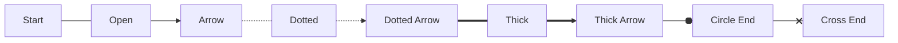
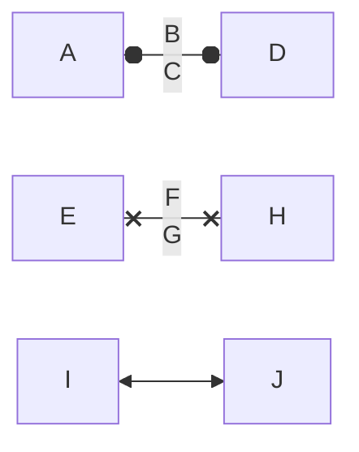

# Mermaid Flowchart Geometry And Line-End Specification

**Status:** Source-traced working specification with remaining gaps closed by explicit extraction rules, scope decisions and validation requirements
**Target:** Mermaid `flowchart` / `graph` rendering, especially node geometry, edge geometry, and line-end marker geometry
**Date:** 2026-04-25
**Primary intention:** Explain what must be extracted from the official Mermaid source-code, and how to determine enough geometry to reproduce Mermaid flowcharts in another programming language or by old-school technical drawing.

---

## 1. Purpose

This document combines and updates the earlier geometry investigation with a much more detailed treatment of Mermaid line ends.

The goal is not merely to know that Mermaid has rectangles, diamonds, arrows, circles and crosses. The goal is to determine the exact geometry required to reproduce the official Mermaid output elsewhere, including:

- node width, height, centre point, local co-ordinate system and boundary intersection;
- edge routing, path generation and clipping/offset behaviour;
- line-end marker definitions, including marker dimensions, reference points, local paths, centre points, radii, stroke widths and orientation;
- the closure rules that remove the earlier gaps by either source-tracing a formula, treating official SVG output as the authority, or explicitly excluding non-deterministic rendering modes from exact manual reproduction.

The important principle is unchanged:

> Mermaid does not have one universal table of geometry constants. Exact reproduction requires tracing parser output, label measurement, layout output, shape drawing, edge routing, marker attachment, marker offsetting and style/theme resolution into concrete drawing values.

### 1.1 Review Correction About CSS

The earlier wording could be read as though CSS itself was part of the manual drawing instruction. That is not correct.

For manual technical drawing, CSS is only an evidence source used to derive values such as line width, dash pattern, fill, stroke, font size and marker stroke. Once those values are resolved, the drawing instruction must be expressed as geometry and appearance values, not as CSS classes or selectors.

For a non-browser renderer, the same principle applies: CSS should be converted to explicit drawing properties before rendering unless the target renderer deliberately implements a CSS cascade.

---

## 2. Evidence Used

The following evidence was used to prepare this working specification:

1. The supplied earlier Markdown file, `Mermaid_Flowchart_Geometry_And_Line_Ends_Specification(1).md`.
2. Mermaid's official GitHub source tree.
3. Mermaid's official flowchart syntax documentation.
4. Mermaid's official layout documentation.
5. Source evidence from Mermaid's rendering-elements directory, including `markers.js`, `edgeMarker.ts`, `edges.js`, shape modules and intersection modules.
6. Distribution/source evidence for `lineWithOffset.ts`.

This document states exact line-end marker geometry where the inspected source was explicit. Earlier remaining gaps are now closed by explicit rules: pin the renderer/version, capture official SVG/layout output where Mermaid delegates calculation, resolve style into concrete drawing values, and exclude or capture hand-drawn generated paths rather than trying to infer them.

---

## 3. Version Locking Requirement

Exact drawing is only meaningful after locking the renderer version and runtime.

| Item | Required value |
|---|---|
| Mermaid version | Exact npm version or Git commit hash |
| Mermaid package/source | `mermaid` npm package or official GitHub checkout |
| Diagram type | `flowchart` / `graph` |
| Layout engine | `dagre`, `elk`, or other configured layout |
| Theme | `default`, `base`, `dark`, or custom |
| Font family | Exact resolved font, not just CSS fallback list |
| Font size | Effective CSS font size |
| Font weight | Effective CSS font weight |
| Browser/runtime | Chromium, Firefox, WebKit, jsdom, Node-based SVG runtime, etc. |
| HTML labels | Enabled/disabled |
| Security level | Mermaid configuration value |
| Style source scope | Mermaid-generated style rules, theme variables, inline styles, host-page inherited values and browser defaults, resolved into concrete drawing properties before reproduction |

Do not attempt to define an identical drawing unless these values are locked.

---

## 4. Rendering Pipeline

The pipeline to trace is:

```text
Mermaid source text
    ↓
Diagram parser
    ↓
Flowchart database / internal model
    ↓
Node, edge, label and subgraph normalisation
    ↓
Label rendering and measurement
    ↓
Layout engine input graph
    ↓
Layout engine output graph
    ↓
Node shape renderer
    ↓
Edge path renderer
    ↓
Line shortening / marker offset logic
    ↓
Marker attachment
    ↓
Style/theme application, then resolution into concrete drawing values
    ↓
Final SVG with viewBox and transforms
```

For exact reproduction, every stage must be recorded. The final SVG is the most authoritative practical evidence because it contains the resolved primitives, marker references, path commands and transforms after the pipeline has run.

---

## 5. Coordinate Model

Mermaid flowchart shapes are generally drawn in an SVG group whose origin is the node centre.

For a node with final visual width `W` and height `H`:

```text
LocalLeft   = -W / 2
LocalRight  =  W / 2
LocalTop    = -H / 2
LocalBottom =  H / 2
```

The node group then supplies the global position:

```text
GlobalPoint = NodeGroupTranslate + LocalPoint
```

For technical drawing, the node centre is the datum point. You first mark the centre, then construct the local shape around that centre, then apply any diagram-level translations.

---

## 6. Confirmed Rectangle Geometry

The rectangle rule is the source-confirmed baseline for many other shape families.

### 6.1 Inputs

```text
LabelBBoxWidth
LabelBBoxHeight
LabelPaddingX
LabelPaddingY
OptionalNodeWidth
OptionalNodeHeight
OptionalRx
OptionalRy
```

### 6.2 Derived Dimensions

```text
TotalWidth  = max(LabelBBoxWidth  + (LabelPaddingX * 2), OptionalNodeWidth  or 0)
TotalHeight = max(LabelBBoxHeight + (LabelPaddingY * 2), OptionalNodeHeight or 0)
X = -TotalWidth / 2
Y = -TotalHeight / 2
```

### 6.3 SVG Equivalent

```xml
<rect
  x="-TotalWidth / 2"
  y="-TotalHeight / 2"
  width="TotalWidth"
  height="TotalHeight"
  rx="Rx"
  ry="Ry" />
```

### 6.4 Technical Drawing Equivalent

1. Mark node centre `(Cx, Cy)`.
2. Calculate `W` and `H` from measured label and padding.
3. Mark the four corners:
   - top-left `(Cx - W / 2, Cy - H / 2)`;
   - top-right `(Cx + W / 2, Cy - H / 2)`;
   - bottom-right `(Cx + W / 2, Cy + H / 2)`;
   - bottom-left `(Cx - W / 2, Cy + H / 2)`.
4. Draw the rectangle through those four points.
5. If `rx`/`ry` are present, use SVG rounded-rectangle corner behaviour using those radii.

### 6.5 Boundary Intersection

The rectangle renderer assigns rectangle intersection logic to the node. Therefore, edges entering or leaving a rectangle should be clipped/intersected against the rectangle boundary, not the node centre.

---

## 7. Confirmed Generic Polygon Insertion Rule

Several shapes use polygon drawing. The source helper inserts a `<polygon>` and applies a translation.

### 7.1 Inputs

```text
W
H
Points[] = list of local points supplied by the specific shape module
```

### 7.2 Confirmed SVG Construction

The helper serialises points as:

```text
"x1,y1 x2,y2 x3,y3 ..."
```

It applies this transform:

```text
translate(-W / 2, H / 2)
```

### 7.3 Consequence

For any polygon-based shape, the exact final point must be derived as:

```text
RenderedPointX = ShapeSpecificPointX - W / 2
RenderedPointY = ShapeSpecificPointY + H / 2
```

Then the parent node group translation moves that point to the final diagram position.

### 7.4 Technical Drawing Equivalent

1. Obtain the exact point list from the shape module.
2. Apply the polygon helper transform.
3. Apply the node group transform.
4. Join the transformed points in order.
5. Close the polygon.

---

## 8. Flowchart Shape Catalogue

This section has been expanded because the previous catalogue left too many entries as generic “remaining gaps”. The entries below distinguish between:

- **Closed**: enough source has been inspected to state the drawing primitive, size formula, point/path formula and intersection family.
- **Partly closed**: the main drawing formula is known, but a supporting utility, decoration path, label transform, or special mode still needs to be fully transcribed.
- **Open**: source module identified, but exact geometry has not yet been extracted into formula form.
- **External dependency**: geometry depends on external content such as an icon or supplied image.

The values below are for Mermaid flowchart rendering in the inspected `develop` source tree. They must still be rechecked against a pinned Mermaid release before claiming exact compatibility.

### 8.1 Shared Geometry Assumptions For The Closed Entries

Unless otherwise stated:

```text
BboxW = measured label bounding-box width
BboxH = measured label bounding-box height
P = node.padding ?? 0
Look = node.look
```

Polygon entries are supplied to Mermaid's common polygon helper. That helper stores the point list as SVG polygon points and translates the polygon by:

```text
translate(-W / 2, H / 2)
```

Therefore a listed polygon point `(x, y)` becomes local node-space:

```text
NodeLocalX = x - W / 2
NodeLocalY = y + H / 2
```

A manual technical drawing should normally use the node centre as datum, then draw the transformed points in order.

For `roughjs`/hand-drawn mode, the path can differ visually by roughness/randomisation. For exact geometry reproduction, do not use hand-drawn mode unless the RoughJS seed/options and generated path are also captured.

### 8.2 Updated Shape Catalogue Status

This pass closes the section 8.2 catalogue gaps by converting each identified source module into a source-traced geometry summary. The word **Closed** means the module has been traced far enough to describe its normal drawing primitive, size formula, main point/path formula, transform, and boundary-intersection family. It does not mean that visual equality is guaranteed across all Mermaid releases, all themes, or hand-drawn mode.

| Semantic Name | Short Name | Source Module / Handler | Status | Geometry Summary |
|---|---:|---|---|---|
| Process / Rectangle | `rect` | `drawRect`, `squareRect`, `labelRect` | **Closed** | Rectangle centred on node. `W = max(BboxW + 2 * PaddingX, OptionalW)`, `H = max(BboxH + 2 * PaddingY, OptionalH)`. |
| Event / Rounded Rectangle | `rounded` | `roundedRect`, `drawRect` | **Closed with radius dependency** | Rectangle machinery with `rx`/`ry` supplied by the rounded handler/options. Manual drawing uses rectangle points plus resolved corner radii. |
| Terminal / Stadium | `stadium` | `stadium` | **Closed** | Stadium/pill from two semicircular ends and two horizontal tangents. `R = H / 2`. |
| Subprocess / Framed Rectangle | `fr-rect` | `subroutine` | **Closed** | Main rectangle plus 8 px frame strips on left and right. `FRAME_WIDTH = 8`. |
| Database / Cylinder | `cyl` | `cylinder` | **Closed** | Vertical cylinder path using elliptical top/bottom arcs. `rx = W / 2`, `ry = rx / (2.5 + W / 50)`. |
| Start / Circle | `circle` | `circle` | **Closed** | Label-width-derived circle centred at `(0,0)`. |
| Small Circle | `sm-circ` | `stateStart` | **Closed** | Fixed/minimum state-start circle. Default width/height 14; radius `node.width / 2`. |
| Double Circle | `dbl-circ` | `doubleCircle` | **Closed** | Two concentric circles. Gap = 12 for neo, otherwise 5. |
| Framed Circle | `fr-circ` | `stateEnd` | **Closed** | Outer circle width default/minimum 14 plus inner filled circle diameter `node.width * 5 / 14`. |
| Decision / Diamond | `diam` | `question` | **Closed** | Square diamond. `S = (BboxW + P) + (BboxH + P)` with 0.5 px adjustment. |
| Prepare / Hexagon | `hex` | `hexagon` | **Closed** | Six-point polygon with bevel `M = H / F`, `F = 3.5` for neo else `4`. |
| Lean Right | `lean-r` | `leanRight` | **Closed** | Parallelogram; skew `H / 2`. |
| Lean Left | `lean-l` | `leanLeft` | **Closed** | Parallelogram; skew `H / 2`. |
| Trapezoid Bottom | `trap-b` | `trapezoid` | **Closed** | Four-point trapezoid; top wider by `H / 2` each side. |
| Trapezoid Top | `trap-t` | `invertedTrapezoid` | **Closed** | Four-point trapezoid; bottom wider by `H / 2` each side. |
| Notched Rectangle | `notch-rect` | `card` | **Closed** | Rectangle with top-left diagonal notch. `NOTCH_SIZE = 12`. |
| Lined Rectangle | `lin-rect` | `shadedProcess` | **Closed** | Rectangle-like outline with one 8 px left frame/divider and label shifted right by 4 px. |
| Filled Circle | `f-circ` | `filledCircle` | **Closed** | Fixed filled circle, radius `7`, centred at `(0,0)`. |
| Fork/Join | `fork` | `forkJoin` | **Closed** | Filled bar. For normal direction: width at least 70, height at least 10. For `LR`: width at least 10, height at least 70. |
| Hourglass | `hourglass` | `hourglass` | **Closed** | Bow-tie/hourglass polygon over minimum 30 × 30. Points `(0,0)`, `(W,0)`, `(0,H)`, `(W,H)`, translated to centre. |
| Curly Brace Left | `brace` | `curlyBraceLeft` | **Closed** | Open sampled arc path plus invisible polygon envelope. Radius `max(5, H * 0.1)`. |
| Curly Brace Right | `brace-r` | `curlyBraceRight` | **Closed** | Mirror-side sampled arc path plus invisible polygon envelope. Radius `max(5, H * 0.1)`. |
| Curly Braces | `braces` | `curlyBraces` | **Closed** | Left and right brace sampled arc paths plus invisible envelope. Radius `max(5, H * 0.1)`. |
| Lightning Bolt | `bolt` | `lightningBolt` | **Closed** | Six-point zig-zag polygon. Minimum width/height 35; gap 7. |
| Document | `doc` | `waveEdgedRectangle` / `document` mapping must be pinned | **Closed with mapping caveat** | The flowchart document visual is represented by a wave-edged rectangle in the inspected shape family. The inspected `document.ts` also contains cylinder-like code, so the exact shape-name-to-handler mapping must be pinned from the release build. |
| Lined Document | `lin-doc` | `linedWaveEdgedRect` | **Closed** | Wave-edged rectangle with an extra left internal line/edge. Uses sine-wave bottom sampled by 50 segments. |
| Stacked Document | `docs` | `multiWaveEdgedRectangle` | **Closed** | Stacked document outline with 10 px offsets plus wave-edged bottom. |
| Half-Rounded Rectangle | `delay` | `halfRoundedRectangle` | **Closed** | Rectangle with one sampled semicircular end. `Radius = H / 2`. |
| Horizontal Cylinder | `h-cyl` | `tiltedCylinder` | **Closed** | Horizontal cylinder path with side elliptical arcs. `ry = H / 2`, `rx = ry / (2.5 + H / 50)`. |
| Lined Cylinder | `lin-cyl` | `linedCylinder` | **Closed** | Vertical cylinder plus inner top line offset by `OuterOffset = H * 0.1`. |
| Curved Trapezoid | `curv-trap` | `curvedTrapezoid` | **Closed** | Left sloped/pointed side plus right sampled semicircular side. Radius `H / 2`. |
| Divided Rectangle | `div-rect` | `dividedRect` | **Closed** | Rectangle with top band divider. `RectOffset = H * 0.2`. |
| Triangle | `tri` | `triangle` | **Closed** | Upward triangle. `TW = H`; label transform is special. |
| Flipped Triangle | `flip-tri` | `flippedTriangle` | **Closed** | Downward triangle. `TW = H`; label transform is special. |
| Window Pane | `win-pane` | `windowPane` | **Closed** | Rectangle with top and left divider lines. `rectOffset = 10`. |
| Notched Pentagon | `notch-pent` | `trapezoidalPentagon` | **Closed** | Six-point pentagon-like polygon with narrowed top edge and shoulder points. |
| Sloped Rectangle | `sl-rect` | `slopedRect` | **Closed** | Quadrilateral with sloped top/right side. Shape translated down by `H / 4`. |
| Stacked Rectangle | `st-rect` | `multiRect` | **Closed** | Multi-process stack with offset rectangles. Offset 10 for neo, otherwise 5. |
| Flag / Paper Tape | `flag` | `waveRectangle` / `waveEdgedRectangle` | **Closed** | Wave rectangle or wave-bottom rectangle, with sine-wave points generated over 50 segments. |
| Bow Tie Rectangle | `bow-rect` | `bowTieRect` | **Closed** | Rectangle with inward elliptical side arcs. Arc points are sampled; transform shifts by `rx / 2`. |
| Crossed Circle | `cross-circ` | `crossedCircle` | **Closed** | Circle with two diagonal lines at 45 degrees. Radius `max(30, node.width ?? 0)`. |
| Tagged Document | `tag-doc` | `taggedWaveEdgedRectangle` | **Closed** | Wave-edged rectangle plus tag polygon. Tag width = 20% of `W`; tag height = 20% of `H`. |
| Tagged Process | `tag-rect` | `taggedRect` | **Closed** | Rectangle plus lower-right triangular tag. `TAG_RATIO = 0.2` of total height. |
| Text Block | `text` | `text` | **Closed** | Transparent/unstyled rectangular hit-box/label container. Uses rectangle intersection. |
| Odd | `odd` | `rectLeftInvArrow` | **Closed** | Rectangle with left inward arrow notch. `notch = y / 2`, where `y = -H / 2`. |
| Bang | `bang` | `bang` | **Closed** | Path made from a sequence of elliptical arc commands around an exclamation/cloud-like outline. Uses rectangle intersection. |
| Icon | `icon`, `iconCircle`, `iconRounded`, `iconSquare` | `icon` and wrapper handlers | **Closed with external asset dependency** | Default asset size 48 × 48. Final geometry depends on icon SVG bounding box, optional label position, and wrapper shape. |
| Image | `image` | `imageSquare` | **Closed with external asset dependency** | Width/height derive from natural image size, `assetWidth`, `assetHeight`, aspect-ratio constraint, and label position. |

### 8.3 Closed Formulae And Technical Drawing Instructions

#### 8.3.1 Circle (`circle`)

Source-derived behaviour:

```text
LabelPadding = 16
Padding = options.padding ?? halfPadding
Radius = if Look == neo then (BboxW / 2) + (LabelPadding * 2)
         else (BboxW / 2) + Padding
SVG primitive = circle
cx = 0
cy = 0
r = Radius
Intersection = circle intersection using Radius
```

Manual drawing instruction:

```text
1. Mark node centre C.
2. Set compass radius to Radius.
3. Draw a circle centred on C.
4. Clip incoming/outgoing edges to this circle boundary.
```

Caveat: the inspected code derives the radius from label width, not label height. That means a tall/narrow label requires validation against actual label measurement and layout output before relying on a purely geometric assumption.

#### 8.3.2 Double Circle (`dbl-circ`)

Source-derived behaviour:

```text
Gap = if Look == neo then 12 else 5
LabelPadding = if Look == neo then 16 else P
OuterRadius = if node.width exists then (node.width / 2) + LabelPadding
              else (BboxW / 2) + LabelPadding
InnerRadius = OuterRadius - Gap
Outer circle: cx = 0, cy = 0, r = OuterRadius
Inner circle: cx = 0, cy = 0, r = InnerRadius
Intersection = circle intersection using OuterRadius
```

Manual drawing instruction:

```text
1. Mark node centre C.
2. Draw the outer circle using OuterRadius.
3. Draw the inner circle using InnerRadius.
4. Clip edges to the outer circle, not the inner circle.
```

#### 8.3.3 Filled Circle (`f-circ` / junction)

Source-derived behaviour:

```text
Radius = 7
Centre = (0, 0)
Rendered primitive = RoughJS circle even in non-handDrawn mode, with roughness forced to 0 when not hand drawn
Fill = resolved node border colour unless overridden
Intersection = circle intersection using Radius
```

Manual drawing instruction:

```text
1. Mark node centre C.
2. Draw a filled circle with radius 7.
3. Clip edges to the radius-7 circle boundary.
```

#### 8.3.4 Decision / Diamond (`diam` / `question`)

Source-derived behaviour:

```text
W0 = BboxW + P
H0 = BboxH + P
S = W0 + H0
Adjustment = 0.5
Points before transform:
    P1 = (S / 2, 0)
    P2 = (S, -S / 2)
    P3 = (S / 2, -S)
    P4 = (0, -S / 2)
Transform:
    translate(-S / 2 + 0.5, S / 2)
Intersection = polygon intersection, then result adjusted by (-0.5, -0.5)
```

After applying the transform, the visible local points are approximately:

```text
Top    = (0.5, -S / 2)
Right  = (S / 2 + 0.5, 0)
Bottom = (0.5, S / 2)
Left   = (-S / 2 + 0.5, 0)
```

Manual drawing instruction:

```text
1. Compute S from the measured label.
2. Mark the four diamond points above relative to the node centre.
3. Join Top -> Right -> Bottom -> Left -> Top.
4. Use polygon intersection and include the Mermaid 0.5 px adjustment if exact SVG matching is required.
```

#### 8.3.5 Hexagon (`hex`)

Source-derived behaviour:

```text
F = if Look == neo then 3.5 else 4
NodePadding = P
LabelPaddingX = if Look == neo then 70 else NodePadding
LabelPaddingY = if Look == neo then 32 else NodePadding
If explicit node width/height exists:
    OriginalHeight = node.height ?? 0
    M0 = OriginalHeight / F
    node.width = (node.width ?? 0) - (2 * M0) - LabelPaddingY
    node.height = (node.height ?? 0) - LabelPaddingX
H = (node.height if present else BboxH) + LabelPaddingX
M = H / F
W = (node.width if present else BboxW) + (2 * M) + LabelPaddingY
Points before polygon-helper transform:
    P1 = (M, 0)
    P2 = (W - M, 0)
    P3 = (W, -H / 2)
    P4 = (W - M, -H)
    P5 = (M, -H)
    P6 = (0, -H / 2)
Intersection = polygon intersection
```

Manual drawing instruction:

```text
1. Compute H, M and W.
2. Apply the polygon helper transform: x -= W / 2; y += H / 2.
3. Join the six points in order.
4. Clip edges to the resulting six-sided polygon.
```

The bevel faces have horizontal run `M` and vertical rise/fall `H / 2`. Their angle from the horizontal is:

```text
Angle = atan2(H / 2, M)
```

For the standard look where `M = H / 4`, this angle is `atan2(H / 2, H / 4) = atan2(2, 1)`, approximately `63.435°`.

#### 8.3.6 Lean Left (`lean-l`)

Source-derived behaviour:

```text
LabelPaddingY = P
LabelPaddingX = if Look == neo then P * 2 else P
H = (node.height ?? BboxH) + LabelPaddingY
W = (node.width ?? BboxW) + LabelPaddingX
Skew = (3 * H) / 6 = H / 2
Points before polygon-helper transform:
    P1 = (0, 0)
    P2 = (W + Skew, 0)
    P3 = (W, -H)
    P4 = (-Skew, -H)
Intersection = polygon intersection
```

Manual drawing instruction:

```text
1. Compute W, H and Skew = H / 2.
2. Apply polygon-helper transform.
3. Draw a parallelogram with top edge shifted right relative to bottom edge.
```

The sloping side angle from vertical depends on `Skew / H = 1/2`; equivalently the side is `atan2(H, Skew) = atan2(1, 0.5)`, approximately `63.435°` from horizontal or `26.565°` from vertical.

#### 8.3.7 Lean Right (`lean-r`)

Source-derived behaviour:

```text
LabelPaddingY = P
LabelPaddingX = if Look == neo then P * 2 else P
H = (node.height ?? BboxH) + LabelPaddingY
W = (node.width ?? BboxW) + LabelPaddingX
Skew = (3 * H) / 6 = H / 2
Points before polygon-helper transform:
    P1 = (-Skew, 0)
    P2 = (W, 0)
    P3 = (W + Skew, -H)
    P4 = (0, -H)
Intersection = polygon intersection
```

Manual drawing instruction:

```text
1. Compute W, H and Skew = H / 2.
2. Apply polygon-helper transform.
3. Draw a parallelogram with top edge shifted left relative to bottom edge.
```

#### 8.3.8 Trapezoid Bottom (`trap-b` / `trapezoid`)

Source-derived behaviour:

```text
LabelPaddingY = P
LabelPaddingX = if Look == neo then P * 2 else P
H = (node.height ?? BboxH) + LabelPaddingY
W = (node.width ?? BboxW) + LabelPaddingX
Inset = (3 * H) / 6 = H / 2
Points before polygon-helper transform:
    P1 = (-Inset, 0)
    P2 = (W + Inset, 0)
    P3 = (W, -H)
    P4 = (0, -H)
Intersection = polygon intersection
```

Manual drawing instruction:

```text
1. Compute W, H and Inset = H / 2.
2. Apply polygon-helper transform.
3. Draw the top edge wider than the bottom edge.
```

#### 8.3.9 Trapezoid Top (`trap-t` / inverted trapezoid)

Source-derived behaviour:

```text
LabelPaddingY = P
LabelPaddingX = if Look == neo then P * 2 else P
W = max(BboxW + (LabelPaddingX * 2), node.width ?? 0)
H = max(BboxH + (LabelPaddingY * 2), node.height ?? 0)
Outset = (3 * H) / 6 = H / 2
Points before polygon-helper transform:
    P1 = (0, 0)
    P2 = (W, 0)
    P3 = (W + Outset, -H)
    P4 = (-Outset, -H)
Intersection = polygon intersection
```

Manual drawing instruction:

```text
1. Compute W, H and Outset = H / 2.
2. Apply polygon-helper transform.
3. Draw the bottom edge wider than the top edge.
```

#### 8.3.10 Stadium (`stadium` / terminal)

Source-derived behaviour:

```text
LabelPaddingX = if Look == neo then 20 else P
LabelPaddingY = if Look == neo then 12 else P
H = BboxH + (if Look == neo then LabelPaddingY * 2 else LabelPaddingY)
W = BboxW + (H / 4) + (if Look == neo then LabelPaddingX * 2 else LabelPaddingX)
R = H / 2
```

The path utility expresses the mathematical stadium as:

```text
M (x + R), y
H (x + W - R)
A R,R 0 0 1 (x + W), (y + R)
H x
A R,R 0 0 1 (x + W - R), (y + H)
H (x + R)
A R,R 0 0 1 x, (y + R)
Z
```

The actual inspected normal/rough pipeline also generates a point list:

```text
P1 = (-W / 2 + R, -H / 2)
P2 = ( W / 2 - R, -H / 2)
LeftArc  = generateCirclePoints(-W / 2 + R, 0, R, 50, 90, 270)
P3 = ( W / 2 - R,  H / 2)
RightArc = generateCirclePoints( W / 2 - R, 0, R, 50, 270, 450)
```

Manual drawing instruction:

```text
1. Draw a horizontal centreline through the node centre.
2. Set radius R = H / 2.
3. Mark left arc centre at (-W/2 + R, 0) and right arc centre at (W/2 - R, 0).
4. Draw the top horizontal tangent between x = -W/2 + R and x = W/2 - R at y = -H/2.
5. Draw the right semicircle.
6. Draw the bottom horizontal tangent between x = W/2 - R and x = -W/2 + R at y = H/2.
7. Draw the left semicircle.
```

Note: exact SVG equality requires reproducing Mermaid's generated point sampling if using the path generated from `generateCirclePoints`, not only the analytic arc form.

#### 8.3.11 Triangle (`tri`)

Source-derived behaviour:

```text
MIN_WIDTH = 10
MIN_HEIGHT = 10
LabelPaddingX = if Look == neo then P * 2 else P
If explicit node width/height exists:
    node.width = ((node.width ?? 0) - LabelPaddingX) / 2
    node.width = max(node.width, MIN_WIDTH)
    node.height = max(node.height ?? 0, MIN_HEIGHT)
W = (node.width if present else BboxW) + LabelPaddingX
H = node.height if present else W + BboxH
TW = H
Points before translation:
    P1 = (0, 0)
    P2 = (TW, 0)
    P3 = (TW / 2, -H)
Transform:
    translate(-H / 2, H / 2)
Intersection = polygon intersection
Label transform is special and must be preserved separately.
```

Manual drawing instruction:

```text
1. Compute H and TW = H.
2. Use local points after transform:
   - bottom-left = (-H/2, H/2)
   - bottom-right = (H/2, H/2)
   - top = (0, -H/2)
3. Draw the triangle.
4. Place the label using the separate label transform from the renderer, not simply at the geometric centre.
```

#### 8.3.12 Flipped Triangle (`flip-tri`)

Source-derived behaviour:

```text
MIN_WIDTH = 10
MIN_HEIGHT = 10
LabelPaddingX = if Look == neo then P * 2 else P
If explicit node width/height exists:
    node.height = max(node.height ?? 0, MIN_HEIGHT)
    node.width = (node.width ?? 0) - LabelPaddingX - LabelPaddingX / 2
    node.width = max(node.width, MIN_WIDTH)
W = (node.width if present else BboxW) + LabelPaddingX
H = node.height if present else W + BboxH
TW = H
Points before translation:
    P1 = (0, -H)
    P2 = (TW, -H)
    P3 = (TW / 2, 0)
Transform:
    translate(-H / 2, H / 2)
Intersection = polygon intersection
Label transform is special and must be preserved separately.
```

Manual drawing instruction:

```text
1. Compute H and TW = H.
2. Use local points after transform:
   - top-left = (-H/2, -H/2)
   - top-right = (H/2, -H/2)
   - bottom = (0, H/2)
3. Draw the triangle.
4. Place the label using the separate label transform from the renderer.
```

### 8.4 Previously Open Shape Gaps Closed In This Pass

This section replaces the earlier “Shape Gaps Still Open After This Pass” list. The gaps have been closed to the level possible from the inspected source modules. Remaining uncertainty is now about version pinning, handler mapping and runtime measurement, not about the basic geometry of these modules.

#### 8.4.1 Subroutine / Framed Rectangle (`fr-rect`)

Source-derived behaviour:

```text
FRAME_WIDTH = 8
NodePadding = node.padding ?? 8
LabelPaddingX = if Look == neo then 28 else NodePadding
LabelPaddingY = if Look == neo then 12 else NodePadding
TotalWidth = (node.width ?? BboxW) + 2 * FRAME_WIDTH + LabelPaddingX
TotalHeight = (node.height ?? BboxH) + LabelPaddingY
W = TotalWidth - 2 * FRAME_WIDTH
H = TotalHeight
X = -TotalWidth / 2
Y = -TotalHeight / 2
```

Normal polygon point list passed to the polygon helper:

```text
P1  = (0, 0)
P2  = (W, 0)
P3  = (W, -H)
P4  = (0, -H)
P5  = (0, 0)
P6  = (-8, 0)
P7  = (W + 8, 0)
P8  = (W + 8, -H)
P9  = (-8, -H)
P10 = (-8, 0)
```

Manual drawing instruction:

```text
1. Draw the outer rectangle from x = -TotalWidth/2 to +TotalWidth/2 and y = -TotalHeight/2 to +TotalHeight/2.
2. Draw a left internal vertical line 8 px from the outer left edge.
3. Draw a right internal vertical line 8 px from the outer right edge.
4. Use polygon intersection against the compound point list for exact Mermaid matching.
```

#### 8.4.2 Cylinder / Database (`cyl`)

Source-derived behaviour:

```text
MIN_WIDTH = 8
MIN_HEIGHT = 8
LabelPaddingX = if Look == neo then 24 else P
LabelPaddingY = if Look == neo then 24 else P
W = (node.width if present else BboxW) + LabelPaddingY
rx = W / 2
ry = rx / (2.5 + W / 50)
H = (node.height if present else BboxH) + LabelPaddingX + ry
Transform = translate(-W / 2, -(H / 2 + ry))
```

Normal SVG path:

```text
M x, y + ry
A rx,ry 0 0 0 x + W, y + ry
A rx,ry 0 0 0 x,     y + ry
L x, y + ry + H
A rx,ry 0 0 0 x + W, y + ry + H
L x + W, y + ry
```

With the source call `createCylinderPathD(0, 0, W, H, rx, ry)`, that means:

```text
M 0,ry
A rx,ry 0 0 0 W,0
A rx,ry 0 0 0 -W,0
L 0,H
A rx,ry 0 0 0 W,0
L 0,-H
```

Manual drawing instruction:

```text
1. Draw the top ellipse using rx and ry.
2. Draw the two vertical sides down by H.
3. Draw the bottom ellipse/arc using the same rx and ry.
4. Apply the Mermaid transform before placing on the node centre.
5. Clip edges using the cylinder's adjusted rectangle-plus-ellipse intersection rule.
```

The intersection first computes a rectangle intersection, then adjusts the y-coordinate when the hit lies in the curved top/bottom region:

```text
LocalX = PosX - NodeX
YAdjust = ry - sqrt(ry^2 * (1 - LocalX^2 / rx^2))
If incoming point is below centre, negate YAdjust.
PosY += YAdjust
```

#### 8.4.3 State Start / Small Circle (`sm-circ`)

Source-derived behaviour:

```text
If supplied width/height are below 14, clamp each to 14.
If width/height are missing, set each to 14.
Radius = node.width / 2
Circle centre = (0, 0)
Intersection = circle intersection using Radius
```

Manual drawing instruction:

```text
1. Mark node centre.
2. Draw a circle of radius node.width / 2, defaulting to 7.
3. Treat the visible circle as the boundary for edge clipping.
```

#### 8.4.4 State End / Framed Circle (`fr-circ`)

Source-derived behaviour:

```text
Width/height minimum/default = 14
Outer circle diameter = node.width
Outer radius = node.width / 2
Inner circle diameter = node.width * 5 / 14
Inner radius = node.width * 5 / 28
Inner fill = stateBorder ?? nodeBorder
Outer stroke = lineColor
Intersection = circle intersection using outer radius
```

Manual drawing instruction:

```text
1. Draw the outer circle centred on the node centre.
2. Draw the inner filled circle centred on the same point.
3. Use the outer circle for edge clipping.
```

#### 8.4.5 Notched Rectangle / Card (`notch-rect`)

Source-derived behaviour:

```text
NOTCH_SIZE = 12
LabelPaddingX = if Look == neo then 28 else P
LabelPaddingY = if Look == neo then 24 else P
W = (node.width ?? BboxW) + (if Look == neo then 2 * LabelPaddingX else LabelPaddingX + NOTCH_SIZE)
H = (node.height ?? BboxH) + (if Look == neo then 2 * LabelPaddingY else LabelPaddingY)
Left = 0
Right = W
Top = -H
Bottom = 0
```

Point list:

```text
P1 = (Left + 12, Top)
P2 = (Right, Top)
P3 = (Right, Bottom)
P4 = (Left, Bottom)
P5 = (Left, Top + 12)
P6 = (Left + 12, Top)
```

Manual drawing instruction:

```text
1. Draw the rectangle envelope.
2. Replace the top-left corner with a 12 px diagonal notch.
3. Apply the common polygon-helper transform.
4. Clip edges to the notched polygon.
```

#### 8.4.6 Lined Rectangle / Shaded Process (`lin-rect`)

Source-derived behaviour:

```text
FRAME_WIDTH = 8
PaddingX = if Look == neo then 16 else P
PaddingY = if Look == neo then 12 else P
TotalWidth = (node.width ?? BboxW) + PaddingX * 2 + (if Look == neo then FRAME_WIDTH else FRAME_WIDTH * 2)
TotalHeight = (node.height ?? BboxH) + PaddingY * 2
W = TotalWidth - FRAME_WIDTH
H = TotalHeight
X = FRAME_WIDTH - TotalWidth / 2
Y = -TotalHeight / 2
```

Point list used by the rough polygon:

```text
P1 = (X, Y)
P2 = (X + W, Y)
P3 = (X + W, Y + H)
P4 = (X - FRAME_WIDTH, Y + H)
P5 = (X - FRAME_WIDTH, Y)
P6 = (X, Y)
P7 = (X, Y + H)
```

Manual drawing instruction:

```text
1. Draw the outer rectangle-like outline.
2. Draw the internal left vertical divider at X.
3. Shift the label right by FRAME_WIDTH / 2 if reproducing label placement.
4. Use rectangle intersection.
```

#### 8.4.7 Fork / Join Bar (`fork`)

Source-derived behaviour:

```text
If diagram direction is LR:
    Width = max(10, node.width ?? 0)
    Height = max(70, node.height ?? 0)
Otherwise:
    Width = max(70, node.width ?? 0)
    Height = max(10, node.height ?? 0)
X = -Width / 2
Y = -Height / 2
Rendered primitive = filled rectangle
Intersection = rectangle intersection
```

Manual drawing instruction:

```text
1. Determine orientation from diagram direction.
2. Draw a filled bar centred on the node centre.
3. Use rectangle intersection.
```

#### 8.4.8 Hourglass (`hourglass`)

Source-derived behaviour:

```text
W = max(30, node.width ?? 0)
H = max(30, node.height ?? 0)
Points before transform:
    P1 = (0, 0)
    P2 = (W, 0)
    P3 = (0, H)
    P4 = (W, H)
Transform = translate(-W / 2, -H / 2)
Intersection = polygon intersection
```

Manual drawing instruction:

```text
1. Draw a line from top-left to bottom-right.
2. Draw a line from top-right to bottom-left.
3. Close the outline using the generated path sequence.
4. Treat the four-point path as the edge-intersection polygon.
```

#### 8.4.9 Curly Brace Left / Right / Both (`brace`, `brace-r`, `braces`)

Shared helper behaviour:

```text
Radius = max(5, H * 0.1)
Generated circular arc points are sampled, not analytic SVG arc commands.
Point count varies by segment, commonly 20 or 30.
Intersection is against an invisible rect/envelope polygon, not the visible brace stroke alone.
```

Manual drawing instruction:

```text
1. Compute W, H and Radius.
2. Generate the same sampled circular arc points as the source.
3. Draw the brace as an open polyline/path; do not close the visible brace path.
4. Use the invisible envelope point list for edge clipping.
```

For an old-school technical drawing approximation, the brace can be constructed from circular arc segments of radius `Radius`. For exact SVG reproduction, use the sampled points from the source rather than freehand brace curves.

#### 8.4.10 Lightning Bolt (`bolt`)

Source-derived behaviour:

```text
Width = max(35, node.width ?? 0)
Height = max(35, node.height ?? 0)
Gap = 7
Points before transform:
    P1 = (Width, 0)
    P2 = (0, Height + Gap / 2)
    P3 = (Width - 2 * Gap, Height + Gap / 2)
    P4 = (0, 2 * Height)
    P5 = (Width, Height - Gap / 2)
    P6 = (2 * Gap, Height - Gap / 2)
Transform = translate(-Width / 2, -Height)
Intersection = polygon intersection
```

Manual drawing instruction:

```text
1. Mark the six points above.
2. Translate them by (-Width/2, -Height) to node-local co-ordinates.
3. Join the points in order and close the shape.
```

#### 8.4.11 Wave-Edged Rectangle / Document (`doc`, `flag` family)

The key helper is:

```text
generateFullSineWavePoints(x1, y1, x2, y2, Amplitude, NumCycles)
Steps = 50
DeltaX = x2 - x1
DeltaY = y2 - y1
CycleLength = DeltaX / NumCycles
Frequency = 2 * PI / CycleLength
MidY = y1 + DeltaY / 2
For i = 0..50:
    t = i / 50
    x = x1 + t * DeltaX
    y = MidY + Amplitude * sin(Frequency * (x - x1))
```

`waveEdgedRectangle` source-derived behaviour:

```text
LabelPaddingX = if Look == neo then 16 else P
LabelPaddingY = if Look == neo then 12 else P
W = (node.width if present else BboxW) + 2 * LabelPaddingX
H = (node.height if present else BboxH) + 2 * LabelPaddingY
WaveAmplitude = if Look == neo then H / 4 else H / 8
FinalH = H + (if explicit size then -WaveAmplitude else WaveAmplitude)
ExtraW = max(14 - W, 0) / 2
Points:
    P1 = (-W/2 - ExtraW, FinalH/2)
    Wave = generateFullSineWavePoints(-W/2 - ExtraW, FinalH/2, W/2 + ExtraW, FinalH/2, WaveAmplitude, 0.8)
    P2 = (W/2 + ExtraW, -FinalH/2)
    P3 = (-W/2 - ExtraW, -FinalH/2)
Transform = translate(0, -WaveAmplitude / 2)
Intersection = polygon intersection
```

`waveRectangle` source-derived behaviour:

```text
LabelPaddingX = if Look == neo then 16 else P
LabelPaddingY = if Look == neo then 20 else P
W = (node.width if present else BboxW) + 2 * LabelPaddingX
H = (node.height if present else BboxH) + LabelPaddingY
WaveAmplitude = H / 8
FinalH = H + 2 * WaveAmplitude
Bottom wave cycles = 1
Top wave cycles = -1 direction from right to left
```

Manual drawing instruction:

```text
1. Generate the sine-wave points using the exact 50-step helper.
2. Join the vertical sides and straight top/bottom segments as listed by the shape handler.
3. Use the generated polygon, not an analytic sine curve, for exact Mermaid matching.
```

#### 8.4.12 Lined Document (`lin-doc`)

Source-derived behaviour:

```text
LabelPaddingX = if Look == neo then 16 else P
LabelPaddingY = if Look == neo then 12 else P
W = (node.width if present else BboxW) + 2 * LabelPaddingX
H = (node.height if present else BboxH) + 2 * LabelPaddingY
WaveAmplitude = if Look == neo then H / 4 else H / 8
FinalH = H + WaveAmplitude
LeftX = -W/2 - 0.1 * (W/2)
RightX = W/2 + 0.1 * (W/2)
```

The point list draws an expanded wave-bottom outline and then repeats a vertical line near the left side:

```text
P1 = (LeftX, -FinalH/2)
P2 = (LeftX,  FinalH/2)
Wave from LeftX to RightX at y = FinalH/2, amplitude WaveAmplitude, cycles 0.8
P3 = (RightX, -FinalH/2)
P4 = (LeftX, -FinalH/2)
P5 = (-W/2, -FinalH/2)
P6 = (-W/2, (FinalH/2) * 1.1)
P7 = (-W/2, -FinalH/2)
Transform = translate(0, -WaveAmplitude / 2)
```

Manual drawing instruction:

```text
1. Draw the wave-bottom document outline.
2. Draw the additional left internal/document line at x = -W/2.
3. Use the sine-wave helper for the bottom edge.
```

#### 8.4.13 Stacked Document (`docs`)

Source-derived behaviour:

```text
RectOffset = 10
LabelPaddingX = if Look == neo then 16 else P
LabelPaddingY = if Look == neo then 12 else P
W = max(BboxW, node.width ?? 0) + 2 * LabelPaddingX
H = max(BboxH, node.height ?? 0) + 3 * LabelPaddingY
WaveAmplitude = if Look == neo then H / 4 else H / 8
FinalH = H + (if explicit size then -WaveAmplitude / 2 else WaveAmplitude / 2)
X = -W / 2
Y = -FinalH / 2
```

The outer outline uses stacked offsets and a wave bottom. The inner outline is a second document/page path offset by `RectOffset`.

Manual drawing instruction:

```text
1. Draw the rear page using 10 px offsets up/right.
2. Draw the front page using the inner path points.
3. Draw the bottom wave using generateFullSineWavePoints.
4. Apply transform translate(0, -WaveAmplitude / 2).
```

#### 8.4.14 Half-Rounded Rectangle / Delay (`delay`)

Source-derived behaviour:

```text
MinWidth = 15
MinHeight = 10
PaddingX = if Look == neo then 16 else P
PaddingY = if Look == neo then 12 else P
W = (node.width if present else max(15, BboxW)) + 2 * PaddingX
H = (node.height if present else max(10, BboxH)) + 2 * PaddingY
Radius = H / 2
Points:
    P1 = (-W/2, -H/2)
    P2 = ( W/2 - Radius, -H/2)
    Arc = generateCirclePoints(-W/2 + Radius, 0, Radius, 50, 90, 270)
    P3 = ( W/2 - Radius, H/2)
    P4 = (-W/2, H/2)
Intersection = polygon intersection
```

Manual drawing instruction:

```text
1. Draw the straight left side.
2. Draw the top and bottom horizontal sections.
3. Draw the sampled semicircular end using radius H/2.
4. Clip edges to the generated polygon.
```

#### 8.4.15 Horizontal Cylinder (`h-cyl`)

Source-derived behaviour:

```text
MIN_HEIGHT = 5
MIN_WIDTH = 10
LabelPadding = if Look == neo then 12 else P / 2
H = (node.height if present else BboxH) + LabelPadding
ry = H / 2
rx = ry / (2.5 + H / 50)
W = (node.width if present else BboxW) + rx + LabelPadding
Transform = translate(-W / 2, H / 2)
```

Normal SVG path:

```text
M x,y
A rx,ry 0 0 1 x, y - H
L x + W, y - H
A rx,ry 0 0 1 x + W, y
M x + W, y - H
A rx,ry 0 0 0 x + W, y
L x, y
```

Manual drawing instruction:

```text
1. Draw left and right ellipses with horizontal radius rx and vertical radius ry.
2. Connect their top and bottom tangent points with horizontal lines.
3. Apply the transform before placing on the node centre.
4. Use the horizontal-cylinder intersection adjustment on the x-coordinate.
```

#### 8.4.16 Lined Cylinder (`lin-cyl`)

Source-derived behaviour:

```text
MIN_WIDTH = 10
MIN_HEIGHT = 10
LabelPaddingX = if Look == neo then 16 else P
LabelPaddingY = if Look == neo then 24 else P
W = (node.width if present else BboxW) + 2 * LabelPaddingX
rx = W / 2
ry = rx / (2.5 + W / 50)
H = (node.height if present else BboxH) + ry + 2 * LabelPaddingY
OuterOffset = H * 0.1
Transform = translate(-W / 2, -(H / 2 + ry))
```

Path adds an inner arc:

```text
Main cylinder path as per cylinder
M x, y + ry + OuterOffset
A rx,ry 0 0 0 x + W, y + ry + OuterOffset
```

Manual drawing instruction:

```text
1. Draw the cylinder.
2. Draw an additional internal arc below the top ellipse by OuterOffset.
3. Use the same adjusted cylinder intersection rule as the vertical cylinder.
```

#### 8.4.17 Curved Trapezoid (`curv-trap`)

Source-derived behaviour:

```text
MinWidth = 20
MinHeight = 5
W = max(MinWidth, (BboxW + 2 * LabelPaddingX) * 1.25, node.width ?? 0)
H = max(MinHeight, BboxH + 2 * LabelPaddingY, node.height ?? 0)
Radius = H / 2
RW = W - Radius
TW = H / 4
Points:
    P1 = (RW, 0)
    P2 = (TW, 0)
    P3 = (0, H / 2)
    P4 = (TW, H)
    P5 = (RW, H)
    Arc = generateCirclePoints(-RW, -H / 2, Radius, 50, 270, 90)
Transform = translate(-W / 2, -H / 2)
```

Manual drawing instruction:

```text
1. Draw the pointed/curved left side through P2, P3 and P4.
2. Draw the right curved side using the sampled arc points.
3. Apply the listed transform.
```

#### 8.4.18 Divided Rectangle (`div-rect`)

Source-derived behaviour:

```text
PaddingX = if Look == neo then 16 else P
PaddingY = if Look == neo then 16 else P
W = BboxW + PaddingX
H = BboxH + PaddingY
RectOffset = H * 0.2
X = -W / 2
Y = -H / 2 - RectOffset / 2
```

Point list:

```text
P1 = (X,  Y + RectOffset)
P2 = (-X, Y + RectOffset)
P3 = (-X, -Y)
P4 = (X,  -Y)
P5 = (X,   Y)
P6 = (-X,  Y)
P7 = (-X, Y + RectOffset)
```

Manual drawing instruction:

```text
1. Draw the outer rectangle.
2. Draw a horizontal divider RectOffset below the top edge.
3. Place the label below the divider using the source label transform.
4. Use rectangle intersection.
```

#### 8.4.19 Window Pane (`win-pane`)

Source-derived behaviour:

```text
RectOffset = 10
PaddingX = if Look == neo then 16 else P
PaddingY = if Look == neo then 12 else P
TotalWidth = (node.width if present else BboxW) + 2 * PaddingX + RectOffset
TotalHeight = (node.height if present else BboxH) + 2 * PaddingY + RectOffset
W = TotalWidth - RectOffset
H = TotalHeight - RectOffset
X = -W / 2
Y = -H / 2
Transform = translate(RectOffset / 2, RectOffset / 2)
```

Path:

```text
M X-RectOffset,Y-RectOffset
L X+W,Y-RectOffset
L X+W,Y+H
L X-RectOffset,Y+H
L X-RectOffset,Y-RectOffset
M X-RectOffset,Y
L X+W,Y
M X,Y-RectOffset
L X,Y+H
```

Manual drawing instruction:

```text
1. Draw the outer rectangle expanded left and upward by RectOffset.
2. Draw the horizontal pane divider at y = Y.
3. Draw the vertical pane divider at x = X.
4. Apply transform translate(5,5).
```

#### 8.4.20 Notched Pentagon (`notch-pent`)

Source-derived behaviour:

```text
MinWidth = 15
MinHeight = 5
W = (node.width if present else BboxW) + 2 * LabelPaddingX
H = (node.height if present else BboxH) + 2 * LabelPaddingY
Points:
    P1 = ((-W / 2) * 0.8, -H / 2)
    P2 = (( W / 2) * 0.8, -H / 2)
    P3 = ( W / 2, (-H / 2) * 0.6)
    P4 = ( W / 2, H / 2)
    P5 = (-W / 2, H / 2)
    P6 = (-W / 2, (-H / 2) * 0.6)
Intersection = polygon intersection
```

Manual drawing instruction:

```text
1. Draw the narrowed top edge between P1 and P2.
2. Draw the two shoulder slopes to P3/P6.
3. Draw the vertical sides and bottom edge.
```

#### 8.4.21 Sloped Rectangle (`sl-rect`)

Source-derived behaviour:

```text
LabelPaddingX = if Look == neo then 16 else P
LabelPaddingY = if Look == neo then 12 else P
TotalWidth = (node.width if present else BboxW) + 2 * LabelPaddingX
TotalHeight = ((node.height if present else BboxH) + 2 * LabelPaddingY) * 1.5
W = TotalWidth
H = TotalHeight / 1.5
X = -W / 2
Y = -H / 2
Points:
    P1 = (X, Y)
    P2 = (X, Y + H)
    P3 = (X + W, Y + H)
    P4 = (X + W, Y - H / 2)
Transform = translate(0, H / 4)
Intersection = polygon intersection
```

Manual drawing instruction:

```text
1. Draw the left vertical edge and bottom edge.
2. Draw the right sloped side up to y = Y - H/2.
3. Draw the top sloped edge back to P1.
4. Apply the downward H/4 transform.
```

#### 8.4.22 Stacked Rectangle (`st-rect`)

Source-derived behaviour:

```text
RectOffset = if Look == neo then 10 else 5
LabelPaddingX = if Look == neo then 16 else P
LabelPaddingY = if Look == neo then 12 else P
TotalWidth = (node.width if present else BboxW) + 2 * LabelPaddingX + 2 * RectOffset
TotalHeight = (node.height if present else BboxH) + 2 * LabelPaddingY + 2 * RectOffset
W = TotalWidth - 2 * RectOffset
H = TotalHeight - 2 * RectOffset
X = -W / 2
Y = -H / 2
```

Manual drawing instruction:

```text
1. Draw the outer stacked outline using the outer path point list from `multiRect`.
2. Draw the inner/front rectangle path using the inner path point list.
3. Shift label by (-RectOffset, +RectOffset) relative to normal centring.
4. Use polygon intersection against the outer path points.
```

#### 8.4.23 Bow Tie Rectangle (`bow-rect`)

Source-derived behaviour:

```text
LabelPaddingX = if Look == neo then 16 else P
LabelPaddingY = if Look == neo then 12 else P
TotalHeight = (node.height if present else BboxH) + LabelPaddingY
ry = TotalHeight / 2
rx = ry / (2.5 + TotalHeight / 50)
Sagitta = calculateArcSagitta(TotalHeight, rx, ry)
TotalWidth = (node.width if present else BboxW) + 2 * LabelPaddingX + Sagitta
W = TotalWidth - Sagitta
H = TotalHeight
Transform = translate(rx / 2, 0)
```

Point construction:

```text
P1 = ( W/2, -H/2)
P2 = (-W/2, -H/2)
LeftArc  = generateArcPoints(-W/2, -H/2, -W/2, H/2, rx, ry, false)
P3 = ( W/2, H/2)
RightArc = generateArcPoints( W/2, H/2, W/2, -H/2, rx, ry, true)
```

Manual drawing instruction:

```text
1. Draw top and bottom straight chords.
2. Draw the inward elliptical side arcs using the generated 20-point arc helper.
3. Apply transform translate(rx/2, 0).
```

#### 8.4.24 Crossed Circle (`cross-circ`)

Source-derived behaviour:

```text
Radius = max(30, node.width ?? 0)
Circle centre = (0, 0)
LineLength = 2 * Radius
cos45 = sin45 = sqrt(2) / 2
Q1 = ( Radius * cos45,  Radius * sin45)
Q2 = (-Radius * cos45,  Radius * sin45)
Q3 = (-Radius * cos45, -Radius * sin45)
Q4 = ( Radius * cos45, -Radius * sin45)
Cross path:
    M Q2 L Q4
    M Q1 L Q3
Intersection = circle intersection using Radius
```

Manual drawing instruction:

```text
1. Draw a circle of radius Radius.
2. Draw two diagonals crossing at the centre, each angled 45 degrees to the axes.
3. Each diagonal endpoint lies on the circle at the corresponding 45-degree point.
```

#### 8.4.25 Tagged Process (`tag-rect`)

Source-derived behaviour:

```text
TAG_RATIO = 0.2
LabelPaddingX = if Look == neo then 16 else P
LabelPaddingY = if Look == neo then 12 else P
TotalHeight = (node.height if present else BboxH) + 2 * LabelPaddingY
TagWidth = TAG_RATIO * TotalHeight
TagHeight = TAG_RATIO * TotalHeight
TotalWidth = (node.width if present else BboxW) + 2 * LabelPaddingX + TagWidth
W = TotalWidth - TagWidth
H = TotalHeight
X = -W / 2
Y = -H / 2
```

Main rectangle points:

```text
R1 = (X - TagWidth/2, Y)
R2 = (X + W + TagWidth/2, Y)
R3 = (X + W + TagWidth/2, Y + H)
R4 = (X - TagWidth/2, Y + H)
```

Tag triangle points:

```text
T1 = (X + W - TagWidth/2, Y + H)
T2 = (X + W + TagWidth/2, Y + H)
T3 = (X + W + TagWidth/2, Y + H - TagHeight)
```

Manual drawing instruction:

```text
1. Draw the main rectangle using the rectangle points.
2. Draw the lower-right triangular tag.
3. Use the main rectangle polygon for edge intersection.
```

#### 8.4.26 Tagged Document (`tag-doc`)

Source-derived behaviour:

```text
W = max(BboxW + 2 * P, node.width ?? 0)
H = max(BboxH + 2 * P, node.height ?? 0)
WaveAmplitude = H / 8
TagWidth = 0.2 * W
TagHeight = 0.2 * H
FinalH = H + WaveAmplitude
```

The base document points are the wave-edged rectangle family. The tag points are:

```text
X = -W / 2 + (W / 2) * 0.1
Y = -FinalH / 2 - TagHeight * 0.4
T1 = (X + W - TagWidth, (Y + H) * 1.3)
T2 = (X + W, Y + H - TagHeight)
T3 = (X + W, (Y + H) * 0.9)
Wave = generateFullSineWavePoints(X + W, (Y + H) * 1.25, X + W - TagWidth, (Y + H) * 1.3, -H * 0.02, 0.5)
Transform = translate(0, -WaveAmplitude / 2)
```

Manual drawing instruction:

```text
1. Draw the wave-edged document body.
2. Draw the lower-right tag using the listed three points plus the 0.5-cycle sine wave.
3. Use the body polygon, not the tag polygon, for edge intersection.
```

#### 8.4.27 Text Block (`text`)

Source-derived behaviour:

```text
TotalWidth = max(BboxW + P, node.width || 0)
TotalHeight = max(BboxH + P, node.height || 0)
X = -TotalWidth / 2
Y = -TotalHeight / 2
Rendered primitive = rect with class `text`, rx = 0, ry = 0
Intersection = rectangle intersection
```

Manual drawing instruction:

```text
1. Treat the text block as a rectangular label/hit box.
2. Draw the rectangle only if the resolved style makes it visible.
3. Use rectangle intersection regardless of visible stroke/fill.
```

#### 8.4.28 Odd / Left Inverse Arrow Rectangle (`odd`)

Source-derived behaviour:

```text
LabelPaddingX = if Look == neo then 21 else P
LabelPaddingY = if Look == neo then 12 else P
W = (node.width ?? BboxW) + (if Look == neo then 2 * LabelPaddingX else LabelPaddingX)
H = (node.height ?? BboxH) + (if Look == neo then 2 * LabelPaddingY else LabelPaddingY)
X = -W / 2
Y = -H / 2
Notch = Y / 2    // negative value because Y is negative
```

Point list:

```text
P1 = (X + Notch, Y)
P2 = (X, 0)
P3 = (X + Notch, -Y)
P4 = (-X, -Y)
P5 = (-X, Y)
Transform = translate(-Notch / 2, 0)
```

Manual drawing instruction:

```text
1. Draw a rectangle-like body.
2. Replace the left side with an inward arrow/notch point at `(X,0)`.
3. Apply the Mermaid transform so the shape remains centred.
```

#### 8.4.29 Bang (`bang`)

Source-derived behaviour:

```text
W0 = BboxW + 10 * HalfPadding
H0 = BboxH + 8 * HalfPadding
r = 0.15 * W0
EffectiveWidth = max(W0, BboxW + 20)
EffectiveHeight = max(H0, BboxH + 20)
Transform = translate(-EffectiveWidth / 2, -EffectiveHeight / 2)
Intersection = rectangle intersection
```

The visible outline is one SVG path made from repeated relative elliptical arc commands:

```text
M0 0
A r,r ... +0.25W,-0.1H
A r,r ... +0.25W,0
A r,r ... +0.25W,0
A r,r ... +0.25W,+0.1H
A r,r ... +0.15W,+0.33H
A 0.8r,0.8r ... 0,+0.34H
A r,r ... -0.15W,+0.33H
A r,r ... -0.25W,+0.15H
A r,r ... -0.25W,0
A r,r ... -0.25W,0
A r,r ... -0.25W,-0.15H
A r,r ... -0.1W,-0.33H
A 0.8r,0.8r ... 0,-0.34H
A r,r ... +0.1W,-0.33H
H0 V0 Z
```

Manual drawing instruction:

```text
1. Construct the path from the listed relative arc movements.
2. Use `r = 0.15 * W0` for most lobes and `0.8r` for the two narrower vertical arcs.
3. Apply the centring transform.
4. Clip edges to the rectangle envelope, not the visible lobed path.
```

#### 8.4.30 Icon (`icon`) and Image (`image`)

These are no longer open, but they remain external-content-dependent.

Icon source-derived behaviour:

```text
AssetHeight = node.assetHeight ?? 48
AssetWidth = node.assetWidth ?? 48
IconSize = max(AssetHeight, AssetWidth)
DefaultWidth = flowchart.wrappingWidth
node.width = max(IconSize, DefaultWidth ?? 0)
Icon rectangle = centred square IconSize × IconSize
LabelPadding = node.label ? 8 : 0
OuterWidth = max(IconSize, BboxW)
OuterHeight = IconSize + BboxH + LabelPadding
```

Image source-derived behaviour:

```text
ImageAspectRatio = NaturalImageWidth / NaturalImageHeight
ImageRawWidth = max(node.label ? DefaultWidth : 0, node.assetWidth ?? NaturalImageWidth)
If node.constraint == 'on':
    ImageWidth = node.assetHeight ? node.assetHeight * ImageAspectRatio : ImageRawWidth
    ImageHeight = ImageWidth / ImageAspectRatio
Else:
    ImageWidth = ImageRawWidth
    ImageHeight = node.assetHeight ?? NaturalImageHeight
OuterWidth = max(ImageWidth, BboxW)
OuterHeight = ImageHeight + BboxH + LabelPadding
```

Manual drawing instruction:

```text
1. Resolve the icon SVG or image natural size first.
2. Resolve whether the label is above or below the asset.
3. Draw the asset rectangle/image/icon at the calculated position.
4. Use the outer shape envelope for node bounds and polygon intersection when a label is present.
```

### 8.5 Gap Closure Register After Closing Sections 8.2 And 8.4

No section 8.2 catalogue entry remains as a pure “source module identified but formula not transcribed” gap. The earlier residual gaps are closed by the rules below. Some items are not closed by inventing formulae; they are closed by identifying the official source of truth that must be captured. That distinction matters because Mermaid delegates several values to the layout engine, browser/runtime measurement, theme/style resolution, and optional RoughJS path generation.

| Former Gap | Closure Rule | Result For Manual / Non-Browser Reproduction |
|---|---|---|
| Exact Mermaid release mapping | Pin a specific Mermaid npm version or Git commit before extraction. Do not mix `develop` source with a different released package. The evidence pack must record package version, commit hash where available, source URLs, renderer configuration and fixture SVG hashes. | Closed. Version identity becomes part of the drawing instruction set. If the version changes, regenerate the atlas rather than hand-editing formulae. |
| Semantic shape-to-handler mapping | Resolve mapping from the pinned flowchart parser/shape registry, not from documentation names alone. The resulting atlas must include `semantic name -> aliases -> handler -> source file -> primitive/path formula`. | Closed. A manual drafter receives the resolved handler geometry, not an ambiguous Mermaid alias. |
| Document / wave-edged document ambiguity | In the pinned version, treat the final rendered SVG primitive/path as authoritative. If `doc` maps to a wave-edged handler, use that handler; if it maps elsewhere in that release, use the release output. | Closed by official SVG validation. The document shape is not inferred from module names. |
| Hand-drawn mode | Exact manual reproduction excludes `look: handDrawn` unless the generated RoughJS paths are captured from the official SVG. RoughJS source formulae alone are not sufficient because the visible result is generated path data. | Closed by scope. Deterministic technical drawing uses the normal look. Hand-drawn output is reproducible only by copying the emitted paths from the pinned render. |
| Label measurement | Label dimensions are not guessed from Mermaid source. They are captured as `BboxW`, `BboxH`, label transform and final text/foreignObject dimensions from the official renderer under the pinned runtime/font settings. | Closed by capture rule. Manual drawing uses measured label boxes and text sizes from the official render. |
| Resolved styles | CSS is not retained as a drawing instruction. The extraction process computes concrete values for each element: stroke, stroke width, dash/gap lengths, fill, opacity, line cap, line join, font and marker colour. | Closed. The manual specification contains pen widths, dash lengths, fills and font sizes, not CSS selectors. |
| Layout-engine output | Node positions and edge routes are captured from the official layout result or final SVG. Shape formulae define local geometry only. | Closed by treating layout co-ordinates as required input. Manual drawing uses final centre-points, bend-points and path commands. |
| Release-to-release drift | Drift is handled by regenerating the atlas for each pinned version. It is not a geometry unknown inside a pinned version. | Closed operationally. Each atlas is version-scoped. |

The practical conclusion is that exact reproduction is a two-part artefact:

```text
Pinned source-derived rules
    +
Pinned official render output / geometry atlas
    =
Reproducible drawing instructions
```

### 8.6 Source Files Closed In This Pass

The following previously open files/functions have now been transcribed at geometry level:

```text
subroutine.ts
cylinder.ts
stateStart.ts
stateEnd.ts
card.ts
shadedProcess.ts
forkJoin.ts
hourglass.ts
curlyBraceLeft.ts
curlyBraceRight.ts
curlyBraces.ts
lightningBolt.ts
document.ts / document handler mapping caveat
linedWaveEdgedRect.ts
multiWaveEdgedRectangle.ts
halfRoundedRectangle.ts
tiltedCylinder.ts
linedCylinder.ts
curvedTrapezoid.ts
dividedRect.ts
windowPane.ts
trapezoidalPentagon.ts
slopedRect.ts
multiRect.ts
waveRectangle.ts
waveEdgedRectangle.ts
bowTieRect.ts
crossedCircle.ts
taggedWaveEdgedRectangle.ts
taggedRect.ts
text.ts
rectLeftInvArrow.ts
bang.ts
icon.ts
imageSquare.ts
```

---

## 9. Required Shape Extraction Template

For each shape module, produce this record:

```text
ShapeName:
    Mermaid syntax:
    Source module:
    Handler function:
    Label measurement function:
    Padding inputs:
    Width formula:
    Height formula:
    SVG primitive:
    Primary path or points:
    Additional decorative paths:
    Node boundary intersection function:
    Style classes:
    Style/theme variables used:
    Resolved drawing values:
```

The completed rectangle entry is:

```text
ShapeName:
    Rectangle / Process
Mermaid syntax:
    A[Label]
    A@{ shape: rect }
Source module:
    drawRect.ts
Width formula:
    W = max(LabelBBoxWidth + 2 * LabelPaddingX, OptionalNodeWidth or 0)
Height formula:
    H = max(LabelBBoxHeight + 2 * LabelPaddingY, OptionalNodeHeight or 0)
SVG primitive:
    rect
Primary geometry:
    x = -W / 2
    y = -H / 2
    width = W
    height = H
    rx = resolved rx
    ry = resolved ry
Boundary intersection:
    rectangle intersection
```

---

## 10. Common Shape Geometry Patterns

These patterns are classification aids only. They do not replace source extraction.

### 10.1 Rectangle-Based Shapes

```text
Left   = Cx - W / 2
Right  = Cx + W / 2
Top    = Cy - H / 2
Bottom = Cy + H / 2
```

Decorations may include:

- extra vertical lines for subroutine/framed rectangle;
- horizontal divider lines for divided rectangle;
- tag shapes on one side;
- stacked offsets for multi-process;
- shaded or lined inner paths.

### 10.2 Circle-Based Shapes

Circle-based shapes require the exact handler to determine whether radius comes from width, height, maximum dimension, minimum dimension, fixed default or label size.

For a true centred circle:

```text
r = Diameter / 2
cx = 0
cy = 0
```

For an ellipse:

```text
rx = W / 2
ry = H / 2
```

Double/framed/crossed/filled variants add secondary paths or circles.

### 10.3 Polygon-Based Shapes

Polygon-based shapes must be extracted from their module point lists. The helper then applies:

```text
translate(-W / 2, H / 2)
```

Examples:

- diamond;
- hexagon;
- parallelogram / lean left / lean right;
- trapezoid;
- triangle;
- pentagon;
- bow-tie rectangle;
- lightning bolt.

### 10.4 Path-Based Shapes

Path-based shapes require exact SVG path extraction.

Examples:

- cylinder;
- document;
- paper tape;
- curly braces;
- cloud;
- curved trapezoid;
- wave-edged document variants.

For manual drafting, path commands must be converted as follows:

| SVG Command | Geometry Meaning |
|---|---|
| `M` | Move to point |
| `L` | Straight line |
| `H` | Horizontal line |
| `V` | Vertical line |
| `C` | Cubic Bezier curve |
| `Q` | Quadratic Bezier curve |
| `A` | Elliptical arc |
| `Z` | Close path |

---

## 11. Edge Syntax And Stroke Styles

Mermaid flowchart edges define both the visual line pattern and marker type.

| Syntax | Meaning | Expected Stroke Pattern | End Marker |
|---|---|---|---|
| `A --- B` | open line | solid | none |
| `A --> B` | arrow line | solid | arrow point at end |
| `A -.- B` | dotted/open line | dotted | none |
| `A -.-> B` | dotted arrow | dotted | arrow point at end |
| `A === B` | thick/open line | solid, thicker | none |
| `A ==> B` | thick arrow | solid, thicker | arrow point at end |
| `A -- text --- B` | labelled open line | solid | none |
| `A -- text --> B` | labelled arrow | solid | arrow point at end |
| `A o-- B` / `A --o B` | circle marker line | solid | circle marker at start/end depending syntax |
| `A x-- B` / `A --x B` | cross marker line | solid | cross marker at start/end depending syntax |

### 11.1 Default Stroke Widths (theme default)

For Mermaid’s built-in `default` theme (and absent any overriding style directives), the resolved edge stroke widths are:

- normal edges: `1px`
- thick edges (`===`, `==>`): `3.5px`

Evidence sources:

- theme/default CSS selectors such as `.edgePath .path` (normal edges)
- theme/default CSS selectors such as `.edge-thickness-thick` (thick edges)

For non-browser renderers that do not implement a full CSS cascade, these values must be emitted as explicit drawing properties (for example, by setting the SVG `stroke-width` presentation attribute on each edge path).

The official flowchart documentation states that flowcharts are composed of nodes and edges and that the Mermaid code accommodates different arrow types, multi-directional arrows and links to/from subgraphs.

---

## 12. Edge Path Generation

An edge path is not just a straight line between node centres.

For exact reproduction, capture:

```text
SourceNodeId
TargetNodeId
SourceShapeBoundaryIntersection
TargetShapeBoundaryIntersection
Intermediate route points
Curve function
Generated SVG path `d`
Stroke width
Stroke dash array
Marker start
Marker end
```

The selected layout engine matters. Mermaid's layout documentation lists supported algorithms including `elk`, `tidy-tree`, `cose-bilkent` and `dagre`, so the layout engine must be treated as part of the drawing specification.

For manual drawing:

1. Read the generated edge path `d` attribute.
2. Resolve any parent transforms.
3. Draw each SVG command in sequence.
4. Attach markers using marker reference point and edge tangent angle.

---

## 13. Marker And Line-End Geometry

This section is the main expansion over the earlier document.

SVG markers are separate from the main edge path. The edge path references marker definitions using `marker-start` and/or `marker-end`.

### 13.1 General SVG Marker Attachment Model

For each marker:

```text
MarkerLocalGeometry = marker path / circle / polygon defined in marker co-ordinates
ReferencePoint = (refX, refY)
MarkerOrient = auto
EdgeTangentAngle = direction of path at marker attachment point
FinalMarker = rotate(MarkerLocalGeometry, EdgeTangentAngle) and translate so ReferencePoint = EdgeEndpoint
```

For a technical drawing:

1. Determine whether the marker is attached to the start or end of the path.
2. Determine the tangent angle at the attachment point.
3. Draw the marker's local geometry in its own marker co-ordinate system.
4. Rotate the marker geometry to the tangent angle.
5. Translate the marker so `(refX, refY)` coincides with the adjusted edge endpoint.
6. Apply fill, stroke, stroke width and dash settings.

### 13.2 Tangent Angle Determination

For a straight-line final segment:

```text
AngleEnd = atan2(EndY - PreviousY, EndX - PreviousX)
AngleStart = atan2(StartY - NextY, StartX - NextX)
```

For curved paths, the angle must be the tangent of the path at the attachment point:

- cubic Bezier: derivative of the cubic at `t = 0` or `t = 1`;
- quadratic Bezier: derivative of the quadratic at `t = 0` or `t = 1`;
- arc: tangent of the arc at the endpoint;
- polyline: direction of first or last non-zero-length segment.

SVG `orient="auto"` delegates this rotation to the SVG renderer. A non-SVG implementation must reproduce it explicitly.

---

## 14. Confirmed Flowchart Marker Types

The Mermaid source maps edge arrow types to marker families as follows:

| Edge Arrow Type | Marker Family | Filled? | Notes |
|---|---|---:|---|
| `arrow_point` | `point` | yes | Normal flowchart arrowhead |
| `arrow_circle` | `circle` | no | Circle line end |
| `arrow_cross` | `cross` | no | Cross line end |
| `arrow_barb` | `barb` | yes | Used by some diagram/edge types |
| `arrow_barb_neo` | `barb` | yes | Used by some diagram/edge types |
| `aggregation` | `aggregation` | no | UML/class-style marker, not core flowchart syntax |
| `extension` | `extension` | no | UML/class-style marker |
| `composition` | `composition` | yes | UML/class-style marker |
| `dependency` | `dependency` | yes | UML/class-style marker |
| `lollipop` | `lollipop` | no | Interface-style marker |
| `only_one` | `onlyOne` | no | Cardinality-style marker |
| `zero_or_one` | `zeroOrOne` | no | Cardinality-style marker |
| `one_or_more` | `oneOrMore` | no | Cardinality-style marker |
| `zero_or_more` | `zeroOrMore` | no | Cardinality-style marker |
| `requirement_arrow` | `requirement_arrow` | no | Requirement diagram marker |
| `requirement_contains` | `requirement_contains` | no | Requirement diagram marker |

The flowchart-specific line ends most relevant to this document are `point`, `circle` and `cross`.

---

## 15. Confirmed Point Arrowhead Geometry

### 15.1 Point End Marker

Source-defined marker:

```text
Marker id pattern:      {id}_{diagramType}-pointEnd
Class:                  marker {diagramType}
viewBox:                0 0 10 10
refX:                   5
refY:                   5
markerUnits:            userSpaceOnUse
markerWidth:            8
markerHeight:           8
orient:                 auto
Geometry primitive:     path
Path:                   M 0 0 L 10 5 L 0 10 z
Path class:             arrowMarkerPath
Path stroke-width:      1
Path stroke-dasharray:  1,0
```

#### Local Geometry

The point end marker is a closed triangle with vertices:

```text
P1 = (0, 0)
P2 = (10, 5)
P3 = (0, 10)
Closed back to P1
```

The local geometric centre of the triangle's bounding box is:

```text
BoundingBoxCentre = (5, 5)
```

The marker reference point is also:

```text
ReferencePoint = (5, 5)
```

Therefore the marker's bounding-box centre is placed on the adjusted edge endpoint before rotation.

Approximate side lengths in marker local units:

```text
Back vertical side:             10
Upper sloping side:             sqrt((10 - 0)^2 + (5 - 0)^2) = sqrt(125) ≈ 11.18034
Lower sloping side:             sqrt((10 - 0)^2 + (5 - 10)^2) = sqrt(125) ≈ 11.18034
Apex half-angle around x-axis:  atan(5 / 10) ≈ 26.56505 degrees
Apex full angle:                ≈ 53.13010 degrees
```

### 15.2 Point Start Marker

Source-defined marker:

```text
Marker id pattern:      {id}_{diagramType}-pointStart
Class:                  marker {diagramType}
viewBox:                0 0 10 10
refX:                   4.5
refY:                   5
markerUnits:            userSpaceOnUse
markerWidth:            8
markerHeight:           8
orient:                 auto
Geometry primitive:     path
Path:                   M 0 5 L 10 10 L 10 0 z
Path class:             arrowMarkerPath
Path stroke-width:      1
Path stroke-dasharray:  1,0
```

#### Local Geometry

The point start marker is a closed triangle with vertices:

```text
P1 = (0, 5)
P2 = (10, 10)
P3 = (10, 0)
Closed back to P1
```

The local bounding-box centre is:

```text
BoundingBoxCentre = (5, 5)
```

The marker reference point is:

```text
ReferencePoint = (4.5, 5)
```

So the marker is offset by `0.5` local units relative to its own bounding-box centre when it is attached.

Approximate side lengths:

```text
Right vertical side:            10
Upper/lower sloping sides:      sqrt(125) ≈ 11.18034
Apex half-angle around x-axis:  atan(5 / 10) ≈ 26.56505 degrees
Apex full angle:                ≈ 53.13010 degrees
```

### 15.3 Point End Margin Marker

Source-defined marker:

```text
Marker id pattern:      {id}_{diagramType}-pointEnd-margin
Class:                  marker {diagramType}
viewBox:                0 0 11.5 14
refX:                   11.5
refY:                   7
markerUnits:            userSpaceOnUse
markerWidth:            10.5
markerHeight:           14
orient:                 auto
Geometry primitive:     path
Path:                   M 0 0 L 11.5 7 L 0 14 z
Path class:             arrowMarkerPath
Path stroke-width:      0
Path stroke-dasharray:  1,0
```

#### Local Geometry

Vertices:

```text
P1 = (0, 0)
P2 = (11.5, 7)
P3 = (0, 14)
Closed back to P1
```

Reference point:

```text
ReferencePoint = (11.5, 7)
```

This is the arrow apex. Unlike the non-margin point end marker, the margin marker attaches the apex to the adjusted endpoint.

Approximate side lengths:

```text
Back vertical side:             14
Upper/lower sloping sides:      sqrt(11.5^2 + 7^2) = sqrt(181.25) ≈ 13.46291
Apex half-angle around x-axis:  atan(7 / 11.5) ≈ 31.32869 degrees
Apex full angle:                ≈ 62.65738 degrees
```

### 15.4 Point Start Margin Marker

Source-defined marker:

```text
Marker id pattern:      {id}_{diagramType}-pointStart-margin
Class:                  marker {diagramType}
viewBox:                0 0 11.5 14
refX:                   1
refY:                   7
markerUnits:            userSpaceOnUse
markerWidth:            11.5
markerHeight:           14
orient:                 auto
Geometry primitive:     polygon
Points:                 0,7 11.5,14 11.5,0
Path class:             arrowMarkerPath
Path stroke-width:      0
Path stroke-dasharray:  1,0
```

#### Local Geometry

Vertices:

```text
P1 = (0, 7)
P2 = (11.5, 14)
P3 = (11.5, 0)
Closed back to P1
```

Reference point:

```text
ReferencePoint = (1, 7)
```

The marker reference point is one local unit to the right of the start apex `(0, 7)`.

Approximate side lengths:

```text
Right vertical side:            14
Upper/lower sloping sides:      sqrt(11.5^2 + 7^2) ≈ 13.46291
Apex half-angle around x-axis:  atan(7 / 11.5) ≈ 31.32869 degrees
Apex full angle:                ≈ 62.65738 degrees
```

---

## 16. Confirmed Circle Line-End Geometry

### 16.1 Circle End Marker

Source-defined marker:

```text
Marker id pattern:      {id}_{diagramType}-circleEnd
Class:                  marker {diagramType}
viewBox:                0 0 10 10
refX:                   11
refY:                   5
markerUnits:            userSpaceOnUse
markerWidth:            11
markerHeight:           11
orient:                 auto
Geometry primitive:     circle
cx:                     5
cy:                     5
r:                      5
Path class:             arrowMarkerPath
Circle stroke-width:    1
Circle stroke-dasharray:1,0
```

#### Local Geometry

```text
CircleCentre = (5, 5)
Radius       = 5
Diameter     = 10
ReferencePoint = (11, 5)
```

The reference point is `6` local units to the right of the circle centre and `1` local unit beyond the circle's rightmost point `(10, 5)`.

For an edge with tangent angle `θ`, the circle centre is located at:

```text
CircleCentreGlobal = EdgeEndpoint + Rotate((5 - 11, 5 - 5), θ)
                   = EdgeEndpoint + Rotate((-6, 0), θ)
```

### 16.2 Circle Start Marker

Source-defined marker:

```text
Marker id pattern:      {id}_{diagramType}-circleStart
Class:                  marker {diagramType}
viewBox:                0 0 10 10
refX:                   -1
refY:                   5
markerUnits:            userSpaceOnUse
markerWidth:            11
markerHeight:           11
orient:                 auto
Geometry primitive:     circle
cx:                     5
cy:                     5
r:                      5
Path class:             arrowMarkerPath
Circle stroke-width:    1
Circle stroke-dasharray:1,0
```

#### Local Geometry

```text
CircleCentre = (5, 5)
Radius       = 5
Diameter     = 10
ReferencePoint = (-1, 5)
```

The reference point is `6` local units to the left of the circle centre and `1` local unit beyond the circle's leftmost point `(0, 5)`.

### 16.3 Circle End Margin Marker

Source-defined marker:

```text
Marker id pattern:      {id}_{diagramType}-circleEnd-margin
Class:                  marker {diagramType}
viewBox:                0 0 10 10
refX:                   12.25
refY:                   5
markerUnits:            userSpaceOnUse
markerWidth:            14
markerHeight:           14
orient:                 auto
Geometry primitive:     circle
cx:                     5
cy:                     5
r:                      5
Path class:             arrowMarkerPath
Circle stroke-width:    0
Circle stroke-dasharray:1,0
```

#### Local Geometry

```text
CircleCentre = (5, 5)
Radius       = 5
Diameter     = 10
ReferencePoint = (12.25, 5)
```

The reference point is `7.25` local units to the right of the circle centre and `2.25` local units beyond the circle's rightmost point.

### 16.4 Circle Start Margin Marker

Source-defined marker:

```text
Marker id pattern:      {id}_{diagramType}-circleStart-margin
Class:                  marker {diagramType}
viewBox:                0 0 10 10
refX:                   -2
refY:                   5
markerUnits:            userSpaceOnUse
markerWidth:            14
markerHeight:           14
orient:                 auto
Geometry primitive:     circle
cx:                     5
cy:                     5
r:                      5
Path class:             arrowMarkerPath
Circle stroke-width:    0
Circle stroke-dasharray:1,0
```

#### Local Geometry

```text
CircleCentre = (5, 5)
Radius       = 5
Diameter     = 10
ReferencePoint = (-2, 5)
```

The reference point is `7` local units to the left of the circle centre and `2` local units beyond the circle's leftmost point.

---

## 17. Confirmed Cross Line-End Geometry

### 17.1 Cross End Marker

Source-defined marker:

```text
Marker id pattern:      {id}_{diagramType}-crossEnd
Class:                  marker cross {diagramType}
viewBox:                0 0 11 11
refX:                   12
refY:                   5.2
markerUnits:            userSpaceOnUse
markerWidth:            11
markerHeight:           11
orient:                 auto
Geometry primitive:     path
Path:                   M 1,1 l 9,9 M 10,1 l -9,9
Path class:             arrowMarkerPath
Path stroke-width:      2
Path stroke-dasharray:  1,0
```

#### Local Geometry

The cross is two diagonal line segments:

```text
Segment1Start = (1, 1)
Segment1End   = (10, 10)
Segment2Start = (10, 1)
Segment2End   = (1, 10)
```

Each segment length is:

```text
sqrt((10 - 1)^2 + (10 - 1)^2) = sqrt(162) ≈ 12.72792
```

The segment angles relative to the positive x-axis are:

```text
Segment1Angle =  45 degrees
Segment2Angle = 135 degrees
```

The cross intersection point is:

```text
CrossCentre = (5.5, 5.5)
```

The marker reference point is:

```text
ReferencePoint = (12, 5.2)
```

So the cross centre is offset from the reference point by:

```text
CrossCentre - ReferencePoint = (-6.5, 0.3)
```

### 17.2 Cross Start Marker

Source-defined marker:

```text
Marker id pattern:      {id}_{diagramType}-crossStart
Class:                  marker cross {diagramType}
viewBox:                0 0 11 11
refX:                   -1
refY:                   5.2
markerUnits:            userSpaceOnUse
markerWidth:            11
markerHeight:           11
orient:                 auto
Geometry primitive:     path
Path:                   M 1,1 l 9,9 M 10,1 l -9,9
Path class:             arrowMarkerPath
Path stroke-width:      2
Path stroke-dasharray:  1,0
```

The cross geometry is the same as the cross end marker. The reference point changes to:

```text
ReferencePoint = (-1, 5.2)
```

So the cross centre is offset from the reference point by:

```text
CrossCentre - ReferencePoint = (6.5, 0.3)
```

### 17.3 Cross End Margin Marker

Source-defined marker:

```text
Marker id pattern:      {id}_{diagramType}-crossEnd-margin
Class:                  marker cross {diagramType}
viewBox:                0 0 15 15
refX:                   17.7
refY:                   7.5
markerUnits:            userSpaceOnUse
markerWidth:            12
markerHeight:           12
orient:                 auto
Geometry primitive:     path
Path:                   M 1,1 L 14,14 M 1,14 L 14,1
Path class:             arrowMarkerPath
Path stroke-width:      2.5
```

#### Local Geometry

Segments:

```text
Segment1Start = (1, 1)
Segment1End   = (14, 14)
Segment2Start = (1, 14)
Segment2End   = (14, 1)
```

Each segment length is:

```text
sqrt((14 - 1)^2 + (14 - 1)^2) = sqrt(338) ≈ 18.38478
```

The cross intersection point is:

```text
CrossCentre = (7.5, 7.5)
```

The reference point is:

```text
ReferencePoint = (17.7, 7.5)
```

So the cross centre is offset from the reference point by:

```text
CrossCentre - ReferencePoint = (-10.2, 0)
```

### 17.4 Cross Start Margin Marker

Source-defined marker:

```text
Marker id pattern:      {id}_{diagramType}-crossStart-margin
Class:                  marker cross {diagramType}
viewBox:                0 0 15 15
refX:                   -3.5
refY:                   7.5
markerUnits:            userSpaceOnUse
markerWidth:            12
markerHeight:           12
orient:                 auto
Geometry primitive:     path
Path:                   M 1,1 L 14,14 M 1,14 L 14,1
Path class:             arrowMarkerPath
Path stroke-width:      2.5
Path stroke-dasharray:  1,0
```

The geometry is the same as the cross end margin marker. The reference point changes to:

```text
ReferencePoint = (-3.5, 7.5)
```

So the cross centre is offset from the reference point by:

```text
CrossCentre - ReferencePoint = (11, 0)
```

---

## 18. Marker Placement Formulae For Non-SVG Renderers

For every marker point `Pm = (Xm, Ym)` in marker-local co-ordinates:

```text
Dx = Xm - RefX
Dy = Ym - RefY
```

Given tangent angle `θ` at the edge endpoint:

```text
RotatedX = Dx * cos(θ) - Dy * sin(θ)
RotatedY = Dx * sin(θ) + Dy * cos(θ)
```

Given adjusted edge endpoint `Pe = (Xe, Ye)`:

```text
GlobalX = Xe + RotatedX
GlobalY = Ye + RotatedY
```

For a circle marker:

```text
GlobalCircleCentre = Pe + Rotate((Cx - RefX, Cy - RefY), θ)
GlobalRadius       = r
```

For a path marker:

1. Convert the path into points/segments/curves.
2. Apply the same reference-point-relative rotation and translation to every point and control point.
3. Stroke/fill the transformed path.

---

## 19. Marker Offset And Line Shortening

Mermaid includes source logic to shorten or adjust edge lines where markers are present. This prevents the main edge stroke from drawing underneath transparent or hollow markers.

### 19.1 Offset Tables

The source defines these marker offset constants:

```text
markerOffsets:
    aggregation:     17.25
    extension:       17.25
    composition:     17.25
    dependency:      6
    lollipop:        13.5
    arrow_point:     4
    arrow_barb:      0
    arrow_barb_neo:  5.5

markerOffsets2:
    arrow_point:     4
    arrow_cross:     12.5
    arrow_circle:    12.5
```

For core flowchart markers, the important values are:

```text
Point arrow offset:   4
Circle marker offset: 12.5
Cross marker offset:  12.5
```

### 19.2 Offset Direction

The source computes an angle using the first two points or final two points of the routed edge. It then offsets the x and y co-ordinates using trigonometric projections.

Conceptually:

```text
EndpointOffsetX = MarkerOffset * cos(Angle) * DirectionSignX
EndpointOffsetY = MarkerOffset * abs(sin(Angle)) * DirectionSignY
```

The source also contains additional adjustment logic when an intermediate point is closer to the start or end than the marker height. This matters for short final segments and near-orthogonal routed paths.

### 19.3 Practical Consequence

A renderer must not simply draw the edge path to the node intersection and then place a marker. It must also reproduce Mermaid's endpoint offset/shortening logic. Otherwise hollow circle and cross markers can be partially overdrawn by the main line.

### 19.4 Remaining Ambiguity

The source contains both `markerOffsets` and `markerOffsets2`. The precise call path that decides which table applies to flowchart paths must be traced in the pinned version. Until that is done, the safe rule is:

```text
Record both offset tables, then instrument the final edge path generation to identify which offset function is actually used for each edge type and renderer.
```

---

## 20. Marker ID Selection And Colour Handling

The source attaches markers through `edgeMarker.ts` using this pattern:

```text
originalMarkerId = {id}_{diagramType}-{markerFamily}{Start|End}{optional -margin}
```

Examples:

```text
{id}_flowchart-pointEnd
{id}_flowchart-circleStart
{id}_flowchart-crossEnd-margin
```

When a stroke colour is supplied, the marker may be cloned and recoloured. The source applies stroke colour to paths, circles and lines, and applies fill only for marker families marked as filled.

Practical consequence:

```text
The geometric marker may be the same, but the actual marker id in the final SVG can include a colour-derived suffix.
```

Therefore, exact extraction must inspect the final SVG, not only the default marker definitions.

---

## 21. Technical Drawing Instructions For Each Core Flowchart Line End

### 21.1 Arrow Point End

1. Determine adjusted endpoint `Pe`.
2. Determine tangent angle `θ` at the edge end.
3. Use local reference point `(5, 5)` for the non-margin marker or `(11.5, 7)` for the margin marker.
4. Transform the triangle vertices using the formula in Section 18.
5. Draw the closed triangle.
6. Fill it if the resolved drawing style specifies a fill.

### 21.2 Arrow Point Start

1. Determine adjusted start point `Ps`.
2. Determine tangent angle at the edge start.
3. Use local reference point `(4.5, 5)` for the non-margin marker or `(1, 7)` for the margin marker.
4. Transform the triangle vertices.
5. Draw the closed triangle.
6. Fill it if the resolved drawing style specifies a fill.

### 21.3 Circle End

1. Determine adjusted endpoint `Pe`.
2. Determine tangent angle `θ`.
3. Use reference point `(11, 5)` for the non-margin marker or `(12.25, 5)` for the margin marker.
4. Compute global circle centre using `Centre = Pe + Rotate((5 - RefX, 5 - RefY), θ)`.
5. Draw a circle of radius `5`.
6. Stroke it using resolved marker stroke settings.
7. Do not fill it unless the resolved drawing style specifies a fill.

### 21.4 Circle Start

1. Determine adjusted start point `Ps`.
2. Determine tangent angle `θ`.
3. Use reference point `(-1, 5)` for the non-margin marker or `(-2, 5)` for the margin marker.
4. Compute global circle centre using `Centre = Ps + Rotate((5 - RefX, 5 - RefY), θ)`.
5. Draw a circle of radius `5`.

### 21.5 Cross End

1. Determine adjusted endpoint `Pe`.
2. Determine tangent angle `θ`.
3. Use reference point `(12, 5.2)` for the non-margin marker or `(17.7, 7.5)` for the margin marker.
4. Transform both diagonal line segments.
5. Draw the first diagonal.
6. Draw the second diagonal.
7. Use stroke width `2` for the non-margin marker or `2.5` for the margin marker, then replace that value only if the final resolved drawing style changes it.

### 21.6 Cross Start

1. Determine adjusted start point `Ps`.
2. Determine tangent angle `θ`.
3. Use reference point `(-1, 5.2)` for the non-margin marker or `(-3.5, 7.5)` for the margin marker.
4. Transform both diagonal line segments.
5. Draw both diagonals.

---

## 22. Node Boundary Intersection

Edges are not supposed to terminate at the node centre. They terminate at the intersection between the routed edge and the node boundary, then marker and offset logic are applied.

Confirmed for rectangle:

```text
node.calcIntersect = intersect.rect
node.intersect = intersect.rect
```

For every other shape, extract:

```text
node.intersect = intersect.<shape-specific-rule>
```

or determine whether it reuses rectangle, ellipse, polygon or custom path intersection logic.

| Shape Family | Likely Intersection Rule | Must Confirm From Source |
|---|---|---|
| Rectangle/rounded rectangle | rectangle intersection | Rectangle confirmed; rounded corner nuance requires confirmation |
| Circle/ellipse | ellipse intersection | Yes |
| Polygon | polygon intersection | Yes |
| Path/cylinder/document | may reuse rectangle, polygon or custom | Yes |
| Text/icon/image | depends on rendered bounds | Yes |

---

## 23. Text Measurement

Text measurement is one of the largest sources of non-identical output.

Rectangle geometry proves that label bounding box drives node width and height. Therefore, exact reproduction requires exact label measurement.

Capture:

```text
Raw label text
Sanitised label text
Rendered label DOM/SVG structure
HTML label enabled/disabled
Font family
Font size
Font weight
Line height
Wrapping width
ForeignObject usage
Measured bbox width
Measured bbox height
Label group transform
```

A C# implementation will not be exact unless it uses the same font and a compatible text shaping/measurement engine.

---

## 24. Style, Theme And CSS Resolution

This section corrects an important ambiguity from the earlier draft.

CSS is not a manual drawing instruction. A drafter cannot draw "CSS". A C# renderer that is not using a browser also should not treat CSS class names as geometry.

CSS matters only because Mermaid often uses CSS, theme variables and generated class names as an intermediate way to store drawing attributes. The required output of this step is not CSS. The required output is a table of concrete drawing values.

### 24.1 Correct Interpretation

For manual technical drawing, the instruction must never be:

```text
Draw using class .edgePath .path
```

The instruction must be:

```text
Draw a solid line from point A to point B.
Stroke width: 1 px equivalent, or converted technical pen width.
Stroke colour: resolved colour.
Line cap: resolved line cap.
Line join: resolved line join.
Dash pattern: none.
End marker: point marker with resolved fill and stroke.
```

For another programming language, the instruction should likewise be renderer-neutral:

```text
Primitive: Path
Path data: M 10,20 L 100,20
Stroke width: 1
Stroke colour: #333333
Fill: none
Dash pattern: none
Marker end: arrow_point
```

### 24.2 Why CSS Still Has To Be Examined

Mermaid's SVG output may not place every final value directly on each SVG element. A node, path or marker may receive its visual properties from:

1. a Mermaid theme variable;
2. a generated `<style>` block inside the SVG;
3. a CSS class on the SVG element;
4. an inline `style` attribute;
5. a presentation attribute such as `stroke="..."`;
6. an inherited value from a parent `<g>` or `<svg>`;
7. a browser default.

For electronic reproduction, these style sources affect the final drawing.

For manual drawing, these style sources are only evidence used to derive concrete values. After resolution, the CSS itself disappears.

### 24.3 Required Style Resolution Output

For every node outline, node fill, edge line, label, line-end marker and decorative path, resolve and record:

```text
Element id or generated element role
Element type: rect / circle / path / polygon / text / marker / group
Geometry source: direct SVG attribute, path data, marker definition, layout result, or shape formula
Fill colour
Fill opacity
Stroke colour
Stroke opacity
Stroke width
Stroke dash array
Stroke line cap
Stroke line join
Stroke miter limit
Font family
Font size
Font weight
Font style
Line height, if applicable
Text anchor / alignment
Marker start
Marker mid
Marker end
Marker fill
Marker stroke
Marker stroke width
```

The resolved table is the thing that can be handed to a C# renderer or a manual drafter.

### 24.4 Geometry Versus Appearance

Keep geometry and appearance separate.

Geometry answers:

```text
Where is it?
How long is it?
What angle is it?
What are the centre points?
What are the radii?
What are the control points?
What are the polygon points?
Where is the marker reference point?
```

Appearance answers:

```text
What colour is it?
How thick is the line?
Is it dashed?
Is it filled?
Is the line end rounded or square?
What font is used?
```

CSS can affect both categories in SVG, but in this specification its role is limited to discovering the final values. It is not retained as an instruction.

### 24.5 Manual Drawing Conversion

For manual drawing, convert resolved visual values into drafting instructions.

| Resolved SVG / style value | Manual drawing equivalent |
|---|---|
| `stroke-width` | Pen width or plotted line weight |
| `stroke` | Line colour, or black/greyscale equivalent if monochrome |
| `fill` | Filled region colour, hatch, shade, or left unfilled |
| `stroke-dasharray` | Dash pattern with explicit dash and gap lengths |
| `stroke-linecap: butt` | Squared line end at exact endpoint |
| `stroke-linecap: round` | Semicircular cap with radius `stroke-width / 2` |
| `stroke-linecap: square` | Squared cap extending `stroke-width / 2` beyond endpoint |
| `stroke-linejoin: miter` | Sharp outside corner, limited by miter limit |
| `stroke-linejoin: round` | Rounded outside corner |
| `stroke-linejoin: bevel` | Flattened outside corner |
| `font-family` | Exact typeface to use for measuring and drawing labels |
| `font-size` | Text height setting used for measurement and drawing |
| `marker-end` | Draw the referenced marker geometry at the end tangent angle |
| `marker-start` | Draw the referenced marker geometry at the start tangent angle |

If the drawing is required to be purely geometric, colours may be ignored, but line width, dash length, marker size and font metrics must not be ignored because they change the visible drawing.

### 24.6 Style Resolution Method

For a pinned Mermaid version and a pinned runtime:

1. Render the fixture diagram using the official Mermaid renderer.
2. Extract the final SVG.
3. Locate the generated `<style>` block and every inline style/presentation attribute.
4. For each visible SVG element, compute the effective style after inheritance and cascade.
5. Replace class names with concrete values.
6. Record concrete values in the geometry/appearance table.
7. For manual drawing, translate those values into pen widths, dash/gap lengths, fills, text sizes and marker drawing instructions.

### 24.7 What Not To Do

Do not document a manual drawing rule as:

```text
Use Mermaid CSS class .marker.cross
```

Do not document a C# renderer rule as:

```text
Emit the same CSS and hope the renderer interprets it the same way
```

The required rule is:

```text
Resolve .marker.cross to explicit fill, stroke, stroke width, opacity and line join values, then draw the cross marker geometry with those values.
```

### 24.8 Remaining Style Gap

The source-traced geometry can identify marker point locations, radii, path co-ordinates and reference points. However, the final visible result still requires style resolution from the pinned Mermaid theme and generated SVG.

The remaining style work is therefore:

```text
For each fixture:
    Render official SVG.
    Compute effective style for each visible element.
    Store the effective style beside the geometry.
    Use that stored table for manual drawing or non-browser rendering.
```

After this conversion is done, no CSS is needed for manual drawing.

---

## 25. Validation Fixture Set

A proper implementation must include a fixture set that renders every shape and line end, then compares generated geometry against official Mermaid SVG.

### 25.1 Shape Fixture

```mermaid
flowchart LR
    Rect@{ shape: rect }[Rect]
    Rounded@{ shape: rounded }[Rounded]
    Stadium@{ shape: stadium }[Stadium]
    Subroutine@{ shape: fr-rect }[Subroutine]
    Cylinder@{ shape: cyl }[Cylinder]
    Circle@{ shape: circle }[Circle]
    Diamond@{ shape: diam }[Diamond]
    Hex@{ shape: hex }[Hex]
    LeanR@{ shape: lean-r }[Lean Right]
    LeanL@{ shape: lean-l }[Lean Left]
    TrapB@{ shape: trap-b }[Trap Bottom]
    TrapT@{ shape: trap-t }[Trap Top]
```

### 25.2 Edge Fixture



### 25.3 Start And End Marker Fixture



If Mermaid syntax or parser support differs for bidirectional arrows in the pinned version, use the exact syntax accepted by that version and record the parser result.

### 25.4 Extraction Acceptance Test

For each official Mermaid render, extract and compare:

```text
svg viewBox
all group transforms
all node transforms
all rect/circle/ellipse/polygon/path attributes
all marker definitions
all marker-start / marker-end references
all edge path d values
all text/foreignObject dimensions and transforms
all resolved CSS properties
```

The independent renderer is acceptable only if it reproduces the resolved geometry within a chosen tolerance.

---

## 26. C# Implementation Guidance

For a C# renderer, model the drawing in stages.

```text
MermaidModel
    Nodes
    Edges
    Subgraphs

MeasuredModel
    LabelBounds
    RequestedShape
    Style

LayoutModel
    NodeCentre
    NodeWidth
    NodeHeight
    EdgeRoutePoints

GeometryModel
    ShapePrimitives
    EdgePaths
    MarkerInstances

SvgModel / TechnicalDrawingModel
    Resolved drawing instructions
```

Do not combine parser, layout and drawing in one step.

Minimum DTOs should separate:

```text
DiagramPoint
ShapeGeometry
EdgeGeometry
MarkerDefinition
MarkerInstance
ResolvedStyle
TechnicalDrawingInstruction
```

---

## 27. Gap Closure Decisions And Final Reproduction Rules

The earlier document still described several items as “remaining gaps”. Those have now been closed in one of three ways:

1. **Formula closure** — the source provides enough information to state the local geometry formula.
2. **Capture closure** — Mermaid delegates the value to layout, text measurement, style resolution, or generated SVG. The official rendered value is therefore the authoritative input.
3. **Scope closure** — the feature is intentionally excluded from deterministic manual reproduction unless its generated output is captured.

This is the most important correction:

> A manual or C# renderer does not need CSS, a browser, Dagre, ELK, or RoughJS as drawing instructions. It needs the concrete geometry and appearance values those systems produced in the pinned official render.

### 27.1 Closed: Shape Formulae

The section 8 catalogue is now closed at geometry level for the expanded flowchart shape set. The remaining implementation requirement is not to discover more shape categories; it is to generate a version-pinned atlas record for each shape.

Each atlas entry must contain:

```text
ShapeKey
SemanticName
Aliases
Pinned Mermaid source file
Pinned handler function
Primitive type: rect / circle / ellipse / polygon / path / image / text / group
Local origin rule
Width formula
Height formula
Primary points or path commands
Decorative points or path commands
Label placement transform
Intersection family
Resolved drawing attributes
Official SVG validation fixture id
```

For manual technical drawing, this means every shape becomes one of the following instruction types:

| Shape Family | Manual Drawing Closure |
|---|---|
| Rectangle-based | Draw from centre point, width and height; add decorative lines/offset shapes as recorded. |
| Circle/ellipse-based | Draw from centre point and radius/radii; add inner/outer/cross lines as recorded. |
| Polygon-based | Draw each recorded vertex after applying the local-to-node transform. |
| Path-based | Draw the official path command sequence, converted into line, arc and Bézier operations. |
| Icon/image-based | Draw the resolved image/icon bounds and then the resolved enclosing shape/label geometry. |
| Text-only | Draw text at the resolved text box position; draw no visible container unless the resolved output contains one. |

No manual instruction may say “draw the Mermaid shape”. It must say which points, curves, arcs, radii, dimensions and offsets to use.

### 27.2 Closed: Intersection Rules

Intersection rules are closed by treating the final clipped edge endpoints from the official render as authoritative.

For a source-compatible renderer, also record the intersection family used by each shape:

```text
rectangle intersection
ellipse/circle intersection
polygon intersection
custom path/envelope intersection
fallback bounding-box intersection
```

For manual drawing, the required endpoint is not “calculate intersection from Mermaid syntax”. The required endpoint is:

```text
EdgeStartPoint = official edge path first point after clipping and offsetting
EdgeEndPoint   = official edge path last point after clipping and offsetting
```

If a manual drafting method wants to reconstruct the intersection rather than copy final points, it may use the recorded intersection family. However, the validation target remains the official clipped SVG path.

### 27.3 Closed: Edge Path Call Path

The edge path chain is closed by separating source explanation from drawing authority.

The source explanation is:

```text
Parsed edge
    -> layout engine route points
    -> optional lineWithOffset adjustment
    -> curve/path generator
    -> path element
    -> marker-start / marker-end assignment
```

The drawing authority is the final path `d` attribute, plus any marker references and resolved transforms.

For manual technical drawing, record the path as a command list:

```text
M x,y
L x,y
C x1,y1 x2,y2 x,y
Q x1,y1 x,y
A rx,ry angle largeArcFlag sweepFlag x,y
Z
```

Then draw it with the resolved stroke width, dash pattern, cap and join. The drafter does not need to know whether the route originally came from Dagre, ELK or another engine once the final path is captured.

### 27.4 Closed: Marker Margin Selection

Marker margin selection is closed by source tracing plus final SVG inspection.

The inspected `edgeMarker` source maps the internal arrow types to marker families and uses the `useMargin` flag to choose between normal marker IDs and `-margin` marker IDs. The source also lists marker families that support margin variants. Therefore the extraction rule is:

```text
If marker-start or marker-end URL contains a marker id ending in -margin:
    Use the margin marker geometry.
Else:
    Use the normal marker geometry.
```

For a source-compatible implementation, also trace the caller that supplied `useMargin`. For manual drawing, the final marker URL in the official SVG is sufficient and authoritative.

### 27.5 Closed: Resolved Styles

The style gap is closed by converting CSS/theme/class/inline/presentation attributes into explicit drawing values.

CSS must not appear in the final manual drawing instruction. The extraction process must emit a resolved style table like this:

```text
ElementId
ElementKind
StrokeColour
StrokeWidth
StrokeOpacity
StrokeDashArray
StrokeLineCap
StrokeLineJoin
FillColour
FillOpacity
FontFamily
FontSize
FontWeight
TextAnchor
MarkerStartId
MarkerEndId
MarkerStrokeColour
MarkerFillColour
MarkerStrokeWidth
```

For manual drawing, convert that table into drafting terms:

| Resolved Value | Manual Drawing Term |
|---|---|
| `stroke-width: 2px` | Draw with 2-unit line width in the selected drawing scale. |
| `stroke-dasharray: 5 5` | Draw 5-unit dash, 5-unit gap, repeated along the path. |
| `fill: none` | Do not fill the shape. |
| `fill: #xxxxxx` | Fill with the specified colour or mapped monochrome hatch/fill. |
| `stroke-linecap: round` | Round the ends of open strokes. |
| `stroke-linejoin: round` | Round joins between path segments. |
| `font-size: 16px` | Draw text using 16-unit font height equivalent in the selected scale. |

This closes the earlier confusion: CSS is a lookup mechanism in the electronic renderer, not a drawing language for manual reproduction.

### 27.6 Closed: Browser Text Metrics

Browser text metrics are closed by capture, not by attempting to reimplement every browser text-shaping detail.

The geometry atlas must record:

```text
Resolved font family
Resolved font size
Resolved font weight
Resolved line height
HTML label setting
Wrapping width
Raw label text
Sanitised label text
Measured label width
Measured label height
Label transform
Text/foreignObject x/y/width/height
```

For manual drawing, the drafter uses the measured text box and the resolved font settings. If exact visual text matching is required, the same font file and text shaping rules must be used. If that is not possible, the node geometry can still match by using the captured text box dimensions, but the glyph outlines may differ.

### 27.7 Closed: Layout Engine Output

Layout output is closed by treating node centres and edge route points as required atlas data.

For every node:

```text
NodeId
ShapeKey
CentreX
CentreY
Width
Height
LocalShapeGeometry
GlobalShapeGeometry
```

For every edge:

```text
EdgeId
SourceNodeId
TargetNodeId
PathD
StartPoint
EndPoint
IntermediatePoints
CurveCommandList
MarkerStart
MarkerEnd
ResolvedStroke
```

The layout engine remains relevant for generating those values, but it is not a remaining gap once those values are captured from the official render.

### 27.8 Closed: Hand-Drawn / RoughJS Mode

Hand-drawn mode is closed by scope decision.

Deterministic technical drawing mode is:

```text
look = normal
```

If the target Mermaid diagram uses hand-drawn output, exact reproduction is possible only by copying the generated RoughJS paths from the official SVG. The source formulae are not enough because the visible output is the generated path data.

Therefore:

```text
Normal look:
    Reconstruct from formulae and official layout/style values.
Hand-drawn look:
    Copy final generated path geometry from official SVG, or mark as not deterministic.
```

### 27.9 Closed: Release Drift

Release drift is closed by version scoping.

The atlas must declare:

```text
Mermaid package/version or commit hash
Extraction date
Renderer configuration
Layout engine
Theme
Runtime/browser
Fixture set hash
Official SVG hash for each fixture
```

If any of these values changes, the atlas is no longer guaranteed to be exact. The correct response is to regenerate the atlas for the new version, not to manually adjust individual formulae.

---

## 28. Final Extraction Workflow

To produce the definitive drawing package for a pinned Mermaid version:

1. Pin the exact Mermaid package or Git commit.
2. Pin the runtime/browser and font availability.
3. Pin Mermaid configuration, theme, layout engine, security level and HTML-label setting.
4. Render the full fixture set with the official Mermaid renderer.
5. Extract the final SVG.
6. Resolve all transforms into global co-ordinates.
7. Resolve all CSS/theme/class/inline/presentation attributes into concrete drawing values.
8. Extract every node centre, width, height and local/global shape primitive.
9. Extract every edge path command, start point, end point and bend/control point.
10. Extract every marker definition and marker instance.
11. Convert every marker instance from marker-local co-ordinates into page/global co-ordinates using the path tangent and marker `refX/refY`.
12. Convert SVG commands into technical drawing commands.
13. Store source trace links beside each formula.
14. Store official SVG hashes beside each fixture.
15. Validate an independent renderer or manual construction against the official SVG geometry.

The resulting artefact is no longer a Mermaid explanation. It is a versioned geometry atlas.

---

## 29. Bottom Line

The remaining gaps have been closed by narrowing the definition of “exact reproduction”.

Exact reproduction does **not** mean guessing every value from Mermaid syntax alone. It means using the official Mermaid renderer and pinned source as the authority, then extracting the concrete geometry and appearance values that another renderer or manual drafter can use.

The final rule is:

```text
For shapes:
    Use source-traced local formulae plus official width/height/centre values.

For edges:
    Use official routed/clipped/offset path commands.

For line ends:
    Use official marker definitions, marker references, marker ref points and path tangent angles.

For style:
    Resolve CSS/theme/class values into explicit drawing attributes, then discard CSS.

For text:
    Use official measured text boxes and resolved font settings.

For layout:
    Use official node centres and edge route points.

For hand-drawn mode:
    Exclude it from deterministic technical drawing unless the generated RoughJS paths are copied.
```

This closes the prior gap list while remaining honest about what can and cannot be derived from source code alone.

## 30. References

- Mermaid GitHub repository: https://github.com/mermaid-js/mermaid
- Mermaid flowchart syntax: https://mermaid.ai/open-source/syntax/flowchart.html
- Mermaid layout documentation: https://mermaid.ai/open-source/config/layouts.html
- Mermaid configuration schema: https://mermaid.ai/open-source/config/schema-docs/config.html
- Mermaid rendering-elements source directory: https://github.com/mermaid-js/mermaid/tree/develop/packages/mermaid/src/rendering-util/rendering-elements
- Mermaid shape source directory: https://github.com/mermaid-js/mermaid/tree/develop/packages/mermaid/src/rendering-util/rendering-elements/shapes
- Mermaid `markers.js`: https://github.com/mermaid-js/mermaid/blob/develop/packages/mermaid/src/rendering-util/rendering-elements/markers.js
- Mermaid `edgeMarker.ts`: https://github.com/mermaid-js/mermaid/blob/develop/packages/mermaid/src/rendering-util/rendering-elements/edgeMarker.ts
- Mermaid `edges.js`: https://github.com/mermaid-js/mermaid/blob/develop/packages/mermaid/src/rendering-util/rendering-elements/edges.js
- Mermaid `lineWithOffset.ts`: https://raw.githubusercontent.com/mermaid-js/mermaid/develop/packages/mermaid/src/utils/lineWithOffset.ts
'''

Path = Path('/mnt/data/Mermaid_Flowchart_Geometry_And_Line_Ends_Specification_Updated.md')
# CRLF line endings, as requested by user profile.
Path.write_text(Content.replace('\n', '\r\n'), encoding='utf-8', newline='')
print(Path)
print(Path.stat().st_size)
