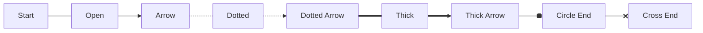
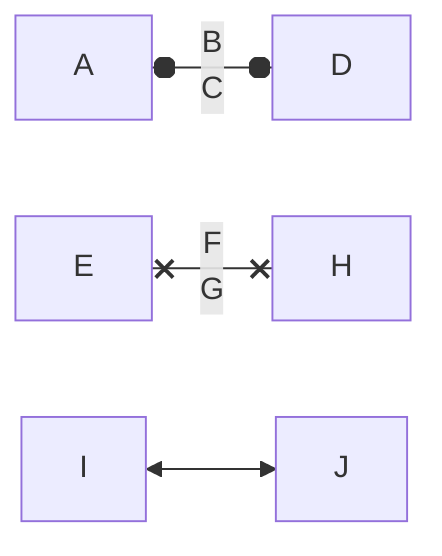

# Mermaid Flowchart Geometry And Line-End Specification

**Status:** Source-traced working specification with expanded line-end geometry and explicit manual-drawing style conversion
**Target:** Mermaid `flowchart` / `graph` rendering, especially node geometry, edge geometry, and line-end marker geometry
**Date:** 2026-04-25
**Primary intention:** Explain what must be extracted from the official Mermaid source-code, and how to determine enough geometry to reproduce Mermaid flowcharts in another programming language or by old-school technical drawing.

---

## 1. Purpose

This document combines and updates the earlier geometry investigation with a much more detailed treatment of Mermaid line ends.

The goal is not merely to know that Mermaid has rectangles, diamonds, arrows, circles and crosses. The goal is to determine the exact geometry required to reproduce the official Mermaid output elsewhere, including:

- node width, height, centre point, local co-ordinate system and boundary intersection;
- edge routing, path generation and clipping/offset behaviour;
- line-end marker definitions, including marker dimensions, reference points, local paths, centre points, radii, stroke widths and orientation;
- the remaining gaps that must still be closed by source extraction from a pinned Mermaid release.

The important principle is unchanged:

> Mermaid does not have one universal table of geometry constants. Exact reproduction requires tracing parser output, label measurement, layout output, shape drawing, edge routing, marker attachment, marker offsetting and style/theme resolution into concrete drawing values.

### 1.1 Review Correction About CSS

The earlier wording could be read as though CSS itself was part of the manual drawing instruction. That is not correct.

For manual technical drawing, CSS is only an evidence source used to derive values such as line width, dash pattern, fill, stroke, font size and marker stroke. Once those values are resolved, the drawing instruction must be expressed as geometry and appearance values, not as CSS classes or selectors.

For a non-browser renderer, the same principle applies: CSS should be converted to explicit drawing properties before rendering unless the target renderer deliberately implements a CSS cascade.

---

## 2. Evidence Used

The following evidence was used to prepare this working specification:

1. The supplied earlier Markdown file, `Mermaid_Flowchart_Geometry_And_Line_Ends_Specification(1).md`.
2. Mermaid's official GitHub source tree.
3. Mermaid's official flowchart syntax documentation.
4. Mermaid's official layout documentation.
5. Source evidence from Mermaid's rendering-elements directory, including `markers.js`, `edgeMarker.ts`, `edges.js`, shape modules and intersection modules.
6. Distribution/source evidence for `lineWithOffset.ts`.

This document states exact line-end marker geometry where the inspected source was explicit. Where the exact source was not visible or not fully inspected, the relevant item is marked as **remaining gap** rather than inferred.

---

## 3. Version Locking Requirement

Exact drawing is only meaningful after locking the renderer version and runtime.

| Item | Required value |
|---|---|
| Mermaid version | Exact npm version or Git commit hash |
| Mermaid package/source | `mermaid` npm package or official GitHub checkout |
| Diagram type | `flowchart` / `graph` |
| Layout engine | `dagre`, `elk`, or other configured layout |
| Theme | `default`, `base`, `dark`, or custom |
| Font family | Exact resolved font, not just CSS fallback list |
| Font size | Effective CSS font size |
| Font weight | Effective CSS font weight |
| Browser/runtime | Chromium, Firefox, WebKit, jsdom, Node-based SVG runtime, etc. |
| HTML labels | Enabled/disabled |
| Security level | Mermaid configuration value |
| Style source scope | Mermaid-generated style rules, theme variables, inline styles, host-page inherited values and browser defaults, resolved into concrete drawing properties before reproduction |

Do not attempt to define an identical drawing unless these values are locked.

---

## 4. Rendering Pipeline

The pipeline to trace is:

```text
Mermaid source text
    ↓
Diagram parser
    ↓
Flowchart database / internal model
    ↓
Node, edge, label and subgraph normalisation
    ↓
Label rendering and measurement
    ↓
Layout engine input graph
    ↓
Layout engine output graph
    ↓
Node shape renderer
    ↓
Edge path renderer
    ↓
Line shortening / marker offset logic
    ↓
Marker attachment
    ↓
Style/theme application, then resolution into concrete drawing values
    ↓
Final SVG with viewBox and transforms
```

For exact reproduction, every stage must be recorded. The final SVG is the most authoritative practical evidence because it contains the resolved primitives, marker references, path commands and transforms after the pipeline has run.

---

## 5. Coordinate Model

Mermaid flowchart shapes are generally drawn in an SVG group whose origin is the node centre.

For a node with final visual width `W` and height `H`:

```text
LocalLeft   = -W / 2
LocalRight  =  W / 2
LocalTop    = -H / 2
LocalBottom =  H / 2
```

The node group then supplies the global position:

```text
GlobalPoint = NodeGroupTranslate + LocalPoint
```

For technical drawing, the node centre is the datum point. You first mark the centre, then construct the local shape around that centre, then apply any diagram-level translations.

---

## 6. Confirmed Rectangle Geometry

The rectangle rule is the source-confirmed baseline for many other shape families.

### 6.1 Inputs

```text
LabelBBoxWidth
LabelBBoxHeight
LabelPaddingX
LabelPaddingY
OptionalNodeWidth
OptionalNodeHeight
OptionalRx
OptionalRy
```

### 6.2 Derived Dimensions

```text
TotalWidth  = max(LabelBBoxWidth  + (LabelPaddingX * 2), OptionalNodeWidth  or 0)
TotalHeight = max(LabelBBoxHeight + (LabelPaddingY * 2), OptionalNodeHeight or 0)
X = -TotalWidth / 2
Y = -TotalHeight / 2
```

### 6.3 SVG Equivalent

```xml
<rect
  x="-TotalWidth / 2"
  y="-TotalHeight / 2"
  width="TotalWidth"
  height="TotalHeight"
  rx="Rx"
  ry="Ry" />
```

### 6.4 Technical Drawing Equivalent

1. Mark node centre `(Cx, Cy)`.
2. Calculate `W` and `H` from measured label and padding.
3. Mark the four corners:
   - top-left `(Cx - W / 2, Cy - H / 2)`;
   - top-right `(Cx + W / 2, Cy - H / 2)`;
   - bottom-right `(Cx + W / 2, Cy + H / 2)`;
   - bottom-left `(Cx - W / 2, Cy + H / 2)`.
4. Draw the rectangle through those four points.
5. If `rx`/`ry` are present, use SVG rounded-rectangle corner behaviour using those radii.

### 6.5 Boundary Intersection

The rectangle renderer assigns rectangle intersection logic to the node. Therefore, edges entering or leaving a rectangle should be clipped/intersected against the rectangle boundary, not the node centre.

---

## 7. Confirmed Generic Polygon Insertion Rule

Several shapes use polygon drawing. The source helper inserts a `<polygon>` and applies a translation.

### 7.1 Inputs

```text
W
H
Points[] = list of local points supplied by the specific shape module
```

### 7.2 Confirmed SVG Construction

The helper serialises points as:

```text
"x1,y1 x2,y2 x3,y3 ..."
```

It applies this transform:

```text
translate(-W / 2, H / 2)
```

### 7.3 Consequence

For any polygon-based shape, the exact final point must be derived as:

```text
RenderedPointX = ShapeSpecificPointX - W / 2
RenderedPointY = ShapeSpecificPointY + H / 2
```

Then the parent node group translation moves that point to the final diagram position.

### 7.4 Technical Drawing Equivalent

1. Obtain the exact point list from the shape module.
2. Apply the polygon helper transform.
3. Apply the node group transform.
4. Join the transformed points in order.
5. Close the polygon.

---

## 8. Flowchart Shape Catalogue

This section has been expanded because the previous catalogue left too many entries as generic “remaining gaps”. The entries below distinguish between:

- **Closed**: enough source has been inspected to state the drawing primitive, size formula, point/path formula and intersection family.
- **Partly closed**: the main drawing formula is known, but a supporting utility, decoration path, label transform, or special mode still needs to be fully transcribed.
- **Open**: source module identified, but exact geometry has not yet been extracted into formula form.
- **External dependency**: geometry depends on external content such as an icon or supplied image.

The values below are for Mermaid flowchart rendering in the inspected `develop` source tree. They must still be rechecked against a pinned Mermaid release before claiming exact compatibility.

### 8.1 Shared Geometry Assumptions For The Closed Entries

Unless otherwise stated:

```text
BboxW = measured label bounding-box width
BboxH = measured label bounding-box height
P = node.padding ?? 0
Look = node.look
```

Polygon entries are supplied to Mermaid's common polygon helper. That helper stores the point list as SVG polygon points and translates the polygon by:

```text
translate(-W / 2, H / 2)
```

Therefore a listed polygon point `(x, y)` becomes local node-space:

```text
NodeLocalX = x - W / 2
NodeLocalY = y + H / 2
```

A manual technical drawing should normally use the node centre as datum, then draw the transformed points in order.

For `roughjs`/hand-drawn mode, the path can differ visually by roughness/randomisation. For exact geometry reproduction, do not use hand-drawn mode unless the RoughJS seed/options and generated path are also captured.

### 8.2 Updated Shape Catalogue Status

| Semantic Name | Short Name | Source Module / Handler | Status | Geometry Summary |
|---|---:|---|---|---|
| Process / Rectangle | `rect` | `drawRect`, `squareRect`, `labelRect` | **Closed for normal rectangle** | Rectangle centred on node. `W = max(BboxW + 2 * PaddingX, OptionalW)` and `H = max(BboxH + 2 * PaddingY, OptionalH)`. |
| Event / Rounded Rectangle | `rounded` | `roundedRect`, `drawRect` | **Partly closed** | Uses rectangle machinery with radii. Exact `rx`/`ry` must be pinned from `roundedRect`/options. |
| Terminal / Stadium | `stadium` | `stadium` | **Closed for normal/neo path generation** | Path/polygon approximated from two half-circles and two straight sections; radius `R = H / 2`. |
| Subprocess / Framed Rectangle | `fr-rect` | `subroutine` | **Open** | Module identified; inner vertical line offsets still need transcription. |
| Database / Cylinder | `cyl` | `cylinder` | **Open** | Module identified; top/bottom ellipse/arc path still needs transcription. |
| Start / Circle | `circle` | `circle` | **Closed** | Circle centred on node. Radius is label-width based, not max(width,height). |
| Small Circle | `sm-circ` | `stateStart` / circle-related | **Open** | Module identified; likely fixed-radius state start marker, but not yet transcribed. |
| Double Circle | `dbl-circ` | `doubleCircle` | **Closed** | Two concentric circles centred on node. Outer radius label-derived; inner radius = outer radius minus gap. |
| Framed Circle | `fr-circ` | `stateEnd` / circle-related | **Open** | Module identified; likely state end variant, but exact radii/gap still need transcription. |
| Decision / Diamond | `diam` | `question` | **Closed** | Square diamond with side-bounding dimension `S = W + H` from padded label measures; transform includes `+0.5` adjustment. |
| Prepare / Hexagon | `hex` | `hexagon` | **Closed** | Six-point polygon with bevel amount `M = H / F`, where `F = 3.5` for neo and `4` otherwise. |
| Lean Right | `lean-r` | `leanRight` | **Closed** | Four-point parallelogram sloping right; horizontal skew amount `H / 2`. |
| Lean Left | `lean-l` | `leanLeft` | **Closed** | Four-point parallelogram sloping left; horizontal skew amount `H / 2`. |
| Trapezoid Bottom | `trap-b` | `trapezoid` | **Closed** | Four-point trapezoid. Top wider than bottom by `H / 2` on each side. |
| Trapezoid Top | `trap-t` | `invertedTrapezoid` | **Closed** | Four-point trapezoid. Bottom wider than top by `H / 2` on each side. |
| Notched Rectangle | `notch-rect` | `card` | **Open** | Module identified; notch depth/shape still needs transcription. |
| Lined Rectangle | `lin-rect` | `shadedProcess` | **Open** | Module identified; outer rectangle plus decorative line/shading still needs transcription. |
| Filled Circle | `f-circ` | `filledCircle` | **Closed** | Fixed filled circle, radius `7`, centred at `(0,0)`. |
| Fork/Join | `fork` | `forkJoin` | **Open** | Module identified; bar dimensions still need transcription. |
| Hourglass | `hourglass` | `hourglass` | **Open** | Module identified; polygon/path still needs transcription. |
| Curly Brace Left | `brace` | `curlyBraceLeft` | **Open** | Module identified; Bézier/brace path still needs transcription. |
| Curly Brace Right | `brace-r` | `curlyBraceRight` | **Open** | Module identified; Bézier/brace path still needs transcription. |
| Curly Braces | `braces` | `curlyBraces` | **Open** | Module identified; pair of brace paths still needs transcription. |
| Lightning Bolt | `bolt` | `lightningBolt` | **Open** | Module identified; zig-zag point list still needs transcription. |
| Document | `doc` | `document` | **Open** | Module identified; wave-bottom path still needs transcription. |
| Lined Document | `lin-doc` | `linedWaveEdgedRect` | **Open** | Module identified; base document plus line decoration still needs transcription. |
| Stacked Document | `docs` | `multiWaveEdgedRectangle` | **Open** | Module identified; stacked offsets plus wave edge still need transcription. |
| Half-Rounded Rectangle | `delay` | `halfRoundedRectangle` | **Open** | Module identified; half-rounded path still needs transcription. |
| Horizontal Cylinder | `h-cyl` | `tiltedCylinder` | **Open** | Module identified; horizontal cylinder ellipse/path still needs transcription. |
| Lined Cylinder | `lin-cyl` | `linedCylinder` | **Open** | Module identified; cylinder plus line decoration still needs transcription. |
| Curved Trapezoid | `curv-trap` | `curvedTrapezoid` | **Open** | Module identified; curved side/path still needs transcription. |
| Divided Rectangle | `div-rect` | `dividedRect` | **Open** | Module identified; outer rectangle plus divider position still needs transcription. |
| Triangle | `tri` | `triangle` | **Closed with label caveat** | Upward triangle. Uses `TW = H`; label is separately translated. |
| Flipped Triangle | `flip-tri` | `flippedTriangle` | **Closed with label caveat** | Downward triangle. Uses `TW = H`; label is separately translated. |
| Window Pane | `win-pane` | `windowPane` | **Open** | Module identified; pane divider locations still need transcription. |
| Notched Pentagon | `notch-pent` | `trapezoidalPentagon` | **Open** | Module identified; pentagon/notch points still need transcription. |
| Sloped Rectangle | `sl-rect` | `slopedRect` | **Open** | Module identified; sloped side points still need transcription. |
| Stacked Rectangle | `st-rect` | `multiRect` | **Open** | Module identified; stack offsets still need transcription. |
| Flag / Paper Tape | `flag` | `waveRectangle` / `waveEdgedRectangle` | **Open** | Module identified; wave path still needs transcription. |
| Bow Tie Rectangle | `bow-rect` | `bowTieRect` | **Open** | Module identified; bow-tie internal/outer points still need transcription. |
| Crossed Circle | `cross-circ` | `crossedCircle` | **Open** | Module identified; circle and cross strokes still need transcription. |
| Tagged Document | `tag-doc` | `taggedWaveEdgedRectangle` | **Open** | Module identified; tag and wave edge still need transcription. |
| Tagged Process | `tag-rect` | `taggedRect` | **Open** | Module identified; tag geometry still needs transcription. |
| Text Block | `text` | `text` | **Open** | Module identified; may not draw enclosing primitive. Needs source confirmation. |
| Odd | `odd` | `rectLeftInvArrow` | **Open** | Module identified; left inverse arrow polygon still needs transcription. |
| Bang | `bang` | `bang` | **Open** | Module identified; bang shape geometry still needs transcription. |
| Icon | `icon` | `icon`, `iconCircle`, `iconRounded`, `iconSquare` | **External dependency** | Depends on icon pack, icon viewport, and selected wrapper. |
| Image | `image` | `imageSquare` | **External dependency** | Depends on supplied image dimensions and image-placement options. |

### 8.3 Closed Formulae And Technical Drawing Instructions

#### 8.3.1 Circle (`circle`)

Source-derived behaviour:

```text
LabelPadding = 16
Padding = options.padding ?? halfPadding
Radius = if Look == neo then (BboxW / 2) + (LabelPadding * 2)
         else (BboxW / 2) + Padding
SVG primitive = circle
cx = 0
cy = 0
r = Radius
Intersection = circle intersection using Radius
```

Manual drawing instruction:

```text
1. Mark node centre C.
2. Set compass radius to Radius.
3. Draw a circle centred on C.
4. Clip incoming/outgoing edges to this circle boundary.
```

Caveat: the inspected code derives the radius from label width, not label height. That means a tall/narrow label requires validation against actual label measurement and layout output before relying on a purely geometric assumption.

#### 8.3.2 Double Circle (`dbl-circ`)

Source-derived behaviour:

```text
Gap = if Look == neo then 12 else 5
LabelPadding = if Look == neo then 16 else P
OuterRadius = if node.width exists then (node.width / 2) + LabelPadding
              else (BboxW / 2) + LabelPadding
InnerRadius = OuterRadius - Gap
Outer circle: cx = 0, cy = 0, r = OuterRadius
Inner circle: cx = 0, cy = 0, r = InnerRadius
Intersection = circle intersection using OuterRadius
```

Manual drawing instruction:

```text
1. Mark node centre C.
2. Draw the outer circle using OuterRadius.
3. Draw the inner circle using InnerRadius.
4. Clip edges to the outer circle, not the inner circle.
```

#### 8.3.3 Filled Circle (`f-circ` / junction)

Source-derived behaviour:

```text
Radius = 7
Centre = (0, 0)
Rendered primitive = RoughJS circle even in non-handDrawn mode, with roughness forced to 0 when not hand drawn
Fill = resolved node border colour unless overridden
Intersection = circle intersection using Radius
```

Manual drawing instruction:

```text
1. Mark node centre C.
2. Draw a filled circle with radius 7.
3. Clip edges to the radius-7 circle boundary.
```

#### 8.3.4 Decision / Diamond (`diam` / `question`)

Source-derived behaviour:

```text
W0 = BboxW + P
H0 = BboxH + P
S = W0 + H0
Adjustment = 0.5
Points before transform:
    P1 = (S / 2, 0)
    P2 = (S, -S / 2)
    P3 = (S / 2, -S)
    P4 = (0, -S / 2)
Transform:
    translate(-S / 2 + 0.5, S / 2)
Intersection = polygon intersection, then result adjusted by (-0.5, -0.5)
```

After applying the transform, the visible local points are approximately:

```text
Top    = (0.5, -S / 2)
Right  = (S / 2 + 0.5, 0)
Bottom = (0.5, S / 2)
Left   = (-S / 2 + 0.5, 0)
```

Manual drawing instruction:

```text
1. Compute S from the measured label.
2. Mark the four diamond points above relative to the node centre.
3. Join Top -> Right -> Bottom -> Left -> Top.
4. Use polygon intersection and include the Mermaid 0.5 px adjustment if exact SVG matching is required.
```

#### 8.3.5 Hexagon (`hex`)

Source-derived behaviour:

```text
F = if Look == neo then 3.5 else 4
NodePadding = P
LabelPaddingX = if Look == neo then 70 else NodePadding
LabelPaddingY = if Look == neo then 32 else NodePadding
If explicit node width/height exists:
    OriginalHeight = node.height ?? 0
    M0 = OriginalHeight / F
    node.width = (node.width ?? 0) - (2 * M0) - LabelPaddingY
    node.height = (node.height ?? 0) - LabelPaddingX
H = (node.height if present else BboxH) + LabelPaddingX
M = H / F
W = (node.width if present else BboxW) + (2 * M) + LabelPaddingY
Points before polygon-helper transform:
    P1 = (M, 0)
    P2 = (W - M, 0)
    P3 = (W, -H / 2)
    P4 = (W - M, -H)
    P5 = (M, -H)
    P6 = (0, -H / 2)
Intersection = polygon intersection
```

Manual drawing instruction:

```text
1. Compute H, M and W.
2. Apply the polygon helper transform: x -= W / 2; y += H / 2.
3. Join the six points in order.
4. Clip edges to the resulting six-sided polygon.
```

The bevel faces have horizontal run `M` and vertical rise/fall `H / 2`. Their angle from the horizontal is:

```text
Angle = atan2(H / 2, M)
```

For the standard look where `M = H / 4`, this angle is `atan2(H / 2, H / 4) = atan2(2, 1)`, approximately `63.435°`.

#### 8.3.6 Lean Left (`lean-l`)

Source-derived behaviour:

```text
LabelPaddingY = P
LabelPaddingX = if Look == neo then P * 2 else P
H = (node.height ?? BboxH) + LabelPaddingY
W = (node.width ?? BboxW) + LabelPaddingX
Skew = (3 * H) / 6 = H / 2
Points before polygon-helper transform:
    P1 = (0, 0)
    P2 = (W + Skew, 0)
    P3 = (W, -H)
    P4 = (-Skew, -H)
Intersection = polygon intersection
```

Manual drawing instruction:

```text
1. Compute W, H and Skew = H / 2.
2. Apply polygon-helper transform.
3. Draw a parallelogram with top edge shifted right relative to bottom edge.
```

The sloping side angle from vertical depends on `Skew / H = 1/2`; equivalently the side is `atan2(H, Skew) = atan2(1, 0.5)`, approximately `63.435°` from horizontal or `26.565°` from vertical.

#### 8.3.7 Lean Right (`lean-r`)

Source-derived behaviour:

```text
LabelPaddingY = P
LabelPaddingX = if Look == neo then P * 2 else P
H = (node.height ?? BboxH) + LabelPaddingY
W = (node.width ?? BboxW) + LabelPaddingX
Skew = (3 * H) / 6 = H / 2
Points before polygon-helper transform:
    P1 = (-Skew, 0)
    P2 = (W, 0)
    P3 = (W + Skew, -H)
    P4 = (0, -H)
Intersection = polygon intersection
```

Manual drawing instruction:

```text
1. Compute W, H and Skew = H / 2.
2. Apply polygon-helper transform.
3. Draw a parallelogram with top edge shifted left relative to bottom edge.
```

#### 8.3.8 Trapezoid Bottom (`trap-b` / `trapezoid`)

Source-derived behaviour:

```text
LabelPaddingY = P
LabelPaddingX = if Look == neo then P * 2 else P
H = (node.height ?? BboxH) + LabelPaddingY
W = (node.width ?? BboxW) + LabelPaddingX
Inset = (3 * H) / 6 = H / 2
Points before polygon-helper transform:
    P1 = (-Inset, 0)
    P2 = (W + Inset, 0)
    P3 = (W, -H)
    P4 = (0, -H)
Intersection = polygon intersection
```

Manual drawing instruction:

```text
1. Compute W, H and Inset = H / 2.
2. Apply polygon-helper transform.
3. Draw the top edge wider than the bottom edge.
```

#### 8.3.9 Trapezoid Top (`trap-t` / inverted trapezoid)

Source-derived behaviour:

```text
LabelPaddingY = P
LabelPaddingX = if Look == neo then P * 2 else P
W = max(BboxW + (LabelPaddingX * 2), node.width ?? 0)
H = max(BboxH + (LabelPaddingY * 2), node.height ?? 0)
Outset = (3 * H) / 6 = H / 2
Points before polygon-helper transform:
    P1 = (0, 0)
    P2 = (W, 0)
    P3 = (W + Outset, -H)
    P4 = (-Outset, -H)
Intersection = polygon intersection
```

Manual drawing instruction:

```text
1. Compute W, H and Outset = H / 2.
2. Apply polygon-helper transform.
3. Draw the bottom edge wider than the top edge.
```

#### 8.3.10 Stadium (`stadium` / terminal)

Source-derived behaviour:

```text
LabelPaddingX = if Look == neo then 20 else P
LabelPaddingY = if Look == neo then 12 else P
H = BboxH + (if Look == neo then LabelPaddingY * 2 else LabelPaddingY)
W = BboxW + (H / 4) + (if Look == neo then LabelPaddingX * 2 else LabelPaddingX)
R = H / 2
```

The path utility expresses the mathematical stadium as:

```text
M (x + R), y
H (x + W - R)
A R,R 0 0 1 (x + W), (y + R)
H x
A R,R 0 0 1 (x + W - R), (y + H)
H (x + R)
A R,R 0 0 1 x, (y + R)
Z
```

The actual inspected normal/rough pipeline also generates a point list:

```text
P1 = (-W / 2 + R, -H / 2)
P2 = ( W / 2 - R, -H / 2)
LeftArc  = generateCirclePoints(-W / 2 + R, 0, R, 50, 90, 270)
P3 = ( W / 2 - R,  H / 2)
RightArc = generateCirclePoints( W / 2 - R, 0, R, 50, 270, 450)
```

Manual drawing instruction:

```text
1. Draw a horizontal centreline through the node centre.
2. Set radius R = H / 2.
3. Mark left arc centre at (-W/2 + R, 0) and right arc centre at (W/2 - R, 0).
4. Draw the top horizontal tangent between x = -W/2 + R and x = W/2 - R at y = -H/2.
5. Draw the right semicircle.
6. Draw the bottom horizontal tangent between x = W/2 - R and x = -W/2 + R at y = H/2.
7. Draw the left semicircle.
```

Note: exact SVG equality requires reproducing Mermaid's generated point sampling if using the path generated from `generateCirclePoints`, not only the analytic arc form.

#### 8.3.11 Triangle (`tri`)

Source-derived behaviour:

```text
MIN_WIDTH = 10
MIN_HEIGHT = 10
LabelPaddingX = if Look == neo then P * 2 else P
If explicit node width/height exists:
    node.width = ((node.width ?? 0) - LabelPaddingX) / 2
    node.width = max(node.width, MIN_WIDTH)
    node.height = max(node.height ?? 0, MIN_HEIGHT)
W = (node.width if present else BboxW) + LabelPaddingX
H = node.height if present else W + BboxH
TW = H
Points before translation:
    P1 = (0, 0)
    P2 = (TW, 0)
    P3 = (TW / 2, -H)
Transform:
    translate(-H / 2, H / 2)
Intersection = polygon intersection
Label transform is special and must be preserved separately.
```

Manual drawing instruction:

```text
1. Compute H and TW = H.
2. Use local points after transform:
   - bottom-left = (-H/2, H/2)
   - bottom-right = (H/2, H/2)
   - top = (0, -H/2)
3. Draw the triangle.
4. Place the label using the separate label transform from the renderer, not simply at the geometric centre.
```

#### 8.3.12 Flipped Triangle (`flip-tri`)

Source-derived behaviour:

```text
MIN_WIDTH = 10
MIN_HEIGHT = 10
LabelPaddingX = if Look == neo then P * 2 else P
If explicit node width/height exists:
    node.height = max(node.height ?? 0, MIN_HEIGHT)
    node.width = (node.width ?? 0) - LabelPaddingX - LabelPaddingX / 2
    node.width = max(node.width, MIN_WIDTH)
W = (node.width if present else BboxW) + LabelPaddingX
H = node.height if present else W + BboxH
TW = H
Points before translation:
    P1 = (0, -H)
    P2 = (TW, -H)
    P3 = (TW / 2, 0)
Transform:
    translate(-H / 2, H / 2)
Intersection = polygon intersection
Label transform is special and must be preserved separately.
```

Manual drawing instruction:

```text
1. Compute H and TW = H.
2. Use local points after transform:
   - top-left = (-H/2, -H/2)
   - top-right = (H/2, -H/2)
   - bottom = (0, H/2)
3. Draw the triangle.
4. Place the label using the separate label transform from the renderer.
```

### 8.4 Shape Gaps Still Open After This Pass

The following gaps remain because their source modules have not yet been transcribed into point/path formulae:

```text
subroutine.ts
cylinder.ts
stateStart.ts
stateEnd.ts
card.ts
shadedProcess.ts
forkJoin.ts
hourglass.ts
curlyBraceLeft.ts
curlyBraceRight.ts
curlyBraces.ts
lightningBolt.ts
document.ts
linedWaveEdgedRect.ts
multiWaveEdgedRectangle.ts
halfRoundedRectangle.ts
tiltedCylinder.ts
linedCylinder.ts
curvedTrapezoid.ts
dividedRect.ts
windowPane.ts
trapezoidalPentagon.ts
slopedRect.ts
multiRect.ts
waveRectangle.ts
waveEdgedRectangle.ts
bowTieRect.ts
crossedCircle.ts
taggedWaveEdgedRectangle.ts
taggedRect.ts
text.ts
rectLeftInvArrow.ts
bang.ts
icon*.ts
imageSquare.ts
```

These are no longer unknown conceptually: the source modules are identified. The remaining work is mechanical transcription of each module into the same format used above: size formula, point/path formula, transform, decorations, label transform, intersection function and manual drawing instruction.

### 8.5 Immediate Implementation Priority

To close the remaining high-value gaps, extract the modules in this order:

1. `subroutine.ts`, `cylinder.ts`, `document.ts`, `dividedRect.ts`, because these are common traditional flowchart symbols.
2. `stateStart.ts`, `stateEnd.ts`, `forkJoin.ts`, because these affect state/fork-like diagrams and have fixed or near-fixed geometry.
3. `card.ts`, `windowPane.ts`, `shadedProcess.ts`, `taggedRect.ts`, because these are rectangle-derived and should be quick to close.
4. `waveRectangle.ts`, `waveEdgedRectangle.ts`, `linedWaveEdgedRect.ts`, `multiWaveEdgedRectangle.ts`, because wave paths are more error-prone for manual drawing.
5. Remaining decorative/special shapes: braces, bolt, hourglass, bow tie, crossed circle, pentagon, odd and bang.

---

## 9. Required Shape Extraction Template

For each shape module, produce this record:

```text
ShapeName:
    Mermaid syntax:
    Source module:
    Handler function:
    Label measurement function:
    Padding inputs:
    Width formula:
    Height formula:
    SVG primitive:
    Primary path or points:
    Additional decorative paths:
    Node boundary intersection function:
    Style classes:
    Style/theme variables used:
    Resolved drawing values:
```

The completed rectangle entry is:

```text
ShapeName:
    Rectangle / Process
Mermaid syntax:
    A[Label]
    A@{ shape: rect }
Source module:
    drawRect.ts
Width formula:
    W = max(LabelBBoxWidth + 2 * LabelPaddingX, OptionalNodeWidth or 0)
Height formula:
    H = max(LabelBBoxHeight + 2 * LabelPaddingY, OptionalNodeHeight or 0)
SVG primitive:
    rect
Primary geometry:
    x = -W / 2
    y = -H / 2
    width = W
    height = H
    rx = resolved rx
    ry = resolved ry
Boundary intersection:
    rectangle intersection
```

---

## 10. Common Shape Geometry Patterns

These patterns are classification aids only. They do not replace source extraction.

### 10.1 Rectangle-Based Shapes

```text
Left   = Cx - W / 2
Right  = Cx + W / 2
Top    = Cy - H / 2
Bottom = Cy + H / 2
```

Decorations may include:

- extra vertical lines for subroutine/framed rectangle;
- horizontal divider lines for divided rectangle;
- tag shapes on one side;
- stacked offsets for multi-process;
- shaded or lined inner paths.

### 10.2 Circle-Based Shapes

Circle-based shapes require the exact handler to determine whether radius comes from width, height, maximum dimension, minimum dimension, fixed default or label size.

For a true centred circle:

```text
r = Diameter / 2
cx = 0
cy = 0
```

For an ellipse:

```text
rx = W / 2
ry = H / 2
```

Double/framed/crossed/filled variants add secondary paths or circles.

### 10.3 Polygon-Based Shapes

Polygon-based shapes must be extracted from their module point lists. The helper then applies:

```text
translate(-W / 2, H / 2)
```

Examples:

- diamond;
- hexagon;
- parallelogram / lean left / lean right;
- trapezoid;
- triangle;
- pentagon;
- bow-tie rectangle;
- lightning bolt.

### 10.4 Path-Based Shapes

Path-based shapes require exact SVG path extraction.

Examples:

- cylinder;
- document;
- paper tape;
- curly braces;
- cloud;
- curved trapezoid;
- wave-edged document variants.

For manual drafting, path commands must be converted as follows:

| SVG Command | Geometry Meaning |
|---|---|
| `M` | Move to point |
| `L` | Straight line |
| `H` | Horizontal line |
| `V` | Vertical line |
| `C` | Cubic Bezier curve |
| `Q` | Quadratic Bezier curve |
| `A` | Elliptical arc |
| `Z` | Close path |

---

## 11. Edge Syntax And Stroke Styles

Mermaid flowchart edges define both the visual line pattern and marker type.

| Syntax | Meaning | Expected Stroke Pattern | End Marker |
|---|---|---|---|
| `A --- B` | open line | solid | none |
| `A --> B` | arrow line | solid | arrow point at end |
| `A -.- B` | dotted/open line | dotted | none |
| `A -.-> B` | dotted arrow | dotted | arrow point at end |
| `A === B` | thick/open line | solid, thicker | none |
| `A ==> B` | thick arrow | solid, thicker | arrow point at end |
| `A -- text --- B` | labelled open line | solid | none |
| `A -- text --> B` | labelled arrow | solid | arrow point at end |
| `A o-- B` / `A --o B` | circle marker line | solid | circle marker at start/end depending syntax |
| `A x-- B` / `A --x B` | cross marker line | solid | cross marker at start/end depending syntax |

The official flowchart documentation states that flowcharts are composed of nodes and edges and that the Mermaid code accommodates different arrow types, multi-directional arrows and links to/from subgraphs.

---

## 12. Edge Path Generation

An edge path is not just a straight line between node centres.

For exact reproduction, capture:

```text
SourceNodeId
TargetNodeId
SourceShapeBoundaryIntersection
TargetShapeBoundaryIntersection
Intermediate route points
Curve function
Generated SVG path `d`
Stroke width
Stroke dash array
Marker start
Marker end
```

The selected layout engine matters. Mermaid's layout documentation lists supported algorithms including `elk`, `tidy-tree`, `cose-bilkent` and `dagre`, so the layout engine must be treated as part of the drawing specification.

For manual drawing:

1. Read the generated edge path `d` attribute.
2. Resolve any parent transforms.
3. Draw each SVG command in sequence.
4. Attach markers using marker reference point and edge tangent angle.

---

## 13. Marker And Line-End Geometry

This section is the main expansion over the earlier document.

SVG markers are separate from the main edge path. The edge path references marker definitions using `marker-start` and/or `marker-end`.

### 13.1 General SVG Marker Attachment Model

For each marker:

```text
MarkerLocalGeometry = marker path / circle / polygon defined in marker co-ordinates
ReferencePoint = (refX, refY)
MarkerOrient = auto
EdgeTangentAngle = direction of path at marker attachment point
FinalMarker = rotate(MarkerLocalGeometry, EdgeTangentAngle) and translate so ReferencePoint = EdgeEndpoint
```

For a technical drawing:

1. Determine whether the marker is attached to the start or end of the path.
2. Determine the tangent angle at the attachment point.
3. Draw the marker's local geometry in its own marker co-ordinate system.
4. Rotate the marker geometry to the tangent angle.
5. Translate the marker so `(refX, refY)` coincides with the adjusted edge endpoint.
6. Apply fill, stroke, stroke width and dash settings.

### 13.2 Tangent Angle Determination

For a straight-line final segment:

```text
AngleEnd = atan2(EndY - PreviousY, EndX - PreviousX)
AngleStart = atan2(StartY - NextY, StartX - NextX)
```

For curved paths, the angle must be the tangent of the path at the attachment point:

- cubic Bezier: derivative of the cubic at `t = 0` or `t = 1`;
- quadratic Bezier: derivative of the quadratic at `t = 0` or `t = 1`;
- arc: tangent of the arc at the endpoint;
- polyline: direction of first or last non-zero-length segment.

SVG `orient="auto"` delegates this rotation to the SVG renderer. A non-SVG implementation must reproduce it explicitly.

---

## 14. Confirmed Flowchart Marker Types

The Mermaid source maps edge arrow types to marker families as follows:

| Edge Arrow Type | Marker Family | Filled? | Notes |
|---|---|---:|---|
| `arrow_point` | `point` | yes | Normal flowchart arrowhead |
| `arrow_circle` | `circle` | no | Circle line end |
| `arrow_cross` | `cross` | no | Cross line end |
| `arrow_barb` | `barb` | yes | Used by some diagram/edge types |
| `arrow_barb_neo` | `barb` | yes | Used by some diagram/edge types |
| `aggregation` | `aggregation` | no | UML/class-style marker, not core flowchart syntax |
| `extension` | `extension` | no | UML/class-style marker |
| `composition` | `composition` | yes | UML/class-style marker |
| `dependency` | `dependency` | yes | UML/class-style marker |
| `lollipop` | `lollipop` | no | Interface-style marker |
| `only_one` | `onlyOne` | no | Cardinality-style marker |
| `zero_or_one` | `zeroOrOne` | no | Cardinality-style marker |
| `one_or_more` | `oneOrMore` | no | Cardinality-style marker |
| `zero_or_more` | `zeroOrMore` | no | Cardinality-style marker |
| `requirement_arrow` | `requirement_arrow` | no | Requirement diagram marker |
| `requirement_contains` | `requirement_contains` | no | Requirement diagram marker |

The flowchart-specific line ends most relevant to this document are `point`, `circle` and `cross`.

---

## 15. Confirmed Point Arrowhead Geometry

### 15.1 Point End Marker

Source-defined marker:

```text
Marker id pattern:      {id}_{diagramType}-pointEnd
Class:                  marker {diagramType}
viewBox:                0 0 10 10
refX:                   5
refY:                   5
markerUnits:            userSpaceOnUse
markerWidth:            8
markerHeight:           8
orient:                 auto
Geometry primitive:     path
Path:                   M 0 0 L 10 5 L 0 10 z
Path class:             arrowMarkerPath
Path stroke-width:      1
Path stroke-dasharray:  1,0
```

#### Local Geometry

The point end marker is a closed triangle with vertices:

```text
P1 = (0, 0)
P2 = (10, 5)
P3 = (0, 10)
Closed back to P1
```

The local geometric centre of the triangle's bounding box is:

```text
BoundingBoxCentre = (5, 5)
```

The marker reference point is also:

```text
ReferencePoint = (5, 5)
```

Therefore the marker's bounding-box centre is placed on the adjusted edge endpoint before rotation.

Approximate side lengths in marker local units:

```text
Back vertical side:             10
Upper sloping side:             sqrt((10 - 0)^2 + (5 - 0)^2) = sqrt(125) ≈ 11.18034
Lower sloping side:             sqrt((10 - 0)^2 + (5 - 10)^2) = sqrt(125) ≈ 11.18034
Apex half-angle around x-axis:  atan(5 / 10) ≈ 26.56505 degrees
Apex full angle:                ≈ 53.13010 degrees
```

### 15.2 Point Start Marker

Source-defined marker:

```text
Marker id pattern:      {id}_{diagramType}-pointStart
Class:                  marker {diagramType}
viewBox:                0 0 10 10
refX:                   4.5
refY:                   5
markerUnits:            userSpaceOnUse
markerWidth:            8
markerHeight:           8
orient:                 auto
Geometry primitive:     path
Path:                   M 0 5 L 10 10 L 10 0 z
Path class:             arrowMarkerPath
Path stroke-width:      1
Path stroke-dasharray:  1,0
```

#### Local Geometry

The point start marker is a closed triangle with vertices:

```text
P1 = (0, 5)
P2 = (10, 10)
P3 = (10, 0)
Closed back to P1
```

The local bounding-box centre is:

```text
BoundingBoxCentre = (5, 5)
```

The marker reference point is:

```text
ReferencePoint = (4.5, 5)
```

So the marker is offset by `0.5` local units relative to its own bounding-box centre when it is attached.

Approximate side lengths:

```text
Right vertical side:            10
Upper/lower sloping sides:      sqrt(125) ≈ 11.18034
Apex half-angle around x-axis:  atan(5 / 10) ≈ 26.56505 degrees
Apex full angle:                ≈ 53.13010 degrees
```

### 15.3 Point End Margin Marker

Source-defined marker:

```text
Marker id pattern:      {id}_{diagramType}-pointEnd-margin
Class:                  marker {diagramType}
viewBox:                0 0 11.5 14
refX:                   11.5
refY:                   7
markerUnits:            userSpaceOnUse
markerWidth:            10.5
markerHeight:           14
orient:                 auto
Geometry primitive:     path
Path:                   M 0 0 L 11.5 7 L 0 14 z
Path class:             arrowMarkerPath
Path stroke-width:      0
Path stroke-dasharray:  1,0
```

#### Local Geometry

Vertices:

```text
P1 = (0, 0)
P2 = (11.5, 7)
P3 = (0, 14)
Closed back to P1
```

Reference point:

```text
ReferencePoint = (11.5, 7)
```

This is the arrow apex. Unlike the non-margin point end marker, the margin marker attaches the apex to the adjusted endpoint.

Approximate side lengths:

```text
Back vertical side:             14
Upper/lower sloping sides:      sqrt(11.5^2 + 7^2) = sqrt(181.25) ≈ 13.46291
Apex half-angle around x-axis:  atan(7 / 11.5) ≈ 31.32869 degrees
Apex full angle:                ≈ 62.65738 degrees
```

### 15.4 Point Start Margin Marker

Source-defined marker:

```text
Marker id pattern:      {id}_{diagramType}-pointStart-margin
Class:                  marker {diagramType}
viewBox:                0 0 11.5 14
refX:                   1
refY:                   7
markerUnits:            userSpaceOnUse
markerWidth:            11.5
markerHeight:           14
orient:                 auto
Geometry primitive:     polygon
Points:                 0,7 11.5,14 11.5,0
Path class:             arrowMarkerPath
Path stroke-width:      0
Path stroke-dasharray:  1,0
```

#### Local Geometry

Vertices:

```text
P1 = (0, 7)
P2 = (11.5, 14)
P3 = (11.5, 0)
Closed back to P1
```

Reference point:

```text
ReferencePoint = (1, 7)
```

The marker reference point is one local unit to the right of the start apex `(0, 7)`.

Approximate side lengths:

```text
Right vertical side:            14
Upper/lower sloping sides:      sqrt(11.5^2 + 7^2) ≈ 13.46291
Apex half-angle around x-axis:  atan(7 / 11.5) ≈ 31.32869 degrees
Apex full angle:                ≈ 62.65738 degrees
```

---

## 16. Confirmed Circle Line-End Geometry

### 16.1 Circle End Marker

Source-defined marker:

```text
Marker id pattern:      {id}_{diagramType}-circleEnd
Class:                  marker {diagramType}
viewBox:                0 0 10 10
refX:                   11
refY:                   5
markerUnits:            userSpaceOnUse
markerWidth:            11
markerHeight:           11
orient:                 auto
Geometry primitive:     circle
cx:                     5
cy:                     5
r:                      5
Path class:             arrowMarkerPath
Circle stroke-width:    1
Circle stroke-dasharray:1,0
```

#### Local Geometry

```text
CircleCentre = (5, 5)
Radius       = 5
Diameter     = 10
ReferencePoint = (11, 5)
```

The reference point is `6` local units to the right of the circle centre and `1` local unit beyond the circle's rightmost point `(10, 5)`.

For an edge with tangent angle `θ`, the circle centre is located at:

```text
CircleCentreGlobal = EdgeEndpoint + Rotate((5 - 11, 5 - 5), θ)
                   = EdgeEndpoint + Rotate((-6, 0), θ)
```

### 16.2 Circle Start Marker

Source-defined marker:

```text
Marker id pattern:      {id}_{diagramType}-circleStart
Class:                  marker {diagramType}
viewBox:                0 0 10 10
refX:                   -1
refY:                   5
markerUnits:            userSpaceOnUse
markerWidth:            11
markerHeight:           11
orient:                 auto
Geometry primitive:     circle
cx:                     5
cy:                     5
r:                      5
Path class:             arrowMarkerPath
Circle stroke-width:    1
Circle stroke-dasharray:1,0
```

#### Local Geometry

```text
CircleCentre = (5, 5)
Radius       = 5
Diameter     = 10
ReferencePoint = (-1, 5)
```

The reference point is `6` local units to the left of the circle centre and `1` local unit beyond the circle's leftmost point `(0, 5)`.

### 16.3 Circle End Margin Marker

Source-defined marker:

```text
Marker id pattern:      {id}_{diagramType}-circleEnd-margin
Class:                  marker {diagramType}
viewBox:                0 0 10 10
refX:                   12.25
refY:                   5
markerUnits:            userSpaceOnUse
markerWidth:            14
markerHeight:           14
orient:                 auto
Geometry primitive:     circle
cx:                     5
cy:                     5
r:                      5
Path class:             arrowMarkerPath
Circle stroke-width:    0
Circle stroke-dasharray:1,0
```

#### Local Geometry

```text
CircleCentre = (5, 5)
Radius       = 5
Diameter     = 10
ReferencePoint = (12.25, 5)
```

The reference point is `7.25` local units to the right of the circle centre and `2.25` local units beyond the circle's rightmost point.

### 16.4 Circle Start Margin Marker

Source-defined marker:

```text
Marker id pattern:      {id}_{diagramType}-circleStart-margin
Class:                  marker {diagramType}
viewBox:                0 0 10 10
refX:                   -2
refY:                   5
markerUnits:            userSpaceOnUse
markerWidth:            14
markerHeight:           14
orient:                 auto
Geometry primitive:     circle
cx:                     5
cy:                     5
r:                      5
Path class:             arrowMarkerPath
Circle stroke-width:    0
Circle stroke-dasharray:1,0
```

#### Local Geometry

```text
CircleCentre = (5, 5)
Radius       = 5
Diameter     = 10
ReferencePoint = (-2, 5)
```

The reference point is `7` local units to the left of the circle centre and `2` local units beyond the circle's leftmost point.

---

## 17. Confirmed Cross Line-End Geometry

### 17.1 Cross End Marker

Source-defined marker:

```text
Marker id pattern:      {id}_{diagramType}-crossEnd
Class:                  marker cross {diagramType}
viewBox:                0 0 11 11
refX:                   12
refY:                   5.2
markerUnits:            userSpaceOnUse
markerWidth:            11
markerHeight:           11
orient:                 auto
Geometry primitive:     path
Path:                   M 1,1 l 9,9 M 10,1 l -9,9
Path class:             arrowMarkerPath
Path stroke-width:      2
Path stroke-dasharray:  1,0
```

#### Local Geometry

The cross is two diagonal line segments:

```text
Segment1Start = (1, 1)
Segment1End   = (10, 10)
Segment2Start = (10, 1)
Segment2End   = (1, 10)
```

Each segment length is:

```text
sqrt((10 - 1)^2 + (10 - 1)^2) = sqrt(162) ≈ 12.72792
```

The segment angles relative to the positive x-axis are:

```text
Segment1Angle =  45 degrees
Segment2Angle = 135 degrees
```

The cross intersection point is:

```text
CrossCentre = (5.5, 5.5)
```

The marker reference point is:

```text
ReferencePoint = (12, 5.2)
```

So the cross centre is offset from the reference point by:

```text
CrossCentre - ReferencePoint = (-6.5, 0.3)
```

### 17.2 Cross Start Marker

Source-defined marker:

```text
Marker id pattern:      {id}_{diagramType}-crossStart
Class:                  marker cross {diagramType}
viewBox:                0 0 11 11
refX:                   -1
refY:                   5.2
markerUnits:            userSpaceOnUse
markerWidth:            11
markerHeight:           11
orient:                 auto
Geometry primitive:     path
Path:                   M 1,1 l 9,9 M 10,1 l -9,9
Path class:             arrowMarkerPath
Path stroke-width:      2
Path stroke-dasharray:  1,0
```

The cross geometry is the same as the cross end marker. The reference point changes to:

```text
ReferencePoint = (-1, 5.2)
```

So the cross centre is offset from the reference point by:

```text
CrossCentre - ReferencePoint = (6.5, 0.3)
```

### 17.3 Cross End Margin Marker

Source-defined marker:

```text
Marker id pattern:      {id}_{diagramType}-crossEnd-margin
Class:                  marker cross {diagramType}
viewBox:                0 0 15 15
refX:                   17.7
refY:                   7.5
markerUnits:            userSpaceOnUse
markerWidth:            12
markerHeight:           12
orient:                 auto
Geometry primitive:     path
Path:                   M 1,1 L 14,14 M 1,14 L 14,1
Path class:             arrowMarkerPath
Path stroke-width:      2.5
```

#### Local Geometry

Segments:

```text
Segment1Start = (1, 1)
Segment1End   = (14, 14)
Segment2Start = (1, 14)
Segment2End   = (14, 1)
```

Each segment length is:

```text
sqrt((14 - 1)^2 + (14 - 1)^2) = sqrt(338) ≈ 18.38478
```

The cross intersection point is:

```text
CrossCentre = (7.5, 7.5)
```

The reference point is:

```text
ReferencePoint = (17.7, 7.5)
```

So the cross centre is offset from the reference point by:

```text
CrossCentre - ReferencePoint = (-10.2, 0)
```

### 17.4 Cross Start Margin Marker

Source-defined marker:

```text
Marker id pattern:      {id}_{diagramType}-crossStart-margin
Class:                  marker cross {diagramType}
viewBox:                0 0 15 15
refX:                   -3.5
refY:                   7.5
markerUnits:            userSpaceOnUse
markerWidth:            12
markerHeight:           12
orient:                 auto
Geometry primitive:     path
Path:                   M 1,1 L 14,14 M 1,14 L 14,1
Path class:             arrowMarkerPath
Path stroke-width:      2.5
Path stroke-dasharray:  1,0
```

The geometry is the same as the cross end margin marker. The reference point changes to:

```text
ReferencePoint = (-3.5, 7.5)
```

So the cross centre is offset from the reference point by:

```text
CrossCentre - ReferencePoint = (11, 0)
```

---

## 18. Marker Placement Formulae For Non-SVG Renderers

For every marker point `Pm = (Xm, Ym)` in marker-local co-ordinates:

```text
Dx = Xm - RefX
Dy = Ym - RefY
```

Given tangent angle `θ` at the edge endpoint:

```text
RotatedX = Dx * cos(θ) - Dy * sin(θ)
RotatedY = Dx * sin(θ) + Dy * cos(θ)
```

Given adjusted edge endpoint `Pe = (Xe, Ye)`:

```text
GlobalX = Xe + RotatedX
GlobalY = Ye + RotatedY
```

For a circle marker:

```text
GlobalCircleCentre = Pe + Rotate((Cx - RefX, Cy - RefY), θ)
GlobalRadius       = r
```

For a path marker:

1. Convert the path into points/segments/curves.
2. Apply the same reference-point-relative rotation and translation to every point and control point.
3. Stroke/fill the transformed path.

---

## 19. Marker Offset And Line Shortening

Mermaid includes source logic to shorten or adjust edge lines where markers are present. This prevents the main edge stroke from drawing underneath transparent or hollow markers.

### 19.1 Offset Tables

The source defines these marker offset constants:

```text
markerOffsets:
    aggregation:     17.25
    extension:       17.25
    composition:     17.25
    dependency:      6
    lollipop:        13.5
    arrow_point:     4
    arrow_barb:      0
    arrow_barb_neo:  5.5

markerOffsets2:
    arrow_point:     4
    arrow_cross:     12.5
    arrow_circle:    12.5
```

For core flowchart markers, the important values are:

```text
Point arrow offset:   4
Circle marker offset: 12.5
Cross marker offset:  12.5
```

### 19.2 Offset Direction

The source computes an angle using the first two points or final two points of the routed edge. It then offsets the x and y co-ordinates using trigonometric projections.

Conceptually:

```text
EndpointOffsetX = MarkerOffset * cos(Angle) * DirectionSignX
EndpointOffsetY = MarkerOffset * abs(sin(Angle)) * DirectionSignY
```

The source also contains additional adjustment logic when an intermediate point is closer to the start or end than the marker height. This matters for short final segments and near-orthogonal routed paths.

### 19.3 Practical Consequence

A renderer must not simply draw the edge path to the node intersection and then place a marker. It must also reproduce Mermaid's endpoint offset/shortening logic. Otherwise hollow circle and cross markers can be partially overdrawn by the main line.

### 19.4 Remaining Ambiguity

The source contains both `markerOffsets` and `markerOffsets2`. The precise call path that decides which table applies to flowchart paths must be traced in the pinned version. Until that is done, the safe rule is:

```text
Record both offset tables, then instrument the final edge path generation to identify which offset function is actually used for each edge type and renderer.
```

---

## 20. Marker ID Selection And Colour Handling

The source attaches markers through `edgeMarker.ts` using this pattern:

```text
originalMarkerId = {id}_{diagramType}-{markerFamily}{Start|End}{optional -margin}
```

Examples:

```text
{id}_flowchart-pointEnd
{id}_flowchart-circleStart
{id}_flowchart-crossEnd-margin
```

When a stroke colour is supplied, the marker may be cloned and recoloured. The source applies stroke colour to paths, circles and lines, and applies fill only for marker families marked as filled.

Practical consequence:

```text
The geometric marker may be the same, but the actual marker id in the final SVG can include a colour-derived suffix.
```

Therefore, exact extraction must inspect the final SVG, not only the default marker definitions.

---

## 21. Technical Drawing Instructions For Each Core Flowchart Line End

### 21.1 Arrow Point End

1. Determine adjusted endpoint `Pe`.
2. Determine tangent angle `θ` at the edge end.
3. Use local reference point `(5, 5)` for the non-margin marker or `(11.5, 7)` for the margin marker.
4. Transform the triangle vertices using the formula in Section 18.
5. Draw the closed triangle.
6. Fill it if the resolved drawing style specifies a fill.

### 21.2 Arrow Point Start

1. Determine adjusted start point `Ps`.
2. Determine tangent angle at the edge start.
3. Use local reference point `(4.5, 5)` for the non-margin marker or `(1, 7)` for the margin marker.
4. Transform the triangle vertices.
5. Draw the closed triangle.
6. Fill it if the resolved drawing style specifies a fill.

### 21.3 Circle End

1. Determine adjusted endpoint `Pe`.
2. Determine tangent angle `θ`.
3. Use reference point `(11, 5)` for the non-margin marker or `(12.25, 5)` for the margin marker.
4. Compute global circle centre using `Centre = Pe + Rotate((5 - RefX, 5 - RefY), θ)`.
5. Draw a circle of radius `5`.
6. Stroke it using resolved marker stroke settings.
7. Do not fill it unless the resolved drawing style specifies a fill.

### 21.4 Circle Start

1. Determine adjusted start point `Ps`.
2. Determine tangent angle `θ`.
3. Use reference point `(-1, 5)` for the non-margin marker or `(-2, 5)` for the margin marker.
4. Compute global circle centre using `Centre = Ps + Rotate((5 - RefX, 5 - RefY), θ)`.
5. Draw a circle of radius `5`.

### 21.5 Cross End

1. Determine adjusted endpoint `Pe`.
2. Determine tangent angle `θ`.
3. Use reference point `(12, 5.2)` for the non-margin marker or `(17.7, 7.5)` for the margin marker.
4. Transform both diagonal line segments.
5. Draw the first diagonal.
6. Draw the second diagonal.
7. Use stroke width `2` for the non-margin marker or `2.5` for the margin marker, then replace that value only if the final resolved drawing style changes it.

### 21.6 Cross Start

1. Determine adjusted start point `Ps`.
2. Determine tangent angle `θ`.
3. Use reference point `(-1, 5.2)` for the non-margin marker or `(-3.5, 7.5)` for the margin marker.
4. Transform both diagonal line segments.
5. Draw both diagonals.

---

## 22. Node Boundary Intersection

Edges are not supposed to terminate at the node centre. They terminate at the intersection between the routed edge and the node boundary, then marker and offset logic are applied.

Confirmed for rectangle:

```text
node.calcIntersect = intersect.rect
node.intersect = intersect.rect
```

For every other shape, extract:

```text
node.intersect = intersect.<shape-specific-rule>
```

or determine whether it reuses rectangle, ellipse, polygon or custom path intersection logic.

| Shape Family | Likely Intersection Rule | Must Confirm From Source |
|---|---|---|
| Rectangle/rounded rectangle | rectangle intersection | Rectangle confirmed; rounded corner nuance requires confirmation |
| Circle/ellipse | ellipse intersection | Yes |
| Polygon | polygon intersection | Yes |
| Path/cylinder/document | may reuse rectangle, polygon or custom | Yes |
| Text/icon/image | depends on rendered bounds | Yes |

---

## 23. Text Measurement

Text measurement is one of the largest sources of non-identical output.

Rectangle geometry proves that label bounding box drives node width and height. Therefore, exact reproduction requires exact label measurement.

Capture:

```text
Raw label text
Sanitised label text
Rendered label DOM/SVG structure
HTML label enabled/disabled
Font family
Font size
Font weight
Line height
Wrapping width
ForeignObject usage
Measured bbox width
Measured bbox height
Label group transform
```

A C# implementation will not be exact unless it uses the same font and a compatible text shaping/measurement engine.

---

## 24. Style, Theme And CSS Resolution

This section corrects an important ambiguity from the earlier draft.

CSS is not a manual drawing instruction. A drafter cannot draw "CSS". A C# renderer that is not using a browser also should not treat CSS class names as geometry.

CSS matters only because Mermaid often uses CSS, theme variables and generated class names as an intermediate way to store drawing attributes. The required output of this step is not CSS. The required output is a table of concrete drawing values.

### 24.1 Correct Interpretation

For manual technical drawing, the instruction must never be:

```text
Draw using class .edgePath .path
```

The instruction must be:

```text
Draw a solid line from point A to point B.
Stroke width: 1 px equivalent, or converted technical pen width.
Stroke colour: resolved colour.
Line cap: resolved line cap.
Line join: resolved line join.
Dash pattern: none.
End marker: point marker with resolved fill and stroke.
```

For another programming language, the instruction should likewise be renderer-neutral:

```text
Primitive: Path
Path data: M 10,20 L 100,20
Stroke width: 1
Stroke colour: #333333
Fill: none
Dash pattern: none
Marker end: arrow_point
```

### 24.2 Why CSS Still Has To Be Examined

Mermaid's SVG output may not place every final value directly on each SVG element. A node, path or marker may receive its visual properties from:

1. a Mermaid theme variable;
2. a generated `<style>` block inside the SVG;
3. a CSS class on the SVG element;
4. an inline `style` attribute;
5. a presentation attribute such as `stroke="..."`;
6. an inherited value from a parent `<g>` or `<svg>`;
7. a browser default.

For electronic reproduction, these style sources affect the final drawing.

For manual drawing, these style sources are only evidence used to derive concrete values. After resolution, the CSS itself disappears.

### 24.3 Required Style Resolution Output

For every node outline, node fill, edge line, label, line-end marker and decorative path, resolve and record:

```text
Element id or generated element role
Element type: rect / circle / path / polygon / text / marker / group
Geometry source: direct SVG attribute, path data, marker definition, layout result, or shape formula
Fill colour
Fill opacity
Stroke colour
Stroke opacity
Stroke width
Stroke dash array
Stroke line cap
Stroke line join
Stroke miter limit
Font family
Font size
Font weight
Font style
Line height, if applicable
Text anchor / alignment
Marker start
Marker mid
Marker end
Marker fill
Marker stroke
Marker stroke width
```

The resolved table is the thing that can be handed to a C# renderer or a manual drafter.

### 24.4 Geometry Versus Appearance

Keep geometry and appearance separate.

Geometry answers:

```text
Where is it?
How long is it?
What angle is it?
What are the centre points?
What are the radii?
What are the control points?
What are the polygon points?
Where is the marker reference point?
```

Appearance answers:

```text
What colour is it?
How thick is the line?
Is it dashed?
Is it filled?
Is the line end rounded or square?
What font is used?
```

CSS can affect both categories in SVG, but in this specification its role is limited to discovering the final values. It is not retained as an instruction.

### 24.5 Manual Drawing Conversion

For manual drawing, convert resolved visual values into drafting instructions.

| Resolved SVG / style value | Manual drawing equivalent |
|---|---|
| `stroke-width` | Pen width or plotted line weight |
| `stroke` | Line colour, or black/greyscale equivalent if monochrome |
| `fill` | Filled region colour, hatch, shade, or left unfilled |
| `stroke-dasharray` | Dash pattern with explicit dash and gap lengths |
| `stroke-linecap: butt` | Squared line end at exact endpoint |
| `stroke-linecap: round` | Semicircular cap with radius `stroke-width / 2` |
| `stroke-linecap: square` | Squared cap extending `stroke-width / 2` beyond endpoint |
| `stroke-linejoin: miter` | Sharp outside corner, limited by miter limit |
| `stroke-linejoin: round` | Rounded outside corner |
| `stroke-linejoin: bevel` | Flattened outside corner |
| `font-family` | Exact typeface to use for measuring and drawing labels |
| `font-size` | Text height setting used for measurement and drawing |
| `marker-end` | Draw the referenced marker geometry at the end tangent angle |
| `marker-start` | Draw the referenced marker geometry at the start tangent angle |

If the drawing is required to be purely geometric, colours may be ignored, but line width, dash length, marker size and font metrics must not be ignored because they change the visible drawing.

### 24.6 Style Resolution Method

For a pinned Mermaid version and a pinned runtime:

1. Render the fixture diagram using the official Mermaid renderer.
2. Extract the final SVG.
3. Locate the generated `<style>` block and every inline style/presentation attribute.
4. For each visible SVG element, compute the effective style after inheritance and cascade.
5. Replace class names with concrete values.
6. Record concrete values in the geometry/appearance table.
7. For manual drawing, translate those values into pen widths, dash/gap lengths, fills, text sizes and marker drawing instructions.

### 24.7 What Not To Do

Do not document a manual drawing rule as:

```text
Use Mermaid CSS class .marker.cross
```

Do not document a C# renderer rule as:

```text
Emit the same CSS and hope the renderer interprets it the same way
```

The required rule is:

```text
Resolve .marker.cross to explicit fill, stroke, stroke width, opacity and line join values, then draw the cross marker geometry with those values.
```

### 24.8 Remaining Style Gap

The source-traced geometry can identify marker point locations, radii, path co-ordinates and reference points. However, the final visible result still requires style resolution from the pinned Mermaid theme and generated SVG.

The remaining style work is therefore:

```text
For each fixture:
    Render official SVG.
    Compute effective style for each visible element.
    Store the effective style beside the geometry.
    Use that stored table for manual drawing or non-browser rendering.
```

After this conversion is done, no CSS is needed for manual drawing.

---

## 25. Validation Fixture Set

A proper implementation must include a fixture set that renders every shape and line end, then compares generated geometry against official Mermaid SVG.

### 25.1 Shape Fixture

```mermaid
flowchart LR
    Rect@{ shape: rect }[Rect]
    Rounded@{ shape: rounded }[Rounded]
    Stadium@{ shape: stadium }[Stadium]
    Subroutine@{ shape: fr-rect }[Subroutine]
    Cylinder@{ shape: cyl }[Cylinder]
    Circle@{ shape: circle }[Circle]
    Diamond@{ shape: diam }[Diamond]
    Hex@{ shape: hex }[Hex]
    LeanR@{ shape: lean-r }[Lean Right]
    LeanL@{ shape: lean-l }[Lean Left]
    TrapB@{ shape: trap-b }[Trap Bottom]
    TrapT@{ shape: trap-t }[Trap Top]
```

### 25.2 Edge Fixture



### 25.3 Start And End Marker Fixture



If Mermaid syntax or parser support differs for bidirectional arrows in the pinned version, use the exact syntax accepted by that version and record the parser result.

### 25.4 Extraction Acceptance Test

For each official Mermaid render, extract and compare:

```text
svg viewBox
all group transforms
all node transforms
all rect/circle/ellipse/polygon/path attributes
all marker definitions
all marker-start / marker-end references
all edge path d values
all text/foreignObject dimensions and transforms
all resolved CSS properties
```

The independent renderer is acceptable only if it reproduces the resolved geometry within a chosen tolerance.

---

## 26. C# Implementation Guidance

For a C# renderer, model the drawing in stages.

```text
MermaidModel
    Nodes
    Edges
    Subgraphs

MeasuredModel
    LabelBounds
    RequestedShape
    Style

LayoutModel
    NodeCentre
    NodeWidth
    NodeHeight
    EdgeRoutePoints

GeometryModel
    ShapePrimitives
    EdgePaths
    MarkerInstances

SvgModel / TechnicalDrawingModel
    Resolved drawing instructions
```

Do not combine parser, layout and drawing in one step.

Minimum DTOs should separate:

```text
DiagramPoint
ShapeGeometry
EdgeGeometry
MarkerDefinition
MarkerInstance
ResolvedStyle
TechnicalDrawingInstruction
```

---

## 27. Remaining Gaps

The remaining gaps are source-extraction gaps, not conceptual gaps.

### 27.1 Shape Formulae Still Missing

Every shape module other than the confirmed rectangle and generic polygon insertion helper still requires formula transcription.

For each file in the shape module directory, extract:

```text
width formula
height formula
primitive type
path data or point list
decorative subpaths
label placement
intersection rule
style classes
```

### 27.2 Intersection Rules Still Missing

The exact intersection rule must be captured for each non-rectangle shape:

```text
circle / ellipse
polygon
cylinder
document / wave-edged shapes
curly braces
lightning bolt
icon/image/text
```

### 27.3 Edge Path Call Path Still Missing

The exact edge path generation chain must be traced for the pinned Mermaid version:

```text
layout engine output points
curve factory
line/curve generator
lineWithOffset use
markerOffsets vs markerOffsets2 use
marker-start / marker-end assignment
```

### 27.4 Margin Marker Selection Still Missing

The source defines both normal and `-margin` variants for point, circle and cross markers. The remaining task is to determine exactly when `useMargin` becomes true for flowchart rendering in the pinned version.

### 27.5 Resolved Style Values Still Missing

The marker definitions include classes such as `marker`, `cross`, flowchart diagram type class and `arrowMarkerPath`. These are not suitable as final drawing instructions. The remaining task is to resolve those style sources into explicit fill, stroke, stroke width, opacity, dash pattern, line cap and line join values for each visible element in the final rendered SVG. Once resolved, the manual drawing specification should contain only concrete drawing values, not CSS selectors or class names.

### 27.6 Browser Text Metrics Still Missing

Text metrics cannot be derived safely from Mermaid source alone. The renderer/runtime must be fixed and tested because DOM/SVG text measurement can differ by environment.

---

## 28. Source Extraction Workplan

To finish the every-shape/every-line atlas:

1. Pin a Mermaid commit hash or npm package version.
2. Render a controlled fixture using the official Mermaid renderer.
3. Extract all `<defs><marker>` elements and convert each marker into a geometry record.
4. Extract all edge paths after layout and offsetting.
5. Trace the source call path to determine whether normal or margin markers were selected.
6. Extract all shape modules into geometry records.
7. Extract all intersection modules and map shapes to intersection functions.
8. Resolve CSS/theme/style sources to concrete drawing values, then discard CSS selectors from the manual drawing rules.
9. Validate an independent renderer against the official SVG.
10. Save the generated geometry atlas with source file, line number and commit hash for each rule.

---

## 29. Bottom Line

The newly closed gap is the **core flowchart line-end geometry**. The point, circle and cross marker definitions now have enough source-traced information to describe their local co-ordinates, dimensions, reference points, centre points, lengths, angles and technical drawing placement method.

The remaining large gap is not line-end geometry; it is full shape and intersection extraction for every expanded Mermaid flowchart shape, plus the exact edge path call path for a pinned version.

For exact reproduction in another language or by manual technical drawing, the decisive artefact should be a generated geometry atlas:

```text
Shape -> formulae -> SVG primitive/path -> intersection rule -> validation fixture result
Edge -> route points -> curve/path -> resolved stroke values -> marker definition -> marker placement -> validation fixture result
```

---

## 30. References

- Mermaid GitHub repository: https://github.com/mermaid-js/mermaid
- Mermaid flowchart syntax: https://mermaid.ai/open-source/syntax/flowchart.html
- Mermaid layout documentation: https://mermaid.ai/open-source/config/layouts.html
- Mermaid configuration schema: https://mermaid.ai/open-source/config/schema-docs/config.html
- Mermaid rendering-elements source directory: https://github.com/mermaid-js/mermaid/tree/develop/packages/mermaid/src/rendering-util/rendering-elements
- Mermaid shape source directory: https://github.com/mermaid-js/mermaid/tree/develop/packages/mermaid/src/rendering-util/rendering-elements/shapes
- Mermaid `markers.js`: https://github.com/mermaid-js/mermaid/blob/develop/packages/mermaid/src/rendering-util/rendering-elements/markers.js
- Mermaid `edgeMarker.ts`: https://github.com/mermaid-js/mermaid/blob/develop/packages/mermaid/src/rendering-util/rendering-elements/edgeMarker.ts
- Mermaid `edges.js`: https://github.com/mermaid-js/mermaid/blob/develop/packages/mermaid/src/rendering-util/rendering-elements/edges.js
- Mermaid `lineWithOffset.ts`: https://raw.githubusercontent.com/mermaid-js/mermaid/develop/packages/mermaid/src/utils/lineWithOffset.ts
'''

Path = Path('/mnt/data/Mermaid_Flowchart_Geometry_And_Line_Ends_Specification_Updated.md')
# CRLF line endings, as requested by user profile.
Path.write_text(Content.replace('\n', '\r\n'), encoding='utf-8', newline='')
print(Path)
print(Path.stat().st_size)
