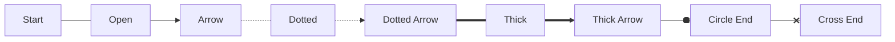
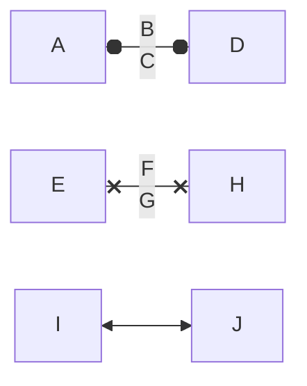

# Mermaid Specification (Consolidated)

**Status:** Consolidated specification (amalgamated from the `Mermaid_*.md` documents in this repository root)  
**Last updated:** 2026-04-25  
**Primary scope:** Mermaid **flowchart** geometry + edge routing + line-end markers (for exact reproduction, SVG extraction, or manual technical drawing)  
**Secondary scope:** Rendering Mermaid **inside .NET 10 / C# 14 applications** (in-process vs browser-hosted strategies)

---

## 1. Source documents and “latest truth” rule

This document is an amalgamation of the following repo-root files:

- `Mermaid_Flowchart_Geometry_And_Line_Ends_Specification.md`
- `Mermaid_Flowchart_Geometry_And_Line_Ends_Specification_Reviewed.md`
- `Mermaid_Flowchart_Geometry_And_Line_Ends_Specification_Shape_Catalogue_Expanded.md`
- `Mermaid_Flowchart_Geometry_And_Line_Ends_Specification_Section_8_Closed.md`
- `Mermaid_Flowchart_Geometry_And_Line_Ends_Specification_Gaps_Closed.md` (**most recent; authoritative for flowchart geometry/markers/shapes**)
- `Mermaid_Typescript_closure.md` (**authoritative closure register for source accountability and “what is closed” definitions**)
- `Mermaid_In_App_Rendering_DotNet10_CSharp14_April_2026.md`

Where statements conflict, the **newest** source is considered authoritative. In practice:

- **Flowchart geometry, line ends, and shape catalogue**: `Mermaid_Flowchart_Geometry_And_Line_Ends_Specification_Gaps_Closed.md` is the authoritative basis.
- **.NET application rendering architecture**: `Mermaid_In_App_Rendering_DotNet10_CSharp14_April_2026.md` is authoritative for host/packaging/interop guidance.

Notes:

- An incidental “Python file write” snippet appears at the end of one older document; it is **not part of the specification** and is excluded.

---

## 2. Purpose

Mermaid does not provide a single universal table of drawing constants.

**Exact reproduction** of Mermaid flowcharts requires tracing the whole pipeline:

- parsing and internal model creation
- label rendering and measurement
- layout engine output (Dagre/ELK/etc.)
- node shape rendering
- edge routing and curve/path generation
- line shortening/offset logic for markers
- marker attachment (SVG markers)
- style/theme/CSS resolution into concrete drawing values

This specification captures:

- what must be pinned for “exactness”
- confirmed baseline geometry rules (rectangles and polygon insertion)
- confirmed marker (arrow/circle/cross) geometry and placement maths
- a closed flowchart shape catalogue (geometry-level summaries, plus selected full formulae)
- what remains “version pinning / runtime measurement / mapping” risk
- .NET in-app rendering options and recommended architecture

---

## 3. Version locking requirement (non-negotiable for exact output)

Exact drawing is only meaningful after locking:

| Item | Required value |
|---|---|
| Mermaid version | Exact npm version or Git commit hash |
| Mermaid package/source | `mermaid` npm package or official GitHub checkout |
| Diagram type | `flowchart` / `graph` |
| Layout engine | `dagre`, `elk`, or other configured layout |
| Theme | `default`, `base`, `dark`, or custom |
| Font family | Exact resolved font, not just CSS fallback list |
| Font size/weight | Effective values |
| Browser/runtime | Chromium/Firefox/WebKit/jsdom/Node SVG runtime, etc. |
| HTML labels | Enabled/disabled |
| Security level | Mermaid configuration value |
| Style sources | Mermaid-generated styles + theme variables + inline styles + inherited/defaults, resolved to concrete values |

Without pinning these, any geometry specification can only be approximate.

---

## 4. Rendering pipeline (what must be traced)

```text
Mermaid source text
    ↓
Diagram parser
    ↓
Flowchart database / internal model
    ↓
Node, edge, label and subgraph normalisation
    ↓
Label rendering and measurement
    ↓
Layout engine input graph
    ↓
Layout engine output graph
    ↓
Node shape renderer
    ↓
Edge path renderer
    ↓
Line shortening / marker offset logic
    ↓
Marker attachment
    ↓
Style/theme application, then resolution into concrete drawing values
    ↓
Final SVG with viewBox and transforms
```

Practical guidance: for “exactness”, treat the final SVG as the most authoritative artefact because it contains resolved primitives, markers, paths, and transforms **after** the pipeline has executed.

---

## 5. Coordinate model (node-local space)

Flowchart node shapes are generally drawn in a node `<g>` whose origin is the **node centre**.

For a node with final visual width `W` and height `H`:

```text
LocalLeft   = -W / 2
LocalRight  =  W / 2
LocalTop    = -H / 2
LocalBottom =  H / 2
```

Global placement is then:

```text
GlobalPoint = NodeGroupTranslate + LocalPoint
```

---

## 6. Confirmed rectangle geometry (baseline)

Inputs:

```text
LabelBBoxWidth
LabelBBoxHeight
LabelPaddingX
LabelPaddingY
OptionalNodeWidth
OptionalNodeHeight
OptionalRx
OptionalRy
```

Confirmed rule:

```text
TotalWidth  = max(LabelBBoxWidth  + (LabelPaddingX * 2), OptionalNodeWidth  or 0)
TotalHeight = max(LabelBBoxHeight + (LabelPaddingY * 2), OptionalNodeHeight or 0)
X = -TotalWidth / 2
Y = -TotalHeight / 2
```

SVG equivalent:

```xml
<rect
  x="-TotalWidth / 2"
  y="-TotalHeight / 2"
  width="TotalWidth"
  height="TotalHeight"
  rx="Rx"
  ry="Ry" />
```

Boundary intersection:

- Rectangle nodes use rectangle intersection, so edges should terminate at the rectangle boundary, not the centre.

---

## 7. Confirmed generic polygon insertion rule

Many shapes provide a point list to a shared polygon helper that:

- serialises `Points[]` to `"x1,y1 x2,y2 ..."`
- applies:

```text
translate(-W / 2, H / 2)
```

Therefore, for any polygon-based shape, a shape-supplied point `(x, y)` becomes:

```text
RenderedPointX = x - W / 2
RenderedPointY = y + H / 2
```

Then the node `<g>` translation places the polygon in global space.

---

## 8. Node boundary intersection (principle)

Edges do not terminate at node centres. They terminate at the boundary intersection between the routed edge path and the node boundary, then:

- marker offset / line shortening logic is applied
- markers are attached (SVG markers)

Confirmed for rectangle:

```text
node.calcIntersect = intersect.rect
node.intersect = intersect.rect
```

All other shapes require confirmation of which intersection rule they use (rectangle/ellipse/polygon/cylinder-specific/custom).

---

## 9. Edge syntax and stroke styles (flowchart level)

Mermaid edge syntax encodes line pattern + marker type. Common forms:

| Syntax | Meaning | Stroke pattern | Marker |
|---|---|---|---|
| `A --- B` | open line | solid | none |
| `A --> B` | arrow line | solid | arrow point end |
| `A -.- B` | dotted/open line | dotted | none |
| `A -.-> B` | dotted arrow | dotted | arrow point end |
| `A === B` | thick/open line | solid (thicker) | none |
| `A ==> B` | thick arrow | solid (thicker) | arrow point end |
| `A -- text --- B` | labelled open line | solid | none |
| `A -- text --> B` | labelled arrow | solid | arrow point end |
| `A o-- B` / `A --o B` | circle marker | solid | circle at start/end |
| `A x-- B` / `A --x B` | cross marker | solid | cross at start/end |

Important parser nuance: `A---oB` and `A---xB` are treated as circle/cross line ends, not node IDs beginning with `o` or `x`.

---

## 10. Edge path generation (exact reproduction rule)

Edge geometry is not simply a line between node centres. For exact reproduction, capture:

```text
SourceNodeId
TargetNodeId
SourceShapeBoundaryIntersection
TargetShapeBoundaryIntersection
Intermediate route points
Curve factory/function
Generated SVG path d
Stroke width
Stroke dash array
Marker start
Marker end
```

Manual drawing approach:

1. Read the generated SVG `d` for the edge.
2. Resolve transforms.
3. Draw each SVG command in sequence.
4. Attach markers using marker reference points and tangent angle.

---

## 11. Markers and line-end geometry (confirmed core flowchart markers)

### 11.1 Marker attachment model

Markers are SVG `<marker>` definitions referenced by `marker-start` / `marker-end`. They are not part of the edge path itself.

General model:

```text
MarkerLocalGeometry = marker path/circle/polygon defined in marker co-ordinates
ReferencePoint = (refX, refY)
MarkerOrient = auto
EdgeTangentAngle = direction of path at attachment
FinalMarker = rotate(MarkerLocalGeometry, EdgeTangentAngle)
            + translate so ReferencePoint coincides with adjusted edge endpoint
```

### 11.2 Tangent angle

Straight segment:

```text
AngleEnd   = atan2(EndY - PreviousY, EndX - PreviousX)
AngleStart = atan2(StartY - NextY,   StartX - NextX)
```

Curves require the tangent (Bezier derivative at `t=0`/`t=1`, arc tangent, etc.).

### 11.3 Marker placement maths (non-SVG renderers)

For a marker-local point `Pm = (Xm, Ym)`:

```text
Dx = Xm - RefX
Dy = Ym - RefY

RotatedX = Dx * cos(θ) - Dy * sin(θ)
RotatedY = Dx * sin(θ) + Dy * cos(θ)

GlobalX = Xe + RotatedX
GlobalY = Ye + RotatedY
```

For circles:

```text
GlobalCircleCentre = Pe + Rotate((Cx - RefX, Cy - RefY), θ)
GlobalRadius       = r
```

### 11.4 Marker families relevant to flowcharts

Core flowchart line ends:

- `arrow_point` (point)
- `arrow_circle` (circle)
- `arrow_cross` (cross)

The source also includes additional marker families (aggregation, extension, composition, dependency, lollipop, cardinalities, requirement markers) that are relevant to other Mermaid diagram types.

---

## 12. Marker offset and line shortening (critical for visual correctness)

Mermaid uses several related mechanisms around markers. It is important not to conflate them, because they affect different parts of rendering:

- Marker geometry and anchoring (marker `refX` / `refY`) controls where the glyph sits relative to the *path endpoint*.
- In some looks/configurations, Mermaid adjusts dash patterns so the dashes do not visually run underneath markers.
- In some code paths (notably for rounded paths), Mermaid may adjust the first/last points when specific marker types are used.

For the default flowchart look, Mermaid relies primarily on marker anchoring plus draw order (marker drawn at the path end), with an important consequence:

- The connector stroke should **not** touch certain terminal glyphs (especially cross), and in Mermaid this is achieved primarily by **marker `refX`** values that place the glyph slightly ahead of the path endpoint, leaving a small gap between the stroke end and the glyph.

Offset tables (source-defined constants):

```text
markerOffsets:
    aggregation:     17.25
    extension:       17.25
    composition:     17.25
    dependency:      6
    lollipop:        13.5
    arrow_point:     4
    arrow_barb:      0
    arrow_barb_neo:  5.5

markerOffsets2:
    arrow_point:     4
    arrow_cross:     12.5
    arrow_circle:    12.5
```

Where these are used (Mermaid upstream, flowcharts):

- `packages/mermaid/src/rendering-util/rendering-elements/edges.js` uses `markerOffsets2` for **dash array shaping** when `edge.look === 'neo'` (so dash/gap placement respects terminal markers).
- The `-margin` marker variants are selected only when `useMargin = !animatedEdge && edge.look === 'neo'` (see `addEdgeMarkers(... useMargin ...)` call in the same file).
- For default look terminals (non-neo), `circleEnd` and `crossEnd` are placed via marker `refX`/`refY` without additional endpoint “stand-off” trimming. The connector visually meets the terminal marker (connected), matching Mermaid’s reference output.
- For correct parity, “connected” here means **consistent small gaps** (not a large stand-off). These gaps arise from:
  - **node-edge-to-glyph** distance: governed by where the layout/intersection places the path endpoint relative to the node boundary, plus the marker’s effective forward extent.
  - **stroke-to-glyph** distance: for circle/cross terminals in the default look, governed primarily by marker `refX` being larger than the glyph’s max X (so the glyph is placed ahead of the stroke endpoint).

Practical consequence:

- Do not treat `markerOffsets2` as a general “trim the endpoint by this amount” table. In flowcharts it primarily exists to keep **dash patterns** from colliding with end markers under the **neo** look, and for specific path-generation paths.
- If you implement endpoint trimming for markers, ensure it matches the exact Mermaid code path and look; otherwise you will introduce inconsistent stand-off distances (for example circle/cross pushed away from the node compared to arrows).

Remaining ambiguity to trace for a pinned version:

- which call path selects `markerOffsets` vs `markerOffsets2`
- when `-margin` marker variants are selected (`useMargin`)

---

## 13. Confirmed marker definitions (point, circle, cross)

The following are source-traced marker definitions and local geometry.

### 13.1 Point arrowhead markers

**Point End marker**

```text
viewBox:            0 0 10 10
refX/refY:          5, 5
markerUnits:        userSpaceOnUse
markerWidth/Height: 8, 8
orient:             auto
path:               M 0 0 L 10 5 L 0 10 z
stroke-width:       1
```

Vertices: `(0,0)`, `(10,5)`, `(0,10)`, closed.

**Point Start marker**

```text
viewBox:            0 0 10 10
refX/refY:          4.5, 5
markerUnits:        userSpaceOnUse
markerWidth/Height: 8, 8
orient:             auto
path:               M 0 5 L 10 10 L 10 0 z
stroke-width:       1
```

Vertices: `(0,5)`, `(10,10)`, `(10,0)`, closed. Reference point is offset by `0.5` in x relative to the bounding-box centre.

**Point End margin marker**

```text
viewBox:            0 0 11.5 14
refX/refY:          11.5, 7
markerWidth/Height: 10.5, 14
path:               M 0 0 L 11.5 7 L 0 14 z
stroke-width:       0
```

Reference point is the apex `(11.5, 7)`.

**Point Start margin marker**

```text
viewBox:            0 0 11.5 14
refX/refY:          1, 7
markerWidth/Height: 11.5, 14
polygon points:     0,7 11.5,14 11.5,0
stroke-width:       0
```

Reference point is one unit to the right of the apex.

### 13.2 Circle markers

**Circle End marker**

```text
viewBox:            0 0 10 10
refX/refY:          11, 5
markerWidth/Height: 11, 11
circle:             cx=5, cy=5, r=5
stroke-width:       1
```

Reference point is `6` units right of centre and `1` beyond the circle boundary.

**Circle Start marker**

```text
viewBox:            0 0 10 10
refX/refY:          -1, 5
markerWidth/Height: 11, 11
circle:             cx=5, cy=5, r=5
stroke-width:       1
```

**Circle End margin marker**

```text
viewBox:            0 0 10 10
refX/refY:          12.25, 5
markerWidth/Height: 14, 14
circle:             cx=5, cy=5, r=5
stroke-width:       0
```

**Circle Start margin marker**

```text
viewBox:            0 0 10 10
refX/refY:          -2, 5
markerWidth/Height: 14, 14
circle:             cx=5, cy=5, r=5
stroke-width:       0
```

### 13.3 Cross markers

**Cross End marker**

```text
viewBox:            0 0 11 11
refX/refY:          12, 5.2
markerWidth/Height: 11, 11
path:               M 1,1 l 9,9 M 10,1 l -9,9
stroke-width:       2
```

Segments:

- `(1,1)` → `(10,10)`
- `(10,1)` → `(1,10)`

Cross centre: `(5.5, 5.5)`. Offset relative to ref: `(-6.5, 0.3)`.

**Cross Start marker**

```text
viewBox:            0 0 11 11
refX/refY:          -1, 5.2
markerWidth/Height: 11, 11
path:               M 1,1 l 9,9 M 10,1 l -9,9
stroke-width:       2
```

**Cross End margin marker**

```text
viewBox:            0 0 15 15
refX/refY:          17.7, 7.5
markerWidth/Height: 12, 12
path:               M 1,1 L 14,14 M 1,14 L 14,1
stroke-width:       2.5
```

**Cross Start margin marker**

```text
viewBox:            0 0 15 15
refX/refY:          -3.5, 7.5
markerWidth/Height: 12, 12
path:               M 1,1 L 14,14 M 1,14 L 14,1
stroke-width:       2.5
```

---

## 14. Style and theme resolution (CSS is evidence, not an instruction)

CSS is not a manual drawing instruction. For manual drawing and most non-browser renderers, CSS/classes must be resolved into concrete values.

Required resolved outputs (per visible element):

```text
Fill colour/opacity
Stroke colour/opacity
Stroke width
Stroke dash array
Stroke linecap/linejoin/miterlimit
Font family/size/weight/style
Text alignment/anchor
Marker start/mid/end
Marker fill/stroke/stroke width
```

Style sources in Mermaid SVG may include:

- theme variables
- generated `<style>` blocks inside SVG
- CSS classes
- inline `style` attributes
- presentation attributes (`stroke="..."`)
- inheritance
- browser defaults

Exact reproduction requires computing effective style for each element in the pinned runtime.

---

## 14A. Entity relationship (ER) diagram: relationship paths and cardinality line ends (source-traced)

This section captures **source-traced** ER relationship rendering details from the local Mermaid upstream checkout (`.\mermaid\`).

### 14A.1 Relationship path generation

Mermaid’s ER renderer constructs relationship geometry from **Dagre layout edge route points**, then uses a **D3 basis spline**:

- Mermaid source: `packages/mermaid/src/diagrams/er/erRenderer.js`
- Path generator:
  - D3 `line()` with `.curve(curveBasis)`
  - `d = lineFunction(edge.points)`

Practical consequence:

- The **end-of-path tangent** is determined by the final spline segment through the last two route points. Marker placement and orientation therefore depend on the **path**, not only on the endpoints.

### 14A.1B Naiad implementation notes (April 2026, Word-first)

The Naiad-based renderer in this repository is validated primarily against **Word’s SVG renderer** (DOCX output), so the practical “what works” notes below are intentionally renderer-specific.

- **ER scenario 1 is now correct (Word + extracted SVG)**: the “gold standard” `CUSTOMER / ORDER / PRODUCT / LINE_ITEM` relationship geometry and cardinality line ends now match Mermaid closely enough to treat this fixture as **closed** for geometry purposes.
  - **Relationship path rule**: use Mermaid’s approach of `curveBasis` over Dagre route points (`edge.points`). For the scenario-1 shoulder relationships, this reduces to a 3-point route:
    - `P0` (source anchor)
    - `P1 = (P0.X, (P0.Y + P3.Y) / 2)` (vertical down segment)
    - `P3` (target anchor)
  - **Cardinality rule**: use Mermaid-style SVG `<marker>` definitions (from `erMarkers.js`) applied with `marker-start` / `marker-end`, and rely on `orient="auto"` for tangent alignment.
  - **Marker attribute rule (Word parity)**: match Mermaid’s marker attributes literally for this fixture (no additional `viewBox` / `markerUnits` attributes), because Word’s SVG marker renderer is sensitive to marker coordinate-system hints.

### 14A.1C Repository baseline: quoted relationship labels opt-in to “fixture” routing (intentional divergence)

Mermaid.js does **not** use relationship label quoting as a semantic input to path routing. However, for this repository’s Word-first parity goals we intentionally treat **quoted** relationship labels as an opt-in signal for “fixture-style” routing and label placement.

Rule (baseline):

- If an ER relationship label is quoted (starts and ends with `"`), render it using the same “fixture/matrix” settings as the cardinality+line-style matrix:
  - Use the hybrid path builder that preserves **literal minimum straight segments** at both ends (do not rely on `curveBasis` to preserve them).
  - Use deterministic fixture label placement (aligned to the target entity centre X and the midpoint between entity centres Y), rather than the scenario-1 vertical offset.

Examples from `test.md` that are treated as fixtures under this rule:

- Cardinality matrix labels like `"||--o{"`, `"||..|{"`, etc.
- Fan-in / fan-out stress labels like `"1:2 A"`, `"1:8 5"`, etc.

### 14A.1A Anchor selection must distinguish fan-out vs fan-in (renderer rule)

When selecting ER relationship anchors (ports) for vertical layouts, do **not** apply a single “side slot” policy to both of these cases:

- **one-to-many fan-out**: one source entity connecting to many target entities
- **many-to-one fan-in**: many source entities connecting into one target entity

These cases are visually and geometrically different. The core principle is:

- The chosen anchor slots should sit on the part of the entity boundary that visually **faces the relationship group**.

Practical rules:

- **Fan-out hub (one source → many targets)**:
  - If the target group is **below** the source, bias the **source** to **lower** side anchors (e.g. 3L/4L and 4R/3R).
  - If the target group is **above** the source, bias the **source** to **upper** side anchors (e.g. 1L/2L and 2R/1R).

- **Fan-in hub (many sources → one target)**:
  - If the source group is **above** the target, bias the **target** to **upper** side anchors (e.g. 1L/2L and 2R/1R), or to **top-edge** anchors where relationships approach primarily from above.
  - If the source group is **below** the target, bias the **target** to **lower** side anchors (e.g. 3L/4L and 4R/3R), or to **bottom-edge** anchors where relationships approach primarily from below.

### 14A.2 Identifying vs non-identifying relationship stroke style

Non-identifying relationships are dashed:

- Mermaid source: `packages/mermaid/src/diagrams/er/erRenderer.js` and `packages/mermaid/src/diagrams/er/styles.ts`
- Dash pattern:

```text
stroke-dasharray: 8,8
```

### 14A.3 Cardinality line ends are SVG markers (not hand-drawn at arbitrary offsets)

ER diagram cardinalities are implemented as SVG `<marker>` definitions and applied as:

- `marker-start` for the B-side cardinality
- `marker-end` for the A-side cardinality

Mermaid source: `packages/mermaid/src/diagrams/er/erMarkers.js` and `packages/mermaid/src/diagrams/er/erRenderer.js`

---

## 14B. Gantt diagram: axis, grid, sections, and task bars (source-traced)

This section captures **source-traced** Gantt rendering behaviour from the local Mermaid upstream checkout (`.\mermaid\`).

### 14B.1 Mermaid’s renderer is D3 + CSS classes

Mermaid’s Gantt renderer is implemented in:

- Mermaid source: `packages/mermaid/src/diagrams/gantt/ganttRenderer.js`
- Stylesheet generator: `packages/mermaid/src/diagrams/gantt/styles.js`

Key points:

- The renderer builds SVG elements and assigns **CSS classes** (e.g. `.grid`, `.section`, `.task`, `.active`, `.done`).
- The default theme provides the effective colours via **theme variables** (see `packages/mermaid/src/themes/theme-default.js`).

### 14B.2 Axis + grid

Mermaid draws the Gantt time axis and grid using D3 axes:

- Grid group: `<g class="grid"> ... </g>`
- Each tick draws a vertical grid line using a negative tick size (extends through the chart height).
- Tick labels use the axis format (`axisFormat`) and are centred under their ticks.

Default sizing and paddings (source: `packages/mermaid/src/diagrams/gantt/ganttRenderer.js` + `packages/mermaid/src/schemas/config.schema.yaml`):

- **Default width**: `w = 1200` (unless `gantt.useWidth` is configured)
- **leftPadding**: 75
- **rightPadding**: 75
- **topPadding**: 50
- **titleTopMargin**: 25
- **gridLineStartPadding**: 35
- **barHeight**: 20
- **barGap**: 4

Axis placement:

- The axis tick labels live at the **bottom** of the chart (D3 axis translated to approximately `y = h - 50`), and the vertical grid lines extend up to `gridLineStartPadding`.

Repository baseline for Word/DOCX parity:

- Prefer a **daily** vertical grid cadence for short ranges (like the `test.md` fixture showing `01..10`), matching VS Code’s default look.

### 14B.3 Section bands (row backgrounds)

Mermaid draws full-width section-row background rectangles behind tasks:

- CSS: `.section { opacity: 0.2; stroke: none; }`
- Section styles alternate via `section0..section3` using `sectionBkgColor`, `altSectionBkgColor`, `sectionBkgColor2` (default theme).

For the `test.md` fixture, the section header band for `Build` uses:

- `sectionBkgColor = rgba(102, 102, 255, 0.49)` (default theme)

### 14B.4 Task bars and labels

Mermaid renders task bars as rounded rectangles:

- `rx = 3`, `ry = 3`
- Border uses `taskBorderColor` (default theme: `#534fbc`)
- Fill colour depends on status:
  - Default: `taskBkgColor` (default theme: `#8a90dd`)
  - Active: `activeTaskBkgColor` (default theme: `#bfc7ff`)
  - Done: `doneTaskBkgColor` (default theme: `lightgrey`)
  - Critical: `critBkgColor` (default theme: `red`)

Task label rule:

- The **task name text** is the primary label (`d.task` in Mermaid), not the task id.
- If the label text does not fit inside the bar, Mermaid places it just outside the bar (left or right), otherwise centred within the bar.

Vertical markers (`vert`) (source: `packages/mermaid/src/diagrams/gantt/ganttRenderer.js`):

- Rendered as a thin task rect with:
  - `y = gridLineStartPadding`
  - `width = 0.08 * barHeight` (with default `barHeight=20` → `1.6px`)
  - `height = taskArray.length * (barHeight + barGap) + barHeight * 2`
- The `vert` label is placed below the chart at:
  - `y = gridLineStartPadding + taskArray.length * (barHeight + barGap) + 60`

Source-traced marker geometry (selected high-signal details):

- **ONLY_ONE**:
  - Start: `refX=0, refY=9, markerWidth=18, markerHeight=18`
    - `d="M9,0 L9,18 M15,0 L15,18"`
  - End: `refX=18, refY=9, markerWidth=18, markerHeight=18`
    - `d="M3,0 L3,18 M9,0 L9,18"`

- **ZERO_OR_ONE** (circle + bar):
  - Start: `refX=0, refY=9, markerWidth=30, markerHeight=18`
    - circle: `cx=21, cy=9, r=6` + `d="M9,0 L9,18"`
  - End: `refX=30, refY=9, markerWidth=30, markerHeight=18`
    - circle: `cx=9, cy=9, r=6` + `d="M21,0 L21,18"`

- **ONE_OR_MORE** (crow’s foot + bar):
  - Start: `refX=18, refY=18, markerWidth=45, markerHeight=36`
    - `d="M0,18 Q 18,0 36,18 Q 18,36 0,18 M42,9 L42,27"`
  - End: `refX=27, refY=18, markerWidth=45, markerHeight=36`
    - `d="M3,9 L3,27 M9,18 Q27,0 45,18 Q27,36 9,18"`

- **ZERO_OR_MORE** (circle + crow’s foot):
  - Start: `refX=18, refY=18, markerWidth=57, markerHeight=36`
    - circle: `cx=48, cy=18, r=6` + `d="M0,18 Q18,0 36,18 Q18,36 0,18"`
  - End: `refX=39, refY=18, markerWidth=57, markerHeight=36`
    - circle: `cx=9, cy=18, r=6` + `d="M21,18 Q39,0 57,18 Q39,36 21,18"`

Practical consequence:

- If crow’s-feet or circles appear offset from the relationship stroke, the **first thing to verify** is the **relationship path geometry near the endpoints** (because `orient="auto"` aligns markers to the path tangent).
- For Naiad/Word validation, prefer the “pinned embellishments” strategy described in **14A.1B** when you are not using SVG `<marker>` elements.

### 14A.4 Naiad ER line ends (current source-of-truth snapshot for reversion)

The following is a **verbatim snapshot** of Naiad’s current ER line-end configuration (marker IDs, marker geometry, and endpoint inset behaviour) as implemented in:

- `extern/Naiad/src/Naiad/Rendering/SvgBuilder.cs` (`AddMermaidErMarkers`)
- `extern/Naiad/src/Naiad/Diagrams/EntityRelationship/ERRenderer.cs` (marker assignment + endpoint insets)

#### 14A.4.1 Marker IDs and geometry (Naiad `AddMermaidErMarkers(...)`)

```csharp
public SvgBuilder AddMermaidErMarkers(string StrokeColor)
{
    var NormalisedStrokeColor = string.IsNullOrWhiteSpace(StrokeColor) ? "#333333" : StrokeColor;

    // MD_PARENT_START
    document.Defs.Markers.Add(new SvgMarker
    {
        Id = "MD_PARENT_START",
        Path = string.Empty,
        RefX = 0,
        RefY = 7,
        MarkerWidth = 190,
        MarkerHeight = 240,
        Orient = "auto",
        ViewBox = "0 0 20 14",
        MarkerUnits = "userSpaceOnUse",
        RawContent = "<path d=\"M 18,7 L9,13 L1,7 L9,1 Z\"/>"
    });

    // MD_PARENT_END
    document.Defs.Markers.Add(new SvgMarker
    {
        Id = "MD_PARENT_END",
        Path = string.Empty,
        RefX = 19,
        RefY = 7,
        MarkerWidth = 20,
        MarkerHeight = 28,
        Orient = "auto",
        ViewBox = "0 0 20 14",
        MarkerUnits = "userSpaceOnUse",
        RawContent = "<path d=\"M 18,7 L9,13 L1,7 L9,1 Z\"/>"
    });

    // ONLY_ONE_START
    document.Defs.Markers.Add(new SvgMarker
    {
        Id = "ONLY_ONE_START",
        Path = string.Empty,
        RefX = 0,
        RefY = 9,
        MarkerWidth = 18,
        MarkerHeight = 18,
        Orient = "auto",
        ViewBox = "0 0 18 18",
        MarkerUnits = "userSpaceOnUse",
        RawContent = $"<path stroke=\"{NormalisedStrokeColor}\" fill=\"none\" d=\"M9,0 L9,18 M15,0 L15,18\"/>"
    });

    // ONLY_ONE_END
    document.Defs.Markers.Add(new SvgMarker
    {
        Id = "ONLY_ONE_END",
        Path = string.Empty,
        RefX = 18,
        RefY = 9,
        MarkerWidth = 18,
        MarkerHeight = 18,
        Orient = "auto",
        ViewBox = "0 0 18 18",
        MarkerUnits = "userSpaceOnUse",
        RawContent = $"<path stroke=\"{NormalisedStrokeColor}\" fill=\"none\" d=\"M3,0 L3,18 M9,0 L9,18\"/>"
    });

    // ZERO_OR_ONE_START (circle + bar)
    document.Defs.Markers.Add(new SvgMarker
    {
        Id = "ZERO_OR_ONE_START",
        Path = string.Empty,
        RefX = 0,
        RefY = 9,
        MarkerWidth = 30,
        MarkerHeight = 18,
        Orient = "auto",
        ViewBox = "0 0 30 18",
        MarkerUnits = "userSpaceOnUse",
        RawContent =
            $"<circle stroke=\"{NormalisedStrokeColor}\" fill=\"white\" cx=\"21\" cy=\"9\" r=\"6\"/>" +
            $"<path stroke=\"{NormalisedStrokeColor}\" fill=\"none\" d=\"M9,0 L9,18\"/>"
    });

    // ZERO_OR_ONE_END
    document.Defs.Markers.Add(new SvgMarker
    {
        Id = "ZERO_OR_ONE_END",
        Path = string.Empty,
        RefX = 30,
        RefY = 9,
        MarkerWidth = 30,
        MarkerHeight = 18,
        Orient = "auto",
        ViewBox = "0 0 30 18",
        MarkerUnits = "userSpaceOnUse",
        RawContent =
            $"<circle stroke=\"{NormalisedStrokeColor}\" fill=\"white\" cx=\"9\" cy=\"9\" r=\"6\"/>" +
            $"<path stroke=\"{NormalisedStrokeColor}\" fill=\"none\" d=\"M21,0 L21,18\"/>"
    });

    // ONE_OR_MORE_START (crowfoot + bar)
    document.Defs.Markers.Add(new SvgMarker
    {
        Id = "ONE_OR_MORE_START",
        Path = string.Empty,
        RefX = 18,
        RefY = 18,
        MarkerWidth = 45,
        MarkerHeight = 36,
        Orient = "auto",
        ViewBox = "0 0 45 36",
        MarkerUnits = "userSpaceOnUse",
        RawContent =
            $"<path stroke=\"{NormalisedStrokeColor}\" fill=\"none\" d=\"M0,18 Q 18,0 36,18 Q 18,36 0,18 M42,9 L42,27\"/>"
    });

    // ONE_OR_MORE_END
    document.Defs.Markers.Add(new SvgMarker
    {
        Id = "ONE_OR_MORE_END",
        Path = string.Empty,
        RefX = 27,
        RefY = 18,
        MarkerWidth = 45,
        MarkerHeight = 36,
        Orient = "auto",
        ViewBox = "0 0 45 36",
        MarkerUnits = "userSpaceOnUse",
        RawContent =
            $"<path stroke=\"{NormalisedStrokeColor}\" fill=\"none\" d=\"M3,9 L3,27 M9,18 Q27,0 45,18 Q27,36 9,18\"/>"
    });

    // ZERO_OR_MORE_START (circle + crowfoot)
    document.Defs.Markers.Add(new SvgMarker
    {
        Id = "ZERO_OR_MORE_START",
        Path = string.Empty,
        RefX = 18,
        RefY = 18,
        MarkerWidth = 57,
        MarkerHeight = 36,
        Orient = "auto",
        ViewBox = "0 0 57 36",
        MarkerUnits = "userSpaceOnUse",
        RawContent =
            $"<circle stroke=\"{NormalisedStrokeColor}\" fill=\"white\" cx=\"48\" cy=\"18\" r=\"6\"/>" +
            $"<path stroke=\"{NormalisedStrokeColor}\" fill=\"none\" d=\"M0,18 Q18,0 36,18 Q18,36 0,18\"/>"
    });

    // ZERO_OR_MORE_END
    document.Defs.Markers.Add(new SvgMarker
    {
        Id = "ZERO_OR_MORE_END",
        Path = string.Empty,
        RefX = 39,
        RefY = 18,
        MarkerWidth = 57,
        MarkerHeight = 36,
        Orient = "auto",
        ViewBox = "0 0 57 36",
        MarkerUnits = "userSpaceOnUse",
        RawContent =
            $"<circle stroke=\"{NormalisedStrokeColor}\" fill=\"white\" cx=\"9\" cy=\"18\" r=\"6\"/>" +
            $"<path stroke=\"{NormalisedStrokeColor}\" fill=\"none\" d=\"M21,18 Q39,0 57,18 Q39,36 21,18\"/>"
    });

    return this;
}
```

#### 14A.4.2 Marker assignment and endpoint inset behaviour (Naiad `ERRenderer`)

```csharp
// Mermaid ER uses marker-start for the B-side cardinality and marker-end for the A-side cardinality.
// With our model mapping SourceId=FromEntity (A-side) and TargetId=ToEntity (B-side), that means:
// - marker-start: ToCardinality
// - marker-end:   FromCardinality
var MarkerStart = GetCardinalityMarkerUrl(rel.ToCardinality, true);
var MarkerEnd = GetCardinalityMarkerUrl(rel.FromCardinality, false);

// Mermaid’s ER renderer conceptually treats the relationship as running from entityB -> entityA, so that:
// - marker-start shows the B-side cardinality
// - marker-end shows the A-side cardinality
// We keep Naiad's computed geometry points intact, but reverse the draw direction to match Mermaid semantics.
List<Position> MermaidDirectionPoints = new List<Position>(RoutedPoints);
MermaidDirectionPoints.Reverse();

// In Word, ER markers can appear to "float" away from the entity edge unless the path endpoint is inset
// into the rectangle by the marker's near-component offset. Mermaid's Dagre edge endpoints effectively
// account for this; replicate that by nudging the start/end points along the local tangent.
ApplyErMarkerEndpointInsets(MermaidDirectionPoints, MarkerStart, MarkerEnd);
```

Endpoint inset constants currently used by Naiad:

```csharp
static double GetErMarkerInsetPx(string MarkerUrl, bool isStart)
{
    // MarkerUrl is just the id in Naiad (not "url(#...)"), but tolerate either.
    string Id = MarkerUrl;
    if (Id.StartsWith("url(#", StringComparison.Ordinal) && Id.EndsWith(')'))
    {
        Id = Id.Substring(5, Id.Length - 6);
    }

    // Word renders ER start markers slightly "ahead" of the endpoint unless the endpoint is inset.
    // Inset by the near-component offset for each marker's geometry (matching Mermaid's erMarkers.js).
    if (isStart)
    {
        if (string.Equals(Id, "ONLY_ONE_START", StringComparison.Ordinal))
        {
            return 9;
        }
        if (string.Equals(Id, "ZERO_OR_ONE_START", StringComparison.Ordinal))
        {
            return 9;
        }
        if (string.Equals(Id, "ONE_OR_MORE_START", StringComparison.Ordinal))
        {
            return 18;
        }
        if (string.Equals(Id, "ZERO_OR_MORE_START", StringComparison.Ordinal))
        {
            return 18;
        }
        if (string.Equals(Id, "MD_PARENT_START", StringComparison.Ordinal))
        {
            return 9;
        }
    }

    // End markers are defined so their near components sit behind the endpoint (they naturally overlap the box).
    return 0;
}
```

#### 14A.4.3 Relationship line routing (Naiad layout: `CoordinateAssignment.RouteEdges`)

This is the code path that produces the ER relationship **polyline control points** (`edge.Points`) that are later converted into a **curveBasis** SVG path by the ER renderer.

```csharp
public static void RouteEdges(LayoutGraph graph, Direction direction, GraphDiagramBase? diagram = null)
{
    var isHorizontal = direction is Direction.LeftToRight or Direction.RightToLeft;
    bool UseErPorts = diagram is MermaidSharp.Diagrams.EntityRelationship.ERLayoutGraph;

    Dictionary<LayoutEdge, (double SourceX, double SourceY, double TargetX, double TargetY)>? ErAttachByEdge = null;
    if (!isHorizontal && UseErPorts)
    {
        ErAttachByEdge = BuildErVerticalAttachPoints(graph);
    }

    foreach (var edge in graph.Edges)
    {
        var source = graph.GetNode(edge.SourceId);
        var target = graph.GetNode(edge.TargetId);

        if (source is null || target is null)
        {
            continue;
        }

        edge.Points.Clear();

        if (source.IsDummy || target.IsDummy)
        {
            edge.Points.Add(new(source.X, source.Y));
            edge.Points.Add(new(target.X, target.Y));
        }
        else
        {
            double sourceEdgeX;
            double sourceEdgeY;
            double targetEdgeXNoShorten;
            double targetEdgeYNoShorten;

            if (isHorizontal)
            {
                sourceEdgeX = source.X + source.Width / 2 + FlowchartEdgeNodeGap;
                sourceEdgeY = source.Y;
                targetEdgeXNoShorten = target.X - target.Width / 2 - FlowchartEdgeNodeGap;
                targetEdgeYNoShorten = target.Y;
            }
            else
            {
                if (UseErPorts && ErAttachByEdge is not null
                    && ErAttachByEdge.TryGetValue(edge, out (double SourceX, double SourceY, double TargetX, double TargetY) ErAttach))
                {
                    sourceEdgeX = ErAttach.SourceX;
                    sourceEdgeY = ErAttach.SourceY;
                    targetEdgeXNoShorten = ErAttach.TargetX;
                    targetEdgeYNoShorten = ErAttach.TargetY;
                }
                else
                {
                    PlaceVerticalFlowSourceOnCentreRayTowardTarget(source, target, out sourceEdgeX, out sourceEdgeY);
                    targetEdgeXNoShorten = target.X;
                    targetEdgeYNoShorten = target.Y - target.Height / 2 - FlowchartEdgeNodeGap;
                }
            }

            edge.Points.Add(new(sourceEdgeX, sourceEdgeY));

            if (dummyLookup.TryGetValue((edge.SourceId, edge.TargetId), out var dummies))
            {
                foreach (var dummy in dummies)
                {
                    edge.Points.Add(new(dummy.X, dummy.Y));
                }
            }
            else if (UseErPorts && !isHorizontal)
            {
                var Dx = targetEdgeXNoShorten - sourceEdgeX;
                var AbsDx = Math.Abs(Dx);
                var SignX = Dx >= 0 ? 1.0 : -1.0;

                var BulgeX = Math.Min(90.0, Math.Max(35.0, AbsDx * 0.35));
                var MidY = (sourceEdgeY + targetEdgeYNoShorten) * 0.5;

                edge.Points.Add(new(sourceEdgeX + SignX * BulgeX, MidY));
                edge.Points.Add(new(targetEdgeXNoShorten + SignX * BulgeX, MidY));
            }

            var targetEdgeX = targetEdgeXNoShorten;
            var targetEdgeY = targetEdgeYNoShorten;

            var lastPoint = edge.Points[^1];
            var dx = targetEdgeX - lastPoint.X;
            var dy = targetEdgeY - lastPoint.Y;
            var length = Math.Sqrt(dx * dx + dy * dy);

            if (length > ArrowMarkerOffset)
            {
                var ratio = (length - ArrowMarkerOffset) / length;
                targetEdgeX = lastPoint.X + dx * ratio;
                targetEdgeY = lastPoint.Y + dy * ratio;
            }

            edge.Points.Add(new(targetEdgeX, targetEdgeY));
        }
    }
}
```

#### 14A.4.4 Relationship path generation and marker application (Naiad renderer: `ERRenderer`)

This is the code path that converts the routed points into the final SVG `<path>` and applies ER cardinality markers.

```csharp
var dashArray = rel.Identifying ? null : "8,8";
const double RelationshipStrokeWidth = 1.0;

List<Position> RoutedPoints = new List<Position>(layoutEdge.Points);

var MarkerStart = GetCardinalityMarkerUrl(rel.ToCardinality, true);
var MarkerEnd = GetCardinalityMarkerUrl(rel.FromCardinality, false);

List<Position> MermaidDirectionPoints = new List<Position>(RoutedPoints);
MermaidDirectionPoints.Reverse();

ApplyErMarkerEndpointInsets(MermaidDirectionPoints, MarkerStart, MarkerEnd);

var pointsForCurve = EnsureCurveableErEdgePoints(MermaidDirectionPoints, diagramCentre);
Position MermaidLabelPoint = Position.Zero;
string pathD = BuildCurveBasisPath(pointsForCurve, out MermaidLabelPoint);

builder.AddPath(pathD,
    fill: "none",
    stroke: "#333333",
    strokeWidth: RelationshipStrokeWidth,
    strokeDasharray: dashArray,
    markerStart: MarkerStart,
    markerEnd: MarkerEnd);
```

---

## 15. Flowchart shape catalogue (geometry status: closed at summary level)

The shape catalogue below is consolidated from the most recent “gaps closed” source and represents geometry-level summaries for flowchart shapes and selected extended shapes.

Key:

- **Closed**: traced far enough to specify primitive, size formula, main points/path formula, transforms, and boundary-intersection family.
- **Closed with dependency/caveat**: geometry depends on runtime measurement, handler mapping, or external assets.

### 15.1 Consolidated shape catalogue (status and summary)

| Semantic Name | Short | Status | Geometry summary (high level) |
|---|---:|---|---|
| Process / Rectangle | `rect` | Closed | Label-measured rectangle, centred on node. |
| Event / Rounded Rectangle | `rounded` | Closed with radius dependency | Rectangle machinery + resolved corner radii. |
| Terminal / Stadium | `stadium` | Closed | Pill from semicircles + tangents; `R = H/2`. |
| Subprocess / Framed Rectangle | `fr-rect` | Closed | Rectangle with left/right frame strips; `FRAME_WIDTH = 8`. |
| Database / Cylinder | `cyl` | Closed | Cylinder path; `rx=W/2`, `ry = rx / (2.5 + W/50)`; custom intersection adjustment. |
| Circle | `circle` | Closed | Label-width-derived radius; circle centred at `(0,0)`. |
| Small circle | `sm-circ` | Closed | Default/min width/height 14; radius = width/2. |
| Double circle | `dbl-circ` | Closed | Two concentric circles; gap depends on `look`. |
| Framed circle | `fr-circ` | Closed | Outer circle + inner filled circle; default/min 14; inner diameter `width*5/14`. |
| Decision / Diamond | `diam` | Closed | Diamond polygon; `S = (BboxW+P)+(BboxH+P)`; includes 0.5 px adjustment. |
| Hexagon | `hex` | Closed | Six-point polygon; bevel `M = H/F` (`F=3.5 neo else 4`). |
| Lean right | `lean-r` | Closed | Parallelogram; skew `H/2`. |
| Lean left | `lean-l` | Closed | Parallelogram; skew `H/2`. |
| Trapezoid bottom | `trap-b` | Closed | Trapezoid with top wider by `H/2` each side. |
| Trapezoid top | `trap-t` | Closed | Trapezoid with bottom wider by `H/2` each side. |
| Notched rectangle (card) | `notch-rect` | Closed | Rectangle with top-left diagonal notch; `NOTCH_SIZE = 12`. |
| Lined rectangle | `lin-rect` | Closed | Rectangle-like outline + left divider; label shift. |
| Filled circle (junction) | `f-circ` | Closed | Fixed radius 7 filled circle. |
| Fork/Join bar | `fork` | Closed | Filled bar; min dims depend on diagram direction. |
| Hourglass | `hourglass` | Closed | Bow-tie/hourglass polygon; min 30×30; centred. |
| Curly brace left | `brace` | Closed | Sampled arc path; invisible envelope for intersection. |
| Curly brace right | `brace-r` | Closed | Sampled arc path; invisible envelope for intersection. |
| Curly braces | `braces` | Closed | Left+right brace strokes + invisible envelope. |
| Lightning bolt | `bolt` | Closed | Zig-zag polygon; min 35; gap 7; centred. |
| Document | `doc` | Closed with mapping caveat | Wave-edged rectangle family; verify semantic mapping in pinned release. |
| Lined document | `lin-doc` | Closed | Wave-edged outline + extra internal line; sampled sine wave (50 steps). |
| Stacked documents | `docs` | Closed | Stacked outlines + wave bottom; offsets. |
| Delay (half-rounded rect) | `delay` | Closed | Rectangle + sampled semicircular end; `R=H/2`. |
| Horizontal cylinder | `h-cyl` | Closed | Tilted cylinder; `ry=H/2`, `rx = ry / (2.5 + H/50)`; custom intersection. |
| Lined cylinder | `lin-cyl` | Closed | Cylinder + extra internal arc; `OuterOffset=H*0.1`. |
| Curved trapezoid | `curv-trap` | Closed | Mixed straight + sampled arc side; `R=H/2`. |
| Divided rectangle | `div-rect` | Closed | Rectangle + top band divider; `RectOffset=H*0.2`. |
| Triangle | `tri` | Closed | Up triangle; `TW=H`; label transform is special. |
| Flipped triangle | `flip-tri` | Closed | Down triangle; `TW=H`; label transform is special. |
| Window pane | `win-pane` | Closed | Rectangle + top/left dividers; `RectOffset=10`. |
| Notched pentagon | `notch-pent` | Closed | Polygon with narrowed top and shoulder points. |
| Sloped rectangle | `sl-rect` | Closed | Quadrilateral with slope; translated by `H/4`. |
| Stacked rectangle | `st-rect` | Closed | Multi-rect stack; offsets depend on `look`. |
| Flag / paper tape | `flag` | Closed | Wave rectangle family; sine wave sampled at 50 steps. |
| Bow-tie rectangle | `bow-rect` | Closed | Rectangle with inward elliptical side arcs; arc points sampled. |
| Crossed circle | `cross-circ` | Closed | Circle + 45-degree cross lines; radius max(30, width). |
| Tagged document | `tag-doc` | Closed | Wave-edged rectangle + tag geometry; ratios based. |
| Tagged process | `tag-rect` | Closed | Rectangle + triangular tag; ratio based. |
| Text block | `text` | Closed | Rectangular hit-box; visible stroke/fill depends on style; rectangle intersection. |
| Odd | `odd` | Closed | Rectangle with left inverse arrow notch; centred via transform. |
| Bang | `bang` | Closed | Complex arc path outline; uses rectangle intersection. |
| Icon | `icon` | Closed with external dependency | Depends on icon pack SVG bounds + wrapper. |
| Image | `image` | Closed with external dependency | Depends on natural image size, constraints, label placement. |

---

## 16. Selected closed shape formulae (high-signal details)

This section consolidates the highest-signal “fully spelled out” formulae from the latest flowchart specification. Where a shape has complex sampled point generation, the key requirement is: **use the same sampling algorithm/step count as Mermaid** for exact SVG equality.

### 16.1 Circle (`circle`)

```text
LabelPadding = 16
Padding = options.padding ?? halfPadding
Radius = if Look == neo then (BboxW / 2) + (LabelPadding * 2)
         else (BboxW / 2) + Padding
cx = 0
cy = 0
r = Radius
Intersection = circle intersection using Radius
```

### 16.2 Double circle (`dbl-circ`)

```text
Gap = if Look == neo then 12 else 5
LabelPadding = if Look == neo then 16 else P
OuterRadius = if node.width exists then (node.width / 2) + LabelPadding
              else (BboxW / 2) + LabelPadding
InnerRadius = OuterRadius - Gap
Intersection = circle intersection using OuterRadius
```

### 16.3 Filled circle (`f-circ`)

```text
Radius = 7
Centre = (0, 0)
Intersection = circle intersection using Radius
```

### 16.4 Diamond (`diam`)

```text
W0 = BboxW + P
H0 = BboxH + P
S = W0 + H0
Adjustment = 0.5

Points before transform:
    (S / 2, 0)
    (S, -S / 2)
    (S / 2, -S)
    (0, -S / 2)
Transform:
    translate(-S / 2 + 0.5, S / 2)
Intersection = polygon intersection, then adjusted by (-0.5, -0.5)
```

### 16.5 Hexagon (`hex`)

```text
F = if Look == neo then 3.5 else 4
H = (node.height if present else BboxH) + LabelPaddingX
M = H / F
W = (node.width if present else BboxW) + (2 * M) + LabelPaddingY

Points before polygon-helper transform:
    (M, 0)
    (W - M, 0)
    (W, -H / 2)
    (W - M, -H)
    (M, -H)
    (0, -H / 2)
Intersection = polygon intersection
```

### 16.6 Lean left/right (`lean-l`, `lean-r`)

```text
Skew = H / 2
```

Point lists are as per the latest flowchart spec; apply the polygon-helper transform.

### 16.7 Trapezoids (`trap-b`, `trap-t`)

```text
Inset/Outset = H / 2
```

Point lists are as per the latest flowchart spec; apply the polygon-helper transform.

### 16.8 Stadium (`stadium`)

Key values:

```text
R = H / 2
```

For exact SVG equality in sampled-point implementations, reproduce Mermaid’s point sampling (not only analytic arcs).

### 16.9 Triangles (`tri`, `flip-tri`)

Key constraint:

```text
TW = H
```

Label placement uses a **special label transform** and must be reproduced from Mermaid output rather than assumed at geometric centre.

### 16.10 Wave-edged rectangle families (`doc`, `flag`, etc.)

Exactness depends on reproducing Mermaid’s sine-wave point generation:

```text
generateFullSineWavePoints(...)
Steps = 50
```

Use the same step count and formulas from the latest flowchart spec; do not substitute an analytic sine curve if you need byte-for-byte SVG equality.

---

## 17. Validation fixtures (recommended minimum)

### 17.1 Shape fixture

```mermaid
flowchart LR
    Rect@{ shape: rect }[Rect]
    Rounded@{ shape: rounded }[Rounded]
    Stadium@{ shape: stadium }[Stadium]
    Subroutine@{ shape: fr-rect }[Subroutine]
    Cylinder@{ shape: cyl }[Cylinder]
    Circle@{ shape: circle }[Circle]
    Diamond@{ shape: diam }[Diamond]
    Hex@{ shape: hex }[Hex]
    LeanR@{ shape: lean-r }[Lean Right]
    LeanL@{ shape: lean-l }[Lean Left]
    TrapB@{ shape: trap-b }[Trap Bottom]
    TrapT@{ shape: trap-t }[Trap Top]
```

### 17.2 Edge fixture



### 17.3 Start/end marker fixture



### 17.4 Extraction acceptance test (what to compare)

For each official Mermaid render, extract and compare:

```text
svg viewBox
all group transforms
all node transforms
all rect/circle/ellipse/polygon/path attributes
all marker definitions
all marker-start / marker-end references
all edge path d values
all text/foreignObject dimensions and transforms
all resolved style properties
```

---

## 18. .NET 10 / C# 14 in-app Mermaid rendering specification (April 2026)

This section consolidates the in-app rendering guidance for a .NET application that needs to render Mermaid diagrams (not only on a website), while avoiding Node.js in the shipped runtime.

### 18.1 The key architectural truth

If you want faithful Mermaid rendering, you are almost certainly using a browser engine somewhere, because Mermaid is a JavaScript renderer operating against DOM/SVG/CSS concepts.

Three honest options:

- **Embed a browser engine inside the app** (e.g. WebView2 on Windows).
- **Use a headless browser as a rendering worker** (e.g. Playwright for .NET) for export/batch.
- **Write a Mermaid-compatible renderer in C#** (large effort; viable only for subsets or strategic independence).

### 18.2 Recommended approach for Windows .NET apps (primary)

Use **WebView2** to host a pinned Mermaid version as local assets:

- the app remains native .NET
- the browser engine is treated as a rendering subsystem
- Mermaid assets are vendored and version-pinned (e.g. 11.14.0)

### 18.3 No-Node packaging model

“No Node” should mean:

- no Node required for the shipping application
- no Node required in the normal runtime rendering path
- no NPM resolution at runtime

So you vendor Mermaid ESM assets and pin the version under change control.

### 18.4 Render service layering (recommended)

Separate the solution into layers:

- request model (Mermaid source, output format, theme/config/security, size hints)
- policy/validation (allowed diagram types, experimental flags, security lockdown)
- render host (WebView2 or Playwright)
- result extraction (SVG/PNG + bounds + errors)
- app integration (editor/preview/export/caching)

### 18.5 Diagram family surface (April 2026 guidance)

Mermaid supports many diagram families; the safe engineering approach is to maintain a capability matrix in the application, and to treat newer/experimental families (e.g. C4, Wardley beta naming) as version-sensitive with explicit flags and regression tests.

### 18.6 Native .NET renderer option (Naiad) and fallback strategy

If a native renderer such as **Naiad** is used:

- prefer it first for the Mermaid surface it supports
- fall back to browser-hosted Mermaid.js for constructs outside that surface
- keep SVG as the canonical internal output

This reduces browser dependence where feasible while retaining compatibility for “full Mermaid” claims.

---

## 19. Remaining risks (even with “gaps closed”)

Even with closed geometry summaries and confirmed marker definitions, exact reproduction still depends on:

- **Release mapping and aliases**: semantic name → handler mapping must be verified against the pinned release build (not only `develop`).
- **Hand-drawn mode**: RoughJS randomisation requires capturing seed/options and the produced path output.
- **Label measurement**: `BboxW`/`BboxH` depend on font, wrapping, HTML labels, runtime engine.
- **Resolved styles**: must compute effective stroke/fill/dash/marker styles in the pinned runtime.
- **Layout engine**: node placement and edge route points come from Dagre/ELK/etc. and must be captured.

---

## 20. TypeScript / source closure register (Mermaid flowchart geometry)

This section incorporates `Mermaid_Typescript_closure.md`. Its purpose is to remove ambiguous statements like “requires source extraction” by defining **closure categories**, expanding the **source scope** to include `.js` rendering files, and providing enforceable **closure rules** and **validation requirements**.

### 20.1 Definition of closure (categories)

A source gap is “closed” only when it is assigned to one of these categories with an explicit extraction/capture method:

| Closure category | Meaning | Closure result |
|---|---|---|
| **Formula Closed** | Source defines explicit geometry/points/paths/radii/offsets/markers. | Transcribe into the geometry atlas. |
| **Source Mapping Closed** | Source maps syntax/aliases/handlers but does not draw geometry. | Record the mapping and point to the drawing file. |
| **Runtime Measurement Closed** | Depends on text metrics, icons/images, runtime behaviour. | Capture from official render (pinned runtime) and store measured values. |
| **Layout Output Closed** | Produced by Dagre/ELK/etc. after Mermaid supplies the graph. | Capture node centres, routed points, and final SVG paths from official output. |
| **Style Resolution Closed** | Source uses classes/theme variables/CSS-like declarations. | Resolve to concrete drawing attributes and discard CSS for manual drawing. |
| **Generated Path Closed** | Delegates to RoughJS or another generator that emits paths. | Copy generated SVG path data from official render; do not infer randomness. |
| **Not Applicable** | Tests/type-only files/non-flowchart/non-geometry helpers. | Record as not applicable (with reason). |

### 20.2 Version pinning closure rule

No geometry atlas is final unless every source record includes:

```text
RepositoryUrl
CommitHash
PackageVersion
FilePath
ExtractionDate
ExtractedFormulaOrClosureCategory
ValidationFixtureId
```

### 20.3 Source scope closure rule (TypeScript + JavaScript)

The closed source scope explicitly includes both `.ts` and `.js` used in the rendering path:

```text
packages/mermaid/src/rendering-util/rendering-elements/**/*.ts
packages/mermaid/src/rendering-util/rendering-elements/**/*.js
packages/mermaid/src/rendering-util/rendering-elements/shapes/**/*.ts
packages/mermaid/src/rendering-util/rendering-elements/intersect/**/*.{ts,js}
packages/mermaid/src/utils/lineWithOffset.ts
packages/mermaid/src/diagrams/flowchart/**/*.{ts,js}
packages/mermaid/src/rendering-util/layout-algorithms/**/*.{ts,js}
```

### 20.4 Master source closure register (high level)

Key source responsibilities:

- `rendering-elements/edgeMarker.ts`: **Formula Closed / Source Mapping Closed** (marker assignment algorithm, arrow type map, start/end suffix handling, `-margin` handling, coloured marker cloning).
- `rendering-elements/markers.js`: **Formula Closed** (marker `viewBox`, `refX/refY`, dimensions, and local geometry primitives).
- `rendering-elements/edges.js`: **Layout Output Closed / Formula Closed** (treat generated SVG path `d` as authoritative after layout/offset/markers).
- `rendering-elements/nodes.ts`: **Source Mapping Closed / Runtime Measurement Closed** (shape handler selection and node sizing ultimately depends on measured label bboxes).
- `rendering-elements/shapes.ts`: **Source Mapping Closed** (shape registration and alias mapping).
- `rendering-elements/createLabel.js`: **Runtime Measurement Closed** (text measurement is closed by capture, not by constants).
- `rendering-elements/intersect/*`: **Formula Closed** (intersection functions by family; record which intersection each shape assigns).

### 20.5 Shared helper closure rules

Mandatory helper closures:

- **Label helper**: **Runtime Measurement Closed**. Capture `BboxW/BboxH` from the official render; do not infer browser text metrics.
- **Polygon helper**: **Formula Closed**. Apply `translate(-W/2, H/2)` and `LocalX = X - W/2`, `LocalY = Y + H/2`.
- **Circle arc point helper**: **Formula Closed** (sampled arc points are closed by recording centre, radius, point count and angle range).
- **Sine-wave helper**: **Formula Closed** with fixed segmentation (`Steps = 50`).
- **RoughJS hand-drawn**: **Generated Path Closed** (copy generated path output) or explicitly exclude from deterministic atlas.

### 20.6 Edge and marker closure rules (summary)

- **Marker assignment**: closed by explicit arrow-type → marker-type mapping and marker ID construction:

```text
MarkerId = `${Id}_${DiagramType}-${MarkerType}{Start|End}{optional -margin}`
```

- **Marker offset/shortening**: closed by capturing the marker offset constants and applying endpoint offset based on segment angle (plus the short-segment adjustment behaviour for very short final/initial segments).

### 20.7 Intersection closure rule

Every shape must record the boundary intersection rule used for edge clipping.

Closure rule:

```text
Do not infer intersection from the visible outline if the source assigns a different intersection function.
The source-assigned intersection function wins.
```

### 20.8 Validation closure (fixtures and acceptance)

Closure is proven only by fixture validation against pinned Mermaid output.

Minimum fixtures:

```text
One diagram containing every flowchart shape alias.
One diagram containing every line style.
One diagram containing every marker type at start and end.
One diagram exercising margin marker variants (if reachable).
One diagram exercising path-based shapes.
Diagrams covering HTML labels, SVG labels, markdown labels, icon/image nodes, and clusters/subgraphs.
```

Acceptance rule:

```text
An independent renderer or manual drawing instruction set is accepted only if it matches the official Mermaid SVG geometry within a declared tolerance.
```

### 20.9 Non-negotiable manual drawing rule

Manual drawing instructions must not contain unresolved directives such as:

```text
Use CSS class X
Use Mermaid default style
Let the browser measure it
Use Dagre output
Use marker definition
Use shape module
Use RoughJS
```

They must be replaced by concrete numeric geometry and resolved appearance values (or copied official SVG path/points where required).

### 20.10 C# extractor implementation instruction (closure-driven)

A C# extractor should drive the official Mermaid renderer and extract resolved SVG, rather than guessing geometry from syntax.

Recommended pipeline:

```text
Pin Mermaid version and commit.
Render fixture diagrams using the official renderer in a controlled runtime.
Save raw SVG.
Parse SVG.
Resolve inherited styles and class-based values.
Extract node transforms, shape primitives, marker definitions and edge paths.
Store a geometry atlas.
Generate manual drawing instructions from the atlas.
Validate against the official SVG.
```

---

## 21. References (primary external anchors)

- Mermaid GitHub repository: `https://github.com/mermaid-js/mermaid`
- Mermaid flowchart syntax: `https://mermaid.ai/open-source/syntax/flowchart.html`
- Mermaid layouts: `https://mermaid.ai/open-source/config/layouts.html`
- Mermaid config schema docs: `https://mermaid.ai/open-source/config/schema-docs/config.html`
- Mermaid rendering elements directory: `https://github.com/mermaid-js/mermaid/tree/develop/packages/mermaid/src/rendering-util/rendering-elements`
- Mermaid shape modules directory: `https://github.com/mermaid-js/mermaid/tree/develop/packages/mermaid/src/rendering-util/rendering-elements/shapes`

