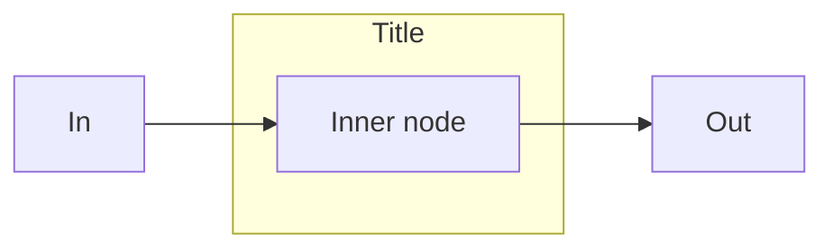
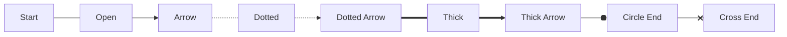
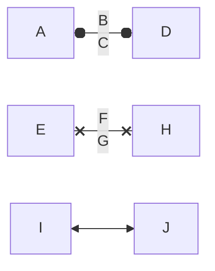
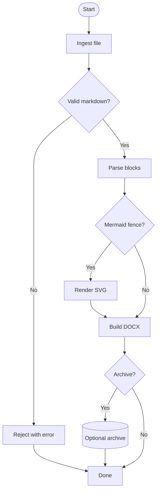
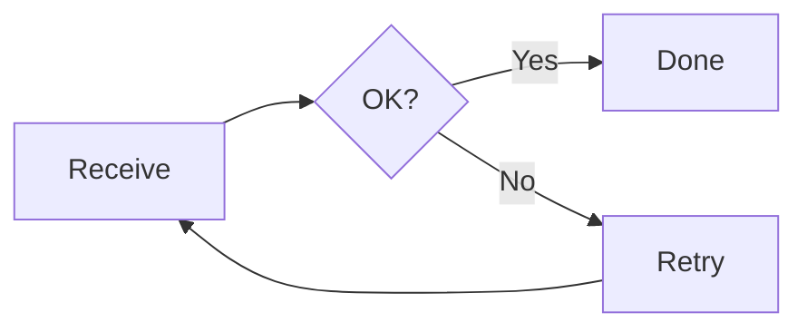
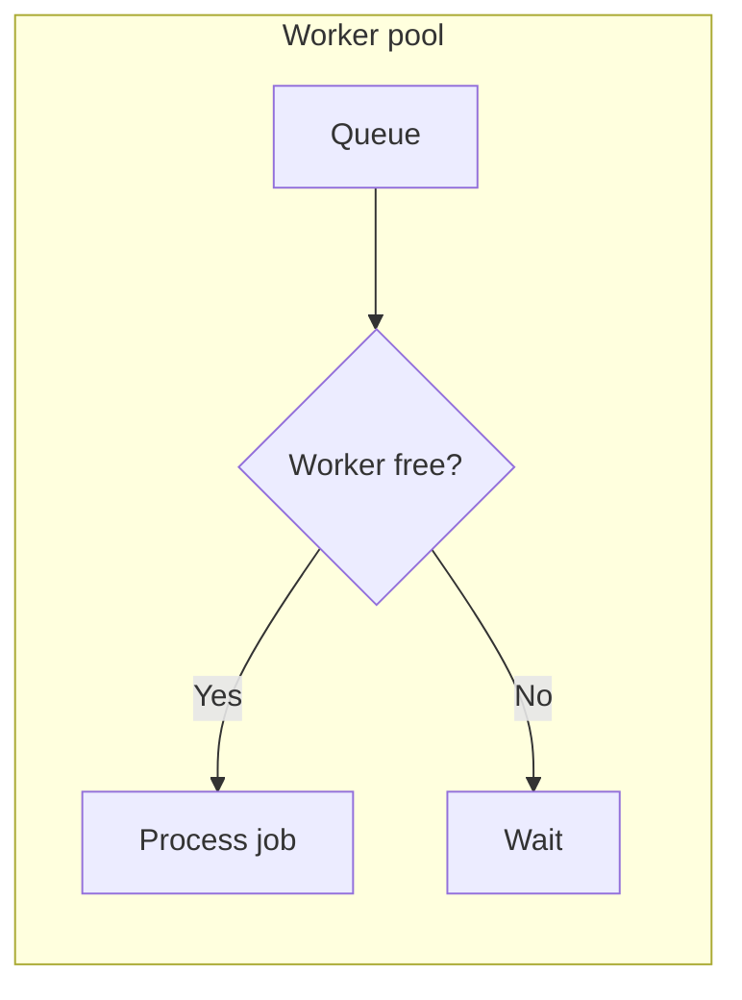

# Mermaid Specification (Consolidated)

**Status:** Consolidated specification (amalgamated from the `Mermaid_*.md` documents in this repository root)  
**Last updated:** 2026-10-05  
**Primary scope:** Mermaid **flowchart** geometry + edge routing + line-end markers (for exact reproduction, SVG extraction, or manual technical drawing)  
**Secondary scope:** Rendering Mermaid **inside .NET 10 / C# 14 applications** (in-process vs browser-hosted strategies)

---

## 1. Source documents and “latest truth” rule

This document is an amalgamation of the following repo-root files:

- `Mermaid_Flowchart_Geometry_And_Line_Ends_Specification.md`
- `Mermaid_Flowchart_Geometry_And_Line_Ends_Specification_Reviewed.md`
- `Mermaid_Flowchart_Geometry_And_Line_Ends_Specification_Shape_Catalogue_Expanded.md`
- `Mermaid_Flowchart_Geometry_And_Line_Ends_Specification_Section_8_Closed.md`
- `Mermaid_Flowchart_Geometry_And_Line_Ends_Specification_Gaps_Closed.md` (**most recent; authoritative for flowchart geometry/markers/shapes**)
- `Mermaid_Typescript_closure.md` (**authoritative closure register for source accountability and “what is closed” definitions**)
- `Mermaid_In_App_Rendering_DotNet10_CSharp14_April_2026.md`

Where statements conflict, the **newest** source is considered authoritative. In practice:

- **Flowchart geometry, line ends, and shape catalogue**: `Mermaid_Flowchart_Geometry_And_Line_Ends_Specification_Gaps_Closed.md` is the authoritative basis.
- **.NET application rendering architecture**: `Mermaid_In_App_Rendering_DotNet10_CSharp14_April_2026.md` is authoritative for host/packaging/interop guidance.

Notes:

- An incidental “Python file write” snippet appears at the end of one older document; it is **not part of the specification** and is excluded.

### 1.1 Per-diagram documentation rule (repository policy)

When a rule is determined from Mermaid upstream **TypeScript/JavaScript** (local checkout: `mermaid/`), it must be recorded in **this file** under the appropriate **diagram-type** section before the work is considered complete.

Each entry should include:

| Field | Requirement |
|---|---|
| **Source** | Repo-relative path(s) under `mermaid/` (for example `packages/mermaid/src/dagre-wrapper/nodes.js`). |
| **Rule** | Formula, default, or behaviour in implementation-usable form. |
| **Closure** | `closed` (deterministic from pinned source) or `runtime-dependent` (browser label measurement, theme, etc.). |
| **Naiad** | Optional note if Word parity requires a deliberate extension beyond upstream (must be labelled as such). |

`AI-Instructions.md` describes workflow; **`Mermaid_Specification.md` holds the per-diagram rules.**

---

## 2. Purpose

Mermaid does not provide a single universal table of drawing constants.

**Exact reproduction** of Mermaid flowcharts requires tracing the whole pipeline:

- parsing and internal model creation
- label rendering and measurement
- layout engine output (Dagre/ELK/etc.)
- node shape rendering
- edge routing and curve/path generation
- line shortening/offset logic for markers
- marker attachment (SVG markers)
- style/theme/CSS resolution into concrete drawing values

This specification captures:

- what must be pinned for “exactness”
- confirmed baseline geometry rules (rectangles and polygon insertion)
- confirmed marker (arrow/circle/cross) geometry and placement maths
- a closed flowchart shape catalogue (geometry-level summaries, plus selected full formulae)
- what remains “version pinning / runtime measurement / mapping” risk
- .NET in-app rendering options and recommended architecture

---

## 3. Version locking requirement (non-negotiable for exact output)

Exact drawing is only meaningful after locking:

| Item | Required value |
|---|---|
| Mermaid version | Exact npm version or Git commit hash |
| Mermaid package/source | `mermaid` npm package or official GitHub checkout |
| Diagram type | `flowchart` / `graph` |
| Layout engine | `dagre`, `elk`, or other configured layout |
| Theme | `default`, `base`, `dark`, or custom |
| Font family | Exact resolved font, not just CSS fallback list |
| Font size/weight | Effective values |
| Browser/runtime | Chromium/Firefox/WebKit/jsdom/Node SVG runtime, etc. |
| HTML labels | Enabled/disabled |
| Security level | Mermaid configuration value |
| Style sources | Mermaid-generated styles + theme variables + inline styles + inherited/defaults, resolved to concrete values |

Without pinning these, any geometry specification can only be approximate.

---

## 4. Rendering pipeline (what must be traced)

```text
Mermaid source text
    ↓
Diagram parser
    ↓
Flowchart database / internal model
    ↓
Node, edge, label and subgraph normalisation
    ↓
Label rendering and measurement
    ↓
Layout engine input graph
    ↓
Layout engine output graph
    ↓
Node shape renderer
    ↓
Edge path renderer
    ↓
Line shortening / marker offset logic
    ↓
Marker attachment
    ↓
Style/theme application, then resolution into concrete drawing values
    ↓
Final SVG with viewBox and transforms
```

Practical guidance: for “exactness”, treat the final SVG as the most authoritative artefact because it contains resolved primitives, markers, paths, and transforms **after** the pipeline has executed.

---

## 5. Coordinate model (node-local space)

Flowchart node shapes are generally drawn in a node `<g>` whose origin is the **node centre**.

For a node with final visual width `W` and height `H`:

```text
LocalLeft   = -W / 2
LocalRight  =  W / 2
LocalTop    = -H / 2
LocalBottom =  H / 2
```

Global placement is then:

```text
GlobalPoint = NodeGroupTranslate + LocalPoint
```

---

## 6. Confirmed rectangle geometry (baseline)

Inputs:

```text
LabelBBoxWidth
LabelBBoxHeight
LabelPaddingX
LabelPaddingY
OptionalNodeWidth
OptionalNodeHeight
OptionalRx
OptionalRy
```

Confirmed rule:

```text
TotalWidth  = max(LabelBBoxWidth  + (LabelPaddingX * 2), OptionalNodeWidth  or 0)
TotalHeight = max(LabelBBoxHeight + (LabelPaddingY * 2), OptionalNodeHeight or 0)
X = -TotalWidth / 2
Y = -TotalHeight / 2
```

SVG equivalent:

```xml
<rect
  x="-TotalWidth / 2"
  y="-TotalHeight / 2"
  width="TotalWidth"
  height="TotalHeight"
  rx="Rx"
  ry="Ry" />
```

Boundary intersection:

- Rectangle nodes use rectangle intersection, so edges should terminate at the rectangle boundary, not the centre.

### 6.1 Flowchart rectangle and diamond sizing (dagre-wrapper; TS-traced, closed)

**Status:** closed (formulae from pinned `mermaid` sources; label bbox still runtime-measured in browser).

**Sources:**

| Item | Path |
|---|---|
| Node `padding` default | `packages/mermaid/src/diagrams/flowchart/flowDb.ts` (`padding: config.flowchart?.padding \|\| 8`) |
| Rectangle (`rect`) dimensions | `packages/mermaid/src/dagre-wrapper/nodes.js` (`rect`) |
| Decision diamond (`question`) | `packages/mermaid/src/dagre-wrapper/nodes.js` (`question`) |
| Layout spacing defaults | `packages/mermaid/src/diagrams/flowchart/flowRenderer-v3-unified.ts` |
| Config schema defaults | `packages/mermaid/src/schemas/config.schema.yaml` (`FlowchartDiagramConfig`) |

**Config keys (flowchart):**

| Key | Default | Meaning |
|---|---:|---|
| `flowchart.padding` | `8` (flowDb fallback; schema default `15` for experimental renderer only) | Added once to measured label width/height when building layout node size. |
| `flowchart.nodeSpacing` | `50` | Same-rank separation (horizontal for TB/BT; vertical for LR/RL). |
| `flowchart.rankSpacing` | `50` | Cross-rank separation (vertical for TB/BT; horizontal for LR/RL). |
| `flowchart.diagramPadding` | `8` | Viewport padding around the finished diagram. |
| `flowchart.wrappingWidth` | `200` | Max label width before wrap (HTML labels; node and edge labels). |

Naiad must honour `%%{init: ...}%%` overrides for these keys when present.

**Rectangle (`rect`) — layout node size:**

```text
P = node.padding   // default 8 from flowDb
TotalWidth  = LabelBBoxWidth  + P
TotalHeight = LabelBBoxHeight + P
```

(`labelHelper` uses `halfPadding = P/2` for visual centring; the **layout** width/height uses the sums above.)

**HTML label bbox (dagre-wrapper, browser-measured):**

- Single-line labels use a ~`2.5em` line box (`line-height: 1.5` plus `<p>`), so at 16px font the inner height is ~40px and `TotalHeight` is typically **48px** with `P = 8`.
- Very short labels (for example `A`, `B` in F08) are not left narrower than that line box: `LabelBBoxWidth` is at least the line-box height (square ~48×48 nodes on mermaid.live).
- Short words (roughly 2–3 characters, for example `End`) may bump width to ~`1.125 ×` the line-box height when glyph measurement would otherwise under-shoot.

**Naiad estimate (`MeasureFlowchartLabelBBox` in `FlowchartRenderer.cs`):** mirrors the above using `0.756em` char width for labels up to five characters, `0.678em` for longer single lines, `2.5em` line-box height, `MaxLineLength == 1 → width = line box`, and the `1.125` width floor for labels of length ≤ 3.

**Decision diamond (`question` / `{...}`) — layout node size:**

```text
P = node.padding
W0 = LabelBBoxWidth  + P
H0 = LabelBBoxHeight + P
S  = W0 + H0          // square diamond bounding box; NOT (W0 + H0) * 0.9
node.width  = S
node.height = S
```

Legacy `packages/mermaid/src/diagrams/flowchart/flowChartShapes.js` still documents `(w + h) * 0.9`; the **dagre-wrapper** path above is authoritative for layout/render in the pinned tree.

**Historical note:** older Naiad builds used ~60px horizontal and ~30px vertical padding and `(width + height) * 0.9` for diamonds; that diverged from dagre-wrapper and produced oversized diamonds and cramped edge-label gaps.

### 6.2 Flowchart edge labels (layout and render; TS-traced)

**Sources:**

| Item | Path |
|---|---|
| Edge `minlen` from link stroke | `packages/mermaid/src/diagrams/flowchart/flowDb.ts` (`edge.length` from `destructEndLink`) |
| Edge label wrap width | `packages/mermaid/src/rendering-util/createText.ts` (default `width = 200`; `flowchart.wrappingWidth` in schema) |
| Label measured before layout | `packages/mermaid/src/rendering-util/layout-algorithms/dagre/index.js` (`insertEdgeLabel` then `dagreLayout`) |
| `edge.width` / `edge.height` | `packages/mermaid/src/rendering-util/rendering-elements/edges.js` (`insertEdgeLabel` — label bbox) |
| Label at half polyline length | Mermaid `utils.calcLabelPosition`; Naiad `Edge.LabelPosition` |
| Post-layout label move | `positionEdgeLabel` in `edges.js` |

**Mermaid pipeline (dagre-wrapper / v3 unified):**

1. Render nodes; size each node (`width` / `height` on the graph node).
2. For each edge with a label, render the label HTML/SVG and set **`edge.width`** and **`edge.height`** from the label bounding box (wrapped at **`flowchart.wrappingWidth`**, default **200**).
3. Run **`dagreLayout`**. Dagre uses node sizes plus edge label dimensions when placing ranks (`ranksep` / `nodesep`, default **50** each in `flowRenderer-v3-unified.ts`).
4. Route edges and position labels on the polyline midpoint (half total path length).

**`minlen` is not derived from label text.** It comes from the link stroke run length (for example `---->` → 4). Do not inflate `minlen` from label width — that produces dummy ranks, curved edges, and excessive vertical gaps on TB diagrams (F25).

**Naiad parity (`FlowchartRenderer.cs` + layout):**

**Wrap and measure** (before layout):

```text
WrappingWidthPx = flowchart.wrappingWidth (default 200)
WrappedLabel    = word-wrap edge.Label at WrappingWidthPx
LabelLayoutWidthPx  = measured box width + 16
LabelLayoutHeightPx = max(24, measured box height + 8)
```

**Rank-axis clearance** (`CoordinateAssignment.AssignRankCoordinates` — mirrors dagre using `edge.width` / `edge.height` on LR vs TB):

```text
AlongRankPx = LR/RL ? LabelLayoutWidthPx : LabelLayoutHeightPx
RankGaps    = target.Rank - source.Rank
RequiredPerGapPx = (AlongRankPx + 12) / RankGaps
ExtraGapPx  = max(0, RequiredPerGapPx - rankSpacing)   // rankSpacing default 50
```

Added between each pair of ranks when a labelled edge crosses that boundary. TB short labels (large width, small height) add little extra along the vertical axis; LR long wrapped labels (F26) widen the horizontal gap between nodes.

**Render:** `PrepareFlowchartEdgeLabel` emits `<br/>` lines as SVG `<tspan>` elements (same wrap as layout measurement).

### 6.3 Flowchart link length (`minlen` from stroke)

**Source:** `packages/mermaid/src/diagrams/flowchart/flowDb.ts` — `destructEndLink` sets `length = line.length - 1` where `line` is the link token without the trailing arrow character (`>`, `o`, `x`, …). The value is capped at **10** when stored on the edge (`edge.length = type.length > 10 ? 10 : type.length`). Dagre receives it as **`minlen`**.

| Link token | Stroke before `>` | `minlen` |
|---|---|---|
| `-->` | `--` (length 2) | **1** |
| `--->` | `---` (length 3) | **2** |
| `---->` | `----` (length 4) | **3** |

**Naiad parity:**

- `FlowchartParser` sets `Edge.MinRankSpan` with the same formula (`stroke length − 1`, minimum 1, maximum 10).
- Layout uses `RankerType.LongestPath` so longer links are not collapsed by tight-tree compaction (F28).
- `Ranker.InsertDummyNodes` splits edges when `target.Rank - source.Rank > 1`; dummy nodes are aligned to the source column/row before routing.
- Dummy segments and axis-aligned polylines render as **straight** SVG paths (`L`), not `curveBasis`, so multi-rank `--->` / `---->` links do not bow (F28).
- After concatenating dummy-chain segment points, Naiad **re-snaps** the first and last polyline points to the real source/target shape attach points (TB: exit bottom, enter top). Without this, collapsed minlen links end at dummy-node centres inside the target bbox and `marker-end` arrowheads are hidden under node fill in Word (F28).

**Do not** derive `minlen` from label width (see §6.2 / F25).

**Cycles (LR retry loop, `A→B→D→A`):** Dagre layout runs on an acyclic copy of the graph (back edges reversed with **endpoint swap** on `LayoutEdge`). Restore original edge direction **before** `RouteEdges`, then route; if an edge still has no polyline, fall back to straight shape attach points.

**Cross-boundary / compound edges (LR sibling subgraphs):** `TryComputeStraightFlowchartEdgePoints` uses diagram **direction** (LR: exit right → enter left with optional Manhattan elbow; TB/BT: bottom → top) instead of centre-to-centre shape intersection only, so sibling-subgraph links stay on the outer LR spine.

**Isolated / long-offset edges (exterior exception routes):** `CollapsePredominantlyAxisAlignedMinlenPolyline` only collapses dummy-chain polylines when perpendicular drift is small (≤48px). `RepairMissingOrDiagonalFlowchartEdges` replaces two-point diagonals with direction-aware Manhattan routing.

---

## 7. Confirmed generic polygon insertion rule

Many shapes provide a point list to a shared polygon helper that:

- serialises `Points[]` to `"x1,y1 x2,y2 ..."`
- applies:

```text
translate(-W / 2, H / 2)
```

Therefore, for any polygon-based shape, a shape-supplied point `(x, y)` becomes:

```text
RenderedPointX = x - W / 2
RenderedPointY = y + H / 2
```

Then the node `<g>` translation places the polygon in global space.

---

## 8. Node boundary intersection (principle)

Edges do not terminate at node centres. They terminate at the boundary intersection between the routed edge path and the node boundary, then:

- marker offset / line shortening logic is applied
- markers are attached (SVG markers)

Confirmed for rectangle:

```text
node.calcIntersect = intersect.rect
node.intersect = intersect.rect
```

All other shapes require confirmation of which intersection rule they use (rectangle/ellipse/polygon/cylinder-specific/custom).

---

## 9. Edge syntax and stroke styles (flowchart level)

Mermaid edge syntax encodes line pattern + marker type. Common forms:

| Syntax | Meaning | Stroke pattern | Marker |
|---|---|---|---|
| `A --- B` | open line | solid | none |
| `A --> B` | arrow line | solid | arrow point end |
| `A -.- B` | dotted/open line | dotted | none |
| `A -.-> B` | dotted arrow | dotted | arrow point end |
| `A === B` | thick/open line | solid (thicker) | none |
| `A ==> B` | thick arrow | solid (thicker) | arrow point end |
| `A -- text --- B` | labelled open line | solid | none |
| `A -- text --> B` | labelled arrow | solid | arrow point end |
| `A o-- B` / `A --o B` | circle marker | solid | circle at start/end |
| `A x-- B` / `A --x B` | cross marker | solid | cross at start/end |

Important parser nuance: `A---oB` and `A---xB` are treated as circle/cross line ends, not node IDs beginning with `o` or `x`.

---

## 10. Edge path generation (exact reproduction rule)

Edge geometry is not simply a line between node centres. For exact reproduction, capture:

```text
SourceNodeId
TargetNodeId
SourceShapeBoundaryIntersection
TargetShapeBoundaryIntersection
Intermediate route points
Curve factory/function
Generated SVG path d
Stroke width
Stroke dash array
Marker start
Marker end
```

Manual drawing approach:

1. Read the generated SVG `d` for the edge.
2. Resolve transforms.
3. Draw each SVG command in sequence.
4. Attach markers using marker reference points and tangent angle.

---

## 11. Markers and line-end geometry (confirmed core flowchart markers)

### 11.1 Marker attachment model

Markers are SVG `<marker>` definitions referenced by `marker-start` / `marker-end`. They are not part of the edge path itself.

General model:

```text
MarkerLocalGeometry = marker path/circle/polygon defined in marker co-ordinates
ReferencePoint = (refX, refY)
MarkerOrient = auto
EdgeTangentAngle = direction of path at attachment
FinalMarker = rotate(MarkerLocalGeometry, EdgeTangentAngle)
            + translate so ReferencePoint coincides with adjusted edge endpoint
```

### 11.2 Tangent angle

Straight segment:

```text
AngleEnd   = atan2(EndY - PreviousY, EndX - PreviousX)
AngleStart = atan2(StartY - NextY,   StartX - NextX)
```

Curves require the tangent (Bezier derivative at `t=0`/`t=1`, arc tangent, etc.).

### 11.3 Marker placement maths (non-SVG renderers)

For a marker-local point `Pm = (Xm, Ym)`:

```text
Dx = Xm - RefX
Dy = Ym - RefY

RotatedX = Dx * cos(θ) - Dy * sin(θ)
RotatedY = Dx * sin(θ) + Dy * cos(θ)

GlobalX = Xe + RotatedX
GlobalY = Ye + RotatedY
```

For circles:

```text
GlobalCircleCentre = Pe + Rotate((Cx - RefX, Cy - RefY), θ)
GlobalRadius       = r
```

### 11.4 Marker families relevant to flowcharts

Core flowchart line ends:

- `arrow_point` (point)
- `arrow_circle` (circle)
- `arrow_cross` (cross)

The source also includes additional marker families (aggregation, extension, composition, dependency, lollipop, cardinalities, requirement markers) that are relevant to other Mermaid diagram types.

---

## 12. Marker offset and line shortening (critical for visual correctness)

Mermaid uses several related mechanisms around markers. It is important not to conflate them, because they affect different parts of rendering:

- Marker geometry and anchoring (marker `refX` / `refY`) controls where the glyph sits relative to the *path endpoint*.
- In some looks/configurations, Mermaid adjusts dash patterns so the dashes do not visually run underneath markers.
- In some code paths (notably for rounded paths), Mermaid may adjust the first/last points when specific marker types are used.

For the default flowchart look, Mermaid relies primarily on marker anchoring plus draw order (marker drawn at the path end), with an important consequence:

- The connector stroke should **not** touch certain terminal glyphs (especially cross), and in Mermaid this is achieved primarily by **marker `refX`** values that place the glyph slightly ahead of the path endpoint, leaving a small gap between the stroke end and the glyph.

Offset tables (source-defined constants):

```text
markerOffsets:
    aggregation:     17.25
    extension:       17.25
    composition:     17.25
    dependency:      6
    lollipop:        13.5
    arrow_point:     4
    arrow_barb:      0
    arrow_barb_neo:  5.5

markerOffsets2:
    arrow_point:     4
    arrow_cross:     12.5
    arrow_circle:    12.5
```

Where these are used (Mermaid upstream, flowcharts):

- `packages/mermaid/src/rendering-util/rendering-elements/edges.js` uses `markerOffsets2` for **dash array shaping** when `edge.look === 'neo'` (so dash/gap placement respects terminal markers).
- The `-margin` marker variants are selected only when `useMargin = !animatedEdge && edge.look === 'neo'` (see `addEdgeMarkers(... useMargin ...)` call in the same file).
- For default look terminals (non-neo), `circleEnd` and `crossEnd` are placed via marker `refX`/`refY` without additional endpoint “stand-off” trimming. The connector visually meets the terminal marker (connected), matching Mermaid’s reference output.
- For correct parity, “connected” here means **consistent small gaps** (not a large stand-off). These gaps arise from:
  - **node-edge-to-glyph** distance: governed by where the layout/intersection places the path endpoint relative to the node boundary, plus the marker’s effective forward extent.
  - **stroke-to-glyph** distance: for circle/cross terminals in the default look, governed primarily by marker `refX` being larger than the glyph’s max X (so the glyph is placed ahead of the stroke endpoint).

Practical consequence:

- Do not treat `markerOffsets2` as a general “trim the endpoint by this amount” table. In flowcharts it primarily exists to keep **dash patterns** from colliding with end markers under the **neo** look, and for specific path-generation paths.
- If you implement endpoint trimming for markers, ensure it matches the exact Mermaid code path and look; otherwise you will introduce inconsistent stand-off distances (for example circle/cross pushed away from the node compared to arrows).

Remaining ambiguity to trace for a pinned version:

- which call path selects `markerOffsets` vs `markerOffsets2`
- when `-margin` marker variants are selected (`useMargin`)

---

## 13. Confirmed marker definitions (point, circle, cross)

The following are source-traced marker definitions and local geometry.

### 13.1 Point arrowhead markers

**Point End marker**

```text
viewBox:            0 0 10 10
refX/refY:          5, 5
markerUnits:        userSpaceOnUse
markerWidth/Height: 8, 8
orient:             auto
path:               M 0 0 L 10 5 L 0 10 z
stroke-width:       1
```

Vertices: `(0,0)`, `(10,5)`, `(0,10)`, closed.

**Point Start marker**

```text
viewBox:            0 0 10 10
refX/refY:          4.5, 5
markerUnits:        userSpaceOnUse
markerWidth/Height: 8, 8
orient:             auto
path:               M 0 5 L 10 10 L 10 0 z
stroke-width:       1
```

Vertices: `(0,5)`, `(10,10)`, `(10,0)`, closed. Reference point is offset by `0.5` in x relative to the bounding-box centre.

**Point End margin marker**

```text
viewBox:            0 0 11.5 14
refX/refY:          11.5, 7
markerWidth/Height: 10.5, 14
path:               M 0 0 L 11.5 7 L 0 14 z
stroke-width:       0
```

Reference point is the apex `(11.5, 7)`.

**Point Start margin marker**

```text
viewBox:            0 0 11.5 14
refX/refY:          1, 7
markerWidth/Height: 11.5, 14
polygon points:     0,7 11.5,14 11.5,0
stroke-width:       0
```

Reference point is one unit to the right of the apex.

### 13.2 Circle markers

**Circle End marker**

```text
viewBox:            0 0 10 10
refX/refY:          11, 5
markerWidth/Height: 11, 11
circle:             cx=5, cy=5, r=5
stroke-width:       1
```

Reference point is `6` units right of centre and `1` beyond the circle boundary.

**Circle Start marker**

```text
viewBox:            0 0 10 10
refX/refY:          -1, 5
markerWidth/Height: 11, 11
circle:             cx=5, cy=5, r=5
stroke-width:       1
```

**Circle End margin marker**

```text
viewBox:            0 0 10 10
refX/refY:          12.25, 5
markerWidth/Height: 14, 14
circle:             cx=5, cy=5, r=5
stroke-width:       0
```

**Circle Start margin marker**

```text
viewBox:            0 0 10 10
refX/refY:          -2, 5
markerWidth/Height: 14, 14
circle:             cx=5, cy=5, r=5
stroke-width:       0
```

### 13.3 Cross markers

**Cross End marker**

```text
viewBox:            0 0 11 11
refX/refY:          12, 5.2
markerWidth/Height: 11, 11
path:               M 1,1 l 9,9 M 10,1 l -9,9
stroke-width:       2
```

Segments:

- `(1,1)` → `(10,10)`
- `(10,1)` → `(1,10)`

Cross centre: `(5.5, 5.5)`. Offset relative to ref: `(-6.5, 0.3)`.

**Cross Start marker**

```text
viewBox:            0 0 11 11
refX/refY:          -1, 5.2
markerWidth/Height: 11, 11
path:               M 1,1 l 9,9 M 10,1 l -9,9
stroke-width:       2
```

**Cross End margin marker**

```text
viewBox:            0 0 15 15
refX/refY:          17.7, 7.5
markerWidth/Height: 12, 12
path:               M 1,1 L 14,14 M 1,14 L 14,1
stroke-width:       2.5
```

**Cross Start margin marker**

```text
viewBox:            0 0 15 15
refX/refY:          -3.5, 7.5
markerWidth/Height: 12, 12
path:               M 1,1 L 14,14 M 1,14 L 14,1
stroke-width:       2.5
```

---

## 14. Style and theme resolution (CSS is evidence, not an instruction)

CSS is not a manual drawing instruction. For manual drawing and most non-browser renderers, CSS/classes must be resolved into concrete values.

Required resolved outputs (per visible element):

```text
Fill colour/opacity
Stroke colour/opacity
Stroke width
Stroke dash array
Stroke linecap/linejoin/miterlimit
Font family/size/weight/style
Text alignment/anchor
Marker start/mid/end
Marker fill/stroke/stroke width
```

Style sources in Mermaid SVG may include:

- theme variables
- generated `<style>` blocks inside SVG
- CSS classes
- inline `style` attributes
- presentation attributes (`stroke="..."`)
- inheritance
- browser defaults

Exact reproduction requires computing effective style for each element in the pinned runtime.

---

## 14.1 Naiad themeVariables resolution (implementation notes, April 2026)

This repository’s Mermaid renderer (`extern/Naiad`) does not execute Mermaid’s JavaScript runtime, so it must **resolve visual-only configuration** (fonts, font sizes, colours, label backgrounds, marker colours) from Mermaid inputs and apply them consistently across diagram types.

### 14.1.1 Input sources

Naiad resolves visual values from:

- Mermaid init blocks at the start of a diagram, for example `%%{init: {"themeVariables": {...}}}%%`.
- Diagram config flattened into `DiagramBase.Config` using dotted keys (for example `themeVariables.lineColor`).
- `RenderOptions` as a local override/fallback for typography (`FontFamily`, `FontSize`).

### 14.1.2 Resolved theme variables (current coverage)

Naiad maintains a resolved theme object (see `MermaidThemeVariables`) seeded from Mermaid’s **default theme** (`packages/mermaid/src/themes/theme-default.js`) and then overridden by init config keys where present.

Implemented high-signal keys:

- **Core**:
  - `themeVariables.background`
  - `themeVariables.mainBkg`
  - `themeVariables.secondBkg`
  - `themeVariables.lineColor`
  - `themeVariables.border1`
  - `themeVariables.border2`
  - `themeVariables.arrowheadColor`
  - `themeVariables.fontFamily`
  - `themeVariables.fontSize`
  - `themeVariables.labelBackground`
  - `themeVariables.textColor`
  - `themeVariables.radius`
  - `themeVariables.strokeWidth`

- **Gantt (default theme variables)**:
  - `themeVariables.sectionBkgColor`
  - `themeVariables.altSectionBkgColor`
  - `themeVariables.sectionBkgColor2`
  - `themeVariables.taskBorderColor`
  - `themeVariables.taskBkgColor`
  - `themeVariables.taskTextLightColor`
  - `themeVariables.taskTextDarkColor`
  - `themeVariables.activeTaskBorderColor`
  - `themeVariables.activeTaskBkgColor`
  - `themeVariables.gridColor`
  - `themeVariables.doneTaskBkgColor`
  - `themeVariables.doneTaskBorderColor`
  - `themeVariables.critBorderColor`
  - `themeVariables.critBkgColor`
  - `themeVariables.todayLineColor`
  - `themeVariables.vertLineColor`

### 14.1.3 Application rules (important distinctions)

- **Line vs marker colour**:
  - `lineColor` applies to connector strokes / general lines.
  - `arrowheadColor` applies to marker glyph fill/stroke and arrowheads.
  - These may differ; Naiad must not treat every occurrence of `#333333` as interchangeable.

- **Word/DOCX constraint**:
  - For some elements (notably Gantt section row bands), Naiad emits **solid fills + explicit opacity** rather than relying on `rgba(..., alpha)` rendering, to avoid Word SVG inconsistencies.

### 14.1.4 Where theme variables are consumed in Naiad

At time of writing, Naiad applies resolved theme variables to:

- **Mermaid-style CSS blocks** (via themed substitution): flowchart, sequence, class, state, ER, pie, gantt.
- **Marker definitions**:
  - flowchart markers (point/circle/cross, including `-margin` variants) use `arrowheadColor`
  - sequence message markers use `arrowheadColor`
- **Non-CSS renderers** that previously used hard-coded strokes/fills:
  - architecture, requirement, radar, c4, xy chart, timeline, kanban, packet, mindmap

### 14.1.5 Intentional exceptions / test-pinned output

- **Block diagram edge stroke**: `BlockRenderer` currently emits connector strokes as `stroke="#555"` for compatibility with existing package assertions in `MDConverter.Tests`. This is an intentional, test-pinned behaviour even when `themeVariables.lineColor` is overridden.

## 14A. Entity relationship (ER) diagram: relationship paths and cardinality line ends (source-traced)

This section captures **source-traced** ER relationship rendering details from the local Mermaid upstream checkout (`.\mermaid\`).

### 14A.1 Relationship path generation

Mermaid’s ER renderer constructs relationship geometry from **Dagre layout edge route points**, then uses a **D3 basis spline**:

- Mermaid source: `packages/mermaid/src/diagrams/er/erRenderer.js`
- Path generator:
  - D3 `line()` with `.curve(curveBasis)`
  - `d = lineFunction(edge.points)`

Practical consequence:

- The **end-of-path tangent** is determined by the final spline segment through the last two route points. Marker placement and orientation therefore depend on the **path**, not only on the endpoints.

### 14A.1B Naiad implementation notes (April 2026, Word-first)

The Naiad-based renderer in this repository is validated primarily against **Word’s SVG renderer** (DOCX output), so the practical “what works” notes below are intentionally renderer-specific.

- **ER scenario 1 is now correct (Word + extracted SVG)**: the “gold standard” `CUSTOMER / ORDER / PRODUCT / LINE_ITEM` relationship geometry and cardinality line ends now match Mermaid closely enough to treat this fixture as **closed** for geometry purposes.
  - **Relationship path rule**: use Mermaid’s approach of `curveBasis` over Dagre route points (`edge.points`). For the scenario-1 shoulder relationships, this reduces to a 3-point route:
    - `P0` (source anchor)
    - `P1 = (P0.X, (P0.Y + P3.Y) / 2)` (vertical down segment)
    - `P3` (target anchor)
  - **Cardinality rule**: use Mermaid-style SVG `<marker>` definitions (from `erMarkers.js`) applied with `marker-start` / `marker-end`, and rely on `orient="auto"` for tangent alignment.
  - **Marker attribute rule (Word parity)**: match Mermaid’s marker attributes literally for this fixture (no additional `viewBox` / `markerUnits` attributes), because Word’s SVG marker renderer is sensitive to marker coordinate-system hints.

### 14A.1C Repository baseline: quoted relationship labels opt-in to “fixture” routing (intentional divergence)

Mermaid.js does **not** use relationship label quoting as a semantic input to path routing. However, for this repository’s Word-first parity goals we intentionally treat **quoted** relationship labels as an opt-in signal for “fixture-style” routing and label placement.

Rule (baseline):

- If an ER relationship label is quoted (starts and ends with `"`), render it using the same “fixture/matrix” settings as the cardinality+line-style matrix:
  - Use the hybrid path builder that preserves **literal minimum straight segments** at both ends (do not rely on `curveBasis` to preserve them).
  - Use deterministic fixture label placement (aligned to the target entity centre X and the midpoint between entity centres Y), rather than the scenario-1 vertical offset.

Examples from `test.md` that are treated as fixtures under this rule:

- Cardinality matrix labels like `"||--o{"`, `"||..|{"`, etc.
- Fan-in / fan-out stress labels like `"1:2 A"`, `"1:8 5"`, etc.

### 14A.1A Anchor selection must distinguish fan-out vs fan-in (renderer rule)

When selecting ER relationship anchors (ports) for vertical layouts, do **not** apply a single “side slot” policy to both of these cases:

- **one-to-many fan-out**: one source entity connecting to many target entities
- **many-to-one fan-in**: many source entities connecting into one target entity

These cases are visually and geometrically different. The core principle is:

- The chosen anchor slots should sit on the part of the entity boundary that visually **faces the relationship group**.

Practical rules:

- **Fan-out hub (one source → many targets)**:
  - If the target group is **below** the source, bias the **source** to **lower** side anchors (e.g. 3L/4L and 4R/3R).
  - If the target group is **above** the source, bias the **source** to **upper** side anchors (e.g. 1L/2L and 2R/1R).

- **Fan-in hub (many sources → one target)**:
  - If the source group is **above** the target, bias the **target** to **upper** side anchors (e.g. 1L/2L and 2R/1R), or to **top-edge** anchors where relationships approach primarily from above.
  - If the source group is **below** the target, bias the **target** to **lower** side anchors (e.g. 3L/4L and 4R/3R), or to **bottom-edge** anchors where relationships approach primarily from below.

### 14A.2 Identifying vs non-identifying relationship stroke style

Non-identifying relationships are dashed:

- Mermaid source: `packages/mermaid/src/diagrams/er/erRenderer.js` and `packages/mermaid/src/diagrams/er/styles.ts`
- Dash pattern:

```text
stroke-dasharray: 8,8
```

### 14A.3 Cardinality line ends are SVG markers (not hand-drawn at arbitrary offsets)

ER diagram cardinalities are implemented as SVG `<marker>` definitions and applied as:

- `marker-start` for the B-side cardinality
- `marker-end` for the A-side cardinality

Mermaid source: `packages/mermaid/src/diagrams/er/erMarkers.js` and `packages/mermaid/src/diagrams/er/erRenderer.js`

---

## 14B. Gantt diagram: axis, grid, sections, and task bars (source-traced)

This section captures **source-traced** Gantt rendering behaviour from the local Mermaid upstream checkout (`.\mermaid\`).

### 14B.1 Mermaid’s renderer is D3 + CSS classes

Mermaid’s Gantt renderer is implemented in:

- Mermaid source: `packages/mermaid/src/diagrams/gantt/ganttRenderer.js`
- Stylesheet generator: `packages/mermaid/src/diagrams/gantt/styles.js`

Key points:

- The renderer builds SVG elements and assigns **CSS classes** (e.g. `.grid`, `.section`, `.task`, `.active`, `.done`).
- The default theme provides the effective colours via **theme variables** (see `packages/mermaid/src/themes/theme-default.js`).

### 14B.2 Axis + grid

Mermaid draws the Gantt time axis and grid using D3 axes:

- Grid group: `<g class="grid"> ... </g>`
- Each tick draws a vertical grid line using a negative tick size (extends through the chart height).
- Tick labels use the axis format (`axisFormat`) and are centred under their ticks.

Default sizing and paddings (source: `packages/mermaid/src/diagrams/gantt/ganttRenderer.js` + `packages/mermaid/src/schemas/config.schema.yaml`):

- **Default width**: `w = 1200` (unless `gantt.useWidth` is configured)
- **leftPadding**: 75
- **rightPadding**: 75
- **topPadding**: 50
- **titleTopMargin**: 25
- **gridLineStartPadding**: 35
- **barHeight**: 20
- **barGap**: 4

Axis placement:

- The axis tick labels live at the **bottom** of the chart (D3 axis translated to approximately `y = h - 50`), and the vertical grid lines extend up to `gridLineStartPadding`.

Repository baseline for Word/DOCX parity:

- Prefer a **daily** vertical grid cadence for short ranges (like the `test.md` fixture showing `01..10`), matching VS Code’s default look.

### 14B.3 Section bands (row backgrounds)

Mermaid draws full-width section-row background rectangles behind tasks:

- CSS: `.section { opacity: 0.2; stroke: none; }`
- Section styles alternate via `section0..section3` using `sectionBkgColor`, `altSectionBkgColor`, `sectionBkgColor2` (default theme).

For the `test.md` fixture, the section header band for `Build` uses:

- `sectionBkgColor = rgba(102, 102, 255, 0.49)` (default theme)

### 14B.4 Task bars and labels

Mermaid renders task bars as rounded rectangles:

- `rx = 3`, `ry = 3`
- Border uses `taskBorderColor` (default theme: `#534fbc`)
- Fill colour depends on status:
  - Default: `taskBkgColor` (default theme: `#8a90dd`)
  - Active: `activeTaskBkgColor` (default theme: `#bfc7ff`)
  - Done: `doneTaskBkgColor` (default theme: `lightgrey`)
  - Critical: `critBkgColor` (default theme: `red`)

Task label rule:

- The **task name text** is the primary label (`d.task` in Mermaid), not the task id.
- If the label text does not fit inside the bar, Mermaid places it just outside the bar (left or right), otherwise centred within the bar.

Vertical markers (`vert`) (source: `packages/mermaid/src/diagrams/gantt/ganttRenderer.js`):

- Rendered as a thin task rect with:
  - `y = gridLineStartPadding`
  - `width = 0.08 * barHeight` (with default `barHeight=20` → `1.6px`)
  - `height = taskArray.length * (barHeight + barGap) + barHeight * 2`
- The `vert` label is placed below the chart at:
  - `y = gridLineStartPadding + taskArray.length * (barHeight + barGap) + 60`

---

## 14C. Pie diagram: slice colours and legend (Word/DOCX baseline)

Mermaid’s pie renderer may emit slice colours as `hsl(...)` strings (depending on the theme/palette source).

Repository baseline for Word/DOCX parity:

- Microsoft Word’s SVG rendering is not reliable for `hsl(...)` colour values on `fill`/`stroke`.
- When emitting SVG for DOCX, normalise pie slice and legend swatch colours to **RGB** form (`rgb(r, g, b)`) so that:
  - slice fills render correctly in Word, and
  - slice colours match the legend swatches.

Source-traced marker geometry (selected high-signal details):

- **ONLY_ONE**:
  - Start: `refX=0, refY=9, markerWidth=18, markerHeight=18`
    - `d="M9,0 L9,18 M15,0 L15,18"`
  - End: `refX=18, refY=9, markerWidth=18, markerHeight=18`
    - `d="M3,0 L3,18 M9,0 L9,18"`

- **ZERO_OR_ONE** (circle + bar):
  - Start: `refX=0, refY=9, markerWidth=30, markerHeight=18`
    - circle: `cx=21, cy=9, r=6` + `d="M9,0 L9,18"`
  - End: `refX=30, refY=9, markerWidth=30, markerHeight=18`
    - circle: `cx=9, cy=9, r=6` + `d="M21,0 L21,18"`

- **ONE_OR_MORE** (crow’s foot + bar):
  - Start: `refX=18, refY=18, markerWidth=45, markerHeight=36`
    - `d="M0,18 Q 18,0 36,18 Q 18,36 0,18 M42,9 L42,27"`
  - End: `refX=27, refY=18, markerWidth=45, markerHeight=36`
    - `d="M3,9 L3,27 M9,18 Q27,0 45,18 Q27,36 9,18"`

- **ZERO_OR_MORE** (circle + crow’s foot):
  - Start: `refX=18, refY=18, markerWidth=57, markerHeight=36`
    - circle: `cx=48, cy=18, r=6` + `d="M0,18 Q18,0 36,18 Q18,36 0,18"`
  - End: `refX=39, refY=18, markerWidth=57, markerHeight=36`
    - circle: `cx=9, cy=18, r=6` + `d="M21,18 Q39,0 57,18 Q39,36 21,18"`

Practical consequence:

- If crow’s-feet or circles appear offset from the relationship stroke, the **first thing to verify** is the **relationship path geometry near the endpoints** (because `orient="auto"` aligns markers to the path tangent).
- For Naiad/Word validation, prefer the “pinned embellishments” strategy described in **14A.1B** when you are not using SVG `<marker>` elements.

### 14A.4 Naiad ER line ends (current source-of-truth snapshot for reversion)

The following is a **verbatim snapshot** of Naiad’s current ER line-end configuration (marker IDs, marker geometry, and endpoint inset behaviour) as implemented in:

- `extern/Naiad/src/Naiad/Rendering/SvgBuilder.cs` (`AddMermaidErMarkers`)
- `extern/Naiad/src/Naiad/Diagrams/EntityRelationship/ERRenderer.cs` (marker assignment + endpoint insets)

#### 14A.4.1 Marker IDs and geometry (Naiad `AddMermaidErMarkers(...)`)

```csharp
public SvgBuilder AddMermaidErMarkers(string StrokeColor)
{
    var NormalisedStrokeColor = string.IsNullOrWhiteSpace(StrokeColor) ? "#333333" : StrokeColor;

    // MD_PARENT_START
    document.Defs.Markers.Add(new SvgMarker
    {
        Id = "MD_PARENT_START",
        Path = string.Empty,
        RefX = 0,
        RefY = 7,
        MarkerWidth = 190,
        MarkerHeight = 240,
        Orient = "auto",
        ViewBox = "0 0 20 14",
        MarkerUnits = "userSpaceOnUse",
        RawContent = "<path d=\"M 18,7 L9,13 L1,7 L9,1 Z\"/>"
    });

    // MD_PARENT_END
    document.Defs.Markers.Add(new SvgMarker
    {
        Id = "MD_PARENT_END",
        Path = string.Empty,
        RefX = 19,
        RefY = 7,
        MarkerWidth = 20,
        MarkerHeight = 28,
        Orient = "auto",
        ViewBox = "0 0 20 14",
        MarkerUnits = "userSpaceOnUse",
        RawContent = "<path d=\"M 18,7 L9,13 L1,7 L9,1 Z\"/>"
    });

    // ONLY_ONE_START
    document.Defs.Markers.Add(new SvgMarker
    {
        Id = "ONLY_ONE_START",
        Path = string.Empty,
        RefX = 0,
        RefY = 9,
        MarkerWidth = 18,
        MarkerHeight = 18,
        Orient = "auto",
        ViewBox = "0 0 18 18",
        MarkerUnits = "userSpaceOnUse",
        RawContent = $"<path stroke=\"{NormalisedStrokeColor}\" fill=\"none\" d=\"M9,0 L9,18 M15,0 L15,18\"/>"
    });

    // ONLY_ONE_END
    document.Defs.Markers.Add(new SvgMarker
    {
        Id = "ONLY_ONE_END",
        Path = string.Empty,
        RefX = 18,
        RefY = 9,
        MarkerWidth = 18,
        MarkerHeight = 18,
        Orient = "auto",
        ViewBox = "0 0 18 18",
        MarkerUnits = "userSpaceOnUse",
        RawContent = $"<path stroke=\"{NormalisedStrokeColor}\" fill=\"none\" d=\"M3,0 L3,18 M9,0 L9,18\"/>"
    });

    // ZERO_OR_ONE_START (circle + bar)
    document.Defs.Markers.Add(new SvgMarker
    {
        Id = "ZERO_OR_ONE_START",
        Path = string.Empty,
        RefX = 0,
        RefY = 9,
        MarkerWidth = 30,
        MarkerHeight = 18,
        Orient = "auto",
        ViewBox = "0 0 30 18",
        MarkerUnits = "userSpaceOnUse",
        RawContent =
            $"<circle stroke=\"{NormalisedStrokeColor}\" fill=\"white\" cx=\"21\" cy=\"9\" r=\"6\"/>" +
            $"<path stroke=\"{NormalisedStrokeColor}\" fill=\"none\" d=\"M9,0 L9,18\"/>"
    });

    // ZERO_OR_ONE_END
    document.Defs.Markers.Add(new SvgMarker
    {
        Id = "ZERO_OR_ONE_END",
        Path = string.Empty,
        RefX = 30,
        RefY = 9,
        MarkerWidth = 30,
        MarkerHeight = 18,
        Orient = "auto",
        ViewBox = "0 0 30 18",
        MarkerUnits = "userSpaceOnUse",
        RawContent =
            $"<circle stroke=\"{NormalisedStrokeColor}\" fill=\"white\" cx=\"9\" cy=\"9\" r=\"6\"/>" +
            $"<path stroke=\"{NormalisedStrokeColor}\" fill=\"none\" d=\"M21,0 L21,18\"/>"
    });

    // ONE_OR_MORE_START (crowfoot + bar)
    document.Defs.Markers.Add(new SvgMarker
    {
        Id = "ONE_OR_MORE_START",
        Path = string.Empty,
        RefX = 18,
        RefY = 18,
        MarkerWidth = 45,
        MarkerHeight = 36,
        Orient = "auto",
        ViewBox = "0 0 45 36",
        MarkerUnits = "userSpaceOnUse",
        RawContent =
            $"<path stroke=\"{NormalisedStrokeColor}\" fill=\"none\" d=\"M0,18 Q 18,0 36,18 Q 18,36 0,18 M42,9 L42,27\"/>"
    });

    // ONE_OR_MORE_END
    document.Defs.Markers.Add(new SvgMarker
    {
        Id = "ONE_OR_MORE_END",
        Path = string.Empty,
        RefX = 27,
        RefY = 18,
        MarkerWidth = 45,
        MarkerHeight = 36,
        Orient = "auto",
        ViewBox = "0 0 45 36",
        MarkerUnits = "userSpaceOnUse",
        RawContent =
            $"<path stroke=\"{NormalisedStrokeColor}\" fill=\"none\" d=\"M3,9 L3,27 M9,18 Q27,0 45,18 Q27,36 9,18\"/>"
    });

    // ZERO_OR_MORE_START (circle + crowfoot)
    document.Defs.Markers.Add(new SvgMarker
    {
        Id = "ZERO_OR_MORE_START",
        Path = string.Empty,
        RefX = 18,
        RefY = 18,
        MarkerWidth = 57,
        MarkerHeight = 36,
        Orient = "auto",
        ViewBox = "0 0 57 36",
        MarkerUnits = "userSpaceOnUse",
        RawContent =
            $"<circle stroke=\"{NormalisedStrokeColor}\" fill=\"white\" cx=\"48\" cy=\"18\" r=\"6\"/>" +
            $"<path stroke=\"{NormalisedStrokeColor}\" fill=\"none\" d=\"M0,18 Q18,0 36,18 Q18,36 0,18\"/>"
    });

    // ZERO_OR_MORE_END
    document.Defs.Markers.Add(new SvgMarker
    {
        Id = "ZERO_OR_MORE_END",
        Path = string.Empty,
        RefX = 39,
        RefY = 18,
        MarkerWidth = 57,
        MarkerHeight = 36,
        Orient = "auto",
        ViewBox = "0 0 57 36",
        MarkerUnits = "userSpaceOnUse",
        RawContent =
            $"<circle stroke=\"{NormalisedStrokeColor}\" fill=\"white\" cx=\"9\" cy=\"18\" r=\"6\"/>" +
            $"<path stroke=\"{NormalisedStrokeColor}\" fill=\"none\" d=\"M21,18 Q39,0 57,18 Q39,36 21,18\"/>"
    });

    return this;
}
```

#### 14A.4.2 Marker assignment and endpoint inset behaviour (Naiad `ERRenderer`)

```csharp
// Mermaid ER uses marker-start for the B-side cardinality and marker-end for the A-side cardinality.
// With our model mapping SourceId=FromEntity (A-side) and TargetId=ToEntity (B-side), that means:
// - marker-start: ToCardinality
// - marker-end:   FromCardinality
var MarkerStart = GetCardinalityMarkerUrl(rel.ToCardinality, true);
var MarkerEnd = GetCardinalityMarkerUrl(rel.FromCardinality, false);

// Mermaid’s ER renderer conceptually treats the relationship as running from entityB -> entityA, so that:
// - marker-start shows the B-side cardinality
// - marker-end shows the A-side cardinality
// We keep Naiad's computed geometry points intact, but reverse the draw direction to match Mermaid semantics.
List<Position> MermaidDirectionPoints = new List<Position>(RoutedPoints);
MermaidDirectionPoints.Reverse();

// In Word, ER markers can appear to "float" away from the entity edge unless the path endpoint is inset
// into the rectangle by the marker's near-component offset. Mermaid's Dagre edge endpoints effectively
// account for this; replicate that by nudging the start/end points along the local tangent.
ApplyErMarkerEndpointInsets(MermaidDirectionPoints, MarkerStart, MarkerEnd);
```

Endpoint inset constants currently used by Naiad:

```csharp
static double GetErMarkerInsetPx(string MarkerUrl, bool isStart)
{
    // MarkerUrl is just the id in Naiad (not "url(#...)"), but tolerate either.
    string Id = MarkerUrl;
    if (Id.StartsWith("url(#", StringComparison.Ordinal) && Id.EndsWith(')'))
    {
        Id = Id.Substring(5, Id.Length - 6);
    }

    // Word renders ER start markers slightly "ahead" of the endpoint unless the endpoint is inset.
    // Inset by the near-component offset for each marker's geometry (matching Mermaid's erMarkers.js).
    if (isStart)
    {
        if (string.Equals(Id, "ONLY_ONE_START", StringComparison.Ordinal))
        {
            return 9;
        }
        if (string.Equals(Id, "ZERO_OR_ONE_START", StringComparison.Ordinal))
        {
            return 9;
        }
        if (string.Equals(Id, "ONE_OR_MORE_START", StringComparison.Ordinal))
        {
            return 18;
        }
        if (string.Equals(Id, "ZERO_OR_MORE_START", StringComparison.Ordinal))
        {
            return 18;
        }
        if (string.Equals(Id, "MD_PARENT_START", StringComparison.Ordinal))
        {
            return 9;
        }
    }

    // End markers are defined so their near components sit behind the endpoint (they naturally overlap the box).
    return 0;
}
```

#### 14A.4.3 Relationship line routing (Naiad layout: `CoordinateAssignment.RouteEdges`)

This is the code path that produces the ER relationship **polyline control points** (`edge.Points`) that are later converted into a **curveBasis** SVG path by the ER renderer.

```csharp
public static void RouteEdges(LayoutGraph graph, Direction direction, GraphDiagramBase? diagram = null)
{
    var isHorizontal = direction is Direction.LeftToRight or Direction.RightToLeft;
    bool UseErPorts = diagram is MermaidSharp.Diagrams.EntityRelationship.ERLayoutGraph;

    Dictionary<LayoutEdge, (double SourceX, double SourceY, double TargetX, double TargetY)>? ErAttachByEdge = null;
    if (!isHorizontal && UseErPorts)
    {
        ErAttachByEdge = BuildErVerticalAttachPoints(graph);
    }

    foreach (var edge in graph.Edges)
    {
        var source = graph.GetNode(edge.SourceId);
        var target = graph.GetNode(edge.TargetId);

        if (source is null || target is null)
        {
            continue;
        }

        edge.Points.Clear();

        if (source.IsDummy || target.IsDummy)
        {
            edge.Points.Add(new(source.X, source.Y));
            edge.Points.Add(new(target.X, target.Y));
        }
        else
        {
            double sourceEdgeX;
            double sourceEdgeY;
            double targetEdgeXNoShorten;
            double targetEdgeYNoShorten;

            if (isHorizontal)
            {
                sourceEdgeX = source.X + source.Width / 2 + FlowchartEdgeNodeGap;
                sourceEdgeY = source.Y;
                targetEdgeXNoShorten = target.X - target.Width / 2 - FlowchartEdgeNodeGap;
                targetEdgeYNoShorten = target.Y;
            }
            else
            {
                if (UseErPorts && ErAttachByEdge is not null
                    && ErAttachByEdge.TryGetValue(edge, out (double SourceX, double SourceY, double TargetX, double TargetY) ErAttach))
                {
                    sourceEdgeX = ErAttach.SourceX;
                    sourceEdgeY = ErAttach.SourceY;
                    targetEdgeXNoShorten = ErAttach.TargetX;
                    targetEdgeYNoShorten = ErAttach.TargetY;
                }
                else
                {
                    PlaceVerticalFlowSourceOnCentreRayTowardTarget(source, target, out sourceEdgeX, out sourceEdgeY);
                    targetEdgeXNoShorten = target.X;
                    targetEdgeYNoShorten = target.Y - target.Height / 2 - FlowchartEdgeNodeGap;
                }
            }

            edge.Points.Add(new(sourceEdgeX, sourceEdgeY));

            if (dummyLookup.TryGetValue((edge.SourceId, edge.TargetId), out var dummies))
            {
                foreach (var dummy in dummies)
                {
                    edge.Points.Add(new(dummy.X, dummy.Y));
                }
            }
            else if (UseErPorts && !isHorizontal)
            {
                var Dx = targetEdgeXNoShorten - sourceEdgeX;
                var AbsDx = Math.Abs(Dx);
                var SignX = Dx >= 0 ? 1.0 : -1.0;

                var BulgeX = Math.Min(90.0, Math.Max(35.0, AbsDx * 0.35));
                var MidY = (sourceEdgeY + targetEdgeYNoShorten) * 0.5;

                edge.Points.Add(new(sourceEdgeX + SignX * BulgeX, MidY));
                edge.Points.Add(new(targetEdgeXNoShorten + SignX * BulgeX, MidY));
            }

            var targetEdgeX = targetEdgeXNoShorten;
            var targetEdgeY = targetEdgeYNoShorten;

            var lastPoint = edge.Points[^1];
            var dx = targetEdgeX - lastPoint.X;
            var dy = targetEdgeY - lastPoint.Y;
            var length = Math.Sqrt(dx * dx + dy * dy);

            if (length > ArrowMarkerOffset)
            {
                var ratio = (length - ArrowMarkerOffset) / length;
                targetEdgeX = lastPoint.X + dx * ratio;
                targetEdgeY = lastPoint.Y + dy * ratio;
            }

            edge.Points.Add(new(targetEdgeX, targetEdgeY));
        }
    }
}
```

#### 14A.4.4 Relationship path generation and marker application (Naiad renderer: `ERRenderer`)

This is the code path that converts the routed points into the final SVG `<path>` and applies ER cardinality markers.

```csharp
var dashArray = rel.Identifying ? null : "8,8";
const double RelationshipStrokeWidth = 1.0;

List<Position> RoutedPoints = new List<Position>(layoutEdge.Points);

var MarkerStart = GetCardinalityMarkerUrl(rel.ToCardinality, true);
var MarkerEnd = GetCardinalityMarkerUrl(rel.FromCardinality, false);

List<Position> MermaidDirectionPoints = new List<Position>(RoutedPoints);
MermaidDirectionPoints.Reverse();

ApplyErMarkerEndpointInsets(MermaidDirectionPoints, MarkerStart, MarkerEnd);

var pointsForCurve = EnsureCurveableErEdgePoints(MermaidDirectionPoints, diagramCentre);
Position MermaidLabelPoint = Position.Zero;
string pathD = BuildCurveBasisPath(pointsForCurve, out MermaidLabelPoint);

builder.AddPath(pathD,
    fill: "none",
    stroke: "#333333",
    strokeWidth: RelationshipStrokeWidth,
    strokeDasharray: dashArray,
    markerStart: MarkerStart,
    markerEnd: MarkerEnd);
```

---

## 15. Flowchart shape catalogue (geometry status: closed at summary level)

The shape catalogue below is consolidated from the most recent “gaps closed” source and represents geometry-level summaries for flowchart shapes and selected extended shapes.

### 15.0 Flowchart edge curves (Word-first parity note, April 2026)

Mermaid flowcharts render edges from Dagre route points, with the **effective curve type** resolved from:

- `edge.curve` **if** it is a string (diagram DB edge override)
- otherwise `config.flowchart.curve`

Confirmed/implemented in Naiad (April 2026):

- **Default**: non-`rounded` paths apply Mermaid’s `fixCorners(...)` then marker-aware endpoint shortening (`lineWithOffset`), then render as a **curve-basis** path.
- **Special value `rounded`**: bypasses D3 curves and uses Mermaid’s explicit rounded-corner path generator (`generateRoundedPath(...)`) with endpoint shifting via `applyMarkerOffsetsToPoints(...)`.
- **Neo look (`look = "neo"`)**:
  - uses `-margin` marker variants (when supported) for point/circle/cross terminals
  - applies Mermaid’s dash shaping using `markerOffsets2` so dash/gap placement does not collide with terminals

#### 15.0A Flowchart edge stroke width and dash patterns (TS-traced, closed)

**Sources:** `packages/mermaid/src/styles.ts` (`.edge-thickness-normal`, `.edge-thickness-thick`, `.edge-pattern-dotted`, `.edge-pattern-dashed`).

| Class / line style | Stroke width | Dash array |
|---|---|---|
| Normal / solid | `themeVariables.strokeWidth` default **1px** | none (`stroke-dasharray: 0`) |
| Thick (`==>` / `thickness: thick`) | **3.5px** | none |
| Dotted (`-.->` / `pattern: dotted`) | normal width | **`2`** |
| Dashed | normal width | **`3`** |

Naiad centralises these in `extern/Naiad/src/Naiad/Rendering/MermaidEdgeStroke.cs`. Explicit `linkStyle` / edge `style` overrides (`stroke-width`, `stroke-dasharray`) take precedence.

**Two-point flowchart paths:** when the routed polyline has exactly **two** points (typical subgraph → subgraph links), emit a **straight** `M… L…` path. Do not run `curveBasis` on two points — the basis sampler bows the segment away from a vertical/horizontal chord.

#### 15.0B Flowchart subgraphs (clusters): cross-boundary edges (confirmed)

Mermaid supports compound flowcharts with `subgraph` (clusters). A common pattern is:



Confirmed behaviour from Mermaid’s rendered SVG:

- A cluster box (`.cluster rect`) encloses its member nodes.
- **Edges may connect directly to member nodes** even when the other endpoint is outside the subgraph (outside → member, member → outside).
- Edge endpoints are determined by **node boundary intersection** (not centre-to-centre), consistent with Section 8.

Additional confirmed/implemented behaviour (April 2026):

- Mermaid’s Dagre renderer shifts edge route points (and therefore edge label positions) by:
  - \( (flowchart.subGraphTitleMargin.top + flowchart.subGraphTitleMargin.bottom) / 2 \)
  - in the **Y direction**.
  - Naiad applies the same shift after layout.

Repository requirement (Naiad / DOCX):

- Cross-boundary flowchart edges must be routed into concrete polyline points after final node placement, so the renderer can produce the correct edge path and boundary-clipped endpoints.
  - This is a **layout output** requirement (capture/compute the points), not a styling concern.

**Subgraph group → subgraph group** (for example `Region_A --> Region_B` in a TB diagram):

- After outer layout places cluster boxes, replace dagre’s multi-point route with a **single straight segment** between shape intersections on the group rectangles (bottom of source cluster → top of target cluster when stacked vertically).
- Implemented in `DagreLayoutEngine.LayoutFlowchartWithSubgraphs` via `TryComputeStraightFlowchartEdgePoints`; rendered with a two-point linear path (Section 15.0A).

**Nested subgraphs** (for example `Outer` containing `Inner` with `B --> C` crossing the inner boundary):

- Layout is **bottom-up**: each child subgraph is laid out first (with its own `direction`), sized as a group node, then the parent packs **direct members + child group nodes** (not the child’s inner members directly).
- Edges wholly inside a child subgraph are excluded from the parent’s internal dagre graph; edges from a parent member to a child member are mapped to **member → child group id** (or **child group id → member**) for parent ranking only, then re-routed to real node boundaries after final placement.
- Diagram-level “outer” layout runs only when there are **multiple root subgraphs** and/or **nodes outside all subgraphs** — a single root cluster with nesting must not stack child group nodes as disconnected siblings.
- Member offsets propagate to **all descendant nodes** when centring content inside a cluster box (deepest clusters first).

**Cluster interior layout** (member nodes inside each subgraph box):

Mermaid sources (`flowDb.ts`, `rendering-util/layout-algorithms/dagre/index.js`, `dagre-wrapper/clusters.js`):

- Dagre compound clusters are declared with `padding: 8` on the group node (`flowDb.ts`); default flowchart node `padding` is **15** (`config.schema.yaml`). After recursive layout, title placement, and `subGraphTitleMargin` shifts, rendered cluster insets match the Naiad parity constants below.
- Inner subgraph layout increases `ranksep` by **25** for child graphs (`dagre/index.js`).
- Cluster labels sit in a **title band** at the top of the box (`clusters.js`: label at `node.y - node.height/2 + subGraphTitleTopMargin`).
- Member nodes inside a parent cluster receive `node.y += subGraphTitleTotalMargin / 2` after layout to clear the title band (`dagre/index.js`).

Repository requirement (Naiad / native Sugiyama — measured parity constants in `DagreLayoutEngine.cs` / `FlowchartSubgraphBoundsBuilder`):

| Region | Size | Notes |
| --- | ---: | --- |
| Side / bottom padding | **18px** | Minimum inset from member node body to cluster border (left, right, bottom). |
| Title band | **26px** | Reserved at top for subgraph label; top inset = **18px below title band** (44px from cluster top to node top). |
| Bottom content slack | **8px** | Extra space below bottom padding. Native Sugiyama used 26px to mirror the title band; that inflated small groups (sample 11 junctions / Store Cluster) and empty vertical space. Tightened so the box fits its members. Title band already reserves the top. |
| Member centreing | — | `CenterSubgraphMembersInClusterBoxes` centres the member content bounding box in the interior region (between title band + padding and bottom padding + slack). Deepest subgraphs first. |

Catalogue regression: `F111` (single-row members in stacked subgraphs).

**Sibling subgraph spacing** (for example `F40` LR side-by-side stages, `F111` TB stacked `Left` / `Right`):

- Sibling subgraphs that share the same parent (including root-level siblings) must not share a coincident cluster border on the diagram’s primary flow axis.
- After layout, enforce a minimum **exterior gap of 24px** between the trailing edge of the upstream cluster box and the leading edge of the downstream sibling (`Right − Left` for LR; `Bottom_upstream − Top_downstream` in Y-up layout space for TB).
- The gap is measured on the **cluster rectangle** (member bounds plus **18px** padding and **26px** title band), not on node bodies alone.
- `FlowchartSubgraphLayoutPostProcessor.EnforceSiblingSubgraphGaps` shifts downstream sibling members when the gap is below the minimum so cross-boundary edges (for example the dense bipartite mesh in `F111`) have a visible gutter between cluster boxes.

**Decision branch links** (diamond source with a label, e.g. `-->|Yes|` / `-->|No|`):

**Sources:** `packages/mermaid/src/rendering-util/rendering-elements/edges.js` (`fixCorners` + `curveBasis` on dagre `edge.points`).

- Layout supplies boundary attach points on the diamond and target (shape intersection), including **3-way fan-out** attach overrides (bottom-left / bottom vertex / bottom-right for TB).
- When dagre routing already yields a **straight or Manhattan** polyline (three or more collinear/orthogonal points, or a single vertical column), the renderer keeps that polyline and emits **`L`** segments (F30). Do **not** replace it with the ER-style **guided `curveBasis`** shortcut (that bows and crosses on multi-target diamonds).
- **Decision fan-out (F29/F30):** TB labelled branches use fixed diamond exits. Side branches use the **S-route** `(P0, (P0.X, midY), (P3.X, midY), P3)` so the bow is outward; labels use **`edge.LabelPosition`** on the three-point polyline (source, guide, target). Targets enter at **top-centre**.
- **TB hub fan-out (F31):** hub exits **left face / bottom centre / right face**. Side branches are quarter routes from the middle of the hub's side face into the target's top centre (see §15.0C.1).
- **BT fan-in (F32):** side workers leave their top centre and enter the middle of the aggregate's left or right face; the centre worker is a straight vertical into the aggregate's bottom centre (see §15.0C.1).
- **LR decision (F34):** dagre layout points and standard flowchart routing (no TB decision-branch override).
- Do **not** run `fixCorners` on the full dagre elbow for these branches (avoids short-branch wobble in Word).
- Do **not** snap targets to side-centre independently of layout (that fought the dagre attach points).

Vertical flowchart port rule (TD/BT, fixture):

- For a node with \(N\) parallel edges leaving (or arriving on) the same facing edge, split that edge into **\(2N-1\)** equal-width slots and use the centres of slots **1, 3, 5, ...**.
  - Example: \(N=2\) uses **3** slots; use the **1st** and **3rd** slot centres.
- **Small-N inboard ports (F31/F32):** for \(N=2\) or \(N=3\) on the same facing edge, use inboard left / centre / right (or top/centre/bottom) rather than corner slots.
- **Targets below source (F31):** edges entering a node from above attach at **top-centre**, not shape-intersection side ports.

#### 15.0C Native layout routing and layout parity notes (Word-first parity note, October 2026)

These rules belong to the native Sugiyama layout in `src/MermaidRecognition.Layout`. Mermaid itself takes its route points from Dagre and smooths them with `curveBasis`; it does not define port slots, loop corridors, or label clearance against other edges. Each rule below is a **Naiad** extension so that Word output stays readable where the Dagre-style route would overlap, hook, or stack arrowheads. All were checked against the fixtures named and are locked in the approved regression set (`tests/FlowchartRegression/approved`, compared by `tools/FixtureProbe/Compare-Fixtures.ps1`).

##### 15.0C.1 Hub side-face ports, top-to-bottom and bottom-to-top (F31, F32, F111)

**Rule:** In a TB or BT diagram, when a hub (the fan-out source or the fan-in target) has a branch node lying wholly beyond its left or right edge, that branch joins the hub at the middle of the facing side. The route is a horizontal stub at the hub, a vertical stub at the branch node's flow face centre, and one smooth quarter curve between them. A branch aligned with the hub stays a straight vertical between the facing centres.

- The side port is only used when the route is clear: the horizontal run along the hub's middle row and the vertical run along the branch column must not pass within 4 px of any other node.
- Dense layouts that fail this check, such as the full bipartite join between two rows in F111, keep spread slots on the flow face instead.

**Closure:** `FlowchartHubSidePortHelper.TryResolveClearHubSideAttach` and `AppendQuarterRoute`, called from `FlowchartFanOutPortAllocator` and `FlowchartFanInPortAllocator`.

##### 15.0C.2 Parallel-branch hub ports, left-to-right and right-to-left (F113)

**Rule:** In an LR or RL diagram, when a rectangle hub has at least four branch nodes and all of them sit in one column beside the hub (on the downstream side for fan-out, the upstream side for fan-in):

- A branch whose node centre lies above the hub's top face uses its own slot on the hub's **top face**. A branch below the bottom face uses a slot on the **bottom face**.
- Slots are spread evenly across the face with an 8 px inset at each end. A single branch on a face uses the face centre.
- The farthest branch takes the slot farthest from the branch column, and nearer branches move inward. The quarter curves therefore nest without crossing, and no two arrowheads share a point.
- The edge leaves the slot vertically, curves a quarter turn, and joins the middle of the branch node's facing side horizontally.
- A branch level with the hub (centre between the hub's top and bottom faces) keeps the ordinary fan-out or fan-in route.

This is the horizontal-flow form of §15.0C.1. Mermaid instead draws every branch from the hub boundary along the Dagre route, which for many branches stacks the arrowheads on one point.

**Closure:** `FlowchartParallelBranchHubPortHelper.TryResolveEdgeRoute`, called from `FlowchartEdgeRouteResolver` before the fan-in and fan-out allocators.

##### 15.0C.3 Stub-bridge curve for short four- to six-point routes

**Rule:** A route of the form boundary, stub, optional step guides, stub, boundary renders as the two straight stubs joined by **one cubic** whose end tangents match the stubs. The edge therefore leaves and enters each node at right angles without the small hooks that `curveBasis` produces on a stepped guide polyline. The route must make forward progress along both stub directions. A fully collinear route stays a straight line.

**Closure:** `FlowchartCurvePathBuilder.TryBuildStubBridgeCurvePathData`.

##### 15.0C.4 Rounded corners on loop and corridor routes (F34, F59, F60)

**Rule:** Routes resolved as `RouteKind.RetryLoop` with an orthogonal polyline (LR retry loops, the F59 loop-back and the F60 under-corridor route) render as the polyline with each interior corner replaced by a quarter-circle cubic. The radius is up to **28 px**, capped at half the shorter adjoining segment. A first or last segment, which touches a node and is not shared with another corner, may be used in full, so the curve still leaves and enters the node at right angles. Collinear guide points are dropped first.

**Closure:** `FlowchartCurvePathBuilder.BuildRoundedCornerPathData`, chosen through `ShouldUseOrthogonalPolylinePathData`.

##### 15.0C.5 Loop-back from the underside (F59)

**Rule:** In a TB or BT diagram, an edge back into a non-decision node that has at least two visible incoming edges, from a source further downstream that lies wholly beyond the target's side, routes as follows:

1. Leave the source's downstream face centre and drop **36 px**.
2. Run outward to a corridor **14 px** beyond the outermost node edge in the span between the two nodes.
3. Run back up to the target's middle row.
4. Enter the middle of the target's facing side.

The corners are rounded per §15.0C.4. If a node blocks the drop row, the ordinary fan-in route is used instead. When both ends are direct members of one subgraph, the corridor points are included in that subgraph's box so the box grows to keep the loop inside it (and keeps its other members centred).

**Closure:** `FlowchartFanInPortAllocator.TryResolveLoopBackRoute` (resolver kind `RetryLoop`) and `FlowchartSubgraphBoundsBuilder.IncludeInternalLoopBackRoutes`.

##### 15.0C.6 Branching subgraph row layout (F59)

**Rule:** Inside a TB subgraph whose members do not form a simple chain (some member has more than one internal incoming or outgoing edge, or the members form a cycle):

- Back edges are found by a depth-first search in declaration order.
- Each member's row is the length of its longest forward path from the group's entry.
- Members in one row sit side by side with the node spacing, ordered by the creation order of their first forward incoming edge, and centred on the group's mean X.
- Rows are separated by the larger of the rank spacing and the node spacing.
- An external node linked to a branching group is aligned to the X of the member it links to.

Supporting guards keep this layout intact: the primary-row box expansion is skipped when the group is at least as tall as it is wide in aligned nodes (column-led), the primary-column box expansion is skipped when the group is row-led, and the parallel-column alignment pass is skipped when a visible edge joins two different column chains.

**Closure:** `FlowchartSubgraphLayoutPostProcessor.TryLayoutVerticalSubgraphMembersByRow`, `FlowchartSubgraphSpineCenterHelper.ExpandVerticalBoundsAroundPrimaryRow`, `FlowchartParallelColumnAlignHelper.HasEdgeBetweenChains`.

##### 15.0C.7 Dotted cross-group under-corridor route (F60)

**Rule:** In an LR or RL diagram, a dotted edge whose ends are in different innermost subgraphs, and whose nodes do not overlap horizontally, routes underneath the diagram:

1. Leave the source's bottom face centre.
2. Run along a corridor **20 px** below the lowest node or subgroup box in the horizontal span.
3. Rise into the target's bottom face centre.

The corners are rounded per §15.0C.4. Because the dotted edge no longer uses the side faces, these edges are left out of the fan-out and fan-in counts at both ends, and the solid edges there stay straight. The edge label is centred under the horizontal run, **20 px** below it, so it never sits on the group box borders.

**Closure:** `FlowchartEdgeGuidePointBuilder.TryAppendUnderCorridorRoute` and `UsesBottomFaceCorridor`, `FlowchartEdgeRouteResolver.IsUnderCorridorRoute`, `FlowchartEdgeLabelPlacementHelper.TryGetUnderCorridorLabelPosition`.

##### 15.0C.8 Edge labels clear of other connectors (F59)

**Rule:** An edge label stays at its preferred spot only when it is within 40 px of its own connector and does not overlap any other edge's connector. Otherwise:

1. Search for the nearest spot that is clear of every connector.
2. If none is found and the original spot was clear of its own connector, keep the original spot.
3. Otherwise search against its own connector only, then fall back to the midpoint of the curve.

The same placement is used when sizing the canvas, so labels moved this way are never clipped.

**Closure:** `FlowchartEdgeLabelClearanceHelper.MoveClearOfConnector` (with `OtherGuideSvgPoints`) and `FlowchartSugiyamaSvgRenderer.CollectOtherEdgeRenderGuidePoints`.

**Addendum (EIP 2.56):** If the first clear spot straight across the flow is more than 40 px from the label's own connector, the search also slides the label along the flow, in 4 px steps up to 60 px either way, and takes the first clear spot within 40 px. If none is found, the first clear spot is kept. When checking labels against nodes, a diamond counts as 16 thin horizontal strips that follow its sloped sides, not its bounding box. This lets a decision-branch label sit in the empty corner beside the diamond instead of being pushed above the diamond's top point.

**Closure:** `FlowchartEdgeLabelClearanceHelper.TrySearchAcrossFlow` and `FlowchartSugiyamaSvgRenderer.AppendDiamondRenderStrips`.

##### 15.0C.9 Inline link text does not lengthen the edge (Mermaid parity, EIP 2.14 and 2.52)

**Source:** Mermaid `flowDb.destructLink` takes the edge length from the closing link token only. `A -- text --> B` has length 1, the same as `A -->|text| B`.

**Rule:** When the parser removes inline link text (`-- text -->`, `== text ==>`, `-. text .->`), the remaining link keeps the start marker (`x`, `o` or `<`, if present) and the closing token only. It is not the start and the closing token run together, which used to read as `---->` (minlen 3) and pushed the target two ranks further away.

**Closure:** `FlowchartInlineLinkLabelExtractor.ReplaceLabeledMatch`. Fixture F85 changed as a result (shorter labelled edge, matching Mermaid).

##### 15.0C.10 Back edges in top-to-bottom layout and fan counts (EIP 2.31, 2.52)

**Rule:** Back edges are found by a depth-first search that starts from root nodes (nodes with no incoming edge) and then by earliest edge, and follows outgoing edges in declaration order, as in Dagre's acyclic pass. In TB and BT diagrams:

- Back edges are left out of the MSAGL layout graph, so a loop does not drag its target sideways or add a rank. Self-loops and edges that have a reverse edge (A to B and B to A) are kept, so the two-node reciprocal pair (F104) is unchanged.
- Back edges are left out of every fan-in and fan-out count in the layout post-processor (centring, spreading and decision ordering), so a loop into a node does not make it a fan-in hub.

**Closure:** `FlowchartBackEdgeHelper.FindBackEdges`, `FlowchartGeometryGraphBuilder.Build`, `FlowchartLayoutPostProcessor` (all fan helpers).

##### 15.0C.11 Spine column overlap guard (EIP 2.52)

**Rule:** The spine column pass (F58 Yes/No columns) is undone when its result has more overlapping node pairs than its input. This stops two branches of a three-way decision being sent to the same margin column.

**Closure:** `FlowchartSpineColumnPostProcessor.Apply` and `CountOverlappingPairs`.

##### 15.0C.12 Decision loop-back and sole forward branch, top-to-bottom (EIP 2.31 Dynamic Router)

**Rule:** In a TB or BT diagram, a back edge from a decision to an earlier node routes as follows:

1. Leave the diamond's left or right point.
2. Run out at least **24 px**, to a column **20 px** beyond the outermost node edge between the two rows.
3. Run back along the flow to the target's middle row.
4. Enter the middle of the target's facing side.

The side faces away from the decision's forward branches; if they are centred, it faces the target's offset, and otherwise the right (matching F59). The corners are rounded per §15.0C.4. If a node blocks either horizontal run, the ordinary routes are used.

When the decision then has exactly one forward branch and its target is directly downstream, that branch is a straight line from the diamond's downstream point (F58 straight spine).

**Closure:** `FlowchartLoopBackRouteHelper.TryResolveDecisionLoopBackRoute` (resolver kind `RetryLoop`) and `TryResolveSoleForwardDecisionBranch` (kind `Straight`).

##### 15.0C.13 Reciprocal pair between stacked nodes (EIP 2.39 Process Manager)

**Rule:** In a TB or BT diagram with more than the two-node pair of F104, when two non-decision nodes are linked both ways (A to B and B to A), do not overlap along the flow, share at least **40 px** of width, and have no node between them across the lanes, each edge is a straight line in its own lane. The lanes sit **12 px** either side of the centre of the shared width. The first declared edge takes the right lane, as in F104. The two lines never meet at a shared port.

**Closure:** `FlowchartLoopBackRouteHelper.TryResolveStackedReciprocalLane` (kind `Straight`).

##### 15.0C.14 Hub mirrored between matching fan-in and fan-out (EIP 2.46 Canonical Data Model)

**Rule:** When a non-decision hub has the same number (two or more) of forward sources and forward targets, it is each target's only forward predecessor, the targets lead nowhere else, and the source spacing leaves room for the targets, then:

- the hub is centred on the mean cross-axis position of its sources;
- each target takes the cross-axis position of one source, keeping the targets' existing order.

The "From" boxes then line up with the "To" boxes, and the hub sits midway between them.

**Closure:** `FlowchartLayoutPostProcessor.MirrorFanInSourcesThroughHub` (runs after the second `CenterSingleSuccessorSources`).

##### 15.0C.15 Nested LR retry loops (EIP 2.63 Smart Proxy)

**Rule:** In an LR or RL diagram, when two or more unlabelled retry loops (back edges between non-decision nodes) have overlapping spans, the loops are routed through corridors above the nodes so they never merge:

- A loop whose source also has a forward edge (so its downstream face is taken) leaves from the top of the source instead of the side.
- Loops are placed in this order: loops that leave from the top first, then shorter loops, then declaration order. Each loop takes the lowest corridor where its horizontal run stays at least **12 px** clear of every run already placed in that corridor.
- Loops whose horizontal runs sit side by side therefore share one corridor height and look alike (EIP 2.63: Service back to Smart proxy, and Smart proxy back to Caller). Only loops whose runs would overlap are stacked, and then the shorter loop reads as a small loop inside the larger one.
- The first corridor is **33 px** above the highest node in the group's span. Each extra stacked corridor adds **22 px**. 33 px is halfway between the earlier 22 px and 44 px levels: high enough for a gentle exit from a side stub, low enough to keep the loops compact.
- Loop ends on a shared top face get separate ports at evenly spaced points across the face (thirds for two ends), ordered by where the other end of each loop lies. A face with one loop end uses its centre.

A lone retry loop keeps the single-corridor route of F34. The canvas includes the nested corridors.

**Closure:** `FlowchartEdgePathBuilder.TryBuildNestedLrRetryLoopPath`, used through `FlowchartSugiyamaSvgRenderer.TryBuildRetryLoopLayoutPoints`.

##### 15.0C.16 Decision branch order across the flow in LR diagrams

**Rule:** LR and RL decision fan-out branches are ordered by their targets' Y (the cross axis), highest first, then by declaration order. They were previously ordered by X, which only worked while every target shared one X; with targets of different widths it could swap the Yes and No ports and cross the branches (EIP 2.14, 2.15).

**Closure:** `FlowchartDecisionPortAllocator.SortOutgoingByTargetCrossAxis` (`UseCrossAxisY`).

##### 15.0C.17 Straight chains follow their decision branch

**Rule:** When decision fan-out targets are spread across the flow, the straight chain below each target moves with it, so the chain stays in the branch's column. A node joins the chain when it is the only forward successor of the node above it, that node is its only forward predecessor, and it was in the same column as that node before the spread. The chain stops at a decision node, whose own branches are placed around it separately. EIP 2.65 (Channel Purger, layered view): Export, Remove and Log stay in one column under the "yes" branch instead of Remove and Log returning to the centre.

The rule uses only graph structure (edges, back edges, invisible links and node shape). It never looks at label or id text.

**Closure:** `FlowchartLayoutPostProcessor.MoveStraightChainWithBranch`, called from `OrderDecisionFanOutTargets`.

##### 15.0C.18 Text baseline (Word-first parity)

**Rule:** Flowchart text (node labels, edge labels and subgraph titles) is written with an explicit alphabetic baseline and no `dominant-baseline`. Each line's baseline is its visual centre plus **0.36 em** (half the cap height of Trebuchet MS, measured as about 0.72 em). Multi-line blocks centre the whole block: the first line's centre is the block centre minus `(lines - 1) * lineHeight / 2`.

**Naiad note:** Mermaid uses `dominant-baseline="middle"` / `central`. Svg.Skia, which rasterises diagrams to PNG for DOCX, ignores `dominant-baseline` and treats `y` as the baseline, so every label sat about 6 px high at 16 px. Writing the baseline explicitly gives the same result in browsers, Word's SVG renderer and Svg.Skia. The old +4 px nudge for single-line rich labels is removed.

**Closure:** `FlowchartRichLabelSvgWriter.ComputeFirstBaselineY` / `ComputeLabelBlockCentreY` (inverse, used by rule validation), `TEXT_BASELINE_OFFSET_EM`; used by `FlowchartSugiyamaSvgRenderer` (node and edge labels), `FlowchartRichLabelSvgWriter.AppendCentredLabel` and `FlowchartSubgraphSvgRenderer`.

##### 15.0C.19 Subgraph boxes contain only members (sample 03)

**Rule:** A subgraph rectangle must enclose only its own members (including nested groups). Nodes that are not members must be laid out outside the box, with the same exterior gap used for sibling clusters. Dummy nodes that exist only because a subgraph id appears in the contract are omitted from Sugiyama placement so they do not occupy a rank.

When members are spread so that a hole between them would swallow a non-member, member columns are packed to close that hole, then any remaining overlap is evicted along the shortest axis. The cluster title stays in the title band of the tightened box.

**Naiad note:** Flat Sugiyama can park non-members in the gap between widely spaced members (sample 03: Shop Web UI, Online Ordering and Order sat inside Primary data centre). Mermaid’s Dagre compound layout never places foreign nodes in a cluster AABB.

**Closure:** `FlowchartGeometryGraphBuilder` skips group-id nodes; `FlowchartSubgraphLayoutPostProcessor.CompactSubgraphMembersAroundNonMembers` and `EvictNonMembersFromSubgraphBoxes`.

##### 15.0C.20 Root ranking follows the diagram direction (sample 12)

**Rule:** A root (a node with outgoing visible edges and no incoming visible edges) is placed one rank beyond its facing successor along the diagram direction: above the highest successor in TB, below the lowest in BT, left of the leftmost in LR, right of the rightmost in RL. Roots are **not** forced onto a shared rank.

**Naiad note:** The earlier `AlignRootNodesToCommonRank` pass moved every root to the minimum Y (TB bottom). That put Board under Raise Revenue in sample 12, so the edge ran up through three boxes. No catalogue test required the shared-rank behaviour, so it is replaced.

**Closure:** `FlowchartLayoutPostProcessor.AlignRootNodesToCommonRank` with `TryGetFacingSuccessorBounds`.

##### 15.0C.21 Compound and subgraph edge endpoints (sample 03)

**Rule:** An edge whose source or target is a subgraph id routes to the cluster rectangle, not to a dummy node and not around the exterior of the diagram. Attach at the facing side, clipped to the rectangle. Use a two-point straight segment (Section 15.0A) when that chord is clear of non-endpoint nodes. When the chord would pierce an unrelated node or unrelated cluster, keep the facing attach points and route around the obstacles in an **inside** channel that stays within the diagram content box. Both the flowchart and enterprise renders must draw the edge in the source → target direction.

Examples: `webShop --> shopUi`, `war --> webShop`, `lb -->|HTTPS| appNode`, `lan --> appNode`. `lan --> lb` keeps LAN as the source.

**Closure:** `FlowchartCompoundEndpointHelper.AddGroupBounds` / `TryBuildFacingBoundaryPath`, then `FlowchartSharedRouteQualityHelper.TryApply` from `FlowchartEdgeRouteResolver`. Group-id dummy nodes are not painted.

##### 15.0C.22 Shared route quality (sample 03)

**Rule:** Every visible edge, including compound edges, is repaired by one shared post-pass:

1. A route segment must not intersect a non-endpoint node body or an unrelated cluster rectangle. A chord that comes within `OBSTACLE_CLEARANCE_PX` of an obstacle is rebuilt on an interior channel.
2. Two edges that share a node face must use distinct attach points (spread along that face).
3. An edge must not be drawn across a node’s label box.
4. An edge label sits beside its own edge’s mid-arc (within a small offset) and must not sit on an unrelated node.
5. A route must not hook, reverse, or emit a detached segment. A near-aligned colinear guide is collapsed to a two-point straight so `curveBasis` cannot overshoot.
6. Guide points must stay inside the content bounding box (node and cluster union plus diagram margin). Prefer an interior channel over wrapping outside the right or left edge. Orthogonal channel corners are held so the drawn spline stays on the channel.

**Naiad note:** Sample 03 after membership/compound attach still ran `dbSvc --> webShop` through Order, `lan --> appNode` through PostgreSQL, stacked arrowheads on Online Ordering, placed `HTTPS` on PostgreSQL, hooked `checkout --> order`, and wrapped `orderTbl --> order` outside the canvas. Those are shared-router bugs, not enterprise-only.

**Closure:** `FlowchartSharedRouteQualityHelper`, called from `FlowchartEdgeRouteResolver` for every resolved edge.

Key:

- **Closed**: traced far enough to specify primitive, size formula, main points/path formula, transforms, and boundary-intersection family.
- **Closed with dependency/caveat**: geometry depends on runtime measurement, handler mapping, or external assets.

### 15.1 Consolidated shape catalogue (status and summary)

| Semantic Name | Short | Status | Geometry summary (high level) |
|---|---:|---|---|
| Process / Rectangle | `rect` | Closed | Label-measured rectangle, centred on node. |
| Event / Rounded Rectangle | `rounded` | Closed with radius dependency | Rectangle machinery + resolved corner radii. |
| Terminal / Stadium | `stadium` | Closed | Pill from semicircles + tangents; `R = H/2`. |
| Subprocess / Framed Rectangle | `fr-rect` | Closed | Rectangle with left/right frame strips; `FRAME_WIDTH = 8`. |
| Database / Cylinder | `cyl` | Closed | Cylinder path; `rx=W/2`, `ry = rx / (2.5 + W/50)`; custom intersection adjustment. |
| Circle | `circle` | Closed | Label-width-derived radius; circle centred at `(0,0)`. |
| Small circle | `sm-circ` | Closed | Default/min width/height 14; radius = width/2. |
| Double circle | `dbl-circ` | Closed | Two concentric circles; gap depends on `look`. |
| Framed circle | `fr-circ` | Closed | Outer circle + inner filled circle; default/min 14; inner diameter `width*5/14`. |
| Decision / Diamond | `diam` | Closed | Diamond polygon; `S = (BboxW+P)+(BboxH+P)`; includes 0.5 px adjustment. |
| Hexagon | `hex` | Closed | Six-point polygon; bevel `M = H/F` (`F=3.5 neo else 4`). |
| Lean right | `lean-r` | Closed | Parallelogram; skew `H/2`. |
| Lean left | `lean-l` | Closed | Parallelogram; skew `H/2`. |
| Trapezoid bottom | `trap-b` | Closed | Source `[/text\]`. Base at the bottom: as drawn (SVG y down), the bottom edge is wider by `H/2` each side. |
| Trapezoid top | `trap-t` | Closed | Source `[\text/]`. Base at the top: as drawn, the top edge is wider by `H/2` each side. |
| Notched rectangle (card) | `notch-rect` | Closed | Rectangle with top-left diagonal notch; `NOTCH_SIZE = 12`. |
| Lined rectangle | `lin-rect` | Closed | Rectangle-like outline + left divider; label shift. |
| Filled circle (junction) | `f-circ` | Closed | Fixed radius 7 filled circle. |
| Fork/Join bar | `fork` | Closed | Filled bar; min dims depend on diagram direction. |
| Hourglass | `hourglass` | Closed | Bow-tie/hourglass polygon; min 30×30; centred. |
| Curly brace left | `brace` | Closed | Sampled arc path; invisible envelope for intersection. |
| Curly brace right | `brace-r` | Closed | Sampled arc path; invisible envelope for intersection. |
| Curly braces | `braces` | Closed | Left+right brace strokes + invisible envelope. |
| Lightning bolt | `bolt` | Closed | Zig-zag polygon; min 35; gap 7; centred. |
| Document | `doc` | Closed with mapping caveat | Wave-edged rectangle family; verify semantic mapping in pinned release. |
| Lined document | `lin-doc` | Closed | Wave-edged outline + extra internal line; sampled sine wave (50 steps). |
| Stacked documents | `docs` | Closed | Stacked outlines + wave bottom; offsets. |
| Delay (half-rounded rect) | `delay` | Closed | Rectangle + sampled semicircular end; `R=H/2`. |
| Horizontal cylinder | `h-cyl` | Closed | Tilted cylinder; `ry=H/2`, `rx = ry / (2.5 + H/50)`; custom intersection. |
| Lined cylinder | `lin-cyl` | Closed | Cylinder + extra internal arc; `OuterOffset=H*0.1`. |
| Curved trapezoid | `curv-trap` | Closed | Mixed straight + sampled arc side; `R=H/2`. |
| Divided rectangle | `div-rect` | Closed | Rectangle + top band divider; `RectOffset=H*0.2`. |
| Triangle | `tri` | Closed | Up triangle; `TW=H`; label transform is special. |
| Flipped triangle | `flip-tri` | Closed | Down triangle; `TW=H`; label transform is special. |
| Window pane | `win-pane` | Closed | Rectangle + top/left dividers; `RectOffset=10`. |
| Notched pentagon | `notch-pent` | Closed | Polygon with narrowed top and shoulder points. |
| Sloped rectangle | `sl-rect` | Closed | Quadrilateral with slope; translated by `H/4`. |
| Stacked rectangle | `st-rect` | Closed | Multi-rect stack; offsets depend on `look`. |
| Flag / paper tape | `flag` | Closed | Wave rectangle family; sine wave sampled at 50 steps. |
| Bow-tie rectangle | `bow-rect` | Closed | Rectangle with inward elliptical side arcs; arc points sampled. |
| Crossed circle | `cross-circ` | Closed | Circle + 45-degree cross lines; radius max(30, width). |
| Tagged document | `tag-doc` | Closed | Wave-edged rectangle + tag geometry; ratios based. |
| Tagged process | `tag-rect` | Closed | Rectangle + triangular tag; ratio based. |
| Text block | `text` | Closed | Rectangular hit-box; visible stroke/fill depends on style; rectangle intersection. |
| Odd | `odd` | Closed | <c>rect_left_inv_arrow</c> polygon: top/bottom left at <c>x − h/2</c>, notch apex at <c>(x, y + h/2)</c> (concave V on the left; <c>A&gt;</c> syntax). |
| Bang | `bang` | Closed | Complex arc path outline; uses rectangle intersection. |
| Icon | `icon` | Closed with external dependency | Depends on icon pack SVG bounds + wrapper. |
| Image | `image` | Closed with external dependency | Depends on natural image size, constraints, label placement. |

---

## 16. Selected closed shape formulae (high-signal details)

This section consolidates the highest-signal “fully spelled out” formulae from the latest flowchart specification. Where a shape has complex sampled point generation, the key requirement is: **use the same sampling algorithm/step count as Mermaid** for exact SVG equality.

### 16.1 Circle (`circle`)

```text
LabelPadding = 16
Padding = options.padding ?? halfPadding
Radius = if Look == neo then (BboxW / 2) + (LabelPadding * 2)
         else (BboxW / 2) + Padding
cx = 0
cy = 0
r = Radius
Intersection = circle intersection using Radius
```

### 16.2 Double circle (`dbl-circ`)

```text
Gap = if Look == neo then 12 else 5
LabelPadding = if Look == neo then 16 else P
OuterRadius = if node.width exists then (node.width / 2) + LabelPadding
              else (BboxW / 2) + LabelPadding
InnerRadius = OuterRadius - Gap
Intersection = circle intersection using OuterRadius
```

### 16.3 Filled circle (`f-circ`)

```text
Radius = 7
Centre = (0, 0)
Intersection = circle intersection using Radius
```

### 16.4 Diamond (`diam`)

**Source:** `packages/mermaid/src/dagre-wrapper/nodes.js` (`question`). See also Section 6.1.

```text
P = node.padding   // default 8 (flowDb)
W0 = BboxW + P
H0 = BboxH + P
S = W0 + H0        // not (W0 + H0) * 0.9 in dagre-wrapper
Adjustment = 0.5

Points before transform:
    (S / 2, 0)
    (S, -S / 2)
    (S / 2, -S)
    (0, -S / 2)
Transform:
    translate(-S / 2 + 0.5, S / 2)
Intersection = polygon intersection, then adjusted by (-0.5, -0.5)
```

#### 16.4.1 Single edge at a diamond vertex (Word-first parity note, October 2026)

**Rule:** When a decision node has only one edge on a side (one incoming edge, or one outgoing edge), that edge joins the diamond at the vertex facing the other node. The connector meets the vertex at right angles to the line joining the two neighbouring vertices. In other words, it runs along the diamond's axis through that vertex and splits the angle between the two sloped sides evenly.

- Top and bottom vertices: the terminal stub is vertical.
- Left and right vertices: the terminal stub is horizontal.
- When the other node is aligned with the vertex, the edge is a straight two-point line (see the straight-connector rule for aligned ports).
- When the other node is off-axis, a short straight stub along the vertex axis is kept, then the body curves smoothly toward the other node. The stub must not tilt toward either slope.

**Closure:** implemented in `FlowchartDiamondAttachHelper.TryResolveOutwardNormal`. An attach point within 1 px of a vertex returns the axis direction instead of the nearest slope's normal.

**Naiad note:** Mermaid clips the edge to the polygon and does not define a stub direction. This rule exists so Word output does not show a 45° jog where a straight line was intended (fixture F11: `B(Rounded rectangle) --> C{Diamond decision} --> D((Circle))`).

### 16.5 Hexagon (`hex`)

```text
F = if Look == neo then 3.5 else 4
H = (node.height if present else BboxH) + LabelPaddingX
M = H / F
W = (node.width if present else BboxW) + (2 * M) + LabelPaddingY

Points before polygon-helper transform:
    (M, 0)
    (W - M, 0)
    (W, -H / 2)
    (W - M, -H)
    (M, -H)
    (0, -H / 2)
Intersection = polygon intersection
```

### 16.6 Lean left/right (`lean-l`, `lean-r`)

```text
Skew = H / 2
```

Point lists are as per the latest flowchart spec; apply the polygon-helper transform.

### 16.7 Trapezoids (`trap-b`, `trap-t`)

```text
Inset/Outset = H / 2
```

Point lists are as per the latest flowchart spec; apply the polygon-helper transform.

### 16.8 Stadium (`stadium`)

Key values:

```text
R = H / 2
```

For exact SVG equality in sampled-point implementations, reproduce Mermaid’s point sampling (not only analytic arcs).

### 16.9 Triangles (`tri`, `flip-tri`)

Key constraint:

```text
TW = H
```

Label placement uses a **special label transform** and must be reproduced from Mermaid output rather than assumed at geometric centre.

### 16.10 Wave-edged rectangle families (`doc`, `flag`, etc.)

Exactness depends on reproducing Mermaid’s sine-wave point generation:

```text
generateFullSineWavePoints(...)
Steps = 50
```

Use the same step count and formulas from the latest flowchart spec; do not substitute an analytic sine curve if you need byte-for-byte SVG equality.

---

## 17. Validation fixtures (recommended minimum)

### 17.1 Shape fixture

```mermaid
flowchart LR
    Rect@{ shape: rect }[Rect]
    Rounded@{ shape: rounded }[Rounded]
    Stadium@{ shape: stadium }[Stadium]
    Subroutine@{ shape: fr-rect }[Subroutine]
    Cylinder@{ shape: cyl }[Cylinder]
    Circle@{ shape: circle }[Circle]
    Diamond@{ shape: diam }[Diamond]
    Hex@{ shape: hex }[Hex]
    LeanR@{ shape: lean-r }[Lean Right]
    LeanL@{ shape: lean-l }[Lean Left]
    TrapB@{ shape: trap-b }[Trap Bottom]
    TrapT@{ shape: trap-t }[Trap Top]
```

### 17.2 Edge fixture



### 17.3 Start/end marker fixture



### 17.4 Extraction acceptance test (what to compare)

For each official Mermaid render, extract and compare:

```text
svg viewBox
all group transforms
all node transforms
all rect/circle/ellipse/polygon/path attributes
all marker definitions
all marker-start / marker-end references
all edge path d values
all text/foreignObject dimensions and transforms
all resolved style properties
```

### 17.5 Additional routing diagnostics

The existing SVG comparison and manual visual inspection remain the final visual validation. Layout-space routing diagnostics do not replace SVG comparison; they identify which routing rule was violated when visual comparison fails.

The renderer test strategy separates three questions:

1. Did the parser understand the Mermaid graph correctly?
2. Did the routing-intent layer classify the edges correctly?
3. Did the SVG renderer draw the classified routes correctly?

#### 17.5.1 Routing-intent diagnostic layer

`FlowchartEdgeRoutingIntentAnalyzer` produces renderer-independent routing-intent JSON for every visible edge before SVG path generation. The JSON records:

- edge identifier and source / target node references
- inferred route class (centre spine, local decision branch, merge-back, skip bypass, long exception bypass, multi-input merge, short adjacent, cross-lane, return backward, obstacle avoidance)
- intended source and target boundary regions
- intended path shape and label-placement strategy
- obstacle-avoidance requirement
- expected behaviours and explicitly invalid behaviours

Torture-test Markdown fixtures (`routing-torture-test.md`) contain multiple Mermaid flowcharts. The test runner:

1. extracts each fenced Mermaid block
2. parses and lays out the diagram
3. produces routing-intent JSON
4. validates intent against `ruleset.json`
5. generates SVG (existing render path)
6. runs structural render diagnostics and SVG comparison separately

When intent validation fails, the renderer misunderstood the diagram before drawing. When intent validation passes but SVG comparison or structural diagnostics fail, the problem is likely in path generation, label placement, obstacle avoidance, or SVG output.

Implementation: `FlowchartEdgeRoutingIntentAnalyzer`, `FlowchartRoutingIntentValidator`, `FlowchartRoutingIntentPipeline`, `MermaidMarkdownFenceExtractor` in `MermaidRecognition.Layout`. Fixtures and comparison rules: `tests/MermaidRecognition.Layout.Tests/RoutingIntent/ruleset.json`, `routing-torture-test.md`. Tests: `FlowchartRoutingIntentTests`.

#### 17.5.2 Render-stage structural diagnostics

Each finding reports the edge key, semantic route class, resolved route kind, source and target ports, and a plain-language reason. Checks are generic and do not depend on node names, catalogue ids, or scenario titles.

**Normative citation rule:** routing and layout requirements in this document use **Mermaid source** or **graph topology** — not regression-catalogue scenario numbers.

The **multi-route TB integration** pattern below is the primary reference for combined route kinds (see `spec.md` §5.5):



**Semantic route classes** (`FlowchartEdgeRouteClassifier`):

**Superseded layout note (EIP work, 2026-10):** the table below describes the earlier single-spine layout. The newer rules win (§1): the spine column pass (§15.0C.11) puts each two-way decision's branches in columns either side of it, and branches leave from the shoulder that faces their target. For this source, `Reject` now sits in the column left of `Validate`, one row above `Done`, and `Done` sits left of `DoArchive` with `Persist` to its right. So:

- `Validate→Reject`, `Validate→Parse`, `DoArchive→Persist` and `DoArchive→Done` are `LocalDecisionBranch` shoulder branches. No edge needs an exterior corridor or skip bypass, because no node lies in the way.
- `Reject→Done` and `Persist→Done` join the middle of `Done`'s facing side (§15.0C.1), so they never share a target port.
- `Parse→HasMermaid` and `Word→DoArchive` are straight vertical runs. Their terminal stub points (§15.0A) are not a centre-spine detour.

The table is kept as the reference for diagrams whose layout still has a single spine with a node in the way.

| Edge (by node id) | Class | Render notes |
| --- | --- | --- |
| Spine chain through `Start`, `Ingest`, `Validate`, `Parse`, `HasMermaid`, `Word`, `DoArchive`, `Persist`, `Done` | `CentreSpine` | Straight two-point attach |
| `Validate→Reject` | `LongExceptionRoute` | Five-point exterior corridor; curveBasis corridor SVG |
| `HasMermaid→Render`, `HasMermaid→Word` | `LocalDecisionBranch` | Left / bottom diamond ports |
| `Render→Word`, `Reject→Done` | `MergeBack` | Smooth corridor; fan-in uses spread top ports |
| `DoArchive→Done` (with `Persist` on spine between) | `SkipBypass` | Right port when obstacle intervenes; six-point bypass outside spine; must clear cylinder body |

**Corridor render policy:** `FlowchartCurvePathBuilder.ShouldUseOrthogonalPolylinePathData` is true only for `RetryLoop` topologies such as:



Corridor, skip-bypass, and merge-back use `BuildCorridorCurveBasisPathData` — straight source stub, smooth body, straight target stub — so `FlowchartRenderedPathValidator` can assert `Ports.PerpendicularAttach`.

**Collinear TB negative branch on two-way diamonds:** `SideLeft` when the target is on the spine with no intervening spine-column node:



`SideRight` when `HasInterveningSpineColumnNode` requires routing around a spine obstacle (`DoArchive→Done` bypassing `Persist` in the integration diagram above).

#### 17.5.3 Reference layout contracts (structural patterns)

Routers must not branch on catalogue scenario ids. Patterns are identified by Mermaid source topology. See `spec.md` §5.5–§5.6.

| Pattern (Mermaid source summary) | Primary structural contract | Key types |
| --- | --- | --- |
| `Success --> End([End])` and `Error --> End` (TD, stadium target) | Terminal-collector merge: centre-bottom source exit; shoulder attach on upper cap | `FlowchartTerminalCollectorPortAllocator` |
| Multi-route TB integration (§5.5 diagram) | Centre spine, long exception, local branches, merge-back, skip-bypass, fan-in | `FlowchartEdgeRouteClassifier`, `FlowchartSkipBypassRouteBuilder`, `FlowchartCurvePathBuilder` |
| `W -->|No| Wait` on unobstructed subgraph spine | Collinear negative branch uses left port | `FlowchartDecisionPortAllocator` |
| LR parent with three sibling `direction TB` subgraphs and `I2 -.-> P2` | Spine-aligned cross-boundary rows; exterior corridor for dotted cross-links | `FlowchartSubgraphLayoutPostProcessor`, `FlowchartCrossSubgraphRouteHelper` |
| Two parallel `subgraph` columns with `Ingress --> a1` and `b2 --> Egress` | Aligned row centres with column separation | `AlignParallelSubgraphColumns` |
| `A & B e1@--> C` (LR) | First-declared ampersand source above second in fan-in stack | Creation-order vertical stacking post-processor |

**Rule-validation gate:** `RuleValidationHarness` must report `OverallResult: Pass` on the flowchart regression catalogue. Fully remarked diagrams (every fence line `%%`) are **Skipped**, not failures. Regenerate `ruleset.json` from `ruleset-org.json` via `Rule Specification/Build-Ruleset.ps1` after changing per-diagram rule bindings.

| Check | Detects |
| --- | --- |
| Long diagonal crossing | Long rank-spanning segments that cut through padded bounds of unrelated nodes or through the spine corridor on exception routes |
| Unnecessary hard elbow | Hard orthogonal bends on routes that should be straight centre-spine or smooth local branches |
| Centre-spine regression | Unobstructed axis-aligned pairs rendered with curves, kinks, or detours |
| Hook / overshoot | Local direction reversals near source or target attach points |
| Node pass-through | Segments crossing node interiors rather than stopping at boundaries (including cylinders) |
| Merge ambiguity | Multiple incoming edges collapsing to target ports closer than the minimum separation |
| Label association failure | Labels on the wrong edge, on the stroke, or overlapping endpoint node boundaries |

Implementation: `FlowchartEdgeRouteDiagnosticAnalyzer` in `MermaidRecognition.Layout`. Tests: `FlowchartEdgeRouteDiagnosticTests`.

---

This section consolidates the in-app rendering guidance for a .NET application that needs to render Mermaid diagrams (not only on a website), while avoiding Node.js in the shipped runtime.

### 18.1 The key architectural truth

If you want faithful Mermaid rendering, you are almost certainly using a browser engine somewhere, because Mermaid is a JavaScript renderer operating against DOM/SVG/CSS concepts.

Three honest options:

- **Embed a browser engine inside the app** (e.g. WebView2 on Windows).
- **Use a headless browser as a rendering worker** (e.g. Playwright for .NET) for export/batch.
- **Write a Mermaid-compatible renderer in C#** (large effort; viable only for subsets or strategic independence).

### 18.2 Recommended approach for Windows .NET apps (primary)

Use **WebView2** to host a pinned Mermaid version as local assets:

- the app remains native .NET
- the browser engine is treated as a rendering subsystem
- Mermaid assets are vendored and version-pinned (e.g. 11.14.0)

### 18.3 No-Node packaging model

“No Node” should mean:

- no Node required for the shipping application
- no Node required in the normal runtime rendering path
- no NPM resolution at runtime

So you vendor Mermaid ESM assets and pin the version under change control.

### 18.4 Render service layering (recommended)

Separate the solution into layers:

- request model (Mermaid source, output format, theme/config/security, size hints)
- policy/validation (allowed diagram types, experimental flags, security lockdown)
- render host (WebView2 or Playwright)
- result extraction (SVG/PNG + bounds + errors)
- app integration (editor/preview/export/caching)

### 18.5 Diagram family surface (April 2026 guidance)

Mermaid supports many diagram families; the safe engineering approach is to maintain a capability matrix in the application, and to treat newer/experimental families (e.g. C4, Wardley beta naming) as version-sensitive with explicit flags and regression tests.

### 18.6 Native .NET renderer option (Naiad) and fallback strategy

If a native renderer such as **Naiad** is used:

- prefer it first for the Mermaid surface it supports
- fall back to browser-hosted Mermaid.js for constructs outside that surface
- keep SVG as the canonical internal output

This reduces browser dependence where feasible while retaining compatibility for “full Mermaid” claims.

---

## 19. Remaining risks (even with “gaps closed”)

Even with closed geometry summaries and confirmed marker definitions, exact reproduction still depends on:

- **Release mapping and aliases**: semantic name → handler mapping must be verified against the pinned release build (not only `develop`).
- **Hand-drawn mode**: RoughJS randomisation requires capturing seed/options and the produced path output.
- **Label measurement**: `BboxW`/`BboxH` depend on font, wrapping, HTML labels, runtime engine.
- **Resolved styles**: must compute effective stroke/fill/dash/marker styles in the pinned runtime.
- **Layout engine**: node placement and edge route points come from Dagre/ELK/etc. and must be captured.

---

## 20. TypeScript / source closure register (Mermaid flowchart geometry)

This section incorporates `Mermaid_Typescript_closure.md`. Its purpose is to remove ambiguous statements like “requires source extraction” by defining **closure categories**, expanding the **source scope** to include `.js` rendering files, and providing enforceable **closure rules** and **validation requirements**.

### 20.1 Definition of closure (categories)

A source gap is “closed” only when it is assigned to one of these categories with an explicit extraction/capture method:

| Closure category | Meaning | Closure result |
|---|---|---|
| **Formula Closed** | Source defines explicit geometry/points/paths/radii/offsets/markers. | Transcribe into the geometry atlas. |
| **Source Mapping Closed** | Source maps syntax/aliases/handlers but does not draw geometry. | Record the mapping and point to the drawing file. |
| **Runtime Measurement Closed** | Depends on text metrics, icons/images, runtime behaviour. | Capture from official render (pinned runtime) and store measured values. |
| **Layout Output Closed** | Produced by Dagre/ELK/etc. after Mermaid supplies the graph. | Capture node centres, routed points, and final SVG paths from official output. |
| **Style Resolution Closed** | Source uses classes/theme variables/CSS-like declarations. | Resolve to concrete drawing attributes and discard CSS for manual drawing. |
| **Generated Path Closed** | Delegates to RoughJS or another generator that emits paths. | Copy generated SVG path data from official render; do not infer randomness. |
| **Not Applicable** | Tests/type-only files/non-flowchart/non-geometry helpers. | Record as not applicable (with reason). |

### 20.2 Version pinning closure rule

No geometry atlas is final unless every source record includes:

```text
RepositoryUrl
CommitHash
PackageVersion
FilePath
ExtractionDate
ExtractedFormulaOrClosureCategory
ValidationFixtureId
```

### 20.3 Source scope closure rule (TypeScript + JavaScript)

The closed source scope explicitly includes both `.ts` and `.js` used in the rendering path:

```text
packages/mermaid/src/rendering-util/rendering-elements/**/*.ts
packages/mermaid/src/rendering-util/rendering-elements/**/*.js
packages/mermaid/src/rendering-util/rendering-elements/shapes/**/*.ts
packages/mermaid/src/rendering-util/rendering-elements/intersect/**/*.{ts,js}
packages/mermaid/src/utils/lineWithOffset.ts
packages/mermaid/src/diagrams/flowchart/**/*.{ts,js}
packages/mermaid/src/rendering-util/layout-algorithms/**/*.{ts,js}
```

### 20.4 Master source closure register (high level)

Key source responsibilities:

- `rendering-elements/edgeMarker.ts`: **Formula Closed / Source Mapping Closed** (marker assignment algorithm, arrow type map, start/end suffix handling, `-margin` handling, coloured marker cloning).
- `rendering-elements/markers.js`: **Formula Closed** (marker `viewBox`, `refX/refY`, dimensions, and local geometry primitives).
- `rendering-elements/edges.js`: **Layout Output Closed / Formula Closed** (treat generated SVG path `d` as authoritative after layout/offset/markers).
- `rendering-elements/nodes.ts`: **Source Mapping Closed / Runtime Measurement Closed** (shape handler selection and node sizing ultimately depends on measured label bboxes).
- `rendering-elements/shapes.ts`: **Source Mapping Closed** (shape registration and alias mapping).
- `rendering-elements/createLabel.js`: **Runtime Measurement Closed** (text measurement is closed by capture, not by constants).
- `rendering-elements/intersect/*`: **Formula Closed** (intersection functions by family; record which intersection each shape assigns).

### 20.5 Shared helper closure rules

Mandatory helper closures:

- **Label helper**: **Runtime Measurement Closed**. Capture `BboxW/BboxH` from the official render; do not infer browser text metrics.
- **Polygon helper**: **Formula Closed**. Apply `translate(-W/2, H/2)` and `LocalX = X - W/2`, `LocalY = Y + H/2`.
- **Circle arc point helper**: **Formula Closed** (sampled arc points are closed by recording centre, radius, point count and angle range).
- **Sine-wave helper**: **Formula Closed** with fixed segmentation (`Steps = 50`).
- **RoughJS hand-drawn**: **Generated Path Closed** (copy generated path output) or explicitly exclude from deterministic atlas.

### 20.6 Edge and marker closure rules (summary)

- **Marker assignment**: closed by explicit arrow-type → marker-type mapping and marker ID construction:

```text
MarkerId = `${Id}_${DiagramType}-${MarkerType}{Start|End}{optional -margin}`
```

- **Marker offset/shortening**: closed by capturing the marker offset constants and applying endpoint offset based on segment angle (plus the short-segment adjustment behaviour for very short final/initial segments).

### 20.7 Intersection closure rule

Every shape must record the boundary intersection rule used for edge clipping.

Closure rule:

```text
Do not infer intersection from the visible outline if the source assigns a different intersection function.
The source-assigned intersection function wins.
```

### 20.8 Validation closure (fixtures and acceptance)

Closure is proven only by fixture validation against pinned Mermaid output.

Minimum fixtures:

```text
One diagram containing every flowchart shape alias.
One diagram containing every line style.
One diagram containing every marker type at start and end.
One diagram exercising margin marker variants (if reachable).
One diagram exercising path-based shapes.
Diagrams covering HTML labels, SVG labels, markdown labels, icon/image nodes, and clusters/subgraphs.
```

Acceptance rule:

```text
An independent renderer or manual drawing instruction set is accepted only if it matches the official Mermaid SVG geometry within a declared tolerance.
```

### 20.9 Non-negotiable manual drawing rule

Manual drawing instructions must not contain unresolved directives such as:

```text
Use CSS class X
Use Mermaid default style
Let the browser measure it
Use Dagre output
Use marker definition
Use shape module
Use RoughJS
```

They must be replaced by concrete numeric geometry and resolved appearance values (or copied official SVG path/points where required).

### 20.10 C# extractor implementation instruction (closure-driven)

A C# extractor should drive the official Mermaid renderer and extract resolved SVG, rather than guessing geometry from syntax.

Recommended pipeline:

```text
Pin Mermaid version and commit.
Render fixture diagrams using the official renderer in a controlled runtime.
Save raw SVG.
Parse SVG.
Resolve inherited styles and class-based values.
Extract node transforms, shape primitives, marker definitions and edge paths.
Store a geometry atlas.
Generate manual drawing instructions from the atlas.
Validate against the official SVG.
```

---

## 21. References (primary external anchors)

- Mermaid GitHub repository: `https://github.com/mermaid-js/mermaid`
- Mermaid flowchart syntax: `https://mermaid.ai/open-source/syntax/flowchart.html`
- Mermaid layouts: `https://mermaid.ai/open-source/config/layouts.html`
- Mermaid config schema docs: `https://mermaid.ai/open-source/config/schema-docs/config.html`
- Mermaid rendering elements directory: `https://github.com/mermaid-js/mermaid/tree/develop/packages/mermaid/src/rendering-util/rendering-elements`
- Mermaid shape modules directory: `https://github.com/mermaid-js/mermaid/tree/develop/packages/mermaid/src/rendering-util/rendering-elements/shapes`

