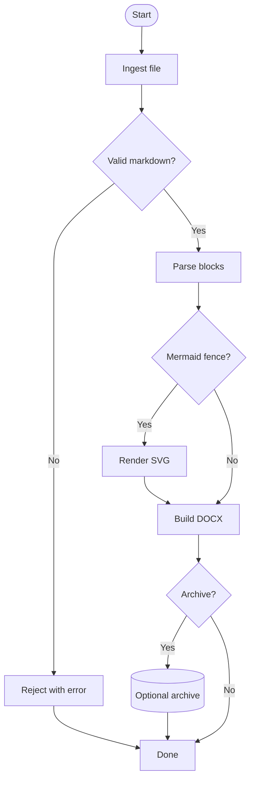
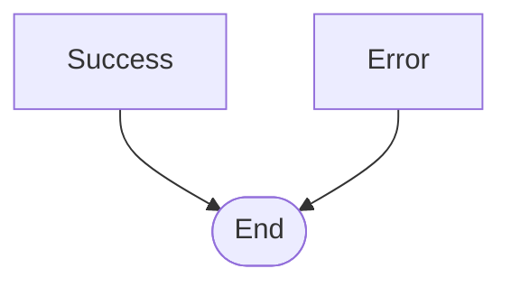
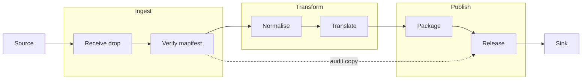
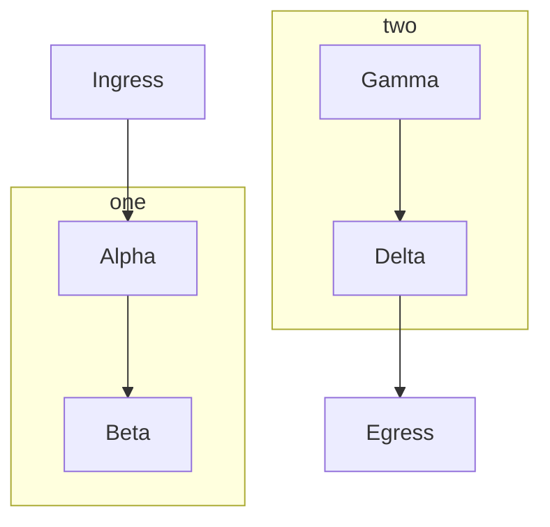
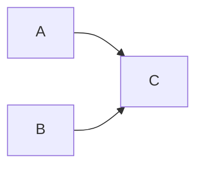
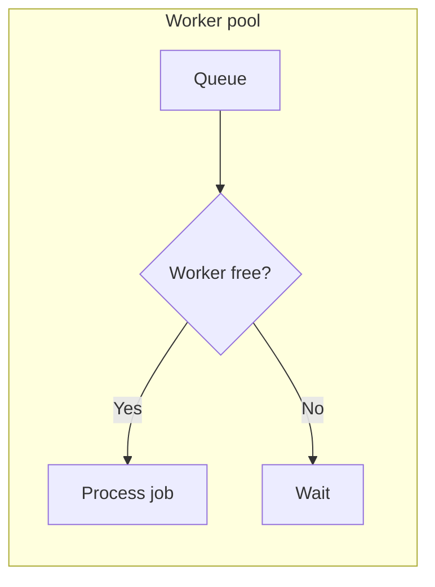
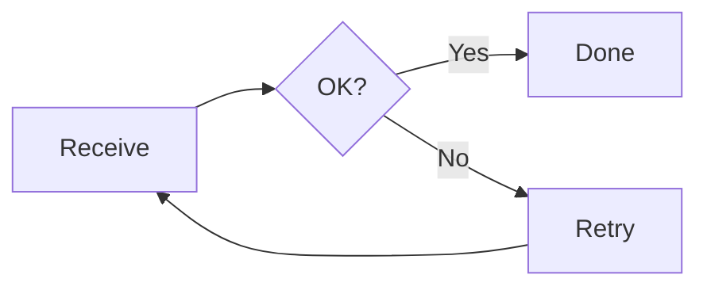

# Mermaid Flowchart Rule Validation Specification

**Document status:** Build specification  
**Schema version:** 2.0.0  
**Primary purpose:** Define the file contracts and rule execution model for validating Mermaid flowchart recognition, node placement, edge routing, labels, markers, geometry diagnostics, and feedback before visual inspection.  
**Primary inputs:** Mermaid source text extracted from Markdown (from any file, including regression catalogues) and any valid Mermaid flowchart.

**Normative citation rule:** this specification describes diagrams by **Mermaid source topology**, not by regression-catalogue scenario numbers. `DiagramId` in generated reports is traceability metadata only.  
**Primary outputs:** Machine-readable pass/fail diagnostics that can be fed back to an agent or developer until the rendered diagram is ready for SVG comparison and visual inspection.

---

## 1. Intent

The validation system must not be fixture-specific.

The goal is not to encode that any named catalogue scenario must look a certain way. The goal is to provide a universal set of rules that can be applied to any Mermaid flowchart after it has been parsed, laid out, routed, and analysed. Specifications describe diagrams by **Mermaid source topology**, not by regression-catalogue scenario numbers.

Every Mermaid diagram is treated as input data. The rules decide what applies by evaluating the generated model.

The system must:

1. Read Mermaid source text.
2. Produce a normalised recognition contract.
3. Produce a layout model containing node bounds, ranks, lanes, relative positions, and neighbour relationships.
4. Produce an edge routing model containing route classes, source and target ports, path family, path segments, arrow markers, labels, and collision facts.
5. Apply all applicable rules from `ruleset.json`.
6. Use `evaluator-map.json` to bind each rule to executable evaluator logic.
7. Use `expected-contract.json` to validate the shape and completeness of actual results and validation reports.
8. Emit `validation-report.json` with specific, actionable diagnostics.

The output must explain *what failed*, *where it failed*, *what was expected*, *what was found*, and *what should be corrected*.

---

## 2. Non-goals

The rule validation system must not:

- Use scenario IDs, scenario titles, node labels, or English words such as `Yes`, `No`, `Render`, or `Word` to select routing behaviour.
- Treat `flow.md` as the rule source.
- Replace SVG comparison.
- Replace final visual inspection.
- Store exact SVG co-ordinates as universal golden values.
- Use exact Bezier control points or exact label co-ordinates as the main validation mechanism.
- Hide unsupported Mermaid features silently.
- Treat recognition success as rendering success.

SVG comparison and visual inspection remain separate downstream gates.

### 2.1 Catalogue remarked diagrams (`Skipped`, not `Fail`)

Some Markdown catalogues contain **fully remarked** diagrams: every non-empty line inside the ` ```mermaid ` fence is prefixed with `%%`. These are documented in `spec.md` §9.1. The harness skips them regardless of which catalogue file contains the source.

| Remark pattern (Mermaid source) | `RenderGate` | Recognition axes tracked |
| --- | --- | --- |
| Metadata shapes: `%% Doc@{ shape: doc }[Document]` | `ExcludedRemarkedScenario` | `Recognition.Node.MetadataShape` |
| Semicolons and comments: `%% A[Receive]; --> B[Validate] %% hand-off` | `ExcludedRemarkedScenario` | `Recognition.Statement.*` |
| Edge animate metadata: `%% A e1@==> B` / `%% e1@{ animate: true }` | `ExcludedRemarkedScenario` | Edge id + animation metadata |
| Edge class animation: `%% classDef animate ...` / `%% class e1 animate` | `ExcludedRemarkedScenario` | `Recognition.Style.ClassDef` on edge id |

**Generation (`ActualResultsGenerator`):** when `ExtractedDiagram.IsFullyRemarked`, the harness sets `ParserSucceeded: true`, `LayoutSucceeded: false`, empty nodes/edges, and diagnostic `RemarkedScenario` (*"Diagram is fully remarked and excluded from layout and routing validation."*).

**Evaluation (`RulesEngine`):** when `Diagram.IsFullyRemarked` or parse failed, `DiagramValidationResult.Result` is **`Skipped`**; no rules from `ruleset.json` run for that diagram.

**Overall pass semantics:** `OverallResult: Pass` means **zero `Error` severity failures** among evaluated diagrams. Skipped diagrams do not contribute errors.

---

## 3. Required artefacts

The validation system is built from five logical artefacts.

| File | Produced by | Consumed by | Purpose |
| --- | --- | --- | --- |
| `ruleset.json` | Humans / rule-authoring agent | Rules engine | Universal rule catalogue. Defines what rules exist, when they apply, and what they mean. |
| `evaluator-map.json` | Humans / implementation team | Rules engine | Maps each `RuleId` to executable evaluator logic, required input fields, and tolerance profiles. |
| `expected-contract.json` | Humans / implementation team | Test harness and rules engine | Defines required schema for actual diagnostic output and validation reports. |
| `actual-results.json` | Mermaid diagnostic renderer | Rules engine | Captures what the parser, layout, router, SVG analyser, and label analyser actually produced. |
| `validation-report.json` | Rules engine | Tests, agents, developers | Reports pass/fail results and actionable diagnostics. |

The first three files are specification inputs. The last two files are generated outputs.

### 3.1 Maintaining `ruleset.json` (catalogue overlay)

`ruleset.json` is **generated**, not hand-edited. Maintain per-diagram bindings in [`ruleset-org.json`](ruleset-org.json) keyed by source hash and structural summary — not by catalogue scenario numbers in normative rule text. Fields include:

- `RenderGate`: `Active` or `ExcludedRemarkedScenario`
- `RequiredGenericRuleIds`: which universal rules must pass when that source topology is evaluated
- `ExpectedIntentAxes`: recognition, routing, and render axis tags for documentation

Regenerate the production ruleset:

```powershell
powershell -File "Rule Specification/Build-Ruleset.ps1"
```

`Build-Ruleset.ps1` reads `ruleset-org.json` generic-rule descriptions, merges them with universal rule templates defined in the script, and writes `ruleset.json` (schema **v2.0.0**).

### 3.2 Implementation packages (repository)

| Package / project | Role |
| --- | --- |
| `src/MermaidRecognition.RuleValidation/` | `RulesEngine`, evaluators, `ActualResultsGenerator`, models |
| `tests/MermaidRecognition.RuleValidation.Tests/` | Rule/evaluator integrity and integration tests |
| `src/MermaidRecognition.Layout/` | `FlowchartDagrePlacement`, structural routing, SVG render, diagnostic analysers |
| `src/RuleValidationHarness/` | CLI: Markdown → `actual-results.json` → `validation-report.json` |

---

## 4. Processing pipeline

```text
Markdown file
    ↓
Extract Mermaid fenced code blocks
    ↓
Parse Mermaid source
    ↓
RecognitionContract
    ↓
LayoutModel
    ↓
RoutingIntentModel
    ↓
SvgAnalysisModel, where SVG is available
    ↓
actual-results.json
    ↓
ruleset.json + evaluator-map.json + expected-contract.json
    ↓
Rules engine
    ↓
validation-report.json
    ↓
Agent/developer correction loop
    ↓
SVG comparison
    ↓
Visual inspection
```

The rules engine must be able to run without rendering to DOCX. It should validate the diagnostic model before the final document-rendering path.

---

## 5. Rule identity

Every rule must have a stable `RuleId`.

A `RuleId` is the join key between:

- `ruleset.json`
- `evaluator-map.json`
- `expected-contract.json`
- `validation-report.json`

A rule ID must be globally unique within the ruleset.

Recommended rule ID pattern:

```text
<Domain>.<Subject>.<RuleName>
```

Examples:

```text
Recognition.Edge.TokenDecomposition
Layout.Node.PrimaryDirectionOrdering
Layout.Node.NeighbourRelativePosition
Routing.Edge.NoNodeBodyIntersection
Routing.Edge.SourcePortMatchesDirection
Routing.Edge.OrthogonalSegmentAngles
Routing.Edge.CentreSpineStraightness
Routing.Label.AttachedToOwningEdge
Render.Marker.EndMarkerMatchesEdgeToken
Diagnostics.NoScenarioNameDrivenSpecialCase
```

---

## 6. `ruleset.json`

### 6.1 Purpose

`ruleset.json` defines the universal rules. It must not contain fixture-specific expectations.

It may include rule groups, applicability conditions, severity, diagnostic text, and expected logical properties. It must not require that a named scenario use a specific route simply because of the scenario name.

### 6.2 Top-level structure

```json
{
  "SchemaVersion": "2.0.0",
  "Name": "MermaidFlowchartUniversalRuleset",
  "Scope": {
    "DiagramKinds": ["flowchart", "graph", "flowchart-elk"],
    "PrimaryKind": "flowchart"
  },
  "DefaultToleranceProfileId": "DefaultGeometry",
  "RuleGroups": [],
  "Rules": []
}
```

### 6.3 Rule object

```json
{
  "RuleId": "Routing.Edge.NoNodeBodyIntersection",
  "RuleGroup": "ObstacleAvoidance",
  "AppliesTo": "Edge",
  "Severity": "Error",
  "Description": "An edge path must not pass through any unrelated node body.",
  "When": {
    "All": [
      { "Field": "Edge.IsVisible", "Operator": "Equals", "Value": true }
    ]
  },
  "Require": {
    "Path.DoesNotIntersectUnrelatedNodeBodies": true
  },
  "FailWhen": [
    "PathIntersectsUnrelatedNodeBody"
  ],
  "DiagnosticTemplate": "Edge {EdgeId} crosses node {IntersectedNodeId}. Route the edge around the node body.",
  "SuggestedCorrectionTemplate": "Move the route into an available corridor and preserve the source/target ports and marker intent."
}
```

### 6.4 Rule groups

The ruleset must include rules in these groups at minimum:

| Rule group | Purpose |
| --- | --- |
| `Recognition` | Validate parsed Mermaid facts: headers, directions, nodes, edges, labels, metadata, styles, subgraphs, accessibility. |
| `Layout` | Validate node rank, lane, ordering, bounds, spacing, group membership, and relative neighbour positions. |
| `NeighbourRelationships` | Validate above/below/left/right/aligned relationships derived from diagram direction and topology. |
| `RoutingClassification` | Validate route class inference: centre spine, short adjacent, decision branch, fan-in, fan-out, merge-back, bypass, cycle, cross-lane. |
| `PortSelection` | Validate source and target boundary regions for each route. |
| `PathShape` | Validate straight, smooth, orthogonal, polyline, spline, bypass, and return path families. |
| `Markers` | Validate arrow, circle, cross, bidirectional, and no-marker edges. |
| `Labels` | Validate edge and node label recognition, measurement, placement, attachment, and overlap avoidance. |
| `ObstacleAvoidance` | Validate that paths avoid unrelated nodes, clusters, sibling branches, and label zones. |
| `Subgraphs` | Validate group containment, internal routing, cross-boundary edges, and group-bound clipping. |
| `Diagnostics` | Validate that unsupported features and failed rules produce structured diagnostics. |
| `AntiPatterns` | Validate that no scenario-name, node-label, or English-label routing selectors are used. |

---

## 7. Applicability conditions

A rule applies when its `When` expression evaluates true against `actual-results.json`.

The rules engine must support the following condition operators at minimum:

| Operator | Meaning |
| --- | --- |
| `Equals` | Field equals value. |
| `NotEquals` | Field does not equal value. |
| `In` | Field value is in a list. |
| `NotIn` | Field value is not in a list. |
| `Exists` | Field exists and is not null. |
| `NotExists` | Field is absent or null. |
| `GreaterThan` | Numeric comparison. |
| `GreaterThanOrEqual` | Numeric comparison. |
| `LessThan` | Numeric comparison. |
| `LessThanOrEqual` | Numeric comparison. |
| `All` | All child conditions must be true. |
| `Any` | At least one child condition must be true. |
| `Not` | Child condition must be false. |

Rules must be selected by model facts, not scenario names.

Good:

```json
{
  "All": [
    { "Field": "SourceNode.Shape", "Operator": "Equals", "Value": "Diamond" },
    { "Field": "SourceNode.OutDegree", "Operator": "GreaterThanOrEqual", "Value": 2 },
    { "Field": "Edge.IsVisible", "Operator": "Equals", "Value": true }
  ]
}
```

Bad (must not select rules by catalogue scenario id):

```json
{
  "Field": "DiagramId",
  "Operator": "Equals",
  "Value": "catalogue-scenario-29"
}
```

---

## 8. `evaluator-map.json`

### 8.1 Purpose

`evaluator-map.json` binds every `RuleId` to executable evaluator logic.

This prevents `ruleset.json` from becoming a programming language while still keeping rule metadata, severity, applicability, and diagnostic text data-driven.

### 8.2 Top-level structure

```json
{
  "SchemaVersion": "2.0.0",
  "Name": "MermaidFlowchartEvaluatorMap",
  "EvaluatorBindings": []
}
```

### 8.3 Evaluator binding object

```json
{
  "RuleId": "Routing.Edge.NoNodeBodyIntersection",
  "EvaluatorId": "NoNodeBodyIntersectionEvaluator",
  "EvaluatorType": "Geometry",
  "InputModel": "ActualResults",
  "AppliesTo": "Edge",
  "RequiredFields": [
    "Edges[].EdgeId",
    "Edges[].Path.Points",
    "Edges[].SourceNodeId",
    "Edges[].TargetNodeId",
    "Nodes[].NodeId",
    "Nodes[].Bounds"
  ],
  "ToleranceProfileId": "StrictIntersection",
  "FailureCode": "ROUTE_NODE_BODY_INTERSECTION"
}
```

### 8.4 Evaluator implementation

The implementation should use C# evaluator classes or methods. The JSON does not execute code. It identifies which evaluator is responsible for a rule.

Recommended C# contract:

```csharp
public interface IRuleEvaluator
{
    string RuleId { get; }

    RuleEvaluationResult Evaluate(
        RuleDefinition RuleDefinition,
        EvaluatorBinding EvaluatorBinding,
        ActualResults ActualResults,
        EvaluationContext EvaluationContext);
}
```

Implementation style should keep evaluator names stable and independent from fixture IDs.

---

## 9. `expected-contract.json`

### 9.1 Purpose

`expected-contract.json` defines the required shape of:

- `actual-results.json`
- `validation-report.json`
- per-rule failure diagnostics
- tolerances
- severity handling
- minimum generated model completeness

It does not contain scenario-specific expected geometry.

### 9.2 Top-level structure

```json
{
  "SchemaVersion": "2.0.0",
  "Name": "MermaidFlowchartExpectedContract",
  "ActualResultsContract": {},
  "ValidationReportContract": {},
  "ToleranceProfiles": [],
  "DiagnosticRequirements": {}
}
```

### 9.3 Required actual results sections

`actual-results.json` must contain at minimum:

```json
{
  "SchemaVersion": "2.0.0",
  "RunId": "string",
  "Source": {},
  "Diagrams": []
}
```

Each diagram result must contain:

```json
{
  "DiagramId": "string",
  "Kind": "flowchart",
  "Direction": "TB",
  "Recognition": {},
  "Config": {},
  "Nodes": [],
  "Edges": [],
  "Groups": [],
  "Layout": {},
  "Routing": {},
  "Labels": [],
  "Markers": [],
  "Diagnostics": []
}
```

### 9.4 Required node fields

Each node must include:

```json
{
  "NodeId": "string",
  "Label": "string",
  "LabelType": "text|string|markdown|html",
  "Shape": "string",
  "Bounds": {
    "X": 0,
    "Y": 0,
    "Width": 0,
    "Height": 0,
    "CentreX": 0,
    "CentreY": 0
  },
  "Rank": 0,
  "Lane": 0,
  "ParentGroupId": null,
  "IncomingEdgeIds": [],
  "OutgoingEdgeIds": [],
  "NeighbourFacts": []
}
```

### 9.5 Required edge fields

Each edge must include:

```json
{
  "EdgeId": "string",
  "SourceNodeId": "string",
  "TargetNodeId": "string",
  "CreationIndex": 0,
  "IsVisible": true,
  "Stroke": "Normal|Dotted|Thick|Invisible",
  "ArrowStart": "None|Point|Circle|Cross",
  "ArrowEnd": "None|Point|Circle|Cross",
  "MinLength": 1,
  "Label": null,
  "LabelType": null,
  "RouteClass": "CentreSpine|ShortAdjacent|LocalDecisionBranch|FanOut|FanIn|MergeBack|LongBypass|CycleOrReturn|CrossLane|SubgraphInternal|SubgraphCrossBoundary|Unknown",
  "SourcePort": "Top|Bottom|Left|Right|TopLeft|TopRight|BottomLeft|BottomRight|Centre|Unknown",
  "TargetPort": "Top|Bottom|Left|Right|TopLeft|TopRight|BottomLeft|BottomRight|Centre|Unknown",
  "PathFamily": "Straight|Smooth|Orthogonal|Polyline|Spline|LongBypass|Invisible|Unknown",
  "Path": {
    "Points": [],
    "Segments": [],
    "BoundingBox": {}
  },
  "CollisionFacts": [],
  "LabelFacts": {},
  "MarkerFacts": {}
}
```

### 9.6 Required validation report fields

`validation-report.json` must contain:

```json
{
  "SchemaVersion": "2.0.0",
  "RunId": "string",
  "OverallResult": "Pass|Fail|WarningOnly",
  "Summary": {
    "DiagramCount": 0,
    "RuleCount": 0,
    "PassCount": 0,
    "WarningCount": 0,
    "ErrorCount": 0
  },
  "DiagramResults": [],
  "Failures": []
}
```

Each failure must contain:

```json
{
  "RuleId": "string",
  "EvaluatorId": "string",
  "Severity": "Info|Warning|Error",
  "DiagramId": "string",
  "ElementType": "Diagram|Node|Edge|Group|Label|Marker|Route|Config",
  "ElementId": "string",
  "Message": "string",
  "Expected": {},
  "Actual": {},
  "SuggestedCorrection": "string",
  "SourceSpan": null
}
```

---

## 10. Tolerance profiles

Geometry checks require explicit tolerances.

Tolerance profiles belong in `expected-contract.json` and are referenced from `evaluator-map.json`.

Example:

```json
{
  "ToleranceProfileId": "DefaultGeometry",
  "DistanceTolerancePx": 4.0,
  "AngleToleranceDegrees": 3.0,
  "AlignmentTolerancePx": 4.0,
  "IntersectionTolerancePx": 0.5,
  "LabelAttachmentTolerancePx": 12.0,
  "PortSnapTolerancePx": 6.0,
  "MinimumMergePortSeparationPx": 8.0
}
```

Recommended profiles:

| Profile | Purpose |
| --- | --- |
| `DefaultGeometry` | General node/edge geometry. |
| `StrictIntersection` | Node/cluster pass-through checks. |
| `LabelAttachment` | Label-to-edge association. |
| `OrthogonalPath` | Axis-aligned path validation. |
| `StraightPath` | Centre-spine and short-adjacent straightness. |
| `MarkerPlacement` | Marker start/end validation. |

---

## 11. Minimum universal rules

The initial `ruleset.json` must contain at least the rules below.

### 11.1 Recognition rules

| RuleId | Applies to | Requirement |
| --- | --- | --- |
| `Recognition.Header.FlowchartFamily` | Diagram | `graph`, `flowchart`, and `flowchart-elk` are recognised as flowchart-compatible inputs. |
| `Recognition.Direction.Canonical` | Diagram | `TD` normalises to `TB`; symbolic directions map to canonical values. |
| `Recognition.Node.IdentityMerge` | Node | Repeated declarations merge into one node contract. |
| `Recognition.Node.ShapeCanonicalisation` | Node | Mermaid node syntax and metadata shapes map to canonical shape intent. |
| `Recognition.Edge.TokenDecomposition` | Edge | Edge token decomposes into stroke, arrow start, arrow end, directionality, and min length. |
| `Recognition.Edge.Expansion` | Edge | Chained and grouped expressions expand into individual logical edges. |
| `Recognition.Edge.MinLengthFromToken` | Edge | `MinLength` is derived from the link token, not label width. |
| `Recognition.Subgraph.Membership` | Group | Subgraphs create groups with deterministic parent/child membership. |
| `Recognition.Style.Mutations` | Diagram | `style`, `classDef`, `class`, `linkStyle`, and inline classes are preserved as mutations. |
| `Recognition.Unsupported.MustDiagnose` | Diagram | Recognised but unsupported constructs must emit diagnostics. |

### 11.2 Node layout rules

| RuleId | Applies to | Requirement |
| --- | --- | --- |
| `Layout.Node.BoundsPresent` | Node | Every rendered node has non-empty bounds and centre co-ordinates. |
| `Layout.Node.RankLanePresent` | Node | Every connected node has rank and lane assignment. |
| `Layout.Node.PrimaryDirectionOrdering` | Edge | For primary-flow edges, source and target ordering matches diagram direction. |
| `Layout.Node.NeighbourRelativePosition` | Node | Above/below/left/right/aligned neighbour facts match node centres and direction. |
| `Layout.Node.NoOverlap` | Node pair | Unrelated node bodies must not overlap beyond tolerance. |
| `Layout.Node.GroupContainment` | Node | A group member must lie within its group bounds, allowing configured padding. |

### 11.3 Route classification rules

| RuleId | Applies to | Requirement |
| --- | --- | --- |
| `Routing.Class.CentreSpine` | Edge | Adjacent-rank primary-flow edges align to the primary spine without unnecessary detours. |
| `Routing.Class.ShortAdjacent` | Edge | Nearby source-target pairs use direct or minimal routes. |
| `Routing.Class.LocalDecisionBranch` | Edge | Decision branches leave distinct ports and do not collapse into sibling branches. |
| `Routing.Class.FanOut` | Edge set | One-to-many edges distribute without ambiguous path collapse. |
| `Routing.Class.FanIn` | Edge set | Many-to-one edges merge cleanly with separable target entry. |
| `Routing.Class.MergeBack` | Edge | Branch paths returning to the primary path use a clear merge-back route. |
| `Routing.Class.LongBypass` | Edge | Rank-spanning or exception edges use an exterior or obstacle-aware corridor. |
| `Routing.Class.CycleOrReturn` | Edge | Backward edges route outside the primary flow and avoid node bodies. |

### 11.4 Port selection rules

| RuleId | Applies to | Requirement |
| --- | --- | --- |
| `Routing.Port.PrimaryDirection` | Edge | Primary-flow edges leave and enter via direction-appropriate ports. |
| `Routing.Port.DecisionBranchDistinct` | Edge set | Multiple branches from a decision node use distinct or non-conflicting source regions. |
| `Routing.Port.MergeSeparation` | Edge set | Multiple incoming edges to a merge target use separable entry regions or merge points. |
| `Routing.Port.ShapeBoundary` | Edge | Edges terminate at shape boundary intersections, not node centres. |

### 11.5 Path shape rules

| RuleId | Applies to | Requirement |
| --- | --- | --- |
| `Routing.Path.Straightness` | Edge | Straight routes remain within perpendicular drift tolerance. |
| `Routing.Path.OrthogonalSegments` | Edge | Orthogonal routes use legal axis-aligned segments. |
| `Routing.Path.NoHardElbowWhenSmoothRequired` | Edge | Smooth routes do not contain sharp, unsupported elbows. |
| `Routing.Path.NoHookAtSource` | Edge | Route does not reverse direction immediately after leaving source. |
| `Routing.Path.NoHookAtTarget` | Edge | Route does not overshoot and hook into target. |
| `Routing.Path.NoUnnecessaryDetour` | Edge | Direct routes are not replaced by arbitrary long detours. |

### 11.6 Obstacle avoidance rules

| RuleId | Applies to | Requirement |
| --- | --- | --- |
| `Routing.Obstacle.NoNodeBodyIntersection` | Edge | Visible edge does not pass through unrelated node bodies. |
| `Routing.Obstacle.NoClusterBodyIntersection` | Edge | Edge does not pass through unrelated cluster bodies or confusing group interiors. |
| `Routing.Obstacle.NoSiblingBranchCrossing` | Edge set | Sibling decision branches do not cross each other unnecessarily. |
| `Routing.Obstacle.NoSpineCrossingForException` | Edge | Long exception routes avoid cutting through the centre spine corridor unless structurally required. |

### 11.7 Label rules

| RuleId | Applies to | Requirement |
| --- | --- | --- |
| `Routing.Label.AttachedToOwningEdge` | Edge label | Label is closer to its owning edge than unrelated edges. |
| `Routing.Label.ClearOfNodeBodies` | Edge label | Label does not overlap source/target or unrelated node bodies. |
| `Routing.Label.ClearOfMarkers` | Edge label | Label does not overlap arrow markers. |
| `Routing.Label.LongLabelWrapped` | Edge label | Long labels wrap or reserve space without changing min length from text width. |
| `Routing.Label.BranchLabelNearBranch` | Edge label | Decision branch labels sit near the relevant branch segment. |

### 11.8 Marker rules

| RuleId | Applies to | Requirement |
| --- | --- | --- |
| `Render.Marker.StartMatchesToken` | Edge | Start marker matches token decomposition. |
| `Render.Marker.EndMatchesToken` | Edge | End marker matches token decomposition. |
| `Render.Marker.BidirectionalPreserved` | Edge | Bidirectional edges preserve both markers without duplicating logical edges. |
| `Render.Marker.NotLost` | Edge | A visible marker is present when required by the source token. |
| `Render.Marker.NotInvented` | Edge | No marker is added when the source token does not require one. |

### 11.9 Subgraph rules

| RuleId | Applies to | Requirement |
| --- | --- | --- |
| `Subgraph.MemberMinimumInset` | Group | Member node bodies maintain minimum cluster insets (18px left/right/bottom; 44px from cluster top including 26px title band). |
| `Subgraph.MembersVerticallyCentered` | Group | Member content bounding box is vertically centred in the cluster content region below the title band. |
| `Subgraph.MembersHorizontallyCentered` | Group | Member content bounding box is horizontally centred with side padding. |
| `Subgraph.BoundsContainMembers` | Group | Group bounds contain child nodes and groups with padding. |
| `Subgraph.InternalEdgesRemainInside` | Edge | Internal group edges route within the group when possible. |
| `Subgraph.CrossBoundaryEdgesAreClear` | Edge | Cross-boundary edges clip and route without confusing group membership. |
| `Subgraph.NestedOwnershipDeterministic` | Group | Nested group ownership is deterministic and not duplicated. |
| `Layout.Subgraph.SiblingMinimumGap` | Group | Sibling subgraph cluster boxes maintain at least **24px** exterior gap on the primary flow axis (cluster bounds including padding and title band). Applies to LR side-by-side subgraph siblings and TB stacked subgraph siblings with cross-boundary edges. |

### 11.10 Anti-pattern rules

| RuleId | Applies to | Requirement |
| --- | --- | --- |
| `Diagnostics.NoScenarioNameDrivenRouting` | Implementation | Routing must not branch on scenario ID or fixture name. |
| `Diagnostics.NoNodeLabelDrivenRouting` | Implementation | Routing must not branch on visible node label text. |
| `Diagnostics.NoEnglishLabelDrivenBranching` | Implementation | Routing must not use English edge labels such as `Yes` or `No` to determine geometry. |
| `Diagnostics.UnsupportedFeaturesReported` | Diagram | Unsupported recognised features produce diagnostics. |

---

## 12. Actual results model

The diagnostic renderer must generate `actual-results.json` from the produced diagram, not from expected data.

The actual results should include enough derived geometry to evaluate rules without reparsing SVG where possible.

The model must include:

- source identity and source hash
- diagram kind and direction
- node contracts
- edge contracts
- group contracts
- resolved config
- node bounds
- group bounds
- ranks and lanes
- neighbour facts
- route classes
- source and target ports
- path family
- path points and segments
- marker facts
- label facts
- collision facts
- diagnostics

Where SVG is available, SVG analysis may add:

- actual path `d`
- marker-start and marker-end references
- text/foreignObject bounds
- group transforms
- viewBox
- resolved style facts

---

## 13. Validation report model

The validation report must be designed for an agent correction loop.

A failure message must be specific enough to guide correction.

Bad failure:

```text
Diagram failed.
```

Good failure:

```text
Edge Check_to_Fail failed Routing.Obstacle.NoNodeBodyIntersection.
The path segment from (120, 220) to (310, 220) intersects node OK bounds.
Route the branch outside the sibling branch corridor before entering Fail.
```

Every failure must include:

- `RuleId`
- `EvaluatorId`
- `Severity`
- `DiagramId`
- `ElementType`
- `ElementId`
- `Message`
- `Expected`
- `Actual`
- `SuggestedCorrection`

---

## 14. Test harness requirements

The test harness must perform these checks:

1. All JSON files parse successfully.
2. Every `RuleId` in `evaluator-map.json` exists in `ruleset.json`.
3. Every `RuleId` in `expected-contract.json` exists in `ruleset.json`, if rule-specific contracts are declared.
4. Every `RuleId` has exactly one evaluator binding unless explicitly marked as composite.
5. Every evaluator's required fields are present in `actual-results.json` or failure is reported as `MissingActualField`.
6. Every rule whose `When` condition evaluates true is executed.
7. Rules whose `When` condition evaluates false are reported as `NotApplicable`, not `Pass`.
8. Any `Error` failure makes the diagram fail.
9. Warnings do not fail the diagram unless configured by strict mode.
10. The report must identify whether the failure is recognition, layout, routing, label, marker, SVG-analysis, or downgrade related.

---

## 15. Fixture usage

`flow.md` and future torture-test files are input catalogues only.

The test runner may record the source scenario ID as `DiagramId` for traceability, but rules must not use it for applicability or route selection.

Acceptable use of scenario ID:

```json
{
  "DiagramId": "F61",
  "SourceFile": "flow.md"
}
```

Forbidden use of scenario ID:

```json
{
  "When": {
    "Field": "DiagramId",
    "Operator": "Equals",
    "Value": "F61"
  }
}
```

---

## 16. Acceptance criteria

The implementation is acceptable when:

1. `ruleset.json`, `evaluator-map.json`, and `expected-contract.json` are schema-valid.
2. All rule IDs are unique.
3. Every rule has an evaluator binding.
4. Every evaluator binding references an implemented evaluator.
5. Every evaluator declares required input fields.
6. The diagnostic renderer can produce `actual-results.json` for every active Mermaid block in `flow.md`.
7. The rules engine can produce `validation-report.json` for every actual result.
8. Failures are specific enough to feed back into an agent.
9. No rule or evaluator selects behaviour using scenario ID, visible node label text, or English branch label text.
10. SVG comparison remains separate and is run after the rule validation report is pass or warning-only.
11. Visual inspection is only performed after the diagnostic rules pass or only approved warnings remain.

---

## 17. Recommended build stages

| Stage | Build outcome | Acceptance |
| --- | --- | --- |
| 1 | JSON schemas for the three specification files | Schemas validate sample files. |
| 2 | Actual results model | Parser/layout/router emits complete `actual-results.json`. |
| 3 | Rules engine shell | Loads three spec files and executes no-op evaluators. |
| 4 | Recognition evaluators | Header, direction, node, edge, group, style, metadata rules pass. |
| 5 | Layout evaluators | Bounds, rank/lane, neighbour, overlap, group containment rules pass. |
| 6 | Routing evaluators | Route class, port, path shape, obstacle, hook, detour rules pass. |
| 7 | Label and marker evaluators | Label attachment and marker preservation rules pass. |
| 8 | Agent-ready diagnostics | Failure messages include expected/actual/suggested correction. |
| 9 | SVG analysis integration | Actual SVG facts are cross-checked where available. |
| 10 | Full `flow.md` run | All active scenarios produce pass/warning-only before SVG comparison. |

---

## 18. Deliverables for the agent

The agent should build:

```text
ruleset.json
evaluator-map.json
expected-contract.json
actual-results.json generator
validation-report.json generator
C# rule evaluator framework
C# evaluator implementations
unit tests for rule/evaluator ID integrity
unit tests for expected-contract compliance
integration tests using flow.md as input
```

The tests must be built against this specification, not against fixture-specific route expectations.

---

## 19. Glossary

| Term | Meaning |
| --- | --- |
| Recognition contract | Parsed Mermaid facts: diagram kind, config, nodes, edges, groups, styles, metadata, diagnostics. |
| Layout model | Node and group geometry: bounds, centres, ranks, lanes, neighbour facts. |
| Routing intent model | Edge-level route facts: route class, ports, path family, path points, labels, markers, collisions. |
| Evaluator | C# logic that evaluates one or more rules against actual results. |
| Expected contract | Required structure and completeness of generated actual results and validation report. |
| Fixture | Input diagram used to exercise rules; not the rule source. |
| Visual inspection | Human review after diagnostic and SVG comparison gates. |

---

## 20. Appendix — reference diagrams (Mermaid source)

Appendix diagrams are **structural patterns** for tests and documentation. Rules must not branch on `DiagramId`, catalogue scenario numbers, or node display text. Authoritative prose: `spec.md` §5.5–§5.6, `Mermaid_Specification.md` §17.5.

### 20.1 Multi-route TB integration



| Edge (by node id) | Class | Rule axis (typical) |
| --- | --- | --- |
| Spine chain through `Start`…`Done` (excluding labelled branches below) | `CentreSpine` | straight spine attach |
| `Validate→Reject` | `LongExceptionRoute` | `Routing.Class.LongBypass` |
| `HasMermaid→Render`, `HasMermaid→Word` | `LocalDecisionBranch` | `Routing.LocalDecisionBranch` |
| `Render→Word`, `Reject→Done` | `MergeBack` | `Routing.MergeBack` |
| `DoArchive→Done` with `Persist` on spine between | `SkipBypass` | `Routing.Class.SkipBypass` |

Implementation: `FlowchartSkipBypassRouteBuilder`, `FlowchartLongExceptionRouteBuilder`, `FlowchartMergeBackRouteBuilder`, `FlowchartCurvePathBuilder`, `FlowchartRenderedPathValidator`, `FlowchartDecisionPortAllocator`.

### 20.2 Additional structural patterns

**Stadium terminal-collector merge:**



**LR sibling subgraphs with dotted cross-link:**



**Parallel subgraph columns:**



**LR ampersand fan-in:**



**Collinear negative branch (left port when unobstructed):**



**LR retry loop (orthogonal polyline route kind):**


