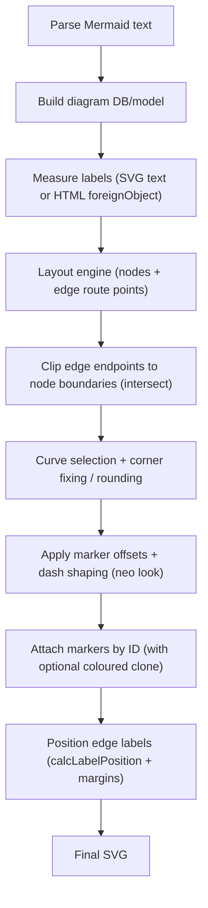

# Official Mermaid Geometry & Routing Specification (Source-Traced)

**Scope**: This document is an **implementation-usable, source-traced** specification for Mermaid’s *render-time* geometry rules: **node sizing**, **text measurement and wrapping**, **layout/routing inputs and outputs**, **edge path generation (including curve selection and corner rounding)**, **marker/arrowhead definition and assignment**, and **theme/colour resolution**.

**Audience**: Implementers writing a renderer, an SVG normaliser/extractor, or a “manual drawing” pipeline that must match Mermaid’s SVG output.

**Repo-local source of truth**: `.\mermaid\packages\mermaid\src\...` (vendored Mermaid source within this repository).

---

## 1. Non-negotiable version pinning

This specification is only exact for the Mermaid source snapshot present in this repository. Any upstream change can alter:

- text measurement (fonts, wrapping algorithm behaviour, HTML labels)
- edge routing points (layout engine versions and configuration)
- marker definitions and offsets
- curve defaults, corner rounding, dash shaping
- theme variables and derived colours

Therefore, “exact reproduction” requires pinning at least:

- Mermaid commit or npm version (from the vendored snapshot)
- diagram type and direction
- layout engine selection (e.g. Dagre vs ELK where applicable)
- `htmlLabels` effective value
- theme + themeVariables overrides
- font family/size/weight, and renderer runtime (browser engine)

---

## 2. Rendering pipeline overview (normative)

Mermaid’s geometry comes from a pipeline that mixes:

- **runtime measurement** (text bounding boxes, HTML layout),
- **layout algorithm output** (node centres, edge route points),
- **post-processing** (intersection with node boundary, corner fixing, curve interpolation),
- **marker attachment** (SVG `<marker>` + `marker-start`/`marker-end`),
- **theme + style resolution**.

For flowchart-like diagram families, the critical stages are:



---

## 3. Node placement and transforms

### 3.1 Shape handler selection (`insertNode`)

Mermaid chooses a shape handler from `shapes` and normalises `rect` into either `roundedRect` or `squareRect`.

```14:55:C:/Users/windo/OneDrive/Documents/Development/MarkdownToDocX/mermaid/packages/mermaid/src/rendering-util/rendering-elements/nodes.ts
export async function insertNode(
  elem: SVGGroup,
  node: NonClusterNode,
  renderOptions: ShapeRenderOptions
) {
  //special check for rect shape (with or without rounded corners)
  if (node.shape === 'rect') {
    if (node.rx && node.ry) {
      node.shape = 'roundedRect';
    } else {
      node.shape = 'squareRect';
    }
  }

  const shapeHandler = node.shape ? shapes[node.shape] : undefined;
  if (!shapeHandler) {
    throw new Error(`No such shape: ${node.shape}. Please check your syntax.`);
  }
  // ...
}
```

**Normative rule**:

- **If** `node.shape == "rect"` and both `node.rx` and `node.ry` are set, **then** render as `roundedRect`.
- **Else** render as `squareRect`.

### 3.2 Node group transform (`positionNode`)

Nodes are positioned by translating the rendered `<g>` to the layout engine’s `(node.x, node.y)` centre. Cluster nodes differ.

```77:100:C:/Users/windo/OneDrive/Documents/Development/MarkdownToDocX/mermaid/packages/mermaid/src/rendering-util/rendering-elements/nodes.ts
export const positionNode = (node: ReturnType<graphlib.Graph['node']>) => {
  const el = nodeElems.get(node.id)!;
  const padding = 8;
  const diff = node.diff || 0;
  if (node.clusterNode) {
    el.attr(
      'transform',
      'translate(' +
        (node.x + diff - node.width / 2) +
        ', ' +
        (node.y - node.height / 2 - padding) +
        ')'
    );
  } else {
    el.attr('transform', 'translate(' + node.x + ', ' + node.y + ')');
  }
  return diff;
};
```

**Normative rules**:

- **Non-cluster nodes**: `transform = translate(node.x, node.y)` where `node.x`/`node.y` are the layout output centre co-ordinates.
- **Cluster nodes**: `transform = translate(node.x + diff - node.width/2, node.y - node.height/2 - padding)` with `padding = 8` and `diff = node.diff || 0`.

### 3.3 Node minimum size, padding, and intersection family (rectangle baseline)

Mermaid’s rectangle-family sizing rule is implemented in `drawRect(...)`. It sets the node’s rendered size based on:

- measured label bbox (`bbox.width`, `bbox.height`)
- label padding (`labelPaddingX`, `labelPaddingY`)
- optional explicit node size (`node.width`, `node.height`) as a minimum

```11:75:C:/Users/windo/OneDrive/Documents/Development/MarkdownToDocX/mermaid/packages/mermaid/src/rendering-util/rendering-elements/shapes/drawRect.ts
export async function drawRect<T extends SVGGraphicsElement>(
  parent: D3Selection<T>,
  node: Node,
  options: RectOptions
) {
  const { shapeSvg, bbox } = await labelHelper(parent, node, getNodeClasses(node));

  const totalWidth = Math.max(bbox.width + options.labelPaddingX * 2, node?.width || 0);
  const totalHeight = Math.max(bbox.height + options.labelPaddingY * 2, node?.height || 0);
  const x = -totalWidth / 2;
  const y = -totalHeight / 2;
  // ... insert <rect> with x/y/width/height ...
  updateNodeBounds(node, rect);

  node.calcIntersect = function (bounds: Bounds, point: Point) {
    return intersect.rect(bounds, point);
  };
  node.intersect = function (point) {
    return intersect.rect(node, point);
  };
  return shapeSvg;
}
```

**Normative rules (rectangle baseline)**:

- **Minimum size**:
  - `TotalWidth = max(LabelBBoxWidth + 2 * LabelPaddingX, node.width || 0)`
  - `TotalHeight = max(LabelBBoxHeight + 2 * LabelPaddingY, node.height || 0)`
- **Local origin** (centred node space):
  - `RectX = -TotalWidth / 2`
  - `RectY = -TotalHeight / 2`
- **Intersection family**:
  - rectangle nodes set both `node.calcIntersect` and `node.intersect` to `intersect.rect(...)`
  - which means edge endpoint clipping is against a **rectangle boundary**, even if the node is part of a broader “rect” semantic shape family.

### 3.4 Polygon insertion transform (shared helper)

Polygon-based shapes are inserted with a shared translation that effectively centres the polygon around the node’s origin:

```157:175:C:/Users/windo/OneDrive/Documents/Development/MarkdownToDocX/mermaid/packages/mermaid/src/rendering-util/rendering-elements/shapes/util.ts
export function insertPolygonShape(
  parent: D3Selection<SVGGElement>,
  w: number,
  h: number,
  points: Point[]
) {
  return parent
    .insert('polygon', ':first-child')
    .attr('points', points.map(function (d) { return d.x + ',' + d.y; }).join(' '))
    .attr('class', 'label-container')
    .attr('transform', 'translate(' + -w / 2 + ',' + h / 2 + ')');
}
```

**Normative rule**:

- After the shape-specific point list is provided in a “shape-local” co-ordinate system, Mermaid applies:
  - `translate(-w/2, h/2)`
  - before the node’s outer `<g>` is translated to `(node.x, node.y)` by `positionNode`.

---

## 4. Label measurement, text sizing, and wrapping

Mermaid supports two label measurement modes:

- **HTML labels** (`useHtmlLabels == true`): label is a `<foreignObject>` containing an XHTML `<div><span>...`.
- **SVG text labels** (`useHtmlLabels == false`): label is a `<text>` with one or more `<tspan>`.

The effective flag is computed upstream, but the label creation behaves as below.

### 4.0 Node label helper (flowchart shapes): label width selection and centring

Flowchart node shapes typically create labels via `labelHelper(...)`, which selects:

- effective HTML label mode as `node.useHtmlLabels || evaluate(config.htmlLabels)`, and
- wrapping width as `node.width || config.flowchart.wrappingWidth`.

```11:87:C:/Users/windo/OneDrive/Documents/Development/MarkdownToDocX/mermaid/packages/mermaid/src/rendering-util/rendering-elements/shapes/util.ts
export const labelHelper = async <T extends SVGGraphicsElement>(
  parent: D3Selection<T>,
  node: Node,
  _classes?: string
) => {
  const useHtmlLabels = node.useHtmlLabels || evaluate(getConfig()?.htmlLabels);
  // ...
  const text = await createText(
    labelEl,
    sanitizeText(decodeEntities(label), getConfig()),
    {
      useHtmlLabels,
      width: node.width || getConfig().flowchart?.wrappingWidth,
      // ...
    },
    getConfig()
  );
  // ...
  if (useHtmlLabels) {
    labelEl.attr('transform', 'translate(' + -bbox.width / 2 + ', ' + -bbox.height / 2 + ')');
  } else {
    labelEl.attr('transform', 'translate(' + 0 + ', ' + -bbox.height / 2 + ')');
  }
  if (node.centerLabel) {
    labelEl.attr('transform', 'translate(' + -bbox.width / 2 + ', ' + -bbox.height / 2 + ')');
  }
  // ...
};
```

**Normative implications**:

- **Text wrapping** for node labels depends on `node.width` when present; otherwise it defaults to `flowchart.wrappingWidth` (schema default **200**).
- **SVG label centring differs** from HTML label centring:
  - SVG mode centres vertically but leaves horizontal centring to text-anchor handling unless `node.centerLabel` is set.
  - HTML mode centres both horizontally and vertically by translating by `-bbox.width/2, -bbox.height/2`.

### 4.1 HTML labels: foreignObject sizing and wrapping rules

HTML label creation uses a “large provisional size then read actual DOM box” strategy.

```32:79:C:/Users/windo/OneDrive/Documents/Development/MarkdownToDocX/mermaid/packages/mermaid/src/rendering-util/createText.ts
async function addHtmlSpan(
  element: D3Selection<SVGGElement>,
  node: { label: string; labelStyle: string; isNode: boolean },
  width: number,
  classes: string,
  addBackground = false,
  config: MermaidConfig = getConfig()
) {
  const fo = element.append('foreignObject');
  fo.attr('width', `${Math.min(10 * width, maxSafeSizeForWidth)}px`);
  fo.attr('height', `${Math.min(10 * width, maxSafeSizeForWidth)}px`);

  const div = fo.append<HTMLDivElement>('xhtml:div');
  // ...
  div.style('display', 'table-cell');
  div.style('white-space', 'nowrap');
  div.style('line-height', '1.5');
  if (width !== Number.POSITIVE_INFINITY) {
    div.style('max-width', width + 'px');
    div.style('text-align', 'center');
  }
  // ...
  let bbox = div.node()!.getBoundingClientRect();
  if (bbox.width === width) {
    div.style('display', 'table');
    div.style('white-space', 'break-spaces');
    div.style('width', width + 'px');
    bbox = div.node()!.getBoundingClientRect();
  }
  return fo.node()!;
}
```

**Normative HTML label rules**:

- **Provisional foreignObject size**:
  - `fo.width = min(10 * width, 16384) px`
  - `fo.height = min(10 * width, 16384) px`
  - Source constant: `maxSafeSizeForWidth = 16384`.  
    See `createText.ts` lines 29–31.
- **Default layout**:
  - `div.display = table-cell`
  - `div.white-space = nowrap`
  - `div.line-height = 1.5`
  - If `width != +Infinity`, set `div.max-width = width px` and `div.text-align = center`.
- **Wrap activation heuristic**:
  - After initial layout, compute `bbox = div.getBoundingClientRect()`.
  - If `bbox.width == width`, switch:
    - `div.display = table`
    - `div.white-space = break-spaces`
    - `div.width = width px`
  - Re-read `bbox`.

### 4.2 SVG text labels: line breaking algorithm and background padding

SVG labels are built using a structured “markdown words” model, then lines are split to fit a `width` using measured text length.

```146:189:C:/Users/windo/OneDrive/Documents/Development/MarkdownToDocX/mermaid/packages/mermaid/src/rendering-util/createText.ts
function createFormattedText(
  width: number,
  g: D3Selection<SVGGElement>,
  structuredText: MarkdownWord[][],
  addBackground = false,
  centerText = false
) {
  const lineHeight = 1.1;
  const labelGroup = g.append('g');
  const bkg = labelGroup.insert('rect').attr('class', 'background').attr('style', 'stroke: none');
  const textElement = labelGroup.append('text').attr('y', '-10.1');
  // ...
  for (const line of structuredText) {
    const checkWidth = (line: MarkdownLine) =>
      computeWidthOfText(labelGroup, lineHeight, line) <= width;
    const linesUnderWidth = checkWidth(line) ? [line] : splitLineToFitWidth(line, checkWidth);
    for (const preparedLine of linesUnderWidth) {
      const tspan = createTspan(textElement, lineIndex, lineHeight, centerText);
      updateTextContentAndStyles(tspan, preparedLine);
      lineIndex++;
    }
  }
  if (addBackground) {
    const bbox = textElement.node()!.getBBox();
    const padding = 2;
    bkg
      .attr('x', bbox.x - padding)
      .attr('y', bbox.y - padding)
      .attr('width', bbox.width + 2 * padding)
      .attr('height', bbox.height + 2 * padding);
    return labelGroup.node()!;
  } else {
    return textElement.node()!;
  }
}
```

**Normative SVG label rules**:

- `lineHeight = 1.1` em.
- Each output line becomes a `<tspan>` created by `createTspan(...)` (see `createText.ts`).
- Lines are wrapped by measuring computed text length and using `splitLineToFitWidth(...)`.
- If `addSvgBackground == true`, the background rectangle is sized from the `<text>` bbox with **padding = 2** on all sides.

### 4.3 Word and character splitting used for wrapping

The wrapping algorithm splits:

- into words using `Intl.Segmenter` if available, otherwise a custom “split by space, reinsert spaces” fallback;
- then, if needed, splits an oversized word into graphemes/characters.

```6:31:C:/Users/windo/OneDrive/Documents/Development/MarkdownToDocX/mermaid/packages/mermaid/src/rendering-util/splitText.ts
export function splitTextToChars(text: string): string[] {
  if (Intl.Segmenter) {
    return [...new Intl.Segmenter().segment(text)].map((s) => s.segment);
  }
  return [...text];
}

export function splitLineToWords(text: string): string[] {
  if (Intl.Segmenter) {
    return [...new Intl.Segmenter(undefined, { granularity: 'word' }).segment(text)].map(
      (s) => s.segment
    );
  }
  const words = text.split(' ');
  const wordsWithSpaces = words.flatMap((s) => [s, ' ']).filter((s) => s);
  wordsWithSpaces.pop();
  return wordsWithSpaces;
}
```

```38:135:C:/Users/windo/OneDrive/Documents/Development/MarkdownToDocX/mermaid/packages/mermaid/src/rendering-util/splitText.ts
export function splitLineToFitWidth(
  line: MarkdownLine,
  checkFit: CheckFitFunction
): MarkdownLine[] {
  if (line.some(({ content }) => content.includes('\n'))) {
    throw new Error('splitLineToFitWidth does not support newlines in the line');
  }
  return splitLineToFitWidthRecursion(line, checkFit);
}
```

**Normative wrap constraints**:

- Explicit newline characters inside a “line” passed to `splitLineToFitWidth` are **not supported** and cause an exception.
- Availability of `Intl.Segmenter` makes the split behaviour locale-dependent (browser/runtime dependent).

---

## 5. Edge routing, endpoint clipping, curve selection, and path generation

This section describes the geometry that turns layout output route points into final SVG `<path d="...">`, including:

- endpoint clipping to node boundaries,
- cluster boundary clipping,
- corner pre-rounding (`fixCorners`),
- curve interpolation via D3 curve factories,
- optional explicit rounded corner path generation (`generateRoundedPath`),
- marker offsets and dash shaping.

### 5.1 Endpoint clipping to node boundaries (`head.intersect` / `tail.intersect`)

Edge route points from layout include “near-node” points, but Mermaid performs an explicit intersection operation when possible.

```568:582:C:/Users/windo/OneDrive/Documents/Development/MarkdownToDocX/mermaid/packages/mermaid/src/rendering-util/rendering-elements/edges.js
  if (head.intersect && tail.intersect && !skipIntersect) {
    points = points.slice(1, edge.points.length - 1);
    points.unshift(tail.intersect(points[0]));
    points.push(head.intersect(points[points.length - 1]));
  }
```

**Normative rule**:

- If both endpoint nodes expose `.intersect(...)` and `skipIntersect == false`, Mermaid:
  - removes the first and last layout points (`slice(1, n-1)`),
  - prepends `tail.intersect(firstInteriorPoint)`,
  - appends `head.intersect(lastInteriorPoint)`.

This guarantees the final route starts and ends on node boundaries (as defined by the shape’s intersection function), not at node centres.

### 5.2 Cluster boundary clipping (`cutPathAtIntersect`)

Edges that enter or leave clusters (`edge.toCluster` / `edge.fromCluster`) are clipped to the cluster boundary node using `cutPathAtIntersect(...)`.

```584:600:C:/Users/windo/OneDrive/Documents/Development/MarkdownToDocX/mermaid/packages/mermaid/src/rendering-util/rendering-elements/edges.js
  if (edge.toCluster) {
    points = cutPathAtIntersect(edge.points, clusterDb.get(edge.toCluster).node);
    pointsHasChanged = true;
  }

  if (edge.fromCluster) {
    points = cutPathAtIntersect(points.reverse(), clusterDb.get(edge.fromCluster).node).reverse();
    pointsHasChanged = true;
  }
```

`cutPathAtIntersect` uses a rectangle-like inside/outside test (`outsideNode`) and a bespoke rectangle intersection function `intersection(...)` to introduce a boundary point at the first entry.

```325:398:C:/Users/windo/OneDrive/Documents/Development/MarkdownToDocX/mermaid/packages/mermaid/src/rendering-util/rendering-elements/edges.js
const outsideNode = (node, point) => {
  const dx = Math.abs(point.x - node.x);
  const dy = Math.abs(point.y - node.y);
  const w = node.width / 2;
  const h = node.height / 2;
  return dx >= w || dy >= h;
};

export const intersection = (node, outsidePoint, insidePoint) => {
  // ... computes a top/bottom or side intersection against a rectangle ...
};
```

**Normative implications**:

- Cluster edge clipping is performed against an axis-aligned rectangle defined by `clusterNode.x/y/width/height`.
- This clipping is independent of the endpoint node intersection logic in §5.1.

### 5.2A Cluster edge “anchor” determination (rewiring edges that cross cluster boundaries)

Before Dagre layout, Mermaid rewrites edges that cross cluster boundaries so that:

- the edge is connected to an **anchor node id** inside the cluster (a “non-cluster child”),
- and the original cluster endpoint is preserved on the edge as `edge.fromCluster` or `edge.toCluster`.

This is performed by `adjustClustersAndEdges(graph)` in `layout-algorithms/dagre/mermaid-graphlib.js`.

Cluster identification + anchor selection:

```209:220:C:/Users/windo/OneDrive/Documents/Development/MarkdownToDocX/mermaid/packages/mermaid/src/rendering-util/layout-algorithms/dagre/mermaid-graphlib.js
  graph.nodes().forEach(function (id) {
    const children = graph.children(id);
    if (children.length > 0) {
      descendants.set(id, extractDescendants(id, graph));
      clusterDb.set(id, { id: findNonClusterChild(id, graph, id), clusterData: graph.node(id) });
    }
  });
```

Cluster “external connections” detection:

```223:241:C:/Users/windo/OneDrive/Documents/Development/MarkdownToDocX/mermaid/packages/mermaid/src/rendering-util/layout-algorithms/dagre/mermaid-graphlib.js
  graph.nodes().forEach(function (id) {
    const children = graph.children(id);
    const edges = graph.edges();
    if (children.length > 0) {
      edges.forEach((edge) => {
        const d1 = isDescendant(edge.v, id);
        const d2 = isDescendant(edge.w, id);
        if (d1 ^ d2) {
          clusterDb.get(id).externalConnections = true;
        }
      });
    }
  });
```

Edge rewriting rule (recording `fromCluster`/`toCluster`):

```252:287:C:/Users/windo/OneDrive/Documents/Development/MarkdownToDocX/mermaid/packages/mermaid/src/rendering-util/layout-algorithms/dagre/mermaid-graphlib.js
  graph.edges().forEach(function (e) {
    const edge = graph.edge(e);
    let v = e.v;
    let w = e.w;
    if (clusterDb.get(e.v) || clusterDb.get(e.w)) {
      v = getAnchorId(e.v);
      w = getAnchorId(e.w);
      graph.removeEdge(e.v, e.w, e.name);
      if (v !== e.v) {
        edge.fromCluster = e.v;
      }
      if (w !== e.w) {
        edge.toCluster = e.w;
      }
      graph.setEdge(v, w, edge, e.name);
    }
  });
```

**Normative implication**:

- `edge.fromCluster` / `edge.toCluster` are **not** set by the parser; they are a *layout-time rewrite artefact* used later by the edge renderer to clip to cluster boundary (§5.2).

### 5.3 Corner detection and pre-rounding (`fixCorners`)

For non-`rounded` curve types, Mermaid applies a “corner fix” that inserts additional points around right-angle elbows.

```436:521:C:/Users/windo/OneDrive/Documents/Development/MarkdownToDocX/mermaid/packages/mermaid/src/rendering-util/rendering-elements/edges.js
function extractCornerPoints(points) {
  const cornerPointPositions = [];
  for (let i = 1; i < points.length - 1; i++) {
    const prev = points[i - 1];
    const curr = points[i];
    const next = points[i + 1];
    if (
      prev.x === curr.x &&
      curr.y === next.y &&
      Math.abs(curr.x - next.x) > 5 &&
      Math.abs(curr.y - prev.y) > 5
    ) {
      cornerPointPositions.push(i);
    } else if (
      prev.y === curr.y &&
      curr.x === next.x &&
      Math.abs(curr.x - prev.x) > 5 &&
      Math.abs(curr.y - next.y) > 5
    ) {
      cornerPointPositions.push(i);
    }
  }
  return { cornerPointPositions };
}
```

```472:521:C:/Users/windo/OneDrive/Documents/Development/MarkdownToDocX/mermaid/packages/mermaid/src/rendering-util/rendering-elements/edges.js
const fixCorners = function (lineData) {
  const { cornerPointPositions } = extractCornerPoints(lineData);
  const newLineData = [];
  for (let i = 0; i < lineData.length; i++) {
    if (cornerPointPositions.includes(i)) {
      const prevPoint = lineData[i - 1];
      const nextPoint = lineData[i + 1];
      const cornerPoint = lineData[i];
      const newPrevPoint = findAdjacentPoint(prevPoint, cornerPoint, 5);
      const newNextPoint = findAdjacentPoint(nextPoint, cornerPoint, 5);
      newLineData.push(newPrevPoint);
      // ... compute newCornerPoint with r=5 and a=Math.sqrt(2)*2 ...
      newLineData.push(newCornerPoint, newNextPoint);
    } else {
      newLineData.push(lineData[i]);
    }
  }
  return newLineData;
};
```

**Normative parameters**:

- A point is treated as a corner only if it forms an axis-aligned elbow and both leg lengths exceed **5 px**.
- Corner smoothing uses:
  - adjacency distance **5 px** (`findAdjacentPoint(..., 5)`),
  - internal constants `r = 5` and `a = sqrt(2) * 2` for the computed bend point.

### 5.4 Curve type resolution and D3 curve mapping

Edge curve selection is:

- `edge.curve` if it is a **string**, otherwise
- `config.flowchart.curve`.

```42:44:C:/Users/windo/OneDrive/Documents/Development/MarkdownToDocX/mermaid/packages/mermaid/src/rendering-util/rendering-elements/edges.js
export const resolveEdgeCurveType = (edgeCurve) => {
  return typeof edgeCurve === 'string' ? edgeCurve : getConfig()?.flowchart?.curve;
};
```

Curve factories are chosen by a switch:

```602:653:C:/Users/windo/OneDrive/Documents/Development/MarkdownToDocX/mermaid/packages/mermaid/src/rendering-util/rendering-elements/edges.js
  const edgeCurveType = resolveEdgeCurveType(edge.curve);
  if (edgeCurveType !== 'rounded') {
    lineData = fixCorners(lineData);
  }
  let curve = curveLinear;
  switch (edgeCurveType) {
    case 'linear': curve = curveLinear; break;
    case 'basis': curve = curveBasis; break;
    case 'cardinal': curve = curveCardinal; break;
    case 'bumpX': curve = curveBumpX; break;
    case 'bumpY': curve = curveBumpY; break;
    case 'catmullRom': curve = curveCatmullRom; break;
    case 'monotoneX': curve = curveMonotoneX; break;
    case 'monotoneY': curve = curveMonotoneY; break;
    case 'natural': curve = curveNatural; break;
    case 'step': curve = curveStep; break;
    case 'stepAfter': curve = curveStepAfter; break;
    case 'stepBefore': curve = curveStepBefore; break;
    case 'rounded': curve = curveLinear; break;
    default: curve = curveBasis;
  }
```

**Normative defaults**:

- The implicit default if no recognised curve string is present is `curveBasis`.
- The special value `'rounded'` does not use a D3 curve factory; it uses an explicit rounded-corner path generator (§5.5).

### 5.5 Explicit rounded-corner path generation (`generateRoundedPath`)

When `edgeCurveType == 'rounded'`, Mermaid calls:

- `applyMarkerOffsetsToPoints(lineData, edge)` then
- `generateRoundedPath(points, radius=5)`.

```685:690:C:/Users/windo/OneDrive/Documents/Development/MarkdownToDocX/mermaid/packages/mermaid/src/rendering-util/rendering-elements/edges.js
  let linePath =
    edgeCurveType === 'rounded'
      ? generateRoundedPath(applyMarkerOffsetsToPoints(lineData, edge), 5)
      : lineFunction(lineData);
```

The rounded path is built from straight segments plus quadratic Béziers `Q` at each corner.

```831:909:C:/Users/windo/OneDrive/Documents/Development/MarkdownToDocX/mermaid/packages/mermaid/src/rendering-util/rendering-elements/edges.js
function generateRoundedPath(points, radius) {
  if (points.length < 2) { return ''; }
  let path = '';
  const epsilon = 1e-5;
  for (let i = 0; i < points.length; i++) {
    const currPoint = points[i];
    const prevPoint = points[i - 1];
    const nextPoint = points[i + 1];
    if (i === 0) {
      path += `M${currPoint.x},${currPoint.y}`;
    } else if (i === points.length - 1) {
      path += `L${currPoint.x},${currPoint.y}`;
    } else {
      // ... compute cutLen ...
      path += `L${startX},${startY}`;
      path += `Q${currPoint.x},${currPoint.y} ${endX},${endY}`;
    }
  }
  return path;
}
```

**Normative parameters**:

- `radius = 5` px.
- `epsilon = 1e-5` for degeneracy checks.
- Bézier type: **quadratic** (`Q`), not cubic.

### 5.6 Marker-related endpoint offsetting (two separate mechanisms)

Mermaid has **two distinct “marker offset” mechanisms** in this source snapshot:

1. **Coordinate offset functions** applied via D3 line functions (`getLineFunctionsWithOffset`) using `markerOffsets`.  
   Source: `utils/lineWithOffset.ts`.
2. **Explicit point shifting** applied only for `'rounded'` curves (`applyMarkerOffsetsToPoints`) using `markerOffsets`.  
   Source: `edges.js`.

#### 5.6.1 Marker offset constants

```1:25:C:/Users/windo/OneDrive/Documents/Development/MarkdownToDocX/mermaid/packages/mermaid/src/utils/lineWithOffset.ts
export const markerOffsets = {
  aggregation: 17.25,
  extension: 17.25,
  composition: 17.25,
  dependency: 6,
  lollipop: 13.5,
  arrow_point: 4,
  arrow_barb: 0,
  arrow_barb_neo: 5.5,
} as const;

export const markerOffsets2 = {
  arrow_point: 4,
  arrow_cross: 12.5,
  arrow_circle: 12.5,
} as const;
```

#### 5.6.2 Offset injection via D3 `.x(...)` / `.y(...)`

`edges.js` builds `lineFunction = line().x(x).y(y).curve(curve)` where `x` and `y` come from `getLineFunctionsWithOffset(edge)`.

```655:657:C:/Users/windo/OneDrive/Documents/Development/MarkdownToDocX/mermaid/packages/mermaid/src/rendering-util/rendering-elements/edges.js
  const { x, y } = getLineFunctionsWithOffset(edge);
  const lineFunction = line().x(x).y(y).curve(curve);
```

Those functions compute per-point offsets at the start and end based on the marker height and segment direction, and also apply additional adjustment when the near-end segment is shorter than the marker.

```56:184:C:/Users/windo/OneDrive/Documents/Development/MarkdownToDocX/mermaid/packages/mermaid/src/utils/lineWithOffset.ts
export const getLineFunctionsWithOffset = (edge) => {
  return {
    x: function (d, i, data) {
      let offset = 0;
      // start/end: offset uses markerOffsets[...] * cos(angle) * sign
      // then: extra adjustment if remaining segment shorter than marker height (extraRoom=1)
      return pointTransformer(d).x + offset;
    },
    y: function (d, i, data) {
      let offset = 0;
      // start/end: offset uses markerOffsets[...] * abs(sin(angle)) * sign
      // then: extra adjustment if remaining segment shorter than marker height (extraRoom=1)
      return pointTransformer(d).y + offset;
    },
  };
};
```

**Normative parameters**:

- For “short segment” adjustment: `extraRoom = 1` px.

#### 5.6.3 Explicit point shifting for `'rounded'` curves only

For rounded curves, Mermaid shifts the first/last points along the edge direction by `markerOffsets[...]`.

```921:960:C:/Users/windo/OneDrive/Documents/Development/MarkdownToDocX/mermaid/packages/mermaid/src/rendering-util/rendering-elements/edges.js
function applyMarkerOffsetsToPoints(points, edge) {
  const newPoints = points.map((point) => ({ ...point }));
  if (points.length >= 2 && markerOffsets[edge.arrowTypeStart]) {
    const offsetValue = markerOffsets[edge.arrowTypeStart];
    const { angle } = calculateDeltaAndAngle(points[0], points[1]);
    newPoints[0].x = points[0].x + offsetValue * Math.cos(angle);
    newPoints[0].y = points[0].y + offsetValue * Math.sin(angle);
  }
  if (points.length >= 2 && markerOffsets[edge.arrowTypeEnd]) {
    const offsetValue = markerOffsets[edge.arrowTypeEnd];
    const { angle } = calculateDeltaAndAngle(points[n - 2], points[n - 1]);
    newPoints[n - 1].x = points[n - 1].x - offsetValue * Math.cos(angle);
    newPoints[n - 1].y = points[n - 1].y - offsetValue * Math.sin(angle);
  }
  return newPoints;
}
```

### 5.7 Dash-array shaping for `look = "neo"`

When `edge.look == "neo"` and the edge is not animated, Mermaid adjusts `stroke-dasharray` so the dash pattern does not collide with markers. It uses `markerOffsets2` for start/end.

```754:770:C:/Users/windo/OneDrive/Documents/Development/MarkdownToDocX/mermaid/packages/mermaid/src/rendering-util/rendering-elements/edges.js
    const len = typeof pathNode.getTotalLength === 'function' ? pathNode.getTotalLength() : 0;
    const oValueS = markerOffsets2[edge.arrowTypeStart] || 0;
    const oValueE = markerOffsets2[edge.arrowTypeEnd] || 0;

    if (edge.look === 'neo' && !animatedEdge) {
      const dashArray =
        edge.pattern === 'dotted' || edge.pattern === 'dashed'
          ? generateDashArray(len, oValueS, oValueE)
          : `0 ${oValueS} ${len - oValueS - oValueE} ${oValueE}`;
      const mOffset = `stroke-dasharray: ${dashArray}; stroke-dashoffset: 0;`;
      svgPath.attr('style', mOffset + svgPath.attr('style'));
    }
```

`generateDashArray` uses `dashLength = 2` and `gapLength = 2`.

```523:539:C:/Users/windo/OneDrive/Documents/Development/MarkdownToDocX/mermaid/packages/mermaid/src/rendering-util/rendering-elements/edges.js
const generateDashArray = (len, oValueS, oValueE) => {
  const middleLength = len - oValueS - oValueE;
  const dashLength = 2;
  const gapLength = 2;
  const numberOfPairs = Math.floor(middleLength / (dashLength + gapLength));
  const middlePattern = Array(numberOfPairs).fill(`${dashLength} ${gapLength}`).join(' ');
  return `0 ${oValueS} ${middlePattern} ${oValueE}`;
};
```

### 5.8 Edge label and terminal-label positioning (distance-traverse rules)

Mermaid positions:

- the **main edge label** at the midpoint *by polyline path length* along the `edge.points` polyline (not the geometric midpoint), and
- optional **terminal labels** (`startLabelLeft`, `startLabelRight`, `endLabelLeft`, `endLabelRight`) at a fixed distance from the start/end, offset perpendicular to the local direction.

#### 5.8.1 Main edge label position (`utils.calcLabelPosition`)

The midpoint is computed by summing segment lengths, then traversing half that distance and interpolating within the segment where the midpoint falls.

```292:365:C:/Users/windo/OneDrive/Documents/Development/MarkdownToDocX/mermaid/packages/mermaid/src/utils.ts
function distance(p1?: Point, p2?: Point): number {
  if (!p1 || !p2) {
    return 0;
  }
  return Math.sqrt(Math.pow(p2.x - p1.x, 2) + Math.pow(p2.y - p1.y, 2));
}

function traverseEdge(points: Point[]): Point {
  let prevPoint: Point | undefined;
  let totalDistance = 0;
  points.forEach((point) => {
    totalDistance += distance(point, prevPoint);
    prevPoint = point;
  });
  const remainingDistance = totalDistance / 2;
  return calculatePoint(points, remainingDistance);
}

function calcLabelPosition(points: Point[]): Point {
  if (points.length === 1) {
    return points[0];
  }
  return traverseEdge(points);
}
```

Interpolation within a segment is linear, with rounding to 5 decimal places:

```333:365:C:/Users/windo/OneDrive/Documents/Development/MarkdownToDocX/mermaid/packages/mermaid/src/utils.ts
export const calculatePoint = (points: Point[], distanceToTraverse: number): Point => {
  let prevPoint: Point | undefined = undefined;
  let remainingDistance = distanceToTraverse;
  for (const point of points) {
    if (prevPoint) {
      const vectorDistance = distance(point, prevPoint);
      if (vectorDistance === 0) {
        return prevPoint;
      }
      if (vectorDistance < remainingDistance) {
        remainingDistance -= vectorDistance;
      } else {
        const distanceRatio = remainingDistance / vectorDistance;
        if (distanceRatio <= 0) {
          return prevPoint;
        }
        if (distanceRatio >= 1) {
          return { x: point.x, y: point.y };
        }
        return {
          x: roundNumber((1 - distanceRatio) * prevPoint.x + distanceRatio * point.x, 5),
          y: roundNumber((1 - distanceRatio) * prevPoint.y + distanceRatio * point.y, 5),
        };
      }
    }
    prevPoint = point;
  }
  throw new Error('Could not find a suitable point for the given distance');
};
```

#### 5.8.2 Terminal label position (`utils.calcTerminalLabelPosition`)

Terminal labels traverse a fixed distance from the start/end:

- `distanceToCardinalityPoint = 25 + terminalMarkerSize`
- perpendicular offset magnitude `d = 10 + terminalMarkerSize * 0.5`

```398:435:C:/Users/windo/OneDrive/Documents/Development/MarkdownToDocX/mermaid/packages/mermaid/src/utils.ts
function calcTerminalLabelPosition(
  terminalMarkerSize: number,
  position: 'start_left' | 'start_right' | 'end_left' | 'end_right',
  _points: Point[]
): Point {
  const points = structuredClone(_points);
  if (position !== 'start_left' && position !== 'start_right') {
    points.reverse();
  }
  const distanceToCardinalityPoint = 25 + terminalMarkerSize;
  const center = calculatePoint(points, distanceToCardinalityPoint);
  const d = 10 + terminalMarkerSize * 0.5;
  const angle = Math.atan2(points[0].y - center.y, points[0].x - center.x);
  // ... uses sin/cos with +/- PI and some -5 shifts for end_* cases ...
  return cardinalityPosition;
}
```

#### 5.8.3 Subgraph-title margin shifts applied to edge labels and edge points

Subgraph title margins are computed as a sum of config top and bottom values:

```3:21:C:/Users/windo/OneDrive/Documents/Development/MarkdownToDocX/mermaid/packages/mermaid/src/utils/subGraphTitleMargins.ts
export const getSubGraphTitleMargins = ({ flowchart }): { subGraphTitleTotalMargin: number } => {
  const subGraphTitleTopMargin = flowchart?.subGraphTitleMargin?.top ?? 0;
  const subGraphTitleBottomMargin = flowchart?.subGraphTitleMargin?.bottom ?? 0;
  const subGraphTitleTotalMargin = subGraphTitleTopMargin + subGraphTitleBottomMargin;
  return { subGraphTitleTopMargin, subGraphTitleBottomMargin, subGraphTitleTotalMargin };
};
```

In Dagre layout rendering, Mermaid shifts:

- each edge route point `y` by `subGraphTitleTotalMargin / 2`, and
- edge label group `translate(..., y + subGraphTitleTotalMargin / 2)`.

```248:258:C:/Users/windo/OneDrive/Documents/Development/MarkdownToDocX/mermaid/packages/mermaid/src/rendering-util/layout-algorithms/dagre/index.js
  graph.edges().forEach(function (e) {
    const edge = graph.edge(e);
    edge.points.forEach((point) => (point.y += subGraphTitleTotalMargin / 2));
    const startNode = graph.node(e.v);
    var endNode = graph.node(e.w);
    const paths = insertEdge(edgePaths, edge, clusterDb, diagramType, startNode, endNode, id);
    positionEdgeLabel(edge, paths);
  });
```

---

## 6. Marker (arrowhead) assignment: ID construction, margin variants, and coloured cloning

Marker attachment is performed by `addEdgeMarkers(...)` which calls `addEdgeMarker(...)` for `start` and/or `end`.

```13:37:C:/Users/windo/OneDrive/Documents/Development/MarkdownToDocX/mermaid/packages/mermaid/src/rendering-util/rendering-elements/edgeMarker.ts
export const addEdgeMarkers = (
  svgPath: SVG,
  edge: Pick<EdgeData, 'arrowTypeStart' | 'arrowTypeEnd'>,
  url: string,
  id: string,
  diagramType: string,
  useMargin = false,
  strokeColor?: string
) => {
  if (edge.arrowTypeStart) {
    addEdgeMarker(svgPath, 'start', edge.arrowTypeStart, url, id, diagramType, useMargin, strokeColor);
  }
  if (edge.arrowTypeEnd) {
    addEdgeMarker(svgPath, 'end', edge.arrowTypeEnd, url, id, diagramType, useMargin, strokeColor);
  }
};
```

### 6.1 Arrow type normalisation map

Arrow types in edge data (`edge.arrowTypeStart` / `edge.arrowTypeEnd`) are mapped to semantic marker types and a “filled” flag:

```39:56:C:/Users/windo/OneDrive/Documents/Development/MarkdownToDocX/mermaid/packages/mermaid/src/rendering-util/rendering-elements/edgeMarker.ts
const arrowTypesMap = {
  arrow_cross: { type: 'cross', fill: false },
  arrow_point: { type: 'point', fill: true },
  arrow_barb: { type: 'barb', fill: true },
  arrow_barb_neo: { type: 'barb', fill: true },
  arrow_circle: { type: 'circle', fill: false },
  aggregation: { type: 'aggregation', fill: false },
  extension: { type: 'extension', fill: false },
  composition: { type: 'composition', fill: true },
  dependency: { type: 'dependency', fill: true },
  lollipop: { type: 'lollipop', fill: false },
  only_one: { type: 'onlyOne', fill: false },
  zero_or_one: { type: 'zeroOrOne', fill: false },
  one_or_more: { type: 'oneOrMore', fill: false },
  zero_or_more: { type: 'zeroOrMore', fill: false },
  requirement_arrow: { type: 'requirement_arrow', fill: false },
  requirement_contains: { type: 'requirement_contains', fill: false },
} as const;
```

### 6.2 Margin variant selection (`-margin`)

Edges select the margin variant only when:

- the edge is not animated, and
- `edge.look === 'neo'`.

```815:816:C:/Users/windo/OneDrive/Documents/Development/MarkdownToDocX/mermaid/packages/mermaid/src/rendering-util/rendering-elements/edges.js
  const useMargin = !animatedEdge && edge?.look === 'neo';
  addEdgeMarkers(svgPath, edge, url, diagramId, diagramType, useMargin, strokeColor);
```

And only certain marker families support `-margin`:

```58:68:C:/Users/windo/OneDrive/Documents/Development/MarkdownToDocX/mermaid/packages/mermaid/src/rendering-util/rendering-elements/edgeMarker.ts
const arrowTypesWithMarginSupport = [
  'cross',
  'point',
  'circle',
  'lollipop',
  'aggregation',
  'extension',
  'composition',
  'dependency',
  'barb',
];
```

### 6.3 Marker ID construction (normative)

Marker ID is built from:

- `id` (diagram id prefix)
- `diagramType` (diagram family identifier)
- marker type (`point`, `circle`, etc.)
- suffix `Start` or `End`
- optional `-margin`

```70:93:C:/Users/windo/OneDrive/Documents/Development/MarkdownToDocX/mermaid/packages/mermaid/src/rendering-util/rendering-elements/edgeMarker.ts
const addEdgeMarker = (svgPath, position, arrowType, url, id, diagramType, useMargin = false, strokeColor) => {
  const arrowTypeInfo = arrowTypesMap[arrowType as keyof typeof arrowTypesMap];
  const marginSupport = arrowTypeInfo && arrowTypesWithMarginSupport.includes(arrowTypeInfo.type);
  const endMarkerType = arrowTypeInfo.type;
  const suffix = position === 'start' ? 'Start' : 'End';
  const offset = useMargin && marginSupport ? '-margin' : '';
  const originalMarkerId = `${id}_${diagramType}-${endMarkerType}${suffix}${offset}`;
  // ...
};
```

**Normative formula**:

- `MarkerId = $"{DiagramId}_{DiagramType}-{MarkerType}{Start|End}{optional -margin}"`

### 6.4 Coloured marker cloning (stroke/fill propagation)

If `strokeColor` is present, Mermaid clones the original marker and applies:

- `stroke = strokeColor` to `path, circle, line`,
- and `fill = strokeColor` only if the marker’s `fill` flag is `true`.

```94:130:C:/Users/windo/OneDrive/Documents/Development/MarkdownToDocX/mermaid/packages/mermaid/src/rendering-util/rendering-elements/edgeMarker.ts
  if (strokeColor && strokeColor.trim() !== '') {
    const colorId = strokeColor.replace(/[^\dA-Za-z]/g, '_');
    const coloredMarkerId = `${originalMarkerId}_${colorId}`;
    if (!document.getElementById(coloredMarkerId)) {
      const originalMarker = document.getElementById(originalMarkerId);
      if (originalMarker) {
        const coloredMarker = originalMarker.cloneNode(true) as Element;
        coloredMarker.id = coloredMarkerId;
        const paths = coloredMarker.querySelectorAll('path, circle, line');
        paths.forEach((path) => {
          path.setAttribute('stroke', strokeColor);
          if (arrowTypeInfo.fill) {
            path.setAttribute('fill', strokeColor);
          }
        });
        originalMarker.parentNode?.appendChild(coloredMarker);
      }
    }
    svgPath.attr(`marker-${position}`, `url(${url}#${coloredMarkerId})`);
  } else {
    svgPath.attr(`marker-${position}`, `url(${url}#${originalMarkerId})`);
  }
```

---

## 7. Marker geometry: viewBox, refX/refY, dimensions, paths

Marker shapes are defined in `rendering-elements/markers.js`. The marker’s `refX/refY` is the point that is aligned to the path endpoint; `orient="auto"` rotates the marker to match the path tangent at that attachment point.

This section is **normative** because it is a direct transcription of source-defined marker geometry.

### 7.1 Point arrowhead (`point`)

```314:379:C:/Users/windo/OneDrive/Documents/Development/MarkdownToDocX/mermaid/packages/mermaid/src/rendering-util/rendering-elements/markers.js
const point = (elem, type, id) => {
  elem
    .append('marker')
    .attr('id', id + '_' + type + '-pointEnd')
    .attr('viewBox', '0 0 10 10')
    .attr('refX', 5)
    .attr('refY', 5)
    .attr('markerUnits', 'userSpaceOnUse')
    .attr('markerWidth', 8)
    .attr('markerHeight', 8)
    .attr('orient', 'auto')
    .append('path')
    .attr('d', 'M 0 0 L 10 5 L 0 10 z');
  // ... also pointStart, and pointEnd-margin / pointStart-margin ...
};
```

Key constants (end marker):

- `viewBox="0 0 10 10"`
- `refX=5`, `refY=5`
- `markerWidth=8`, `markerHeight=8`
- path `d="M 0 0 L 10 5 L 0 10 z"`

Margin variant (end marker):

- `viewBox="0 0 11.5 14"`
- `refX=11.5`, `refY=7`
- `markerWidth=10.5`, `markerHeight=14`
- path `d="M 0 0 L 11.5 7 L 0 14 z"`

### 7.2 Circle terminal (`circle`)

```380:455:C:/Users/windo/OneDrive/Documents/Development/MarkdownToDocX/mermaid/packages/mermaid/src/rendering-util/rendering-elements/markers.js
const circle = (elem, type, id) => {
  elem
    .append('marker')
    .attr('id', id + '_' + type + '-circleEnd')
    .attr('viewBox', '0 0 10 10')
    .attr('refX', 11)
    .attr('refY', 5)
    .attr('markerUnits', 'userSpaceOnUse')
    .attr('markerWidth', 11)
    .attr('markerHeight', 11)
    .attr('orient', 'auto')
    .append('circle')
    .attr('cx', '5')
    .attr('cy', '5')
    .attr('r', '5');
  // ... also circleStart, and margin variants ...
};
```

### 7.3 Cross terminal (`cross`)

```456:524:C:/Users/windo/OneDrive/Documents/Development/MarkdownToDocX/mermaid/packages/mermaid/src/rendering-util/rendering-elements/markers.js
const cross = (elem, type, id) => {
  elem
    .append('marker')
    .attr('id', id + '_' + type + '-crossEnd')
    .attr('viewBox', '0 0 11 11')
    .attr('refX', 12)
    .attr('refY', 5.2)
    .attr('markerUnits', 'userSpaceOnUse')
    .attr('markerWidth', 11)
    .attr('markerHeight', 11)
    .attr('orient', 'auto')
    .append('path')
    .attr('d', 'M 1,1 l 9,9 M 10,1 l -9,9');
  // ... also crossStart, and margin variants ...
};
```

---

## 8. Theme variables and colour codes (default theme)

Mermaid’s theme system sets `themeVariables` which are used by renderers and marker definitions (especially neo variants).

Default theme base variables and derived values are defined in `themes/theme-default.js`.

Key defaults (selected high-signal values):

```8:43:C:/Users/windo/OneDrive/Documents/Development/MarkdownToDocX/mermaid/packages/mermaid/src/themes/theme-default.js
class Theme {
  constructor() {
    this.background = 'white';
    this.mainBkg = '#ECECFF';
    this.secondBkg = '#ffffde';
    this.lineColor = '#333333';
    this.border1 = '#9370DB';
    this.border2 = '#aaaa33';
    this.arrowheadColor = '#333333';
    this.fontFamily = '"trebuchet ms", verdana, arial, sans-serif';
    this.fontSize = '16px';
    this.labelBackground = 'rgba(232,232,232, 0.8)';
    this.textColor = '#333';
    this.radius = 5;
    this.strokeWidth = 1;
    // ...
  }
}
```

Gantt colours (explicit defaults):

```96:114:C:/Users/windo/OneDrive/Documents/Development/MarkdownToDocX/mermaid/packages/mermaid/src/themes/theme-default.js
    this.sectionBkgColor = rgba(102, 102, 255, 0.49);
    this.altSectionBkgColor = 'white';
    this.sectionBkgColor2 = '#fff400';
    this.taskBorderColor = '#534fbc';
    this.taskBkgColor = '#8a90dd';
    this.taskTextLightColor = 'white';
    this.taskTextDarkColor = 'black';
    this.activeTaskBorderColor = '#534fbc';
    this.activeTaskBkgColor = '#bfc7ff';
    this.gridColor = 'lightgrey';
    this.doneTaskBkgColor = 'lightgrey';
    this.doneTaskBorderColor = 'grey';
    this.critBorderColor = '#ff8888';
    this.critBkgColor = 'red';
    this.todayLineColor = 'red';
    this.vertLineColor = 'navy';
```

**Normative note**:

- Many theme variables are computed (“calculated”) based on base colours. For exact reproduction, capture *resolved* `themeVariables` after applying overrides.

---

## 9. Per-diagram drawing procedure (draft; will be expanded after full routing audit)

This section will be expanded into step-by-step “draw” recipes per diagram family once the remaining routing/port/slot logic is fully traced from the source (layout engine wrappers and diagram renderers).

### 9.1 Flowchart-like diagrams (flowchart/state/class; shared edge renderer)

1. **Parse + build model** (diagram DB).
2. **Create labels** for nodes and edges using `createText` rules (§4), yielding measured `bbox` sizes.
3. **Run layout engine** to obtain node centres and edge route points.
4. **Insert nodes** using `insertNode` and transform using `positionNode` (§3).
5. **For each edge**:
   - start from layout `edge.points`.
   - clip endpoints to node boundaries via `tail.intersect`/`head.intersect` if available (§5.1).
   - clip to cluster boundaries for `fromCluster`/`toCluster` edges (§5.2).
   - select curve type by `edge.curve` or config (§5.4).
   - apply corner fixing unless `rounded` (§5.3).
   - generate path `d` using either D3 curve interpolation or `generateRoundedPath` (§5.5).
   - apply neo dash shaping when applicable (§5.7).
   - attach markers by ID (§6–§7).
6. **Position edge labels** using the distance-traverse rules (§5.8) and subgraph title margins.

### 9.2 Flowchart: Dagre integration (graph settings, spacing, padding)

#### 9.2.1 Data preparation in `flowRenderer-v3-unified.ts`

Flowchart draw sets:

- `data4Layout.layoutAlgorithm` from config `layout` (with a Dagre fallback warning when `layout === "elk"` but in-core ELK is unavailable),
- direction from the diagram DB,
- `nodeSpacing` and `rankSpacing` default **50**,
- marker families: `['point', 'circle', 'cross']`,
- viewBox padding from `flowchart.diagramPadding` default **8**.

```17:57:C:/Users/windo/OneDrive/Documents/Development/MarkdownToDocX/mermaid/packages/mermaid/src/diagrams/flowchart/flowRenderer-v3-unified.ts
export const draw = async function (text: string, id: string, _version: string, diag: any) {
  const { securityLevel, flowchart: conf, layout } = getConfig();
  diag.db.setDiagramId(id);
  const data4Layout = diag.db.getData() as LayoutData;
  const svg = getDiagramElement(id, securityLevel);
  const direction = diag.db.getDirection();
  data4Layout.type = diag.type;
  data4Layout.layoutAlgorithm = getRegisteredLayoutAlgorithm(layout);
  data4Layout.direction = direction;
  data4Layout.nodeSpacing = conf?.nodeSpacing || 50;
  data4Layout.rankSpacing = conf?.rankSpacing || 50;
  data4Layout.markers = ['point', 'circle', 'cross'];
  data4Layout.diagramId = id;
  await render(data4Layout, svg);
  const padding = data4Layout.config.flowchart?.diagramPadding ?? 8;
  utils.insertTitle(svg, 'flowchartTitleText', conf?.titleTopMargin || 0, diag.db.getDiagramTitle());
  setupViewPortForSVG(svg, padding, 'flowchart', conf?.useMaxWidth || false);
};
```

#### 9.2.2 Dagre graph defaults (`layout-algorithms/dagre/index.js`)

The Dagre graph is created with:

- `multigraph: true`, `compound: true`
- graph settings:
  - `rankdir = data4Layout.direction`
  - `nodesep` from `config.nodeSpacing`/`config.flowchart.nodeSpacing`/`data4Layout.nodeSpacing`
  - `ranksep` from `config.rankSpacing`/`config.flowchart.rankSpacing`/`data4Layout.rankSpacing`
  - `marginx = 8`, `marginy = 8`

```271:291:C:/Users/windo/OneDrive/Documents/Development/MarkdownToDocX/mermaid/packages/mermaid/src/rendering-util/layout-algorithms/dagre/index.js
export const render = async (data4Layout, svg) => {
  const graph = new graphlib.Graph({ multigraph: true, compound: true })
    .setGraph({
      rankdir: data4Layout.direction,
      nodesep:
        data4Layout.config?.nodeSpacing ||
        data4Layout.config?.flowchart?.nodeSpacing ||
        data4Layout.nodeSpacing,
      ranksep:
        data4Layout.config?.rankSpacing ||
        data4Layout.config?.flowchart?.rankSpacing ||
        data4Layout.rankSpacing,
      marginx: 8,
      marginy: 8,
    })
    .setDefaultEdgeLabel(function () {
      return {};
    });
  // ...
};
```

#### 9.2.3 Subgraph spacing override inside recursive cluster layout

When rendering a cluster recursively, Mermaid increases `ranksep` by **25** for the cluster’s internal Dagre graph:

```76:83:C:/Users/windo/OneDrive/Documents/Development/MarkdownToDocX/mermaid/packages/mermaid/src/rendering-util/layout-algorithms/dagre/index.js
        const { ranksep, nodesep } = graph.graph();
        node.graph.setGraph({
          ...node.graph.graph(),
          ranksep: ranksep + 25,
          nodesep,
        });
```

### 9.3 Class diagram (v3 unified): layout + marker set (with config-source caveat)

Class diagrams are rendered via the shared layout pipeline, with class-specific marker families enabled:

```41:76:C:/Users/windo/OneDrive/Documents/Development/MarkdownToDocX/mermaid/packages/mermaid/src/diagrams/class/classRenderer-v3-unified.ts
export const draw = async function (text: string, id: string, _version: string, diag: any) {
  const { securityLevel, state: conf, layout } = getConfig();
  diag.db.setDiagramId(id);
  const data4Layout = diag.db.getData() as LayoutData;
  const svg = getDiagramElement(id, securityLevel);
  data4Layout.type = diag.type;
  data4Layout.layoutAlgorithm = getRegisteredLayoutAlgorithm(layout);
  data4Layout.nodeSpacing = conf?.nodeSpacing || 50;
  data4Layout.rankSpacing = conf?.rankSpacing || 50;
  data4Layout.markers = ['aggregation', 'extension', 'composition', 'dependency', 'lollipop'];
  data4Layout.diagramId = id;
  await render(data4Layout, svg);
  const padding = 8;
  utils.insertTitle(
    svg,
    'classDiagramTitleText',
    conf?.titleTopMargin ?? 25,
    diag.db.getDiagramTitle()
  );
  setupViewPortForSVG(svg, padding, 'classDiagram', conf?.useMaxWidth ?? true);
};
```

**Draw procedure (class)**:

1. Build `data4Layout` from class DB.
2. Run shared layout render.
3. Ensure marker defs include: `aggregation`, `extension`, `composition`, `dependency`, `lollipop`.
4. Apply viewport padding 8.

**Important caveat (source-verified weirdness)**:

- In current upstream and vendored source, `classRenderer-v3-unified.ts` reads `const { securityLevel, state: conf, layout } = getConfig();`.
- Therefore class v3 spacing/title/viewport options are sourced from `config.state` (for example `nodeSpacing`, `rankSpacing`, `titleTopMargin`, `useMaxWidth`), not `config.class`.
- This appears to be a copy/paste defect, but it is real behaviour in the traced code and must be preserved for exact reproduction.

### 9.4 State diagram (v3 unified): layout + barb markers + link injection

State diagrams choose the marker family based on `look`:

```42:75:C:/Users/windo/OneDrive/Documents/Development/MarkdownToDocX/mermaid/packages/mermaid/src/diagrams/state/stateRenderer-v3-unified.ts
export const draw = async function (text: string, id: string, _version: string, diag: any) {
  const { securityLevel, state: conf, layout } = getConfig();
  diag.db.extract(diag.db.getRootDocV2());
  const data4Layout = diag.db.getData() as LayoutData;
  const svg = getDiagramElement(id, securityLevel);
  data4Layout.type = diag.type;
  data4Layout.layoutAlgorithm = layout;
  data4Layout.nodeSpacing = conf?.nodeSpacing || 50;
  data4Layout.rankSpacing = conf?.rankSpacing || 50;
  const config = getConfig();
  if (config.look === 'neo') {
    data4Layout.markers = ['barbNeo'];
  } else {
    data4Layout.markers = ['barb'];
  }
  data4Layout.diagramId = id;
  await render(data4Layout, svg);
  setupViewPortForSVG(svg, 8, CSS_DIAGRAM, conf?.useMaxWidth ?? true);
};
```

**Draw procedure (state)**:

1. Extract DB root doc.
2. Build layout data and run layout render.
3. Insert marker defs `barb` (classic) or `barbNeo` (neo).
4. Apply viewport padding 8.
5. Inject clickable links by wrapping matched node `<g>` in SVG `<a>` (renderer post-step):

```77:142:C:/Users/windo/OneDrive/Documents/Development/MarkdownToDocX/mermaid/packages/mermaid/src/diagrams/state/stateRenderer-v3-unified.ts
  // Inject clickable links after nodes are rendered
  try {
    const links: Map<string, { url: string; tooltip: string }> =
      typeof diag.db.getLinks === 'function' ? diag.db.getLinks() : new Map();
    // ...
    links.forEach((linkInfo, key: StateKey) => {
      // ... find matched <g> by textContent and wrap in <a> ...
      const a = document.createElementNS('http://www.w3.org/2000/svg', 'a');
      const cleanedUrl = linkInfo.url.replace(/^"+|"+$/g, '');
      a.setAttributeNS('http://www.w3.org/1999/xlink', 'xlink:href', cleanedUrl);
      a.setAttribute('target', '_blank');
      // ...
    });
  } catch (e) {
    // ...
  }
```

### 9.5 ER diagram (unified): layout spacing override + cardinality markers

ER rendering uses the shared layout pipeline but overrides flowchart spacing to ER-specific defaults and enables cardinality marker families:

```10:77:C:/Users/windo/OneDrive/Documents/Development/MarkdownToDocX/mermaid/packages/mermaid/src/diagrams/er/erRenderer-unified.ts
export const draw = async function (text: string, id: string, _version: string, diag: any) {
  const { securityLevel, er: conf, layout } = getConfig();
  const data4Layout = diag.db.getData() as LayoutData;
  const svg = getDiagramElement(id, securityLevel);
  data4Layout.type = diag.type;
  data4Layout.layoutAlgorithm = getRegisteredLayoutAlgorithm(layout);
  data4Layout.config.flowchart!.nodeSpacing = conf?.nodeSpacing || 140;
  data4Layout.config.flowchart!.rankSpacing = conf?.rankSpacing || 80;
  data4Layout.direction = diag.db.getDirection();
  const { config } = data4Layout;
  const { look } = config;
  if (look === 'neo') {
    data4Layout.markers = [
      'only_one_neo',
      'zero_or_one_neo',
      'one_or_more_neo',
      'zero_or_more_neo',
    ];
  } else {
    data4Layout.markers = ['only_one', 'zero_or_one', 'one_or_more', 'zero_or_more'];
  }
  data4Layout.diagramId = id;
  await render(data4Layout, svg);
  if (data4Layout.layoutAlgorithm === 'elk') {
    svg.select('.edges').lower();
  }
  const padding = 8;
  utils.insertTitle(svg, 'erDiagramTitleText', conf?.titleTopMargin ?? 25, diag.db.getDiagramTitle());
  setupViewPortForSVG(svg, padding, 'erDiagram', conf?.useMaxWidth ?? true);
};
```

**Draw procedure (ER)**:

1. Build ER layout data.
2. Override spacing to ER defaults (node 140, rank 80) by mutating `data4Layout.config.flowchart`.
3. Enable cardinality marker defs (neo vs classic families).
4. Run shared layout render.
5. Apply viewport padding 8.

### 9.6 Gantt diagram: time scale, grid, rows, task bars, label overflow rule

Gantt is not Dagre-based; it is rendered directly using D3 scales/axes and explicit rectangle placement.

Key rules:

- **Default width**: `w = elem.parentElement.offsetWidth`, else `1200`, overridden by `conf.useWidth`.
- **Row height model**: `gap = barHeight + barGap`.
- **Section background rows**: full-width rects at `y = order * gap + topPadding - 2`.
- **Task bar geometry**:
  - rounded `rx = 3`, `ry = 3`
  - `x = timeScale(startTime) + leftPadding` (milestones special-case)
  - `width = timeScale(end) - timeScale(start)` (verts special-case)
- **Task label overflow**: if `textWidth > barWidth`, label is placed outside the bar (left or right).

Primary geometry rules are directly visible in:

```85:212:C:/Users/windo/OneDrive/Documents/Development/MarkdownToDocX/mermaid/packages/mermaid/src/diagrams/gantt/ganttRenderer.js
export const draw = function (text, id, version, diagObj) {
  const conf = getConfig().gantt;
  // ...
  w = elem.parentElement.offsetWidth;
  if (w === undefined) {
    w = 1200;
  }
  if (conf.useWidth !== undefined) {
    w = conf.useWidth;
  }
  // ...
  let h = 2 * conf.topPadding;
  // ... h += ... (conf.barHeight + conf.barGap) ...
  elem.setAttribute('viewBox', '0 0 ' + w + ' ' + h);
  const timeScale = scaleTime()
    .domain([min(taskArray, (d) => d.startTime), max(taskArray, (d) => d.endTime)])
    .rangeRound([0, w - conf.leftPadding - conf.rightPadding]);
  // ...
}
```

```240:499:C:/Users/windo/OneDrive/Documents/Development/MarkdownToDocX/mermaid/packages/mermaid/src/diagrams/gantt/ganttRenderer.js
// ... section row rects covering width, y = order * gap + topPadding - 2 ...
rectangles
  .append('rect')
  .attr('rx', 3)
  .attr('ry', 3)
  .attr('x', function (d) {
    // ... milestone centring special-case ...
    return timeScale(d.startTime) + theSidePad;
  })
  .attr('y', function (d) {
    // ... vert special-case ...
    return i * theGap + theTopPad;
  })
  .attr('width', function (d) {
    // ... milestone/vert special-cases ...
    return timeScale(d.renderEndTime || d.endTime) - timeScale(d.startTime);
  });
// ...
rectangles
  .append('text')
  .attr('x', function (d) {
    // ... compute startX/endX ...
    const textWidth = this.getBBox().width;
    if (textWidth > endX - startX) {
      // ... place outside left/right ...
    } else {
      // ... centre within bar ...
    }
  });
```

### 9.7 Sequence diagram: explicit co-ordinate construction + marker selection

Sequence diagrams are not Dagre-based; they compute explicit actor X positions, vertical message placement, and then draw lines/paths with marker references.

Marker selection for message types is controlled by `msg.type` and sets `marker-start`/`marker-end` to IDs like:

- `#{diagramId}-arrowhead`
- `#{diagramId}-crosshead`
- `#{diagramId}-filled-head`
- `#{diagramId}-solidTopArrowHead` / `-solidBottomArrowHead`
- `#{diagramId}-stickTopArrowHead` / `-stickBottomArrowHead`

See the message rendering path:

```460:643:C:/Users/windo/OneDrive/Documents/Development/MarkdownToDocX/mermaid/packages/mermaid/src/diagrams/sequence/sequenceRenderer.ts
const drawMessage = async function (
  diagram,
  msgModel,
  lineStartY: number,
  diagObj: Diagram,
  msg,
  diagramId: string
) {
  // ... message label creation and wrapping width = (stopx - startx) ...
  let line;
  if (startx === stopx) {
    if (conf.rightAngles) {
      line = diagram.append('path').attr('d', `M  ${lineStartX},${lineStartY} H ... V ... H ${startx}`);
    } else {
      line = diagram.append('path').attr('d', 'M ' + lineStartX + ',' + lineStartY + ' C ...');
    }
  } else {
    line = diagram.append('line');
    line.attr('x1', startx).attr('y1', lineStartY).attr('x2', stopx).attr('y2', lineStartY);
  }
  // ... dotted stroke-dasharray selection ...
  if (type === diagObj.db.LINETYPE.SOLID || type === diagObj.db.LINETYPE.DOTTED) {
    line.attr('marker-end', 'url(' + url + '#' + diagramId + '-arrowhead)');
  }
  if (type === diagObj.db.LINETYPE.SOLID_POINT || type === diagObj.db.LINETYPE.DOTTED_POINT) {
    line.attr('marker-end', 'url(' + url + '#' + diagramId + '-filled-head)');
  }
  if (type === diagObj.db.LINETYPE.SOLID_CROSS || type === diagObj.db.LINETYPE.DOTTED_CROSS) {
    line.attr('marker-end', 'url(' + url + '#' + diagramId + '-crosshead)');
  }
};
```

---

## 10. Work remaining (source-trace completion checklist)

The following areas must be traced next to satisfy the requested “very comprehensive” routing and slot/port specification across all diagram types:

- **Slot/port determination** for non-cluster nodes (how an edge chooses a side/port when multiple edges attach to the same node side).
- **Diagram-specific routing nuances** not yet exhaustively traced for every family (e.g. class/state internal shape/intersection variations, ER relationship label placement).
- **ELK-specific routing** (when the external ELK package is used instead of Dagre).

---

## 11. Challenged weirdness (cross-checked against `mermaid-js/mermaid`)

This section records behaviours that are easy to "correct" accidentally in a reimplementation but are currently true in source.

### 11.1 Class v3 renderer reads `state` config

Source (upstream and vendored): `diagrams/class/classRenderer-v3-unified.ts`.

Observed:

- `conf` is sourced from `state`, not `class`.
- Class diagram spacing/title/max-width therefore follow state config keys in this renderer.

Implementation consequence:

- If parity with Mermaid output is required, **do not silently remap this to `config.class`** unless you are deliberately targeting a patched Mermaid fork.

### 11.2 Curve resolution ignores non-string `edge.curve`

Source: `rendering-util/rendering-elements/edges.js`, `resolveEdgeCurveType(...)`.

Observed:

- If `edge.curve` is not a string (for example a D3 curve factory function), Mermaid falls back to `config.flowchart.curve`.

Implementation consequence:

- A renderer that accepts and executes function-valued `edge.curve` will diverge from current Mermaid behaviour in this path.

### 11.3 Two marker-offset systems are intentionally both active

Source: `utils/lineWithOffset.ts` and `rendering-util/rendering-elements/edges.js`.

Observed:

- Non-`rounded` paths use D3 line accessors (`x`/`y`) with marker offsets.
- `rounded` paths bypass that and instead apply explicit endpoint shifts via `applyMarkerOffsetsToPoints(...)`.

Implementation consequence:

- Treat this as a deliberate behavioural split. Unifying these into one mechanism changes endpoint geometry.

---

## 12. How to determine which rendering and routing rules apply

Use this as the practical decision procedure when you need to know exactly which geometry/routing rules Mermaid will apply to a specific diagram instance.

### 12.1 Deterministic rule-selection procedure

1. **Pin source snapshot and runtime**
  - Pin Mermaid commit/version and renderer runtime (browser engine + fonts).
  - If this is not pinned, only approximate parity is possible.

2. **Identify diagram family and renderer path**
  - Detect whether the diagram is flowchart/class/state/ER (shared layout pipeline) or a direct renderer (sequence, gantt, etc.).
  - Select the renderer source file for that family.

3. **Resolve effective config**
  - Resolve global config + per-diagram config + frontmatter/directive overrides.
  - Record `layout`, `look`, `htmlLabels`, curve defaults, spacing, padding, theme variables.

4. **Resolve layout algorithm implementation**
  - Determine whether rendering uses Dagre or an external ELK package path.
  - Record the concrete graph spacing/rank settings actually used by the selected layout code.

5. **Resolve node geometry path**
  - Determine each node shape handler and resulting size/intersection function.
  - Resolve label measurement mode (HTML vs SVG text) and wrapping width inputs.

6. **Resolve edge geometry path**
  - Start with layout route points.
  - Apply endpoint clipping (`intersect`) when enabled.
  - Apply cluster clipping if `fromCluster`/`toCluster` are present.
  - Resolve edge curve type (string edge curve vs fallback config curve).
  - Apply corner fixes / rounded-path generator and marker offset path.

7. **Resolve marker assignment and dash shaping**
  - Map arrow types to marker IDs, choose margin variants where applicable.
  - Apply neo dash shaping rules and optional marker colour cloning.

8. **Resolve labels and final transform**
  - Apply main edge-label and terminal-label positioning rules.
  - Apply subgraph title margin shifts if in that renderer path.

9. **Validate against source-traced oddities**
  - Check the challenged-weirdness list in Section 11 before “simplifying” behaviour.

10. **Only then emit/compare SVG**
   - Compare resulting geometry after all above rule gates, not after parse/layout alone.

### 12.2 Large rule-discovery flowchart

```mermaid
flowchart TD
   A0[Start: Diagram text + target parity requirement] --> A1[Pin Mermaid source snapshot + runtime fonts/browser]
   A1 --> A2{Source + runtime fully pinned?}
   A2 -- No --> A3[Output: Approximate only, stop exact-claim]
   A2 -- Yes --> B0[Detect diagram family and renderer entrypoint]

   B0 --> B1{Family uses shared layout pipeline?}
   B1 -- Yes --> B2[Resolve unified renderer path]
   B1 -- No --> B3[Resolve direct renderer path]

   B2 --> C0[Resolve effective config stack]
   B3 --> C0

   C0 --> C1[Read global + diagram config + frontmatter/directive overrides]
   C1 --> C2[Record: layout, look, htmlLabels, curve defaults, spacing, padding, themeVariables]

   C2 --> D0{Layout algorithm selected?}
   D0 -- Dagre --> D1[Use Dagre graph settings + cluster rewrite path]
   D0 -- ELK --> D2[Use external ELK renderer path and its edge data mapping]
   D0 -- Other --> D3[Use family-specific layout implementation]

   D1 --> E0[Resolve node geometry]
   D2 --> E0
   D3 --> E0

   E0 --> E1[Resolve shape handler and special shape normalization]
   E1 --> E2[Measure labels: HTML foreignObject or SVG text/tspan]
   E2 --> E3[Compute node size from label bbox + padding + min explicit size]
   E3 --> E4[Bind node intersection function used by edge clipping]

   E4 --> F0[Resolve edge geometry]
   F0 --> F1[Start from layout points]
   F1 --> F2{head/tail intersect available and enabled?}
   F2 -- Yes --> F3[Clip endpoints to node boundary]
   F2 -- No --> F4[Keep endpoints from layout path]

   F3 --> F5{fromCluster/toCluster present?}
   F4 --> F5
   F5 -- Yes --> F6[Apply cluster boundary clipping]
   F5 -- No --> F7[Skip cluster clipping]

   F6 --> G0[Resolve curve and corner logic]
   F7 --> G0
   G0 --> G1[Resolve edge curve type: edge string else config fallback]
   G1 --> G2{curve type equals rounded?}
   G2 -- Yes --> G3[Apply explicit rounded path generator + rounded marker point offsets]
   G2 -- No --> G4[Apply fixCorners + D3 curve factory + line accessor offsets]

   G3 --> H0[Resolve marker and dash rules]
   G4 --> H0
   H0 --> H1[Map arrow types to marker family and Start/End ID]
   H1 --> H2{look neo and non-animated edge?}
   H2 -- Yes --> H3[Use margin marker variants + neo dash shaping]
   H2 -- No --> H4[Use standard marker variants]
   H3 --> H5{stroke color specified?}
   H4 --> H5
   H5 -- Yes --> H6[Clone colored marker defs and attach colored marker IDs]
   H5 -- No --> H7[Attach original marker IDs]

   H6 --> I0[Resolve labels and final transforms]
   H7 --> I0
   I0 --> I1[Main edge label by half-distance polyline traversal]
   I1 --> I2[Terminal labels by fixed-distance traverse + perpendicular offset]
   I2 --> I3{Subgraph title margin path active?}
   I3 -- Yes --> I4[Shift edge points and labels by total title margin rules]
   I3 -- No --> I5[No margin shift]

   I4 --> J0[Challenged-weirdness guardrail check]
   I5 --> J0
   J0 --> J1[Verify Section 11 behaviours before simplifying logic]
   J1 --> J2[Emit/compare final SVG geometry]
   J2 --> Z0[Done: Rule set identified for this diagram instance]
```



### 12.3 Source references to execute this procedure

- Renderer entrypoints and per-family draw wiring:
  - `packages/mermaid/src/diagrams/flowchart/flowRenderer-v3-unified.ts`
  - `packages/mermaid/src/diagrams/class/classRenderer-v3-unified.ts`
  - `packages/mermaid/src/diagrams/state/stateRenderer-v3-unified.ts`
  - `packages/mermaid/src/diagrams/er/erRenderer-unified.ts`
  - `packages/mermaid/src/diagrams/sequence/sequenceRenderer.ts`
  - `packages/mermaid/src/diagrams/gantt/ganttRenderer.js`

- Layout implementations and cluster rewrite:
  - `packages/mermaid/src/rendering-util/layout-algorithms/dagre/index.js`
  - `packages/mermaid/src/rendering-util/layout-algorithms/dagre/mermaid-graphlib.js`
  - `packages/mermaid-layout-elk/src/render.ts` (external package path)

- Node/label geometry and wrapping:
  - `packages/mermaid/src/rendering-util/rendering-elements/nodes.ts`
  - `packages/mermaid/src/rendering-util/rendering-elements/shapes/drawRect.ts`
  - `packages/mermaid/src/rendering-util/rendering-elements/shapes/util.ts`
  - `packages/mermaid/src/rendering-util/createText.ts`
  - `packages/mermaid/src/rendering-util/splitText.ts`

- Edge routing, curve, marker offsets, labels:
  - `packages/mermaid/src/rendering-util/rendering-elements/edges.js`
  - `packages/mermaid/src/utils/lineWithOffset.ts`
  - `packages/mermaid/src/utils.ts`

- Marker definitions and assignment:
  - `packages/mermaid/src/rendering-util/rendering-elements/edgeMarker.ts`
  - `packages/mermaid/src/rendering-util/rendering-elements/markers.js`

- Theme defaults:
  - `packages/mermaid/src/themes/theme-default.js`

### 12.4 What the layout renderers are, how they differ, and how Mermaid chooses them

For the diagrams covered by the shared rendering pipeline, Mermaid does not have one universal layout renderer. It has multiple layout paths, and the selected path materially changes how node positions and edge routes are produced before the shared post-processing stages run.

The important distinction is:

- **layout renderer** = component that computes node positions and edge routes from `LayoutData`
- **edge/node renderer** = later component that turns those positions/routes into SVG paths, markers, labels, and transforms

In this source snapshot, the relevant layout paths are:

#### Dagre

Dagre is the default shared layout renderer.

Characteristics:

- Registered in `packages/mermaid/src/rendering-util/render.ts` under the name `dagre`
- Loaded lazily from `packages/mermaid/src/rendering-util/layout-algorithms/dagre/index.js`
- Builds a graphlib graph with `multigraph: true`, `compound: true`
- Uses graph attributes such as `rankdir`, `nodesep`, `ranksep`, `marginx`, `marginy`
- Performs Mermaid-specific cluster rewriting through `adjustClustersAndEdges(...)`
- Produces polyline-like edge routes that are then post-processed by the shared edge renderer
- Is the fallback when a requested registered layout is unavailable and `getRegisteredLayoutAlgorithm(...)` is used

Practical effect:

- This is the canonical path for the geometry rules described in Sections 3 to 7.
- Cluster handling, subgraph margin shifts, intersection clipping, and shared edge-curve logic are all naturally aligned with this path.

#### CoSE-Bilkent

CoSE-Bilkent is an optional registered shared layout renderer for generic graph-like layouts.

Characteristics:

- Registered in `packages/mermaid/src/rendering-util/render.ts` under the name `cose-bilkent`
- Only registered when `injected.includeLargeFeatures` is enabled
- Loaded from `packages/mermaid/src/rendering-util/layout-algorithms/cose-bilkent/index.ts`
- Uses Cytoscape + CoSE-Bilkent to compute positions
- First inserts nodes into the DOM to measure actual width/height, then runs layout, then writes back positions
- Produces a simplified edge geometry payload in the renderer path shown here as start/mid/end points

Practical effect:

- Selection still flows through the shared `render(data4Layout, svg)` entrypoint, but the positioning engine is not Dagre.
- The later SVG edge renderer is still reused, but the incoming route geometry is sourced from Cytoscape/CoSE-Bilkent rather than graphlib/Dagre.

#### ELK (external package path)

ELK is not registered in the built-in `layoutAlgorithms` table in this source snapshot. It is an external package path used when Mermaid selects an ELK-specific diagram implementation.

Characteristics:

- External implementation lives in `packages/mermaid-layout-elk/src/render.ts`
- Flowchart detection can select an ELK-specific diagram type when config requests `flowchart.defaultRenderer = 'elk'`
- The ELK renderer computes node and edge geometry using ELK, then maps that result back into Mermaid edge/node rendering data
- ELK-specific geometry helpers handle border intersection and endpoint replacement differently from the Dagre path

Practical effect:

- ELK is not “just another built-in registry choice” in this snapshot; it is a separate renderer package integration.
- When ELK is used, route shapes and control-point structure originate from ELK, so parity expectations must follow the ELK package, not only the core Mermaid Dagre code.

#### Direct-renderer exception paths

Some Mermaid diagram families do not use a shared layout renderer at all.

Examples in this spec:

- `sequenceRenderer.ts`: explicit actor/message coordinate construction
- `ganttRenderer.js`: explicit D3 scale/axis and row/bar placement

Practical effect:

- For these families, there is no Dagre/CoSE/ELK selection step.
- Their geometry is determined directly inside the family renderer.

### 12.5 Layout renderer selection table

| Layout path | Where it lives | How it is chosen | What causes the choice | Fallback behaviour | Main geometric consequence |
|---|---|---|---|---|---|
| `dagre` | `packages/mermaid/src/rendering-util/layout-algorithms/dagre/index.js` | Chosen via `getRegisteredLayoutAlgorithm(layout)` resolving to `dagre`, or by fallback | `layout` unset, `layout='dagre'`, or requested layout not registered and fallback allowed | Yes, built-in fallback target in `getRegisteredLayoutAlgorithm(..., { fallback: 'dagre' })` | Graphlib rank-based layout, Mermaid cluster rewriting, Dagre route points feeding shared edge post-processing |
| `cose-bilkent` | `packages/mermaid/src/rendering-util/layout-algorithms/cose-bilkent/index.ts` | Chosen via `getRegisteredLayoutAlgorithm(layout)` when registry contains `cose-bilkent` | `layout='cose-bilkent'` and `injected.includeLargeFeatures` enabled so the loader is registered | If not registered and caller uses `getRegisteredLayoutAlgorithm(...)`, resolution falls back to `dagre` | Cytoscape/CoSE-Bilkent force-directed-ish positioning, then shared Mermaid node/edge rendering over returned positions |
| ELK external path | `packages/mermaid-layout-elk/src/render.ts` | Chosen by selecting an ELK-specific diagram implementation rather than the built-in registry path | Example: flowchart detection with `flowchart.defaultRenderer = 'elk'` selecting `flowchart-elk` | In core flowchart v3 unified renderer, asking for `layout='elk'` without in-core ELK registration yields Dagre fallback warning | ELK-computed node coordinates and edge sections/control points, then mapped back into Mermaid rendering data |
| Direct renderer (no shared layout renderer) | Family renderer file, e.g. `sequenceRenderer.ts`, `ganttRenderer.js` | Chosen by diagram family itself | Diagram family uses explicit geometry construction instead of `render(data4Layout, svg)` shared layout | No layout-renderer fallback because no shared layout renderer is involved | Coordinates are constructed directly by the family renderer |

### 12.6 Diagram-family to layout-path selection table

| Diagram family/path | Selection trigger | Layout path used | Notes |
|---|---|---|---|
| Flowchart v3 unified | Flowchart family using unified renderer path | Registered layout via `getRegisteredLayoutAlgorithm(layout)` | If `layout='elk'` but only Dagre is registered here, renderer warns and falls back to Dagre |
| Class v3 unified | Class unified renderer | Registered layout via `getRegisteredLayoutAlgorithm(layout)` | Uses shared layout pipeline; config caveat from Section 11 still applies |
| State v3 unified | State unified renderer | `layout` value passed directly to shared `render(...)` path | This path is stricter because it does not use `getRegisteredLayoutAlgorithm(...)` in the renderer shown here |
| ER unified | ER unified renderer | Registered layout via `getRegisteredLayoutAlgorithm(layout)` | Also mutates flowchart spacing defaults before layout |
| Flowchart ELK | Detection/selection of ELK-specific flowchart implementation | External ELK package path | Chosen by flowchart default-renderer selection rather than built-in registry |
| Sequence | Sequence diagram family | No shared layout renderer | Explicit coordinates |
| Gantt | Gantt diagram family | No shared layout renderer | D3 scales/axes and direct placement |

### 12.7 Primary source anchors for layout-renderer selection

- `packages/mermaid/src/rendering-util/render.ts`
- `packages/mermaid/src/rendering-util/layout-algorithms/dagre/index.js`
- `packages/mermaid/src/rendering-util/layout-algorithms/dagre/mermaid-graphlib.js`
- `packages/mermaid/src/rendering-util/layout-algorithms/cose-bilkent/index.ts`
- `packages/mermaid/src/rendering-util/layout-algorithms/cose-bilkent/render.ts`
- `packages/mermaid-layout-elk/src/render.ts`
- `packages/mermaid/src/diagram-api/diagram-orchestration.spec.ts`

### 12.8 Why the renderer can still behave deterministically across many diagram-specific rules

The dispatch model is the concrete chain of lookups, loader choices, handler tables, and switches that Mermaid executes to turn one parsed diagram into one SVG. It is deterministic because each stage dispatches on already-resolved values, not on heuristics.

For the flowchart-like families covered by this specification, the dispatch model is:

1. **Diagram-family dispatch**
  - Mermaid reaches a concrete renderer entrypoint such as `flowRenderer-v3-unified.ts`, `classRenderer-v3-unified.ts`, `stateRenderer-v3-unified.ts`, or `erRenderer-unified.ts`.
  - At this point the family is fixed. Mermaid is no longer choosing between “possible” renderers; it is executing one selected renderer module.

2. **Renderer-to-layout dispatch**
  - The unified renderer populates `data4Layout` with diagram-specific values such as marker families, spacing defaults, direction, and diagram id.
  - It then calls `render(data4Layout, svg)` from `packages/mermaid/src/rendering-util/render.ts`.
  - In `render.ts`, Mermaid dispatches on `data4Layout.layoutAlgorithm` through the `layoutAlgorithms` registry.
  - `getRegisteredLayoutAlgorithm(...)` resolves the requested algorithm to a registered loader or a fallback.
  - The selected loader imports the actual implementation, for example `layout-algorithms/dagre/index.js`.

3. **Layout implementation dispatch**
  - Inside the Dagre renderer, Mermaid builds a graph with fixed graph attributes (`rankdir`, `nodesep`, `ranksep`, `marginx`, `marginy`).
  - It then rewrites cluster edges through `adjustClustersAndEdges(...)` in `layout-algorithms/dagre/mermaid-graphlib.js`.
  - This is a dispatch step because cluster involvement changes the later edge path: plain node-to-node edges continue unchanged, while cluster-crossing edges gain `fromCluster`/`toCluster` metadata and possibly anchor-node substitution.

4. **Node-handler dispatch**
  - The Dagre renderer inserts each node through `insertNode(...)` in `rendering-elements/nodes.ts`.
  - `insertNode(...)` dispatches on `node.shape` through the `shapes` handler table.
  - Before lookup, Mermaid normalises some shapes, for example `rect` becomes `roundedRect` or `squareRect` based on `rx`/`ry`.
  - The selected shape handler determines the label helper path, padding, final node bounds, and the `intersect` function later used by edge clipping.

5. **Label-measurement dispatch**
  - Shape helpers call `createText(...)` and related helpers.
  - The key dispatch variable is whether labels are HTML labels or SVG text labels.
  - HTML labels take the `foreignObject`/DOM measurement path; SVG labels take the `<text>/<tspan>` measurement and wrapping path.
  - This is a real geometry dispatch, because different measurement mechanisms yield different bounding boxes, centring transforms, and sometimes different wrapping behaviour.

6. **Edge-renderer dispatch**
  - After layout, Mermaid renders each edge through `insertEdge(...)` in `rendering-elements/edges.js`.
  - `insertEdge(...)` first dispatches on topology conditions:
    - whether endpoint clipping should use `tail.intersect(...)` / `head.intersect(...)`
    - whether `fromCluster` / `toCluster` require cluster-boundary clipping
  - These are not optional stylistic choices; they change the actual route geometry.

7. **Curve-path dispatch**
  - Still inside `insertEdge(...)`, Mermaid resolves the effective curve type with `resolveEdgeCurveType(edge.curve)`.
  - That dispatches on whether `edge.curve` is a string; otherwise it falls back to `config.flowchart.curve`.
  - Mermaid then dispatches through a `switch` selecting one concrete curve path:
    - D3 curve factory (`linear`, `basis`, `cardinal`, `bumpX`, `bumpY`, `catmullRom`, `monotoneX`, `monotoneY`, `natural`, `step`, `stepAfter`, `stepBefore`)
    - or the explicit `rounded` path path, which bypasses D3 interpolation and calls `generateRoundedPath(...)`

8. **Marker-offset dispatch**
  - The selected curve path determines which marker-offset mechanism is used.
  - Non-`rounded` edges use `getLineFunctionsWithOffset(edge)` from `utils/lineWithOffset.ts`.
  - `rounded` edges instead use `applyMarkerOffsetsToPoints(...)` before `generateRoundedPath(...)`.
  - This is one of the most important concrete dispatch points in the renderer because it changes endpoint coordinates, not just cosmetics.

9. **Marker-assignment dispatch**
  - After the path is created, Mermaid dispatches marker assignment through `addEdgeMarkers(...)` in `edgeMarker.ts`.
  - `arrowTypesMap` translates logical edge arrow types into concrete marker families.
  - `useMargin` dispatches neo-style edges onto `-margin` marker variants where supported.
  - If stroke colour is present, Mermaid clones a coloured marker definition and dispatches the edge to that new marker id instead of the base one.

10. **Label-position dispatch**
   - Mermaid then positions labels with shared helpers in `utils.ts`.
   - Main edge labels use `calcLabelPosition(points)`, which dispatches to polyline half-distance traversal.
   - Terminal labels use `calcTerminalLabelPosition(...)`, which uses a different fixed-distance and perpendicular-offset rule set.
   - If the Dagre subgraph-title-margin path is active, edge points and labels are shifted again.

That is the actual dispatch model: not one abstract layer, but a sequence of concrete function-level branches.

The renderer remains deterministic because each dispatch key is explicit and stable for a pinned input set:

- renderer module selected by diagram family
- layout algorithm selected by registered loader name
- node shape selected by `shapes[node.shape]`
- label measurement mode selected by `useHtmlLabels`
- edge path selected by cluster/intersection/curve guards
- marker family selected by arrow-type mapping
- label positioning selected by label kind and renderer path

So, when the following stay fixed:

- Mermaid source snapshot
- input diagram text
- resolved configuration
- browser/runtime/font environment

the dispatch chain is the same, the same handlers run in the same order, and the same SVG geometry is produced. The large number of diagram specifics does not undermine determinism; it only increases the number of explicit dispatch points that must be traced.

---

## 13. Diagram-type value matrix (which values are used where)

The tables below summarise the effective values and rule sources already traced in this specification.

### 13.1 Renderer and layout selection matrix

| Aspect | Flowchart (v3 unified) | Class (v3 unified) | State (v3 unified) | ER (unified) | Sequence | Gantt |
|---|---|---|---|---|---|---|
| Primary renderer file | `diagrams/flowchart/flowRenderer-v3-unified.ts` | `diagrams/class/classRenderer-v3-unified.ts` | `diagrams/state/stateRenderer-v3-unified.ts` | `diagrams/er/erRenderer-unified.ts` | `diagrams/sequence/sequenceRenderer.ts` | `diagrams/gantt/ganttRenderer.js` |
| Uses shared layout pipeline (`render(data4Layout, svg)`) | Yes | Yes | Yes | Yes | No | No |
| Layout algorithm source | `getRegisteredLayoutAlgorithm(layout)` | `getRegisteredLayoutAlgorithm(layout)` | `layout` directly | `getRegisteredLayoutAlgorithm(layout)` | N/A (explicit coordinates) | N/A (D3 scales/axes) |
| Dagre graph defaults used when Dagre path active | Yes (`multigraph`, `compound`, `marginx=8`, `marginy=8`) | Yes | Yes | Yes | No | No |
| Cluster rewrite (`adjustClustersAndEdges`) relevant | Yes | Yes | Yes | Yes | No | No |

### 13.2 Spacing, padding, direction, and viewport values

| Aspect | Flowchart | Class | State | ER | Sequence | Gantt |
|---|---|---|---|---|---|---|
| `data4Layout.nodeSpacing` default | `conf?.nodeSpacing || 50` | `conf?.nodeSpacing || 50` (`conf` from `state`) | `conf?.nodeSpacing || 50` | ER sets `config.flowchart.nodeSpacing = conf?.nodeSpacing || 140` | N/A | N/A |
| `data4Layout.rankSpacing` default | `conf?.rankSpacing || 50` | `conf?.rankSpacing || 50` (`conf` from `state`) | `conf?.rankSpacing || 50` | ER sets `config.flowchart.rankSpacing = conf?.rankSpacing || 80` | N/A | N/A |
| Direction source | `diag.db.getDirection()` | Layout-managed; class renderer does not set direction field explicitly | State DB extraction + layout path | `diag.db.getDirection()` | Explicit sequence placement logic | Time-axis + row ordering logic |
| Viewport padding | `flowchart.diagramPadding ?? 8` | `8` | `8` | `8` | Diagram-specific sizing logic | Computed from content (`w`, `h`) |
| Subgraph title margin shift on edges/labels | Yes on Dagre path (`+ subGraphTitleTotalMargin / 2` in Y) | Yes on shared Dagre path | Yes on shared Dagre path | Yes on shared Dagre path | No | No |

### 13.3 Marker families and marker-related values

| Aspect | Flowchart | Class | State | ER | Sequence | Gantt |
|---|---|---|---|---|---|---|
| Marker families registered by renderer | `['point','circle','cross']` | `['aggregation','extension','composition','dependency','lollipop']` | `['barb']` or `['barbNeo']` by `look` | neo: `['only_one_neo','zero_or_one_neo','one_or_more_neo','zero_or_more_neo']`, else classic set | Sequence-specific IDs (`arrowhead`, `crosshead`, etc.) | Not edge-marker-driven in same way |
| Marker ID formula | `DiagramId_DiagramType-MarkerType(Start|End)(-margin?)` | Same shared rule | Same shared rule | Same shared rule | `#{diagramId}-...` sequence marker naming | N/A |
| Margin marker variants active | When `look='neo'` and edge not animated | Same shared rule | Same shared rule | Same shared rule | Not this path | N/A |
| Coloured marker cloning by stroke color | Yes (shared edge marker path) | Yes | Yes | Yes | Different marker handling path | N/A |

### 13.4 Label measurement, wrapping, and placement values

| Aspect | Shared flowchart-like path (Flowchart/Class/State/ER where applicable) | Sequence | Gantt |
|---|---|---|---|
| Node label mode switch | `useHtmlLabels = node.useHtmlLabels || evaluate(config.htmlLabels)` | Sequence-specific text/HTML helpers | Gantt-specific text placement |
| Node wrapping width input | `node.width || config.flowchart.wrappingWidth` | Message/note width from sequence model/config | Bar/row geometry and text width checks |
| HTML label provisional foreignObject size | `min(10 * width, 16384)` for width and height | Sequence uses own rendering helpers | N/A |
| SVG text line height | `1.1` | Sequence-specific text metrics | Gantt-specific text metrics |
| SVG background padding around text bbox | `2` | Sequence labels use sequence renderer logic | N/A |
| Main edge label position | `calcLabelPosition(points)` (half-distance traversal) | Sequence labels placed by explicit message geometry | N/A |
| Terminal edge label position | `calcTerminalLabelPosition(...)` with distance/offset constants | N/A | N/A |

### 13.5 Edge routing and curve-resolution values

| Aspect | Shared flowchart-like edge renderer (Flowchart/Class/State/ER) | Sequence | Gantt |
|---|---|---|---|
| Endpoint clipping to node boundary | Yes when `head.intersect` and `tail.intersect` and not skipped | No (own line/path logic) | N/A |
| Cluster clipping | Yes via `cutPathAtIntersect` using cluster rectangle bounds | No | N/A |
| Curve type resolution | `edge.curve` if string, else `config.flowchart.curve` | Sequence line type mapping, not shared curve resolver | N/A |
| Non-rounded corner handling | `fixCorners(...)` applied when curve type != `rounded` | No shared `fixCorners` path | N/A |
| Rounded path pathing | `generateRoundedPath(..., radius=5)` | No | N/A |
| Marker offset path | Non-rounded: D3 accessor offsets; rounded: explicit endpoint shifts | Sequence uses own marker positioning | N/A |
| Neo dash shaping | Yes for `look='neo'` and non-animated edge | No shared neo dash path | N/A |

### 13.6 Known intentional/observed oddities that affect value selection

| Oddity | Effective value behaviour | Affected diagram types |
|---|---|---|
| Class v3 renderer config source | Uses `state` config object as `conf` in class v3 unified renderer | Class |
| Non-string `edge.curve` input | Ignored by resolver; fallback to `config.flowchart.curve` | Shared flowchart-like edge path |
| Dual marker-offset mechanisms | Different mechanism for rounded vs non-rounded edge path generation | Shared flowchart-like edge path |

### 13.7 Primary source anchors for these tables

- `packages/mermaid/src/diagrams/flowchart/flowRenderer-v3-unified.ts`
- `packages/mermaid/src/diagrams/class/classRenderer-v3-unified.ts`
- `packages/mermaid/src/diagrams/state/stateRenderer-v3-unified.ts`
- `packages/mermaid/src/diagrams/er/erRenderer-unified.ts`
- `packages/mermaid/src/rendering-util/layout-algorithms/dagre/index.js`
- `packages/mermaid/src/rendering-util/layout-algorithms/dagre/mermaid-graphlib.js`
- `packages/mermaid/src/rendering-util/rendering-elements/edges.js`
- `packages/mermaid/src/rendering-util/rendering-elements/edgeMarker.ts`
- `packages/mermaid/src/rendering-util/rendering-elements/markers.js`
- `packages/mermaid/src/rendering-util/createText.ts`
- `packages/mermaid/src/rendering-util/splitText.ts`
- `packages/mermaid/src/utils/lineWithOffset.ts`
- `packages/mermaid/src/utils.ts`
- `packages/mermaid/src/diagrams/sequence/sequenceRenderer.ts`
- `packages/mermaid/src/diagrams/gantt/ganttRenderer.js`

