# Symmetry stress progression (8 diagrams)

This file contains eight flowchart fixtures that progressively increase in complexity.
Paste any individual block into Mermaid Live Editor unchanged to compare with Naiad/Word output.

---

## 1. Baseline: 1→1 vertical

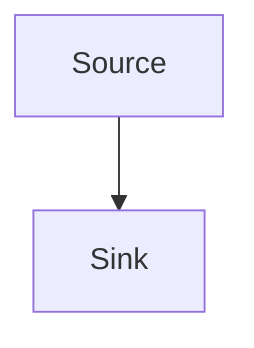

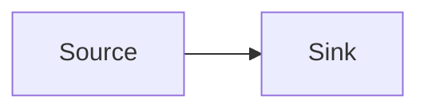

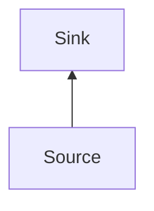

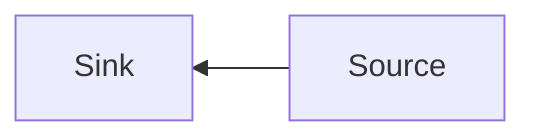

---

## 2. Simple fork: 1→2

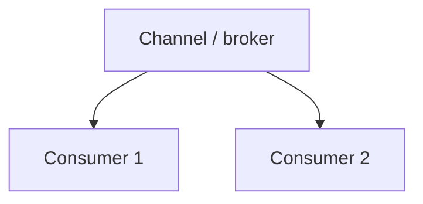

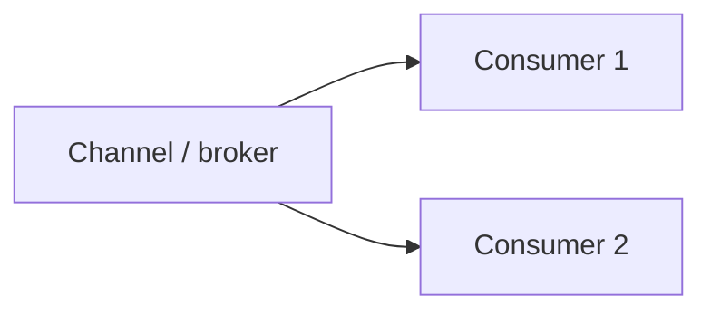

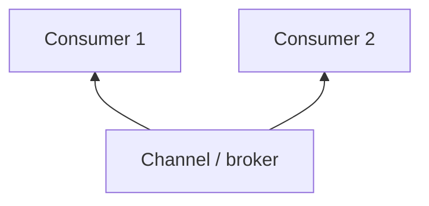

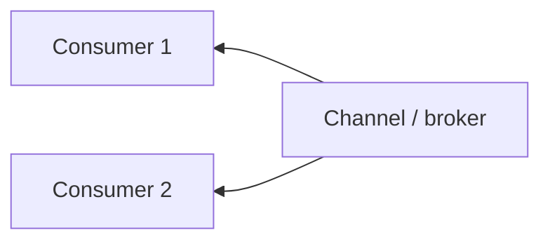

---

## 3. Fork to shared sink: 1→2 then 2→1 (includes labelled edge)

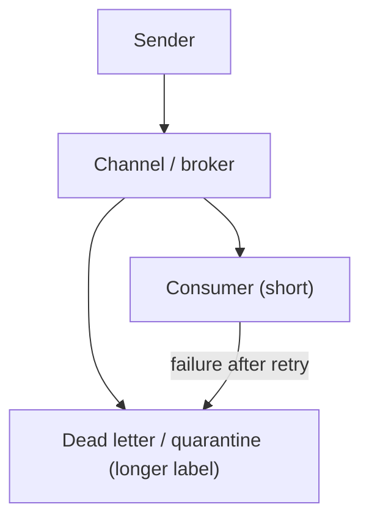

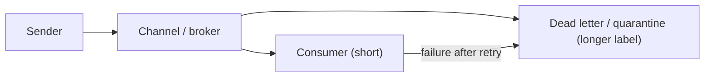

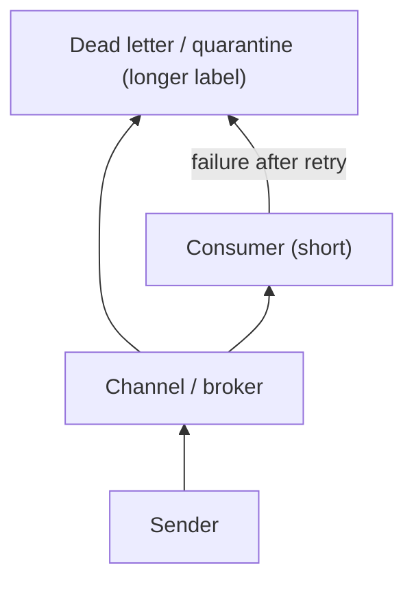

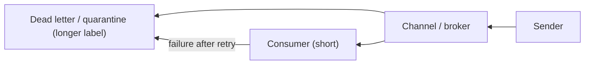

---

## 4. Wider fork: 1→3 (varied widths)

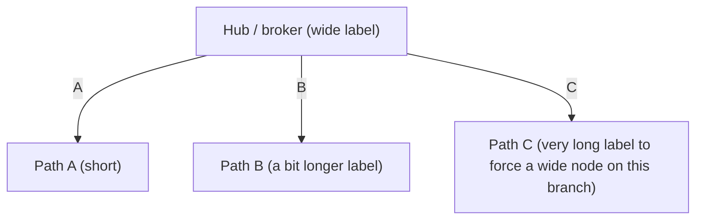

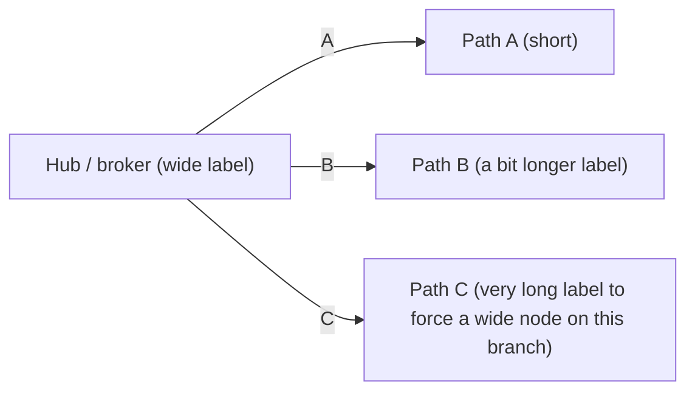

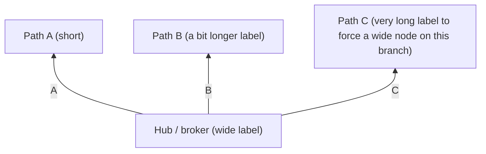

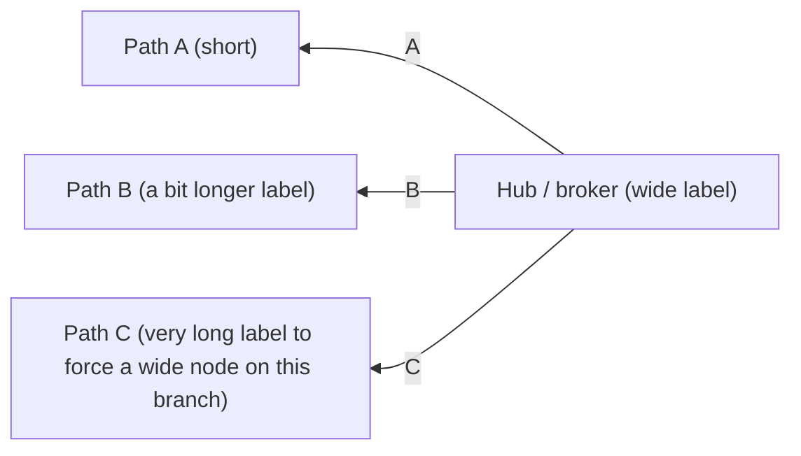

---

## 5. Local sub-fork: 1→3, with 1→2 on one branch

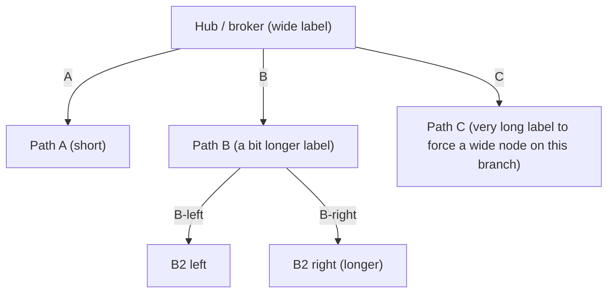

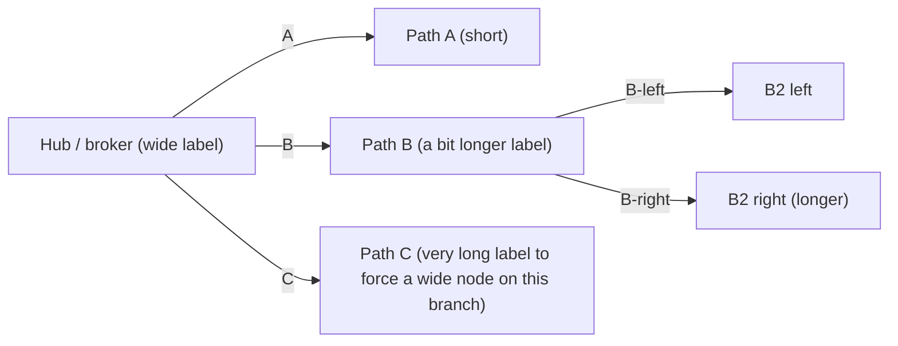

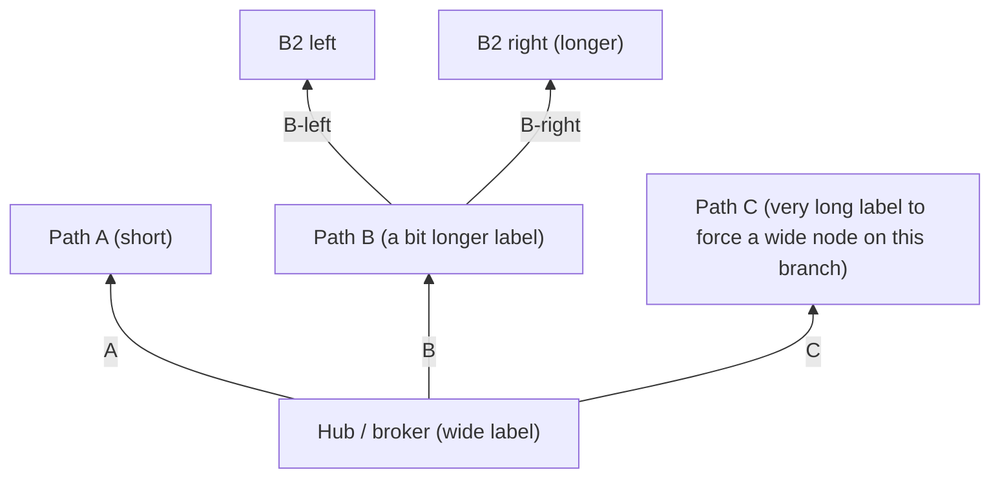

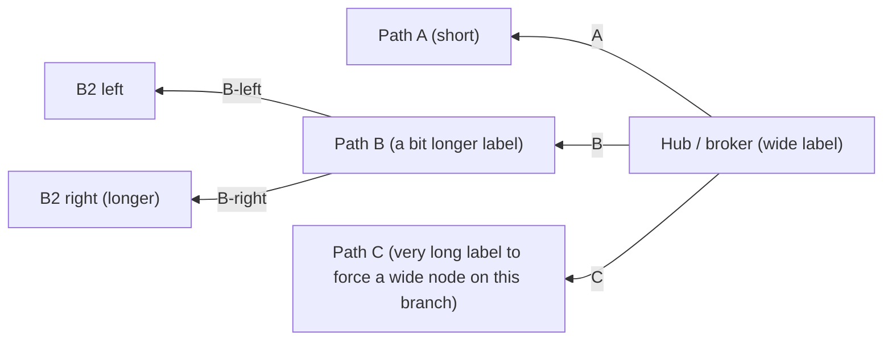

---

## 6. Join: 3→1 (fan-in into a shared sink)

```mermaid
flowchart TD
    Q[Channel / broker] --> A1["Path A (short)"]
    Q --> B1["Path B (a bit longer label)"]
    Q --> C1["Path C (very long label to force a wide node)"]

    A1 -->|join| DL["Shared sink / DLQ (wide label)"]
    B1 -->|join| DL
    C1 -->|join| DL
```

```mermaid
flowchart LR
    Q[Channel / broker] --> A1["Path A (short)"]
    Q --> B1["Path B (a bit longer label)"]
    Q --> C1["Path C (very long label to force a wide node)"]

    A1 -->|join| DL["Shared sink / DLQ (wide label)"]
    B1 -->|join| DL
    C1 -->|join| DL
```

```mermaid
flowchart BT
    Q[Channel / broker] --> A1["Path A (short)"]
    Q --> B1["Path B (a bit longer label)"]
    Q --> C1["Path C (very long label to force a wide node)"]

    A1 -->|join| DL["Shared sink / DLQ (wide label)"]
    B1 -->|join| DL
    C1 -->|join| DL
```

```mermaid
flowchart RL
    Q[Channel / broker] --> A1["Path A (short)"]
    Q --> B1["Path B (a bit longer label)"]
    Q --> C1["Path C (very long label to force a wide node)"]

    A1 -->|join| DL["Shared sink / DLQ (wide label)"]
    B1 -->|join| DL
    C1 -->|join| DL
```

---

## 7. Fork + join: 1→4 then 4→1 (two levels)

```mermaid
flowchart TD
    HUB["Hub / broker (wide label)"] -->|D1| D1["Downstream 1"]
    HUB -->|D2| D2["Downstream 2 (long label)"]
    HUB -->|D3| D3["Downstream 3"]
    HUB -->|D4| D4["Downstream 4"]

    D1 -->|done| OUT["Egress / sink (wide label)\n(two lines)"]
    D2 -->|done| OUT
    D3 -->|done| OUT
    D4 -->|done| OUT
```

```mermaid
flowchart LR
    HUB["Hub / broker (wide label)"] -->|D1| D1["Downstream 1"]
    HUB -->|D2| D2["Downstream 2 (long label)"]
    HUB -->|D3| D3["Downstream 3"]
    HUB -->|D4| D4["Downstream 4"]

    D1 -->|done| OUT["Egress / sink (wide label)\n(two lines)"]
    D2 -->|done| OUT
    D3 -->|done| OUT
    D4 -->|done| OUT
```

```mermaid
flowchart BT
    HUB["Hub / broker (wide label)"] -->|D1| D1["Downstream 1"]
    HUB -->|D2| D2["Downstream 2 (long label)"]
    HUB -->|D3| D3["Downstream 3"]
    HUB -->|D4| D4["Downstream 4"]

    D1 -->|done| OUT["Egress / sink (wide label)\n(two lines)"]
    D2 -->|done| OUT
    D3 -->|done| OUT
    D4 -->|done| OUT
```

```mermaid
flowchart RL
    HUB["Hub / broker (wide label)"] -->|D1| D1["Downstream 1"]
    HUB -->|D2| D2["Downstream 2 (long label)"]
    HUB -->|D3| D3["Downstream 3"]
    HUB -->|D4| D4["Downstream 4"]

    D1 -->|done| OUT["Egress / sink (wide label)\n(two lines)"]
    D2 -->|done| OUT
    D3 -->|done| OUT
    D4 -->|done| OUT
```

---

## 8. Monster: multi-level fork/join (current full stress case)

```mermaid
flowchart TD
    %% Level 0 (core hub + sink)
    S[Sender] --> Q[Channel / broker]
    Q --> C["Consumer (short)"]
    Q --> DL["Dead letter / quarantine (very long label to force a wide node)"]
    C -->|failure after retry| DL

    %% Level 1: 1→3 fan-out from the hub (expect symmetric columns)
    Q -->|A| A1["Path A (short)"]
    Q -->|B| B1["Path B (a bit longer label)"]
    Q -->|C| C1["Path C (very long label to force a wide node on this branch)"]

    %% Level 2: 1→2 fan-out on one branch
    B1 -->|B-left| B2L["B2 left"]
    B1 -->|B-right| B2R["B2 right (longer)"]

    %% Level 3: 4→1 fan-in (join) into the shared sink
    A1 -->|join| DL
    B2L -->|join| DL
    B2R -->|join| DL
    C1 -->|join| DL

    %% Level 4: 1→4 fan-out from the shared sink (stress 4-way columns)
    DL -->|D1| D1["Downstream 1"]
    DL -->|D2| D2["Downstream 2 (long label)"]
    DL -->|D3| D3["Downstream 3"]
    DL -->|D4| D4["Downstream 4"]

    %% Level 5: 4→1 fan-in (final join)
    D1 -->|done| OUT["Egress / sink (wide label)\n(two lines)"]
    D2 -->|done| OUT
    D3 -->|done| OUT
    D4 -->|done| OUT
```

```mermaid
flowchart LR
    %% Level 0 (core hub + sink)
    S[Sender] --> Q[Channel / broker]
    Q --> C["Consumer (short)"]
    Q --> DL["Dead letter / quarantine (very long label to force a wide node)"]
    C -->|failure after retry| DL

    %% Level 1: 1→3 fan-out from the hub (expect symmetric columns)
    Q -->|A| A1["Path A (short)"]
    Q -->|B| B1["Path B (a bit longer label)"]
    Q -->|C| C1["Path C (very long label to force a wide node on this branch)"]

    %% Level 2: 1→2 fan-out on one branch
    B1 -->|B-left| B2L["B2 left"]
    B1 -->|B-right| B2R["B2 right (longer)"]

    %% Level 3: 4→1 fan-in (join) into the shared sink
    A1 -->|join| DL
    B2L -->|join| DL
    B2R -->|join| DL
    C1 -->|join| DL

    %% Level 4: 1→4 fan-out from the shared sink (stress 4-way columns)
    DL -->|D1| D1["Downstream 1"]
    DL -->|D2| D2["Downstream 2 (long label)"]
    DL -->|D3| D3["Downstream 3"]
    DL -->|D4| D4["Downstream 4"]

    %% Level 5: 4→1 fan-in (final join)
    D1 -->|done| OUT["Egress / sink (wide label)\n(two lines)"]
    D2 -->|done| OUT
    D3 -->|done| OUT
    D4 -->|done| OUT
```

```mermaid
flowchart BT
    %% Level 0 (core hub + sink)
    S[Sender] --> Q[Channel / broker]
    Q --> C["Consumer (short)"]
    Q --> DL["Dead letter / quarantine (very long label to force a wide node)"]
    C -->|failure after retry| DL

    %% Level 1: 1→3 fan-out from the hub (expect symmetric columns)
    Q -->|A| A1["Path A (short)"]
    Q -->|B| B1["Path B (a bit longer label)"]
    Q -->|C| C1["Path C (very long label to force a wide node on this branch)"]

    %% Level 2: 1→2 fan-out on one branch
    B1 -->|B-left| B2L["B2 left"]
    B1 -->|B-right| B2R["B2 right (longer)"]

    %% Level 3: 4→1 fan-in (join) into the shared sink
    A1 -->|join| DL
    B2L -->|join| DL
    B2R -->|join| DL
    C1 -->|join| DL

    %% Level 4: 1→4 fan-out from the shared sink (stress 4-way columns)
    DL -->|D1| D1["Downstream 1"]
    DL -->|D2| D2["Downstream 2 (long label)"]
    DL -->|D3| D3["Downstream 3"]
    DL -->|D4| D4["Downstream 4"]

    %% Level 5: 4→1 fan-in (final join)
    D1 -->|done| OUT["Egress / sink (wide label)\n(two lines)"]
    D2 -->|done| OUT
    D3 -->|done| OUT
    D4 -->|done| OUT
```

```mermaid
flowchart RL
    %% Level 0 (core hub + sink)
    S[Sender] --> Q[Channel / broker]
    Q --> C["Consumer (short)"]
    Q --> DL["Dead letter / quarantine (very long label to force a wide node)"]
    C -->|failure after retry| DL

    %% Level 1: 1→3 fan-out from the hub (expect symmetric columns)
    Q -->|A| A1["Path A (short)"]
    Q -->|B| B1["Path B (a bit longer label)"]
    Q -->|C| C1["Path C (very long label to force a wide node on this branch)"]

    %% Level 2: 1→2 fan-out on one branch
    B1 -->|B-left| B2L["B2 left"]
    B1 -->|B-right| B2R["B2 right (longer)"]

    %% Level 3: 4→1 fan-in (join) into the shared sink
    A1 -->|join| DL
    B2L -->|join| DL
    B2R -->|join| DL
    C1 -->|join| DL

    %% Level 4: 1→4 fan-out from the shared sink (stress 4-way columns)
    DL -->|D1| D1["Downstream 1"]
    DL -->|D2| D2["Downstream 2 (long label)"]
    DL -->|D3| D3["Downstream 3"]
    DL -->|D4| D4["Downstream 4"]

    %% Level 5: 4→1 fan-in (final join)
    D1 -->|done| OUT["Egress / sink (wide label)\n(two lines)"]
    D2 -->|done| OUT
    D3 -->|done| OUT
    D4 -->|done| OUT
```

