# Mermaid diagrams extracted from `Stress.md`

This file is an automated extraction of **all Mermaid diagram blocks** found in `Stress.md`, in source order.

---

## Diagram 0001

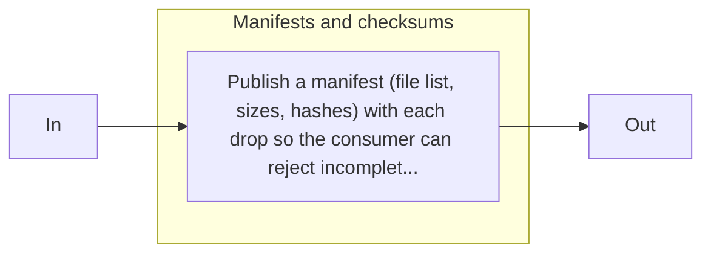

## Diagram 0002

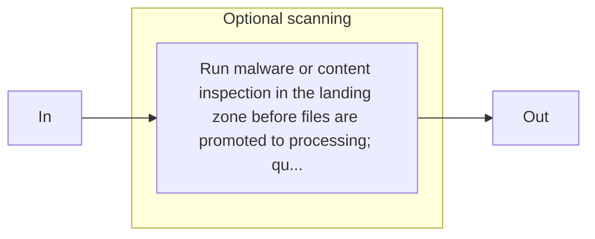

## Diagram 0003

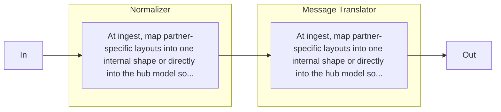

## Diagram 0004

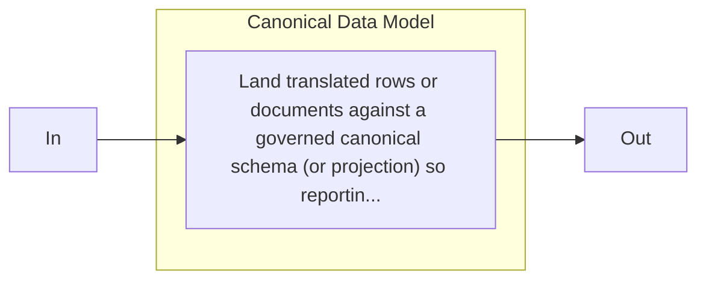

## Diagram 0005

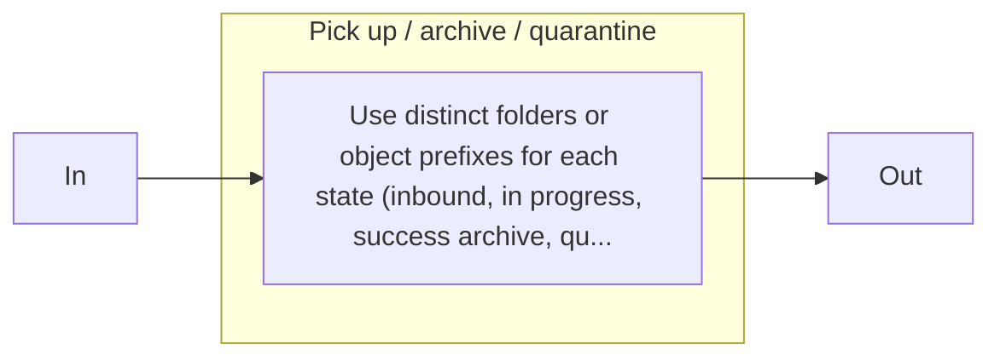

## Diagram 0006

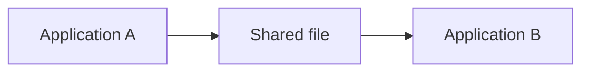

## Diagram 0007

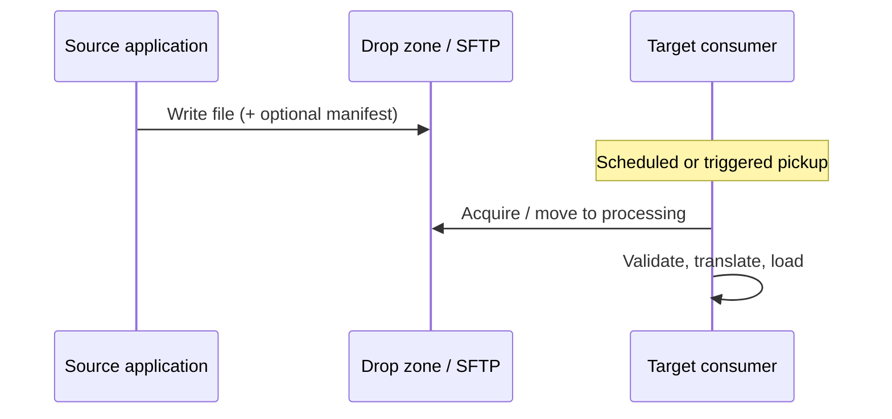

## Diagram 0008

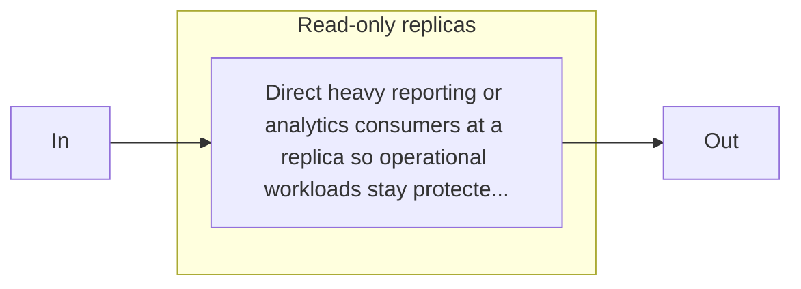

## Diagram 0009

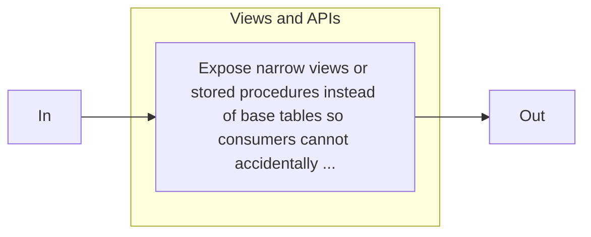

## Diagram 0010

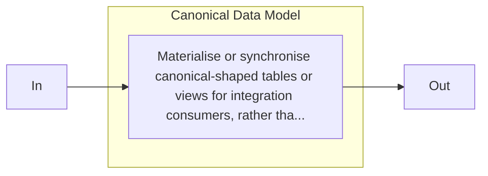

## Diagram 0011

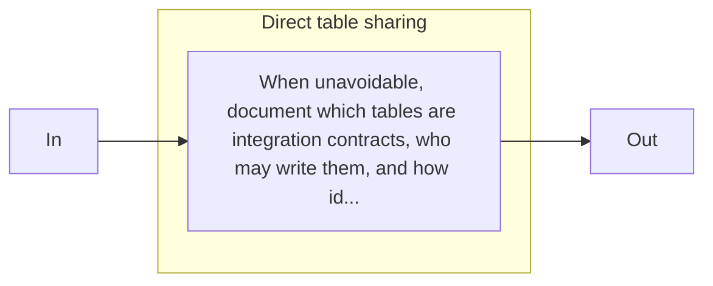

## Diagram 0012

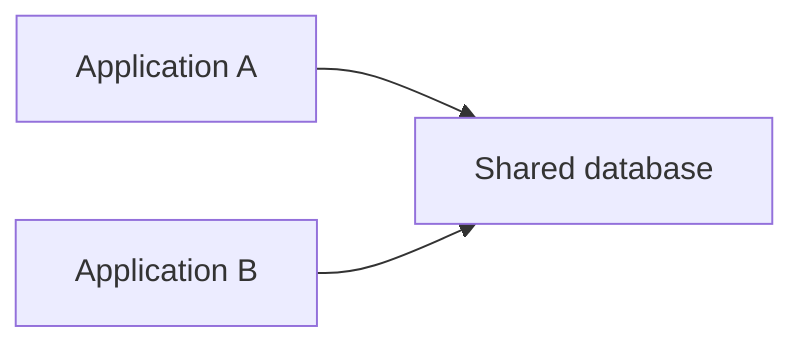

## Diagram 0013

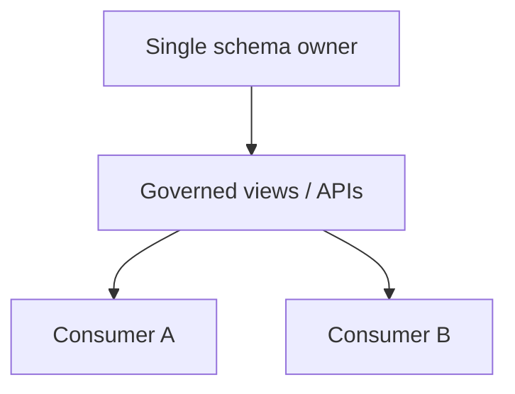

## Diagram 0014

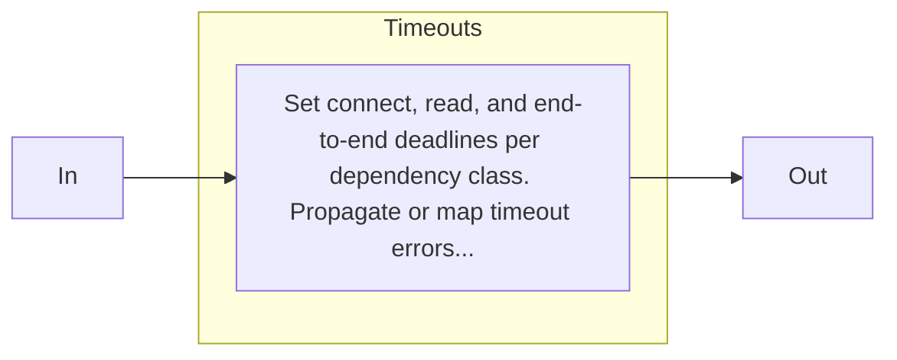

## Diagram 0015

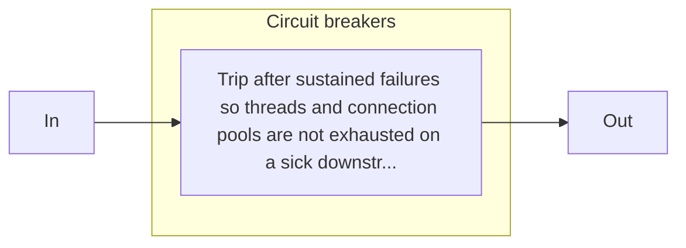

## Diagram 0016

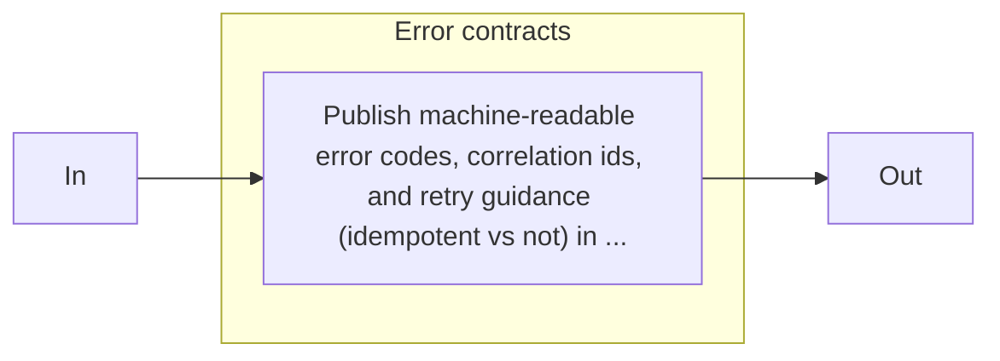

## Diagram 0017

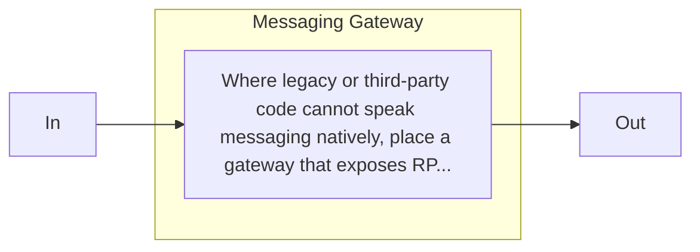

## Diagram 0018

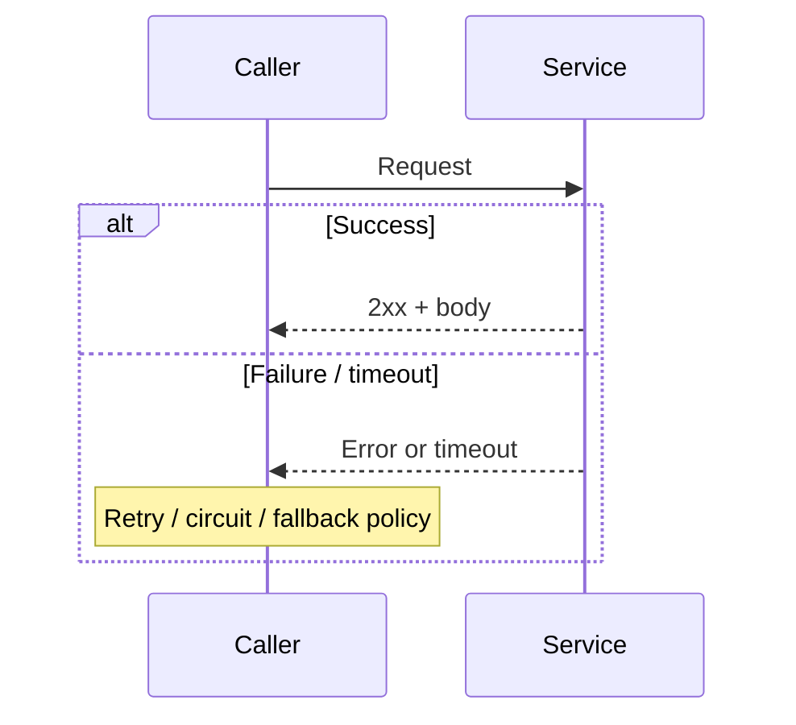

## Diagram 0019

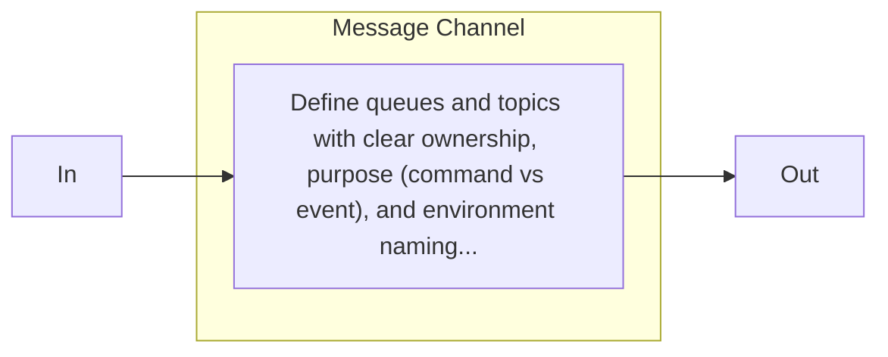

## Diagram 0020

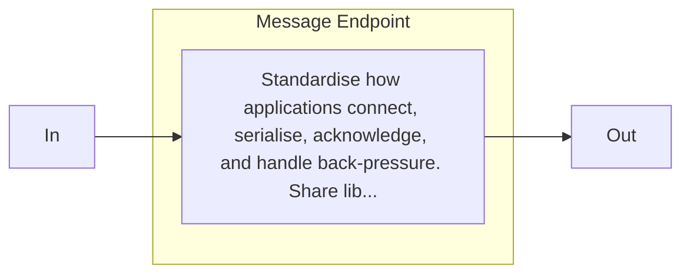

## Diagram 0021

```mermaid
flowchart LR
    subgraph R2S0["Guaranteed Delivery"]
        direction TB
        r2n0["Enable broker persistence, durable producers where needed, and consumer acknowledgement rules tha..."]
    end
    IN[In] --> r2n0
    r2n0 --> OUT[Out]
```

## Diagram 0022

```mermaid
flowchart LR
    subgraph R3S0["Dead Letter Channel"]
        direction TB
        r3n0["After bounded retries, move unprocessable messages to a DLQ with reason codes, original payload p..."]
    end
    IN[In] --> r3n0
    r3n0 --> OUT[Out]
```

## Diagram 0023

```mermaid
flowchart LR
    A["Sender"] --> B["Messaging system"] --> C["Receiver"]
```

## Diagram 0024

```mermaid
flowchart TD
    S[Sender] --> Q[Channel / broker]
    Q --> C[Consumer]
    Q --> DL[Dead letter / quarantine]
    C -->|failure after retry| DL
```

## Diagram 0025

```mermaid
flowchart LR
    subgraph R0S0["Naming"]
        direction TB
        r0n0["Encode domain, message family, environment, and sometimes region in channel names. Avoid anonymou..."]
    end
    IN[In] --> r0n0
    r0n0 --> OUT[Out]
```

## Diagram 0026

```mermaid
flowchart LR
    subgraph R1S0["Datatype Channel"]
        direction TB
        r1n0["When payloads differ materially (JSON vs binary, or incompatible schemas), use separate channels ..."]
    end
    IN[In] --> r1n0
    r1n0 --> OUT[Out]
```

## Diagram 0027

```mermaid
flowchart LR
    subgraph R2S0["Format Indicator"]
        direction TB
        r2n0["When one channel carries multiple schema versions during migration, require version metadata in h..."]
    end
    IN[In] --> r2n0
    r2n0 --> OUT[Out]
```

## Diagram 0028

```mermaid
flowchart LR
    subgraph R3S0["Operational pairing"]
        direction TB
        r3n0["Document monitoring (depth, age, DLQ rate) per channel and tie access control to the owning team."]
    end
    IN[In] --> r3n0
    r3n0 --> OUT[Out]
```

## Diagram 0029

```mermaid
flowchart LR
    A["Sender"] --> B["Message channel"] --> C["Receiver"]
```

## Diagram 0030

```mermaid
flowchart LR
    subgraph Commands["Commands (P2P)"]
        C1[Producer] --> Q1[Work queue]
    end
    subgraph Events["Events (pub/sub)"]
        E1[Producer] --> T[Topic]
        T --> S1[Subscriber]
        T --> S2[Subscriber]
    end
```

## Diagram 0031

```mermaid
flowchart LR
    subgraph R0S0["Command Message"]
        direction TB
        r0n0["Encode intent in message type and naming conventions so routers and humans can reason about side ..."]
    end
    subgraph R0S1["Document Message"]
        direction TB
        r0n1["Encode intent in message type and naming conventions so routers and humans can reason about side ..."]
    end
    subgraph R0S2["Event Message"]
        direction TB
        r0n2["Encode intent in message type and naming conventions so routers and humans can reason about side ..."]
    end
    IN[In] --> r0n0
    r0n0 --> r0n1
    r0n1 --> r0n2
    r0n2 --> OUT[Out]
```

## Diagram 0032

```mermaid
flowchart LR
    subgraph R1S0["Datatype Channel"]
        direction TB
        r1n0["Route each major payload family to its own channel when parsers, SLAs, or security zones differ."]
    end
    IN[In] --> r1n0
    r1n0 --> OUT[Out]
```

## Diagram 0033

```mermaid
flowchart LR
    subgraph R2S0["Format Indicator"]
        direction TB
        r2n0["Carry schema name and version on every message during evolution; pair with compatibility tests in..."]
    end
    IN[In] --> r2n0
    r2n0 --> OUT[Out]
```

## Diagram 0034

```mermaid
flowchart LR
    subgraph R3S0["Message Filter"]
        direction TB
        r3n0["Drop or divert irrelevant traffic early (for example old versions or non-matching tenants) so wor..."]
    end
    IN[In] --> r3n0
    r3n0 --> OUT[Out]
```

## Diagram 0035

```mermaid
flowchart LR
    A["Producer"] --> B["Message"] --> C["Consumer"]
```

## Diagram 0036

```mermaid
flowchart TD
    M[Message] --> H[Headers / metadata]
    M --> P[Payload]
    H --> C[Correlation id]
    H --> F[Format / version]
    H --> T[Type: command / document / event]
```

## Diagram 0037

```mermaid
flowchart LR
    subgraph R0S0["Wire Tap"]
        direction TB
        r0n0["Tee a copy to audit or metrics paths asynchronously so support can inspect traffic patterns witho..."]
    end
    IN[In] --> r0n0
    r0n0 --> OUT[Out]
```

## Diagram 0038

```mermaid
flowchart LR
    subgraph R1S0["Message History"]
        direction TB
        r1n0["Append hop metadata when messages traverse many filters so incidents can be reconstructed across ..."]
    end
    IN[In] --> r1n0
    r1n0 --> OUT[Out]
```

## Diagram 0039

```mermaid
flowchart LR
    subgraph R2S0["Dead Letter Channel"]
        direction TB
        r2n0["Use when the message is structurally valid but processing fails after retries (downstream outage,..."]
    end
    IN[In] --> r2n0
    r2n0 --> OUT[Out]
```

## Diagram 0040

```mermaid
flowchart LR
    subgraph R3S0["Invalid Message Channel"]
        direction TB
        r3n0["Use when validation fails early (schema, signature, mandatory fields) so poison does not block th..."]
    end
    IN[In] --> r3n0
    r3n0 --> OUT[Out]
```

## Diagram 0041

```mermaid
flowchart LR
    A["Input"] --> B["Filter 1"] --> C["Filter 2"] --> D["Filter 3"] --> E["Output"]
```

## Diagram 0042

```mermaid
sequenceDiagram
    participant In as Inbound message
    participant F1 as Filter 1
    participant F2 as Filter 2
    participant Out as Outbound
    In->>F1: Message
    alt Invalid
        F1->>F1: Route to invalid / DLQ
    else OK
        F1->>F2: Forward
        F2->>Out: Forward
    end
```

## Diagram 0043

```mermaid
flowchart LR
    subgraph R0S0["Content-Based Router"]
        direction TB
        r0n0["Centralise business routing rules that inspect headers or body fields. Keep rules testable and ve..."]
    end
    IN[In] --> r0n0
    r0n0 --> OUT[Out]
```

## Diagram 0044

```mermaid
flowchart LR
    subgraph R1S0["Recipient List"]
        direction TB
        r1n0["Send a deliberate copy to each target channel when several parties must process the same logical ..."]
    end
    IN[In] --> r1n0
    r1n0 --> OUT[Out]
```

## Diagram 0045

```mermaid
flowchart LR
    subgraph R2S0["Dynamic Router"]
        direction TB
        r2n0["Consult registries, feature flags, or policy services to choose targets, with caching, timeouts, ..."]
    end
    IN[In] --> r2n0
    r2n0 --> OUT[Out]
```

## Diagram 0046

```mermaid
flowchart LR
    A["Incoming message"] --> B["Message router"]
    B --> C["Route A"]
    B --> D["Route B"]
```

## Diagram 0047

```mermaid
flowchart TD
    M[Message arrives] --> R{Router rules}
    R -->|type A| C1[Channel A]
    R -->|type B| C2[Channel B]
    R -->|no match| D[Default / dead letter]
```

## Diagram 0048

```mermaid
flowchart LR
    subgraph R0S0["Message Translator"]
        direction TB
        r0n0["Place Message Translator at anti-corruption boundaries so each system keeps its native model whil..."]
    end
    IN[In] --> r0n0
    r0n0 --> OUT[Out]
```

## Diagram 0049

```mermaid
flowchart LR
    subgraph R1S0["Format Indicator"]
        direction TB
        r1n0["Require consumers to read version metadata before parsing so mixed-version traffic can coexist du..."]
    end
    IN[In] --> r1n0
    r1n0 --> OUT[Out]
```

## Diagram 0050

```mermaid
flowchart LR
    subgraph R2S0["Envelope Wrapper"]
        direction TB
        r2n0["Separate transport metadata (routing, trace, security) from business payload versioning so each c..."]
    end
    IN[In] --> r2n0
    r2n0 --> OUT[Out]
```

## Diagram 0051

```mermaid
flowchart LR
    A["Source message"] --> B["Translator"] --> C["Target message"]
```

## Diagram 0052

```mermaid
sequenceDiagram
    participant Src as Source format
    participant T as Message translator
    participant Can as Canonical / target
    Src->>T: External message
    T->>T: Map + validate
    T->>Can: Internal message
```

## Diagram 0053

```mermaid
flowchart LR
    subgraph R0S0["Lifecycle"]
        direction TB
        r0n0["Manage connect/reconnect, credential rotation, and heartbeat behaviour in one place so domain cod..."]
    end
    IN[In] --> r0n0
    r0n0 --> OUT[Out]
```

## Diagram 0054

```mermaid
flowchart LR
    subgraph R1S0["Acknowledgement policy"]
        direction TB
        r1n0["Define when to ack, negative-ack, or dead-letter; never leave stuck locks on poison messages."]
    end
    IN[In] --> r1n0
    r1n0 --> OUT[Out]
```

## Diagram 0055

```mermaid
flowchart LR
    subgraph R2S0["Polling Consumer"]
        direction TB
        r2n0["Choose pull semantics (batching, rate control) versus push/callback semantics (lower latency) per..."]
    end
    subgraph R2S1["Event-Driven Consumer"]
        direction TB
        r2n1["Choose pull semantics (batching, rate control) versus push/callback semantics (lower latency) per..."]
    end
    IN[In] --> r2n0
    r2n0 --> r2n1
    r2n1 --> OUT[Out]
```

## Diagram 0056

```mermaid
flowchart LR
    subgraph R3S0["Transactional Client"]
        direction TB
        r3n0["When database and message publication must align, use outbox or transactional send patterns so yo..."]
    end
    IN[In] --> r3n0
    r3n0 --> OUT[Out]
```

## Diagram 0057

```mermaid
flowchart LR
    A["Application"] <--> B["Message endpoint"] <--> C["Messaging system"]
```

## Diagram 0058

```mermaid
sequenceDiagram
    participant App as Application code
    participant EP as Message endpoint
    participant Bus as Messaging system
    App->>EP: Send domain command
    EP->>Bus: Publish / send
    Bus->>EP: Deliver message
    EP->>App: Invoke handler
```

## Diagram 0059

```mermaid
flowchart LR
    subgraph R0S0["Competing Consumers"]
        direction TB
        r0n0["Add instances that read from the same queue so throughput rises with load. Ensure fair dispatch a..."]
    end
    IN[In] --> r0n0
    r0n0 --> OUT[Out]
```

## Diagram 0060

```mermaid
flowchart LR
    subgraph R1S0["Dead Letter Channel"]
        direction TB
        r1n0["Move messages that fail after max deliveries so one bad message does not block the whole partitio..."]
    end
    IN[In] --> r1n0
    r1n0 --> OUT[Out]
```

## Diagram 0061

```mermaid
flowchart LR
    subgraph R2S0["Idempotent Receiver"]
        direction TB
        r2n0["Because redelivery and at-least-once semantics are normal, handlers must tolerate duplicate deliv..."]
    end
    IN[In] --> r2n0
    r2n0 --> OUT[Out]
```

## Diagram 0062

```mermaid
flowchart LR
    A["Sender"] --> B["Point-to-point channel"] --> C["Single consuming path"]
```

## Diagram 0063

```mermaid
flowchart LR
    P[Producer] --> Q[Queue]
    Q --> C1[Consumer instance 1]
    Q --> C2[Consumer instance 2]
```

## Diagram 0064

```mermaid
flowchart LR
    subgraph R0S0["Durable Subscriber"]
        direction TB
        r0n0["For consumers that must not miss events during maintenance, use durable subscriptions or equivale..."]
    end
    IN[In] --> r0n0
    r0n0 --> OUT[Out]
```

## Diagram 0065

```mermaid
flowchart LR
    subgraph R1S0["Message Filter"]
        direction TB
        r1n0["Drop or divert events upstream of expensive handlers when large topics carry heterogeneous event ..."]
    end
    IN[In] --> r1n0
    r1n0 --> OUT[Out]
```

## Diagram 0066

```mermaid
flowchart LR
    subgraph R2S0["Selective Consumer"]
        direction TB
        r2n0["When sharing a subscription group or queue, skip messages that do not match local responsibility ..."]
    end
    IN[In] --> r2n0
    r2n0 --> OUT[Out]
```

## Diagram 0067

```mermaid
flowchart LR
    A["Publisher"] --> B["Publish-subscribe channel"]
    B --> C["Subscriber 1"]
    B --> D["Subscriber 2"]
    B --> E["Subscriber 3"]
```

## Diagram 0068

```mermaid
sequenceDiagram
    participant P as Publisher
    participant T as Topic
    participant S1 as Subscriber 1
    participant S2 as Subscriber 2
    P->>T: Event
    T->>S1: Copy
    T->>S2: Copy
```

## Diagram 0069

```mermaid
flowchart LR
    subgraph R0S0["Strict validation"]
        direction TB
        r0n0["Reject messages that do not match the declared contract at the channel boundary so downstream cod..."]
    end
    IN[In] --> r0n0
    r0n0 --> OUT[Out]
```

## Diagram 0070

```mermaid
flowchart LR
    subgraph R1S0["Resequencer"]
        direction TB
        r1n0["When fragments or related messages must arrive in order, resequence before business logic; define..."]
    end
    IN[In] --> r1n0
    r1n0 --> OUT[Out]
```

## Diagram 0071

```mermaid
flowchart LR
    subgraph R2S0["Monitoring"]
        direction TB
        r2n0["Alert on reject rates and unexpected payload fingerprints per datatype channel."]
    end
    IN[In] --> r2n0
    r2n0 --> OUT[Out]
```

## Diagram 0072

```mermaid
flowchart LR
    A["Typed message"] --> B["Datatype channel"] --> C["Typed consumer"]
```

## Diagram 0073

```mermaid
flowchart TD
    V[Validate envelope + type] -->|match| B[Business processing]
    V -->|mismatch| I[Invalid message channel]
```

## Diagram 0074

```mermaid
flowchart LR
    subgraph R0S0["Message Filter"]
        direction TB
        r0n0["Prefer rejecting before expensive steps; record structured error codes and raw payload pointers (..."]
    end
    IN[In] --> r0n0
    r0n0 --> OUT[Out]
```

## Diagram 0075

```mermaid
flowchart LR
    subgraph R1S0["Downstream tooling"]
        direction TB
        r1n0["Dashboards, alerts, and ticketing integration on invalid-channel depth and top failure reasons."]
    end
    IN[In] --> r1n0
    r1n0 --> OUT[Out]
```

## Diagram 0076

```mermaid
flowchart LR
    subgraph R2S0["Wire Tap"]
        direction TB
        r2n0["For difficult incidents, tap a sample of invalid messages to a secure inspection store with stric..."]
    end
    IN[In] --> r2n0
    r2n0 --> OUT[Out]
```

## Diagram 0077

```mermaid
flowchart LR
    A["Incoming message"] --> B{"Valid?"}
    B -- Yes --> C["Normal channel"]
    B -- No --> D["Invalid message channel"]
```

## Diagram 0078

```mermaid
sequenceDiagram
    participant R as Receiver
    participant V as Validator
    participant I as Invalid channel
    R->>V: Message
    alt Schema OK
        V->>R: Process
    else Schema fail
        V->>I: Move with reason code
    end
```

## Diagram 0079

```mermaid
flowchart LR
    subgraph R0S0["Message Store"]
        direction TB
        r0n0["Optionally persist DLQ payloads and metadata for long-term audit and bulk replay tooling."]
    end
    IN[In] --> r0n0
    r0n0 --> OUT[Out]
```

## Diagram 0080

```mermaid
flowchart LR
    subgraph R1S0["Monitoring"]
        direction TB
        r1n0["Track age, count, and rate of DLQ ingress; correlate spikes with deploys or partner changes."]
    end
    IN[In] --> r1n0
    r1n0 --> OUT[Out]
```

## Diagram 0081

```mermaid
flowchart LR
    subgraph R2S0["Idempotent Receiver"]
        direction TB
        r2n0["Define who may requeue messages, after which code fixes, and how Idempotent Receiver prevents dou..."]
    end
    IN[In] --> r2n0
    r2n0 --> OUT[Out]
```

## Diagram 0082

```mermaid
flowchart LR
    subgraph R3S0["Invalid Message Channel"]
        direction TB
        r3n0["Keep structurally invalid messages separate from “valid but failed” poison so triage queues stay ..."]
    end
    IN[In] --> r3n0
    r3n0 --> OUT[Out]
```

## Diagram 0083

```mermaid
flowchart LR
    A["Processing / delivery attempts"] --> B{"Succeeded?"}
    B -- Yes --> C["Continue"]
    B -- No after retries --> D["Dead letter channel"]
```

## Diagram 0084

```mermaid
sequenceDiagram
    participant C as Consumer
    participant Q as Work queue
    participant DL as Dead letter
    loop Retries with backoff
        Q->>C: Deliver
        C-->>Q: Fail / nack
    end
    Q->>DL: Move after max attempts
```

## Diagram 0085

```mermaid
flowchart LR
    subgraph R0S0["Format Indicator"]
        direction TB
        r0n0["Ensures replayed or redelivered messages can still be parsed after consumer upgrades."]
    end
    IN[In] --> r0n0
    r0n0 --> OUT[Out]
```

## Diagram 0086

```mermaid
flowchart LR
    subgraph R1S0["Outbox / transactional patterns"]
        direction TB
        r1n0["When publishing must align with database commits, write an outbox row in the same transaction as ..."]
    end
    IN[In] --> r1n0
    r1n0 --> OUT[Out]
```

## Diagram 0087

```mermaid
flowchart LR
    subgraph R2S0["Message Endpoint"]
        direction TB
        r2n0["Centralise ack/nack and DLQ behaviour so guaranteed delivery does not deadlock on application bugs."]
    end
    IN[In] --> r2n0
    r2n0 --> OUT[Out]
```

## Diagram 0088

```mermaid
flowchart LR
    A["Sender"] --> B["Durable store"] --> C["Channel"] --> D["Receiver"]
```

## Diagram 0089

```mermaid
sequenceDiagram
    participant S as Sender
    participant B as Broker (durable)
    participant R as Receiver
    S->>B: Send (persisted)
    Note over B: Survives broker restart
    B->>R: Deliver
    R-->>B: Ack
```

## Diagram 0090

```mermaid
flowchart LR
    subgraph R0S0["Message Translator"]
        direction TB
        r0n0["Normalise wire format into bus contracts (or canonical messages) immediately after ingress so dow..."]
    end
    IN[In] --> r0n0
    r0n0 --> OUT[Out]
```

## Diagram 0091

```mermaid
flowchart LR
    subgraph R1S0["Messaging Mapper"]
        direction TB
        r1n0["Map messages to or from application entities at the service edge, keeping domain models free of b..."]
    end
    IN[In] --> r1n0
    r1n0 --> OUT[Out]
```

## Diagram 0092

```mermaid
flowchart LR
    subgraph R2S0["Correlation"]
        direction TB
        r2n0["Stamp a trace or correlation id on every message produced by the adapter for cross-system support."]
    end
    IN[In] --> r2n0
    r2n0 --> OUT[Out]
```

## Diagram 0093

```mermaid
flowchart LR
    A["External system / app"] --> B["Channel adapter"] --> C["Message channel"]
```

## Diagram 0094

```mermaid
sequenceDiagram
    participant Ext as External API / file
    participant CA as Channel adapter
    participant Ch as Message channel
    Ext->>CA: Poll / webhook / file event
    CA->>Ch: Normalised message
```

## Diagram 0095

```mermaid
flowchart LR
    subgraph R0S0["Message Translator"]
        direction TB
        r0n0["Apply at each boundary so addressing, headers, and body formats match the target bus conventions ..."]
    end
    IN[In] --> r0n0
    r0n0 --> OUT[Out]
```

## Diagram 0096

```mermaid
flowchart LR
    subgraph R1S0["Wire Tap"]
        direction TB
        r1n0["Mirror a sample of bridged messages to a secure store during cutover for diffing and volume valid..."]
    end
    IN[In] --> r1n0
    r1n0 --> OUT[Out]
```

## Diagram 0097

```mermaid
flowchart LR
    subgraph R2S0["Message History"]
        direction TB
        r2n0["Append hop metadata so operators can prove path and diagnose duplicate delivery across buses."]
    end
    IN[In] --> r2n0
    r2n0 --> OUT[Out]
```

## Diagram 0098

```mermaid
flowchart LR
    A["Messaging system A"] --> B["Messaging bridge"] --> C["Messaging system B"]
```

## Diagram 0099

```mermaid
flowchart LR
    A[Bus A topic] --> B[Bridge]
    B --> C[Bus B queue]
    B --> D[DLQ / alert on map fail]
```

## Diagram 0100

```mermaid
flowchart LR
    subgraph R0S0["Datatype Channel"]
        direction TB
        r0n0["Prefer separate channels (or subscriptions) per major contract family so incompatible parsers nev..."]
    end
    IN[In] --> r0n0
    r0n0 --> OUT[Out]
```

## Diagram 0101

```mermaid
flowchart LR
    subgraph R1S0["Format Indicator"]
        direction TB
        r1n0["When multiple versions share a channel during migration, require explicit version metadata and co..."]
    end
    IN[In] --> r1n0
    r1n0 --> OUT[Out]
```

## Diagram 0102

```mermaid
flowchart LR
    subgraph R2S0["Dead Letter Channel"]
        direction TB
        r2n0["Run both as first-class routes with dashboards, owners, and distinct triage: schema failure versu..."]
    end
    subgraph R2S1["Invalid Message Channel"]
        direction TB
        r2n1["Run both as first-class routes with dashboards, owners, and distinct triage: schema failure versu..."]
    end
    IN[In] --> r2n0
    r2n0 --> r2n1
    r2n1 --> OUT[Out]
```

## Diagram 0103

```mermaid
flowchart LR
    A["Producer A"] --> B["Message bus"]
    C["Producer B"] --> B
    B --> D["Consumer A"]
    B --> E["Consumer B"]
```

## Diagram 0104

```mermaid
flowchart TD
    subgraph Bus["Governed message bus"]
        T1[Topic / queue standards]
        T2[Schema registry / contracts]
        T3[Observability + DLQ]
    end
```

## Diagram 0105

```mermaid
flowchart LR
    subgraph R0S0["Point-to-Point Channel"]
        direction TB
        r0n0["Send commands to a work queue or dedicated handler path so competing consumers still yield exactl..."]
    end
    IN[In] --> r0n0
    r0n0 --> OUT[Out]
```

## Diagram 0106

```mermaid
flowchart LR
    subgraph R1S0["Idempotent Receiver"]
        direction TB
        r1n0["Use business keys or dedupe stores so redelivered commands do not duplicate side effects."]
    end
    IN[In] --> r1n0
    r1n0 --> OUT[Out]
```

## Diagram 0107

```mermaid
flowchart LR
    subgraph R2S0["Format Indicator"]
        direction TB
        r2n0["Version command schemas explicitly; reject unknown versions at the edge."]
    end
    IN[In] --> r2n0
    r2n0 --> OUT[Out]
```

## Diagram 0108

```mermaid
flowchart LR
    subgraph R3S0["Correlation Identifier"]
        direction TB
        r3n0["Tie commands to follow-up events, replies, or saga steps."]
    end
    IN[In] --> r3n0
    r3n0 --> OUT[Out]
```

## Diagram 0109

```mermaid
flowchart LR
    A["Sender"] --> B["Command message"] --> C["Receiver performs action"]
```

## Diagram 0110

```mermaid
sequenceDiagram
    participant S as Sender
    participant Q as Command queue
    participant H as Handler
    S->>Q: Command + key
    Q->>H: Deliver once (conceptually)
    H->>H: Idempotent execute
```

## Diagram 0111

```mermaid
flowchart LR
    subgraph R0S0["Pipes and Filters"]
        direction TB
        r0n0["Chain validate → transform → authorise → persist as discrete filters with clear failure exits."]
    end
    IN[In] --> r0n0
    r0n0 --> OUT[Out]
```

## Diagram 0112

```mermaid
flowchart LR
    subgraph R1S0["Message History"]
        direction TB
        r1n0["Record which stages processed a document for audit and replay when a mid-pipeline defect is fixed."]
    end
    IN[In] --> r1n0
    r1n0 --> OUT[Out]
```

## Diagram 0113

```mermaid
flowchart LR
    subgraph R2S0["Dynamic Router"]
        direction TB
        r2n0["Route document types or versions to different target systems from configuration rather than hard-..."]
    end
    IN[In] --> r2n0
    r2n0 --> OUT[Out]
```

## Diagram 0114

```mermaid
flowchart LR
    A["Business document"] --> B["Document message"] --> C["Receiver"]
```

## Diagram 0115

```mermaid
flowchart TD
    D[Document message] --> M[Metadata: type, version]
    D --> B[Business body]
    M --> V[Validate then process]
    B --> V
```

## Diagram 0116

```mermaid
flowchart LR
    subgraph R0S0["Correlation Identifier"]
        direction TB
        r0n0["Group related events (for example saga or aggregate stream) for tracing and downstream joins."]
    end
    IN[In] --> r0n0
    r0n0 --> OUT[Out]
```

## Diagram 0117

```mermaid
flowchart LR
    subgraph R1S0["Format Indicator"]
        direction TB
        r1n0["Carry event type and schema version so subscribers can evolve at different speeds."]
    end
    IN[In] --> r1n0
    r1n0 --> OUT[Out]
```

## Diagram 0118

```mermaid
flowchart LR
    subgraph R2S0["Message Expiration"]
        direction TB
        r2n0["Drop or divert stale events where timeliness matters more than completeness (for example cache re..."]
    end
    IN[In] --> r2n0
    r2n0 --> OUT[Out]
```

## Diagram 0119

```mermaid
flowchart LR
    subgraph R3S0["Idempotent Receiver"]
        direction TB
        r3n0["Treat duplicate delivery as normal, especially under consumer scaling or at-least-once brokers."]
    end
    IN[In] --> r3n0
    r3n0 --> OUT[Out]
```

## Diagram 0120

```mermaid
flowchart LR
    A["Business event occurs"] --> B["Event message"] --> C["Interested consumers"]
```

## Diagram 0121

```mermaid
sequenceDiagram
    participant Src as Source
    participant T as Topic
    participant C1 as Consumer A
    participant C2 as Consumer B
    Src->>T: EmployeeUpdated (id, version)
    T->>C1: Deliver
    T->>C2: Deliver
```

## Diagram 0122

```mermaid
flowchart LR
    subgraph R0S0["Splitter"]
        direction TB
        r0n0["Decompose a large request into child tasks with shared correlation when parallel processing is re..."]
    end
    IN[In] --> r0n0
    r0n0 --> OUT[Out]
```

## Diagram 0123

```mermaid
flowchart LR
    subgraph R1S0["Wire Tap"]
        direction TB
        r1n0["Observe request and reply traffic for support without altering business flow (redact sensitive fi..."]
    end
    IN[In] --> r1n0
    r1n0 --> OUT[Out]
```

## Diagram 0124

```mermaid
flowchart LR
    subgraph R2S0["Pipes and Filters"]
        direction TB
        r2n0["Structure validation, authorisation, and execution stages before the reply is composed."]
    end
    IN[In] --> r2n0
    r2n0 --> OUT[Out]
```

## Diagram 0125

```mermaid
flowchart LR
    subgraph R3S0["Message Expiration"]
        direction TB
        r3n0["Expire orphaned requests and late replies so reply queues and correlation tables do not grow with..."]
    end
    IN[In] --> r3n0
    r3n0 --> OUT[Out]
```

## Diagram 0126

```mermaid
sequenceDiagram
    participant Sender
    participant RequestChannel as Request Channel
    participant Receiver
    participant ReplyChannel as Reply Channel
    Sender->>RequestChannel: Send request
    RequestChannel->>Receiver: Deliver request
    Receiver->>ReplyChannel: Send reply
    ReplyChannel->>Sender: Deliver correlated reply
```

## Diagram 0127

```mermaid
flowchart LR
    subgraph R0S0["Message Sequence"]
        direction TB
        r0n0["When replies are fragmented, carry sequence metadata alongside the return address so the requeste..."]
    end
    IN[In] --> r0n0
    r0n0 --> OUT[Out]
```

## Diagram 0128

```mermaid
flowchart LR
    subgraph R1S0["Target validation"]
        direction TB
        r1n0["Allow-list reply queues or topics per tenant or client credential; reject or sanitise return addr..."]
    end
    IN[In] --> r1n0
    r1n0 --> OUT[Out]
```

## Diagram 0129

```mermaid
flowchart LR
    subgraph R2S0["Temporary reply resources"]
        direction TB
        r2n0["If using per-request reply queues, automate creation and TTL cleanup to avoid orphan queues and l..."]
    end
    IN[In] --> r2n0
    r2n0 --> OUT[Out]
```

## Diagram 0130

```mermaid
flowchart LR
    A["Request + return address"] --> B["Receiver"] --> C["Reply to supplied address"]
```

## Diagram 0131

```mermaid
flowchart TD
    Req[Request] --> RA[Return address metadata]
    Req --> CID[Correlation id]
    RA --> R[Reply routing]
    CID --> M[Match reply to caller]
```

## Diagram 0132

```mermaid
flowchart LR
    subgraph R0S0["Envelope Wrapper"]
        direction TB
        r0n0["Carry correlation and parent span ids in a stable header area so every hop can forward without pa..."]
    end
    IN[In] --> r0n0
    r0n0 --> OUT[Out]
```

## Diagram 0133

```mermaid
flowchart LR
    subgraph R1S0["Structured logs"]
        direction TB
        r1n0["Log the same correlation id as the bus for support searches; avoid PII in log keys."]
    end
    IN[In] --> r1n0
    r1n0 --> OUT[Out]
```

## Diagram 0134

```mermaid
flowchart LR
    subgraph R2S0["Message Store"]
        direction TB
        r2n0["Persist messages with correlation for forensic replay after incidents; align retention with priva..."]
    end
    IN[In] --> r2n0
    r2n0 --> OUT[Out]
```

## Diagram 0135

```mermaid
flowchart LR
    subgraph R3S0["Distributed tracing"]
        direction TB
        r3n0["Map correlation to OpenTelemetry (or equivalent) so APM and bus telemetry align."]
    end
    IN[In] --> r3n0
    r3n0 --> OUT[Out]
```

## Diagram 0136

```mermaid
flowchart TD
    A["Request created"] --> B["Assign correlation identifier"]
    B --> C["Send request"]
    C --> D["Receive later response / event / log"]
    D --> E["Match using same correlation identifier"]
```

## Diagram 0137

```mermaid
sequenceDiagram
    participant A as Service A
    participant B as Service B
    participant C as Service C
    A->>B: Msg (cid=123)
    B->>C: Msg (cid=123, parent span)
    C-->>B: Reply (cid=123)
    B-->>A: Reply (cid=123)
```

## Diagram 0138

```mermaid
flowchart LR
    subgraph R0S0["Correlation Identifier"]
        direction TB
        r0n0["Identifies the logical group (all parts share one correlation or group id)."]
    end
    IN[In] --> r0n0
    r0n0 --> OUT[Out]
```

## Diagram 0139

```mermaid
flowchart LR
    subgraph R1S0["Index and size (or end marker)"]
        direction TB
        r1n0["Receivers know when the group is complete; define whether size is fixed or inferred from an end m..."]
    end
    IN[In] --> r1n0
    r1n0 --> OUT[Out]
```

## Diagram 0140

```mermaid
flowchart LR
    subgraph R2S0["Resequencer"]
        direction TB
        r2n0["Time out incomplete groups, emit alerts, and optionally partial-complete with business approval; ..."]
    end
    IN[In] --> r2n0
    r2n0 --> OUT[Out]
```

## Diagram 0141

```mermaid
flowchart LR
    A["Logical message"] --> B["Sequence 1 of N"]
    A --> C["Sequence 2 of N"]
    A --> D["Sequence N of N"]
```

## Diagram 0142

```mermaid
flowchart TD
    S[Splitter] --> M1[Part 1 of 3 + cid + idx]
    S --> M2[Part 2 of 3 + cid + idx]
    S --> M3[Part 3 of 3 + cid + idx]
    M1 --> R[Resequencer / aggregator]
    M2 --> R
    M3 --> R
```

## Diagram 0143

```mermaid
flowchart LR
    subgraph R0S0["Correlation Identifier"]
        direction TB
        r0n0["Tie message TTL to business deadlines (for example “quote valid for 15 minutes”) and log when wor..."]
    end
    IN[In] --> r0n0
    r0n0 --> OUT[Out]
```

## Diagram 0144

```mermaid
flowchart LR
    subgraph R1S0["Scatter-Gather"]
        direction TB
        r1n0["Use gather timeouts that match or exceed the slowest downstream SLA; expire partial gathers expli..."]
    end
    IN[In] --> r1n0
    r1n0 --> OUT[Out]
```

## Diagram 0145

```mermaid
flowchart LR
    subgraph R2S0["Guaranteed Delivery"]
        direction TB
        r2n0["Document whether expired messages are deleted, dead-lettered, or counted as discarded for reconci..."]
    end
    IN[In] --> r2n0
    r2n0 --> OUT[Out]
```

## Diagram 0146

```mermaid
flowchart LR
    A["Message created"] --> B{"Expired?"}
    B -- No --> C["Process normally"]
    B -- Yes --> D["Discard / route aside"]
```

## Diagram 0147

```mermaid
sequenceDiagram
    participant P as Producer
    participant Q as Queue
    participant C as Consumer
    P->>Q: Message (expiresAt)
    Note over Q: TTL elapsed
    Q->>C: Skip or route to discard
```

## Diagram 0148

```mermaid
flowchart LR
    subgraph R0S0["Registry"]
        direction TB
        r0n0["Maintain the authoritative list of format ids (and sunset dates) in documentation or a schema reg..."]
    end
    IN[In] --> r0n0
    r0n0 --> OUT[Out]
```

## Diagram 0149

```mermaid
flowchart LR
    subgraph R1S0["Invalid Message Channel"]
        direction TB
        r1n0["Route unknown formats to quarantine or Invalid Message Channel with the Correlation Identifier pr..."]
    end
    subgraph R1S1["Correlation Identifier"]
        direction TB
        r1n1["Route unknown formats to quarantine or Invalid Message Channel with the Correlation Identifier pr..."]
    end
    IN[In] --> r1n0
    r1n0 --> r1n1
    r1n1 --> OUT[Out]
```

## Diagram 0150

```mermaid
flowchart LR
    subgraph R2S0["Message Translator"]
        direction TB
        r2n0["Map registered formats to internal versions at the edge; reject before deep parsing when possible."]
    end
    IN[In] --> r2n0
    r2n0 --> OUT[Out]
```

## Diagram 0151

```mermaid
flowchart LR
    A["Message + format indicator"] --> B["Receiver / translator"] --> C["Correct parsing logic"]
```

## Diagram 0152

```mermaid
flowchart TD
    M[Inbound] --> F{Format v1 / v2 / v3?}
    F -->|v1| T1[Translator v1]
    F -->|v2| T2[Translator v2]
    F -->|unknown| I[Invalid / quarantine]
```

## Diagram 0153

```mermaid
flowchart LR
    subgraph R0S0["External rules"]
        direction TB
        r0n0["Store routing tables in configuration services or Git-backed pipelines so changes are reviewed an..."]
    end
    IN[In] --> r0n0
    r0n0 --> OUT[Out]
```

## Diagram 0154

```mermaid
flowchart LR
    subgraph R1S0["Publish-Subscribe Channel"]
        direction TB
        r1n0["Replay captured production-shaped events to a test topic to validate routing before promoting rul..."]
    end
    IN[In] --> r1n0
    r1n0 --> OUT[Out]
```

## Diagram 0155

```mermaid
flowchart LR
    subgraph R2S0["Default route"]
        direction TB
        r2n0["Define an explicit default to DLQ or audit rather than silent drop when no rule matches."]
    end
    IN[In] --> r2n0
    r2n0 --> OUT[Out]
```

## Diagram 0156

```mermaid
flowchart TD
    A["Incoming message"] --> B{"Inspect content"}
    B -- Rule A --> C["Destination A"]
    B -- Rule B --> D["Destination B"]
```

## Diagram 0157

```mermaid
sequenceDiagram
    participant R as Content-based router
    participant A as System A
    participant B as System B
    R->>R: Read business fields
    alt region = WA
        R->>A: Forward
    else region = SA
        R->>B: Forward
    end
```

## Diagram 0158

```mermaid
flowchart LR
    subgraph R0S0["Message Store"]
        direction TB
        r0n0["Send filtered messages to a low-volume audit topic, Message Store, or Invalid Message Channel whe..."]
    end
    subgraph R0S1["Invalid Message Channel"]
        direction TB
        r0n1["Send filtered messages to a low-volume audit topic, Message Store, or Invalid Message Channel whe..."]
    end
    IN[In] --> r0n0
    r0n0 --> r0n1
    r0n1 --> OUT[Out]
```

## Diagram 0159

```mermaid
flowchart LR
    subgraph R1S0["Metrics"]
        direction TB
        r1n0["Count pass, drop, and divert rates; alert on sudden shifts (upstream schema change)."]
    end
    IN[In] --> r1n0
    r1n0 --> OUT[Out]
```

## Diagram 0160

```mermaid
flowchart LR
    subgraph R2S0["DLQ policy"]
        direction TB
        r2n0["Document when filtered messages become dead letters (usually only if they are malformed, not mere..."]
    end
    IN[In] --> r2n0
    r2n0 --> OUT[Out]
```

## Diagram 0161

```mermaid
flowchart TD
    A["Incoming messages"] --> B{"Matches filter?"}
    B -- Yes --> C["Forward"]
    B -- No --> D["Discard / divert"]
```

## Diagram 0162

```mermaid
flowchart LR
    In[Topic] --> F[Message filter]
    F -->|pass| OK[Core consumer]
    F -->|drop| T[Telemetry only]
```

## Diagram 0163

```mermaid
flowchart LR
    subgraph R0S0["Wire Tap"]
        direction TB
        r0n0["Record chosen hops and policy version for post-incident analysis (avoid logging full payloads)."]
    end
    IN[In] --> r0n0
    r0n0 --> OUT[Out]
```

## Diagram 0164

```mermaid
flowchart LR
    subgraph R1S0["Caps"]
        direction TB
        r1n0["Enforce maximum hops, wall-clock time, and loop detection so runaway conversations cannot exhaust..."]
    end
    IN[In] --> r1n0
    r1n0 --> OUT[Out]
```

## Diagram 0165

```mermaid
flowchart LR
    subgraph R2S0["Policy access"]
        direction TB
        r2n0["Cache policy responses with TTL; on failure, fail closed to DLQ or safe default per risk appetite."]
    end
    IN[In] --> r2n0
    r2n0 --> OUT[Out]
```

## Diagram 0166

```mermaid
flowchart TD
    A["Incoming message"] --> B["Determine next destination"] --> C["Send"] --> D{"More routing?"}
    D -- Yes --> B
    D -- No --> E["Complete"]
```

## Diagram 0167

```mermaid
sequenceDiagram
    participant DR as Dynamic router
    participant P as Policy service
    DR->>P: Next hop?
    P-->>DR: Route hint
    DR->>DR: Forward message
```

## Diagram 0168

```mermaid
flowchart LR
    subgraph R0S0["Invalid Message Channel"]
        direction TB
        r0n0["When list building fails (bad recipient id), route the original message with diagnostics before a..."]
    end
    IN[In] --> r0n0
    r0n0 --> OUT[Out]
```

## Diagram 0169

```mermaid
flowchart LR
    subgraph R1S0["Guaranteed Delivery"]
        direction TB
        r1n0["Each fan-out leg should use durable channels if downstream processing must not lose work mid-flight."]
    end
    IN[In] --> r1n0
    r1n0 --> OUT[Out]
```

## Diagram 0170

```mermaid
flowchart LR
    subgraph R2S0["Message Expiration"]
        direction TB
        r2n0["Align per-leg TTL with gather timeouts so slow recipients do not block aggregation indefinitely."]
    end
    IN[In] --> r2n0
    r2n0 --> OUT[Out]
```

## Diagram 0171

```mermaid
flowchart LR
    subgraph R3S0["Partial failure"]
        direction TB
        r3n0["Define whether to continue sending to other recipients when one leg fails."]
    end
    IN[In] --> r3n0
    r3n0 --> OUT[Out]
```

## Diagram 0172

```mermaid
flowchart LR
    A["Incoming message"] --> B["Recipient list"]
    B --> C["Recipient 1"]
    B --> D["Recipient 2"]
    B --> E["Recipient 3"]
```

## Diagram 0173

```mermaid
sequenceDiagram
    participant R as Router
    participant L as Recipient list builder
    participant T1 as Target 1
    participant T2 as Target 2
    R->>L: Message
    L->>T1: Copy
    L->>T2: Copy
```

## Diagram 0174

```mermaid
flowchart LR
    subgraph R0S0["Message Sequence"]
        direction TB
        r0n0["Stamp index/total (or stream position) on every child so downstream can detect completeness."]
    end
    IN[In] --> r0n0
    r0n0 --> OUT[Out]
```

## Diagram 0175

```mermaid
flowchart LR
    subgraph R1S0["Resequencer"]
        direction TB
        r1n0["Reorder children when the bus does not guarantee global order."]
    end
    IN[In] --> r1n0
    r1n0 --> OUT[Out]
```

## Diagram 0176

```mermaid
flowchart LR
    subgraph R2S0["Aggregator"]
        direction TB
        r2n0["Rejoin outcomes when a single parent result is required after parallel child processing."]
    end
    IN[In] --> r2n0
    r2n0 --> OUT[Out]
```

## Diagram 0177

```mermaid
flowchart LR
    subgraph R3S0["Message Store"]
        direction TB
        r3n0["Persist partial progress for long-running splits so restarts do not lose correlation state."]
    end
    IN[In] --> r3n0
    r3n0 --> OUT[Out]
```

## Diagram 0178

```mermaid
flowchart TD
    A["Composite message"] --> B["Splitter"]
    B --> C["Item 1"]
    B --> D["Item 2"]
    B --> E["Item 3"]
```

## Diagram 0179

```mermaid
sequenceDiagram
    participant S as Splitter
    participant Q as Work queue
    S->>Q: Item 1 + cid
    S->>Q: Item 2 + cid
    S->>Q: Item 3 + cid
```

## Diagram 0180

```mermaid
flowchart LR
    subgraph R0S0["Message Store"]
        direction TB
        r0n0["Persist partial aggregates and completion rules for crash recovery; compact state when groups com..."]
    end
    IN[In] --> r0n0
    r0n0 --> OUT[Out]
```

## Diagram 0181

```mermaid
flowchart LR
    subgraph R1S0["Scatter-Gather"]
        direction TB
        r1n0["Publish a timeout result, notify callers, and free buffers when not all parts arrive."]
    end
    IN[In] --> r1n0
    r1n0 --> OUT[Out]
```

## Diagram 0182

```mermaid
flowchart LR
    subgraph R2S0["Partial failure"]
        direction TB
        r2n0["Decide whether to emit best-effort aggregates, errors, or compensating events; document for API c..."]
    end
    IN[In] --> r2n0
    r2n0 --> OUT[Out]
```

## Diagram 0183

```mermaid
flowchart TD
    A["Message 1"] --> D["Aggregator"]
    B["Message 2"] --> D
    C["Message 3"] --> D
    D --> E["Combined result"]
```

## Diagram 0184

```mermaid
sequenceDiagram
    participant A as Aggregator
    participant O as Output
    A->>A: Part 1 (cid)
    A->>A: Part 2 (cid)
    A->>A: Part 3 (cid) completes group
    A->>O: Emit combined result
```

## Diagram 0185

```mermaid
flowchart LR
    subgraph R0S0["Message Sequence"]
        direction TB
        r0n0["Every buffered message carries group id and position so the component knows what “next” means."]
    end
    IN[In] --> r0n0
    r0n0 --> OUT[Out]
```

## Diagram 0186

```mermaid
flowchart LR
    subgraph R1S0["Message Expiration"]
        direction TB
        r1n0["If the next expected index never arrives, expire the group and escalate (DLQ, alert, or partial e..."]
    end
    IN[In] --> r1n0
    r1n0 --> OUT[Out]
```

## Diagram 0187

```mermaid
flowchart LR
    subgraph R2S0["Sharding"]
        direction TB
        r2n0["Scale by correlation key so one entity’s ordering does not block unrelated traffic."]
    end
    IN[In] --> r2n0
    r2n0 --> OUT[Out]
```

## Diagram 0188

```mermaid
flowchart LR
    A["3"] --> D["Resequencer"]
    B["1"] --> D
    C["2"] --> D
    D --> E["1,2,3"]
```

## Diagram 0189

```mermaid
flowchart TD
    I[Out-of-order input] --> B[Buffer by correlation]
    B --> W{Next seq ready?}
    W -->|yes| O[Emit in order]
    W -->|timeout| DL[Escalate / DLQ]
```

## Diagram 0190

```mermaid
flowchart LR
    subgraph R0S0["Return Address"]
        direction TB
        r0n0["Preserve reply-to and correlation on every sub-request so parallel workers can respond through on..."]
    end
    IN[In] --> r0n0
    r0n0 --> OUT[Out]
```

## Diagram 0191

```mermaid
flowchart LR
    subgraph R1S0["Message Router"]
        direction TB
        r1n0["Use Message Router or Content-Based Router to steer parts without embedding topology in each worker."]
    end
    subgraph R1S1["Content-Based Router"]
        direction TB
        r1n1["Use Message Router or Content-Based Router to steer parts without embedding topology in each worker."]
    end
    IN[In] --> r1n0
    r1n0 --> r1n1
    r1n1 --> OUT[Out]
```

## Diagram 0192

```mermaid
flowchart LR
    subgraph R2S0["Idempotent Receiver"]
        direction TB
        r2n0["Sub-tasks and aggregates must tolerate retries when any leg redelivers."]
    end
    IN[In] --> r2n0
    r2n0 --> OUT[Out]
```

## Diagram 0193

```mermaid
flowchart LR
    subgraph R3S0["Process Manager"]
        direction TB
        r3n0["Own timers, compensations, and state when the composed flow spans long periods or many systems."]
    end
    IN[In] --> r3n0
    r3n0 --> OUT[Out]
```

## Diagram 0194

```mermaid
flowchart TD
    A["Composite request"] --> B["Split"]
    B --> C["Process part A"]
    B --> D["Process part B"]
    C --> E["Aggregate"]
    D --> E
    E --> F["Composed result"]
```

## Diagram 0195

```mermaid
sequenceDiagram
    participant CMP as Composed processor
    participant A as Worker A
    participant B as Worker B
    CMP->>A: Sub-request 1
    CMP->>B: Sub-request 2
    A-->>CMP: Result 1
    B-->>CMP: Result 2
    CMP->>CMP: Compose response
```

## Diagram 0196

```mermaid
flowchart LR
    subgraph R0S0["Recipient List"]
        direction TB
        r0n0["Build the set of targets per request (policy, eligibility, or static configuration) and fan out c..."]
    end
    IN[In] --> r0n0
    r0n0 --> OUT[Out]
```

## Diagram 0197

```mermaid
flowchart LR
    subgraph R1S0["Aggregator"]
        direction TB
        r1n0["Collect replies until count, completeness marker, or timeout; emit merged response or structured ..."]
    end
    IN[In] --> r1n0
    r1n0 --> OUT[Out]
```

## Diagram 0198

```mermaid
flowchart LR
    subgraph R2S0["Correlation Identifier"]
        direction TB
        r2n0["Shared across scatter and all replies so gather logic never mixes conversations."]
    end
    IN[In] --> r2n0
    r2n0 --> OUT[Out]
```

## Diagram 0199

```mermaid
flowchart LR
    subgraph R3S0["Message Translator"]
        direction TB
        r3n0["Normalise heterogeneous reply shapes before merge."]
    end
    IN[In] --> r3n0
    r3n0 --> OUT[Out]
```

## Diagram 0200

```mermaid
flowchart TD
    A["Request"] --> B["Scatter"]
    B --> C["Target 1"]
    B --> D["Target 2"]
    B --> E["Target 3"]
    C --> F["Gather"]
    D --> F
    E --> F
```

## Diagram 0201

```mermaid
sequenceDiagram
    participant C as Caller
    participant SG as Scatter-gather
    participant T1 as Target 1
    participant T2 as Target 2
    C->>SG: Request (cid)
    SG->>T1: Parallel ask
    SG->>T2: Parallel ask
    T1-->>SG: Reply (cid)
    T2-->>SG: Reply (cid)
    SG-->>C: Merged response
```

## Diagram 0202

```mermaid
flowchart LR
    subgraph R0S0["Message Translator"]
        direction TB
        r0n0["At each step, map to local format while preserving slip metadata and remaining route list in a ta..."]
    end
    IN[In] --> r0n0
    r0n0 --> OUT[Out]
```

## Diagram 0203

```mermaid
flowchart LR
    subgraph R1S0["Integrity"]
        direction TB
        r1n0["Validate slip on entry to each hop; reject or DLQ if steps were removed or reordered unexpectedly."]
    end
    IN[In] --> r1n0
    r1n0 --> OUT[Out]
```

## Diagram 0204

```mermaid
flowchart LR
    subgraph R2S0["Message History"]
        direction TB
        r2n0["Log slip version and remaining steps to Message History for compliance-heavy pipelines."]
    end
    IN[In] --> r2n0
    r2n0 --> OUT[Out]
```

## Diagram 0205

```mermaid
flowchart LR
    A["Message + routing slip"] --> B["Step 1"] --> C["Step 2"] --> D["Step 3"]
```

## Diagram 0206

```mermaid
sequenceDiagram
    participant M as Message + slip
    participant S1 as Step 1
    participant S2 as Step 2
    M->>S1: Process + pop slip
    S1->>S2: Forward remaining slip
    S2->>S2: Final step
```

## Diagram 0207

```mermaid
flowchart LR
    subgraph R0S0["Claim Check"]
        direction TB
        r0n0["Store bulky state or attachments externally; the manager tracks references and retrieval policy."]
    end
    IN[In] --> r0n0
    r0n0 --> OUT[Out]
```

## Diagram 0208

```mermaid
flowchart LR
    subgraph R1S0["Event Message"]
        direction TB
        r1n0["Emit state transitions as events so read models and other services react without polling the orch..."]
    end
    IN[In] --> r1n0
    r1n0 --> OUT[Out]
```

## Diagram 0209

```mermaid
flowchart LR
    subgraph R2S0["Sagas / compensation"]
        direction TB
        r2n0["Define explicit compensating commands or events for each forward step; document failure matrices ..."]
    end
    IN[In] --> r2n0
    r2n0 --> OUT[Out]
```

## Diagram 0210

```mermaid
flowchart TD
    A["Start process"] --> B["Process manager"]
    B --> C["Step / message / decision"]
    C --> B
    B --> D["Process complete"]
```

## Diagram 0211

```mermaid
stateDiagram-v2
    [*] --> Pending
    Pending --> AwaitingApproval: event
    AwaitingApproval --> Completed: approved
    AwaitingApproval --> Rejected: rejected
    Completed --> [*]
    Rejected --> [*]
```

## Diagram 0212

```mermaid
flowchart LR
    subgraph R0S0["HA and rate limits"]
        direction TB
        r0n0["Cluster brokers; apply per-tenant or per-route quotas so one noisy neighbour cannot starve others."]
    end
    IN[In] --> r0n0
    r0n0 --> OUT[Out]
```

## Diagram 0213

```mermaid
flowchart LR
    subgraph R1S0["Correlation Identifier"]
        direction TB
        r1n0["Propagate through broker transforms and dead-letter metadata for end-to-end tracing."]
    end
    IN[In] --> r1n0
    r1n0 --> OUT[Out]
```

## Diagram 0214

```mermaid
flowchart LR
    subgraph R2S0["Message Endpoint"]
        direction TB
        r2n0["Prefer transformation and validation in application endpoints (with automated contract tests) rat..."]
    end
    IN[In] --> r2n0
    r2n0 --> OUT[Out]
```

## Diagram 0215

```mermaid
flowchart LR
    A["Source A"] --> B["Message broker"] --> D["Target A"]
    C["Source B"] --> B --> E["Target B"]
```

## Diagram 0216

```mermaid
flowchart TD
    S[Sources] --> B[Broker: route + transform + monitor]
    B --> T[Targets]
    B --> DL[DLQ / alert]
```

## Diagram 0217

```mermaid
flowchart LR
    subgraph R0S0["Format Indicator"]
        direction TB
        r0n0["Maintain envelope schema version independently from payload Format Indicator so infrastructure ca..."]
    end
    IN[In] --> r0n0
    r0n0 --> OUT[Out]
```

## Diagram 0218

```mermaid
flowchart LR
    subgraph R1S0["Signing / authentication"]
        direction TB
        r1n0["Use signatures or tokens on the envelope to detect tampering in transit through intermediaries."]
    end
    IN[In] --> r1n0
    r1n0 --> OUT[Out]
```

## Diagram 0219

```mermaid
flowchart LR
    subgraph R2S0["Message Translator"]
        direction TB
        r2n0["Strip or validate envelope at trust boundaries before domain code runs."]
    end
    IN[In] --> r2n0
    r2n0 --> OUT[Out]
```

## Diagram 0220

```mermaid
flowchart LR
    A["Business payload"] --> B["Envelope wrapper"] --> C["Wrapped message"]
```

## Diagram 0221

```mermaid
flowchart TD
    E[Envelope: routing, security, trace] --> W[Wrapped message]
    P[Payload: business body] --> W
```

## Diagram 0222

```mermaid
flowchart LR
    subgraph R0S0["Caching"]
        direction TB
        r0n0["Cache lookups with TTL and stampede protection; degrade gracefully when the reference API is down."]
    end
    IN[In] --> r0n0
    r0n0 --> OUT[Out]
```

## Diagram 0223

```mermaid
flowchart LR
    subgraph R1S0["Point-to-Point Channel"]
        direction TB
        r1n0["For very large enrichments, post a follow-up command on a dedicated queue rather than blocking th..."]
    end
    IN[In] --> r1n0
    r1n0 --> OUT[Out]
```

## Diagram 0224

```mermaid
flowchart LR
    subgraph R2S0["Invalid Message Channel"]
        direction TB
        r2n0["When lookup fails in a way that makes the message unprocessable, divert with reason codes instead..."]
    end
    IN[In] --> r2n0
    r2n0 --> OUT[Out]
```

## Diagram 0225

```mermaid
flowchart LR
    A["Original message"] --> B["Content enricher"]
    C["Lookup source"] --> B
    B --> D["Enriched message"]
```

## Diagram 0226

```mermaid
sequenceDiagram
    participant M as Message
    participant E as Enricher
    participant L as Lookup API
    M->>E: Arrives
    E->>L: Fetch context
    L-->>E: Reference data
    E->>E: Merge
    E->>E: Forward enriched
```

## Diagram 0227

```mermaid
flowchart LR
    subgraph R0S0["Datatype Channel"]
        direction TB
        r0n0["Route “full” versus “reduced” representations on different channels so support can compare volume..."]
    end
    IN[In] --> r0n0
    r0n0 --> OUT[Out]
```

## Diagram 0228

```mermaid
flowchart LR
    subgraph R1S0["Wire Tap"]
        direction TB
        r1n0["Document which fields are stripped for each partner class; pair with Wire Tap of full payloads on..."]
    end
    IN[In] --> r1n0
    r1n0 --> OUT[Out]
```

## Diagram 0229

```mermaid
flowchart LR
    subgraph R2S0["Format Indicator"]
        direction TB
        r2n0["Bump version when filter shape changes so consumers know which keys to expect."]
    end
    IN[In] --> r2n0
    r2n0 --> OUT[Out]
```

## Diagram 0230

```mermaid
flowchart LR
    A["Large message"] --> B["Content filter"] --> C["Reduced message"]
```

## Diagram 0231

```mermaid
flowchart LR
    Full[Full message] --> F[Content filter]
    Full -.-> T[Wire tap / audit store]
    F --> R[Reduced to partner]
```

## Diagram 0232

```mermaid
flowchart LR
    subgraph R0S0["Secure store"]
        direction TB
        r0n0["Enforce authentication, authorisation, encryption at rest, and network boundaries; never embed lo..."]
    end
    IN[In] --> r0n0
    r0n0 --> OUT[Out]
```

## Diagram 0233

```mermaid
flowchart LR
    subgraph R1S0["Message History"]
        direction TB
        r1n0["Record claim issuance and retrieval events (metadata only) so support can trace orphaned blobs."]
    end
    IN[In] --> r1n0
    r1n0 --> OUT[Out]
```

## Diagram 0234

```mermaid
flowchart LR
    subgraph R2S0["Message Expiration"]
        direction TB
        r2n0["Prefer time-limited URLs or tokens for fetch; align TTL with Message Expiration on the reference ..."]
    end
    IN[In] --> r2n0
    r2n0 --> OUT[Out]
```

## Diagram 0235

```mermaid
flowchart LR
    A["Large message"] --> B["Store body"] --> C["Message with claim check"]
```

## Diagram 0236

```mermaid
sequenceDiagram
    participant P as Producer
    participant S as Blob store
    participant B as Bus
    participant C as Consumer
    P->>S: Upload payload
    S-->>P: Token / URI
    P->>B: Message + claim check
    B->>C: Deliver reference
    C->>S: Retrieve when needed
```

## Diagram 0237

```mermaid
flowchart LR
    subgraph R0S0["Placement"]
        direction TB
        r0n0["Run normalisation immediately after ingress validation so downstream services see one canonical s..."]
    end
    IN[In] --> r0n0
    r0n0 --> OUT[Out]
```

## Diagram 0238

```mermaid
flowchart LR
    subgraph R1S0["Wire Tap"]
        direction TB
        r1n0["Sample normalised outputs per source for regression detection when partners change schemas silently."]
    end
    IN[In] --> r1n0
    r1n0 --> OUT[Out]
```

## Diagram 0239

```mermaid
flowchart LR
    subgraph R2S0["Testing"]
        direction TB
        r2n0["Maintain golden-message fixtures per source variant in CI; fail builds when mappings drift."]
    end
    IN[In] --> r2n0
    r2n0 --> OUT[Out]
```

## Diagram 0240

```mermaid
flowchart LR
    A["Source variant A"] --> C["Normalizer"]
    B["Source variant B"] --> C
    C --> D["Normalised message"]
```

## Diagram 0241

```mermaid
flowchart TD
    SA[Source A format] --> N[Normalizer]
    SB[Source B format] --> N
    N --> CDM[Canonical shape]
    CDM --> Down[Single downstream path]
```

## Diagram 0242

```mermaid
flowchart LR
    subgraph R0S0["Message Translator"]
        direction TB
        r0n0["Every system maps to and from the canonical representation at its boundary; forbid “reach into” f..."]
    end
    IN[In] --> r0n0
    r0n0 --> OUT[Out]
```

## Diagram 0243

```mermaid
flowchart LR
    subgraph R1S0["Versioning"]
        direction TB
        r1n0["Version canonical entities and publish deprecation timelines; use straddle periods with dual-writ..."]
    end
    IN[In] --> r1n0
    r1n0 --> OUT[Out]
```

## Diagram 0244

```mermaid
flowchart LR
    subgraph R2S0["Impact analysis"]
        direction TB
        r2n0["Run consumer contract tests and partner notifications before breaking changes; track downstream m..."]
    end
    IN[In] --> r2n0
    r2n0 --> OUT[Out]
```

## Diagram 0245

```mermaid
flowchart LR
    A["System A"] --> B["Canonical model"] --> C["System B"]
    D["System C"] --> B
```

## Diagram 0246

```mermaid
flowchart LR
    A[Sys A] --> TA[To canonical]
    B[Sys B] --> TB[To canonical]
    TA --> C[Canonical hub]
    TB --> C
    C --> FA[From canonical to A]
    C --> FB[From canonical to B]
```

## Diagram 0247

```mermaid
flowchart LR
    subgraph R0S0["Message Channel"]
        direction TB
        r0n0["Configure destination channels, timeouts, and retry policy in one place rather than scattering qu..."]
    end
    IN[In] --> r0n0
    r0n0 --> OUT[Out]
```

## Diagram 0248

```mermaid
flowchart LR
    subgraph R1S0["Exception mapping"]
        direction TB
        r1n0["Map broker errors to application exceptions that align with your standard error format; include c..."]
    end
    IN[In] --> r1n0
    r1n0 --> OUT[Out]
```

## Diagram 0249

```mermaid
flowchart LR
    subgraph R2S0["Request-Reply"]
        direction TB
        r2n0["Document when methods return after publish versus after acknowledgement or reply (Request-Reply)."]
    end
    IN[In] --> r2n0
    r2n0 --> OUT[Out]
```

## Diagram 0250

```mermaid
flowchart LR
    A["Application"] --> B["Messaging gateway"] --> C["Messaging system"]
```

## Diagram 0251

```mermaid
sequenceDiagram
    participant App as Application
    participant GW as Messaging gateway
    participant Bus as Bus
    App->>GW: sendOrder(cmd)
    GW->>Bus: Publish mapped message
```

## Diagram 0252

```mermaid
flowchart LR
    subgraph R0S0["Message Endpoint"]
        direction TB
        r0n0["Co-locate mapper with connection and ack logic so every send/receive path uses the same DTO rules."]
    end
    IN[In] --> r0n0
    r0n0 --> OUT[Out]
```

## Diagram 0253

```mermaid
flowchart LR
    subgraph R1S0["Format Indicator"]
        direction TB
        r1n0["Encode schema/version on outgoing messages; branch parsers on receive for rolling upgrades."]
    end
    IN[In] --> r1n0
    r1n0 --> OUT[Out]
```

## Diagram 0254

```mermaid
flowchart LR
    subgraph R2S0["Content Enricher"]
        direction TB
        r2n0["Mappers should not call databases or remote APIs-use Content Enricher instead."]
    end
    IN[In] --> r2n0
    r2n0 --> OUT[Out]
```

## Diagram 0255

```mermaid
flowchart LR
    A["Application model"] --> B["Messaging mapper"] --> C["Message model"]
```

## Diagram 0256

```mermaid
flowchart TD
    DTO[Domain object] --> M[Mapper layer]
    M --> JSON[Wire DTO + headers]
    JSON --> V[Validate against contract]
```

## Diagram 0257

```mermaid
flowchart LR
    subgraph R0S0["Invalid Message Channel"]
        direction TB
        r0n0["Messages that fail validation after receive should not retry forever; route aside with diagnostics."]
    end
    IN[In] --> r0n0
    r0n0 --> OUT[Out]
```

## Diagram 0258

```mermaid
flowchart LR
    subgraph R1S0["Commit order"]
        direction TB
        r1n0["Prefer transactional outbox (DB + outbox row in one commit, then async publisher) over “publish t..."]
    end
    IN[In] --> r1n0
    r1n0 --> OUT[Out]
```

## Diagram 0259

```mermaid
flowchart LR
    subgraph R2S0["Idempotent Receiver"]
        direction TB
        r2n0["Even with transactions, duplicates happen; handlers must still be safe."]
    end
    IN[In] --> r2n0
    r2n0 --> OUT[Out]
```

## Diagram 0260

```mermaid
flowchart LR
    A["Receive / send message"] --> B["Transactional work"] --> C["Commit or roll back"]
```

## Diagram 0261

```mermaid
sequenceDiagram
    participant C as Consumer
    participant DB as Database
    participant B as Broker
    C->>DB: Begin
    C->>DB: Persist + outbox row
    C->>B: Publish (same tx or follow-up worker)
    C->>DB: Commit
```

## Diagram 0262

```mermaid
flowchart LR
    subgraph R0S0["Batch receive"]
        direction TB
        r0n0["Use max message count and max wait to balance latency and efficiency; scale batch size with backl..."]
    end
    IN[In] --> r0n0
    r0n0 --> OUT[Out]
```

## Diagram 0263

```mermaid
flowchart LR
    subgraph R1S0["Message Expiration"]
        direction TB
        r1n0["Skip or dead-letter expired messages during receive so pollers do not waste cycles on stale paylo..."]
    end
    IN[In] --> r1n0
    r1n0 --> OUT[Out]
```

## Diagram 0264

```mermaid
flowchart LR
    subgraph R2S0["Backoff"]
        direction TB
        r2n0["Exponential backoff when the broker or downstream errors; avoid hot loops hammering a failing sys..."]
    end
    IN[In] --> r2n0
    r2n0 --> OUT[Out]
```

## Diagram 0265

```mermaid
flowchart LR
    A["Consumer poll"] --> B["Channel"] --> C["Message if available"]
```

## Diagram 0266

```mermaid
sequenceDiagram
    participant C as Consumer
    participant Q as Queue
    loop Every interval / long poll
        C->>Q: Receive batch
        alt Messages
            C->>C: Process
        else Empty
            C->>C: Sleep / backoff
        end
    end
```

## Diagram 0267

```mermaid
flowchart LR
    subgraph R0S0["Wire Tap"]
        direction TB
        r0n0["Capture a sample of inbound messages (metadata-first) for debugging bursts without blocking the c..."]
    end
    IN[In] --> r0n0
    r0n0 --> OUT[Out]
```

## Diagram 0268

```mermaid
flowchart LR
    subgraph R1S0["Message Filter"]
        direction TB
        r1n0["Drop or divert irrelevant messages before they occupy worker threads during spikes."]
    end
    IN[In] --> r1n0
    r1n0 --> OUT[Out]
```

## Diagram 0269

```mermaid
flowchart LR
    subgraph R2S0["Dead Letter Channel"]
        direction TB
        r2n0["After bounded retries, move poison messages with failure reason; never infinite nack loops."]
    end
    IN[In] --> r2n0
    r2n0 --> OUT[Out]
```

## Diagram 0270

```mermaid
flowchart LR
    A["Channel receives message"] --> B["Event-driven consumer invoked"] --> C["Handle message"]
```

## Diagram 0271

```mermaid
sequenceDiagram
    participant B as Broker
    participant H as Handler
    B->>H: Push deliver
    H->>H: Process
    alt OK
        H-->>B: Ack
    else Fail
        H-->>B: Nack / retry policy
    end
```

## Diagram 0272

```mermaid
flowchart LR
    subgraph R0S0["Lag metrics"]
        direction TB
        r0n0["Track oldest message age and processing latency percentiles per queue and consumer group."]
    end
    IN[In] --> r0n0
    r0n0 --> OUT[Out]
```

## Diagram 0273

```mermaid
flowchart LR
    subgraph R1S0["Poison and DLQ"]
        direction TB
        r1n0["Alert when DLQ depth spikes or poison rate exceeds baseline; tie alerts to deploy windows."]
    end
    IN[In] --> r1n0
    r1n0 --> OUT[Out]
```

## Diagram 0274

```mermaid
flowchart LR
    subgraph R2S0["Autoscale"]
        direction TB
        r2n0["Prefer scaling on backlog depth or age in addition to CPU to avoid under-scaling during IO-bound ..."]
    end
    IN[In] --> r2n0
    r2n0 --> OUT[Out]
```

## Diagram 0275

```mermaid
flowchart LR
    A["Work queue"] --> B["Consumer 1"]
    A --> C["Consumer 2"]
    A --> D["Consumer 3"]
```

## Diagram 0276

```mermaid
flowchart TD
    Q[Queue] --> L{Load balance}
    L --> C1[Instance 1]
    L --> C2[Instance 2]
    L --> C3[Instance 3]
    C1 --> DL[Shared DLQ policy]
    C2 --> DL
    C3 --> DL
```

## Diagram 0277

```mermaid
flowchart LR
    subgraph R0S0["Selective Consumer"]
        direction TB
        r0n0["When products support filters, reduce wasted deliveries so the dispatcher only sees relevant types."]
    end
    IN[In] --> r0n0
    r0n0 --> OUT[Out]
```

## Diagram 0278

```mermaid
flowchart LR
    subgraph R1S0["Message Filter"]
        direction TB
        r1n0["Route unknown or deprecated types to a dedicated diagnostics path instead of a silent default han..."]
    end
    IN[In] --> r1n0
    r1n0 --> OUT[Out]
```

## Diagram 0279

```mermaid
flowchart LR
    subgraph R2S0["Registration model"]
        direction TB
        r2n0["Use explicit handler registry (convention or DI) so new types fail fast in tests if unhandled."]
    end
    IN[In] --> r2n0
    r2n0 --> OUT[Out]
```

## Diagram 0280

```mermaid
flowchart LR
    A["Incoming message"] --> B["Message dispatcher"]
    B --> C["Handler A"]
    B --> D["Handler B"]
```

## Diagram 0281

```mermaid
flowchart TD
    M[Message] --> D{Type?}
    D -->|Create| H1[Create handler]
    D -->|Update| H2[Update handler]
    D -->|else| U[Unknown handler]
```

## Diagram 0282

```mermaid
flowchart LR
    subgraph R0S0["Idempotent Receiver"]
        direction TB
        r0n0["Even selective consumers receive duplicates; business keys remain mandatory."]
    end
    IN[In] --> r0n0
    r0n0 --> OUT[Out]
```

## Diagram 0283

```mermaid
flowchart LR
    subgraph R1S0["Broker semantics"]
        direction TB
        r1n0["Document whether skipped messages remain available to other consumers or block head-of-line; choo..."]
    end
    IN[In] --> r1n0
    r1n0 --> OUT[Out]
```

## Diagram 0284

```mermaid
flowchart LR
    subgraph R2S0["Runbooks"]
        direction TB
        r2n0["Publish selection predicates and test fixtures so predicate drift is caught in CI."]
    end
    IN[In] --> r2n0
    r2n0 --> OUT[Out]
```

## Diagram 0285

```mermaid
flowchart LR
    A["Shared channel"] --> B{"Selected by consumer?"}
    B -- Yes --> C["Consume"]
    B -- No --> D["Leave for others / ignore"]
```

## Diagram 0286

```mermaid
sequenceDiagram
    participant Q as Shared queue
    participant C1 as Consumer A (filter=WA)
    participant C2 as Consumer B (filter=SA)
    Q->>C1: Offer WA message
    C1->>Q: Accept
    Q->>C2: Offer WA message
    C2->>Q: Skip (not SA)
```

## Diagram 0287

```mermaid
flowchart LR
    subgraph R0S0["Idempotent Receiver"]
        direction TB
        r0n0["Backlog replay will duplicate; handlers must dedupe by event id or business key."]
    end
    IN[In] --> r0n0
    r0n0 --> OUT[Out]
```

## Diagram 0288

```mermaid
flowchart LR
    subgraph R1S0["Backlog policy"]
        direction TB
        r1n0["Define max age, max count, or compaction rules; alert before retention drops messages unexpectedly."]
    end
    IN[In] --> r1n0
    r1n0 --> OUT[Out]
```

## Diagram 0289

```mermaid
flowchart LR
    subgraph R2S0["Message Store"]
        direction TB
        r2n0["After long outage, document whether to fast-forward, snapshot, or bulk-replay from Message Store."]
    end
    IN[In] --> r2n0
    r2n0 --> OUT[Out]
```

## Diagram 0290

```mermaid
flowchart LR
    A["Publisher"] --> B["Durable subscription"] --> C["Subscriber online later receives backlog"]
```

## Diagram 0291

```mermaid
sequenceDiagram
    participant P as Publisher
    participant T as Topic
    participant S as Subscriber (offline)
    P->>T: Events while down
    Note over S: Restart
    S->>T: Resume durable sub
    T->>S: Deliver backlog
```

## Diagram 0292

```mermaid
flowchart LR
    subgraph R0S0["Natural keys"]
        direction TB
        r0n0["Prefer stable business identifiers over transport message ids when brokers may assign new ids on ..."]
    end
    IN[In] --> r0n0
    r0n0 --> OUT[Out]
```

## Diagram 0293

```mermaid
flowchart LR
    subgraph R1S0["Outbox / inbox"]
        direction TB
        r1n0["Persist processed-key tables in the same transaction as domain writes when strong consistency is ..."]
    end
    IN[In] --> r1n0
    r1n0 --> OUT[Out]
```

## Diagram 0294

```mermaid
flowchart LR
    subgraph R2S0["Distributed cache"]
        direction TB
        r2n0["Use TTL aligned to maximum redelivery window; handle cache loss as “unknown” and re-check authori..."]
    end
    IN[In] --> r2n0
    r2n0 --> OUT[Out]
```

## Diagram 0295

```mermaid
flowchart LR
    A["Receive message"] --> B{"Already processed?"}
    B -- Yes --> C["Ignore safely"]
    B -- No --> D["Process and record"]
```

## Diagram 0296

```mermaid
sequenceDiagram
    participant R as Receiver
    participant S as Idempotency store
    R->>S: Check business key
    alt New
        S-->>R: Proceed
        R->>R: Execute side effects
        R->>S: Record done
    else Duplicate
        S-->>R: Skip
    end
```

## Diagram 0297

```mermaid
flowchart LR
    subgraph R0S0["Message Dispatcher"]
        direction TB
        r0n0["Route by type or action so the activator does not grow a monolithic switch."]
    end
    IN[In] --> r0n0
    r0n0 --> OUT[Out]
```

## Diagram 0298

```mermaid
flowchart LR
    subgraph R1S0["Thin boundary"]
        direction TB
        r1n0["Keep SQL, HTTP calls, and business rules inside domain services, not in the messaging adapter."]
    end
    IN[In] --> r1n0
    r1n0 --> OUT[Out]
```

## Diagram 0299

```mermaid
flowchart LR
    subgraph R2S0["Transactional Client"]
        direction TB
        r2n0["When handling must align with DB commits, use outbox/inbox or broker-coordinated transactions as ..."]
    end
    IN[In] --> r2n0
    r2n0 --> OUT[Out]
```

## Diagram 0300

```mermaid
flowchart LR
    A["Incoming message"] --> B["Service activator"] --> C["Application service"]
```

## Diagram 0301

```mermaid
sequenceDiagram
    participant M as Message
    participant A as Service activator
    participant S as Domain service
    M->>A: Deliver
    A->>S: Invoke use case
    S-->>A: Result / exception
    A-->>M: Ack / nack policy
```

## Diagram 0302

```mermaid
flowchart LR
    subgraph R0S0["Isolation"]
        direction TB
        r0n0["Separate control topics/queues from business traffic; restrict with network ACLs and RBAC."]
    end
    IN[In] --> r0n0
    r0n0 --> OUT[Out]
```

## Diagram 0303

```mermaid
flowchart LR
    subgraph R1S0["Audit"]
        direction TB
        r1n0["Log who issued each control command, source IP, and outcome; retain per security policy."]
    end
    IN[In] --> r1n0
    r1n0 --> OUT[Out]
```

## Diagram 0304

```mermaid
flowchart LR
    subgraph R2S0["Test Message"]
        direction TB
        r2n0["Schedule synthetic control and data-plane probes; alert when probes fail across regions."]
    end
    IN[In] --> r2n0
    r2n0 --> OUT[Out]
```

## Diagram 0305

```mermaid
flowchart LR
    A["Control command / event"] --> B["Control bus"] --> C["Managed component"]
```

## Diagram 0306

```mermaid
sequenceDiagram
    participant Ops as Operator / automation
    participant CB as Control bus
    participant N as Integration node
    Ops->>CB: Config / pause / resume
    CB->>N: Deliver command
    N-->>CB: Status event
```

## Diagram 0307

```mermaid
flowchart LR
    subgraph R0S0["Control Bus"]
        direction TB
        r0n0["Enable, disable, and scope detours through authenticated control messages with audit trails."]
    end
    IN[In] --> r0n0
    r0n0 --> OUT[Out]
```

## Diagram 0308

```mermaid
flowchart LR
    subgraph R1S0["Wire Tap"]
        direction TB
        r1n0["Compare shadow path outputs to main path samples for regression testing during migrations."]
    end
    IN[In] --> r1n0
    r1n0 --> OUT[Out]
```

## Diagram 0309

```mermaid
flowchart LR
    subgraph R2S0["Rejoin policy"]
        direction TB
        r2n0["On shadow failure, either revert to main path only or halt with alert-never silently drop."]
    end
    IN[In] --> r2n0
    r2n0 --> OUT[Out]
```

## Diagram 0310

```mermaid
flowchart LR
    A["Normal route"] --> B["Detour"] --> C["Alternate path"] --> D["Return / continue"]
```

## Diagram 0311

```mermaid
flowchart TD
    M[Message] --> D{Detour flag?}
    D -->|on| X[Inspection / shadow]
    X --> R[Rejoin main path]
    D -->|off| R
```

## Diagram 0312

```mermaid
flowchart LR
    subgraph R0S0["Message Store"]
        direction TB
        r0n0["Persist tap stream for replay or compliance when legal retention allows; index by Correlation Ide..."]
    end
    subgraph R0S1["Correlation Identifier"]
        direction TB
        r0n1["Persist tap stream for replay or compliance when legal retention allows; index by Correlation Ide..."]
    end
    IN[In] --> r0n0
    r0n0 --> r0n1
    r0n1 --> OUT[Out]
```

## Diagram 0313

```mermaid
flowchart LR
    subgraph R1S0["SIEM / analytics"]
        direction TB
        r1n0["Forward structured tap events with field-level redaction; align with privacy assessments."]
    end
    IN[In] --> r1n0
    r1n0 --> OUT[Out]
```

## Diagram 0314

```mermaid
flowchart LR
    subgraph R2S0["Sampling"]
        direction TB
        r2n0["Use head-based or tail-based sampling under load to protect downstream systems."]
    end
    IN[In] --> r2n0
    r2n0 --> OUT[Out]
```

## Diagram 0315

```mermaid
flowchart LR
    A["Main flow"] --> B["Primary destination"]
    A -. copy .-> C["Wire tap channel"]
```

## Diagram 0316

```mermaid
sequenceDiagram
    participant M as Main path
    participant P as Primary consumer
    participant T as Tap sink
    M->>P: Deliver
    M->>T: Async copy (non-blocking)
```

## Diagram 0317

```mermaid
flowchart LR
    subgraph R0S0["Wire Tap"]
        direction TB
        r0n0["Emit hop events to a trace collector asynchronously; avoid growing unbounded headers on the busin..."]
    end
    IN[In] --> r0n0
    r0n0 --> OUT[Out]
```

## Diagram 0318

```mermaid
flowchart LR
    subgraph R1S0["Correlation Identifier"]
        direction TB
        r1n0["Use the same id across hops and in the trace store for single-pane support views."]
    end
    IN[In] --> r1n0
    r1n0 --> OUT[Out]
```

## Diagram 0319

```mermaid
flowchart LR
    subgraph R2S0["Integrity"]
        direction TB
        r2n0["Sign hop records or use trusted internal services only to append history."]
    end
    IN[In] --> r2n0
    r2n0 --> OUT[Out]
```

## Diagram 0320

```mermaid
flowchart LR
    A["Message"] --> B["Hop 1"] --> C["Hop 2"] --> D["Hop 3"]
    D --> E["History available for inspection"]
```

## Diagram 0321

```mermaid
flowchart TD
    H1[Hop adds component + timestamp] --> H2[Next hop appends]
    H2 --> T[Trace backend query by correlation id]
```

## Diagram 0322

```mermaid
flowchart LR
    subgraph R0S0["Encrypt at rest"]
        direction TB
        r0n0["Use platform KMS or equivalent; separate keys per environment."]
    end
    IN[In] --> r0n0
    r0n0 --> OUT[Out]
```

## Diagram 0323

```mermaid
flowchart LR
    subgraph R1S0["Correlation Identifier"]
        direction TB
        r1n0["Index persisted messages or state snapshots by cid for incident response."]
    end
    IN[In] --> r1n0
    r1n0 --> OUT[Out]
```

## Diagram 0324

```mermaid
flowchart LR
    subgraph R2S0["Message Expiration"]
        direction TB
        r2n0["Apply retention/TTL policies that match legal and operational needs; purge expired rows on schedule."]
    end
    IN[In] --> r2n0
    r2n0 --> OUT[Out]
```

## Diagram 0325

```mermaid
flowchart LR
    subgraph R3S0["Idempotent Receiver"]
        direction TB
        r3n0["Replays into business systems must use the same dedupe rules as live traffic."]
    end
    IN[In] --> r3n0
    r3n0 --> OUT[Out]
```

## Diagram 0326

```mermaid
flowchart TD
    A["Message arrives"] --> B["Persist message or state"]
    B --> C["Resume later processing"]
    C --> D["Re-read / replay / inspect as needed"]
```

## Diagram 0327

```mermaid
sequenceDiagram
    participant W as Worker
    participant S as Message store
    participant B as Bus
    B->>W: Deliver
    W->>S: Checkpoint state
    W->>B: Ack
    Note over W,S: After crash, reload from store
```

## Diagram 0328

```mermaid
flowchart LR
    subgraph R0S0["Return Address"]
        direction TB
        r0n0["Map incorrect or static reply destinations to per-caller dynamic queues when legacy services cann..."]
    end
    IN[In] --> r0n0
    r0n0 --> OUT[Out]
```

## Diagram 0329

```mermaid
flowchart LR
    subgraph R1S0["Correlation Identifier"]
        direction TB
        r1n0["Inject or repair missing correlation ids so downstream observability and matching work."]
    end
    IN[In] --> r1n0
    r1n0 --> OUT[Out]
```

## Diagram 0330

```mermaid
flowchart LR
    subgraph R2S0["HA deployment"]
        direction TB
        r2n0["Run active/active or active/passive pairs with health checks; document added latency budget."]
    end
    IN[In] --> r2n0
    r2n0 --> OUT[Out]
```

## Diagram 0331

```mermaid
flowchart LR
    A["Caller"] --> B["Smart proxy"] --> C["Service"]
    C --> B --> A
```

## Diagram 0332

```mermaid
sequenceDiagram
    participant C as Caller
    participant P as Smart proxy
    participant S as Service
    C->>P: Request
    P->>S: Adjusted request
    S-->>P: Reply (wrong queue)
    P-->>C: Correlation / reply fix
```

## Diagram 0333

```mermaid
flowchart LR
    subgraph R0S0["Clear markers"]
        direction TB
        r0n0["Use dedicated headers or envelope flags (`test=true`) enforced by filters on business consumers."]
    end
    IN[In] --> r0n0
    r0n0 --> OUT[Out]
```

## Diagram 0334

```mermaid
flowchart LR
    subgraph R1S0["Control Bus"]
        direction TB
        r1n0["Trigger or schedule probes through the same secured control plane as other operational commands."]
    end
    IN[In] --> r1n0
    r1n0 --> OUT[Out]
```

## Diagram 0335

```mermaid
flowchart LR
    subgraph R2S0["Message History"]
        direction TB
        r2n0["Assert expected hops, latency, and success counters; fail the probe if traces do not appear."]
    end
    IN[In] --> r2n0
    r2n0 --> OUT[Out]
```

## Diagram 0336

```mermaid
flowchart LR
    A["Test message"] --> B["Integration path"] --> C["Expected observation / result"]
```

## Diagram 0337

```mermaid
sequenceDiagram
    participant Mon as Monitor
    participant P as Integration path
    participant Obs as Observability
    Mon->>P: Synthetic message (tagged)
    P-->>Obs: Metrics / trace
    Obs-->>Mon: Pass / fail
```

## Diagram 0338

```mermaid
flowchart LR
    subgraph R0S0["Dual approval"]
        direction TB
        r0n0["Tie purge jobs to change tickets with two-person rule for non-production shared environments and ..."]
    end
    IN[In] --> r0n0
    r0n0 --> OUT[Out]
```

## Diagram 0339

```mermaid
flowchart LR
    subgraph R1S0["Message Store"]
        direction TB
        r1n0["Archive messages or metadata to durable storage before deletion when compliance or triage may nee..."]
    end
    IN[In] --> r1n0
    r1n0 --> OUT[Out]
```

## Diagram 0340

```mermaid
flowchart LR
    subgraph R2S0["Telemetry"]
        direction TB
        r2n0["Emit before/after depth metrics and purge volume to auditing systems."]
    end
    IN[In] --> r2n0
    r2n0 --> OUT[Out]
```

## Diagram 0341

```mermaid
flowchart LR
    A["Channel backlog"] --> B["Channel purger"] --> C["Selected messages removed"]
```

## Diagram 0342

```mermaid
flowchart TD
    P[Purge request] --> V{Authorised + scoped?}
    V -->|no| X[Reject / audit alert]
    V -->|yes| E[Export optional archive]
    E --> R[Remove messages]
    R --> L[Log counts + ticket ref]
```

