# Class diagram regression catalogue

Progressive Mermaid **classDiagram** scenarios for recognition and render regression (Markdown → DOCX). Each section increases complexity; scenarios within a section are ordered from simplest to hardest.

**Spec mapping:** line types in `spec.md` §11.1.14.3; recognition fixtures in `tests/MermaidRecognition.Tests/ClassRecognition/`.

**Rendering:** Recognition and rendering are separate capabilities. See the [README renderer table](../README.md#diagram-types-rendered-in-docx) for the supported output path.

## Scenario index (complete)

| Id | Level | Line types / axis | Recognition fixture | Naiad sample |
| --- | --- | --- | --- | --- |
| C01 | 1 | header, class | `simple` | Simple |
| C02 | 1 | multiple classes | `multiple-classes` | - |
| C03 | 2 | structOpen, member, structClose | `members` | Members |
| C04 | 2 | methods | `methods-only` | Methods |
| C05 | 2 | members + methods | `members-and-methods` | MembersAndMethods |
| C06 | 2 | visibility prefixes | `visibility-modifiers` | - |
| C07 | 3 | relation `<\|--` | `inheritance` | Inheritance |
| C08 | 3 | multi-level inheritance | `multi-level-inheritance` | - |
| C09 | 3 | relation `*--` | `relation-composition` | Composition |
| C10 | 3 | relation `o--` | `relation-aggregation` | Aggregation |
| C11 | 3 | relation `-->` + label | `relation-association` | Association |
| C12 | 3 | relation `..>` | `relation-dependency` | - |
| C13 | 3 | relation `<\|..` | `relation-realization` | - |
| C14 | 3 | relation `<--` | `relation-reverse-association` | - |
| C15 | 3 | relation `--` link | `relation-solid-link` | - |
| C16 | 3 | relation `..` dotted link | `relation-dotted-link` | - |
| C17 | 3 | cardinality labels on relation | `relation-cardinality` | - |
| C18 | 4 | annotation `<<interface>>` | `interface-annotation` | InterfaceAnnotation |
| C19 | 4 | annotation `<<abstract>>` | `abstract-stereotype` | - |
| C20 | 4 | annotation `<<enumeration>>`, `<<service>>` | `enum-service-stereotype` | Complex |
| C21 | 4 | note | `note` | - |
| C22 | 5 | classDef, class apply | `classDef-style` | - |
| C23 | 5 | style | `inline-style` | - |
| C24 | 5 | cssClass (**remarked**) | - | - |
| C25 | 6 | direction | `direction` | - |
| C26 | 6 | namespace | `namespace` | - |
| C27 | 7 | comment | `comment` | - |
| C28 | 7 | click / link | `click-href` | - |
| C29 | 7 | accTitle, accDescr inline | `accessibility-inline` | - |
| C30 | 7 | accDescr block | `accessibility` | - |
| C31 | 7 | init (G1) | `init-leading` | - |
| C32 | 7 | header `classDiagram-v2` | `header-v2` | - |
| C33 | 8 | generics `Class~T~` | `generic-class` | Complex |
| C34 | 8 | static member `$` | `static-members` | Complex |
| C35 | 8 | combined render smoke | `complex-smoke` | Complex |

**§11.1.14.3 line-type coverage:** every row is **parsed** or **partial** (`classApply`); `classDiagram.body` must not appear in catalogue scenarios.

## How to use

This file is the **complete** class diagram regression catalogue: **isolated diagrams (C01-C35)**. Levels 1-6 align with `extern/Naiad/src/test-renders/Class.md`. Level 7-8 add remaining §11.1.14.3 axes and the Naiad Complex sample.

### Remarked scenarios (`%%`)

Diagrams that **do not render** on [mermaid.live](https://mermaid.live) remain in this file with **every source line prefixed by `%%`**. That marks them as **considered but rejected** for the render gate - **do not re-add** them because the catalogue looks incomplete. SvgHarness and DOCX visual review skip remarked blocks. See §9.1 in `spec.md`.

**Currently remarked:** C24 (`cssClass`).

### SvgHarness (visual / structural gate)

```powershell
dotnet build extern/Naiad/src/Naiad/Naiad.csproj -c Release
dotnet run --project src/SvgHarness/SvgHarness.csproj -c Release -- class.md out/class-mermaid-ink --reference=mermaid-ink --parallel 2 --report=out/class-mermaid-ink/report.md
```

Structural-only:

```powershell
dotnet run --project src/SvgHarness/SvgHarness.csproj -c Release -- class.md out/class-harness --no-reference
```

### Recognition contract gate

```powershell
dotnet test tests/MermaidRecognition.Tests/MermaidRecognition.Tests.csproj --filter "FullyQualifiedName~ClassRecognition"
```

Catalogue scenarios must not produce silent `classDiagram.body` fallback.

### DOCX visual review

```powershell
dotnet run --project src/md2docx/md2docx.csproj -- class.md class.docx
```

**Checklist per scenario**

- Every class box present with correct name
- Members and methods listed inside compartments when declared
- Relation arrows use correct UML notation (inheritance, composition, aggregation, association)
- Stereotypes (`<<interface>>`, etc.) visible
- Styles / classDef applied when declared

---

## Level 1 - Header and single class

### C01 - Minimal class declaration

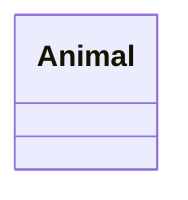

*Fixture:* `simple` · Naiad: Simple*

### C02 - Two classes (no relation)

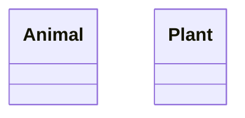

---

## Level 2 - Class body (members and methods)

### C03 - Fields only

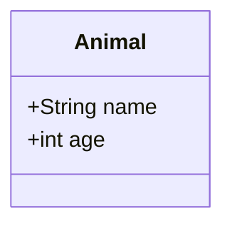

*Fixture:* `members` · Naiad: Members*

### C04 - Methods only

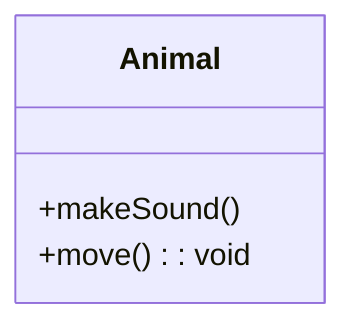

*Naiad: Methods*

### C05 - Fields and methods combined

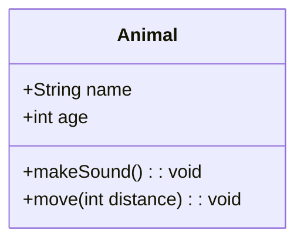

*Naiad: MembersAndMethods*

### C06 - Visibility and modifiers

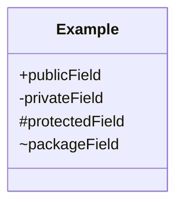

---

## Level 3 - Relations (one token per scenario)

### C07 - Inheritance

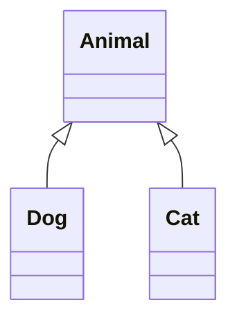

*Fixture:* `relations` · token: `<|--` · Naiad: Inheritance*

### C08 - Multi-level inheritance

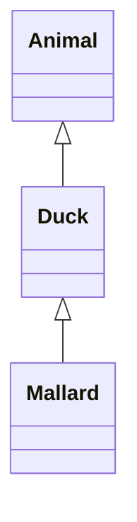

### C09 - Composition

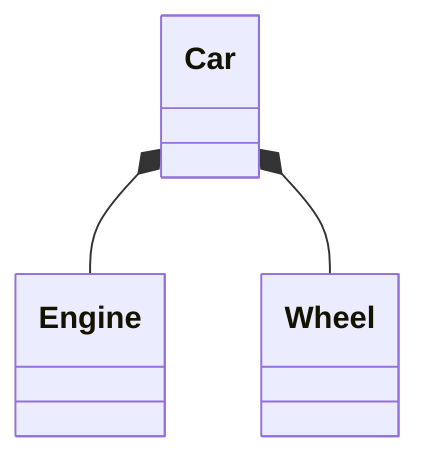

*Token:* `*--` · Naiad: Composition*

### C10 - Aggregation

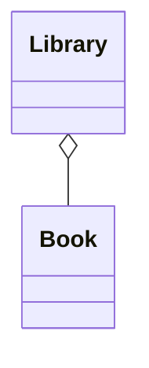

*Token:* `o--` · Naiad: Aggregation*

### C11 - Association with label

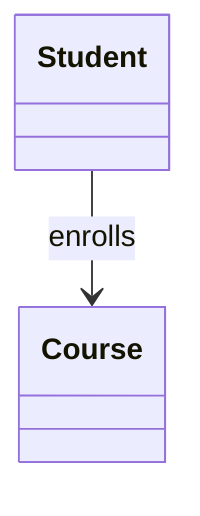

*Token:* `-->` · Naiad: Association*

### C12 - Dependency (dotted arrow)

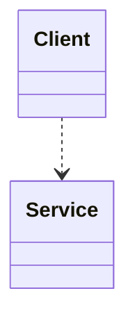

*Token:* `..>`*

### C13 - Realization (dotted inheritance)

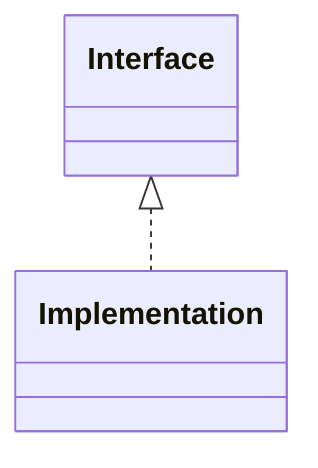

*Token:* `<|..`*

### C14 - Reverse association

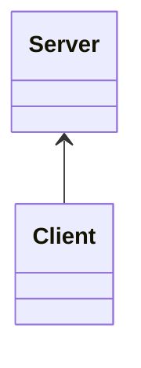

*Token:* `<--`*

### C15 - Solid link (no arrowhead)

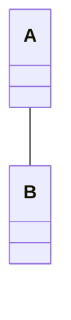

*Token:* `--`*

### C16 - Dotted link

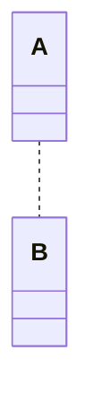

*Token:* `..`*

### C17 - Cardinality labels on relation

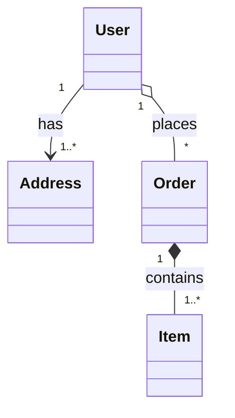

*Naiad: Complex (relation subset)*

---

## Level 4 - Annotations and notes

### C18 - Interface stereotype

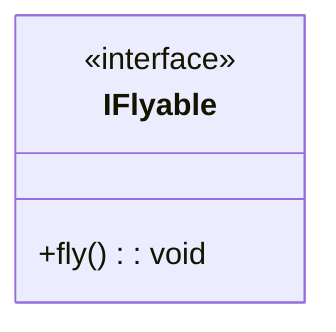

*Naiad: InterfaceAnnotation*

### C19 - Abstract stereotype

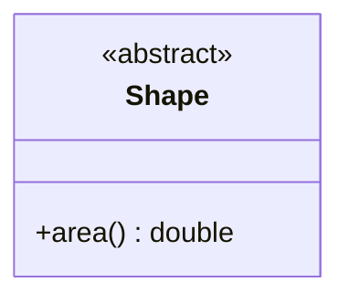

### C20 - Enumeration and service stereotypes

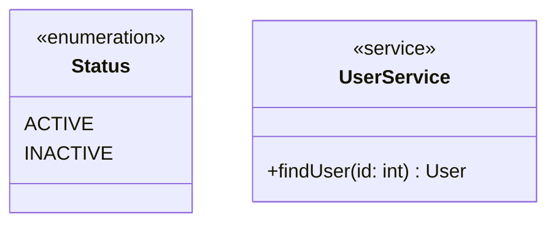

### C21 - Note

```mermaid
classDiagram
    class Animal
    note for Animal "Base type"
```

*Maps:* `classDiagram.note`*

---

## Level 5 - Styles and classDef

### C22 - classDef and class apply

```mermaid
classDiagram
    class Animal
    classDef highlight fill:#f9f,stroke:#333
    class Animal highlight
```

*Fixture:* `classDef-style` · maps: `classDef`, `classApply` (partial)*

### C23 - Inline style directive

```mermaid
classDiagram
    class Animal
    style Animal fill:#bbf,stroke:#333
```

*Maps:* `classDiagram.styleDirective`*

### C24 - cssClass directive (remarked)

```mermaid
%%     classDiagram
%%     class Animal
%%     classDef highlight fill:#f9f
%%     cssClass Animal highlight
```

*Maps:* `classDiagram.cssClass` · **remarked** - does not render on mermaid.live; recognition axis may still be tracked in spec/fixtures.*

---

## Level 6 - Layout and structure

### C25 - Direction

```mermaid
classDiagram
    direction LR
    Animal <|-- Dog
```

### C26 - Namespace block

```mermaid
classDiagram
    namespace animals {
        class Animal
        class Dog
    }
```

---

## Level 7 - Recognition axes

### C27 - Comment lines

```mermaid
classDiagram
    %% domain entity
    class Animal
```

### C28 - Click / hyperlink

```mermaid
classDiagram
    class Animal
    click Animal href "https://example.com" "Docs"
```

*Callback forms emit diagnostic at render policy; href is recognition target.*

### C29 - Accessibility (inline)

```mermaid
classDiagram
    accTitle: Domain model
    accDescr: Core entities
    class Animal
```

### C30 - Accessibility (accDescr block)

```mermaid
classDiagram
    accTitle: Domain model
    accDescr {
        Describes core
        domain entities
    }
    class Animal
```

### C31 - Leading init block

```mermaid
%%{init: {'theme': 'base'}}%%
classDiagram
    class Animal
```

### C32 - classDiagram-v2 header

```mermaid
classDiagram-v2
    class Animal
```

---

## Level 8 - Advanced syntax and combined smoke

### C33 - Generic type parameter

```mermaid
classDiagram
    class Repository~T~ {
        +get(id: int) T
        +save(entity: T) void
    }
```

### C34 - Static members

```mermaid
classDiagram
    class Util {
        +hash(input: String)$ String
        +validate()$ bool
    }
```

### C35 - Combined render smoke (Naiad Complex sample)

```mermaid
classDiagram
    class IRepository~T~ {
        <<interface>>
        +get(id: int) T
        +save(entity: T) void
        +delete(id: int) void
    }
    class AbstractEntity {
        <<abstract>>
        #int id
        +getId() int
    }
    class UserService {
        <<service>>
        -IUserRepository repository
        +createUser(name: String) User
    }
    class Status {
        <<enumeration>>
        ACTIVE
        INACTIVE
    }
    class User {
        +String name
        +validate()$ bool
    }
    class Address {
        +String city
    }
    class Order {
        +int orderId
    }
    class Item {
        +String name
    }
    IRepository~T~ <|.. UserRepository : implements
    AbstractEntity <|-- User : extends
    UserService ..> IRepository~T~ : uses
    User "1" --> "1..*" Address : has
    User "1" o-- "*" Order : places
    Order "1" *-- "1..*" Item : contains
```

*Naiad: Complex · render regression; many axes combined.*

---

## Catalogue maintenance

| Column | Rule |
| --- | --- |
| Scenario id | `C` + two digits; stable once published |
| New scenario | Must map to a row in §11.1.14.3 or add that row first |
| Recognition | Every `ClassRecognition/*.mmd` fixture must appear in the index table |
| Render | SvgHarness PASS for **active** scenarios only (remarked `%%` blocks excluded) |
| Remarked `%%` | Considered but rejected on mermaid.live; do not treat as missing |

Do not extend Naiad `ClassParser` to close recognition gaps - extend `MermaidRecognition` and this catalogue instead.
