# Entity-relationship diagram regression catalogue

Progressive Mermaid **erDiagram** scenarios for recognition and render regression (Markdown → DOCX). Each section increases complexity; scenarios within a section are ordered from simplest to hardest.

**Spec mapping:** line types in `spec.md` §11.1.14.5; recognition fixtures in `tests/MermaidRecognition.Tests/ErRecognition/`.

**Programme note:** Naiad is an interim render baseline only. Recognition advances in `ErKindRecognizer`; entity population and non-Naiad render follow the same pattern as class (§11.1.14.3).

## Scenario index (complete)

| Id | Level | Line types / axis | Recognition fixture | Naiad sample |
| --- | --- | --- | --- | --- |
| E01 | 1 | header, relationship `||--o{` | `relationship` | Simple |
| E02 | 1 | quoted relationship label | `quoted-relationship-label` | - |
| E03 | 2 | `||--||` one-to-one | `one-to-one` | OneToOne |
| E04 | 2 | `|o--o|` zero-or-one both | `cardinality-zero-or-one` | ZeroOrOne |
| E05 | 2 | `||..o{` non-identifying | `non-identifying` | NonIdentifying |
| E06 | 2 | multiple relationships | `multiple-relationships` | MultipleRelationships |
| E07 | 3 | entityBlockOpen, attribute, close | `entity-attributes` | Attributes |
| E08 | 3 | PK / FK / UK keys | `attribute-keys` | KeyTypes |
| E09 | 3 | quoted attribute comments | `attribute-comments` | Comments |
| E10 | 3 | entity alias (**remarked**) | `catalogue-remarked-entity-alias` | - |
| E11 | 4 | direction | `direction` | - |
| E12 | 5 | combined small schema | `combined-schema` | - |
| E13 | 6 | classDef, class apply | `classDef-style` | - |
| E14 | 6 | style | `inline-style` | - |
| E15 | 6 | comment | `comment` | - |
| E16 | 6 | accTitle, accDescr | `accessibility` | - |
| E17 | 6 | init (G1) | `init-leading` | - |
| E18 | 5 | many-to-many via associative entity | `associative-entity` | - |
| E19 | 7 | combined render smoke | `complex-smoke` | Complex |
| E20 | 2 | `}o--||` | `cardinality-zero-or-more-left` | - |
| E21 | 2 | `||--|{` | `relationship` | - |
| E22 | 2 | `|o..o{` | `cardinality-zero-or-one-dotted` | - |
| E23 | 2 | `}o--o{` | `cardinality-zero-or-more-both` | - |
| E24 | 2 | `}|..o{` | `cardinality-one-or-more-dotted` | - |
| E25 | 2 | `}o..o{` | `cardinality-zero-or-more-dotted` | - |
| E26 | 2 | `o|--o{` | `cardinality-optional-zero-or-more` | - |
| E27 | 2 | `}o..||` | `cardinality-zero-or-more-zero-or-one-dotted` | - |
| E28 | 2 | recursive relationship | `recursive-relationship` | - |
| E29 | 2 | duplicate entity pair, different roles | `duplicate-role-labels` | - |
| E30 | 1 | entity block only (no relationship) | `entity-only` | - |
| E31 | 6 | accDescr block | `accDescr-block` | - |
| E32 | 3 | entityBlockClose (explicit) | `attribute-keys` | - |
| E33 | 6 | class apply without classDef | `class-apply-only` | - |
| E34 | 2 | hyphenated entity names | `hyphenated-entities` | - |
| E35 | 2 | relationship before entity block | `relationship-before-entity` | - |

**§11.1.14.5 line-type coverage:** header, relationship, entityBlockOpen/Close, attribute, entityAlias, classDef, class, style, direction, accTitle, accDescr, comment, init; `erDiagram.body` must not appear in catalogue scenarios.

## How to use

This file is the **complete** ER regression catalogue: **isolated diagrams (E01-E35)**. Levels 1-5 align with `extern/Naiad/src/test-renders/EntityRelationship.md`. Levels 6-7 add style, accessibility, and cardinality matrix axes from vendored `erDiagram.spec.js`.

### Remarked scenarios (`%%`)

Diagrams that **do not render** on [mermaid.live](https://mermaid.live) remain in this file with **every source line prefixed by `%%`**. That marks them as **considered but rejected** for the render gate - **do not re-add** them because the catalogue looks incomplete. SvgHarness and DOCX visual review skip remarked blocks. See §9.1 in `spec.md`.

**Currently remarked:** E10 (entity alias syntax).

### SvgHarness (visual / structural gate)

```powershell
dotnet build extern/Naiad/src/Naiad/Naiad.csproj -c Release
dotnet run --project src/SvgHarness/SvgHarness.csproj -c Release -- entityrelationship.md out/er-mermaid-ink --reference=mermaid-ink --parallel 2 --report=out/er-mermaid-ink/report.md
```

Structural-only:

```powershell
dotnet run --project src/SvgHarness/SvgHarness.csproj -c Release -- entityrelationship.md out/er-harness --no-reference
```

### Recognition contract gate

```powershell
dotnet test tests/MermaidRecognition.Tests/MermaidRecognition.Tests.csproj --filter "FullyQualifiedName~ErRecognition"
```

Catalogue scenarios must not produce silent `erDiagram.body` fallback.

### DOCX visual review

```powershell
dotnet run --project src/md2docx/md2docx.csproj -- entityrelationship.md entityrelationship.docx
```

**Checklist per scenario**

- Entity boxes and relationship lines present
- Cardinality markers (`||`, `o{`, `|o`, etc.) match Mermaid
- Relationship labels readable
- Attribute lists inside entity blocks formatted correctly
- PK / FK / UK key markers visible when declared

---

## Level 1 - Header and simple relationship

### E01 - Single identifying relationship

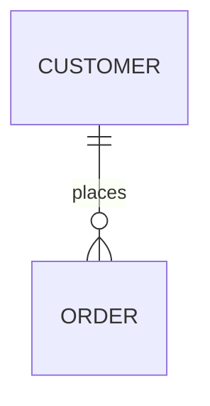

*Fixture:* `relationship` · Naiad: Simple*

### E02 - Quoted relationship label

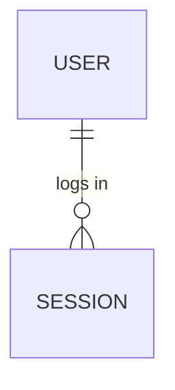

### E30 - Entity block only (no relationship)

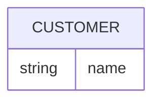

*Stand-alone entity (vendored erDiagram.spec.js)*

### E35 - Relationship declared before entity attributes

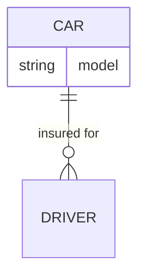

---

## Level 2 - Cardinality and relationship variants

### E03 - One-to-one identifying

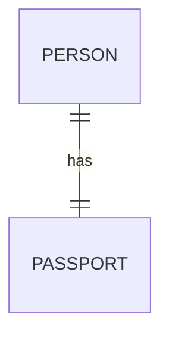

*Naiad: OneToOne*

### E04 - Zero-or-one both ends

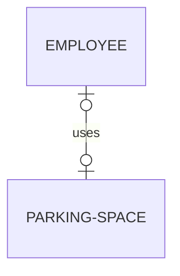

*Naiad: ZeroOrOne*

### E05 - Non-identifying (dotted)

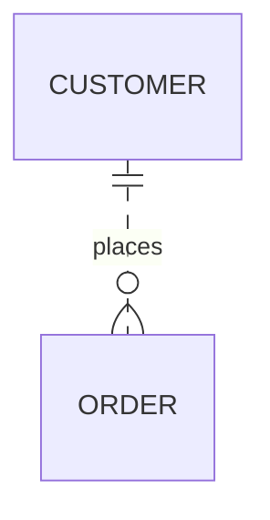

*Naiad: NonIdentifying*

### E06 - Multiple relationships (shared entities)

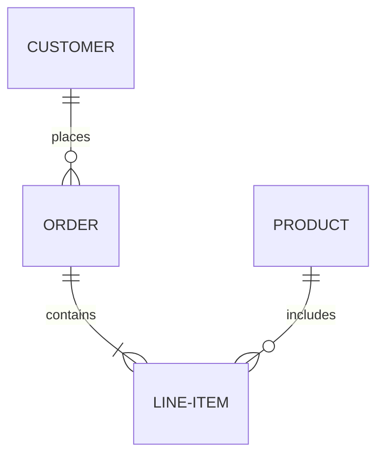

*Naiad: MultipleRelationships*

### E20 - Zero-or-more to exactly-one

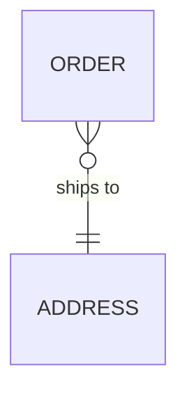

### E21 - Exactly-one to one-or-more

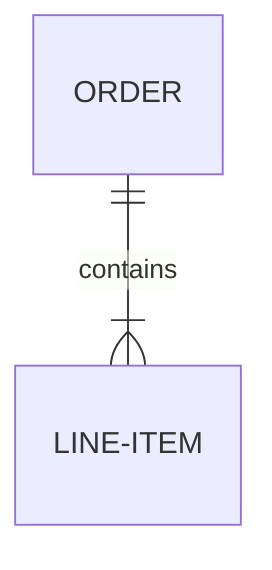

### E22 - Zero-or-one to zero-or-more (dotted)


### E23 - Zero-or-more to zero-or-more

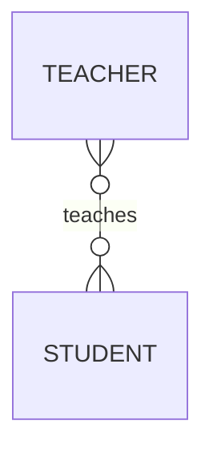

### E24 - One-or-more to zero-or-more (dotted)

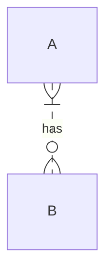

### E25 - Zero-or-more to zero-or-more (dotted)

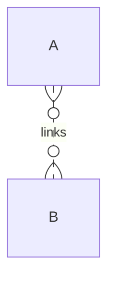

### E26 - Optional to zero-or-more (leading o)

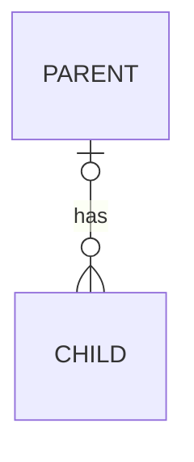

### E27 - Zero-or-more to zero-or-one (dotted)

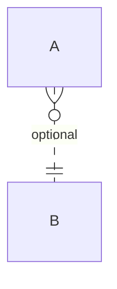

### E28 - Recursive relationship

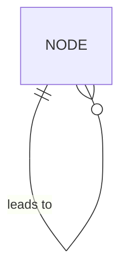

### E29 - Same entity pair, different role labels

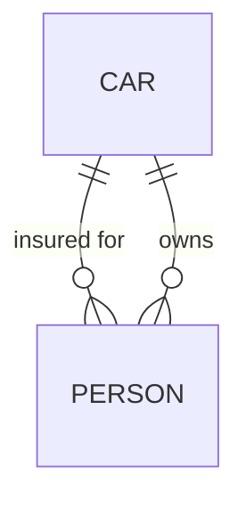

### E34 - Hyphenated entity names

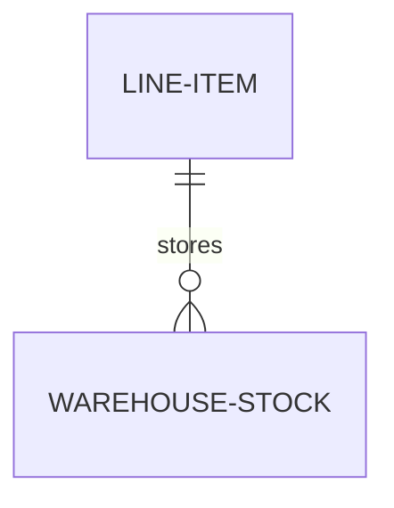

---

## Level 3 - Entity attributes

### E07 - Attribute block (types only)

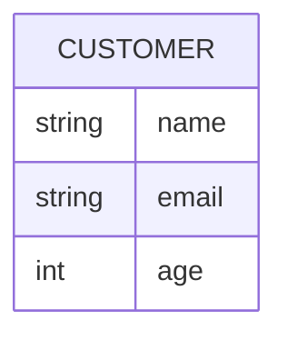

*Fixture:* `entity-attributes` · Naiad: Attributes*

### E08 - Primary / foreign / unique keys

```mermaid
erDiagram
    CUSTOMER {
        int id PK
        string email UK
    }
    ORDER {
        int id PK
        int customer_id FK
    }
```

*Naiad: KeyTypes*

### E09 - Quoted attribute comments

```mermaid
erDiagram
    CUSTOMER {
        int id PK "Primary key"
        string name "Customer name"
    }
```

*Naiad: Comments*

*Maps:* `erDiagram.entityAlias` · **remarked** - does not render on mermaid.live; recognition axis may still be tracked in spec/fixtures.*

### E10 - Entity alias syntax (remarked)

```mermaid
%% erDiagram
%%     CUSTOMER [Customer Account] {
%%         string name
%%     }
```

*Maps:* `erDiagram.entityAlias`*

### E32 - Explicit closing brace (multi-entity file)

```mermaid
erDiagram
    A {
        int id PK
    }
    B {
        int id PK
    }
```

---

## Level 4 - Layout direction

### E11 - Layout direction

```mermaid
erDiagram
    direction LR
    A ||--|| B : links
```

---

## Level 5 - Combined models

### E12 - Small schema (attributes + relationships)

```mermaid
erDiagram
    CUSTOMER {
        int customer_id PK
        string email UK
    }
    ORDER {
        int order_id PK
        int customer_id FK
        date order_date
    }
    CUSTOMER ||--o{ ORDER : places
```

### E18 - Many-to-many through associative entity

```mermaid
erDiagram
    STUDENT }o--o{ ENROLLMENT : has
    COURSE ||--o{ ENROLLMENT : includes
    STUDENT {
        int id PK
        string name
    }
    COURSE {
        int id PK
        string title
    }
    ENROLLMENT {
        int student_id FK
        int course_id FK
    }
```

### E19 - Combined render smoke (Naiad Complex sample)

```mermaid
erDiagram
    CUSTOMER {
        int customer_id PK "Primary key"
        string first_name "Customer first name"
        string last_name "Customer last name"
        string email UK "Unique email address"
        date date_of_birth
        string phone
        boolean is_active
    }
    ADDRESS {
        int address_id PK
        int customer_id FK
        string street
        string city
        string state
        string postal_code
        string country
        string address_type "billing or shipping"
    }
    ORDER {
        int order_id PK
        int customer_id FK
        int shipping_address_id FK
        int billing_address_id FK
        datetime order_date
        datetime shipped_date
        string status
        decimal total_amount
    }
    ORDER_ITEM {
        int item_id PK
        int order_id FK
        int product_id FK
        int quantity
        decimal unit_price
        decimal discount
    }
    PRODUCT {
        int product_id PK
        int category_id FK
        string name
        string description
        decimal price
        int stock_quantity
        string sku UK
    }
    CATEGORY {
        int category_id PK
        int parent_id FK "Self-referencing"
        string name
        string description
    }
    CUSTOMER ||--o{ ORDER : places
    CUSTOMER ||--o{ ADDRESS : has
    ORDER ||--|{ ORDER_ITEM : contains
    ORDER }o--|| ADDRESS : "ships to"
    ORDER }o--|| ADDRESS : "bills to"
    PRODUCT ||--o{ ORDER_ITEM : "included in"
    CATEGORY ||--o{ PRODUCT : categorizes
    CATEGORY |o--o| CATEGORY : "parent of"
```

*Naiad: Complex*

---

## Level 6 - Recognition axes (styles, comments, accessibility)

### E13 - classDef and class apply

```mermaid
erDiagram
    CUSTOMER ||--o{ ORDER : places
    classDef highlight fill:#f9f
    class CUSTOMER highlight
```

### E14 - Style directive

```mermaid
erDiagram
    CUSTOMER {
        string name
    }
    style CUSTOMER fill:#bbf
```

### E15 - Comment lines

```mermaid
erDiagram
    %% Domain: sales
    CUSTOMER ||--o{ ORDER : places
```

### E16 - Accessibility (inline)

```mermaid
erDiagram
    accTitle: Sales schema
    accDescr: Customer and order entities
    CUSTOMER ||--o{ ORDER : places
```

### E31 - Accessibility (accDescr block)

```mermaid
erDiagram
    accTitle: Sales schema
    accDescr {
        Entity relationship model
        for the sales domain
    }
    CUSTOMER ||--o{ ORDER : places
```

### E17 - Leading init block

```mermaid
%%{init: {'theme': 'base'}}%%
erDiagram
    A ||--|| B : relates
```

### E33 - Class apply styling

```mermaid
erDiagram
    CUSTOMER {
        string name
    }
    class CUSTOMER important
```

---

## Cardinality token reference

Left and right markers compose Mermaid ER cardinality (identifying `--` vs non-identifying `..`):

| Left | Right | Example scenario |
| --- | --- | --- |
| `\|\|` | `o{` | E01 |
| `\|\|` | `\|\|` | E03 |
| `\|o` | `o\|` | E04 |
| `\|\|` | `\|{` | E06, E21 |
| `}o` | `\|\|` | E20 |
| `}o` | `o{` | E23 |
| `\|o` | `..o{` | E22 |
| `}\|` | `..o{` | E24 |
| `}o` | `..o{` | E25 |
| `o\|` | `o{` | E26 |
| `}o` | `..\|\|` | E27 |

---

## Catalogue maintenance

| Column | Rule |
| --- | --- |
| Scenario id | `E` + two digits; stable once published |
| New scenario | Must map to §11.1.14.5 (expand spec table when adding rows) |
| Recognition | Every `ErRecognition/*.mmd` fixture must appear in the index table |
| Render | SvgHarness PASS for **active** scenarios only (remarked `%%` blocks excluded) |
| Remarked `%%` | Considered but rejected on mermaid.live; do not treat as missing |

Do not treat this file as the specification - machine-readable truth remains `*.verified.json` under `ErRecognition/`. Expand §11.1.14.5 to a full line-type table like §11.1.14.3 when ER L2 is claimed complete.
