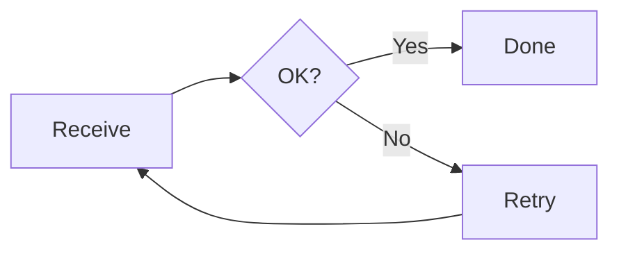
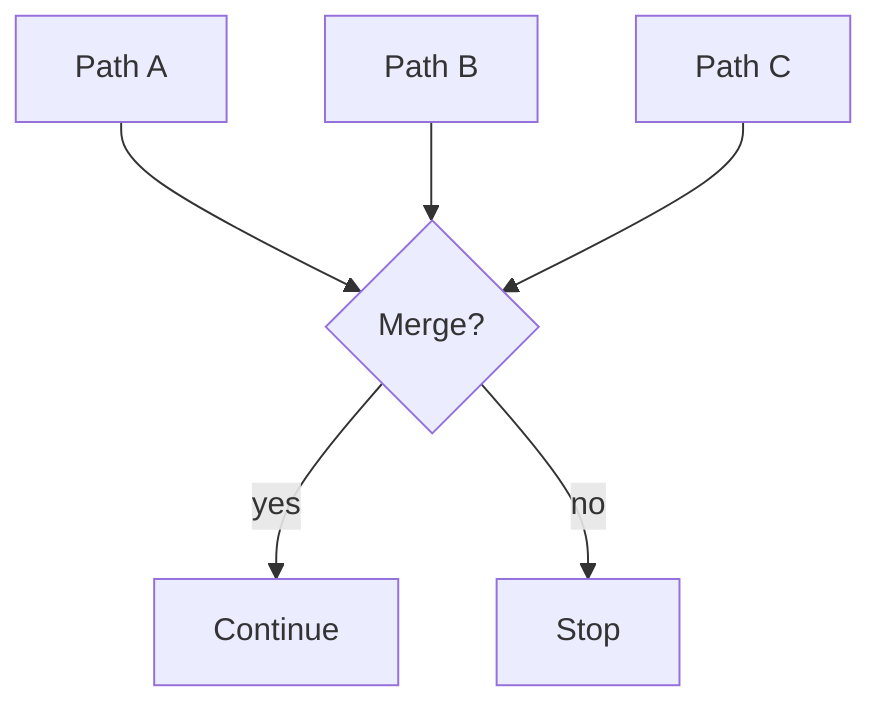
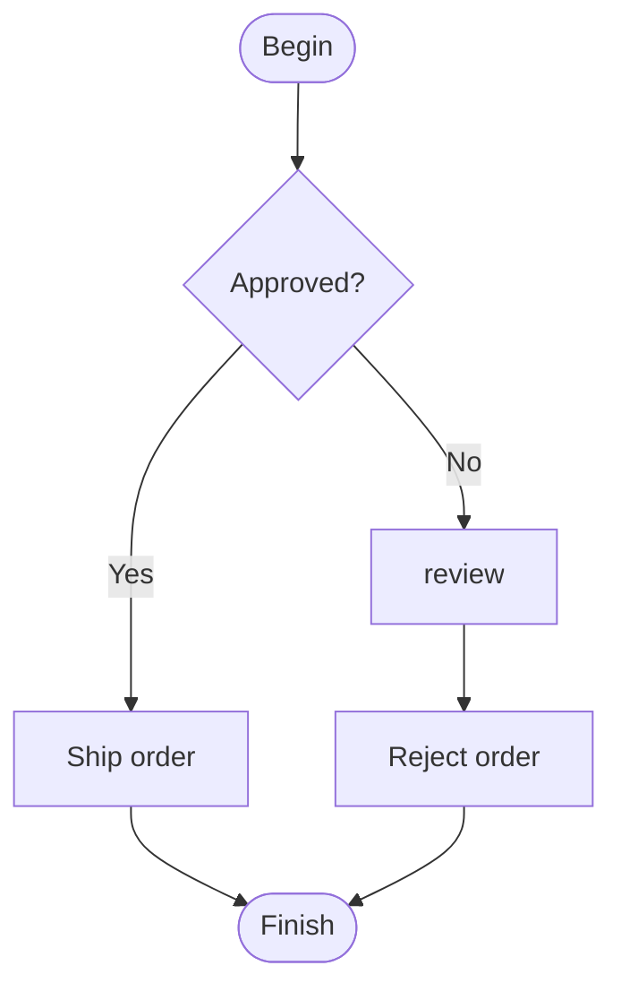
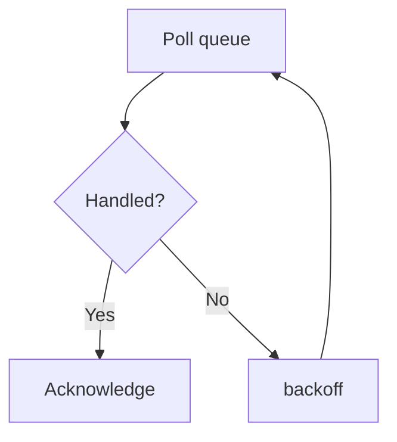
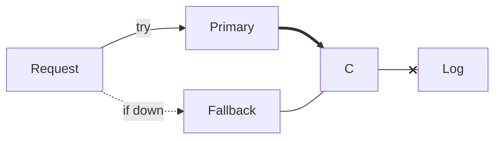
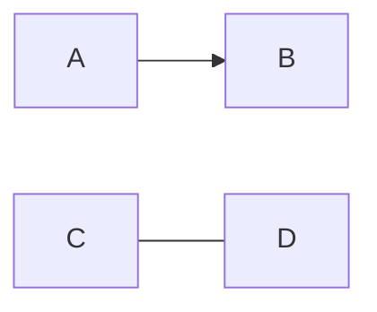

# Fixture render spot check (rules 1.8 / 3.11 batch)

Small extract for manual Word conversion. Do not use as the full flow or enterprise catalogue.

## F124 — Nodes first: retry loop (equiv. F34)

## F125 — Nodes first: diamond with multiple incoming edges

## F135 — Nodes first: approval decision with a review detour (equiv. F119)

## F137 — Nodes first: polling loop with back edge (equiv. F124)

## F140 — Nodes first: mixed edge styles with labels (equiv. F131)

## Batch 2 catalogue equivalents (reference renders)

### F34 — Simple cycle (retry loop)

### F131 — Nodes first: mixed edge styles declared after nodes (equiv. F18)

