# Diagram Recognition Specification

- **Project status:** [`currentstatus.md`](currentstatus.md) (recognition gate summary and active engineering work - not normative).
- **Scope:** recognising the individual aspects involved in turning text into diagrams without naming every scenario as a separate case.
- **Primary reference catalogue:** `flow.md` (visual regression; not the recognition specification).
- **Primary implementation reference:** vendored Mermaid flowchart parser/database under `mermaid/packages/mermaid/src/diagrams/flowchart/`, implemented in `src/MermaidRecognition/`.

**Normative citation rule:** routing, layout, and recognition requirements in this document describe diagrams by **Mermaid source** or **graph topology** (node ids, edge structure, subgraph nesting). They must **not** cite regression-catalogue scenario numbers (`F01`, `F58`, etc.). Catalogue ids belong in regression Markdown files and [`currentstatus.md`](currentstatus.md) only.

---

## 1. Finding

### Native placement setting

Enterprise and flowchart diagrams accept `config.layout: grid` or `config.layout: open` in diagram frontmatter. The default is `grid`. An unknown value emits one warning and falls back to `grid`. The command-line option `--layout grid|open` sets the run default; explicit diagram configuration takes precedence.

All diagram kinds accept optional `config.legend`. Values are `off` (default), `on` (`bottom-right`), `bottom-right`, `bottom-left`, `top-right`, `top-left`, `below`, `right`, `table`, or a placement hint such as `right-of id`. `--legend` sets the run default and diagram frontmatter wins. Image legends are added after layout outside the main bounds and do not change main geometry or score. Table mode adds a Symbol/Type table after the diagram and draws no image legend.

Grid mode uses one shared placement grid. Open mode skips shared-grid placement only. Both modes retain the same routing, ports, straight runs, rounded corners and crossing rules, and prevent boxes and unrelated group frames from overlapping.

`flow.md` is a useful regression catalogue, but it is not a recognition strategy.

It names examples (`F01` to `F60`) and groups them by topic. That is good for humans checking regressions. It is bad as an implementation basis because it tempts the renderer to recognise examples by scenario shape:

```text
if this looks like F43, handle nested subgraphs
if this looks like F26, handle long labels
if this looks like F53A, special-case stadium merge geometry
```

That approach will collapse as soon as two axes combine in an unlisted way.

The correct unit of recognition is not the scenario. It is the smallest semantic fact the source text contributes to the diagram model:

- this line declares a diagram family
- this token sets direction
- this statement defines or mutates a vertex
- this bracket pair chooses a shape
- this link token expands to one or more edges
- this edge has stroke, arrowheads, length, label, id, classes and style
- this subgraph establishes containment and maybe direction
- this directive mutates style, class, link style, interaction, config, or accessibility metadata

Mermaid's own flowchart code is built this way. The parser calls methods such as `addVertex`, `addLink`, `addSubGraph`, `setDirection`, `addClass`, `setClass`, `updateLink`, and `updateLinkInterpolate`; the renderer later consumes a normalised graph model. It does not have a `renderFanOutScenario` or `renderNestedSubgraphScenario`.

---

## 2. Recognition Principle

The recogniser must emit a compositional diagram contract, not a scenario id.

For every Mermaid block, recognition must produce:

```text
Diagram
  kind
  aliases
  effectiveConfig
  direction
  declarations[]
  vertices[]   → NodeContract[] (implementation name: Nodes)
  edges[]
  groups[]
  styles[]
  classes[]
  interactions[]
  diagnostics[]
```

Every item must preserve both:

- the source-level fact, such as `A --> B`
- the normalised rendering-level effect, such as one edge from `A` to `B` with `stroke=normal`, `arrowTypeEnd=point`, `minlen=1`

This dual representation is non-negotiable. Source text is needed for diagnostics and round-tripping. Normalised facts are needed for layout and rendering.

---

## 3. Required Recognition Axes

### 3.1 Diagram Header

Recognise:

| Source aspect | Normalised fact |
| --- | --- |
| `graph` | flowchart-compatible diagram |
| `flowchart` | flowchart-compatible diagram |
| `flowchart-elk` | flowchart family with ELK renderer intent |
| omitted direction after header | `TB` |
| `TD` | `TB` |
| symbolic direction `<`, `>`, `^`, `v` | `RL`, `LR`, `BT`, `TB` |

Critical point: direction is not a visual hint. It changes layout rank direction, edge routing expectations, cluster placement, label clearance, and the meaning of spacing.

### 3.2 Statement Boundaries

Recognise statements independently of whether they end with:

- newline
- semicolon
- EOF
- blank space around tokens

Do not encode "one line equals one operation". Mermaid allows chains and grouped node expressions on one statement, and comments/blank lines should not become model facts.

### 3.3 Vertex Identity

Recognise vertex identity separately from visible label.

```text
id: stable graph reference
label: rendered text, defaulting to id only if no label is supplied
labelType: text | string | markdown
shape: explicit, bracket-derived, metadata-derived, or default
classes: zero or more
styles: zero or more
metadata: optional shape-data object
```

Critical point: the same vertex can be declared repeatedly. Later statements can add label, shape, classes, styles, metadata or interactions. The recogniser must merge declarations, not duplicate nodes.

### 3.4 Vertex Label Forms

Recognise label source and label type:

| Form | Required distinction |
| --- | --- |
| unlabelled id | label defaults to id |
| bracket text | labelType `text` unless quoted/markdown syntax changes it |
| quoted text | labelType `string`; outer quotes stripped |
| markdown string | labelType `markdown` |
| `@{ label: ... }` | metadata label overrides default/id label |
| entity codes | decoded/sanitised downstream, but source must be preserved |
| `<br/>` | explicit line break intent |
| unicode | accepted content, not a special scenario |

Critical point: label parsing is not just visual wrapping. The label type affects sanitisation, HTML/SVG rendering, measurement, and sometimes escaping validity.

### 3.5 Vertex Shape

Recognise shape as a fact, not as a scenario.

Legacy bracket syntax must map to canonical shape intent:

| Syntax family | Shape fact |
| --- | --- |
| `A[text]` | square/rect |
| `A(text)` | round/rounded rectangle |
| `A([text])` | stadium |
| `A[[text]]` | subroutine/framed rectangle |
| `A[(text)]` | cylinder |
| `A((text))` | circle |
| `A(((text)))` | double circle |
| `A{text}` | diamond |
| `A{{text}}` | hexagon |
| `A>text]` | odd/asymmetric flag |
| trapezoid/lean syntaxes | trapezoid / inverted trapezoid / lean variants |
| `A@{ shape: ... }` | metadata shape, with validation |

Critical point: `flow.md` covers only a small subset of the current Mermaid shape surface. It exercises the old common shapes but not the large modern shape catalogue available through `@{ shape: ... }`. A renderer claiming "Mermaid flowchart shapes" from `flow.md` alone is overclaiming.

### 3.6 Edge Expansion

Recognise source expressions that expand into multiple edges.

Examples:

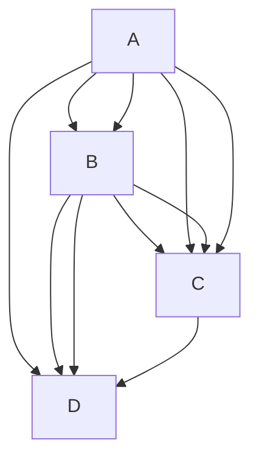

The recogniser must emit every edge produced by the Cartesian expansion and chaining rules. It must not store the chain as a single edge-like object.

Critical point: grouped/chained edges are not "fan-out scenarios". They are grammar expansions. The visual fan-out is a consequence of expanded edges plus layout.

### 3.7 Edge Identity

Recognise edge id as independent from endpoints.

```text
source syntax: e1@-->
normalised edge id: e1 for only the grammar-selected edge
fallback id: deterministic generated id
```

When a grouped statement has an edge id, Mermaid applies the user id only to a specific generated edge and auto-generates ids for the rest. Duplicate user ids do not silently overwrite all edges. This is a subtle source-level rule and must be tested.

Critical point: `flow.md` mostly tests visual edges, not edge identity. That is insufficient for style, animation, metadata, and linkStyle targeting.

### 3.8 Edge Token Decomposition

Recognise each edge token as a tuple:

```text
startArrow: none | point | circle | cross
endArrow: none | point | circle | cross
directionality: one-ended | double-ended
stroke: normal | dotted | thick | invisible
minlen: integer, capped at 10
label: optional
labelType: text | string | markdown
```

Examples:

| Token | Facts |
| --- | --- |
| `---` | open line, normal stroke, no markers |
| `-->` | point at end, normal stroke, `minlen=1` |
| `--->` | point at end, normal stroke, `minlen=2` |
| `-.->` | point at end, dotted stroke |
| `==>` | point at end, thick stroke |
| `--o` | circle at end |
| `x--x` | cross at both ends |
| `<-->` | point at both ends |
| `~~~` | invisible edge |

Critical point: edge recognition must not conflate "arrow" with "edge". Arrowheads, stroke pattern, thickness, length and label are separate axes.

### 3.9 Edge Labels

Recognise both label syntaxes:

```text
A -->|label| B
A -- label --> B
```

Then preserve:

```text
edge.label
edge.labelType
source span
layout measurement requirement
```

Critical point: a long edge label is not a different edge kind. It is an edge with a label whose measured dimensions affect layout. `flow.md` correctly stresses this, but the implementation must not respond by deriving `minlen` from text width. Mermaid derives `minlen` from token length, not label length.

### 3.10 Subgraphs

Recognise subgraph declaration as group creation plus membership.

```text
group.id
group.title
group.labelType
group.children[]
group.direction?
group.classes[]
parentGroup?
```

Supported source forms include:

```text
subgraph Title
subgraph id[Title]
subgraph id["Title"]
subgraph
```

Direction inside a subgraph is a group-local fact. It must be attached to the group, not applied globally.

Critical point: nested subgraphs are not a special diagram kind. They are ordinary groups whose child list contains other group ids and node ids. Cross-boundary edges are ordinary edges whose endpoints happen to live in different containment contexts. Layout/routing must handle that later.

**Cluster interior insets and centreing:** each subgraph cluster box reserves a **26px title band** at the top, **18px padding** on left/right/bottom around member node bodies, and **26px vertical content slack** below the bottom padding. Member content is centred horizontally and vertically in the remaining interior region (`FlowchartSubgraphLayoutPostProcessor.CenterSubgraphMembersInClusterBoxes`, deepest subgraphs first). Mermaid declares `padding: 8` on dagre cluster nodes and `flowchart.padding` default **15** on ordinary nodes; rendered parity uses the **18 / 26 / 26** constants from Naiad measurement.

**Sibling subgraph spacing:** root-level or same-parent subgraph siblings must keep a minimum **24px exterior gap** on the diagram primary flow axis (LR: between right border of the left cluster and left border of the right cluster; TB: between bottom border of the upper cluster and top border of the lower cluster). Gap is measured on cluster rectangles (member bounds + 18px padding + 26px title band). Regression patterns include LR side-by-side stage subgraphs (`subgraph A` … `subgraph B` under `flowchart LR`) and TB stacked sibling subgraphs with cross-boundary edges between member nodes.

### 3.11 Membership and Uniqueness

Recognise that a node should have one effective parent group.

Mermaid removes members from later/outer group lists when they already belong to another subgraph. This is not intuitive, and it is easy to get wrong if group parsing is modelled as simple "append all descendants".

Critical point: containment is a graph fact with ownership rules, not indentation decoration.

### 3.12 Styling

Recognise style declarations as mutations:

```text
style <id> <style-list>
classDef <class-id> <style-list>
class <id-list> <class-id>
<vertex>:::<class-id>
linkStyle <edge-index-list | default> <style-list>
linkStyle <edge-index-list | default> interpolate <curve> [style-list]
```

Styles can target:

- vertices
- edges, by generated or user id through class assignment
- subgraphs
- default edge style
- numbered edge positions

Critical point: `flow.md` barely touches style order, default link style, curve interpolation, style targeting errors, comma escaping, and classes on subgraphs/edges. A recogniser must still model them because they mutate the same graph contract.

### 3.13 Metadata Shape Data

Recognise `@{ ... }` as metadata that can apply to:

- a vertex
- an existing edge id

For vertices, supported facts include at least:

```text
shape
label
labelType
icon
form
pos
img
constraint
w
h
```

For edges, supported facts include at least:

```text
animate
animation
curve
```

Critical point: this is missing from `flow.md` except indirectly through style/init coverage. Mermaid's source tests cover it heavily. Without metadata recognition, the renderer will be frozen at an older flowchart syntax surface.

### 3.14 Interactions and Links

Recognise:

```text
click <id> <callback>
click <id> call <callback>(args)
click <id> href "url"
click <id> "url"
tooltip text
target: _self | _blank | _parent | _top
```

Even if DOCX output cannot preserve runtime click callbacks, the recogniser should record them and emit a diagnostic or downgrade. Silently dropping them makes the conversion non-auditable.

### 3.15 Accessibility and Title

Recognise:

```text
accTitle:
accDescr:
accDescr { ... }
```

Critical point: accessibility metadata is part of the diagram source. It may not affect geometry, but it affects the conversion contract and should be exposed to downstream document generation.

### 3.16 Init and Configuration

Recognise `%%{init: ...}%%` before diagram parsing and record effective overrides.

At minimum:

```text
flowchart.htmlLabels
flowchart.nodeSpacing
flowchart.rankSpacing
flowchart.diagramPadding
flowchart.wrappingWidth
flowchart.curve
look
theme/themeVariables
securityLevel
```

Critical point: config is not merely rendering polish. It changes text measurement mode, layout spacing, curve generation, marker variants and security behaviour.

### 3.17 Mermaid Default Styling and Text Rendering Constants (pinned)

This specification is pinned to the vendored Mermaid version declared in §11.1. All recognition and rendering behaviour must be compatible with the defaults and override rules in that version.

This section exists because “diagram correctness” for DOCX export includes the **textual representation inside shapes and on edges**, which depends on default typography, padding, colours, spacing, and wrapping behaviour. These values must be **specified**, not guessed.

#### 3.17.1 Source of truth (vendored files in this repo)

Defaults and override rules are derived from these vendored Mermaid files:

- `mermaid/packages/mermaid/src/schemas/config.schema.yaml`
  - All JSON-schema default values (including flowchart spacing, curve defaults, and global font settings).
- `mermaid/packages/mermaid/src/defaultConfig.ts`
  - Non-JSON defaults (for example `themeVariables` initialisation).
- `mermaid/packages/mermaid/src/config.ts`
  - Directive precedence and `themeVariables` merge rules.
- `mermaid/packages/mermaid/src/themes/theme-default.js`
  - Theme-default variables, including baseline colours and font settings used by default theming.

If any of these vendored defaults change, this section and the recognition fixtures must be updated together with the compatibility pin.

#### 3.17.2 Global typography defaults (when not overridden)

From `mermaid/packages/mermaid/src/schemas/config.schema.yaml`:

```text
fontFamily default: '"trebuchet ms", verdana, arial, sans-serif;'  (config.schema.yaml:171-177)
fontSize default: 16  (config.schema.yaml:345-347)
htmlLabels: configured globally (see §3.17.4); precedence is root-level htmlLabels over diagram-specific htmlLabels
```

From `mermaid/packages/mermaid/src/themes/theme-default.js` (theme variables baseline):

```text
themeVariables.fontFamily default: '"trebuchet ms", verdana, arial, sans-serif'  (theme-default.js:36-37)
themeVariables.fontSize default: '16px'  (theme-default.js:36-38)
themeVariables.fontWeight default: 'normal' (when present; theme sets normal if not otherwise defined)
```

Contract requirement:

- The recogniser must record the **effective** values for `fontFamily`, `fontSize`, and `htmlLabels` that apply to the diagram after directive merging (§3.17.4), even if they are defaults.
- The contract must also preserve **user-specified overrides** separately (source-level facts), so diagnostics can explain why effective values differ from defaults.

#### 3.17.3 Flowchart layout and text-box related defaults (when not overridden)

From `mermaid/packages/mermaid/src/schemas/config.schema.yaml` `FlowchartDiagramConfig` defaults:

```text
flowchart.titleTopMargin default: 25  (config.schema.yaml:2125-2128)
flowchart.subGraphTitleMargin default: { top: 0, bottom: 0 }  (config.schema.yaml:2128-2141)
flowchart.diagramPadding default: 8  (config.schema.yaml:2144-2147)
flowchart.nodeSpacing default: 50  (config.schema.yaml:2159-2167)
flowchart.rankSpacing default: 50  (config.schema.yaml:2168-2176)
flowchart.curve default: 'basis'  (config.schema.yaml:2177-2197)
flowchart.wrappingWidth default: 200  (config.schema.yaml:2208-2215)
flowchart.defaultRenderer default: 'dagre-wrapper'  (config.schema.yaml:2205-2207)
flowchart.inheritDir default: false  (config.schema.yaml:2217-2219)

flowchart.padding default: 15
  note: “Only used in new experimental rendering.” Still must be recognised as a config fact.  (config.schema.yaml:2198-2204)
```

Contract requirement:

- These values must appear in `effectiveConfig` for flowcharts, with explicit indication of whether each value was defaulted or overridden.
- `wrappingWidth` and `fontSize` together define label measurement and wrapping behaviour; the recogniser must preserve them as first-class facts.

#### 3.17.4 Directive/config precedence and theme variable merging (observable behaviour)

From `mermaid/packages/mermaid/src/config.ts`:

- Directives are merged onto site/default config, then theme variables are recomputed when a theme is selected.
- If a directive sets `fontFamily` but not `themeVariables.fontFamily`, Mermaid injects it into `themeVariables.fontFamily`.  (config.ts:197-206)
- `flowchart.htmlLabels` exists but is deprecated; effective value is computed as:

```text
effectiveHtmlLabels = evaluate(config.htmlLabels ?? config.flowchart?.htmlLabels ?? true)  (config.ts:282-288)
```

Contract requirement:

- The recogniser must implement the same precedence rules so that `effectiveConfig` matches Mermaid’s effective configuration.
- The contract must preserve both:
  - **raw directive payload(s)** (source-level)
  - **effective merged config** (normalised)

#### 3.17.5 Theme-default colour and styling baselines (used unless overridden)

From `mermaid/packages/mermaid/src/themes/theme-default.js` (theme variable baseline, including derived flowchart defaults):

```text
background: 'white'  (theme-default.js:28-29)
lineColor: '#333333'  (theme-default.js:31-32)
textColor: '#333'  (theme-default.js:38-40)
arrowheadColor: '#333333'  (theme-default.js:34-36)
labelBackground: 'rgba(232,232,232, 0.8)'  (theme-default.js:37-39)

Flowchart-derived theme variables (after updateColors):
nodeBkg: mainBkg ('#ECECFF')  (theme-default.js:29-31)
clusterBkg: secondBkg ('#ffffde')  (theme-default.js:29-31)
defaultLinkColor: lineColor ('#333333')  (theme-default.js:31-32)
edgeLabelBackground: labelBackground ('rgba(232,232,232, 0.8)')  (theme-default.js:37-39)
nodeBorder: border1 ('#9370DB')  (theme-default.js:31-33)
clusterBorder: border2 ('#aaaa33')  (theme-default.js:33-35)
```

Contract requirement:

- The recogniser must capture any user overrides to theme variables (`themeVariables`) and theme selection (`theme`).
- The rendering pipeline must treat theme variables as part of the **diagram contract inputs** that determine:
  - text colour and background (node + edge label)
  - stroke colours (borders and edges)
  - arrowhead colours

DOCX requirement:

- If the DOCX exporter cannot preserve a recognised theme variable (for example a font family not available at render time, or a colour not representable in the chosen export mode), it must emit a diagnostic rather than silently substituting values.

#### 3.17.6 All diagram families (including experimental): required config defaults and overrides

This specification covers **all Mermaid diagram families present in the pinned Mermaid version**, including experimental/beta diagrams (`wardley-beta`). For each family, defaults and overrides are defined in the vendored Mermaid configuration schema and theme implementation. **Every default value in sections 3.17.7 through 3.17.39 includes a source file reference.**

Regenerate the machine-readable tables when the Mermaid pin changes:

```text
powershell -File tools/Generate-MermaidDefaultsMarkdown.ps1
powershell -File tools/Generate-EntityTypesMarkdown.ps1
```

Contract requirements (all diagram kinds):

- The recogniser must emit `effectiveConfig` for the diagram kind that includes global defaults, diagram-specific defaults, directive overrides, and resolved `themeVariables`.
- The recogniser must preserve raw directive payload and source spans.
- For experimental/beta families, recognise config using schema defaults and emit diagnostics for unsupported native render/export features (see section 7.3).
- The renderer/exporter must treat `effectiveConfig` + `themeVariables` as inputs for fonts, colours, spacing, padding, and label measurement.
- Silent substitution without diagnostics is not acceptable for DOCX export.

<!-- Generated tables: tools/Generate-MermaidDefaultsMarkdown.ps1 - regenerate when Mermaid pin changes -->

#### 3.17.7 Global root configuration defaults (pinned Mermaid 11.14.0)

| Config key | Default | Reference |
| --- | --- | --- |
| theme | 'default' | `mermaid/packages/mermaid/src/schemas/config.schema.yaml:83` |
| look | 'classic' | `mermaid/packages/mermaid/src/schemas/config.schema.yaml:96` |
| handDrawnSeed | 0 | `mermaid/packages/mermaid/src/schemas/config.schema.yaml:101` |
| layout | 'dagre' | `mermaid/packages/mermaid/src/schemas/config.schema.yaml:106` |
| maxTextSize | 50000 | `mermaid/packages/mermaid/src/schemas/config.schema.yaml:110` |
| maxEdges | 500 | `mermaid/packages/mermaid/src/schemas/config.schema.yaml:115` |
| darkMode | false | `mermaid/packages/mermaid/src/schemas/config.schema.yaml:163` |
| fontFamily | "trebuchet ms", verdana, arial, sans-serif; | `mermaid/packages/mermaid/src/schemas/config.schema.yaml:177` |
| fontSize | 16 | `mermaid/packages/mermaid/src/schemas/config.schema.yaml:347` |
| markdownAutoWrap | true | `mermaid/packages/mermaid/src/schemas/config.schema.yaml:350` |
| securityLevel | strict | `mermaid/packages/mermaid/src/schemas/config.schema.yaml:224` |
| startOnLoad | true | `mermaid/packages/mermaid/src/schemas/config.schema.yaml:228` |
| arrowMarkerAbsolute | false | `mermaid/packages/mermaid/src/schemas/config.schema.yaml:235` |
| htmlLabels | true (effective when unset; see `getEffectiveHtmlLabels`) | `mermaid/packages/mermaid/src/schemas/config.schema.yaml:164-170`; `mermaid/packages/mermaid/src/config.ts:282-288` |
| logLevel | 5 (fatal) | `mermaid/packages/mermaid/src/schemas/config.schema.yaml:181-207` |

ELK (`elk` object):

| Config key | Default | Reference |
| --- | --- | --- |
| elk.mergeEdges | false | `mermaid/packages/mermaid/src/schemas/config.schema.yaml:124` |
| elk.nodePlacementStrategy | BRANDES_KOEPF | `mermaid/packages/mermaid/src/schemas/config.schema.yaml:134` |
| elk.cycleBreakingStrategy | GREEDY_MODEL_ORDER | `mermaid/packages/mermaid/src/schemas/config.schema.yaml:145` |
| elk.forceNodeModelOrder | false | `mermaid/packages/mermaid/src/schemas/config.schema.yaml:150` |
| elk.considerModelOrder | 'NODES_AND_EDGES' | `mermaid/packages/mermaid/src/schemas/config.schema.yaml:160` |

#### 3.17.8 Top-level `%%{init}%%` diagram config keys

| Init key | Schema `$defs` | Reference |
| --- | --- | --- |
| c4 | C4DiagramConfig | `mermaid/packages/mermaid/src/schemas/config.schema.yaml:373-874` |
| gitGraph | GitGraphDiagramConfig | `mermaid/packages/mermaid/src/schemas/config.schema.yaml:875-922` |
| requirement | RequirementDiagramConfig | `mermaid/packages/mermaid/src/schemas/config.schema.yaml:936-972` |
| architecture | ArchitectureDiagramConfig | `mermaid/packages/mermaid/src/schemas/config.schema.yaml:973-1002` |
| mindmap | MindmapDiagramConfig | `mermaid/packages/mermaid/src/schemas/config.schema.yaml:1003-1025` |
| ishikawa | IshikawaDiagramConfig | `mermaid/packages/mermaid/src/schemas/config.schema.yaml:1026-1042` |
| kanban | KanbanDiagramConfig | `mermaid/packages/mermaid/src/schemas/config.schema.yaml:1043-1059` |
| pie | PieDiagramConfig | `mermaid/packages/mermaid/src/schemas/config.schema.yaml:1060-1073` |
| quadrantChart | QuadrantChartConfig | `mermaid/packages/mermaid/src/schemas/config.schema.yaml:1074-1193` |
| xyChart | XYChartConfig | `mermaid/packages/mermaid/src/schemas/config.schema.yaml:1264-1328` |
| er | ErDiagramConfig | `mermaid/packages/mermaid/src/schemas/config.schema.yaml:1329-1405` |
| state | StateDiagramConfig | `mermaid/packages/mermaid/src/schemas/config.schema.yaml:1406-1497` |
| class | ClassDiagramConfig | `mermaid/packages/mermaid/src/schemas/config.schema.yaml:1498-1552` |
| journey | JourneyDiagramConfig | `mermaid/packages/mermaid/src/schemas/config.schema.yaml:1553-1693` |
| timeline | TimelineDiagramConfig | `mermaid/packages/mermaid/src/schemas/config.schema.yaml:1694-1821` |
| gantt | GanttDiagramConfig | `mermaid/packages/mermaid/src/schemas/config.schema.yaml:1822-1943` |
| sequence | SequenceDiagramConfig | `mermaid/packages/mermaid/src/schemas/config.schema.yaml:1944-2107` |
| flowchart | FlowchartDiagramConfig | `mermaid/packages/mermaid/src/schemas/config.schema.yaml:2108-2223` |
| sankey | SankeyDiagramConfig | `mermaid/packages/mermaid/src/schemas/config.schema.yaml:2267-2330` |
| packet | PacketDiagramConfig | `mermaid/packages/mermaid/src/schemas/config.schema.yaml:2331-2367` |
| block | BlockDiagramConfig | `mermaid/packages/mermaid/src/schemas/config.schema.yaml:2368-2379` |
| eventmodeling | EventModelingDiagramConfig | `mermaid/packages/mermaid/src/schemas/config.schema.yaml:2380-2395` |
| treeView | TreeViewDiagramConfig | `mermaid/packages/mermaid/src/schemas/config.schema.yaml:2396-2423` |
| radar | RadarDiagramConfig | `mermaid/packages/mermaid/src/schemas/config.schema.yaml:2424-2477` |
| venn | VennDiagramConfig | `mermaid/packages/mermaid/src/schemas/config.schema.yaml:2478-2502` |
| wardley-beta | WardleyDiagramConfig | `mermaid/packages/mermaid/src/schemas/config.schema.yaml:2503-2549` |

#### 3.17.9 BaseDiagramConfig (init key: (all diagrams via BaseDiagramConfig))

| Property | Default | Reference |
| --- | --- | --- |
| useMaxWidth | `true` | `mermaid/packages/mermaid/src/schemas/config.schema.yaml:372` |

#### 3.17.10 C4DiagramConfig (init key: c4)

| Property | Default | Reference |
| --- | --- | --- |
| diagramMarginX | `50` | `mermaid/packages/mermaid/src/schemas/config.schema.yaml:395` |
| diagramMarginY | `10` | `mermaid/packages/mermaid/src/schemas/config.schema.yaml:401` |
| c4ShapeMargin | `50` | `mermaid/packages/mermaid/src/schemas/config.schema.yaml:406` |
| c4ShapePadding | `20` | `mermaid/packages/mermaid/src/schemas/config.schema.yaml:411` |
| width | `216` | `mermaid/packages/mermaid/src/schemas/config.schema.yaml:416` |
| height | `60` | `mermaid/packages/mermaid/src/schemas/config.schema.yaml:421` |
| boxMargin | `10` | `mermaid/packages/mermaid/src/schemas/config.schema.yaml:426` |
| c4ShapeInRow | `4` | `mermaid/packages/mermaid/src/schemas/config.schema.yaml:431` |
| nextLinePaddingX | `0` | `mermaid/packages/mermaid/src/schemas/config.schema.yaml:436` |
| c4BoundaryInRow | `2` | `mermaid/packages/mermaid/src/schemas/config.schema.yaml:440` |
| personFontSize | `14` | `mermaid/packages/mermaid/src/schemas/config.schema.yaml:449` |
| personFontFamily | `'"Open Sans", sans-serif'` | `mermaid/packages/mermaid/src/schemas/config.schema.yaml:453` |
| personFontWeight | `normal` | `mermaid/packages/mermaid/src/schemas/config.schema.yaml:457` |
| external_personFontSize | `14` | `mermaid/packages/mermaid/src/schemas/config.schema.yaml:461` |
| external_personFontFamily | `'"Open Sans", sans-serif'` | `mermaid/packages/mermaid/src/schemas/config.schema.yaml:465` |
| external_personFontWeight | `normal` | `mermaid/packages/mermaid/src/schemas/config.schema.yaml:469` |
| systemFontSize | `14` | `mermaid/packages/mermaid/src/schemas/config.schema.yaml:473` |
| systemFontFamily | `'"Open Sans", sans-serif'` | `mermaid/packages/mermaid/src/schemas/config.schema.yaml:477` |
| systemFontWeight | `normal` | `mermaid/packages/mermaid/src/schemas/config.schema.yaml:481` |
| external_systemFontSize | `14` | `mermaid/packages/mermaid/src/schemas/config.schema.yaml:485` |
| external_systemFontFamily | `'"Open Sans", sans-serif'` | `mermaid/packages/mermaid/src/schemas/config.schema.yaml:489` |
| external_systemFontWeight | `normal` | `mermaid/packages/mermaid/src/schemas/config.schema.yaml:493` |
| system_dbFontSize | `14` | `mermaid/packages/mermaid/src/schemas/config.schema.yaml:497` |
| system_dbFontFamily | `'"Open Sans", sans-serif'` | `mermaid/packages/mermaid/src/schemas/config.schema.yaml:501` |
| system_dbFontWeight | `normal` | `mermaid/packages/mermaid/src/schemas/config.schema.yaml:505` |
| external_system_dbFontSize | `14` | `mermaid/packages/mermaid/src/schemas/config.schema.yaml:509` |
| external_system_dbFontFamily | `'"Open Sans", sans-serif'` | `mermaid/packages/mermaid/src/schemas/config.schema.yaml:513` |
| external_system_dbFontWeight | `normal` | `mermaid/packages/mermaid/src/schemas/config.schema.yaml:517` |
| system_queueFontSize | `14` | `mermaid/packages/mermaid/src/schemas/config.schema.yaml:521` |
| system_queueFontFamily | `'"Open Sans", sans-serif'` | `mermaid/packages/mermaid/src/schemas/config.schema.yaml:525` |
| system_queueFontWeight | `normal` | `mermaid/packages/mermaid/src/schemas/config.schema.yaml:529` |
| external_system_queueFontSize | `14` | `mermaid/packages/mermaid/src/schemas/config.schema.yaml:533` |
| external_system_queueFontFamily | `'"Open Sans", sans-serif'` | `mermaid/packages/mermaid/src/schemas/config.schema.yaml:537` |
| external_system_queueFontWeight | `normal` | `mermaid/packages/mermaid/src/schemas/config.schema.yaml:541` |
| boundaryFontSize | `14` | `mermaid/packages/mermaid/src/schemas/config.schema.yaml:545` |
| boundaryFontFamily | `'"Open Sans", sans-serif'` | `mermaid/packages/mermaid/src/schemas/config.schema.yaml:549` |
| boundaryFontWeight | `normal` | `mermaid/packages/mermaid/src/schemas/config.schema.yaml:553` |
| messageFontSize | `12` | `mermaid/packages/mermaid/src/schemas/config.schema.yaml:557` |
| messageFontFamily | `'"Open Sans", sans-serif'` | `mermaid/packages/mermaid/src/schemas/config.schema.yaml:561` |
| messageFontWeight | `normal` | `mermaid/packages/mermaid/src/schemas/config.schema.yaml:565` |
| containerFontSize | `14` | `mermaid/packages/mermaid/src/schemas/config.schema.yaml:570` |
| containerFontFamily | `'"Open Sans", sans-serif'` | `mermaid/packages/mermaid/src/schemas/config.schema.yaml:574` |
| containerFontWeight | `normal` | `mermaid/packages/mermaid/src/schemas/config.schema.yaml:578` |
| external_containerFontSize | `14` | `mermaid/packages/mermaid/src/schemas/config.schema.yaml:582` |
| external_containerFontFamily | `'"Open Sans", sans-serif'` | `mermaid/packages/mermaid/src/schemas/config.schema.yaml:586` |
| external_containerFontWeight | `normal` | `mermaid/packages/mermaid/src/schemas/config.schema.yaml:590` |
| container_dbFontSize | `14` | `mermaid/packages/mermaid/src/schemas/config.schema.yaml:595` |
| container_dbFontFamily | `'"Open Sans", sans-serif'` | `mermaid/packages/mermaid/src/schemas/config.schema.yaml:599` |
| container_dbFontWeight | `normal` | `mermaid/packages/mermaid/src/schemas/config.schema.yaml:603` |
| external_container_dbFontSize | `14` | `mermaid/packages/mermaid/src/schemas/config.schema.yaml:607` |
| external_container_dbFontFamily | `'"Open Sans", sans-serif'` | `mermaid/packages/mermaid/src/schemas/config.schema.yaml:611` |
| external_container_dbFontWeight | `normal` | `mermaid/packages/mermaid/src/schemas/config.schema.yaml:615` |
| container_queueFontSize | `14` | `mermaid/packages/mermaid/src/schemas/config.schema.yaml:620` |
| container_queueFontFamily | `'"Open Sans", sans-serif'` | `mermaid/packages/mermaid/src/schemas/config.schema.yaml:624` |
| container_queueFontWeight | `normal` | `mermaid/packages/mermaid/src/schemas/config.schema.yaml:628` |
| external_container_queueFontSize | `14` | `mermaid/packages/mermaid/src/schemas/config.schema.yaml:632` |
| external_container_queueFontFamily | `'"Open Sans", sans-serif'` | `mermaid/packages/mermaid/src/schemas/config.schema.yaml:636` |
| external_container_queueFontWeight | `normal` | `mermaid/packages/mermaid/src/schemas/config.schema.yaml:640` |
| componentFontSize | `14` | `mermaid/packages/mermaid/src/schemas/config.schema.yaml:645` |
| componentFontFamily | `'"Open Sans", sans-serif'` | `mermaid/packages/mermaid/src/schemas/config.schema.yaml:649` |
| componentFontWeight | `normal` | `mermaid/packages/mermaid/src/schemas/config.schema.yaml:653` |
| external_componentFontSize | `14` | `mermaid/packages/mermaid/src/schemas/config.schema.yaml:657` |
| external_componentFontFamily | `'"Open Sans", sans-serif'` | `mermaid/packages/mermaid/src/schemas/config.schema.yaml:661` |
| external_componentFontWeight | `normal` | `mermaid/packages/mermaid/src/schemas/config.schema.yaml:665` |
| component_dbFontSize | `14` | `mermaid/packages/mermaid/src/schemas/config.schema.yaml:670` |
| component_dbFontFamily | `'"Open Sans", sans-serif'` | `mermaid/packages/mermaid/src/schemas/config.schema.yaml:674` |
| component_dbFontWeight | `normal` | `mermaid/packages/mermaid/src/schemas/config.schema.yaml:678` |
| external_component_dbFontSize | `14` | `mermaid/packages/mermaid/src/schemas/config.schema.yaml:682` |
| external_component_dbFontFamily | `'"Open Sans", sans-serif'` | `mermaid/packages/mermaid/src/schemas/config.schema.yaml:686` |
| external_component_dbFontWeight | `normal` | `mermaid/packages/mermaid/src/schemas/config.schema.yaml:690` |
| component_queueFontSize | `14` | `mermaid/packages/mermaid/src/schemas/config.schema.yaml:695` |
| component_queueFontFamily | `'"Open Sans", sans-serif'` | `mermaid/packages/mermaid/src/schemas/config.schema.yaml:699` |
| component_queueFontWeight | `normal` | `mermaid/packages/mermaid/src/schemas/config.schema.yaml:703` |
| external_component_queueFontSize | `14` | `mermaid/packages/mermaid/src/schemas/config.schema.yaml:707` |
| external_component_queueFontFamily | `'"Open Sans", sans-serif'` | `mermaid/packages/mermaid/src/schemas/config.schema.yaml:711` |
| external_component_queueFontWeight | `normal` | `mermaid/packages/mermaid/src/schemas/config.schema.yaml:715` |
| wrap | `true` | `mermaid/packages/mermaid/src/schemas/config.schema.yaml:720` |
| wrapPadding | `10` | `mermaid/packages/mermaid/src/schemas/config.schema.yaml:724` |
| person_bg_color | `'#08427B'` | `mermaid/packages/mermaid/src/schemas/config.schema.yaml:731` |
| person_border_color | `'#073B6F'` | `mermaid/packages/mermaid/src/schemas/config.schema.yaml:734` |
| external_person_bg_color | `'#686868'` | `mermaid/packages/mermaid/src/schemas/config.schema.yaml:737` |
| external_person_border_color | `'#8A8A8A'` | `mermaid/packages/mermaid/src/schemas/config.schema.yaml:740` |
| system_bg_color | `'#1168BD'` | `mermaid/packages/mermaid/src/schemas/config.schema.yaml:743` |
| system_border_color | `'#3C7FC0'` | `mermaid/packages/mermaid/src/schemas/config.schema.yaml:746` |
| system_db_bg_color | `'#1168BD'` | `mermaid/packages/mermaid/src/schemas/config.schema.yaml:749` |
| system_db_border_color | `'#3C7FC0'` | `mermaid/packages/mermaid/src/schemas/config.schema.yaml:752` |
| system_queue_bg_color | `'#1168BD'` | `mermaid/packages/mermaid/src/schemas/config.schema.yaml:755` |
| system_queue_border_color | `'#3C7FC0'` | `mermaid/packages/mermaid/src/schemas/config.schema.yaml:758` |
| external_system_bg_color | `'#999999'` | `mermaid/packages/mermaid/src/schemas/config.schema.yaml:761` |
| external_system_border_color | `'#8A8A8A'` | `mermaid/packages/mermaid/src/schemas/config.schema.yaml:764` |
| external_system_db_bg_color | `'#999999'` | `mermaid/packages/mermaid/src/schemas/config.schema.yaml:767` |
| external_system_db_border_color | `'#8A8A8A'` | `mermaid/packages/mermaid/src/schemas/config.schema.yaml:770` |
| external_system_queue_bg_color | `'#999999'` | `mermaid/packages/mermaid/src/schemas/config.schema.yaml:773` |
| external_system_queue_border_color | `'#8A8A8A'` | `mermaid/packages/mermaid/src/schemas/config.schema.yaml:776` |
| container_bg_color | `'#438DD5'` | `mermaid/packages/mermaid/src/schemas/config.schema.yaml:779` |
| container_border_color | `'#3C7FC0'` | `mermaid/packages/mermaid/src/schemas/config.schema.yaml:782` |
| container_db_bg_color | `'#438DD5'` | `mermaid/packages/mermaid/src/schemas/config.schema.yaml:785` |
| container_db_border_color | `'#3C7FC0'` | `mermaid/packages/mermaid/src/schemas/config.schema.yaml:788` |
| container_queue_bg_color | `'#438DD5'` | `mermaid/packages/mermaid/src/schemas/config.schema.yaml:791` |
| container_queue_border_color | `'#3C7FC0'` | `mermaid/packages/mermaid/src/schemas/config.schema.yaml:794` |
| external_container_bg_color | `'#B3B3B3'` | `mermaid/packages/mermaid/src/schemas/config.schema.yaml:797` |
| external_container_border_color | `'#A6A6A6'` | `mermaid/packages/mermaid/src/schemas/config.schema.yaml:800` |
| external_container_db_bg_color | `'#B3B3B3'` | `mermaid/packages/mermaid/src/schemas/config.schema.yaml:803` |
| external_container_db_border_color | `'#A6A6A6'` | `mermaid/packages/mermaid/src/schemas/config.schema.yaml:806` |
| external_container_queue_bg_color | `'#B3B3B3'` | `mermaid/packages/mermaid/src/schemas/config.schema.yaml:809` |
| external_container_queue_border_color | `'#A6A6A6'` | `mermaid/packages/mermaid/src/schemas/config.schema.yaml:812` |
| component_bg_color | `'#85BBF0'` | `mermaid/packages/mermaid/src/schemas/config.schema.yaml:815` |
| component_border_color | `'#78A8D8'` | `mermaid/packages/mermaid/src/schemas/config.schema.yaml:818` |
| component_db_bg_color | `'#85BBF0'` | `mermaid/packages/mermaid/src/schemas/config.schema.yaml:821` |
| component_db_border_color | `'#78A8D8'` | `mermaid/packages/mermaid/src/schemas/config.schema.yaml:824` |
| component_queue_bg_color | `'#85BBF0'` | `mermaid/packages/mermaid/src/schemas/config.schema.yaml:827` |
| component_queue_border_color | `'#78A8D8'` | `mermaid/packages/mermaid/src/schemas/config.schema.yaml:830` |
| external_component_bg_color | `'#CCCCCC'` | `mermaid/packages/mermaid/src/schemas/config.schema.yaml:833` |
| external_component_border_color | `'#BFBFBF'` | `mermaid/packages/mermaid/src/schemas/config.schema.yaml:836` |
| external_component_db_bg_color | `'#CCCCCC'` | `mermaid/packages/mermaid/src/schemas/config.schema.yaml:839` |
| external_component_db_border_color | `'#BFBFBF'` | `mermaid/packages/mermaid/src/schemas/config.schema.yaml:842` |
| external_component_queue_bg_color | `'#CCCCCC'` | `mermaid/packages/mermaid/src/schemas/config.schema.yaml:845` |
| external_component_queue_border_color | `'#BFBFBF'` | `mermaid/packages/mermaid/src/schemas/config.schema.yaml:848` |

#### 3.17.11 GitGraphDiagramConfig (init key: gitGraph)

| Property | Default | Reference |
| --- | --- | --- |
| titleTopMargin | `25` | `mermaid/packages/mermaid/src/schemas/config.schema.yaml:889` |
| diagramPadding | `8` | `mermaid/packages/mermaid/src/schemas/config.schema.yaml:893` |
| mainBranchName | `'main'` | `mermaid/packages/mermaid/src/schemas/config.schema.yaml:904` |
| mainBranchOrder | `0` | `mermaid/packages/mermaid/src/schemas/config.schema.yaml:907` |
| showCommitLabel | `true` | `mermaid/packages/mermaid/src/schemas/config.schema.yaml:910` |
| showBranches | `true` | `mermaid/packages/mermaid/src/schemas/config.schema.yaml:913` |
| rotateCommitLabel | `true` | `mermaid/packages/mermaid/src/schemas/config.schema.yaml:916` |
| parallelCommits | `false` | `mermaid/packages/mermaid/src/schemas/config.schema.yaml:919` |

#### 3.17.12 RequirementDiagramConfig (init key: requirement)

| Property | Default | Reference |
| --- | --- | --- |
| rect_fill | `'#f9f9f9'` | `mermaid/packages/mermaid/src/schemas/config.schema.yaml:947` |
| text_color | `'#333'` | `mermaid/packages/mermaid/src/schemas/config.schema.yaml:950` |
| rect_border_size | `'0.5px'` | `mermaid/packages/mermaid/src/schemas/config.schema.yaml:953` |
| rect_border_color | `'#bbb'` | `mermaid/packages/mermaid/src/schemas/config.schema.yaml:956` |
| rect_min_width | `200` | `mermaid/packages/mermaid/src/schemas/config.schema.yaml:959` |
| rect_min_height | `200` | `mermaid/packages/mermaid/src/schemas/config.schema.yaml:962` |
| fontSize | `14` | `mermaid/packages/mermaid/src/schemas/config.schema.yaml:965` |
| rect_padding | `10` | `mermaid/packages/mermaid/src/schemas/config.schema.yaml:968` |
| line_height | `20` | `mermaid/packages/mermaid/src/schemas/config.schema.yaml:971` |

#### 3.17.13 ArchitectureDiagramConfig (init key: architecture)

| Property | Default | Reference |
| --- | --- | --- |
| padding | `40` | `mermaid/packages/mermaid/src/schemas/config.schema.yaml:988` |
| iconSize | `80` | `mermaid/packages/mermaid/src/schemas/config.schema.yaml:991` |
| fontSize | `16` | `mermaid/packages/mermaid/src/schemas/config.schema.yaml:994` |
| randomize | `false` | `mermaid/packages/mermaid/src/schemas/config.schema.yaml:1001` |

#### 3.17.14 MindmapDiagramConfig (init key: mindmap)

| Property | Default | Reference |
| --- | --- | --- |
| padding | `10` | `mermaid/packages/mermaid/src/schemas/config.schema.yaml:1017` |
| maxNodeWidth | `200` | `mermaid/packages/mermaid/src/schemas/config.schema.yaml:1020` |
| layoutAlgorithm | `'cose-bilkent'` | `mermaid/packages/mermaid/src/schemas/config.schema.yaml:1024` |

#### 3.17.15 IshikawaDiagramConfig (init key: ishikawa)

| Property | Default | Reference |
| --- | --- | --- |
| diagramPadding | `20` | `mermaid/packages/mermaid/src/schemas/config.schema.yaml:1037` |
| useMaxWidth | `false` | `mermaid/packages/mermaid/src/schemas/config.schema.yaml:1041` |

#### 3.17.16 KanbanDiagramConfig (init key: kanban)

| Property | Default | Reference |
| --- | --- | --- |
| padding | `8` | `mermaid/packages/mermaid/src/schemas/config.schema.yaml:1052` |
| sectionWidth | `200` | `mermaid/packages/mermaid/src/schemas/config.schema.yaml:1055` |
| ticketBaseUrl | `''` | `mermaid/packages/mermaid/src/schemas/config.schema.yaml:1058` |

#### 3.17.17 PieDiagramConfig (init key: pie)

| Property | Default | Reference |
| --- | --- | --- |
| textPosition | `0.75` | `mermaid/packages/mermaid/src/schemas/config.schema.yaml:1072` |

#### 3.17.18 QuadrantChartConfig (init key: quadrantChart)

| Property | Default | Reference |
| --- | --- | --- |
| chartWidth | `500` | `mermaid/packages/mermaid/src/schemas/config.schema.yaml:1104` |
| chartHeight | `500` | `mermaid/packages/mermaid/src/schemas/config.schema.yaml:1109` |
| titleFontSize | `20` | `mermaid/packages/mermaid/src/schemas/config.schema.yaml:1114` |
| titlePadding | `10` | `mermaid/packages/mermaid/src/schemas/config.schema.yaml:1119` |
| quadrantPadding | `5` | `mermaid/packages/mermaid/src/schemas/config.schema.yaml:1124` |
| xAxisLabelPadding | `5` | `mermaid/packages/mermaid/src/schemas/config.schema.yaml:1129` |
| yAxisLabelPadding | `5` | `mermaid/packages/mermaid/src/schemas/config.schema.yaml:1134` |
| xAxisLabelFontSize | `16` | `mermaid/packages/mermaid/src/schemas/config.schema.yaml:1139` |
| yAxisLabelFontSize | `16` | `mermaid/packages/mermaid/src/schemas/config.schema.yaml:1144` |
| quadrantLabelFontSize | `16` | `mermaid/packages/mermaid/src/schemas/config.schema.yaml:1149` |
| quadrantTextTopPadding | `5` | `mermaid/packages/mermaid/src/schemas/config.schema.yaml:1154` |
| pointTextPadding | `5` | `mermaid/packages/mermaid/src/schemas/config.schema.yaml:1159` |
| pointLabelFontSize | `12` | `mermaid/packages/mermaid/src/schemas/config.schema.yaml:1164` |
| pointRadius | `5` | `mermaid/packages/mermaid/src/schemas/config.schema.yaml:1169` |
| xAxisPosition | `top` | `mermaid/packages/mermaid/src/schemas/config.schema.yaml:1176` |
| yAxisPosition | `left` | `mermaid/packages/mermaid/src/schemas/config.schema.yaml:1183` |
| quadrantInternalBorderStrokeWidth | `1` | `mermaid/packages/mermaid/src/schemas/config.schema.yaml:1188` |
| quadrantExternalBorderStrokeWidth | `2` | `mermaid/packages/mermaid/src/schemas/config.schema.yaml:1193` |

#### 3.17.19 XYChartAxisConfig (init key: (xyChart.xAxis / xyChart.yAxis))

| Property | Default | Reference |
| --- | --- | --- |
| showLabel | `true` | `mermaid/packages/mermaid/src/schemas/config.schema.yaml:1215` |
| labelFontSize | `14` | `mermaid/packages/mermaid/src/schemas/config.schema.yaml:1219` |
| labelPadding | `5` | `mermaid/packages/mermaid/src/schemas/config.schema.yaml:1224` |
| titleFontSize | `16` | `mermaid/packages/mermaid/src/schemas/config.schema.yaml:1233` |
| titlePadding | `5` | `mermaid/packages/mermaid/src/schemas/config.schema.yaml:1238` |
| showTick | `true` | `mermaid/packages/mermaid/src/schemas/config.schema.yaml:1243` |
| tickLength | `5` | `mermaid/packages/mermaid/src/schemas/config.schema.yaml:1247` |
| tickWidth | `2` | `mermaid/packages/mermaid/src/schemas/config.schema.yaml:1252` |
| showAxisLine | `true` | `mermaid/packages/mermaid/src/schemas/config.schema.yaml:1257` |
| axisLineWidth | `2` | `mermaid/packages/mermaid/src/schemas/config.schema.yaml:1261` |

#### 3.17.20 XYChartConfig (init key: xyChart)

| Property | Default | Reference |
| --- | --- | --- |
| width | `700` | `mermaid/packages/mermaid/src/schemas/config.schema.yaml:1284` |
| height | `500` | `mermaid/packages/mermaid/src/schemas/config.schema.yaml:1289` |
| titleFontSize | `20` | `mermaid/packages/mermaid/src/schemas/config.schema.yaml:1294` |
| titlePadding | `10` | `mermaid/packages/mermaid/src/schemas/config.schema.yaml:1299` |
| showDataLabel | `false` | `mermaid/packages/mermaid/src/schemas/config.schema.yaml:1304` |
| showDataLabelOutsideBar | `false` | `mermaid/packages/mermaid/src/schemas/config.schema.yaml:1308` |
| showTitle | `true` | `mermaid/packages/mermaid/src/schemas/config.schema.yaml:1309-1312` |
| xAxis | `{ '$ref': '#/$defs/XYChartAxisConfig' }` | `mermaid/packages/mermaid/src/schemas/config.schema.yaml:1315` |
| yAxis | `{ '$ref': '#/$defs/XYChartAxisConfig' }` | `mermaid/packages/mermaid/src/schemas/config.schema.yaml:1318` |
| chartOrientation | `'vertical'` | `mermaid/packages/mermaid/src/schemas/config.schema.yaml:1322` |
| plotReservedSpacePercent | `50` | `mermaid/packages/mermaid/src/schemas/config.schema.yaml:1326` |

#### 3.17.21 ErDiagramConfig (init key: er)

| Property | Default | Reference |
| --- | --- | --- |
| titleTopMargin | `25` | `mermaid/packages/mermaid/src/schemas/config.schema.yaml:1349` |
| diagramPadding | `20` | `mermaid/packages/mermaid/src/schemas/config.schema.yaml:1355` |
| layoutDirection | `TB` | `mermaid/packages/mermaid/src/schemas/config.schema.yaml:1366` |
| minEntityWidth | `100` | `mermaid/packages/mermaid/src/schemas/config.schema.yaml:1370` |
| minEntityHeight | `75` | `mermaid/packages/mermaid/src/schemas/config.schema.yaml:1375` |
| entityPadding | `15` | `mermaid/packages/mermaid/src/schemas/config.schema.yaml:1382` |
| nodeSpacing | `140` | `mermaid/packages/mermaid/src/schemas/config.schema.yaml:1386` |
| rankSpacing | `80` | `mermaid/packages/mermaid/src/schemas/config.schema.yaml:1390` |
| stroke | `gray` | `mermaid/packages/mermaid/src/schemas/config.schema.yaml:1395` |
| fill | `honeydew` | `mermaid/packages/mermaid/src/schemas/config.schema.yaml:1399` |
| fontSize | `12` | `mermaid/packages/mermaid/src/schemas/config.schema.yaml:1403` |

#### 3.17.22 StateDiagramConfig (init key: state)

| Property | Default | Reference |
| --- | --- | --- |
| titleTopMargin | `25` | `mermaid/packages/mermaid/src/schemas/config.schema.yaml:1419` |
| dividerMargin | `10` | `mermaid/packages/mermaid/src/schemas/config.schema.yaml:1425` |
| sizeUnit | `5` | `mermaid/packages/mermaid/src/schemas/config.schema.yaml:1428` |
| padding | `8` | `mermaid/packages/mermaid/src/schemas/config.schema.yaml:1431` |
| textHeight | `10` | `mermaid/packages/mermaid/src/schemas/config.schema.yaml:1434` |
| titleShift | `-15` | `mermaid/packages/mermaid/src/schemas/config.schema.yaml:1437` |
| noteMargin | `10` | `mermaid/packages/mermaid/src/schemas/config.schema.yaml:1440` |
| forkWidth | `70` | `mermaid/packages/mermaid/src/schemas/config.schema.yaml:1453` |
| forkHeight | `7` | `mermaid/packages/mermaid/src/schemas/config.schema.yaml:1456` |
| miniPadding | `2` | `mermaid/packages/mermaid/src/schemas/config.schema.yaml:1460` |
| fontSizeFactor | `5.02` | `mermaid/packages/mermaid/src/schemas/config.schema.yaml:1467` |
| fontSize | `24` | `mermaid/packages/mermaid/src/schemas/config.schema.yaml:1470` |
| labelHeight | `16` | `mermaid/packages/mermaid/src/schemas/config.schema.yaml:1473` |
| edgeLengthFactor | `'20'` | `mermaid/packages/mermaid/src/schemas/config.schema.yaml:1476` |
| compositTitleSize | `35` | `mermaid/packages/mermaid/src/schemas/config.schema.yaml:1479` |
| radius | `5` | `mermaid/packages/mermaid/src/schemas/config.schema.yaml:1482` |
| defaultRenderer | `dagre-wrapper` | `mermaid/packages/mermaid/src/schemas/config.schema.yaml:1492` |

#### 3.17.23 ClassDiagramConfig (init key: class)

| Property | Default | Reference |
| --- | --- | --- |
| titleTopMargin | `25` | `mermaid/packages/mermaid/src/schemas/config.schema.yaml:1510` |
| dividerMargin | `10` | `mermaid/packages/mermaid/src/schemas/config.schema.yaml:1515` |
| padding | `5` | `mermaid/packages/mermaid/src/schemas/config.schema.yaml:1518` |
| textHeight | `10` | `mermaid/packages/mermaid/src/schemas/config.schema.yaml:1521` |
| defaultRenderer | `dagre-wrapper` | `mermaid/packages/mermaid/src/schemas/config.schema.yaml:1524` |
| htmlLabels | `false` | `mermaid/packages/mermaid/src/schemas/config.schema.yaml:1539` |
| hideEmptyMembersBox | `false` | `mermaid/packages/mermaid/src/schemas/config.schema.yaml:1542` |
| hierarchicalNamespaces | `true` | `mermaid/packages/mermaid/src/schemas/config.schema.yaml:1545` |

#### 3.17.24 JourneyDiagramConfig (init key: journey)

| Property | Default | Reference |
| --- | --- | --- |
| diagramMarginX | `50` | `mermaid/packages/mermaid/src/schemas/config.schema.yaml:1580` |
| diagramMarginY | `10` | `mermaid/packages/mermaid/src/schemas/config.schema.yaml:1583` |
| leftMargin | `150` | `mermaid/packages/mermaid/src/schemas/config.schema.yaml:1587` |
| maxLabelWidth | `360` | `mermaid/packages/mermaid/src/schemas/config.schema.yaml:1592` |
| width | `150` | `mermaid/packages/mermaid/src/schemas/config.schema.yaml:1596` |
| height | `50` | `mermaid/packages/mermaid/src/schemas/config.schema.yaml:1601` |
| boxMargin | `10` | `mermaid/packages/mermaid/src/schemas/config.schema.yaml:1606` |
| boxTextMargin | `5` | `mermaid/packages/mermaid/src/schemas/config.schema.yaml:1611` |
| noteMargin | `10` | `mermaid/packages/mermaid/src/schemas/config.schema.yaml:1616` |
| messageMargin | `35` | `mermaid/packages/mermaid/src/schemas/config.schema.yaml:1621` |
| messageAlign | `center` | `mermaid/packages/mermaid/src/schemas/config.schema.yaml:1630` |
| bottomMarginAdj | `1` | `mermaid/packages/mermaid/src/schemas/config.schema.yaml:1637` |
| rightAngles | `false` | `mermaid/packages/mermaid/src/schemas/config.schema.yaml:1646` |
| taskFontSize | `14` | `mermaid/packages/mermaid/src/schemas/config.schema.yaml:1649` |
| taskFontFamily | `'"Open Sans", sans-serif'` | `mermaid/packages/mermaid/src/schemas/config.schema.yaml:1652` |
| taskMargin | `50` | `mermaid/packages/mermaid/src/schemas/config.schema.yaml:1655` |
| activationWidth | `10` | `mermaid/packages/mermaid/src/schemas/config.schema.yaml:1659` |
| textPlacement | `fo` | `mermaid/packages/mermaid/src/schemas/config.schema.yaml:1665` |
| actorColours | `['#8FBC8F', '#7CFC00', '#00FFFF', '#20B2AA', '#B0E0E6', '#FFFFE0']` | `mermaid/packages/mermaid/src/schemas/config.schema.yaml:1670` |
| sectionFills | `['#191970', '#8B008B', '#4B0082', '#2F4F4F', '#800000', '#8B4513', '#00008B']` | `mermaid/packages/mermaid/src/schemas/config.schema.yaml:1675` |
| sectionColours | `['#fff']` | `mermaid/packages/mermaid/src/schemas/config.schema.yaml:1680` |
| titleColor | `''` | `mermaid/packages/mermaid/src/schemas/config.schema.yaml:1684` |
| titleFontFamily | `'"trebuchet ms", verdana, arial, sans-serif'` | `mermaid/packages/mermaid/src/schemas/config.schema.yaml:1688` |
| titleFontSize | `'4ex'` | `mermaid/packages/mermaid/src/schemas/config.schema.yaml:1692` |

#### 3.17.25 TimelineDiagramConfig (init key: timeline)

| Property | Default | Reference |
| --- | --- | --- |
| diagramMarginX | `50` | `mermaid/packages/mermaid/src/schemas/config.schema.yaml:1716` |
| diagramMarginY | `10` | `mermaid/packages/mermaid/src/schemas/config.schema.yaml:1719` |
| leftMargin | `150` | `mermaid/packages/mermaid/src/schemas/config.schema.yaml:1723` |
| width | `150` | `mermaid/packages/mermaid/src/schemas/config.schema.yaml:1728` |
| height | `50` | `mermaid/packages/mermaid/src/schemas/config.schema.yaml:1733` |
| boxMargin | `10` | `mermaid/packages/mermaid/src/schemas/config.schema.yaml:1742` |
| boxTextMargin | `5` | `mermaid/packages/mermaid/src/schemas/config.schema.yaml:1747` |
| noteMargin | `10` | `mermaid/packages/mermaid/src/schemas/config.schema.yaml:1752` |
| messageMargin | `35` | `mermaid/packages/mermaid/src/schemas/config.schema.yaml:1757` |
| messageAlign | `center` | `mermaid/packages/mermaid/src/schemas/config.schema.yaml:1766` |
| bottomMarginAdj | `1` | `mermaid/packages/mermaid/src/schemas/config.schema.yaml:1773` |
| rightAngles | `false` | `mermaid/packages/mermaid/src/schemas/config.schema.yaml:1782` |
| taskFontSize | `14` | `mermaid/packages/mermaid/src/schemas/config.schema.yaml:1785` |
| taskFontFamily | `'"Open Sans", sans-serif'` | `mermaid/packages/mermaid/src/schemas/config.schema.yaml:1788` |
| taskMargin | `50` | `mermaid/packages/mermaid/src/schemas/config.schema.yaml:1791` |
| activationWidth | `10` | `mermaid/packages/mermaid/src/schemas/config.schema.yaml:1795` |
| textPlacement | `fo` | `mermaid/packages/mermaid/src/schemas/config.schema.yaml:1801` |
| actorColours | `['#8FBC8F', '#7CFC00', '#00FFFF', '#20B2AA', '#B0E0E6', '#FFFFE0']` | `mermaid/packages/mermaid/src/schemas/config.schema.yaml:1806` |
| sectionFills | `['#191970', '#8B008B', '#4B0082', '#2F4F4F', '#800000', '#8B4513', '#00008B']` | `mermaid/packages/mermaid/src/schemas/config.schema.yaml:1811` |
| sectionColours | `['#fff']` | `mermaid/packages/mermaid/src/schemas/config.schema.yaml:1816` |
| disableMulticolor | `false` | `mermaid/packages/mermaid/src/schemas/config.schema.yaml:1820` |

#### 3.17.26 GanttDiagramConfig (init key: gantt)

| Property | Default | Reference |
| --- | --- | --- |
| titleTopMargin | `25` | `mermaid/packages/mermaid/src/schemas/config.schema.yaml:1846` |
| barHeight | `20` | `mermaid/packages/mermaid/src/schemas/config.schema.yaml:1850` |
| barGap | `4` | `mermaid/packages/mermaid/src/schemas/config.schema.yaml:1855` |
| topPadding | `50` | `mermaid/packages/mermaid/src/schemas/config.schema.yaml:1861` |
| rightPadding | `75` | `mermaid/packages/mermaid/src/schemas/config.schema.yaml:1867` |
| leftPadding | `75` | `mermaid/packages/mermaid/src/schemas/config.schema.yaml:1873` |
| gridLineStartPadding | `35` | `mermaid/packages/mermaid/src/schemas/config.schema.yaml:1878` |
| fontSize | `11` | `mermaid/packages/mermaid/src/schemas/config.schema.yaml:1883` |
| sectionFontSize | `11` | `mermaid/packages/mermaid/src/schemas/config.schema.yaml:1890` |
| numberSectionStyles | `4` | `mermaid/packages/mermaid/src/schemas/config.schema.yaml:1895` |
| axisFormat | `'%Y-%m-%d'` | `mermaid/packages/mermaid/src/schemas/config.schema.yaml:1903` |
| topAxis | `false` | `mermaid/packages/mermaid/src/schemas/config.schema.yaml:1919` |
| displayMode | `''` | `mermaid/packages/mermaid/src/schemas/config.schema.yaml:1929` |
| weekday | `sunday` | `mermaid/packages/mermaid/src/schemas/config.schema.yaml:1942` |

#### 3.17.27 SequenceDiagramConfig (init key: sequence)

| Property | Default | Reference |
| --- | --- | --- |
| hideUnusedParticipants | `false` | `mermaid/packages/mermaid/src/schemas/config.schema.yaml:1983` |
| activationWidth | `10` | `mermaid/packages/mermaid/src/schemas/config.schema.yaml:1987` |
| diagramMarginX | `50` | `mermaid/packages/mermaid/src/schemas/config.schema.yaml:1992` |
| diagramMarginY | `10` | `mermaid/packages/mermaid/src/schemas/config.schema.yaml:1997` |
| actorMargin | `50` | `mermaid/packages/mermaid/src/schemas/config.schema.yaml:2002` |
| width | `150` | `mermaid/packages/mermaid/src/schemas/config.schema.yaml:2006` |
| height | `65` | `mermaid/packages/mermaid/src/schemas/config.schema.yaml:2009` |
| boxMargin | `10` | `mermaid/packages/mermaid/src/schemas/config.schema.yaml:2012` |
| boxTextMargin | `5` | `mermaid/packages/mermaid/src/schemas/config.schema.yaml:2015` |
| noteMargin | `10` | `mermaid/packages/mermaid/src/schemas/config.schema.yaml:2018` |
| messageMargin | `35` | `mermaid/packages/mermaid/src/schemas/config.schema.yaml:2021` |
| messageAlign | `center` | `mermaid/packages/mermaid/src/schemas/config.schema.yaml:2024` |
| mirrorActors | `true` | `mermaid/packages/mermaid/src/schemas/config.schema.yaml:2029` |
| forceMenus | `false` | `mermaid/packages/mermaid/src/schemas/config.schema.yaml:2034` |
| bottomMarginAdj | `1` | `mermaid/packages/mermaid/src/schemas/config.schema.yaml:2037` |
| rightAngles | `false` | `mermaid/packages/mermaid/src/schemas/config.schema.yaml:2040` |
| showSequenceNumbers | `false` | `mermaid/packages/mermaid/src/schemas/config.schema.yaml:2044` |
| actorFontSize | `14` | `mermaid/packages/mermaid/src/schemas/config.schema.yaml:2048` |
| actorFontFamily | `'"Open Sans", sans-serif'` | `mermaid/packages/mermaid/src/schemas/config.schema.yaml:2052` |
| actorFontWeight | `400` | `mermaid/packages/mermaid/src/schemas/config.schema.yaml:2056` |
| noteFontSize | `14` | `mermaid/packages/mermaid/src/schemas/config.schema.yaml:2061` |
| noteFontFamily | `'"trebuchet ms", verdana, arial, sans-serif'` | `mermaid/packages/mermaid/src/schemas/config.schema.yaml:2065` |
| noteFontWeight | `400` | `mermaid/packages/mermaid/src/schemas/config.schema.yaml:2069` |
| noteAlign | `'center'` | `mermaid/packages/mermaid/src/schemas/config.schema.yaml:2074` |
| messageFontSize | `16` | `mermaid/packages/mermaid/src/schemas/config.schema.yaml:2079` |
| messageFontFamily | `'"trebuchet ms", verdana, arial, sans-serif'` | `mermaid/packages/mermaid/src/schemas/config.schema.yaml:2083` |
| messageFontWeight | `400` | `mermaid/packages/mermaid/src/schemas/config.schema.yaml:2087` |
| wrap | `false # different from C4 Diagram` | `mermaid/packages/mermaid/src/schemas/config.schema.yaml:2092` |
| wrapPadding | `10` | `mermaid/packages/mermaid/src/schemas/config.schema.yaml:2095` |
| labelBoxWidth | `50` | `mermaid/packages/mermaid/src/schemas/config.schema.yaml:2099` |
| labelBoxHeight | `20` | `mermaid/packages/mermaid/src/schemas/config.schema.yaml:2103` |

#### 3.17.28 FlowchartDiagramConfig (init key: flowchart)

| Property | Default | Reference |
| --- | --- | --- |
| titleTopMargin | `25` | `mermaid/packages/mermaid/src/schemas/config.schema.yaml:2127` |
| diagramPadding | `8` | `mermaid/packages/mermaid/src/schemas/config.schema.yaml:2146` |
| htmlLabels | `null` | `mermaid/packages/mermaid/src/schemas/config.schema.yaml:2158` |
| nodeSpacing | `50` | `mermaid/packages/mermaid/src/schemas/config.schema.yaml:2166` |
| rankSpacing | `50` | `mermaid/packages/mermaid/src/schemas/config.schema.yaml:2175` |
| curve | `'basis'` | `mermaid/packages/mermaid/src/schemas/config.schema.yaml:2197` |
| padding | `15` | `mermaid/packages/mermaid/src/schemas/config.schema.yaml:2204` |
| defaultRenderer | `dagre-wrapper` | `mermaid/packages/mermaid/src/schemas/config.schema.yaml:2207` |
| wrappingWidth | `200` | `mermaid/packages/mermaid/src/schemas/config.schema.yaml:2215` |
| inheritDir | `false` | `mermaid/packages/mermaid/src/schemas/config.schema.yaml:2219` |
| subGraphTitleMargin | `{ top: 0, bottom: 0 }` | ``mermaid/packages/mermaid/src/schemas/config.schema.yaml:2139-2141`` |

#### 3.17.29 SankeyDiagramConfig (init key: sankey)

| Property | Default | Reference |
| --- | --- | --- |
| width | `600` | `mermaid/packages/mermaid/src/schemas/config.schema.yaml:2276` |
| height | `400` | `mermaid/packages/mermaid/src/schemas/config.schema.yaml:2279` |
| linkColor | `gradient` | `mermaid/packages/mermaid/src/schemas/config.schema.yaml:2287` |
| nodeAlignment | `justify` | `mermaid/packages/mermaid/src/schemas/config.schema.yaml:2290` |
| useMaxWidth | `false` | `mermaid/packages/mermaid/src/schemas/config.schema.yaml:2293` |
| showValues | `true` | `mermaid/packages/mermaid/src/schemas/config.schema.yaml:2298` |
| prefix | `''` | `mermaid/packages/mermaid/src/schemas/config.schema.yaml:2303` |
| suffix | `''` | `mermaid/packages/mermaid/src/schemas/config.schema.yaml:2308` |
| nodeWidth | `10` | `mermaid/packages/mermaid/src/schemas/config.schema.yaml:2313` |
| nodePadding | `12` | `mermaid/packages/mermaid/src/schemas/config.schema.yaml:2318` |
| labelStyle | `legacy` | `mermaid/packages/mermaid/src/schemas/config.schema.yaml:2323` |

#### 3.17.30 PacketDiagramConfig (init key: packet)

| Property | Default | Reference |
| --- | --- | --- |
| rowHeight | `32` | `mermaid/packages/mermaid/src/schemas/config.schema.yaml:2342` |
| bitWidth | `32` | `mermaid/packages/mermaid/src/schemas/config.schema.yaml:2347` |
| bitsPerRow | `32` | `mermaid/packages/mermaid/src/schemas/config.schema.yaml:2352` |
| showBits | `true` | `mermaid/packages/mermaid/src/schemas/config.schema.yaml:2356` |
| paddingX | `5` | `mermaid/packages/mermaid/src/schemas/config.schema.yaml:2361` |
| paddingY | `5` | `mermaid/packages/mermaid/src/schemas/config.schema.yaml:2366` |

#### 3.17.31 BlockDiagramConfig (init key: block)

| Property | Default | Reference |
| --- | --- | --- |
| padding | `8` | `mermaid/packages/mermaid/src/schemas/config.schema.yaml:2378` |

#### 3.17.32 EventModelingDiagramConfig (init key: eventmodeling)

| Property | Default | Reference |
| --- | --- | --- |
| padding | `30` | `mermaid/packages/mermaid/src/schemas/config.schema.yaml:2390` |
| rowHeight | `32` | `mermaid/packages/mermaid/src/schemas/config.schema.yaml:2395` |

#### 3.17.33 TreeViewDiagramConfig (init key: treeView)

| Property | Default | Reference |
| --- | --- | --- |
| rowIndent | `10` | `mermaid/packages/mermaid/src/schemas/config.schema.yaml:2407` |
| paddingX | `5` | `mermaid/packages/mermaid/src/schemas/config.schema.yaml:2412` |
| paddingY | `5` | `mermaid/packages/mermaid/src/schemas/config.schema.yaml:2417` |
| lineThickness | `1` | `mermaid/packages/mermaid/src/schemas/config.schema.yaml:2422` |

#### 3.17.34 RadarDiagramConfig (init key: radar)

| Property | Default | Reference |
| --- | --- | --- |
| width | `600` | `mermaid/packages/mermaid/src/schemas/config.schema.yaml:2435` |
| height | `600` | `mermaid/packages/mermaid/src/schemas/config.schema.yaml:2440` |
| marginTop | `50` | `mermaid/packages/mermaid/src/schemas/config.schema.yaml:2445` |
| marginRight | `50` | `mermaid/packages/mermaid/src/schemas/config.schema.yaml:2450` |
| marginBottom | `50` | `mermaid/packages/mermaid/src/schemas/config.schema.yaml:2455` |
| marginLeft | `50` | `mermaid/packages/mermaid/src/schemas/config.schema.yaml:2460` |
| axisScaleFactor | `1` | `mermaid/packages/mermaid/src/schemas/config.schema.yaml:2465` |
| axisLabelFactor | `1.05` | `mermaid/packages/mermaid/src/schemas/config.schema.yaml:2470` |
| curveTension | `0.17` | `mermaid/packages/mermaid/src/schemas/config.schema.yaml:2476` |

#### 3.17.35 VennDiagramConfig (init key: venn)

| Property | Default | Reference |
| --- | --- | --- |
| width | `800` | `mermaid/packages/mermaid/src/schemas/config.schema.yaml:2489` |
| height | `450` | `mermaid/packages/mermaid/src/schemas/config.schema.yaml:2494` |
| padding | `8` | `mermaid/packages/mermaid/src/schemas/config.schema.yaml:2498` |
| useDebugLayout | `false` | `mermaid/packages/mermaid/src/schemas/config.schema.yaml:2501` |

#### 3.17.36 WardleyDiagramConfig (init key: wardley-beta)

| Property | Default | Reference |
| --- | --- | --- |
| width | `900` | `mermaid/packages/mermaid/src/schemas/config.schema.yaml:2514` |
| height | `600` | `mermaid/packages/mermaid/src/schemas/config.schema.yaml:2519` |
| padding | `48` | `mermaid/packages/mermaid/src/schemas/config.schema.yaml:2524` |
| nodeRadius | `6` | `mermaid/packages/mermaid/src/schemas/config.schema.yaml:2529` |
| nodeLabelOffset | `8` | `mermaid/packages/mermaid/src/schemas/config.schema.yaml:2534` |
| axisFontSize | `12` | `mermaid/packages/mermaid/src/schemas/config.schema.yaml:2539` |
| labelFontSize | `10` | `mermaid/packages/mermaid/src/schemas/config.schema.yaml:2544` |
| showGrid | `false` | `mermaid/packages/mermaid/src/schemas/config.schema.yaml:2548` |

#### 3.17.37 Treemap configuration (non-schema defaults)

Treemap is not exposed as a top-level key in `config.schema.yaml` properties, but defaults exist in `defaultConfig.ts`:

| Property | Default | Reference |
| --- | --- | --- |
| useMaxWidth | true | `mermaid/packages/mermaid/src/defaultConfig.ts:284` |
| padding | 10 | `mermaid/packages/mermaid/src/defaultConfig.ts:285` |
| diagramPadding | 8 | `mermaid/packages/mermaid/src/defaultConfig.ts:286` |
| showValues | true | `mermaid/packages/mermaid/src/defaultConfig.ts:287` |
| nodeWidth | 100 | `mermaid/packages/mermaid/src/defaultConfig.ts:288` |
| nodeHeight | 40 | `mermaid/packages/mermaid/src/defaultConfig.ts:289` |
| borderWidth | 1 | `mermaid/packages/mermaid/src/defaultConfig.ts:290` |
| valueFontSize | 12 | `mermaid/packages/mermaid/src/defaultConfig.ts:291` |
| labelFontSize | 14 | `mermaid/packages/mermaid/src/defaultConfig.ts:292` |
| valueFormat | ',' | `mermaid/packages/mermaid/src/defaultConfig.ts:293` |

#### 3.17.38 Flowchart edge / line token decoding (implementation constants)

These are not JSON-schema defaults; they are parser/database behaviour that must be reproduced for flowchart recognition:

| Rule | Behaviour | Reference |
| --- | --- | --- |
| minlen cap | edge.length = min(type.length, 10) | `mermaid/packages/mermaid/src/diagrams/flowchart/flowDb.ts:304` |
| Start link markers | less-than to point, x to cross, o to circle | `mermaid/packages/mermaid/src/diagrams/flowchart/flowDb.ts:817-829` |
| End link markers | suffix greater-than, x, o with double-ended variants | `mermaid/packages/mermaid/src/diagrams/flowchart/flowDb.ts:861-882` |
| Stroke from tokens | equals thick, dot dotted (length = dot count), tilde invisible | `mermaid/packages/mermaid/src/diagrams/flowchart/flowDb.ts:834-901` |
| Normalised arrow types | arrow_point, arrow_circle, arrow_cross, none, double-ended | `mermaid/packages/mermaid/src/diagrams/flowchart/flowDb.ts:998-1011` |

#### 3.17.39 Theme variable baselines (`theme: default`)

Resolved from `mermaid/packages/mermaid/src/themes/theme-default.js` after `updateColors()` (lines 193-200 for flowchart-related derived variables):

| Theme variable | Effective default | Reference |
| --- | --- | --- |
| fontFamily | "trebuchet ms", verdana, arial, sans-serif | `mermaid/packages/mermaid/src/themes/theme-default.js:36-37` |
| fontSize | '16px' | `mermaid/packages/mermaid/src/themes/theme-default.js:37-38` |
| fontWeight | 'normal' | `mermaid/packages/mermaid/src/themes/theme-default.js:116-117` |
| background | 'white' | `mermaid/packages/mermaid/src/themes/theme-default.js:28-29` |
| mainBkg | '#ECECFF' | `mermaid/packages/mermaid/src/themes/theme-default.js:29-30` |
| secondBkg | '#ffffde' | `mermaid/packages/mermaid/src/themes/theme-default.js:30-31` |
| lineColor | '#333333' | `mermaid/packages/mermaid/src/themes/theme-default.js:31-32` |
| textColor | '#333' | `mermaid/packages/mermaid/src/themes/theme-default.js:39-40` |
| arrowheadColor | '#333333' | `mermaid/packages/mermaid/src/themes/theme-default.js:35-36` |
| labelBackground | 'rgba(232,232,232, 0.8)' | `mermaid/packages/mermaid/src/themes/theme-default.js:38-39` |
| radius | 5 | `mermaid/packages/mermaid/src/themes/theme-default.js:41-42` |
| strokeWidth | 1 | `mermaid/packages/mermaid/src/themes/theme-default.js:42-43` |
| nodeBkg | mainBkg | `mermaid/packages/mermaid/src/themes/theme-default.js:194-195` |
| nodeBorder | border1 (#9370DB) | `mermaid/packages/mermaid/src/themes/theme-default.js:195-196` |
| clusterBkg | secondBkg | `mermaid/packages/mermaid/src/themes/theme-default.js:196-197` |
| clusterBorder | border2 (#aaaa33) | `mermaid/packages/mermaid/src/themes/theme-default.js:197-198` |
| defaultLinkColor | lineColor | `mermaid/packages/mermaid/src/themes/theme-default.js:198-199` |
| edgeLabelBackground | labelBackground | `mermaid/packages/mermaid/src/themes/theme-default.js:199-200` |
| actorTextColor | 'black' (constructor) | `mermaid/packages/mermaid/src/themes/theme-default.js:57-58` |
| noteBkgColor | '#fff5ad' | `mermaid/packages/mermaid/src/themes/theme-default.js:66-67` |

Other themes (`dark`, `forest`, `neutral`, `neo`, `redux`, etc.) override these via their theme files under `mermaid/packages/mermaid/src/themes/`; when `init.theme` is set, effective colours must be recomputed using the same merge rules as Mermaid (`mermaid/packages/mermaid/src/config.ts:24-52`, `70-81`).

Theme file references (vendored):

| Theme id | Source file |
| --- | --- |
| default | `mermaid/packages/mermaid/src/themes/theme-default.js` |
| base | `mermaid/packages/mermaid/src/themes/theme-base.js` |
| dark | `mermaid/packages/mermaid/src/themes/theme-dark.js` |
| forest | `mermaid/packages/mermaid/src/themes/theme-forest.js` |
| neutral | `mermaid/packages/mermaid/src/themes/theme-neutral.js` |
| neo | `mermaid/packages/mermaid/src/themes/theme-neo.js` |
| neo-dark | `mermaid/packages/mermaid/src/themes/theme-neo-dark.js` |
| redux | `mermaid/packages/mermaid/src/themes/theme-redux.js` |
| redux-dark | `mermaid/packages/mermaid/src/themes/theme-redux-dark.js` |
| redux-color | `mermaid/packages/mermaid/src/themes/theme-redux-color.js` |
| redux-dark-color | `mermaid/packages/mermaid/src/themes/theme-redux-dark-color.js` |

#### 3.17.40 Diagram-specific line, connector, and stroke defaults (summary)

Where a diagram family does not use flowchart edge tokens, spacing and stroke behaviour is still specified by config defaults and theme variables. The recogniser must preserve these as `effectiveConfig` facts.

| Diagram family | Line / connector concept | Default / behaviour | Reference |
| --- | --- | --- | --- |
| flowchart | edge tokens (arrows, stroke, minlen) | see sections 3.8 and 3.17.38 | `mermaid/packages/mermaid/src/diagrams/flowchart/flowDb.ts:304`, `813-1011` |
| sequence | message spacing and label boxes | `messageMargin` 35, `labelBoxWidth` 50, `labelBoxHeight` 20 | `mermaid/packages/mermaid/src/schemas/config.schema.yaml:2018-2103` |
| sequence | activation bar width | `activationWidth` 10 | `mermaid/packages/mermaid/src/schemas/config.schema.yaml:1983-1987` |
| gantt | bar geometry | `barHeight` 20, `barGap` 4 | `mermaid/packages/mermaid/src/schemas/config.schema.yaml:1850-1855` |
| gantt | grid / axis | `gridColor` lightgrey (theme-derived in renderer) | `config.schema.yaml:1878+`; `theme-default.js` gantt vars |
| er | entity border stroke / fill | `stroke` gray, `fill` honeydew | `mermaid/packages/mermaid/src/schemas/config.schema.yaml:1390-1399` |
| sankey | link colour mode | `linkColor` gradient; enum source/target/gradient | `mermaid/packages/mermaid/src/schemas/config.schema.yaml:2280-2287`, `2236`, `2265` |
| sankey | link label style | `labelStyle` legacy | `mermaid/packages/mermaid/src/schemas/config.schema.yaml:2318-2323`, `2247` |
| architecture | diagram edge width | theme `archEdgeWidth` `'3'` | `mermaid/packages/mermaid/src/schemas/config.schema.yaml:988-991`; `theme-default.js:126-127` |
| gitGraph | branch/commit colours | `git0`..`git7` theme variables | `mermaid/packages/mermaid/src/themes/theme-default.js:361-403` |
| eventmodeling | swimlane / relation strokes | `emRelationStroke`, `emArrowhead` from theme | `mermaid/packages/mermaid/src/themes/theme-default.js:416-429` |
| radar | axis and curve stroke | `axisStrokeWidth` 2, `curveStrokeWidth` 2 | `mermaid/packages/mermaid/src/schemas/config.schema.yaml:2458-2476` |
| treeView | connector line thickness | `lineThickness` 1 | `mermaid/packages/mermaid/src/schemas/config.schema.yaml:2417-2422` |
| packet | bit row geometry | `rowHeight` 32, `bitWidth` 32 | `mermaid/packages/mermaid/src/schemas/config.schema.yaml:2342-2352` |
| wardley-beta (experimental) | axis and node labels | `axisFontSize` 12, `labelFontSize` 10 | `mermaid/packages/mermaid/src/schemas/config.schema.yaml:2534-2544` |

---

Regenerate entity-type tables when the Mermaid pin changes:

```text
powershell -File tools/Generate-EntityTypesMarkdown.ps1
```

### 3.18 Entity type catalogue (normative)

This section documents **all entity types** the recogniser and renderer must be able to represent, classify, or diagnose. Every row includes a vendored Mermaid source reference. Diagram registration order is defined in `mermaid/packages/mermaid/src/diagram-api/diagram-orchestration.ts:84-115`.

##### 3.18.1 Recognition contract model entities

| Contract entity | Role | Required fields (summary) | Spec reference |
| --- | --- | --- | --- |
| `DiagramContract` | Root per Mermaid block | Kind, Header, Direction, Config, collections, Diagnostics | spec.md section 4 |
| `NodeContract` | Vertex / node | Id, Declarations[], Label, LabelType, Shape, ParentGroupId?, Classes, Styles, Metadata | spec.md section 4.1 |
| `EdgeContract` | Directed link | Id, endpoints, markers, stroke, minlen, label, CreationIndex, ExpansionTrace | spec.md sections 4.2, 3.8, 7.1.1 |
| `GroupContract` | Subgraph / cluster | Id, Title, parent/children, Direction?, Classes | spec.md section 4.3 |
| `ClassContract` | classDef | Class id, style list | spec.md section 3.12 |
| `StyleMutation` | style / linkStyle / class | Target ids, merged styles | spec.md section 3.12 |
| `InteractionContract` | click / href / tooltip | Target id, callback or url, target | spec.md section 3.14 |
| `AccessibilityContract` | accTitle / accDescr | Title and description text | spec.md section 3.15 |
| `Diagnostic` | unknown vs unsupported | Severity, Code, Message, SourceSpan | spec.md section 4.4 |

##### 3.18.2 Mermaid diagram kinds (detector registration)

| Diagram kind | Detector `id` | Typical source header | `%%{init}%%` key | Notes | Reference |
| --- | --- | --- | --- | --- | --- |
| Flowchart (legacy `graph`) | flowchart | `graph` | flowchart | No | `mermaid/packages/mermaid/src/diagrams/flowchart/flowDetector.ts:7-18` |
| Flowchart (`flowchart`) | flowchart-v2 | `flowchart` | flowchart | No | `mermaid/packages/mermaid/src/diagrams/flowchart/flowDetector-v2.ts:7-22` |
| Flowchart ELK | flowchart-elk | `flowchart-elk` | flowchart | Lazy-load feature | `mermaid/packages/mermaid/src/diagrams/flowchart/elk/detector.ts:7` |
| Sequence | sequence | `sequenceDiagram` | sequence | No | `mermaid/packages/mermaid/src/diagrams/sequence/sequenceDetector.ts:7` |
| Class (legacy) | class | `classDiagram` (v1) | class | No | `mermaid/packages/mermaid/src/diagrams/class/classDetector.ts:7` |
| Class (v2) | classDiagram | `classDiagram` | class | No | `mermaid/packages/mermaid/src/diagrams/class/classDetector-V2.ts:7` |
| State (legacy) | state | `stateDiagram` (v1) | state | No | `mermaid/packages/mermaid/src/diagrams/state/stateDetector.ts:7` |
| State (v2) | stateDiagram | `stateDiagram` | state | No | `mermaid/packages/mermaid/src/diagrams/state/stateDetector-V2.ts:7` |
| Entity Relationship | er | `erDiagram` | er | No | `mermaid/packages/mermaid/src/diagrams/er/erDetector.ts:7` |
| Gantt | gantt | `gantt` | gantt | No | `mermaid/packages/mermaid/src/diagrams/gantt/ganttDetector.ts:7` |
| User Journey | journey | `journey` | journey | No | `mermaid/packages/mermaid/src/diagrams/user-journey/journeyDetector.ts:7` |
| Timeline | timeline | `timeline` | timeline | No | `mermaid/packages/mermaid/src/diagrams/timeline/detector.ts:7` |
| Git Graph | gitGraph | `gitGraph` | gitGraph | No | `mermaid/packages/mermaid/src/diagrams/git/gitGraphDetector.ts:4` |
| Pie | pie | `pie` | pie | No | `mermaid/packages/mermaid/src/diagrams/pie/pieDetector.ts:7` |
| Quadrant Chart | quadrantChart | `quadrantChart` | quadrantChart | No | `mermaid/packages/mermaid/src/diagrams/quadrant-chart/quadrantDetector.ts:7` |
| XY Chart | xychart | `xychart-beta` / xychart | xyChart | No | `mermaid/packages/mermaid/src/diagrams/xychart/xychartDetector.ts:7` |
| Requirement | requirement | `requirementDiagram` | requirement | No | `mermaid/packages/mermaid/src/diagrams/requirement/requirementDetector.ts:7` |
| Architecture | architecture | `architecture-beta` | architecture | Lazy-load feature | `mermaid/packages/mermaid/src/diagrams/architecture/architectureDetector.ts:7` |
| Mindmap | mindmap | `mindmap` | mindmap | Lazy-load feature | `mermaid/packages/mermaid/src/diagrams/mindmap/detector.ts:6-9` |
| Kanban | kanban | `kanban` | kanban | No | `mermaid/packages/mermaid/src/diagrams/kanban/detector.ts:6` |
| Sankey | sankey | `sankey-beta` / sankey | sankey | No | `mermaid/packages/mermaid/src/diagrams/sankey/sankeyDetector.ts:3` |
| Packet | packet | `packet-beta` / packet | packet | No | `mermaid/packages/mermaid/src/diagrams/packet/detector.ts:7` |
| Block | block | `block-beta` / block | block | No | `mermaid/packages/mermaid/src/diagrams/block/blockDetector.ts:3` |
| Event Modeling | eventmodeling | `eventmodeling` | eventmodeling | No | `mermaid/packages/mermaid/src/diagrams/eventmodeling/detector.ts:4` |
| Tree View | treeView | `treeview` / treeView | treeView | No | `mermaid/packages/mermaid/src/diagrams/treeView/detector.ts:4` |
| Radar | radar | `radar-beta` / radar | radar | No | `mermaid/packages/mermaid/src/diagrams/radar/detector.ts:7` |
| Ishikawa | ishikawa | `ishikawa` | ishikawa | No | `mermaid/packages/mermaid/src/diagrams/ishikawa/ishikawaDetector.ts:7` |
| Treemap | treemap | `treemap` | (treemap in defaultConfig.ts only) | No | `mermaid/packages/mermaid/src/diagrams/treemap/detector.ts:7` |
| Venn | venn | `venn` | venn | No | `mermaid/packages/mermaid/src/diagrams/venn/vennDetector.ts:7` |
| Wardley | wardley-beta | `wardley-beta` | wardley-beta | Yes (beta id) | `mermaid/packages/mermaid/src/diagrams/wardley/wardleyDetector.ts:7` |
| C4 | c4 | `C4Context` / `C4Container` / etc. | c4 | No | `mermaid/packages/mermaid/src/diagrams/c4/c4Detector.ts:7` |
| Info | info | `info` | (none) | No | `mermaid/packages/mermaid/src/diagrams/info/infoDetector.ts:7` |
| YAML front-matter trap | `---` | starts with `---` | (none) | No | `mermaid/packages/mermaid/src/diagram-api/diagram-orchestration.ts:49-77` |

##### 3.18.3 Flowchart vertex shape entities (`@{ shape: ... }` and legacy brackets)

Canonical shape ids are defined in `shapesDefs` and exposed through `shapes` / `isValidShape` (`shapes.ts:92-542`).

| Semantic name | Canonical `shortName` | Legacy bracket (if any) | Public aliases (subset) | Reference |
| --- | --- | --- | --- | --- |
| Process | `rect` | A[text] | `'proc', 'process', 'rectangle'` | `mermaid/packages/mermaid/src/rendering-util/rendering-elements/shapes.ts:94` |
| Event | `rounded` | A(text) | `'event'` | `mermaid/packages/mermaid/src/rendering-util/rendering-elements/shapes.ts:103` |
| Terminal Point | `stadium` | A([text]) | `'terminal', 'pill'` | `mermaid/packages/mermaid/src/rendering-util/rendering-elements/shapes.ts:112` |
| Subprocess | `fr-rect` | A[[text]] | `'subprocess', 'subproc', 'framed-rectangle', 'subroutine'` | `mermaid/packages/mermaid/src/rendering-util/rendering-elements/shapes.ts:120` |
| Database | `cyl` | A[(text)] | `'db', 'database', 'cylinder'` | `mermaid/packages/mermaid/src/rendering-util/rendering-elements/shapes.ts:128` |
| Data Store | `datastore` | (metadata only; or A@{ shape: ... }) | `'data-store'` | `mermaid/packages/mermaid/src/rendering-util/rendering-elements/shapes.ts:136` |
| Start | `circle` | A((text)) | `'circ'` | `mermaid/packages/mermaid/src/rendering-util/rendering-elements/shapes.ts:144` |
| Bang | `bang` | (metadata only; or A@{ shape: ... }) | `'bang'` | `mermaid/packages/mermaid/src/rendering-util/rendering-elements/shapes.ts:152` |
| Cloud | `cloud` | (metadata only; or A@{ shape: ... }) | `'cloud'` | `mermaid/packages/mermaid/src/rendering-util/rendering-elements/shapes.ts:160` |
| Decision | `diam` | A{text} | `'decision', 'diamond', 'question'` | `mermaid/packages/mermaid/src/rendering-util/rendering-elements/shapes.ts:168` |
| Prepare Conditional | `hex` | A{{text}} | `'hexagon', 'prepare'` | `mermaid/packages/mermaid/src/rendering-util/rendering-elements/shapes.ts:176` |
| Data Input/Output | `lean-r` | (metadata only; or A@{ shape: ... }) | `'lean-right', 'in-out'` | `mermaid/packages/mermaid/src/rendering-util/rendering-elements/shapes.ts:184` |
| Data Input/Output | `lean-l` | (metadata only; or A@{ shape: ... }) | `'lean-left', 'out-in'` | `mermaid/packages/mermaid/src/rendering-util/rendering-elements/shapes.ts:193` |
| Priority Action | `trap-b` | (metadata only; or A@{ shape: ... }) | `'priority', 'trapezoid-bottom', 'trapezoid'` | `mermaid/packages/mermaid/src/rendering-util/rendering-elements/shapes.ts:202` |
| Manual Operation | `trap-t` | (metadata only; or A@{ shape: ... }) | `'manual', 'trapezoid-top', 'inv-trapezoid'` | `mermaid/packages/mermaid/src/rendering-util/rendering-elements/shapes.ts:210` |
| Stop | `dbl-circ` | A(((text))) | `'double-circle'` | `mermaid/packages/mermaid/src/rendering-util/rendering-elements/shapes.ts:219` |
| Text Block | `text` | (metadata only; or A@{ shape: ... }) | `(none listed)` | `mermaid/packages/mermaid/src/rendering-util/rendering-elements/shapes.ts:228` |
| Card | `notch-rect` | (metadata only; or A@{ shape: ... }) | `'card', 'notched-rectangle'` | `mermaid/packages/mermaid/src/rendering-util/rendering-elements/shapes.ts:235` |
| Lined/Shaded Process | `lin-rect` | (metadata only; or A@{ shape: ... }) | `'lined-rectangle', 'lined-process', 'lin-proc', 'shaded-process'` | `mermaid/packages/mermaid/src/rendering-util/rendering-elements/shapes.ts:243` |
| Start | `sm-circ` | (metadata only; or A@{ shape: ... }) | `'start', 'small-circle'` | `mermaid/packages/mermaid/src/rendering-util/rendering-elements/shapes.ts:251` |
| Stop | `fr-circ` | (metadata only; or A@{ shape: ... }) | `'stop', 'framed-circle'` | `mermaid/packages/mermaid/src/rendering-util/rendering-elements/shapes.ts:260` |
| Fork/Join | `fork` | (metadata only; or A@{ shape: ... }) | `'join'` | `mermaid/packages/mermaid/src/rendering-util/rendering-elements/shapes.ts:269` |
| Collate | `hourglass` | (metadata only; or A@{ shape: ... }) | `'hourglass', 'collate'` | `mermaid/packages/mermaid/src/rendering-util/rendering-elements/shapes.ts:278` |
| Comment | `brace` | (metadata only; or A@{ shape: ... }) | `'comment', 'brace-l'` | `mermaid/packages/mermaid/src/rendering-util/rendering-elements/shapes.ts:286` |
| Comment Right | `brace-r` | (metadata only; or A@{ shape: ... }) | `(none listed)` | `mermaid/packages/mermaid/src/rendering-util/rendering-elements/shapes.ts:294` |
| Comment with braces on both sides | `braces` | (metadata only; or A@{ shape: ... }) | `(none listed)` | `mermaid/packages/mermaid/src/rendering-util/rendering-elements/shapes.ts:301` |
| Com Link | `bolt` | (metadata only; or A@{ shape: ... }) | `'com-link', 'lightning-bolt'` | `mermaid/packages/mermaid/src/rendering-util/rendering-elements/shapes.ts:308` |
| Document | `doc` | (metadata only; or A@{ shape: ... }) | `'doc', 'document'` | `mermaid/packages/mermaid/src/rendering-util/rendering-elements/shapes.ts:316` |
| Delay | `delay` | (metadata only; or A@{ shape: ... }) | `'half-rounded-rectangle'` | `mermaid/packages/mermaid/src/rendering-util/rendering-elements/shapes.ts:324` |
| Direct Access Storage | `h-cyl` | (metadata only; or A@{ shape: ... }) | `'das', 'horizontal-cylinder'` | `mermaid/packages/mermaid/src/rendering-util/rendering-elements/shapes.ts:332` |
| Disk Storage | `lin-cyl` | (metadata only; or A@{ shape: ... }) | `'disk', 'lined-cylinder'` | `mermaid/packages/mermaid/src/rendering-util/rendering-elements/shapes.ts:340` |
| Display | `curv-trap` | (metadata only; or A@{ shape: ... }) | `'curved-trapezoid', 'display'` | `mermaid/packages/mermaid/src/rendering-util/rendering-elements/shapes.ts:348` |
| Divided Process | `div-rect` | (metadata only; or A@{ shape: ... }) | `'div-proc', 'divided-rectangle', 'divided-process'` | `mermaid/packages/mermaid/src/rendering-util/rendering-elements/shapes.ts:356` |
| Extract | `tri` | (metadata only; or A@{ shape: ... }) | `'extract', 'triangle'` | `mermaid/packages/mermaid/src/rendering-util/rendering-elements/shapes.ts:364` |
| Internal Storage | `win-pane` | (metadata only; or A@{ shape: ... }) | `'internal-storage', 'window-pane'` | `mermaid/packages/mermaid/src/rendering-util/rendering-elements/shapes.ts:372` |
| Junction | `f-circ` | (metadata only; or A@{ shape: ... }) | `'junction', 'filled-circle'` | `mermaid/packages/mermaid/src/rendering-util/rendering-elements/shapes.ts:380` |
| Loop Limit | `notch-pent` | (metadata only; or A@{ shape: ... }) | `'loop-limit', 'notched-pentagon'` | `mermaid/packages/mermaid/src/rendering-util/rendering-elements/shapes.ts:388` |
| Manual File | `flip-tri` | (metadata only; or A@{ shape: ... }) | `'manual-file', 'flipped-triangle'` | `mermaid/packages/mermaid/src/rendering-util/rendering-elements/shapes.ts:396` |
| Manual Input | `sl-rect` | (metadata only; or A@{ shape: ... }) | `'manual-input', 'sloped-rectangle'` | `mermaid/packages/mermaid/src/rendering-util/rendering-elements/shapes.ts:404` |
| Multi-Document | `docs` | (metadata only; or A@{ shape: ... }) | `'documents', 'st-doc', 'stacked-document'` | `mermaid/packages/mermaid/src/rendering-util/rendering-elements/shapes.ts:412` |
| Multi-Process | `st-rect` | (metadata only; or A@{ shape: ... }) | `'procs', 'processes', 'stacked-rectangle'` | `mermaid/packages/mermaid/src/rendering-util/rendering-elements/shapes.ts:420` |
| Stored Data | `bow-rect` | (metadata only; or A@{ shape: ... }) | `'stored-data', 'bow-tie-rectangle'` | `mermaid/packages/mermaid/src/rendering-util/rendering-elements/shapes.ts:428` |
| Summary | `cross-circ` | (metadata only; or A@{ shape: ... }) | `'summary', 'crossed-circle'` | `mermaid/packages/mermaid/src/rendering-util/rendering-elements/shapes.ts:436` |
| Tagged Document | `tag-doc` | (metadata only; or A@{ shape: ... }) | `'tag-doc', 'tagged-document'` | `mermaid/packages/mermaid/src/rendering-util/rendering-elements/shapes.ts:444` |
| Tagged Process | `tag-rect` | (metadata only; or A@{ shape: ... }) | `'tagged-rectangle', 'tag-proc', 'tagged-process'` | `mermaid/packages/mermaid/src/rendering-util/rendering-elements/shapes.ts:452` |
| Paper Tape | `flag` | (metadata only; or A@{ shape: ... }) | `'paper-tape'` | `mermaid/packages/mermaid/src/rendering-util/rendering-elements/shapes.ts:460` |
| Odd | `odd` | A>text] | `(none listed)` | `mermaid/packages/mermaid/src/rendering-util/rendering-elements/shapes.ts:468` |
| Lined Document | `lin-doc` | (metadata only; or A@{ shape: ... }) | `'lined-document'` | `mermaid/packages/mermaid/src/rendering-util/rendering-elements/shapes.ts:476` |

Additional renderer-only shape handlers (not in `shapesDefs` but registered in `undocumentedShapes`):

| Shape id | Used by diagram | Reference |
| --- | --- | --- |
| state, choice, note | state diagram | `mermaid/packages/mermaid/src/rendering-util/rendering-elements/shapes.ts:487-491` |
| icon, iconSquare, iconCircle, iconRounded, imageSquare, anchor | flowchart metadata | `mermaid/packages/mermaid/src/rendering-util/rendering-elements/shapes.ts:497-503` |
| kanbanItem | kanban | `mermaid/packages/mermaid/src/rendering-util/rendering-elements/shapes.ts:505-506` |
| mindmapCircle, defaultMindmapNode | mindmap | `mermaid/packages/mermaid/src/rendering-util/rendering-elements/shapes.ts:508-510` |
| classBox | class | `mermaid/packages/mermaid/src/rendering-util/rendering-elements/shapes.ts:511-512` |
| erBox | er | `mermaid/packages/mermaid/src/rendering-util/rendering-elements/shapes.ts:514-515` |
| requirementBox | requirement | `mermaid/packages/mermaid/src/rendering-util/rendering-elements/shapes.ts:517-518` |

##### 3.18.4 Flowchart edge / line entity types

See sections 3.8, 3.17.38, and 7.1.1. Normalised edge fields:

| Field | Allowed values | Reference |
| --- | --- | --- |
| `startArrow` / `endArrow` | none, point, circle, cross | spec.md 3.8; `mermaid/packages/mermaid/src/diagrams/flowchart/flowDb.ts:998-1011` |
| `stroke` | normal, dotted, thick, invisible | spec.md 3.8; `mermaid/packages/mermaid/src/diagrams/flowchart/flowDb.ts:832-901` |
| `minlen` | integer 1..10 (from token length) | `mermaid/packages/mermaid/src/diagrams/flowchart/flowDb.ts:304` |
| `labelType` | text, string, markdown | spec.md 3.4 |

##### 3.18.5 Per-diagram domain entity types

**C4** (`mermaid/packages/mermaid/src/diagrams/c4/parser/c4Diagram.jison:277-309`, `mermaid/packages/mermaid/src/diagrams/c4/c4Db.js`)

| Category | `typeC4Shape` / rel tokens (complete set) | Reference |
| --- | --- | --- |
| C4 element shapes | person, external_person, system, system_db, system_queue, external_system, external_system_db, external_system_queue, container, container_db, container_queue, external_container, external_container_db, external_container_queue, component, component_db, component_queue, external_component, external_component_db, external_component_queue | `mermaid/packages/mermaid/src/diagrams/c4/parser/c4Diagram.jison:277-309` |
| C4 boundaries | ENTERPRISE boundary, SYSTEM boundary, BOUNDARY, CONTAINER boundary | `mermaid/packages/mermaid/src/diagrams/c4/parser/c4Diagram.jison:277-309` |
| C4 relationships | rel, birel, rel_u, rel_d, rel_l, rel_r, rel_b | `mermaid/packages/mermaid/src/diagrams/c4/parser/c4Diagram.jison:277-309` |

**Block** (`mermaid/packages/mermaid/src/diagrams/block/blockTypes.ts:3-30`)

| `BlockType` union members | Reference |
| --- | --- |
| na, column-setting, edge, round, block_arrow, space, square, diamond, hexagon, odd, lean_right, lean_left, trapezoid, inv_trapezoid, rect_left_inv_arrow, odd_right, circle, ellipse, stadium, subroutine, cylinder, group, doublecircle, classDef, applyClass, applyStyles, composite | `mermaid/packages/mermaid/src/diagrams/block/blockTypes.ts:3-30` |

**Architecture** (`mermaid/packages/mermaid/src/diagrams/architecture/architectureTypes.ts`)

| Entity | `type` field | Reference |
| --- | --- | --- |
| Service node | `service` | `mermaid/packages/mermaid/src/diagrams/architecture/architectureTypes.ts:193-203` |
| Junction node | `junction` | `mermaid/packages/mermaid/src/diagrams/architecture/architectureTypes.ts:205-212` |
| Group | (group record, no type enum) | `mermaid/packages/mermaid/src/diagrams/architecture/architectureTypes.ts:226-231` |
| Edge | direction pair L/R/T/B | `mermaid/packages/mermaid/src/diagrams/architecture/architectureTypes.ts:233-243` |

**Requirement** (`mermaid/packages/mermaid/src/diagrams/requirement/types.ts:1-45`)

| Entity | Values | Reference |
| --- | --- | --- |
| `Requirement` | RequirementType: Requirement, Functional Requirement, Interface Requirement, Performance Requirement, Physical Requirement, Design Constraint | `mermaid/packages/mermaid/src/diagrams/requirement/types.ts:1-22` |
| `Element` | name, type (free text), docRef | `mermaid/packages/mermaid/src/diagrams/requirement/types.ts:39-45` |
| `Relation` | contains, copies, derives, satisfies, verifies, refines, traces | `mermaid/packages/mermaid/src/diagrams/requirement/types.ts:24-37` |
| `RiskLevel` | Low, Medium, High | `mermaid/packages/mermaid/src/diagrams/requirement/types.ts:9` |
| `VerifyType` | Analysis, Demonstration, Inspection, Test | `mermaid/packages/mermaid/src/diagrams/requirement/types.ts:11` |

**Sequence** (`mermaid/packages/mermaid/src/diagrams/sequence/sequenceDb.ts`)

| Entity | Reference |
| --- | --- |
| Actor / participant | `mermaid/packages/mermaid/src/diagrams/sequence/sequenceDb.ts` (`addActor`) |
| Message | `mermaid/packages/mermaid/src/diagrams/sequence/sequenceDb.ts` message list |
| Note, loop, alt, opt, par, rect, activate/deactivate | `mermaid/packages/mermaid/src/diagrams/sequence/parser/sequenceDiagram.jison` |

**Other diagram kinds (compact index):**

| Diagram | Domain entities (recogniser must classify) | Reference |
| --- | --- | --- |
| Sequence | Actor / participant, Message, Note, loop, alt, opt, par, rect, activate/deactivate | `mermaid/packages/mermaid/src/diagrams/sequence/sequenceDb.ts`; `mermaid/packages/mermaid/src/diagrams/sequence/parser/sequenceDiagram.jison` |
| ER | Entity, Attribute, Relationship | `mermaid/packages/mermaid/src/diagrams/er/erDb.ts`; `mermaid/packages/mermaid/src/rendering-util/rendering-elements/shapes.ts:514-515` |
| State | State, composite, choice, fork, join, note | `mermaid/packages/mermaid/src/diagrams/state/stateDb.ts`; `mermaid/packages/mermaid/src/rendering-util/rendering-elements/shapes.ts:487-491` |
| Class | Class, Interface, Namespace, relationship | `mermaid/packages/mermaid/src/diagrams/class/classDb.ts`; `mermaid/packages/mermaid/src/rendering-util/rendering-elements/shapes.ts:511-512` |
| Gantt | Section, Task, Milestone, excludes | `mermaid/packages/mermaid/src/diagrams/gantt/ganttDb.js` |
| Venn | Set region, intersection item (id, sets[], label) | `mermaid/packages/mermaid/src/diagrams/venn/parser`; `mermaid/packages/mermaid/src/diagrams/venn/venn.spec.ts` |
| Sankey | Node, Link (gradient/source/target colour) | `mermaid/packages/mermaid/src/diagrams/sankey/sankeyDb.ts` |
| GitGraph | Commit, Branch, Tag, CherryPick, Merge | `mermaid/packages/mermaid/src/diagrams/git/gitGraphAst.ts` |
| Event modeling | Frame kinds: cmd/command, evt/event, pcr/processor, rmo/readmodel; swimlanes Command/Read Model and Events | `mermaid/packages/mermaid/src/diagrams/eventmodeling/db.ts:96-120`; `mermaid/packages/mermaid/src/themes/theme-default.js:418-425` |
| Kanban | Section, Ticket | `mermaid/packages/mermaid/src/diagrams/kanban/kanbanDb.ts`; `mermaid/packages/mermaid/src/rendering-util/rendering-elements/shapes.ts:505-506` |
| Mindmap | Node (hierarchy, mindmapCircle shape) | `mermaid/packages/mermaid/src/diagrams/mindmap/mindmapDb.ts:239-269`; `mermaid/packages/mermaid/src/rendering-util/rendering-elements/shapes.ts:508-510` |
| Pie | Slice (label, value) | `mermaid/packages/mermaid/src/diagrams/pie/pieDb.ts` |
| Packet | Row, Bit field | `mermaid/packages/mermaid/src/diagrams/packet/packetDb.ts` |
| Radar | Axis, Curve, Legend entry | `mermaid/packages/mermaid/src/diagrams/radar/radarDb.ts` |
| TreeView | Tree node | `mermaid/packages/mermaid/src/diagrams/treeView/treeViewDb.ts` |
| QuadrantChart | Quadrant, Point, Axis labels | `mermaid/packages/mermaid/src/diagrams/quadrant-chart/quadrantDb.ts` |
| XYChart | Series, Axis, Bar/Line plot | `mermaid/packages/mermaid/src/diagrams/xychart/chartBuilder/` |
| Timeline | Section, Event | `mermaid/packages/mermaid/src/diagrams/timeline/timelineDb.ts` |
| Journey | Section, Task | `mermaid/packages/mermaid/src/diagrams/user-journey/journeyDb.ts` |
| Ishikawa | Category, Cause | `mermaid/packages/mermaid/src/diagrams/ishikawa/ishikawaDb.ts` |
| Wardley (beta) | Node, Axis, Anchor | `mermaid/packages/mermaid/src/diagrams/wardley/wardleyDb.ts` |
| Treemap | Hierarchy node (width/height/value) | `mermaid/packages/mermaid/src/diagrams/treemap/`; `mermaid/packages/mermaid/src/defaultConfig.ts:283-294` |
| Info | Info / showInfo box | `mermaid/packages/mermaid/src/diagrams/info/` |

##### 3.18.6 Naiad `DiagramType` enum (native renderer subset)

Naiad currently exposes a smaller native enum than full Mermaid (`extern/Naiad/src/Naiad/DiagramType.cs`). Unlisted Mermaid kinds must be recognised in the contract and handled via diagnostics or official fallback until native support exists.

| `DiagramType` | Mermaid detector id | Reference |
| --- | --- | --- |
| Flowchart | flowchart / flowchart-v2 | `extern/Naiad/src/Naiad/DiagramType.cs` |
| Sequence | sequence | `extern/Naiad/src/Naiad/DiagramType.cs` |
| Class | class / classDiagram | `extern/Naiad/src/Naiad/DiagramType.cs` |
| State | state / stateDiagram | `extern/Naiad/src/Naiad/DiagramType.cs` |
| EntityRelationship | er | `extern/Naiad/src/Naiad/DiagramType.cs` |
| Gantt | gantt | `extern/Naiad/src/Naiad/DiagramType.cs` |
| Pie | pie | `extern/Naiad/src/Naiad/DiagramType.cs` |
| GitGraph | gitGraph | `extern/Naiad/src/Naiad/DiagramType.cs` |
| Mindmap | mindmap | `extern/Naiad/src/Naiad/DiagramType.cs` |
| Timeline | timeline | `extern/Naiad/src/Naiad/DiagramType.cs` |
| C4Context | C4Context | `extern/Naiad/src/Naiad/DiagramType.cs` |
| C4Container | C4Container | `extern/Naiad/src/Naiad/DiagramType.cs` |
| C4Component | C4Component | `extern/Naiad/src/Naiad/DiagramType.cs` |
| C4Deployment | C4Deployment | `extern/Naiad/src/Naiad/DiagramType.cs` |
| Block | block | `extern/Naiad/src/Naiad/DiagramType.cs` |
| Kanban | kanban | `extern/Naiad/src/Naiad/DiagramType.cs` |
| Quadrant | quadrantChart | `extern/Naiad/src/Naiad/DiagramType.cs` |
| Requirement | requirement | `extern/Naiad/src/Naiad/DiagramType.cs` |
| Sankey | sankey | `extern/Naiad/src/Naiad/DiagramType.cs` |
| UserJourney | journey | `extern/Naiad/src/Naiad/DiagramType.cs` |
| XYChart | xychart | `extern/Naiad/src/Naiad/DiagramType.cs` |
| Architecture | architecture | `extern/Naiad/src/Naiad/DiagramType.cs` |
| Packet | packet | `extern/Naiad/src/Naiad/DiagramType.cs` |
| Radar | radar | `extern/Naiad/src/Naiad/DiagramType.cs` |
| Treemap | treemap | `extern/Naiad/src/Naiad/DiagramType.cs` |
| ZenUML | (not in diagram-orchestration.ts 11.14) | `extern/Naiad/src/Naiad/DiagramType.cs` |

---

## 4. Recognition Contract

The parser should emit a typed contract similar to this:

```text
DiagramContract
  SourceHash
  Kind
  Header
  Direction
  Configuration: DiagramConfigContract
  Nodes: NodeContract[]
  Edges: EdgeContract[]
  Groups: GroupContract[]
  Classes: ClassContract[]
  Styles: StyleMutation[]
  Interactions: InteractionContract[]
  Accessibility: AccessibilityContract
  Diagnostics: Diagnostic[]
```

### 4.1 DiagramConfigContract (effective configuration)

Mermaid init/config is a nested JSON object (global keys, per-diagram-family sections such as `flowchart` and `sequence`, and `themeVariables`). For each parsed diagram block the recogniser must emit **one** configuration contract, not a dictionary keyed by `DiagramType`.

Use a **flat dictionary of string key/value pairs per diagram instance**, with **dotted path keys** that preserve the Mermaid nesting (for example `flowchart.nodeSpacing`, `themeVariables.fontFamily`, `htmlLabels`).

```text
DiagramConfigContract
  RawDirectiveValues: IReadOnlyDictionary<string, string>   // from %%{init}%% only (source fact)
  EffectiveValues: IReadOnlyDictionary<string, string>     // defaults + directives + resolved themeVariables (normalised)
  ValueSources: IReadOnlyDictionary<string, ConfigValueSource>?  // optional; Default | DirectiveOverride | ThemeResolved | Computed
```

Rules:

- **RawDirectiveValues** - flattened init JSON exactly as authored (after JSON parse, before default merge). Empty when no init blocks are present.
- **EffectiveValues** - must match Mermaid's merged effective configuration for the diagram kind (§3.16-§3.17.4), including global defaults, diagram-family defaults, directive overrides, and resolved `themeVariables`.
- Diagram-family scope is expressed **inside** `EffectiveValues` via key prefixes (`flowchart.*`, `sequence.*`, …), not via an outer `Dictionary<DiagramKind, …>`.
- A typed view (for example reading `flowchart.rankSpacing` as `double`) may be built **on top of** `EffectiveValues` for renderers; the portable cross-diagram contract remains key/value.

C# reference: `src/MermaidRecognition/Config/DiagramConfigContract.cs`, `Config/MermaidJsonConfigFlattener.cs`.

### 4.2 Multi-kind entry point (Stage 11.A)

Every fenced Mermaid block must be recognised at the **diagram-kind** level before kind-specific facts are parsed. Recognition is **not** complete if only `flowchart` / `graph` headers are handled.

**Public API (target):**

```text
MermaidRecognizer.Parse(source) → DiagramContract
```

**Required behaviour:**

1. **Detect** diagram kind using the same header families as §3.18.2, aligned with vendored Mermaid `diagram-orchestration.ts` / `detectType.ts` detector order and regexes. **Mermaid source is authoritative** for detection and parse behaviour; Naiad `Mermaid.DetectDiagramType` is legacy render reference only (§11.1.3, §12 planned).
2. Set `DiagramContract.Kind` to the normalised kind id (for example `flowchart`, `sequence`, `classDiagram`, `er`, `gantt`, `pie`, `gitGraph`, `mindmap`, `timeline`, `journey`, `quadrantChart`, `xychart`, `requirement`, `architecture`, `kanban`, `sankey`, `packet`, `block`, `radar`, `treemap`, `c4`, …).
3. **Parse** kind-specific source into the contract:
   - Graph-like kinds (flowchart, class, state, ER, …): use `NodeContract`, `EdgeContract`, `GroupContract` where applicable.
   - Other kinds: use kind-appropriate facts in `DiagramContract` (collections and diagnostics are mandatory; extend with per-kind DTOs under `src/MermaidRecognition/` as needed - do not overload flowchart node/edge shapes for sequence messages or gantt tasks).
4. If the kind is **known but not yet implemented**, emit `Diagnostic` with code `recognition.kind-not-implemented` (severity at least Warning) and still record `Kind`, `Header`, and `Configuration` from init blocks.
5. If the source is **not a valid Mermaid diagram**, emit `recognition.unknown-diagram` (Error).

**Layout under `src/` (implemented):**

```text
src/MermaidRecognition/
  Core/                             # MermaidRecognizer, KindRecognizerRegistry, IKindRecognizer
  Contract/                         # DiagramContract, NodeContract, EdgeContract, …
  Config/                           # DiagramConfigContract, init flattening, effective config
  Detection/                        # DiagramKindDetector (vendored detector order)
  Diagnostics/                      # MermaidDiagnostic, spans
  Kinds/
    Flowchart/                      # Deepest recognition path (L3+ target)
    Sequence/, Class/, State/, Er/ # Wave kinds (L3 target)
    Pie/, LinePattern/             # Secondary kinds (L2+ / L1 line patterns)
tests/MermaidRecognition.Tests/
  FlowchartRecognition/             # flowchart verified JSON (§11.12)
  SequenceRecognition/              # sequence verified JSON
  Flowchart/, Sequence/, Class/, …  # unit tests per kind
  Gates/                            # L1 smoke, detector tests
```

**Stage 11.A exit gate:** §7.4.2 + §11.1.13 - every kind at **L1**; flowchart at **L3** with complete line-type catalogue (§11.1.14.1).

Rendering (Naiad or fallback) remains **out of scope** for Stage 11.A except where existing tests already render; recognition and render are separate (§11.13).

### 4.3 NodeContract

```text
Id
Declarations[]
Label
LabelType
Shape
ShapeSource
ParentGroupId?
Classes[]
InlineStyles[]
Metadata
DomIdPolicy
```

### 4.4 EdgeContract

```text
Id
IsUserDefinedId
SourceId
TargetId
SourceGroupContext?
TargetGroupContext?
Stroke
ArrowStart
ArrowEnd
MinLength
Label
LabelType
Classes[]
Styles[]
Curve?
Animation?
SourceExpansionTrace
```

### 4.5 GroupContract

```text
Id
Title
LabelType
ParentGroupId?
ChildNodeIds[]
ChildGroupIds[]
Direction?
Classes[]
Styles[]
```

### 4.6 Diagnostic

```text
Severity
Code
Message
SourceSpan
AffectedModelId?
DowngradeBehaviour?
```

Diagnostics are required for unsupported but recognised constructs. "Unknown" and "unsupported" are different:

- unknown means the recogniser cannot parse the source
- unsupported means the recogniser parsed the source but the renderer/exporter cannot reproduce it yet

---

## 5. Reference routing and layout contracts

### 5.5 Reference routing contract - multi-route TB integration

**Normative rule:** routing and layout specifications describe diagrams by **Mermaid source topology**, not by catalogue scenario ids. The reference diagram below is a **structural pattern**, not a routing selector.

This pattern combines stadium, rect, diamond, and cylinder shapes; labelled decision branches; a persistence cylinder on the spine; margin-column merge-back; exterior exception routing; skip-bypass; and terminal collector fan-in. Any diagram with equivalent topology must receive the same route classification.

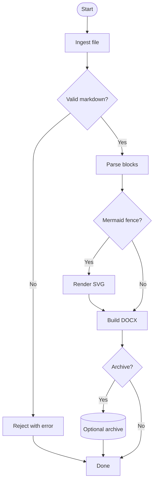

**Edge classification** (`FlowchartEdgeRouteClassifier` - by graph topology, not node display text):

| Edge (by node id) | `FlowchartEdgeSemanticRouteClass` |
| --- | --- |
| `Start→Ingest`, `Ingest→Validate`, `Validate→Parse`, `Parse→HasMermaid`, `Word→DoArchive`, `DoArchive→Persist`, `Persist→Done` | `CentreSpine` |
| `Validate→Reject` (labelled negative branch) | `LongExceptionRoute` |
| `HasMermaid→Render`, `HasMermaid→Word` | `LocalDecisionBranch` |
| `Render→Word`, `Reject→Done` | `MergeBack` |
| `DoArchive→Done` (labelled negative branch with `Persist` on spine between) | `SkipBypass` |

**Guide-point and render expectations:**

- **`Validate→Reject`:** five-point exterior corridor; corridor lane X left of `FlowchartSpineCorridorBounds.Left`.
- **`HasMermaid→Render`:** left diamond source port; **`HasMermaid→Word`:** bottom port.
- **`DoArchive→Persist`:** bottom port; **`DoArchive→Done`:** right port when `Persist` intervenes on the spine between `DoArchive` and `Done`.
- **`DoArchive→Done`:** six-point skip bypass; bypass chord outside spine column; rendered path clears unrelated node bodies (including the cylinder).
- **`Render→Word`:** six-point merge-back corridor; `Ports.PerpendicularAttach` on rendered SVG.

**TB two-way decision collinear negative-branch port rule** (`FlowchartDecisionPortAllocator.ResolveVerticalTwoWayDecisionPort`):

When a two-branch diamond has a collinear negative-branch target on the spine column:

- **No intervening spine-column node** → `SideLeft`. Reference pattern:

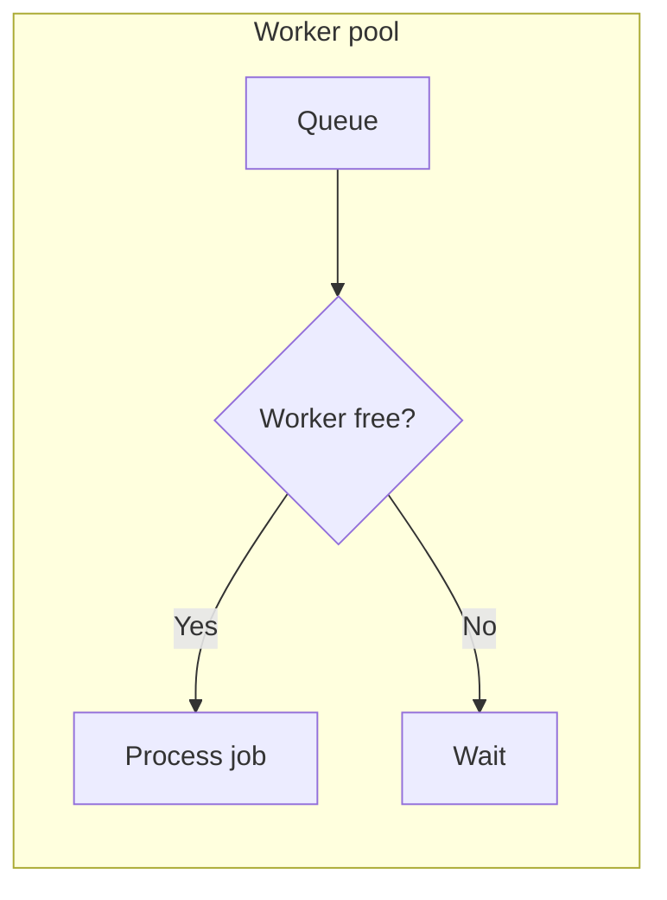

(`W→Wait` on the subgraph spine - left port.)

- **`HasInterveningSpineColumnNode` between source and negative target** → `SideRight` so skip-bypass routes around the obstacle (`DoArchive→Done` bypassing `Persist` in the integration diagram above).

**Corridor SVG policy** (`FlowchartCurvePathBuilder`): `ShouldUseOrthogonalPolylinePathData` applies only to `FlowchartEdgeRouteKind.RetryLoop`. Reference retry-loop topology:

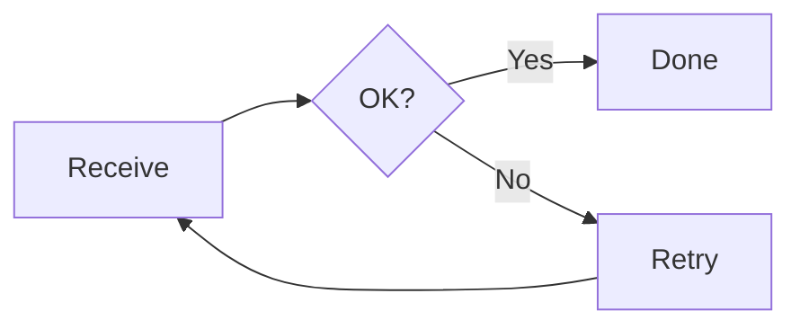


**Applicable rule axes** (when this topology is present): `Header.Flowchart`, `Direction.TB`, diamond and cylinder shape recognition, `Recognition.Edge.LabelPipeSyntax`, `Routing.LocalDecisionBranch`, `Routing.MergeBack`, `Routing.Class.LongBypass`, `Routing.Class.SkipBypass`, plus render rules for obstacle clearance, perpendicular attach, and no orthogonal polylines under default curveBasis.

### 5.6 Reference layout and routing contracts (structural patterns)

These are **structural patterns** verified by layout tests and the rule-validation harness. Implementation must use topology and route classification - not catalogue ids, scenario titles, or English branch labels.

#### Stadium terminal-collector merge

Two rect sources fan into one stadium (`End`) target. Used to gate coordinate parity against [mermaid.live](https://mermaid.live).

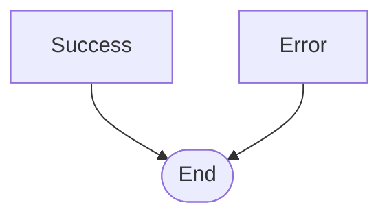

| Expectation | Implementation |
| --- | --- |
| Terminal-collector routing applies to stadium targets | `FlowchartTerminalCollectorPortAllocator.ShouldApplyTerminalCollectorRouting` |
| Each source exits from **centre-bottom** slot (vertical stub at source centre X) | `FlowchartEdgeRouteResolver` + port allocator |
| Each edge lands on the stadium **shoulder** (upper cap), not the top-centre slot | Target attach X offset from stadium centre; target Y above stadium centre |
| Rendered SVG path starts at centre source slot | `FlowchartSugiyamaSvgRenderer` + `FlowchartRenderedPathValidator` |

#### LR sibling subgraphs with cross-links

Three sibling TB subgraphs in an LR parent, spine cross-boundary edges, and a dotted labelled cross-link.

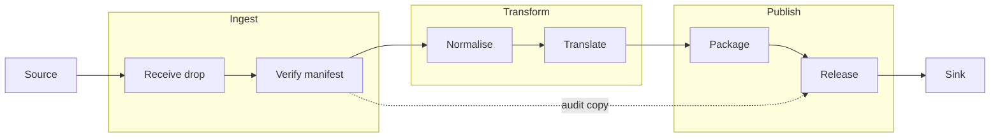

| Expectation | Implementation |
| --- | --- |
| Inner subgraph chains are vertically aligned (`I1`/`I2`, `T1`/`T2`, `P1`/`P2`) | Subgraph internal TB layout |
| Cross-boundary member rows share a **spine-aligned** centre Y across sibling subgraphs | `FlowchartSubgraphLayoutPostProcessor.AlignSiblingSubgraphCrossBoundaryRows` |
| Primary cross-group flow uses horizontal routing at aligned row centres | Layout post-processor + straight cross-boundary edges |
| Dotted cross-link routes via an **exterior corridor** that clears unrelated subgraph bodies | `FlowchartCrossSubgraphRouteHelper.ResolveCrossGroupGuideCenterX` |

#### Parallel subgraph columns

Two bare-titled parallel subgraph columns with external ingress and egress.

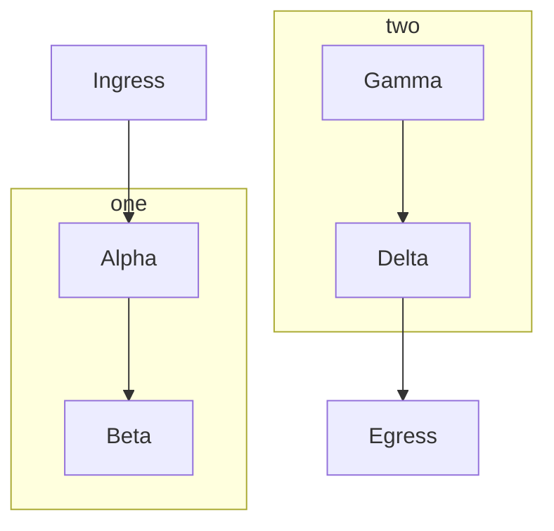

| Expectation | Implementation |
| --- | --- |
| Parallel columns align row centres across subgraphs | `FlowchartSubgraphLayoutPostProcessor.AlignParallelSubgraphColumns` |
| Horizontal gap between parallel columns preserved (minimum column separation) | Post-layout column alignment |

#### LR ampersand fan-in creation order

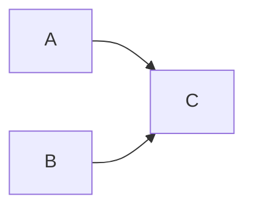

Expands to two edges; edge id `e1` applies to `A→C` only.

| Expectation | Implementation |
| --- | --- |
| First-declared source (`A`) stacks **above** second source (`B`) in LR fan-in | Creation-order vertical stacking in layout post-processor |
| Both sources sit left of target `C` on the LR primary axis | Standard LR rank assignment |

---

## 6. Mermaid-Inspired Architecture

The implementation should copy Mermaid's separation of concerns, not necessarily its code.

```text
source text
  -> lexical/parser events
  -> diagram database mutations
  -> normalised diagram contract
  -> layout input
  -> layout output
  -> SVG/render primitives
  -> DOCX embedding/export
```

The most important design move is the mutable diagram database. Source statements do not directly draw. They mutate facts:

```text
addVertex
addLink
addSubGraph
setDirection
addClass
setClass
updateLink
setClickEvent
setLink
setAccTitle
setAccDescription
```

Only after parsing should the system ask how to lay out and render.

Critical point: if recognition and rendering are coupled, every missing syntax path becomes a rendering bug. Keep them separate so unsupported render features can still be recognised, diagnosed, and tested.

---

## 7. Acceptance Criteria

### 7.1 Recognition Acceptance

For every Mermaid block, tests must compare the emitted contract against expected facts:

- diagram kind and direction
- node ids, labels, label types, shapes and classes
- group ids, titles, directions and parent/child relationships
- edge count after expansion
- edge ids, endpoints, arrows, stroke, minlen, labels and label types
- styles/classes/link styles/config/accessibility/interactions
- diagnostics for unsupported features

This must run independently of SVG/DOCX rendering.

### 7.1.1 Implementation-Critical Invariants (flowchart - must be locked first)

The following invariants apply to **flowchart / graph** kinds only. They are **implementation-critical** because they are observable in the contract and directly affect later mutations (especially `linkStyle`), metadata targeting, and auditability. Other diagram kinds have their own minimum fixtures (§11.1.13); Stage 11.A is not complete with flowchart alone.

These flowchart rules must be locked in verified contract fixtures before any **flowchart** routing or visual parity work claims correctness.

- **Edge expansion produces concrete edges**
  - Grouped and chained syntax must expand into the full set of edges. The recogniser must not store a grouped/chained link as a single edge-like object.
- **Edge creation order is stable and Mermaid-aligned**
  - Edge creation order is observable and must be recorded as a first-class fact (for example `EdgeContract.CreationIndex`).
  - `linkStyle <index>` targets edges by this order. If expansion order differs, style attaches to the wrong edge even when pictures look plausible.
- **Required expansion order fixtures**

```text
A --> B --> C
  edges: A->B, B->C

A & B --> C
  edges: A->C, B->C

A --> B & C
  edges: A->B, A->C

A & B --> C & D
  edges (order): A->C, A->D, B->C, B->D

A --> B & C --> D
  edges (order): A->B, A->C, B->D, C->D
```

- **Grouped user-defined edge id placement (`e1@-->`) is exact**
  - User-defined edge id is independent from endpoints.
  - When a grouped expansion has a user edge id, Mermaid applies that id to **only one** of the generated edges (the grammar-selected edge; documented in vendored Mermaid source). The remaining edges must receive auto-generated ids.
  - Duplicate user ids must not silently overwrite or collapse edges. If a user id is already used, later edges must still exist with generated ids and should be diagnosable.
- **`linkStyle default` versus indexed `linkStyle N` is modelled explicitly**
  - Default link style must be captured separately from indexed mutations.
  - Indexed link style must target edges by creation order (`CreationIndex`), not by incidental list position after later filtering, sorting, routing, or dummy-edge insertion.
- **Node identity merge rules are enforced**
  - Repeated node declarations must merge into one node with a preserved `Declarations[]` history, not duplicate nodes.
- **Subgraph membership uniqueness is enforced**
  - A node should have one effective parent group. Nested subgraphs must establish containment with ownership rules, not “append all descendants”.
- **Label types are preserved as contract facts**
  - `text` versus `string` versus `markdown` must be preserved because it affects sanitisation/escaping, measurement/wrapping, and downstream rendering behaviour.
- **Diagnostics and downgrade policy are non-optional**
  - Recognised-but-unsupported constructs must emit diagnostics (unknown and unsupported are different).
  - Silent loss (especially in DOCX export) is not acceptable.

### 7.1.2 Per-diagram recognition gates (authoritative)

Stage 11.A and all later work must be judged **per diagram kind**, not by a single global “recognition works” flag. Flowchart may be the **current phase target-state** (deepest gates first); every other kind in §3.18.2 still needs its own gate row before the programme is complete.

See **§7.4** (gate dimensions and levels) and **§11.1.14** (line-type catalogues). Implementation gate registry: [`currentstatus.md`](currentstatus.md).

### 7.2 Rendering Acceptance

Rendering tests may still use visual comparison, but only after recognition has passed.

Rendering comparison should include:

- node positions and dimensions
- group bounds
- edge paths and marker assignment
- label positions and wrapping
- resolved styles
- SVG viewBox
- raster output where DOCX embedding is involved

### 7.3 Downgrade Acceptance

If the DOCX path cannot preserve a recognised feature, it must emit a diagnostic.

Examples:

| Recognised feature | Acceptable downgrade |
| --- | --- |
| click callback | ignored in DOCX with diagnostic |
| href | converted to hyperlink if possible, else diagnostic |
| animation | ignored with diagnostic |
| unsupported shape | fallback shape with diagnostic, or hard failure if fidelity mode is strict |
| unsupported curve | fallback curve with diagnostic, or hard failure if fidelity mode is strict |

Silent loss is not acceptable.

### 7.4 Per-diagram gate dimensions and levels

Recognition quality is tracked on a **per diagram kind** grid. Each kind (§3.18.2) has its own gate record. Gates are independent of native render (Naiad); render gates are separate columns (§7.2, §7.4.2).

#### 7.4.1 Universal gate dimensions (every diagram kind)

These dimensions apply to **all** kinds. Kind-specific detail lives in the **line-type catalogue** (§7.4.3) and in §11.1.14.

| Gate | Code | What must be understood | Spec axes (§3) | Exit evidence |
| --- | --- | --- | --- | --- |
| **Detection** | G0 | Correct `Kind`, `Header`, detector id | §3.1 (kind-specific header rules) | Detector unit test + header fixture |
| **Configuration** | G1 | Leading `%%{init}%%` → `DiagramConfigContract` | §3.16, §4.1 | `config-init` or per-kind config fixture |
| **Line-type catalogue** | G2 | **Every** source line form named, classified, and mapped | §3.2, §7.4.3 | Markdown table in spec or `spec-gates/{kind}-line-types.md` |
| **Statement parse** | G3 | Each line type either produces contract facts or a diagnostic | §3.2 | Per-line-type fixture or grouped fixture |
| **Entity model** | G4 | Kind entities in contract (nodes, edges, messages, tasks, sections, …) | §3.3-§3.11, §4 | Verified JSON fields populated |
| **Containment** | G5 | Groups, nested scopes, participants, boundaries, … | §3.10-§3.11 | Membership / parentage fixtures |
| **Styles & mutations** | G6 | `style`, `classDef`, `class`, `:::`, kind-specific style directives | §3.12 | Style mutation fixtures |
| **Metadata extensions** | G7 | `@{ ... }`, kind-specific shape/data blocks | §3.13 | Metadata fixtures |
| **Interactions** | G8 | `click`, href, tooltips, kind-specific links | §3.14 | Interaction fixtures + downgrade diagnostics |
| **Accessibility** | G9 | `accTitle`, `accDescr`, diagram title | §3.15 | Accessibility fixtures |
| **Diagnostics discipline** | G10 | No silent drop; `unknown` vs `unsupported` vs `kind-not-implemented` | §4.6, §7.3 | Negative fixtures |
| **Contract fixtures** | G11 | Machine-readable expected output | §7.1, §9 | `*.verified.json` per gate cluster |
| **Mermaid parity** | G12 | Subset of vendored parser tests transcribed | §3.18, upstream `*.spec.js` / `*.spec.ts` | the G12 minimum slice - minimum L4 slice rows **transcribed** |
| **Native render smoke** | R0 | Legacy Naiad can render minimal sample (comparison only) | - | Existing `*Tests.cs` or documented N/A |
| **Native render fidelity** | R1 | Visual/coordinate gates for native path | §7.2, `flow.md` | SvgHarness / coordinate tests |

**Rule:** A kind cannot advance to level **L3** unless **G2 (line-type catalogue)** is written and **G3** covers every listed line type (parse or explicit diagnostic).

#### 7.4.2 Gate levels (per kind)

| Level | Name | Recognition requirements | Typical use |
| --- | --- | --- | --- |
| **L0** | Detect | G0 only | Kind appears in detector tests |
| **L1** | Smoke | G0, G1, G10, G11 (one minimal fixture) | Stage 11.A **minimum** row in §11.1.13 |
| **L2** | Catalogue | L1 + **G2 complete** + G3 for all line types | “We understand every line form” |
| **L3** | Axis-complete | L2 + G4-G9 per §8 matrix for that kind | Kind ready for render adapter work |
| **L4** | Parser parity | L3 + G12 | Matches agreed Mermaid 11.14 facts |
| **R1** | Native render | L3 + native adapter (+ R0 legacy compare where useful) | Product embedding; separate from L4 |

**Target depth by kind (normative programme phasing):**

```text
Flowchart:  L3 (G2-G11) minimum for Stage 11.A exit; L4 (G12) for parser parity with pinned Mermaid
Wave kinds (sequence, class, state, ER):  L3 (G4-G9) before render adapter work; L4 when G12 required
Secondary kinds (pie, gantt, mindmap, gitGraph, …):  L1 minimum (Stage 11.A); L2 catalogue before L3
```

Stage 11.A **recognition exit:** every kind in §3.18.2 at gate **L1** minimum; flowchart at **L3** on G2-G11 (§7.4.2, §11.1.14.1). Deeper levels (L4, wave L3+) are programme targets tracked in [`currentstatus.md`](currentstatus.md).

#### 7.4.3 Line-type catalogue (required per kind)

A **line type** is one recognisable grammatical form in source text (after init stripping), not a visual scenario. Examples:

- Flowchart: `link_statement`, `subgraph_start`, `classDef_line`, `accDescr_block`, …
- Sequence: `participant_line`, `message_arrow`, `activate_line`, `alt_block_start`, …
- Gantt: `section_line`, `task_line`, `dateFormat_directive`, …

Each kind’s catalogue must list:

| Column | Meaning |
| --- | --- |
| **Line type id** | Stable snake_case id (e.g. `flowchart.link.chained`) |
| **Example source** | Minimal line or block |
| **Produces** | Contract path(s) affected |
| **Mermaid reference** | Vendored file:line or parser rule name |
| **Gate status** | `parsed`, `diagnostic`, `not-implemented` |
| **Diagnostic code** | If not fully parsed |
| **Fixture** | Path to `.mmd` / `.verified.json` |

Catalogues may live in this spec (for flowchart exemplar) or in `spec-gates/{kind}-line-types.md` merged by tooling later. They are **normative**: if a line appears in user diagrams but not in the catalogue, that is a spec bug.

#### 7.4.4 Cross-cutting aspects (styles, config, comments)

These cut across line types and must appear in **every** kind’s gate record where Mermaid supports them:

| Aspect | Recognition requirement | Gate |
| --- | --- | --- |
| **Comments** | `%%` lines are never model facts | G3 |
| **Init blocks** | Leading and inline policy documented per kind | G1 |
| **Theme / look** | Flattened keys in `EffectiveValues` when applicable | G1 |
| **classDef / class / style** | Where grammar exists for that kind | G6 |
| **Indexed styles** | e.g. `linkStyle N`, gantt task classes - creation order rules documented | G6 |
| **HTML / markdown labels** | `labelType` preserved | G4 |
| **Unicode & quoting** | No scenario-specific handling | G4 |
| **Semicolon / newline** | Statement boundaries (§3.2) | G3 |

---

## 8. Replacement for Scenario Thinking

Instead of maintaining only scenario names, maintain a capability matrix keyed by axes.

Example:

```text
Header:
  graph
  flowchart
  flowchart-elk

Direction:
  TB
  TD -> TB
  BT
  LR
  RL
  symbolic

Vertex:
  id-only
  label
  quoted-label
  markdown-label
  shape-bracket
  shape-metadata
  repeated-declaration

Edge:
  token decomposition
  chain expansion
  grouped expansion
  user id
  label
  metadata
  minlen

Group:
  title-only
  id-title
  nested
  local direction
  membership uniqueness

Mutation:
  style
  classDef
  class
  inline class
  linkStyle
  interpolate
  click
  href
  init
```

Then keep `flow.md` as one fixture file that samples combinations from this matrix. Do not let it become the matrix.

---

## 9. Minimum Next Fixtures

Add or generate fixtures that are not named after scenarios but after capability axes:

```text
recognition-edge-expansion.md
recognition-edge-identity.md
recognition-shape-metadata.md
recognition-style-mutations.md
recognition-subgraph-membership.md
recognition-interactions.md
recognition-accessibility.md
recognition-config.md
recognition-errors.md
```

Each fixture should have expected contract output in a machine-readable form.

Markdown examples alone are not enough. They are input, not expected truth.

### 9.1 Per-kind regression catalogues (visual + recognition smoke)

Parallel to **`flow.md`** (flowchart F01-F88), each major diagram kind needs a progressive Markdown catalogue for **SvgHarness** visual gates, **DOCX** review, and cross-reference to **`*.verified.json`** recognition fixtures. These files sample axes from §11.1.14.x; they are **not** the recognition specification.

| Catalogue file | Diagram kind | Scenario ids | Spec line types | Recognition fixtures |
| --- | --- | --- | --- | --- |
| [`flow.md`](../flow.md) | Flowchart / graph | F01-F88 (+ F53A) | §11.1.14.1 | `FlowchartRecognition/` |
| [`sequence.md`](sequence.md) | Sequence | S01-S32 | §11.1.14.2 | `SequenceRecognition/` |
| [`class.md`](class.md) | Class | C01-C35 | §11.1.14.3 | `ClassRecognition/` |
| [`entityrelationship.md`](entityrelationship.md) | ER | E01-E35 | §11.1.14.5 | `ErRecognition/` |
| [`state.md`](state.md) | State | ST01-ST27 | §11.1.14.4 | `StateRecognition/` |
| *(pending - `pie.md`)* | Pie | - | §11.1.14.6 | `PieRecognition/` |
| *(pending - `gantt.md`)* | Gantt | - | §11.1.14.7 | `GanttRecognition/` |
| *(pending - `mindmap.md`)* | Mindmap | - | §11.1.14.8 | `MindmapRecognition/` |
| *(pending - `gitgraph.md`)* | Git graph | - | §11.1.14.9 | `GitGraphRecognition/` |

Fixture counts and gate levels: [`currentstatus.md`](currentstatus.md).

**SvgHarness pattern (substitute catalogue path):**

```powershell
dotnet run --project src/SvgHarness/SvgHarness.csproj -c Release -- sequence.md out/sequence-mermaid-ink --reference=mermaid-ink --report=out/sequence-mermaid-ink/report.md
```

**Rules:**

- Every new scenario id must map to a line-type row in the kind’s §11.1.14 catalogue (add the row first if missing).
- Prefer adding a matching `*Recognition/*.mmd` + `.verified.json` when the axis is recognition-critical.
- Naiad (`extern/Naiad`) is a **legacy comparison baseline** only (§12); catalogues must remain valid for **native render** without Naiad parser changes.

#### Scenario vs recognition fixture (terminology)

These terms are **not interchangeable** in this programme:

| Term | Where it lives | Id / naming | Purpose |
| --- | --- | --- | --- |
| **Scenario** | Catalogue Markdown (`sequence.md`, `class.md`, `flow.md`, …) | Numbered ids: S01, C35, F86, E19, … | Progressive regression catalogue for **visual** gates (SvgHarness, DOCX review) and human-readable coverage index. **Not** the recognition specification. |
| **Recognition fixture** | `tests/MermaidRecognition.Tests/*Recognition/` | Capability names: `simple`, `relation-cardinality`, `config-front-matter`, … | **Machine-testable** recognition truth: `name.mmd` input + `name.verified.json` expected `DiagramContract`. Used by `dotnet test` and gate manifests. |

**Relationship:**

- Catalogue **scenario index** tables include a **Recognition fixture** column mapping each active scenario id to zero or one fixture name.
- **Catalogue back-fill 100%** means every **non-remarked** scenario id has that column filled (remarked ids such as C24, ST19, E10, F88 intentionally show `-` for render exclusion but may still have a recognition fixture elsewhere).
- Fixture count may **exceed** scenario count when extra axis-combination fixtures exist (e.g. sequence `arrow-variants` alongside S07/S08).
- **L3 complete** for a kind means fixtures pass contract tests and G4-G9 axis gates - not that SvgHarness or DOCX render parity is done.

**Authority:** line-type catalogues in §11.1.14.x define what recognition must parse; `.verified.json` files hold expected output; catalogue scenarios are **samples** that should align with those axes.

#### Remarked scenarios (`%%`)

When a diagram **does not render** on [mermaid.live](https://mermaid.live) or is otherwise **rejected for the render gate**, keep the scenario **heading and section** in the catalogue file but prefix **every line** of the diagram source inside the ` ```mermaid ` fence with **`%%`**.

Implementation: `MermaidRemarkAnalyzer` in `MermaidRecognition` classifies remark semantics; `DiagramContract.RemarkStatus` is `CatalogueRemarked` when every non-empty line is a full-line remark. SvgHarness skips such blocks (reported as **SKIP**). Catalogue-remarked source is still parsed via unremarked shadow text for recognition-only axes (§9.1).

**Rule validation harness (`RuleValidationHarness`):** `ActualResultsGenerator` sets `IsFullyRemarked: true`, `ParserSucceeded: true`, `LayoutSucceeded: false`, and diagnostic `RemarkedScenario` when every fence line is `%%`. `RulesEngine` (`MermaidRecognition.RuleValidation`) assigns **`Result: Skipped`** and does **not** evaluate `ruleset.json` rules for that diagram. Skipped diagrams do **not** increment `ErrorCount` and do **not** fail `OverallResult: Pass`. Fully remarked source (every line prefixed `%%`) is skipped regardless of which Markdown catalogue file contains it. Command:

```powershell
dotnet run --project src/RuleValidationHarness/RuleValidationHarness.csproj -c Release -- flow.md out/flow-rule-validation "Rule Specification"
```

**Native layout and routing pipeline** (feeds `actual-results.json`):

```text
flow.md fenced blocks
  → MermaidMarkdownFenceExtractor (remark detection)
  → MermaidRecognizer.Parse → DiagramContract
  → FlowchartSugiyamaLayoutEngine.TryLayout → FlowchartLayoutResult
  → FlowchartEdgeRoutingIntentAnalyzer + FlowchartEdgeRouteDiagnosticAnalyzer
  → FlowchartSugiyamaSvgRenderer (rendered-path facts for SVG rules)
  → actual-results.json
  → RulesEngine (ruleset.json + evaluator-map.json + expected-contract.json)
  → validation-report.json
```

Implementation packages: `src/MermaidRecognition.RuleValidation/` (engine + evaluators), `src/MermaidRecognition.Layout/` (Sugiyama layout, structural routing, SVG render), `src/RuleValidationHarness/` (CLI). Specification inputs live under `Rule Specification/`. Full rule-validation build specification: [`Rule Specification/Mermaid_Flowchart_Rule_Validation_Specification.md`](../Rule%20Specification/Mermaid_Flowchart_Rule_Validation_Specification.md).

**Regenerating `ruleset.json`:** edit the human-maintained catalogue overlay [`Rule Specification/ruleset-org.json`](../Rule%20Specification/ruleset-org.json) (per-scenario `RequiredGenericRuleIds`, `RenderGate`, recognition axes). Then run:

```powershell
powershell -File "Rule Specification/Build-Ruleset.ps1"
```

`Build-Ruleset.ps1` merges `ruleset-org.json` generic-rule descriptions with the universal rule templates in the build script and writes [`Rule Specification/ruleset.json`](../Rule%20Specification/ruleset.json) (schema v2.0.0). Commit `ruleset-org.json` and regenerated `ruleset.json` together when scenario rule bindings change. `evaluator-map.json` and `expected-contract.json` are maintained separately by the implementation team.

| Intent | Meaning |
| --- | --- |
| **Considered but rejected** | The axis was evaluated and deliberately excluded from official Mermaid render. **Do not re-add** the same scenario because the catalogue looks incomplete or because SvgHarness skipped an empty block. |
| **Excluded from render gates** | SvgHarness, mermaid.ink comparison, and DOCX visual review apply only to **active** (non-remarked) diagrams. |
| **Recognition may still apply** | Spec line types and `*Recognition/` fixtures may track the axis separately; remarking is **not** a signal that recognition was abandoned. |

**Do not confuse with:**

- `%%{init: ...}%%` on its own line - an **active** Mermaid init directive (e.g. F53, S24, C35, E35), not a remark of the whole diagram.
- A single `%%` comment line inside an otherwise **active** diagram - valid Mermaid inline comment syntax.

**Catalogue status column:** index tables should mark remarked ids (e.g. **remarked** in the topic/line-type column). Maintain a **Currently remarked** list in each catalogue’s *How to use* section.

**Known remarked ids (render gate excluded):**

| Catalogue | Scenario ids | Reason (summary) |
| --- | --- | --- |
| [`flow.md`](../flow.md) | Fully remarked blocks (see examples below) | `RenderGate: ExcludedRemarkedScenario` in `ruleset-org.json`. Axes include metadata shapes (`Doc@{ shape: doc }`), semicolon/comment statement boundaries, edge `e1@{ animate: true }`, and `classDef` animation on edge id. All rejected or non-renderable on mermaid.live; rule harness **Skipped**, not Fail. |

**Remarked source examples (recognition axes only - not layout/routing evaluated):**

```mermaid
%% flowchart LR
%% Doc@{ shape: doc }[Document]
```

```mermaid
%% flowchart TD
%% A[Receive]; --> B[Validate] %% hand-off
```

```mermaid
%% flowchart LR
%% A e1@==> B
%% e1@{ animate: true }
```

```mermaid
%% flowchart LR
%% A e1@--> B
%% classDef animate stroke-dasharray:9,5,...;
%% class e1 animate
```
| [`sequence.md`](sequence.md) | *(none yet)* | - |
| [`class.md`](class.md) | C24 | `cssClass` directive does not render on mermaid.live |
| [`entityrelationship.md`](entityrelationship.md) | E10 | Entity alias syntax does not render on mermaid.live |

**L2 line-type catalogues (spec only - no visual catalogue Markdown yet):** pie §11.1.14.6, gantt §11.1.14.7, mindmap §11.1.14.8, git graph §11.1.14.9. Add `pie.md`, `gantt.md`, `mindmap.md`, `gitgraph.md` when render-gate priority arrives. **`state.md`** and the four wave catalogues above are published.

---

## 10. Bottom Line

The hard problem is not recognising "a flowchart scenario".

The hard problem is recognising a stream of declarations and mutations that together define a diagram. Mermaid's source strongly supports this model: parse text into a graph database, normalise it into nodes/edges/groups/styles/config, then render.

`flow.md` should remain a regression catalogue. It should not become the specification for recognition.

The specification for recognition must be the compositional contract above, tested axis-by-axis and combination-by-combination. Anything else will look complete right up until an ordinary Mermaid diagram combines two unsupported axes and slips straight through the cracks.

---

## 11. Migration architecture and implementation plan

Section 11 specifies **target architecture**, **stage exit criteria**, and **file-level work** for Mermaid-aligned **recognition** (`src/MermaidRecognition`) and **native render** from `DiagramContract`. Implementation progress is tracked in [`currentstatus.md`](currentstatus.md), not in this section.

**Legacy Naiad policy (normative):** `extern/Naiad` is **frozen**. It is **not** a product render option and must **not** receive new parsers, layout features, or programme-driven fixes. Use legacy Naiad output **only** when comparing against native render (SvgHarness, DOCX review, §12 baseline). The product path is **recognition → native render in `src/`** (or §11.E official Mermaid fallback).

This plan is derived from:

- Mermaid 11.14.0 source behaviour, especially the flowchart parser/database tests.
- The current modified Naiad source tree, which already renders `flow.md` with acceptable visual parity.
- Known gaps observed while comparing Naiad behaviour against Mermaid parser/render expectations.

It is not a speculative design document. Claims in this section should be traceable to those sources or marked `provisional`, `unknown`, or `not-native`.

### 11.1 Compatibility Pin, Evidence, and Phasing

Target Mermaid compatibility:

```text
Mermaid package version: 11.14.0
Vendored source commit: 1bb6ba52937c21999e9ac89d11b82b0c56fd2739
Vendored source state: clean
Minimum feature context: edge-level curve styling via edge ids exists in Mermaid v11.10.0+
```

All parser-contract expectations must be derived from this vendored Mermaid version unless explicitly marked `future`, `unknown`, or `not-native`. If the vendored Mermaid source changes, the recognition fixtures and this pin must be updated together. Operational pin state (clean vs dirty baseline) is recorded in [`currentstatus.md`](currentstatus.md).

Baseline evidence table:

| Claim | Evidence | File | Method/area | Test/grep |
| --- | --- | --- | --- | --- |
| Routing currently branches on English decision labels | `StartsWith("Yes"` and `StartsWith("No"` are present | `extern/Naiad/src/Naiad/Layout/CoordinateAssignment.cs` | `TryGetFlowchartHorizontalDecisionBranchEndpoints` | Label-invariance test should fail before migration |
| Renderer also has label-semantic handling | `StartsWith("Yes"` and `StartsWith("No"` are present | `extern/Naiad/src/Naiad/Diagrams/Flowchart/FlowchartRenderer.cs` | decision label rendering/curve handling area | Static grep gate |
| Routing contains fixture-shaped helpers | `IsFlowchartTbStadiumDualFanInMergeTarget`, `IsFlowchartTbStadiumTerminalCollectorTarget` | `CoordinateAssignment.cs`, `FlowchartRenderer.cs` | stadium/terminal collector routing | Route-kind migration table |
| Code comments encode fixture identities | comments reference `F53`, `F58`, etc. | `CoordinateAssignment.cs` | constants and helper comments | Allowed in comments; not allowed as active selector names long term |
| Current parser is thinner than Mermaid parser facts | no edge id, label type, metadata DTO, grouped edge expansion contract | `FlowchartParser.cs`, `Node.cs`, `Edge.cs`, `FlowchartModel.cs` | parser/model | Stage 11.A recognition JSON |
| Config is init-only on render path | Naiad `DiagramBase.Config` holds init overrides only | `DiagramBase.cs`, `Mermaid.cs` | `MermaidRecognition.DiagramConfigContract` | Stage 11.A in MermaidRecognition |

Migration risk register:

| Risk | Mitigation |
| --- | --- |
| Parser drift from Mermaid | Pin Mermaid version; derive fixtures from upstream parser tests or parser dump. |
| Visual parity regression | Compare native render against legacy baseline (§12) until SvgHarness/coordinate gates pass; do not extend Naiad for parity fixes. |
| Fallback security | Use local pinned official Mermaid only; no default network rendering; sandbox callbacks. |
| Performance regression | Add parser/render timing budgets before enabling the new path by default. |
| Public API breakage | Add recognition fields without removing existing render fields; use feature flags. |

Performance acceptance criteria:

```text
Recognition parser: must parse flow.md plus recognition fixtures within an agreed local budget before default enablement.
Native rendering: must not regress current flow.md render time by more than an agreed threshold.
Fallback rendering: must record timing and renderer version; fallback must be opt-in or policy-controlled.
```

Phasing:

This section describes the future state as a **native render** build in `src/`, not a Naiad migration. Legacy Naiad may supply comparison baselines only (§12).

Use these stages:

| Stage | Goal | Exit criterion |
| --- | --- | --- |
| 11.A | **Multi-kind** recognition contract and parser facts | Every diagram kind in §3.18.2 is **detected** and parsed to `DiagramContract` (or emits structured diagnostics); per-kind verified fixtures pass. **Complete.** |
| 11.B | Native flowchart routing - no label semantics | Static gate proves routing does not read edge label text; label-invariance tests produce the same port roles for empty, English, numeric, unicode, and long labels. Implemented in **`src/`**, not `extern/Naiad`. |
| 11.C | Native `FlowchartRouter` strangler | Router handles one route kind at a time; legacy Naiad output used **only** for comparison until each topology class passes SvgHarness gates. |
| 11.D | Shrink scenario-specific layout code | Native layout/router code is structural; no English-label or scenario-name predicates. |
| 11.E | Fallback and diagnostics | `CanRender` wired into MDConverter with strict/pragmatic modes; official Mermaid fallback where native render unavailable. |

Stage 11.A is the immediate priority and the only stage that should start now:

```text
Build multi-kind recognition: detect every Mermaid diagram family (§3.18.2), parse to DiagramContract
(or diagnostics), and lock behaviour with verified JSON per kind - without changing the default render path.
```

**Scope (normative):** Stage 11.A is **multi-kind**, not flowchart-only. Flowchart recognition in `src/MermaidRecognition/Kinds/Flowchart/` is **slice 1** (deepest path). Every diagram kind in §3.18.2 must reach at least **L1** before Stage 11.A recognition exit. See §11.1.13.

Stage 11.A config deliverable (§4.1): `DiagramConfigContract` with `RawDirectiveValues` and `EffectiveValues` (flat dotted keys per diagram instance). Full default merge from vendored Mermaid schema is required before recognition JSON is authoritative; implemented in **`src/MermaidRecognition`**, not Naiad.

The parser contract can be made much stronger without disturbing the current renderer. Stage 11.C is deliberately incremental: every old helper must either be mapped to a structural route kind, retained temporarily as `Legacy*`, or deleted only after parity is proven.

### 11.1.2 Reference model: how official Mermaid handles flowcharts

Mermaid does **not** draw from the text in one step. It builds an in-memory **diagram database** (`flowDb`), then lays out, then renders. That separation is the reference for **native render** in this programme - not for extending legacy Naiad.

Official documentation: [Flowcharts syntax](https://mermaid.js.org/syntax/flowchart.html) (Mermaid 11.x).

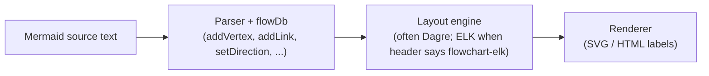

**Source of truth in this repo (vendored Mermaid 11.14.0):**

| Responsibility | File (under repo root) |
| --- | --- |
| Diagram database (`addVertex`, `addLink`, `setDirection`, styles) | `mermaid/packages/mermaid/src/diagrams/flowchart/flowDb.ts` |
| Parser grammar (JISON) | `mermaid/packages/mermaid/src/diagrams/flowchart/parser/flow.jison` |
| Behaviour tests (edge expansion, chaining) | `mermaid/packages/mermaid/src/diagrams/flowchart/parser/flow-vertice-chaining.spec.js` |
| Grouped links + edge ids (`A & B e1@--> C & D`) | `mermaid/packages/mermaid/src/diagrams/flowchart/parser/flow-node-data.spec.js` (lines 347-362) |
| Edge id on grouped links (implementation rule) | `flowDb.ts` - `addLink` (see comment at lines 349-360) |
| Symbolic directions `<` `>` `^` `v` | `flowDb.ts` - `setDirection` (lines 436-449) |

**Grouped node expansion (Cartesian product)** - when the user writes `A & B --> C & D`, Mermaid creates **four** edges, not one “fan” object:

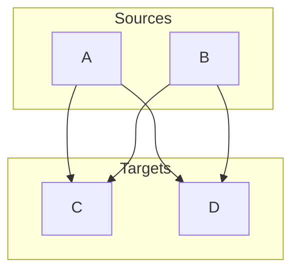

Verified by upstream test `A & B --> C` (two edges) in `flow-vertice-chaining.spec.js` (lines 38-58). The full `A & B --> C & D` expansion (four edges) and `A & B e1@--> C & D` (six edges; user id `e1` on **B→C** only) are exercised in `flow-node-data.spec.js` and `flow-vertice-chaining.spec.js`. Naiad must lock the same facts in verified JSON (§11.12) **before** they are treated as authoritative.

**User-defined edge id on a group** - Mermaid applies the user id only to **one** generated edge in a group (last source × first target in the cross product). This is **confirmed in source**, not guessed (`mermaid/packages/mermaid/src/diagrams/flowchart/flowDb.ts`, `addLink`, lines 349-360):

```typescript
// for a group syntax like A e1@--> B & C, only the first edge should have a userDefined id
// the rest of the edges should have auto generated ids
for (const start of _start) {
  for (const end of _end) {
    const isLastStart = start === _start[_start.length - 1];
    const isFirstEnd = end === _end[0];
    if (isLastStart && isFirstEnd) {
      this.addSingleLink(start, end, linkData, id);
    } else {
      this.addSingleLink(start, end, linkData, undefined);
    }
  }
}
```

Naiad must reproduce this rule in Stage 11.A and tag the result in verified JSON. Until Naiad tests pass, treat the table row for `A & B e1@--> C & D` as `implementation-critical-unverified` in §11.5.

**Why edge order matters:** `linkStyle 0` and `linkStyle default` refer to edges by **creation order** in the database. If Naiad expands `&` differently from Mermaid, styles attach to the wrong arrows even when the picture “looks fine”.

### 11.1.4 Target behaviour after migration

The target is **not** “rewrite SVG from scratch.” It is:

1. **Parse** into a contract as complete as practical (Mermaid-aligned facts + diagnostics).
2. **Layout** with Dagre (unchanged engine family for this migration).
3. **Route** edges using **structure** (topology, shape, direction, ports)-§11.7-11.9 are **Naiad-native routing strategies**, not copies of `flowDb` fields.
4. **Render** with existing curve/marker/label code where possible.

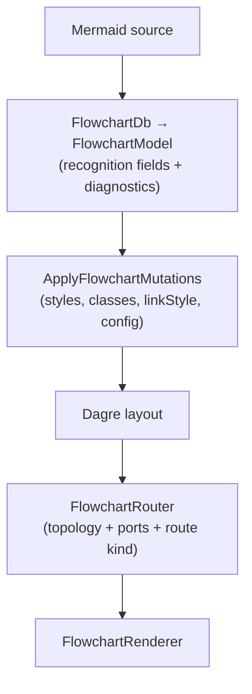

**Target components (architecture):**

| Piece | Role | Where specified |
| --- | --- | --- |
| `FlowchartDb` parse database | Mermaid-aligned statement accumulation (edge expansion, subgraph stack, linkStyle list) | §11.5, §11.11 |
| `DiagramContract` / `NodeContract` / `EdgeContract` | Recognition output DTOs | §4, §11.1.8, `src/MermaidRecognition` |
| Naiad render models (`Node`, `Edge`) | Legacy render path only | Unchanged unless adapter maps from contract |
| `FlowchartRouter.cs` | Structural route classification (Stage 11.C) | §11.8, §11.11 |
| `*Recognition/*.verified.json` | Machine-readable contract expectations | §11.12 |
| `UseFlowchartRecognitionParser` | Feature flag; default **off** until gates pass | `MarkdownToDocxOptions.Mermaid` |
| `ContractToFlowchartModel` adapter | Maps `DiagramContract` → Naiad `FlowchartModel` (flowchart) | `src/MermaidRecognition.NaiadAdapter/` |

Implementation status of each component: [`currentstatus.md`](currentstatus.md).

### 11.1.7 Recognition vs rendering vs routing (three layers)

Project managers often conflate “parse”, “layout”, and “draw”. This project treats them separately:

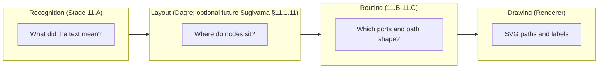

| Layer | Question it answers | Wrong approach |
| --- | --- | --- |
| Recognition | How many edges after `A & B --> C`? What is edge id `e1`? | Guessing from PNG |
| Layout | Rank and node positions | Hard-coding F05 as a special case |
| Routing | Which side of the diamond, loop outside cluster | Reading `"Yes"` on the label |

### 11.1.8 Assembly boundaries (recognition vs legacy render)

Stage 11.A and all new Mermaid recognition work live in a **separate project**, not in Naiad.

| Project | Path | Responsibility | References |
| --- | --- | --- | --- |
| **MermaidRecognition** | `src/MermaidRecognition/MermaidRecognition.csproj` | Parse Mermaid source → `DiagramContract` (+ config, diagnostics). No Dagre, no SVG, no OpenXML. | BCL only |
| **MermaidRecognition.Tests** | `tests/MermaidRecognition.Tests/` (fixtures in `FlowchartRecognition/`) | Verified JSON / contract fixtures (§7.1, §11.12) | MermaidRecognition |
| **Naiad** (legacy) | `extern/Naiad/src/Naiad/Naiad.csproj` | Existing parse → layout → SVG for default DOCX path. **Frozen** except bugfixes and adapter glue. | Must not be required to build recognition tests |
| **MDConverter** (legacy) | `src/MDConverter/` | Markdown → DOCX; orchestrates recognition + render + fallback (§11.10) | MermaidRecognition + Naiad (adapter TBD) |

Dependency rule: **MermaidRecognition must not reference Naiad.** Naiad may reference MermaidRecognition only for an explicit adapter (`ContractToFlowchartModel`) behind a feature flag; that adapter is Stage 11.A exit glue, not new recognition logic inside Naiad.

### 11.1.8.2 Repository layout (`src` vs legacy)

Recognition library and tests live under **`src/`** (`MermaidRecognition`, `MermaidRecognition.Tests`, `MermaidRecognition.NaiadAdapter`), separated from legacy `src/` MDConverter and `extern/Naiad`. See [`currentstatus.md`](currentstatus.md) for layout notes.

| Tree | Role | Do not add here |
| --- | --- | --- |
| `src/MermaidRecognition/` | Recognition library by **aspect** (`Core/`, `Contract/`, `Config/`, `Detection/`, `Diagnostics/`, `Kinds/*`) | Legacy DOCX, Naiad types, SVG layout, fixture `.mmd` files |
| `tests/MermaidRecognition.Tests/` | Recognition-only tests + `FlowchartRecognition/*.verified.json` | MDConverter integration tests |
| `src/MDConverter/`, `src/md2docx/`, `Converter/` | **Legacy** product pipeline | New recognition parsers or contract DTOs |
| `tests/MDConverter.Tests/` | **Legacy** tests | New §7.1 / §11.12 contract fixtures |
| `extern/Naiad/` | **Legacy** render stack | New recognition logic (adapter glue only) |

Solution file `MDConverter.slnx` groups projects under `/legacy/` and `/src/` folders. Build recognition in isolation:

```powershell
dotnet build src/MermaidRecognition/MermaidRecognition.csproj
dotnet test tests/MermaidRecognition.Tests/MermaidRecognition.Tests.csproj
```

See also `src/MermaidRecognition/README.md`.

### 11.1.9 Code reference map (quick navigation)

| Topic | MermaidRecognition (new) | Naiad (legacy render) | Mermaid 11.14 (vendored) |
| --- | --- | --- | --- |
| Recognition contract | `src/MermaidRecognition/Contract/DiagramContract.cs`, `NodeContract.cs`, `EdgeContract.cs` | N/A | `flowDb.ts` facts |
| Config (§4.1) | `DiagramConfigContract.cs`, `MermaidJsonConfigFlattener.cs` | `DiagramBase.Config` (init overrides only, render path) | `config.ts`, `config.schema.yaml` |
| Parse flowchart (target) | `src/MermaidRecognition/Kinds/Flowchart/` (FlowchartDb, parser - §11.11) | `FlowchartParser.cs` (legacy, default render) | `flowchart/parser/` + `flowDb.ts` |
| Layout | N/A (recognition); Naiad `DagreLayoutEngine.cs`; optional future MSAGL Sugiyama (§11.1.11) | `Layout/DagreLayoutEngine.cs` | `flowRenderer-v3-unified.ts` |
| SVG / curves | N/A | `Diagrams/Flowchart/FlowchartRenderer.cs` | `diagrams/flowchart/` |
| Public render API | N/A | `Mermaid.cs` | N/A |
| Regression catalogue | `tests/MermaidRecognition.Tests/FlowchartRecognition/*.verified.json` | `flow.md` visual gate | `mermaid/.../parser/*.spec.js` |
| DOCX pipeline | `src/MDConverter/` (orchestration) | via adapter when enabled | N/A |
| Visual gate tool | N/A | `src/SvgHarness/Program.cs` | [Mermaid Live Editor](https://mermaid.live) |

**Online references (external):**

- [Mermaid flowchart syntax](https://mermaid.js.org/syntax/flowchart.html)
- [Mermaid configuration / `%%{init}%%`](https://mermaid.js.org/config/configuration.html)
- [Edge IDs and curve (v11.10+)](https://mermaid.js.org/syntax/flowchart.html) - see “Attaching an ID to Edges”
- [Dagre layout](https://github.com/dagrejs/dagre) - same family Naiad already uses; Mermaid default for `flowchart` / `graph`
- [MSAGL layered (Sugiyama)](https://github.com/microsoft/automatic-graph-layout) - potential native C# Dagre replacement (§11.1.11; local MIT sources under `3rd Party/Microsoft.AGL/.../Layout/Layered/`)
- [ELK layout](https://eclipse.dev/elk/) - used by Mermaid for `flowchart-elk` only; vendored adapter `mermaid/packages/mermaid-layout-elk/` (MIT, §11.1.11.2); **not** Naiad’s current engine (§11.1.10)

### 11.1.10 ELK and `flowchart-elk` (explicitly deferred)

Mermaid supports a separate header form, `flowchart-elk`, that uses the **Eclipse Layout Kernel (ELK)** instead of Dagre for layout. That is a different layout engine with different routing behaviour.

| Topic | Mermaid.js | Naiad (this repo, verified) |
| --- | --- | --- |
| Default `flowchart` / `graph` | Dagre-based layout in practice | Dagre via `DagreLayoutEngine.cs` |
| `flowchart-elk` | ELK-based layout | **Not supported** - no ELK integration under `extern/Naiad` |
| Naiad ER / other diagrams | N/A | Separate parsers; no ELK dependency found in flowchart path |

**Migration decision (locked for this plan):**

1. **Stage 11.A** targets **recognition for all diagram kinds** (§3.18.2, §11.1.13) - **complete** for started kinds at L4 minimum. **Stages 11.B-E** target **native flowchart render** from `DiagramContract` in `src/` (ordinary `flowchart` / `graph` headers). Optional **MSAGL Sugiyama** layout may be adopted on the native path after routing gates (§11.1.11.1). **Do not** extend legacy Naiad for these stages.
2. If the parser sees `flowchart-elk`, it should still **recognise** the header and emit diagnostic `flowchart.elk-not-native` (see §11.15).
3. **Do not** schedule ELK porting, ELK routing, or ELK parity work during Stages **11.A-11.E** baseline migration. ELK remains a **future** programme after Dagre-path recognition and structural routing are stable. When ELK native render is pursued, the vendored MIT sources and port options are defined in **§11.1.11.2** (distinct from the MSAGL Sugiyama Dagre-replacement track in §11.1.11.1).
4. Product behaviour for `flowchart-elk` in DOCX: official Mermaid fallback (when §11.E is implemented) or a clear “unsupported” message-not silent wrong layout.

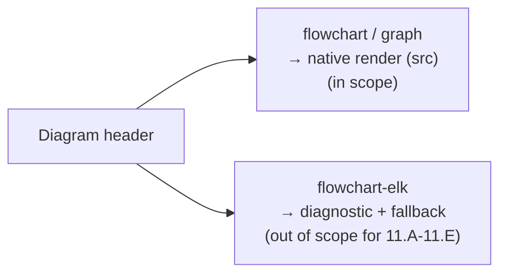

### 11.1.11 Sugiyama layered layout (adopted native Dagre replacement - pilot)

Mermaid 11.14 uses **Dagre** ([dagrejs/dagre](https://github.com/dagrejs/dagre)) for default `flowchart` / `graph` layout via `layout: dagre` and `flowchart.defaultRenderer: dagre-wrapper` (§3.17.7, §3.17.28). Naiad today uses a Dagre-family engine (`extern/Naiad/.../DagreLayoutEngine.cs`) plus extensive post-layout repairs. Dagre and Naiad are both **layered directed-graph** layouters, but they are different implementations with different tuning and routing integration.

The programme **has adopted** a **native C# Sugiyama layered layout** as the **default Dagre-family replacement** on the product render path for ordinary `flowchart` / `graph` headers (not `flowchart-elk`). MSAGL layered sources were copied under the **MIT licence** into `src/MermaidRecognition.Layout/Sugiyama/`; structural edge routing is implemented separately in `FlowchartEdgeRouteResolver` and related builders (§5.5-§5.6, §11.8-11.9). Original reference sources remain under:

```text
C:\Users\windo\OneDrive\Documents\Development\3rd Party\Microsoft.AGL\Microsoft.AGL\Layout\Layered\
```

This is the **Microsoft Automatic Graph Layout (MSAGL)** layered engine: `LayeredLayoutEngine`, `SugiyamaLayoutSettings`, and supporting types (`Layering/`, `Ordering/`, `Routing.cs`, `FlatEdgeRouter`, `SmoothedPolylineCalculator`, …). It implements the classic Sugiyama pipeline (layer assignment, vertex ordering, coordinate assignment, edge routing) - the same **algorithm family** Mermaid targets through Dagre for layered flowcharts.

| Topic | Dagre (Mermaid / Naiad today) | MSAGL Sugiyama (adopted pilot) |
| --- | --- | --- |
| Origin | JavaScript library; Naiad C# integration | Native C# sources (MIT-licensed MSAGL) in `MermaidRecognition.Layout/Sugiyama/` |
| Mermaid config | `layout: dagre`, `flowchart.defaultRenderer: dagre-wrapper` | Programme-defined via `FlowchartSugiyamaLayoutEngine` + `FlowchartRenderOptions` |
| Layout input | Mermaid `flowDb`; Naiad `FlowchartModel` | `DiagramContract` → `FlowchartGeometryGraphBuilder` → MSAGL `GeometryGraph` |
| Edge paths | Mermaid renderer; Naiad `CoordinateAssignment` repairs | **Structural router primary** (`FlowchartEdgeRouteResolver`, corridor/bypass builders); MSAGL layered routers retained for compile closure - **see §11.9.1** |
| Relation to ELK | Separate from `flowchart-elk` | Also separate - Sugiyama replaces **Dagre**, not ELK (§11.1.10) |
| Product path | Legacy Naiad comparison only | **Default** md2docx flowchart render (Sugiyama SVG); Naiad fallback on failure |

**Programme rules (normative):**

1. **Recognition** must not depend on Sugiyama layout output - parse into `DiagramContract` first (Stage 11.A complete).
2. **Native render** uses Sugiyama for node placement; legacy Naiad output is **comparison only** (§12).
3. The adapter **`DiagramContract` → MSAGL graph** (`FlowchartGeometryGraphBuilder`) maps measured node bounds, edge endpoints, `MinLength` / creation order, subgraph containment, and direction - **not** semantic label text (§11.3, §11.7).
4. Effective config from §3.17 (`flowchart.nodeSpacing`, `flowchart.rankSpacing`, `flowchart.diagramPadding`, `flowchart.curve`, direction TB/LR/…, `themeVariables.*`) must map to `SugiyamaLayoutSettings` (for example `LayerSeparation`, margins, constraints) where equivalents exist; unmapped keys require diagnostics, not silent defaults.
5. Parity acceptance: compare native Sugiyama output against legacy Naiad (baseline) on node bounds and route **classification** for active `flow.md` scenarios. Document intentional differences. Sugiyama adoption does **not** satisfy `flowchart-elk` recognition or render claims. Structural rule-validation harness must pass (§9.1) before claiming routing complete.
6. Required MSAGL classes live in `src/MermaidRecognition.Layout/Sugiyama/` (first-party, MIT preserved). `extern/Microsoft.AGL/` is transitional re-copy reference only. Native router must not use label-semantic rules (§11.7). See [`src/MermaidRecognition.Layout/SUGIYAMA_ADOPTION.md`](../src/MermaidRecognition.Layout/SUGIYAMA_ADOPTION.md).
7. **Edge routing integration (current):** structural router is **primary** for product SVG (`FlowchartEdgeRouteResolver`, corridor/bypass builders); MSAGL layered edge polylines are retained for compile closure but not consumed as the main render path. Hybrid strategy detail: **§11.9.1**.

#### 11.1.11.1 MSAGL is not ELK-compatible (Brandes-Köpf overlap only)

Repository verification (local sources under `3rd Party\Microsoft.AGL\` and the wider `Development\` tree) found **no ELK implementation**, no `elkjs` checkout, and no native C# binding to the Eclipse Layout Kernel. MSAGL’s layered engine is **Sugiyama-only** for the Dagre-family path; it must **not** be treated as a substitute for `flowchart-elk` render or parity claims (§11.1.10, §11.15).

MSAGL **does** share one algorithmic building block with ELK Layered: horizontal coordinate assignment following Brandes and Köpf (“Fast and Simple Horizontal Coordinate Assignment”), implemented in `Layout/Layered/XCoordsWithAlignment.cs` and selected via `SugiyamaLayoutSettings.BrandesThreshold` / the internal `Brandes` flag in `LayeredLayoutEngine`. Mermaid’s pinned defaults include `elk.nodePlacementStrategy: BRANDES_KOEPF` (§3.17), which ELK’s layered algorithm exposes under a different option surface. That overlap explains similar *layered* results on some graphs; it does **not** imply:

| Concern | MSAGL Sugiyama | ELK (`flowchart-elk`) |
| --- | --- | --- |
| Graph model | `GeometryGraph`, MSAGL ports and clusters | ELK JSON (`elkjs` / Java ELK) with `elk.hierarchyHandling`, explicit layout options |
| Config keys | `SugiyamaLayoutSettings` (layer separation, constraints, …) | `elk.*`, `elk.layered.*`, `nodePlacement.strategy`, … (§3.17 `elk` object) |
| Mermaid header | `flowchart` / `graph` only | `flowchart-elk` (separate detector and renderer) |
| Parity gate | Dagre baseline on ordinary flowcharts | ELK baseline on `flowchart-elk` fixtures - **not** satisfied by MSAGL |
| Licence on PC | MSAGL layered sources (MIT, local path above) | `elkjs` + `@mermaid-js/layout-elk` (MIT, vendored under `mermaid/` - §11.1.11.2) |

**Normative rule:** adopting MSAGL Sugiyama for the Dagre path (§11.1.11 programme rules) leaves `flowchart.elk-not-native` and ELK render work **unchanged** and **out of scope** for that adoption.

#### 11.1.11.2 Potential ELK path - port Mermaid layout adapter (MIT)

Native `flowchart-elk` render is **not** available in Naiad today. The programme **may** later port or host ELK layout using the **MIT-licensed** Mermaid integration already vendored in this repository, rather than re-deriving ELK graph construction from scratch.

**Authoritative vendored sources (pinned Mermaid 11.14 tree):**

| Component | Path | Licence | Role |
| --- | --- | --- | --- |
| `@mermaid-js/layout-elk` | `mermaid/packages/mermaid-layout-elk/` | MIT | Maps Mermaid `LayoutData` → ELK JSON, applies `config.elk.*`, post-processes ELK routes for SVG |
| `elkjs` (dependency) | declared in `mermaid-layout-elk/package.json` as `^0.9.3` | MIT | JavaScript transpilation of ELK; `elk.layout(graph)` entry point |
| ELK render entry | `mermaid-layout-elk/src/render.ts` | MIT | Sets `elk.algorithm`, `nodePlacement.strategy`, `elk.layered.mergeEdges`, `elk.layered.cycleBreaking.strategy`, `elk.layered.considerModelOrder.strategy`, direction, hierarchy handling |
| Core fallback | `mermaid/packages/mermaid/src/diagrams/flowchart/flowRenderer-v3-unified.ts` | MIT | Without the external layout package registered, `flowchart-elk` **warns** and falls back to **Dagre** - native product must not silently rely on this |

There is **no** maintained native C# ELK library in the programme’s source trees. Realistic native strategies (evaluate after Dagre-path and §11.E fallback policy are stable):

1. **Official Mermaid.js host (§11.E)** - load vendored `@mermaid-js/layout-elk` + `elkjs` in a headless/browser render path for `flowchart-elk` only; lowest port risk, not pure C#.
2. **Adapter port** - reimplement the **Mermaid-side** adapter (`LayoutData` / `DiagramContract` → ELK JSON, config mapping, route → contract geometry) in C# while still calling **elkjs** via an embedded JS host (Node, Jint, or similar); preserve MIT notices for both Mermaid adapter code and `elkjs`.
3. **Full native ELK** - invoke Eclipse ELK Java (EPL-2.0) or await a future C# binding; **not** present on this PC; licence and deployment differ from MSAGL MIT and from the vendored MIT stack above.

**Programme rules (normative) for ELK port work:**

1. **Separate track** from MSAGL Sugiyama (§11.1.11.1). ELK satisfies `flowchart-elk`; MSAGL targets ordinary `flowchart` / `graph` Dagre replacement - do not conflate parity gates.
2. **Source of truth for graph shape and options:** vendored `mermaid-layout-elk/src/render.ts` and pinned `config.elk.*` defaults (§3.17), not MSAGL `SugiyamaLayoutSettings`.
3. **Config mapping:** `elk.mergeEdges`, `elk.nodePlacementStrategy`, `elk.cycleBreakingStrategy`, `elk.forceNodeModelOrder`, `elk.considerModelOrder` (and any keys added by the adapter in `render.ts`) must round-trip from `DiagramConfigContract`; unmapped keys emit diagnostics.
4. **Vendoring:** if code is copied or translated from `mermaid-layout-elk`, place it under `extern/` or `src/` with MIT licence files preserved; record upstream path and pinned Mermaid version in revision history.
5. **Acceptance:** parity against Mermaid ELK output on an agreed `flowchart-elk` fixture slice (SvgHarness or coordinate classification), not against Dagre or MSAGL baselines.
6. **Until ELK native path exists:** keep recognition diagnostic `flowchart.elk-not-native` (§11.15) and product fallback policy from §11.1.10 rule 4.

Implementation progress: [`currentstatus.md`](currentstatus.md).

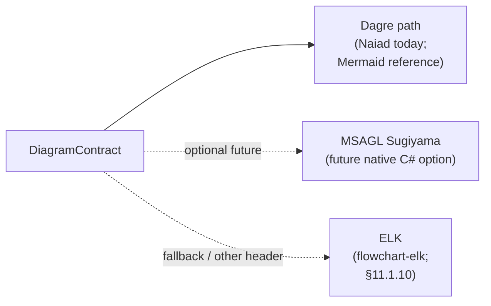

Implementation progress and adoption decision: [`currentstatus.md`](currentstatus.md).

### 11.1.13 Stage 11.A - all Mermaid diagram kinds (recognition coverage)

**Exit criterion (recognition):** every diagram kind listed in §3.18.2 can be fed through `MermaidRecognizer.Parse` and produces an auditable `DiagramContract` (or explicit diagnostics). Implementing flowchart alone does **not** satisfy Stage 11.A.

**Minimum per kind:** gate level **L1** (§7.4.2) - detect (G0), init/config where applicable (G1), diagnostics discipline (G10), at least one smoke fixture (G11).

**Depth targets (beyond L1):**

| Kind group | Target gate level | Requirements |
| --- | --- | --- |
| Flowchart / graph | **L3** (Stage 11.A exit); **L4** (G12 parity) | Complete §11.1.14.1 line-type catalogue; G4-G11 axis coverage; then G12 vs pinned Mermaid |
| Sequence, class, state, ER | **L3** | Complete kind catalogue (§11.1.14.2-§11.1.14.5); G4-G9 per kind matrix |
| Pie, gantt, mindmap, gitGraph | **L2** | Published line-type catalogue (§11.1.14.6-§11.1.14.9); G3 for every listed line type |
| All other §3.18.2 kinds | **L1** | Detect + smoke + structured diagnostics |

**Coverage matrix (required recognition - not native render):**

| Diagram kind (§3.18.2) | Typical header | Naiad native render? | Minimum gate | Notes |
| --- | --- | --- | --- | --- |
| Flowchart / graph | `flowchart`, `graph` | Yes | **L3** (+ L4 target) | §7.1.1, §11.1.14.1 |
| Flowchart ELK | `flowchart-elk` | No | **L1** | Detect + `flowchart.elk-not-native` diagnostic |
| Sequence | `sequenceDiagram` | Yes | **L1** (L3 target) | §11.1.14.2 |
| Class | `classDiagram` | Yes | **L1** (L3 target) | §11.1.14.3 |
| State | `stateDiagram` | Yes | **L1** (L3 target) | §11.1.14.4 |
| ER | `erDiagram` | Yes | **L1** (L3 target) | §11.1.14.5 |
| Gantt | `gantt` | Yes | **L4** | §11.1.14.7 |
| Pie | `pie` | Yes | **L1** (L2 target) | §11.1.14.6 |
| Git graph | `gitGraph` | Yes | **L1** (L2 target) | §11.1.14.9 |
| Mindmap | `mindmap` | Yes | **L1** (L2 target) | §11.1.14.8 |
| Timeline, journey, quadrant, xychart, requirement, architecture, kanban, sankey, block, packet, radar, treemap, C4 | per §3.18.2 | Yes | **L1** | Line-pattern recognisers |
| Event modelling, tree view, ishikawa, venn, wardley, info | per §3.18.2 | No | **L1** | Recognise + unsupported-native diagnostic |
| YAML front-matter trap | `---` | N/A | **L1** | `recognition.yaml-front-matter` or clear reject |

Use Naiad `extern/Naiad/src/test-renders/*.md` as **evidence sources** when authoring fixtures (recognition need not match Naiad parse depth on day one, but must not contradict detectable headers).

**Programme rules:**

- Do not enable native render as MDConverter default until SvgHarness / contract gates pass.
- Do not start Stage **11.B** on recognition fixtures alone - render evidence required.
- Per-kind implementation progress: [`currentstatus.md`](currentstatus.md) gate registry.

**§12:** Legacy Naiad comparison baseline - [`spec-gates/naiad-render-baseline.md`](../spec-gates/naiad-render-baseline.md) (not parse authority; not product target).

### 11.1.14 Per-diagram line-type catalogues

Normative **line-type catalogues** for each diagram kind (§7.4.3). Each table lists grammatical forms, expected contract effects, gate status (`parsed`, `partial`, `diagnostic`, `not-implemented`), and reference fixtures.

**Gate tooling (manifests and tests):**

- JSON manifests under `tests/MermaidRecognition.Tests/Gates/manifests/` list required fixture base names per kind and `GateLevel`.
- `DiagramGateManifestTests` fails if a manifest references a missing `.mmd` / `.verified.json`.
- Per-kind axis gate tests (e.g. `FlowchartL3AxisGateTests`, `SequenceL3AxisGateTests`) assert G4-G9 coverage samples.
- `CatalogueScenarioCoverageTests` asserts wave catalogue index rows map to recognition fixtures (S/C/ST/E).

Implementation gate levels and fixture counts: [`currentstatus.md`](currentstatus.md).

**Programme direction:** **Native render from `DiagramContract` in `src/`** is the product path. **`extern/Naiad` is frozen** - comparison baseline only (§12). All recognition work lives in `src/MermaidRecognition`. Do not extend Naiad parsers or renderers for programme gaps. Advance **recognition → native render adapter** (or §11.E fallback).

#### 11.1.14.1 Flowchart line-type catalogue (exemplar for other kinds)

Other kinds must publish an equivalent table before **L2**. Status values: **parsed**, **partial**, **diagnostic**, **not-implemented**.

| Line type id | Example | Produces (contract) | Gate status | Fixture / notes |
| --- | --- | --- | --- | --- |
| `flowchart.header` | `flowchart TD` | `Kind`, `Header`, `Direction` | parsed | all fixtures |
| `flowchart.header.elk` | `flowchart-elk TD` | + diagnostic `flowchart.elk-not-native` | diagnostic | `unsupported-diagnostics` |
| `flowchart.comment` | `%% note` | (none) | parsed | - |
| `flowchart.init.leading` | `%%{init:...}%%` | `Configuration.RawDirectiveValues` | parsed | `config-init` |
| `flowchart.init.frontMatter` | `---` YAML `config:` block before diagram | `Configuration.RawDirectiveValues` | **parsed** | `config-front-matter`, `config-front-matter-spacing` |
| `flowchart.node.id_only` | `A` | `NodeContract` | parsed | expansion fixtures |
| `flowchart.node.bracket` | `A[Label]`, `A(L)`, `A{D}`, … | label, shape, shapeSource | **parsed** | `node-bracket-shapes`, `metadata-shape-data` |
| `flowchart.node.metadata` | `A@{ shape: doc }` | metadata, shape | parsed | `metadata-shape-data` |
| `flowchart.node.class_suffix` | `A:::className` | `Classes` | parsed | `class-def-style` |
| `flowchart.link.simple` | `A --> B` | `EdgeContract` | parsed | chain fixtures |
| `flowchart.link.chained` | `A --> B --> C` | multiple edges, `CreationIndex` | parsed | §7.1.1 |
| `flowchart.link.grouped` | `A & B --> C & D` | Cartesian expansion | parsed | §7.1.1 |
| `flowchart.link.label` | `A -->\|Yes\| B` | `EdgeContract.Label` | parsed | `edge-label-pipe` fixture |
| `flowchart.link.label.inline` | `A -- authorize --> B` | `EdgeContract.Label` | parsed | `edge-label-inline` fixture |
| `flowchart.link.edge_id` | `A e1@--> B` | `Id`, `IsUserDefinedId` | parsed | `edge-identity` |
| `flowchart.link.minlen` | `A ----> B` | `MinLength` | **parsed** | `link-minlen` fixture |
| `flowchart.link.arrow_variants` | `A -.-> B`, `A ==> B`, … | markers, stroke | **parsed** | `arrow-variants` fixture |
| `flowchart.subgraph.start` | `subgraph id [Title]` | `GroupContract` | parsed | `subgraph-membership` |
| `flowchart.subgraph.end` | `end` | pop group | parsed | `subgraph-membership` |
| `flowchart.subgraph.nested` | `subgraph` inside `subgraph` | `Group.ParentGroupId`, `ChildGroupIds` | **parsed** | `subgraph-nested` fixture |
| `flowchart.subgraph.direction` | `direction LR` inside subgraph | `Group.Direction` | **parsed** | `subgraph-direction` fixture |
| `flowchart.style.node` | `style A stroke:#f00` | `InlineStyle` | parsed | `class-def-style` |
| `flowchart.classDef` | `classDef c stroke:...` | `ClassDefs` | parsed | `class-def-style` |
| `flowchart.class.apply` | `class A,B c` | `Classes` | parsed | `class-def-style` |
| `flowchart.linkStyle` | `linkStyle 0 stroke:...` | `LinkStyles` | parsed | linkStyle tests |
| `flowchart.linkStyle.default` | `linkStyle default ...` | default link style | parsed | linkStyle tests |
| `flowchart.linkStyle.interpolate` | `linkStyle 0 interpolate basis` | `Edge.Curve` | **parsed** | `linkStyle-interpolate` fixture |
| `flowchart.click.href` | `click A href "url"` | `Interactions` | parsed | `interactions` |
| `flowchart.click.callback` | `click A fn` | + diagnostic | diagnostic | `unsupported-diagnostics` |
| `flowchart.accTitle` | `accTitle: T` | `Accessibility.Title` | parsed | `accessibility` |
| `flowchart.accDescr.inline` | `accDescr: text` | `Accessibility.Description` | parsed | `accessibility` |
| `flowchart.accDescr.block` | `accDescr { ... }` | multiline description | **parsed** | `accDescr-block` fixture |
| `flowchart.edge.metadata` | `e1@{ curve: basis }` / `e1@{ animate: true }` on edge id | `EdgeContract.Metadata` | **parsed** | `edge-metadata`, `edge-animate`, `edge-metadata-thick-link`; node `@{ }` unchanged |
| `flowchart.invisible_link` | `A ~~~ B` | `Stroke=invisible` | **parsed** | `invisible-link` fixture |

**Flowchart L2 exit criteria:** every row above is **parsed** or **diagnostic** (no **not-implemented**).

**Flowchart L3 exit criteria:** L2 + G4-G9 axis coverage per flowchart matrix; verified JSON fixtures; no silent `flowchart.body` on official fixtures.

**Flowchart L4 exit criteria (G12):** L3 + parser parity with pinned Mermaid 11.14 for agreed axes, including at minimum: YAML front-matter `config`, edge `classDef` animation on edge id (`class e1 animate`), edge metadata animate/curve (`e1@{ animate: true }`), grouped edge id semantics (§11.1.2). Inventory and status: the G12 minimum slice. Sources that are fully remarked in a catalogue may still be covered by recognition fixtures (§9.1).

#### 11.1.14.2 Sequence line-type catalogue (L2)

Dedicated recogniser: `src/MermaidRecognition/Kinds/Sequence/SequenceKindRecognizer.cs`. Source: `mermaid/packages/mermaid/src/diagrams/sequence/parser/sequenceDiagram.jison` (detector: `sequenceDetector.ts`).

**Render policy (Naiad replacement programme):** L2 classifies every source line into `SourceStatementContract.LineTypeId` only. Populating sequence entities (participants, messages, activations, notes, control blocks, boxes) in `DiagramContract` is **L3 (G4)** work in `MermaidRecognition`, then a **new render adapter** (or official Mermaid fallback per §11.E). **Do not** extend Naiad sequence parsers / renderers for recognition gaps - Naiad is a temporary render baseline only (§12). Evidence scenarios: `extern/Naiad/src/test-renders/Sequence.md` (Simple, Participants, Actors, Activation, DifferentArrows, Notes, Title, AutoNumber, AltElseBlocks, Complex); regression catalogue [`sequence.md`](sequence.md) (S01-S32).

Status values match §11.1.14.1: **parsed**, **partial**, **diagnostic**, **not-implemented**.

| Line type id | Example | Produces (contract) | Gate status | Fixture / notes |
| --- | --- | --- | --- | --- |
| `sequence.header` | `sequenceDiagram` | `Kind`, `Header` | **parsed** | all fixtures; S01; Naiad Simple |
| `sequence.init.leading` | `%%{init: {'theme': 'base'}}%%` before header | `Configuration.RawDirectiveValues`, `EffectiveValues` | **parsed** | init strip in recogniser (`StripLeadingInitBlocks`); S24; fixture `init-leading` |
| `sequence.comment` | `%% This is a comment` | (none) | **parsed** | S22; not `%%{init}%%` |
| `sequence.participant` | `participant A as Alice`, `actor User` | `SourceStatements[]` (`LineTypeId`, `RawLine`) | **parsed** | `participants`; S04-S06; Naiad Participants, Actors |
| `sequence.message` | `A->>B: Hi`, `A-->>B: Reply`, `A->>+B: Start`, `A->>A: Self` | `SourceStatements[]` | **parsed** | `simple`, `activation`; S01-S03, S07-S09, S29-S31; Naiad Simple, DifferentArrows, Activation; inline `+`/`-` activation markers on arrow |
| `sequence.activate` | `activate A`, `deactivate B` | `SourceStatements[]` | **parsed** | `activate-deactivate`; S10 |
| `sequence.note` | `note right of A: text`, `Note over A,B: span` | `SourceStatements[]` | **parsed** | `notes`; S11; Naiad Notes |
| `sequence.title` | `title Authentication Flow` | `SourceStatements[]` (title fact; L3 → diagram title DTO) | **parsed** | `title`; S12; Naiad Title |
| `sequence.autonumber` | `autonumber` | `SourceStatements[]` (autonumber fact) | **parsed** | `autonumber`; S13; Naiad AutoNumber |
| `sequence.block` | `loop`, `alt`, `else`, `opt`, `par`, `and`, `critical`, `option`, `break`, `rect`, `par_over` | `SourceStatements[]` | **parsed** | `alt-else-blocks`, `loop-control`, `opt-block`, `par-block`, `critical-block`; S14-S18, S25-S27, S32; Naiad AltElseBlocks; `else`/`and`/`option` are branch keywords, not standalone blocks |
| `sequence.end` | `end` | `SourceStatements[]` | **parsed** | all block/box fixtures; closes `alt`/`loop`/`par`/`opt`/`critical`/`break`/`rect` and participant `box` |
| `sequence.box` | `box rgb(200,200,200) Internal` | `SourceStatements[]` | **parsed** | `box-rgb`; S19; closed by `sequence.end` |
| `sequence.lifecycle` | `create participant B`, `destroy B` | `SourceStatements[]` | **parsed** | `lifecycle-create`; S20 |
| `sequence.accTitle` | `accTitle: Auth` | `Accessibility.Title` (when wired) | **parsed** | `sequence-accessibility`; S21; L3 G9 populates `AccessibilityContract` |
| `sequence.accDescr` | `accDescr: text` / `accDescr { ... }` | `Accessibility.Description` (when wired) | **parsed** | `sequence-accessibility`; S21, S28; L3 G9; inline and multiline block forms |
| `sequence.body` | (fallback) | `SourceStatements[]` + optional info diagnostic | **partial** | must not appear in official fixtures or [`sequence.md`](sequence.md) active scenarios; `SequenceRecognitionFixtureTests` |

**Message arrow token coverage (G3 sub-rule):** recogniser `MessageRegex` matches any line containing an arrow token before `:`. Solid closed `->>`, dotted closed `-->>`, solid open `->`, dotted open `-->`, cross endings `-x` / `--x`, bidirectional `<<->>` / `<<-->>`, and additional jison-aligned tokens (`-x>>`, `x->`, `-)`, `--)`, `-\|`, `--\\`, `--\/`, `\/\/-`, `\\\\-`). Catalogue scenarios exercising primary variants:

| Arrow style | Example | Scenario | Naiad sample |
| --- | --- | --- | --- |
| Solid closed | `A->>B: msg` | S01, S07 | Simple |
| Dotted closed | `A-->>B: msg` | S01, S07 | Simple |
| Solid open | `A->B: msg` | S08 | DifferentArrows |
| Dotted open | `A-->B: msg` | S08 | DifferentArrows |
| Solid cross | `A-xB: msg` | S08 | DifferentArrows |
| Dotted cross | `A--xB: msg` | S08 | DifferentArrows |
| Inline activate | `A->>+B: Start`, `B-->>-A: Done` | S09 | Activation |
| Self-message | `A->>A: Reflect` | S29 | - |

Implicit participants (first appearance in a message, no prior `participant`/`actor` line) are a sub-axis of `sequence.message` and `sequence.participant` at L3 (S02, S03). Long and quoted message labels (S30, S31) remain `sequence.message`.

**Control-block keyword coverage:** `loop` (S15), `alt`/`else` (S14, S32), `opt` (S16), `par`/`and` (S17), `critical`/`option` (S18), `break` (S25), `rect rgb(...)` (S26), nested blocks (S27). `par_over` is recognised at L2 but has no catalogue scenario yet.

**Sequence L2 exit criteria:** table published (this section); tests in `SequenceRecognition/`; no silent `sequence.body` on fixture samples or [`sequence.md`](sequence.md) active scenarios; every row **parsed**, **partial**, or **diagnostic** (no **not-implemented**); catalogue scenario index maps each active S-id to a fixture (§9.1).

**Sequence L3 exit criteria:** L2 + `SequenceContractMapper` populates G4-G9 entities; axis gate tests cover each applicable G4-G9 dimension; render remains a separate adapter concern (§11.E).

**Sequence L4 exit criteria (G12):** L3 + parser parity with pinned Mermaid 11.14 for the minimum slice in the G12 minimum slice, including at minimum: leading init theme (`sequence.init.leading`), `par_over` block, autonumber, participant box, create/destroy lifecycle, and accessibility (`accTitle` / `accDescr`) aligned with upstream `sequenceDiagram.spec.js`. Each minimum-slice cluster has a recognition fixture, verified JSON, and a `SequenceL4AxisGateTests` assertion (or documented **partial** gap). Manifest `GateLevel: L4`.

**Sequence L2 → L3 sequencing (no Naiad changes):**

```text
L2 (now)     SequenceKindRecognizer → SourceStatements + line-type ids
L3 (next)    SequenceContractMapper → DiagramContract entities + verified JSON
L3 render    MermaidRecognition.SequenceRenderAdapter OR §11.E fallback (not Naiad)
```

#### 11.1.14.3 Class diagram line-type catalogue (L2)

Dedicated recogniser: `src/MermaidRecognition/Kinds/Class/ClassKindRecognizer.cs`. Source: `mermaid/packages/mermaid/src/diagrams/class/parser/classDiagram.jison`.

**Render policy (Naiad replacement programme):** L2 classifies every source line into `SourceStatementContract.LineTypeId` only. Populating class entities (`NodeContract`, `EdgeContract`, members, namespaces) in `DiagramContract` is **L3 (G4)** work in `MermaidRecognition`, then a **new render adapter** (or official Mermaid fallback per §11.E). **Do not** extend Naiad `ClassParser` / `ClassRenderer` for recognition gaps - Naiad is a temporary render baseline only (§12).

Status values match §11.1.14.1: **parsed**, **partial**, **diagnostic**, **not-implemented**.

| Line type id | Example | Produces (contract) | Gate status | Fixture / notes |
| --- | --- | --- | --- | --- |
| `classDiagram.header` | `classDiagram` / `classDiagram-v2` | `Kind`, `Header` | **parsed** | all fixtures; `classDetector-V2.ts` |
| `classDiagram.header.legacy` | (v1 detector only) | same as header | **parsed** | normalised to `classDiagram` kind |
| `classDiagram.init.leading` | `%%{init:...}%%` before header | `Configuration.RawDirectiveValues`, `EffectiveValues` | **parsed** | init strip in recogniser; no dedicated fixture yet |
| `classDiagram.comment` | `%% note` | (none) | **parsed** | - |
| `classDiagram.class` | `class Animal` | `SourceStatements[]` (`LineTypeId`, `RawLine`) | **parsed** | `simple`; also `class Animal highlight` (apply form classified here until `.classApply` split) |
| `classDiagram.structOpen` | `{` opening class body | `SourceStatements[]` | **parsed** | `members` |
| `classDiagram.structClose` | `}` closing class body | `SourceStatements[]` | **parsed** | `members` |
| `classDiagram.member` | `+String name`, `-id`, `#secret`, `~method()` | `SourceStatements[]` | **parsed** | `members` |
| `classDiagram.annotation` | `<<interface>>`, `<<abstract>>` | `SourceStatements[]` | **parsed** | - |
| `classDiagram.relation` | `Animal <|-- Duck`, `A --> B`, `A ..> B`, `A *-- B`, `A o-- B` | `SourceStatements[]` | **parsed** | `inheritance`, `relation-*`; jison `relationStatement` |
| `classDiagram.namespace` | `namespace pkg.name {` | `SourceStatements[]` | **parsed** | - |
| `classDiagram.classDef` | `classDef highlight fill:#f9f,stroke:#333` | `SourceStatements[]` | **parsed** | `classDef-style` |
| `classDiagram.style` | `style Animal fill:#f9f` | `SourceStatements[]` | **parsed** | - |
| `classDiagram.cssClass` | `cssClass Animal highlight` | `SourceStatements[]` | **parsed** | - |
| `classDiagram.classApply` | `class Animal highlight` | (target) `Classes` on entity | **partial** | Must split from `.class` when L3 entity mapping requires distinct apply semantics |
| `classDiagram.note` | `note for Animal "text"`, `note "text"` | `SourceStatements[]` | **parsed** | - |
| `classDiagram.click` | `click Animal href "url"`, `link`, `callback` | `SourceStatements[]` | **parsed** | callback → diagnostic at L3 render policy |
| `classDiagram.direction` | `direction TB` / `LR` / `RL` / `BT` | `SourceStatements[]` (direction fact) | **parsed** | - |
| `classDiagram.accTitle` | `accTitle: Title` | `Accessibility.Title` (when wired) | **parsed** | L3 G9 populates `AccessibilityContract` |
| `classDiagram.accDescr` | `accDescr: text` / `accDescr { ... }` | `Accessibility.Description` (when wired) | **parsed** | L3 G9 |
| `classDiagram.body` | (fallback) | `SourceStatements[]` + optional info diagnostic | **partial** | must not appear in official fixtures; `ClassRecognitionFixtureTests` |

**Relation token coverage (G3 sub-rule):** `<|--`, `<|..`, `..>`, `*--`, `o--`, `-->`, `<--`, `--`, `..` (extension / composition / aggregation / link variants per jison `relation` rules).

**Class L2 exit criteria:** table published (this section); tests in `ClassRecognition/`; no silent `classDiagram.body` on fixture samples; every row **parsed**, **partial**, or **diagnostic** (no **not-implemented**); [`class.md`](class.md) active scenarios map to fixtures (§9.1).

**Class L3 exit criteria:** L2 + contract mapper populates classes, relations, members, namespaces, notes, styles, and accessibility (G4-G9); `classDiagram.classApply` split from `.class` when entity model requires it.

**Class L4 exit criteria (G12):** L3 + minimum slice in the G12 minimum slice transcribed, including at minimum: leading init theme, `classDiagram.classApply` semantics, relation token matrix, namespace nesting, and `direction` - aligned with `classDiagram.spec.ts`. Manifest `GateLevel: L4`.

**Class L2 → L3 sequencing (no Naiad changes):**

```text
L2 (now)     ClassKindRecognizer → SourceStatements + line-type ids
L3 (next)    ClassContractMapper → DiagramContract entities + verified JSON
L3 render    MermaidRecognition.ClassRenderAdapter OR §11.E fallback (not Naiad)
```

#### 11.1.14.4 State diagram line-type catalogue (L2)

Dedicated recogniser: `src/MermaidRecognition/Kinds/State/StateKindRecognizer.cs`. Source: `mermaid/packages/mermaid/src/diagrams/state/parser/stateDiagram.jison` (shared by `stateDiagram` and `stateDiagram-v2` detectors).

**Render policy (Naiad replacement programme):** L2 classifies every source line into `SourceStatementContract.LineTypeId` only. Populating state entities (`NodeContract`, `EdgeContract`, composite regions, fork/join/choice pseudo-states, notes) in `DiagramContract` is **L3 (G4)** work in `MermaidRecognition`, then a **new render adapter** (or official Mermaid fallback per §11.E). **Do not** extend Naiad `StateParser` / `StateRenderer` for recognition gaps - Naiad is a temporary render baseline only (§12). Evidence scenarios: `extern/Naiad/src/test-renders/State.md` (Simple, MultipleStates, TransitionLabels, Description, ForkJoinState, ChoiceState, StateWithNote, StateDiagramV1, Complex).

Status values match §11.1.14.1: **parsed**, **partial**, **diagnostic**, **not-implemented**.

| Line type id | Example | Produces (contract) | Gate status | Fixture / notes |
| --- | --- | --- | --- | --- |
| `stateDiagram.header` | `stateDiagram` / `stateDiagram-v2` | `Kind`, `Header` | **parsed** | `simple`, `composite`, `note`; Naiad `StateDiagramV1` |
| `stateDiagram.init.leading` | `%%{init:...}%%` before header | `Configuration.RawDirectiveValues`, `EffectiveValues` | **parsed** | init strip in recogniser (`ApplyInit` / `StripLeadingInitBlocks`); no dedicated fixture yet |
| `stateDiagram.comment` | `%% note`, `# comment` | (none) | **parsed** | jison `#` and `%%` (not `%%{init}%%`) |
| `stateDiagram.transition` | `[*] --> Still`, `Still --> Moving`, `Active --> Inactive : timeout` | `SourceStatements[]` (`LineTypeId`, `RawLine`) | **parsed** | `simple`, `composite`, `note`; Naiad TransitionLabels, MultipleStates |
| `stateDiagram.state` | `state "Description" as s1`, `state fork_state <<fork>>`, `state join_state <<join>>`, `state choice_state <<choice>>`, `state First {` | `SourceStatements[]` | **parsed** | fork/join/choice via `ForkJoinRegex` on same id; Naiad Description, ForkJoinState, ChoiceState, Complex; composite opening brace on same line |
| `stateDiagram.structOpen` | `{` on its own line (nested body) | `SourceStatements[]` | **parsed** | jison `STRUCT_START`; rare vs inline `state Id {` |
| `stateDiagram.structClose` | `}` closing composite body | `SourceStatements[]` | **parsed** | `composite` |
| `stateDiagram.hideEmpty` | `hide empty description` | `SourceStatements[]` | **parsed** | jison `HIDE_EMPTY`; no fixture yet |
| `stateDiagram.note` | `note right of Active : text`, `note left of Error : handling` | `SourceStatements[]` | **parsed** | `note`; Naiad StateWithNote, Complex |
| `stateDiagram.classDef` | `classDef highlight fill:#f9f,stroke:#333` | `SourceStatements[]` | **parsed** | jison `classDefStatement`; no L2 fixture yet |
| `stateDiagram.style` | `style State2 fill:#f9f` | `SourceStatements[]` | **parsed** | - |
| `stateDiagram.cssClass` | `class State1 highlight` | `SourceStatements[]` | **parsed** | jison `cssClassStatement` (`applyClass`); distinct from `.classDef` |
| `stateDiagram.click` | `click State1 href "url" "tooltip"` | `SourceStatements[]` | **parsed** | callback forms → diagnostic at L3 render policy (mirror class) |
| `stateDiagram.direction` | `direction TB` / `LR` / `RL` / `BT` | `SourceStatements[]` (direction fact) | **parsed** | jison `direction_*` tokens |
| `stateDiagram.accTitle` | `accTitle: Title` | `Accessibility.Title` (when wired) | **parsed** | L3 G9 populates `AccessibilityContract` |
| `stateDiagram.accDescr` | `accDescr: text` / `accDescr { ... }` | `Accessibility.Description` (when wired) | **parsed** | L3 G9; inline and multiline lexer states |
| `stateDiagram.body` | (fallback) | `SourceStatements[]` + optional info diagnostic | **partial** | must not appear in official fixtures; `StateRecognitionFixtureTests` |

**Transition token coverage (G3 sub-rule):** `-->` only (jison `relation` / `idStatement '-->' idStatement`). Endpoints include implicit state ids, `[*]` (`EDGE_STATE`), and optional transition label after `:` (`DESCR` on relation). No dotted/open arrow variants (contrast class `classDiagram.relation`). Concurrent region divider `--` inside `struct` is **not** a separate L2 line type today (see gaps).

**State L2 exit criteria:** table published (this section); tests in `StateRecognition/`; manifest aligned with §11.1.14.4; no silent `stateDiagram.body` on fixture samples; every row **parsed**, **partial**, or **diagnostic** (no **not-implemented**); [`state.md`](state.md) active scenarios map to fixtures (§9.1).

**State L3 exit criteria:** L2 + contract mapper populates states, transitions, composite groups, notes, styles, interactions, and accessibility (G4-G9).

**State L4 exit criteria (G12):** L3 + minimum slice in the G12 minimum slice transcribed, including at minimum: leading init theme, composite groups, choice/fork (where grammar supports), transition labels with embedded colons, notes, and `classDef` / `style` / `:::` application - aligned with `state-parser.spec.js` and `state-style.spec.js`. Manifest `GateLevel: L4`.

**State L2 → L3 sequencing (no Naiad changes):**

```text
L2 (now)     StateKindRecognizer → SourceStatements + line-type ids
L3 (next)    StateContractMapper → DiagramContract entities + verified JSON
L3 render    MermaidRecognition.StateRenderAdapter OR §11.E fallback (not Naiad)
```

#### 11.1.14.5 ER diagram line-type catalogue (L2)

Dedicated recogniser: `src/MermaidRecognition/Kinds/Er/ErKindRecognizer.cs`. Source: `mermaid/packages/mermaid/src/diagrams/er/parser/erDiagram.jison`.

**Render policy (Naiad replacement programme):** L2 classifies every source line into `SourceStatementContract.LineTypeId` only. Populating ER entities (`NodeContract` for entities and attributes, `EdgeContract` for relationships and cardinality) in `DiagramContract` is **L3 (G4)** work in `MermaidRecognition`, then a **new render adapter** (or official Mermaid fallback per §11.E). **Do not** extend Naiad `ErParser` / `ErRenderer` for recognition gaps - Naiad is a temporary render baseline only (§12). Naiad interim samples: `extern/Naiad/src/test-renders/EntityRelationship.md` (Simple, OneToOne, ZeroOrOne, NonIdentifying, MultipleRelationships, Attributes, KeyTypes, Comments, Complex).

Status values match §11.1.14.1: **parsed**, **partial**, **diagnostic**, **not-implemented**.

| Line type id | Example | Produces (contract) | Gate status | Fixture / notes |
| --- | --- | --- | --- | --- |
| `erDiagram.header` | `erDiagram` | `Kind`, `Header` | **parsed** | all fixtures; E01-E35; jison `ER_DIAGRAM` |
| `erDiagram.init.leading` | `%%{init: {'theme': 'base'}}%%` before header | `Configuration.RawDirectiveValues`, `EffectiveValues` | **parsed** | init strip in recogniser; E17; fixture `init-leading` |
| `erDiagram.comment` | `%% Domain: sales` | (none) | **parsed** | E15 |
| `erDiagram.accTitle` | `accTitle: Sales schema` | `Accessibility.Title` (when wired) | **parsed** | E16, E31; L3 G9 populates `AccessibilityContract` |
| `erDiagram.accDescr` | `accDescr: text` / `accDescr { ... }` | `Accessibility.Description` (when wired) | **parsed** | E16 (inline), E31 (block); L3 G9 |
| `erDiagram.direction` | `direction TB` / `LR` / `RL` / `BT` | `SourceStatements[]` (direction fact) | **parsed** | E11 |
| `erDiagram.classDef` | `classDef highlight fill:#f9f,stroke:#333` | `SourceStatements[]` | **parsed** | E13; jison `classDefStatement` |
| `erDiagram.class` | `class CUSTOMER highlight` | `SourceStatements[]` | **parsed** | E13 (with `classDef`), E33 (apply without prior `classDef`); jison `classStatement` |
| `erDiagram.style` | `style CUSTOMER fill:#bbf` | `SourceStatements[]` | **parsed** | E14; jison `styleStatement` |
| `erDiagram.relationship` | `CUSTOMER \|\|--o{ ORDER : places` | `SourceStatements[]` | **parsed** | E01, E02, E03, E05, E06, E18, E28, E29, E34, E35; fixture `relationship`; Naiad: Simple, NonIdentifying, MultipleRelationships, Complex |
| `erDiagram.entityBlockOpen` | `CUSTOMER {` | `SourceStatements[]` | **parsed** | E07, E08, E09, E12, E18, E19, E30, E32; fixture `entity-attributes`; Naiad: Attributes, KeyTypes, Comments |
| `erDiagram.entityBlockClose` | `}` closing entity block | `SourceStatements[]` | **parsed** | E32 (explicit multi-entity); fixture `entity-attributes` |
| `erDiagram.attribute` | `string name`, `int id PK`, `string email UK`, `int customer_id FK` | `SourceStatements[]` | **parsed** | E07, E08, E09, E12, E18, E19; fixture `entity-attributes`; PK / FK / UK per jison `ATTRIBUTE_KEY` |
| `erDiagram.entityAlias` | `CUSTOMER [Customer Account] {` | `SourceStatements[]` | **parsed** | E10 (**remarked** - §9.1; does not render on mermaid.live; recognition axis tracked separately); jison `entityName SQS entityName SQE BLOCK_START` |
| `erDiagram.body` | (fallback) | `SourceStatements[]` + optional info diagnostic | **partial** | must not appear in official fixtures or [`entityrelationship.md`](entityrelationship.md) active scenarios; `ErRecognitionFixtureTests` |

**Relationship cardinality token coverage (G3 sub-rule):** left marker + link type + right marker compose Mermaid ER cardinality (identifying `--` vs non-identifying `..`). Lexer tokens from `erDiagram.jison`: `ONLY_ONE` (`||`, `one`, `only one`, `1` before link), `ZERO_OR_ONE` (`|o`, `o|`, `one or zero`, `zero or one`), `ZERO_OR_MORE` (`}o`, `o{`, `zero or more`, `0+`, `many`), `ONE_OR_MORE` (`}|`, `|{`, `one or more`, `1+`, `many(1)`). Catalogue scenarios exercising each active combination:

| Left | Link | Right | Example scenario | Naiad sample |
| --- | --- | --- | --- | --- |
| `\|\|` | `--` | `o{` | E01 | Simple |
| `\|\|` | `--` | `\|\|` | E03 | OneToOne |
| `\|o` | `--` | `o\|` | E04 | ZeroOrOne |
| `\|\|` | `..` | `o{` | E05 | NonIdentifying |
| `\|\|` | `--` | `\|{` | E06, E21 | MultipleRelationships |
| `}o` | `--` | `\|\|` | E20 | - |
| `}o` | `--` | `o{` | E23 | - |
| `\|o` | `..` | `o{` | E22 | - |
| `}\|` | `..` | `o{` | E24 | - |
| `}o` | `..` | `o{` | E25 | - |
| `o\|` | `--` | `o{` | E26 | - |
| `}o` | `..` | `\|\|` | E27 | - |

Quoted relationship labels (`: "logs in"`) and hyphenated entity names (`LINE-ITEM`, `PARKING-SPACE`) are sub-axes of `erDiagram.relationship` and entity naming (E02, E34). Recursive and duplicate-role edges (E28, E29) remain `erDiagram.relationship`. Stand-alone entity blocks without relationships (E30) use `entityBlockOpen` / `attribute` / `entityBlockClose` only.

**Remarked catalogue axes (§9.1):** E10 (`erDiagram.entityAlias`) is **considered but rejected** for the render gate - every source line in the catalogue fence is prefixed with `%%`. SvgHarness and DOCX visual review skip remarked blocks. Recognition may still classify the axis via `ErKindRecognizer` and future fixtures; remarking is not a signal that L2 tracking was abandoned.

**ER L2 exit criteria:** table published (this section); tests in `ErRecognition/`; no silent `erDiagram.body` on fixture samples or [`entityrelationship.md`](entityrelationship.md) active scenarios; every row **parsed**, **partial**, or **diagnostic** (no **not-implemented**); active E-ids map to fixtures (§9.1).

**ER L3 exit criteria:** L2 + contract mapper populates entities, attributes, relationships, styles, and accessibility (G4-G9).

**ER L4 exit criteria (G12):** L3 + minimum slice in the G12 minimum slice transcribed, including at minimum: leading init theme, relationship cardinality matrix, entity attributes (PK/FK/UK), direction, style/classDef, entity alias (recognition axis; E10 may remain render-remarked §9.1) - aligned with `erDiagram.spec.js`. Manifest `GateLevel: L4`.

**ER L2 → L3 sequencing (no Naiad changes):**

```text
L2 (now)     ErKindRecognizer → SourceStatements + line-type ids
L3 (next)    ErContractMapper → DiagramContract entities + verified JSON
L3 render    MermaidRecognition.ErRenderAdapter OR §11.E fallback (not Naiad)
```

#### 11.1.14.6 Pie chart line-type catalogue (L2)

Dedicated recogniser: `src/MermaidRecognition/Kinds/Pie/PieKindRecognizer.cs`. Source: `mermaid/packages/mermaid/src/diagrams/pie/pieDetector.ts`; parser: `mermaid/packages/parser/src/language/pie/pie.langium`.

**Render policy (Naiad replacement programme):** L2 classifies every source line into `SourceStatementContract.LineTypeId` only. Populating pie slices (label, value, optional `showData`) in `DiagramContract` is **L3 (G4)** work in `MermaidRecognition`, then a **new render adapter** (or official Mermaid fallback per §11.E). **Do not** extend Naiad pie parsers / renderers for recognition gaps - Naiad is a temporary render baseline only (§12).

Status values match §11.1.14.1: **parsed**, **partial**, **diagnostic**, **not-implemented**.

| Line type id | Example | Produces (contract) | Gate status | Fixture / notes |
| --- | --- | --- | --- | --- |
| `pie.header` | `pie` / `pie showData` | `Kind`, `Header` | **parsed** | `simple`, `title-showData`; detector `pieDetector.ts` |
| `pie.init.leading` | `%%{init: {"theme": "base"}}%%` before header | `Configuration.RawDirectiveValues`, `EffectiveValues` | **parsed** | `init-leading` |
| `pie.comment` | `%% slice note` (full-line remark) | (none) | **parsed** | `comment` |
| `pie.title` | `title Pets` | `SourceStatements[]` (title fact) | **parsed** | `title-showData` |
| `pie.section` | `"Cats" : 45`, `'Dogs' : 55` | `SourceStatements[]` | **parsed** | `simple`, `title-showData`; quoted label + numeric value (`SectionRegex`) |
| `pie.body` | (fallback) | `SourceStatements[]` + info diagnostic `recognition.pie.unclassified-line` | **partial** | must not appear in `PieRecognition/` fixtures; `PieRecognitionFixtureTests` |

**Pie L2 exit criteria:** table published (this section); tests in `PieRecognition/`; manifest at **L2**; no silent `pie.body` on fixture samples; every row **parsed**, **partial**, or **diagnostic** (no **not-implemented**).

**Pie L3 exit criteria:** L2 + `PieContractMapper` populates slice nodes with label/value metadata (`pieValue` where applicable); `PieL3AxisGateTests` covers G4 entity model and G9 when grammar supports accessibility; manifest **L3**.

**Pie L4 exit criteria (G12):** L3 + minimum slice in the G12 minimum slice transcribed, including at minimum: simple pie slices, `showData`, init leading, and accessibility - aligned with `pie.spec.ts`. Manifest **L4**.

**Pie L2 → L3 sequencing (no Naiad changes):**

```text
L2 (now)     PieKindRecognizer → SourceStatements + line-type ids
L3 (next)    PieContractMapper → DiagramContract slices + verified JSON
L3 render    MermaidRecognition.PieRenderAdapter OR §11.E fallback (not Naiad)
```

#### 11.1.14.7 Gantt chart line-type catalogue (L2)

Dedicated recogniser: `LinePatternKindRecognizer` registered for `gantt` in `KindRecognizerRegistry.cs` (patterns: `KindLinePatternProfiles.TitlePattern`, `GanttDateFormatPattern`, `GanttExcludesPattern`, `GanttSectionPattern`, `GanttTaskPattern`). Source: `mermaid/packages/mermaid/src/diagrams/gantt/ganttDetector.ts`; DB: `ganttDb.js`.

**Render policy (Naiad replacement programme):** L2 classifies every source line into `SourceStatementContract.LineTypeId` only. Populating sections, tasks, milestones, and date axes in `DiagramContract` is **L3 (G4)** work, then a **new render adapter** (or §11.E fallback). **Do not** extend Naiad gantt parsers / renderers for recognition gaps.

Status values match §11.1.14.1: **parsed**, **partial**, **diagnostic**, **not-implemented**.

| Line type id | Example | Produces (contract) | Gate status | Fixture / notes |
| --- | --- | --- | --- | --- |
| `gantt.header` | `gantt` | `Kind`, `Header` | **parsed** | all fixtures; header regex `^\s*gantt` |
| `gantt.init.leading` | `%%{init: ...}%%` before header | `Configuration.RawDirectiveValues`, `EffectiveValues` | **parsed** | `init-leading` |
| `gantt.comment` | `%% phase note` (full-line remark) | (none) | **parsed** | full-line `%%` remarks |
| `gantt.title` | `title Simple Gantt` | `SourceStatements[]` (title fact) | **parsed** | `simple`, `section`, `dateFormat`, `excludes`; `TitlePattern("gantt")` |
| `gantt.accTitle` | `accTitle: Gantt Diagram` | `Accessibility.Title` | **parsed** | `accessibility`; `AccTitlePattern("gantt")` |
| `gantt.accDescr` | `accDescr: Tasks for Q4` | `Accessibility.Description` | **parsed** | `accessibility`; `AccDescrPattern("gantt")` |
| `gantt.dateFormat` | `dateFormat YYYY-MM-DD` | `Configuration.RawDirectiveValues["gantt.dateFormat"]` | **parsed** | `dateFormat`; pattern `^\s*dateFormat\s+` |
| `gantt.inclusiveEndDates` | `inclusiveEndDates` | `Configuration.RawDirectiveValues["gantt.inclusiveEndDates"]` | **parsed** | `inclusive-end`; pattern `^\s*inclusiveEndDates\s*$` |
| `gantt.excludes` | `excludes weekends` | `Configuration.RawDirectiveValues["gantt.excludes"]` | **parsed** | `excludes` |
| `gantt.section` | `section Phase 1` | `SourceStatements[]` | **parsed** | `section`; pattern `^\s*section\s+` |
| `gantt.task` | `Task A :a1, 2024-01-01, 30d` | `Nodes[]` (`ganttTask` / `ganttMilestone`) | **parsed** | all fixtures; `relative`, `milestone`; pattern `^\s*\w.+\s*:\s*\w` |
| `gantt.body` | (fallback) | `SourceStatements[]` | **partial** | must not appear in `GanttRecognition/` fixtures; `GanttRecognitionFixtureTests` |

**Gantt L2 exit criteria:** table published (this section); tests in `GanttRecognition/`; manifest at **L2**; no silent `gantt.body` on fixture samples; every row **parsed**, **partial**, or **diagnostic** (no **not-implemented**).

**Gantt L3 exit criteria:** L2 + `GanttContractMapper` populates sections and tasks in `DiagramContract`; `GanttL3AxisGateTests` covers G4; manifest **L3**.

**Gantt L4 exit criteria (G12):** L3 + minimum slice in the G12 minimum slice transcribed, including at minimum: section/task definitions, `dateFormat`, `excludes`, init leading, and inclusive end-date task form - aligned with `gantt.spec.js`. Manifest **L4**.

**Gantt L2 → L3 sequencing (no Naiad changes):**

```text
L2 (now)     LinePatternKindRecognizer (gantt) → SourceStatements + line-type ids
L3 (next)    GanttContractMapper → DiagramContract tasks/sections + verified JSON
L3 render    MermaidRecognition.GanttRenderAdapter OR §11.E fallback (not Naiad)
```

#### 11.1.14.8 Mindmap line-type catalogue (L2)

Dedicated recogniser: `LinePatternKindRecognizer` for `mindmap` in `KindRecognizerRegistry.cs` (`MindmapNodePattern`). Source: `mermaid/packages/mermaid/src/diagrams/mindmap/detector.ts`; DB: `mindmapDb.ts`.

**Render policy:** L2 line classification only; hierarchical node model and layout are **L3+**. Naiad remains interim render baseline (§12).

Status values match §11.1.14.1.

| Line type id | Example | Produces (contract) | Gate status | Fixture / notes |
| --- | --- | --- | --- | --- |
| `mindmap.header` | `mindmap` | `Kind`, `Header` | **parsed** | `simple` |
| `mindmap.init.leading` | `%%{init: ...}%%` before header | `Configuration` directives | **parsed** | `init-leading` |
| `mindmap.comment` | `%% node note` (full-line remark) | (none) | **parsed** | `comment` |
| `mindmap.node` | indented node lines (`  Root`, `    Branch A`) | `SourceStatements[]` | **parsed** | `simple`, `comment`; pattern `^\s{2,}\S` |
| `mindmap.body` | (fallback) | `SourceStatements[]` | **partial** | must not appear in `MindmapRecognition/` fixtures |

**Mindmap L2 exit criteria:** table published (this section); tests in `MindmapRecognition/`; manifest at **L2**; no silent `mindmap.body` on fixture samples; every row **parsed** or **partial**.

**Mindmap L3 exit criteria:** L2 + `MindmapContractMapper` populates hierarchical tree nodes with parentage; `MindmapL3AxisGateTests` covers G4/G5; manifest **L3**.

**Mindmap L4 exit criteria (G12):** L3 + minimum slice in the G12 minimum slice transcribed, including at minimum: hierarchical nodes, init leading, node shape suffixes, and illegal multi-root diagnostic - aligned with `mindmap.spec.ts` (MMP-* ids). Manifest **L4**.

#### 11.1.14.9 Git graph line-type catalogue (L2)

Dedicated recogniser: `LinePatternKindRecognizer` for `gitGraph` in `KindRecognizerRegistry.cs` (`GitGraphCommitPattern`, `GitGraphBranchPattern`). Source: `mermaid/packages/mermaid/src/diagrams/git/gitGraphDetector.ts`; AST: `gitGraphAst.ts`.

**Render policy:** L2 line classification only; commit graph topology is **L3+**. Naiad remains interim render baseline (§12).

Status values match §11.1.14.1.

| Line type id | Example | Produces (contract) | Gate status | Fixture / notes |
| --- | --- | --- | --- | --- |
| `gitGraph.header` | `gitGraph` | `Kind`, `Header` | **parsed** | `simple` |
| `gitGraph.init.leading` | `%%{init: ...}%%` before header | `Configuration` directives | **parsed** | `init-leading` |
| `gitGraph.comment` | `%% release note` (full-line remark) | (none) | **parsed** | full-line remarks |
| `gitGraph.commit` | `commit id: "1"` | `SourceStatements[]` | **parsed** | `simple`, `branch-history`; pattern `^\s*commit\b` |
| `gitGraph.branch` | `branch main` | `SourceStatements[]` | **parsed** | `simple`, `branch-history`; pattern `^\s*branch\b` |
| `gitGraph.body` | (fallback) | `SourceStatements[]` | **partial** | must not appear in `GitGraphRecognition/` fixtures |

**Git graph L2 exit criteria:** table published (this section); tests in `GitGraphRecognition/`; manifest at **L2**; no silent `gitGraph.body` on fixture samples; every row **parsed** or **partial**.

**Git graph L3 exit criteria:** L2 + `GitGraphContractMapper` populates commit and branch entities; `GitGraphL3AxisGateTests` covers G4; manifest **L3**.

**Git graph L4 exit criteria (G12):** L3 + minimum slice in the G12 minimum slice transcribed, including at minimum: commits, branch/checkout history, merge, init leading, and accessibility - aligned with `gitGraph.spec.ts`. Manifest **L4**.

### 11.3 Non-Negotiable Target

Naiad should parse Mermaid into a complete recognition contract, then layout and render from that contract.

The renderer must never choose behaviour because a visible label equals `"Yes"`, `"No"`, `"Done"`, `"End"`, `"Retry"`, `"Success"`, `"Error"`, or any other scenario word.

Allowed decision inputs:

- parsed syntax facts
- node ids
- edge ids
- graph topology
- node shapes
- edge styles and arrowheads
- label presence and measured dimensions
- declared direction
- subgraph containment
- source order
- layout positions
- explicit config
- explicit metadata

Disallowed decision inputs:

- semantic guesses from rendered label text
- fixture names
- scenario names
- English words in node labels

### 11.4 Data Model Changes

Add recognition-level model types instead of overloading the render model.

Pseudo code:

```csharp
enum MermaidLabelType
{
    Text,
    String,
    Markdown
}

enum MermaidDiagnosticSeverity
{
    Info,
    Warning,
    Error
}

sealed record MermaidSourceSpan(
    int StartOffset,
    int EndOffset,
    int StartLine,
    int StartColumn,
    int EndLine,
    int EndColumn);

sealed record MermaidDiagnostic(
    MermaidDiagnosticSeverity Severity,
    string Code,
    string Message,
    MermaidSourceSpan? SourceSpan,
    string? AffectedId);

sealed record MermaidDeclaration(
    string Kind,
    string RawText,
    MermaidSourceSpan SourceSpan);

abstract record MermaidMetadataValue;
sealed record ShapeMetadata(NodeShape Shape) : MermaidMetadataValue;
sealed record LabelMetadata(string Text, MermaidLabelType LabelType) : MermaidMetadataValue;
sealed record CurveMetadata(string Curve) : MermaidMetadataValue;
sealed record AnimationMetadata(bool? Animate, string? Animation) : MermaidMetadataValue;
sealed record RawMetadata(string Key, string RawValue) : MermaidMetadataValue;

sealed record EdgeExpansionTrace(
    MermaidSourceSpan StatementSpan,
    int LinkOrdinalInStatement,
    int StartOrdinal,
    int EndOrdinal,
    IReadOnlyList<string> StartSet,
    IReadOnlyList<string> EndSet,
    string RawLinkToken);

sealed class Node
{
    string Id;
    string? Label;
    MermaidLabelType LabelType;
    NodeShape Shape;
    string? ShapeSource;          // "default", "legacy-bracket", "metadata"
    List<MermaidDeclaration> Declarations;
    Dictionary<string, MermaidMetadataValue> Metadata;
    List<string> ClassNames;
    Style InlineStyle;
    string? ParentId;
    bool IsGroup;
}

sealed class Edge
{
    string Id;
    bool IsUserDefinedId;
    string SourceId;
    string TargetId;
    EdgeEndpointMarker MarkerStart; // None, Point, Circle, Cross
    EdgeEndpointMarker MarkerEnd;
    EdgeStyle LineStyle;            // Solid, Dotted, Thick, Invisible
    int MinRankSpan;
    string? Label;
    MermaidLabelType LabelType;
    List<string> ClassNames;
    Style InlineStyle;
    string? Curve;
    bool? Animate;
    string? Animation;
    MermaidSourceSpan SourceSpan;
    EdgeExpansionTrace ExpansionTrace;
    int CreationIndex;            // Mermaid parse-order index; required for linkStyle N
}

sealed class Subgraph
{
    string Id;
    string? Title;
    MermaidLabelType LabelType;
    string? ParentId;
    Direction? DeclaredDirection;
    Direction EffectiveDirection;
    string? DirectionIgnoredReason;
    List<string> NodeIds;
    List<string> ChildSubgraphIds;
    List<string> ClassNames;
    Style InlineStyle;
}

sealed class FlowchartModel : GraphDiagramBase
{
    List<MermaidDeclaration> Declarations;
    List<MermaidDiagnostic> Diagnostics;
    Dictionary<string, Style> ClassDefinitions;
    List<LinkStyleDirective> LinkStyles; // index list OR default
    List<InteractionDirective> Interactions;
    DiagramConfigContract Configuration;  // RawDirectiveValues + EffectiveValues (§4.1)
}
```

Do not remove the existing render fields immediately. Add the recognition fields first, then migrate call sites. The current renderer can keep consuming `Node.Shape`, `Node.Label`, `Edge.LineStyle`, etc. while the richer facts are introduced.

Implementation should follow the existing C# conventions in the Naiad source. The pseudo-code in this document names concepts, not final public API casing.

Metadata may be stored internally as raw parsed YAML/JSON while parsing, but the contract emitted for tests should use typed values like `ShapeMetadata`, `LabelMetadata`, `CurveMetadata`, and `AnimationMetadata`. Stable verified JSON is impossible if everything is an unstructured `Dictionary<string, object?>`.

`EdgeExpansionTrace` is required because Mermaid edge order is observable. `linkStyle 0`, generated edge ids, user-defined edge ids, and grouped `&` expansion all depend on the exact creation sequence. Every edge must record its parse-order `CreationIndex` and the source statement/link/set positions that produced it.

Subgraph membership must also be explicit. Mermaid gives each node one effective parent. When a node is encountered inside a subgraph, add it to the current subgraph only if it has no parent yet. When a nested subgraph owns a node, do not also leave that node as a direct member of the outer group.

Subgraph direction has two states:

```text
DeclaredDirection: the direction statement written inside the subgraph, if any.
EffectiveDirection: the direction the renderer should actually use.
DirectionIgnoredReason: why a declared direction was not applied.
```

Mermaid has a cross-boundary caveat: when subgraph members are linked to nodes outside the subgraph, local subgraph direction can be ignored and the parent graph direction effectively wins. Naiad must therefore preserve the declared fact for recognition while computing an effective direction for layout.

Pseudo code:

```csharp
ResolveSubgraphEffectiveDirection(subgraph, parentDirection, topology)
{
    if (subgraph.DeclaredDirection is null)
    {
        subgraph.EffectiveDirection = parentDirection;
        return;
    }

    if (HasExternalEdges(subgraph, topology))
    {
        subgraph.EffectiveDirection = parentDirection;
        subgraph.DirectionIgnoredReason = "external-edge-crosses-subgraph-boundary";
        return;
    }

    subgraph.EffectiveDirection = subgraph.DeclaredDirection.Value;
}
```

Pseudo code:

```csharp
AddNodeToCurrentSubgraphOnce(nodeId)
{
    if (SubgraphStack.Count == 0)
        return;

    if (ParentSubgraphByNodeId.ContainsKey(nodeId))
        return;

    Subgraph current = SubgraphStack.Peek();
    current.NodeIds.Add(nodeId);
    ParentSubgraphByNodeId[nodeId] = current.Id;
    NodesById[nodeId].ParentId = current.Id;
}

AddNestedSubgraph(parent, child)
{
    parent.ChildSubgraphIds.Add(child.Id);
    child.ParentId = parent.Id;
}
```

### 11.5 Parser Replacement

Replace the current simplified `StatementParser` in `FlowchartParser.cs` with a Mermaid-style parse database.

The parser should not directly build final layout behaviour. It should mutate a `FlowchartDb` that mirrors Mermaid's `flowDb.ts` responsibilities.

Pseudo code:

```csharp
sealed class FlowchartDb
{
    Dictionary<string, Node> NodesById = new(StringComparer.Ordinal);
    List<Edge> Edges = [];
    List<Subgraph> RootSubgraphs = [];
    Stack<Subgraph> SubgraphStack = [];
    Dictionary<string, Subgraph> SubgraphById = [];
    Dictionary<string, Style> ClassDefinitions = [];
    Dictionary<string, List<string>> ClassesById = [];
    List<LinkStyleDirective> LinkStyles = [];
    List<MermaidDiagnostic> Diagnostics = [];
    Direction Direction = Direction.TopToBottom;

    Node AddOrUpdateNode(NodeDeclaration decl)
    {
        Node node = GetOrCreateNode(decl.Id);

        node.Declarations.Add(decl.ToMermaidDeclaration());

        if (decl.LabelWasPresent)
        {
            node.Label = decl.Label;
            node.LabelType = decl.LabelType;
        }
        else if (node.Label is null)
        {
            node.Label = decl.Id;
            node.LabelType = MermaidLabelType.Text;
        }

        if (decl.ShapeWasPresent)
        {
            node.Shape = decl.Shape;
            node.ShapeSource = decl.ShapeSource;
        }

        foreach (string className in decl.InlineClasses)
        {
            AddClass(node.Id, className);
        }

        if (SubgraphStack.Count > 0)
        {
            AddNodeToCurrentSubgraphOnce(node.Id);
        }

        return node;
    }

    void AddLink(NodeSet starts, NodeSet ends, LinkToken token, MermaidSourceSpan span)
    {
        for each start in starts.Items:
            for each end in ends.Items:
                Edge edge = BuildEdge(start.Id, end.Id, token, span);

                if (token.UserDefinedId is not null
                    && start == starts.Last
                    && end == ends.First
                    && !Edges.Any(e => e.Id == token.UserDefinedId))
                {
                    edge.Id = token.UserDefinedId;
                    edge.IsUserDefinedId = true;
                }
                else
                {
                    edge.Id = GenerateMermaidEdgeId(edge.SourceId, edge.TargetId);
                }

                Edges.Add(edge);
    }

    void ApplyMetadata(string id, MetadataObject metadata)
    {
        Edge? edge = Edges.FirstOrDefault(e => e.Id == id);
        if (edge is not null)
        {
            edge.Animate = metadata.GetBool("animate");
            edge.Animation = metadata.GetString("animation");
            edge.Curve = metadata.GetString("curve");
            return;
        }

        Node node = GetOrCreateNode(id);
        if (metadata.TryGetShape(out NodeShape shape))
        {
            node.Shape = shape;
            node.ShapeSource = "metadata";
        }
        if (metadata.TryGetLabel(out string label, out MermaidLabelType labelType))
        {
            node.Label = label;
            node.LabelType = labelType;
        }

        node.Metadata.Merge(metadata.RawValues);
    }
}
```

The parser grammar must recognise at least these top-level statement kinds:

```csharp
ParseFlowchart()
{
    ParseLeadingInitBlocksIntoModelConfig();
    ParseHeaderAndDirection();

    while (!EndOfInput)
    {
        if (TryParseCommentOrBlankLine()) continue;
        if (TryParseAccessibility()) continue;
        if (TryParseSubgraphStart()) continue;
        if (TryParseSubgraphEnd()) continue;
        if (TryParseSubgraphDirection()) continue;
        if (TryParseStyle()) continue;
        if (TryParseClassDef()) continue;
        if (TryParseClass()) continue;
        if (TryParseLinkStyle()) continue;
        if (TryParseClickOrHref()) continue;
        if (TryParseVertexOrEdgeStatement()) continue;

        AddDiagnostic("flowchart.unrecognised-statement", currentLine);
        if (StrictMode) throw;
        SkipLine();
    }

    return db.ToFlowchartModel();
}
```

Parser technology is an implementation choice, but it must be deliberate. The current `FlowchartParser.cs` uses parser combinators; a full Mermaid-compatible grammar could be reached by expanding that parser, porting the upstream JISON grammar, or introducing a generated lexer/parser. The chosen approach must be judged by edge-order fidelity and diagnostics, not by short-term ease.

Default parsing mode for MDConverter should be lenient:

```csharp
ParseOptions.Default = new ParseOptions
{
    Strict = false,
    AccumulateDiagnostics = true,
    ContinueAfterUnsupportedStatement = true
};
```

Strict mode should exist for test and fidelity gates, but the DOCX product path usually needs a model plus diagnostics rather than a first-error throw.

`TryParseVertexOrEdgeStatement` must parse the general grammar, not only a chain of single nodes:

```csharp
ParseVertexOrEdgeStatement()
{
    NodeSet current = ParseNodeSet();       // A or A & B or A@{...} & B[...]

    while (TryParseLink(out LinkToken link))
    {
        NodeSet next = ParseNodeSet();
        db.AddLink(current, next, link, link.SourceSpan);
        current = next;
    }
}

ParseNodeSet()
{
    List<NodeDeclaration> nodes = [];
    nodes.Add(ParseNodeDeclaration());

    while (TryConsume("&"))
    {
        nodes.Add(ParseNodeDeclaration());
    }

    foreach (node in nodes)
    {
        db.AddOrUpdateNode(node);
    }

    return new NodeSet(nodes);
}
```

`ParseLink` must decompose syntax into facts:

```csharp
ParseLink()
{
    optionalUserId = TryParseEdgeIdPrefix(); // e1@
    startToken = TryParseStartLink();        // <, o, x plus -- / == / -.
    embeddedText = TryParseEmbeddedEdgeText();
    endToken = ParseEndLink();
    pipeLabelBeforeOrAfter = TryParsePipeLabel();

    return new LinkToken
    {
        UserDefinedId = optionalUserId,
        MarkerStart = DecodeStartMarker(startToken, endToken),
        MarkerEnd = DecodeEndMarker(startToken, endToken),
        LineStyle = DecodeStroke(startToken, endToken),
        MinRankSpan = DecodeMinlen(endToken),
        Label = embeddedText ?? pipeLabelBeforeOrAfter?.Text,
        LabelType = embeddedText?.Type ?? pipeLabelBeforeOrAfter?.Type ?? MermaidLabelType.Text
    };
}
```

This is the core fix. Once edges are decomposed this way, every later stage can reason from edge facts rather than from labels or fixture cases.

Edge expansion and edge-id order must be copied from Mermaid's upstream parser tests, not re-derived from intuition. In particular, use the local Mermaid files under:

```text
mermaid/packages/mermaid/src/diagrams/flowchart/parser/flow-vertice-chaining.spec.js
mermaid/packages/mermaid/src/diagrams/flowchart/parser/flow-node-data.spec.js
mermaid/packages/mermaid/src/diagrams/flowchart/parser/flow-edges.spec.js
mermaid/packages/mermaid/src/diagrams/flowchart/parser/flow-lines.spec.js
```

The grouped edge-id placement rule is **implementation-critical** and must be confirmed against the pinned Mermaid parser source (tests or parser dump) before it becomes a locked fixture. Until then, tag verified JSON and contract tests with `implementation-critical-unverified` rather than treating this document as the oracle.

The recognition tests should include an explicit expansion table:

| Source | Edge creation order | Fixture status |
| --- | --- | --- |
| `A --> B --> C` | `A->B`, `B->C` | locked (derive from upstream tests) |
| `A & B --> C` | `A->C`, `B->C` | locked (derive from upstream tests) |
| `A --> B & C` | `A->B`, `A->C` | locked (derive from upstream tests) |
| `A & B --> C & D` | `A->C`, `A->D`, `B->C`, `B->D` | locked (derive from upstream tests) |
| `A --> B & C --> D` | `A->B`, `A->C`, `B->D`, `C->D` | locked (derive from upstream tests) |
| `A & B e1@--> C & D` | target: auto `A->C`, auto `A->D`, user `e1` on `B->C`, auto `B->D` | `implementation-critical-unverified` |

The final row is deliberately strange because Mermaid applies a user-defined edge id only to the grammar-selected generated edge. That exact behaviour is required for `linkStyle`, metadata mutation, and class assignment by edge id. Keep the rule in the plan; do not remove it. Verify it, then lock it.

Config parsing must include `%%{init: ...}%%` now. YAML front matter (`---`) should be either parsed into the same effective config pipeline or recognised with a diagnostic:

```text
flowchart.frontmatter-recognised-but-not-applied
```

Do not silently discard front matter once the recogniser claims Mermaid compatibility.

### 11.6 Style and Config Application

Change style application from "nodes plus linkStyle index" to a Mermaid-style mutation pass.

Pseudo code:

```csharp
ApplyFlowchartMutations(model)
{
    foreach (ClassDef def in model.ClassDefinitions)
        RegisterClass(def);

    foreach (ClassAssignment assignment in model.ClassAssignments)
        foreach (id in assignment.TargetIds)
            ApplyClassToNodeEdgeOrSubgraph(id, assignment.ClassName);

    foreach (InlineClass inline in model.InlineClasses)
        ApplyClassToNodeEdgeOrSubgraph(inline.TargetId, inline.ClassName);

    foreach (StyleDirective style in model.StyleDirectives)
        ApplyStyleToNodeEdgeOrSubgraph(style.TargetId, style.Style);

    foreach (LinkStyleDirective linkStyle in model.LinkStyles)
    {
        if (linkStyle.IsDefault)
            model.DefaultEdgeStyle.Merge(linkStyle.Style);
        else
            foreach (int index in linkStyle.EdgeIndexes)
                model.Edges[index].Style.Merge(linkStyle.Style);

        if (linkStyle.Curve is not null)
            ApplyCurveToDefaultOrIndexedEdges(linkStyle);
    }
}
```

`RenderOptions` should not be the only home for effective config. `FlowchartModel.Configuration.EffectiveValues` must be populated before rendering (§4.1). Typed accessors read dotted keys, for example:

```csharp
DiagramConfigContract Configuration = BuildEffectiveConfig(initBlocks, mermaidDefaults, themeResolver);
// EffectiveValues["flowchart.nodeSpacing"] == "50" (default) or override
// EffectiveValues["flowchart.htmlLabels"] from evaluate(htmlLabels ?? flowchart.htmlLabels ?? true)
// EffectiveValues["themeVariables.fontFamily"] after theme merge
```

Edge-indexed style depends on exact Mermaid creation order. Therefore style application must use `Edge.CreationIndex`, not list position after any later filtering, dummy-edge insertion, sorting, or routing transformation.

Pseudo code:

```csharp
ApplyIndexedLinkStyle(model, directive)
{
    IEnumerable<Edge> targets = directive.IsDefault
        ? model.Edges
        : model.Edges.Where(e => directive.Indexes.Contains(e.CreationIndex));

    foreach (Edge edge in targets)
    {
        edge.Style.Merge(directive.Style);
        if (directive.Curve is not null)
            edge.Curve = directive.Curve;
    }
}
```

Verified contract JSON must include `CreationIndex` for every edge so failures in expansion order are obvious before rendering.

### 11.7 Replace Label-Based Routing

The routing algorithms in Sections 11.6-11.8 are **Naiad-native structural routing strategies**. They are intended to replace fixture-specific repair logic while preserving existing `flow.md` visual parity. They are **not** parser facts and must not be confused with Mermaid `flowDb` recognition output.

Remove all direct semantic label tests from routing.

Specifically, replace logic shaped like this:

```csharp
if (edge.Label.StartsWith("Yes")) useRightPort();
else if (edge.Label.StartsWith("No")) useUpperPort();
else sortByTargetPosition();
```

with structural branch allocation:

```csharp
ResolveDecisionBranchPorts(decisionNode, outgoingEdges, diagramDirection)
{
    ordered = outgoingEdges
        .OrderBy(edge => PrimaryCoordinateOfTarget(edge, diagramDirection))
        .ThenBy(edge => edge.SourceSpan.StartOffset)
        .ToList();

    for i in 0..ordered.Count-1:
        role = AllocateDecisionExitRole(i, ordered.Count, diagramDirection);
        ordered[i].PortHint = role;
}

AllocateDecisionExitRole(index, count, direction)
{
    if (direction is TopToBottom or BottomToTop)
    {
        if (count == 1) return BottomVertex;
        if (count == 2) return index == 0 ? SideLeft : SideRight;
        if (count == 3) return index == 0 ? SideLeft
                         : index == 1 ? BottomVertex
                         : SideRight;
        return EvenlySpacedPerimeterPort(index, count, preferredFace: Bottom);
    }

    if (direction is LeftToRight or RightToLeft)
    {
        if (count == 1) return RightVertex;
        if (count == 2) return index == 0 ? UpperRightSlope : RightVertex;
        if (count == 3) return index == 0 ? UpperRightSlope
                         : index == 1 ? RightVertex
                         : LowerRightSlope;
        return EvenlySpacedPerimeterPort(index, count, preferredFace: Right);
    }
}
```

Labels may still affect layout clearance because they have dimensions:

```csharp
if (edge.Label is not null)
{
    MeasureLabel(edge);
    ReserveLabelSpace(edge);
}
```

But labels must not determine branch meaning.

The branch roles above are still Mermaid-version-sensitive geometry choices. They are acceptable only because they are derived from branch count, source order, rank, relative target position, and direction. They must never be derived from English words on the edge.

Incoming edges need the same treatment as outgoing decision branches. Multi-incoming diamonds, stadium/pill fan-in, and collector-like joins should be handled by target-side port allocation first, then optional shape-specific attach modification. The hook may be shape-specific, but it must not be scenario-specific:

```csharp
ShapeRouteModifier? modifier = ShapeRouteModifiers.For(target.Shape);
modifier?.AdjustTargetPort(edge, target, allocatedPort, topology);
```

Label bounding boxes are layout inputs only:

```text
edge.Label text -> measure -> reserve clearance -> render label
edge.Label text -> route semantic choice    // forbidden
```

### 11.8 Replace Fixture-Specific Endpoint Repairs with Generic Port Allocation

Keep the good geometry functions, but change how they are selected.

Current helpers like these should become implementation details behind generic routing:

```text
TryGetFlowchartVerticalDecisionBranchEndpoints
TryGetFlowchartVerticalDecisionMultiIncomingEndpoints
TryGetFlowchartTbStadiumMergeEndpoints
TryGetFlowchartTbTerminalCollectorEndpoints
IsFlowchartLrRetryLoopEdge
IsFlowchartLrRectangleToDiamondIngressEdge
```

Do not replace all call sites at once. Introduce this general pipeline behind a feature flag and migrate one route kind at a time:

```csharp
RouteAllFlowchartEdges(model, layout)
{
    TopologyIndex topology = BuildTopologyIndex(model);
    PortPlan portPlan = AllocatePorts(model, topology);

    foreach (Edge edge in model.Edges)
    {
        Node source = model.GetNode(edge.SourceId);
        Node target = model.GetNode(edge.TargetId);

        Port sourcePort = portPlan.GetSourcePort(edge);
        Port targetPort = portPlan.GetTargetPort(edge);

        Position sourceAttach = IntersectShape(source, sourcePort, target.Position);
        Position targetAttach = IntersectShape(target, targetPort, source.Position);

        EdgeRouteKind kind = ClassifyRoute(edge, source, target, topology, model.Direction);
        edge.Points.ReplaceWith(BuildRoute(kind, sourceAttach, targetAttach, source, target, model));
    }
}
```

Temporary bridge:

```csharp
RouteEdge(edge)
{
    if (FlowchartRouter.TryRoute(edge, out Route route)
        && RouteParityGate.IsEnabled(route.Kind))
    {
        edge.Points.ReplaceWith(route.Points);
        return;
    }

    LegacyCoordinateAssignment.Route(edge); // existing behaviour
}
```

Each former `IsFlowchart*` helper must be classified before deletion:

| Old helper family | New destination |
| --- | --- |
| decision branch endpoints | `RouteKind.DecisionFanOut` / `RouteKind.DecisionFanIn` |
| hub fan-out/fan-in | generic endpoint-face port allocation |
| stadium dual fan-in | target-side ports + `StadiumShapeRouteModifier` |
| terminal collector | target-side multi-port join + route corridor selection |
| LR retry loop | `RouteKind.BackEdgeLoop` using reachability |
| rectangle-to-diamond ingress | shape intersection + target-side diamond port |
| cross-subgraph boundary | `RouteKind.CrossClusterBoundary` |
| BT stacked/forward column | rank/reachability route classification, not visual `DeltaY` alone |
| helpers with no structural mapping yet | temporary `RouteKind.Legacy*` plus deletion ticket |

Comments may reference historical fixture ids, but routing predicates must not encode scenario identity as their reason to run.

Build topology from graph facts:

```csharp
BuildTopologyIndex(model)
{
    return new TopologyIndex
    {
        IncomingByNode = model.Edges.GroupBy(e => e.TargetId),
        OutgoingByNode = model.Edges.GroupBy(e => e.SourceId),
        ParentByNode = model.Nodes.ToDictionary(n => n.Id, n => n.ParentId),
        SourceOrderByEdge = model.Edges.Select((edge, index) => (edge, index)),
        Reachability = ComputeReachability(model.Edges)
    };
}
```

Allocate ports generically:

```csharp
AllocatePorts(model, topology)
{
    PortPlan plan = new();

    foreach (Node node in model.Nodes)
    {
        List<Edge> incoming = topology.Incoming(node.Id);
        List<Edge> outgoing = topology.Outgoing(node.Id);

        AllocateEndpointGroup(
            node,
            incoming,
            endpointKind: Target,
            direction: model.Direction,
            plan);

        AllocateEndpointGroup(
            node,
            outgoing,
            endpointKind: Source,
            direction: model.Direction,
            plan);
    }

    return plan;
}

AllocateEndpointGroup(node, edges, endpointKind, direction, plan)
{
    groups = edges.GroupBy(edge => FacingFace(node, OtherNode(edge), direction, endpointKind));

    foreach (group in groups)
    {
        ordered = group
            .OrderBy(edge => OrthogonalCoordinate(OtherNode(edge), group.Face))
            .ThenBy(edge => edge.SourceSpan.StartOffset)
            .ToList();

        slots = BuildPerimeterSlots(node.Shape, group.Face, ordered.Count);

        for i in 0..ordered.Count-1:
            plan.Set(edge: ordered[i], endpointKind, slots[i]);
    }
}
```

This replaces hard-coded cases such as "dual fan-in stadium", "terminal collector", and "hub fan-out" with the same underlying rule: multiple edges sharing a face need stable, ordered ports on that face.

The special geometry functions are still useful:

```csharp
IntersectShape(node, port, toward)
{
    switch (node.Shape)
    {
        case Diamond:
            return IntersectDiamondAtPortOrRay(node, port, toward);
        case Stadium:
            return IntersectStadiumAtPortOrRay(node, port, toward);
        case Cylinder:
            return IntersectCylinderAtPortOrRay(node, port, toward);
        case Circle:
        case DoubleCircle:
            return IntersectCircleAtPortOrRay(node, port, toward);
        default:
            return IntersectRectangleAtPortOrRay(node, port, toward);
    }
}
```

The difference is that shape geometry is selected by shape, and route pattern is selected by topology. Neither is selected by label text.

Polyline ownership must be explicit:

- layout engine owns initial rank/order and a candidate polyline
- router owns endpoint ports, route classification, shape/subgraph clipping, and any replacement guide points
- renderer owns curve interpolation (`basis`, `linear`, `rounded`, etc.), markers, marker offsets, and label drawing

When `RouteKind.DefaultDagreSpline` is selected, the router should preserve the layout polyline and only clip/normalise endpoints. When a structural route kind is selected, the router may replace guide points, but it must record the route kind in diagnostics/debug output for parity review.

### 11.9 Generic Route Classification

Route classification should be structural:

```csharp
ClassifyRoute(edge, source, target, topology, direction)
{
    if (IsInvisible(edge))
        return Invisible;

    if (IsSelfLoop(edge))
        return SelfLoop;

    if (CrossesSubgraphBoundary(source, target))
        return CrossClusterBoundary;

    if (IsBackEdge(edge, topology.Reachability))
        return BackEdgeLoop;

    if (SharesRank(source, target, direction))
        return SameRank;

    if (HasClearAxisAlignedPath(source, target, direction))
        return AxisAligned;

    if (HasMultipleEdgesOnEndpointFace(edge, topology))
        return PortRoutedSpline;

    return DefaultDagreSpline;
}
```

Classification order is part of the specification. Back-edge detection must use rank plus reachability, not screen-space `DeltaX`/`DeltaY` alone. A geometrically upward edge in `BT` is often a normal forward edge, not a loop.

Required precedence:

```text
1. invisible edge
2. self loop
3. edge crossing subgraph boundary
4. graph-theoretic back edge (rank + reachability, excluding the edge itself)
5. explicit multi-rank/minlen dummy chain
6. same-rank edge
7. multi-edge endpoint-face route
8. simple axis-aligned forward edge
9. default layout polyline
```

If a new rule needs to be inserted into this order, add a regression explaining which older route kind it must beat and why.

Then build points from route kind:

```csharp
BuildRoute(kind, sourceAttach, targetAttach, source, target, model)
{
    switch (kind)
    {
        case AxisAligned:
            return [sourceAttach, targetAttach];

        case SameRank:
            return BuildSameRankRoute(sourceAttach, targetAttach, model.Direction);

        case BackEdgeLoop:
            return BuildLoopOutsideOccupiedBounds(source, target, model.Nodes, model.Direction);

        case CrossClusterBoundary:
            return ClipRouteToClusterBoundaries(
                BuildManhattanOrSpline(sourceAttach, targetAttach, model.Direction),
                source,
                target,
                model.Subgraphs);

        case PortRoutedSpline:
            return BuildOrthogonalStubbedSpline(sourceAttach, targetAttach, model.Direction);

        case DefaultDagreSpline:
            return UseLayoutEnginePolylineThenClipEndpoints(edge);
    }
}
```

Naiad can still match Mermaid closely by using `curveBasis` or the existing curve builders after points are selected. The point is to derive those points from a general topology/port model.

#### 11.9.1 Edge routing strategy (programme choice)

The adopted MSAGL slice under `src/MermaidRecognition.Layout/Sugiyama/` includes full edge routing (`Routing.cs`, `SplineRouter`, `InteractiveEdgeRouter`, `RectilinearEdgeRouter`, …). `LayeredLayoutEngine.Run()` invokes it by default (`EdgeRoutingMode.SugiyamaSplines`). The native Sugiyama pilot today reads **node centres only** and draws **straight segments** in SVG - see [`SUGIYAMA_ADOPTION.md`](../src/MermaidRecognition.Layout/SUGIYAMA_ADOPTION.md). When wiring polylines into the render path, the programme must choose how structural routing (§11.8-11.9) relates to MSAGL routing.

**Candidate strategies:**

| Strategy | Description | Parity with Mermaid/Dagre | Risk |
| --- | --- | --- | --- |
| **A - Structural router primary** | `FlowchartRouter` classifies each edge; `BuildRoute` supplies guide points for special kinds (`BackEdgeLoop`, `DecisionFanOut`, `SameRank`, …); `DefaultDagreSpline` keeps a layout polyline and clips endpoints only | **Best** - matches Dagre + targeted repairs (Naiad `CoordinateAssignment` family) | More route-kind builders to implement and gate |
| **B - MSAGL obstacle routing primary** | After final node positions, run `SplineRouter` or `RectilinearEdgeRouter` on the geometry graph for all edges | **Poor** - MSAGL splines/rectilinear paths differ from Mermaid `curveBasis` and fixture-specific loop corridors | Unpredictable visual drift on `flow.md`; hard to regression-gate |
| **C - MSAGL layout-time routing only** | Read `Edge.Curve` / `UnderlyingPolyline` from the first `LayeredLayout.Run()` and pass through to SVG | **Stale** once post-layout adjustments move nodes (branch order, fan-in spine, minlen, retry loop placement) | Polylines disagree with final bounds unless layout post-processing is removed or routing is re-run |

**Recommended programme choice: hybrid A + selective MSAGL (not B or C alone).**

1. **Layout** - MSAGL Sugiyama (or Dagre) produces rank, order, and node positions.
2. **Post-processor** - apply contract-driven adjustments to final node bounds (§11.1.11 adapter rules; examples: decision fan-out order, join-row spine, minlen, edge-label clearance).
3. **Structural router** - `FlowchartRouter.TryRouteAll` classifies every edge; precedence in §11.9 applies.
4. **Point build** - `BuildRoute(kind, …)` for non-default kinds; `UseLayoutEnginePolylineThenClipEndpoints` for `DefaultDagreSpline` / simple forward edges.
5. **Renderer** - shape-aware clip, curve interpolation (`basis`, `linear`, `rounded` from §3.17), markers, labels (polyline ownership in §11.8).
6. **Optional MSAGL fallback** - re-run layered splines or `SplineRouter` **only** when an intersection test shows the chosen polyline still crosses a node obstacle; record `RouteKind` and fallback reason in diagnostics. Do **not** make generic obstacle routing the default for ordinary forward edges.

```text
DiagramContract
  → Sugiyama layout (node positions)
  → layout post-processor (final bounds)
  → FlowchartRouter (classification)
  → BuildRoute / layout polyline clip
  → [optional] MSAGL re-route if obstacle intersection
  → SVG renderer
```

**Normative rules for this choice:**

1. **Mermaid parity gate** - acceptance compares route **classification** and geometry against Dagre/Mermaid baselines on `flow.md`, not against MSAGL viewer aesthetics.
2. **Post-processor ordering** - edge routing that depends on node bounds must run **after** the post-processor, or polylines must be recomputed when bounds change.
3. **Back-edge loops** - `RouteKind.BackEdgeLoop` (graph-theoretic reachability, not screen-space delta alone) uses structural `BuildLoopOutsideOccupiedBounds`, not generic `SplineRouter`. Example topology: `A→B→D→A` LR retry cycle (`B` decision, `D` retry, back-edge to `A`).
4. **MSAGL role** - MSAGL supplies **layered candidate polylines** for `DefaultDagreSpline` and optional **intersection fallback**; it does not replace §11.9 classification or port allocation.
5. **Bespoke per-fixture paths** - temporary helpers (e.g. hand-built retry polylines) are allowed only behind the same route-kind gates until the structural builder lands; they must not become the long-term routing model.

Cross-reference: MSAGL adoption scope and “node centres only” pilot status - §11.1.11 and [`SUGIYAMA_ADOPTION.md`](../src/MermaidRecognition.Layout/SUGIYAMA_ADOPTION.md).

### 11.10 Parser Coverage for "Any Mermaid Diagram"

No native C# renderer will handle "any Mermaid diagram successfully" unless it either:

1. implements every Mermaid grammar and renderer path, or
2. recognises the full input enough to decide whether Naiad can render it, then falls back to official Mermaid for unsupported constructs.

The practical target should be:

```csharp
Render(input, options)
{
    MermaidDocument document = MermaidFrontEnd.Parse(input);

    if (NaiadCapabilities.CanRender(document.Contract))
    {
        return NaiadNativeRenderer.Render(document.Contract, options);
    }

    if (options.AllowOfficialMermaidFallback)
    {
        return OfficialMermaidRenderer.Render(input, options);
    }

    throw new MermaidUnsupportedException(document.Diagnostics);
}
```

`CanRender` must be contract-based:

```csharp
CanRender(contract)
{
    if (contract.Kind not in NativeSupportedDiagramKinds)
        return false;

    if (contract.Flowchart?.UsesUnsupportedShape == true)
        return false;

    if (contract.Flowchart?.UsesUnsupportedCurve == true)
        return false;

    if (contract.Flowchart?.UsesHtmlLabelFeatureNativeCannotMeasure == true
        && !options.AllowApproximateTextMeasurement)
        return false;

    if (contract.Diagnostics.Any(d => d.Severity == Error))
        return false;

    return true;
}
```

This is not a failure of Naiad. It is the only honest way to claim "any Mermaid diagram" without reimplementing all of Mermaid.js.

MDConverter/Converter needs an explicit product policy:

```csharp
enum MermaidRenderFidelityMode
{
    NativeOnlyStrict,   // fail if Naiad cannot render contract faithfully
    PreferNative,       // use Naiad when CanRender, else official Mermaid fallback
    OfficialOnly        // bypass Naiad for debugging/parity
}
```

Fallback implementation may be headless browser, mermaid-cli, a local vendored Mermaid bundle, or a service adapter. The spec does not require one mechanism, but it does require that the mechanism be pinned, repeatable, and visible in diagnostics.

Fallback safety constraints:

```text
Official Mermaid fallback must be local, pinned, deterministic, and non-networked by default.
Do not call mermaid.ink or any external rendering service unless the user explicitly opts in.
Record the Mermaid package version, commit/tag, renderer mode, browser/runtime, and securityLevel used.
Disable or sandbox JavaScript callbacks.
Default securityLevel should be strict unless a caller explicitly requests loose behaviour.
Href/click directives must not execute during batch conversion.
```

This matters because Mermaid interaction behaviour changes with `securityLevel`; strict mode disables callback/link functionality that loose mode may permit. DOCX conversion should treat interactions as recognised metadata, not executable behaviour.

DOCX behaviour:

```csharp
RenderMermaidForDocx(block, options)
{
    MermaidDocument doc = MermaidFrontEnd.Parse(block.Source);
    RenderDecision decision = NaiadCapabilities.Decide(doc.Contract, options.FidelityMode);

    switch (decision.Kind)
    {
        case UseNaiadSvg:
            return EmbedSvg(NaiadNativeRenderer.Render(doc.Contract));

        case UseOfficialMermaid:
            AddConversionWarning(block, decision.Diagnostics);
            return EmbedPngOrSvg(OfficialMermaidRenderer.Render(block.Source));

        case Fail:
            throw new MarkdownToDocxException(decision.Diagnostics.ToUserMessage());

        case Placeholder:
            AddConversionWarning(block, decision.Diagnostics);
            return EmbedDiagnosticPlaceholder(block.Source, decision.Diagnostics);
    }
}
```

The user should never receive silent feature loss. In pragmatic mode, fallback should be recorded as a conversion warning; in strict mode, unsupported native rendering should fail with actionable diagnostics.

DOCX accessibility mapping:

```text
accTitle -> image alt title, where the target DOCX API supports it
accDescr -> image alt description, where the target DOCX API supports it
if either cannot be preserved -> diagnostic flowchart.accessibility-not-preserved
SVG fallback/native render should also include <title>, <desc>, aria-labelledby, and aria-describedby where possible
```

### 11.11 Concrete File-Level Work Plan

Implement this by stage, not as one patch.

Stage 11.A: **multi-kind** recognition contract and parser facts (§4.2, §11.1.13).

0. Add **`MermaidRecognizer.Parse`** and **`DiagramKindDetector`** - dispatch to per-kind parsers; unimplemented kinds must not throw silently.
1. In **`src/MermaidRecognition/`** (see §11.1.8-§11.1.8.2), add contract and support types:

```text
DiagramContract, NodeContract, EdgeContract, GroupContract
MermaidLabelType, MermaidSourceSpan, MermaidDiagnostic, MermaidDeclaration
EdgeEndpointMarker, EdgeExpansionTrace
DiagramConfigContract, ConfigValueSource, MermaidJsonConfigFlattener
RecognitionStyle, InteractionDirective, LinkStyleDirective
```

2. Do **not** add recognition fields to Naiad `Node`, `Edge`, or `FlowchartModel`. Map `DiagramContract` → Naiad render model only in an explicit adapter (optional project `MermaidRecognition.NaiadAdapter` or `MDConverter` internal), behind `UseFlowchartRecognitionParser`.
3. In `src/MermaidRecognition/Kinds/Flowchart/`, implement `FlowchartDb`, `FlowchartRecognizer.Parse` (via `MermaidRecognizer` in `Core/`), and the Mermaid-style statement parser. Add recognisers under `Kinds/` for **each** §3.18.2 kind to meet Stage 11.A L1 exit. Naiad `FlowchartParser.cs` remains the **default render input** until adapters are enabled.

The parallel path should contain:

```text
FlowchartDb
ParseHeader
ParseStatementLoop
ParseNodeSet
ParseNodeDeclaration
ParseShapeSuffix
ParseMetadataObject
ParseLinkToken
ParseStyleMutation
ParseSubgraphMutation
ParseInteraction
ParseAccessibility
```

4. Keep the existing parser/render path as the default during Stage 11.A:

```csharp
if (options.UseFlowchartRecognitionParser)
{
    FlowchartContract contract = NewFlowchartParser.ParseToContract(source);
    return ExistingRendererAdapter.Render(contract);
}

return ExistingFlowchartParser.Parse(source);
```

5. In the new parser path, implement Mermaid edge expansion exactly:

```csharp
A & B --> C & D
// produces A->C, A->D, B->C, B->D

A --> B & C --> D
// produces A->B, A->C, B->D, C->D
```

6. In the new parser path, implement Mermaid edge id semantics:

```csharp
Use user id only for last start and first end in grouped edge expansion.
If the id is already used, generate ids for later edges.
```

7. In `FlowchartRenderer.cs`, keep measurement and SVG generation, but consume `model.EffectiveConfig` and `LabelType` only after the parallel parser output has been verified.

Exit criterion (Stage 11.A recognition):

- **Every** §3.18.2 kind at gate level **L1** minimum (§7.4.2, §11.1.13).
- **Flowchart** at gate level **L3** (line-type catalogue complete per §11.1.14.1, G4-G11 axis coverage). **L4** (G12) is the parser-parity target beyond 11.A minimum.
- Visual rendering remains on the legacy path unless `UseFlowchartRecognitionParser` is explicitly enabled.

Implementation progress: [`currentstatus.md`](currentstatus.md).

Stage 11.B: label-semantic removal.

8. Add static and behavioural tests that fail if routing chooses ports by semantic label text.
9. Replace known label branches one by one with structural ordering. The first target should be decision fan-out because it currently contains direct `"Yes"` / `"No"` logic.

Exit criterion: changing any branch label text (including `"Yes"`/`"No"`, `"True"`/`"False"`, `"1"`/`"0"`, unicode, empty, or long text) changes only label dimensions and rendered label text, not route classification or port roles.

Stage 11.C: router strangler.

10. In `DagreLayoutEngine.cs`, do not remove the repeated post-layout chain immediately:

```text
ApplyFlowchartLrSimpleRetryCycleNodeLayout
ApplyFlowchartDecisionBranchEndpointSnapping
ApplyFlowchartDiagramConnectorEndpointSnapping
ApplyFlowchartCrossBoundaryEdgeEndpointSnapping
ApplyFlowchartTbUpwardLoopEdgeOrthogonalSnapping
ApplyFlowchartLrRectangleToDiamondIngressEdgeEndpointSnapping
ApplyFlowchartLrRetryLoopEdgeEndpointSnapping
ApplyFlowchartTbStadiumMergeEndpointSnapping
ApplyFlowchartTbTerminalCollectorEndpointSnapping
```

Wrap it:

```csharp
if (!FlowchartRouter.TryRouteAllEdges(model, layoutGraph, layoutOptions, out routed))
{
    LegacyFlowchartRepairs.Apply(model);
}
```

Then migrate one route kind at a time with a parity gate:

```csharp
if (FlowchartRouter.TryRoute(edge, out route)
    && RouteParityGate.Enabled(route.Kind))
{
    edge.Points.ReplaceWith(route.Points);
}
else
{
    LegacyFlowchartRepairs.Apply(edge);
}
```

11. Create `FlowchartRouter.cs`:

```text
BuildTopologyIndex
AllocatePorts
ClassifyRoute
BuildRoute
ClipToShapeBoundaries
ClipToSubgraphBoundaries
ApplyMarkerOffsets
```

12. Move reusable geometry from `CoordinateAssignment.cs` into shape/route helpers:

```text
IntersectDiamond
IntersectStadium
IntersectCylinder
ComputeFlowchartAttachPoint
BuildFlowchartCurveBasisPath
ApplyFlowchartOrthogonalAttachStubs
```

Exit criterion: each route kind has a SvgHarness/coordinate gate before its legacy helper is disabled.

Stage 11.D: shrink scenario predicates.

13. Delete or quarantine label-semantic predicates. If a method reads `edge.Label` for anything other than measuring or rendering text, it should be considered suspect.

Pseudo-code test:

```csharp
AssertNoRoutingCodeUsesLabelSemantics()
{
    foreach (method in FlowchartRoutingMethods)
    {
        Assert.False(method.Source.Contains("StartsWith(\"Yes\""));
        Assert.False(method.Source.Contains("StartsWith(\"No\""));
        Assert.False(method.Source.Contains("== \"Done\""));
        Assert.False(method.Source.Contains("== \"End\""));
    }
}
```

Also track scenario-shaped routing selectors. Comments can mention `F53` or `F58`; active predicates should not need names like `IsFlowchartTbStadiumTerminalCollectorTarget` as the reason to run. Either map them to structural route kinds or mark them temporary `Legacy*`.

Stage 11.E: fallback and diagnostics.

14. Wire `CanRender` and `MermaidRenderFidelityMode` into `Mermaid.Render`, MDConverter, and Converter.
15. Ensure DOCX output records warnings when official fallback or placeholder rendering occurs.

### 11.12 Required Tests

**Stage 11.A (all kinds):** For each row in §11.1.13, reach gate **L1** (G0, G1, G10, G11 smoke fixture). `DiagramKindDetectorTests` must assert correct `Kind` for minimal header samples.

**Per-diagram gates (ongoing):** For each kind, tests and fixtures must map to **line type ids** in that kind’s catalogue (§7.4.3, §11.1.14.1). A fixture without a catalogue row is invalid.

**Flowchart (depth - subset of 11.A, §7.1.1):** Add parser contract tests before visual tests:

```text
FlowchartRecognitionTests.EdgeExpansion
FlowchartRecognitionTests.EdgeIdentity
FlowchartRecognitionTests.MetadataShapeData
FlowchartRecognitionTests.EdgeMetadataMutation
FlowchartRecognitionTests.LabelTypes
FlowchartRecognitionTests.SubgraphMembership
FlowchartRecognitionTests.LinkStyleDefaultAndIndexed
FlowchartRecognitionTests.Accessibility
FlowchartRecognitionTests.Interactions
FlowchartRecognitionTests.UnsupportedButRecognisedDiagnostics
```

Each recognition test should have a machine-readable expected contract:

```text
tests/MermaidRecognition.Tests/FlowchartRecognition/edge-expansion.verified.json
tests/MermaidRecognition.Tests/FlowchartRecognition/edge-identity.verified.json
tests/MermaidRecognition.Tests/FlowchartRecognition/metadata-shape-data.verified.json
tests/MermaidRecognition.Tests/FlowchartRecognition/subgraph-membership.verified.json
tests/MermaidRecognition.Tests/FlowchartRecognition/config-init.verified.json
```

The JSON must include node ids, labels, label types, shapes, subgraph parentage, edge creation indexes, edge ids, endpoints, marker facts, minlen, styles, metadata, and diagnostics. Rendering is not part of these tests.

Add label-invariance rendering tests:

```csharp
Render("A{Check} -->|Yes| B; A -->|No| C")
Render("A{Check} -->|True| B; A -->|False| C")
Render("A{Check} -->|1| B; A -->|0| C")
Render("A{Check} -->|Approved| B; A -->|Rejected| C")

AssertSamePortRolesIgnoringRenderedLabelText();
```

Add topology-invariance tests:

```csharp
For each finite topology fixture from the capability matrix:
    vary labels across empty, English, punctuation, unicode, long text
    assert same edge classification and same port allocation
    assert only label dimensions and label positions may change
```

Do not promise literal coverage of every possible graph topology. Use a finite set from the §8 matrix and optionally add a bounded property-based generator:

```text
nodes: 1..8
edges: 0..12
directions: TB, BT, LR, RL
shapes: rectangle, diamond, stadium, cylinder
labels: empty, short, long, unicode
```

Visual migration rules:

- no SvgHarness scenario is deleted because the contract parser exists
- no legacy route helper is disabled until the corresponding route kind has a visual or coordinate parity gate
- the stadium terminal-collector merge coordinate gate (§5.6) remains mandatory for pill/stadium fan-in geometry
- `flow.md` remains the visual catalogue; recognition-only additions should live in separate fixtures until native rendering catches up

If future `flow.md` blocks such as F61-F88 are added for recognition gaps, classify them explicitly:

```text
recognition-only until native render support exists
visual-gated once native support is implemented
fallback-gated when official Mermaid is intentionally used
```

### 11.13 Definition of Done

This work is done only when:

- **every diagram kind in §3.18.2** meets gate **L1** (§7.4, §11.1.13); flowchart meets **L3** (§11.1.14), including a complete **line-type catalogue** and G4-G11 where applicable; **L4** (G12) is the flowchart parser-parity target beyond 11.A minimum
- flowchart parsing emits a contract rich enough to compare against Mermaid parser facts, exported as verified JSON
- routing does not branch on semantic label text
- every route decision can be explained by topology, shape, direction, style, config, containment, or source order
- unsupported Mermaid constructs produce diagnostics or official-renderer fallback
- `flow.md` still passes as a visual regression catalogue
- the new recognition fixtures pass without rendering
- label-invariance tests prove that changing edge label text does not change branch semantics or route classification

The comparison mechanism should be one of:

```text
1. verified JSON generated from Naiad's recognition contract and reviewed against Mermaid upstream parser tests
2. a local Mermaid parser dump tool that serialises flowDb nodes/edges/subgraphs for the same fixture
3. a curated subset of upstream flow-*.spec.js expectations transcribed into Naiad verified JSON
```

Do not claim parser parity from PNG or SVG output alone.

Done for native rendering and done for recognition are separate:

```text
Recognition done: §11.1.13 matrix complete; per-kind contract fixtures pass, including unsupported diagnostics.
Native render done (flowchart-first): matching route kind passes SvgHarness/coordinate gates.
Product done: MDConverter either embeds native output or deterministic official fallback with warnings.
```

The key shift is simple: Naiad should keep its geometry work, but the trigger for that geometry must be a Mermaid-like diagram contract, not a catalogue of visual scenarios.

### 11.15 Explicit Non-Goals for the First Migration

These are not first-migration requirements:

- full visual parity for every modern `@{ shape: ... }` shape
- unifying ER, state, class, sequence, and other Naiad parsers under the new flowchart contract
- perfect mermaid.ink PNG matching for constructs Naiad recognises but deliberately routes to fallback
- replacing every existing `CoordinateAssignment` helper before the router has parity gates
- supporting `flowchart-elk` natively

`flowchart-elk` should still be recognised at the header level. Until Naiad has an ELK-compatible native layout path, emit a diagnostic such as:

```text
flowchart.elk-not-native; fallback required unless strict native mode is disabled
```
