# Flowchart regression catalogue

Progressive Mermaid **flowchart** scenarios for Markdown → DOCX conversion. Each section increases complexity; scenarios within a section are ordered from simplest to hardest.

## How to use

This file is the **complete** flowchart regression catalogue: **isolated diagrams (F01–F88, plus F53A)**, mostly one recognition axis per scenario. Levels 1–9 are visual regression; **Level 10** adds axes from `spec.md` (§3–§10) that Naiad must parse into a compositional contract, not scenario-shaped layout hacks. A single combined diagram cannot exercise every axis (conflicting directions, init blocks, nested layout pairs, and isolated baselines).

### Remarked scenarios (`%%`)

Some diagrams **do not render** on [mermaid.live](https://mermaid.live) or are otherwise **rejected for the render gate**. They stay in this catalogue with **every source line prefixed by `%%`** inside the fenced block.

| Intent | Meaning |
| --- | --- |
| **Considered but rejected** | The axis was evaluated; **do not re-add** the same scenario because the file looks incomplete. |
| **Excluded from render gates** | SvgHarness, mermaid.ink comparison, and DOCX visual review apply only to **active** (non-remarked) diagrams. |
| **Recognition may still apply** | Spec line types and `FlowchartRecognition/` fixtures may cover the axis separately. |

**Do not confuse with:**

- `%%{init: ...}%%` on its own line — an **active** Mermaid init directive, not a remark of the whole diagram.
- A single `%%` comment line inside an otherwise **active** diagram (valid Mermaid comment syntax).

**Currently remarked (render gate excluded):** F65, F70, F87, F88. See also §9.1 in `spec.md`.

### Mandatory gate (mermaid.ink / Mermaid Live)

Every **active** (non-remarked) scenario must pass **structural** (labels, edge count, clusters) **and** **visual** (PNG) comparison against mermaid.ink:

```powershell
dotnet build extern/Naiad/src/Naiad/Naiad.csproj -c Release
dotnet run --project src/SvgHarness/SvgHarness.csproj -c Release -- flow.md out/flow-mermaid-ink --reference=mermaid-ink --parallel 2 --report=out/flow-mermaid-ink/report.md
```

Exit code **0** only when all scenarios PASS. Review `out/flow-mermaid-ink/report.md` and side-by-side artefacts (`NNN.naiad.svg` vs `NNN.reference.svg`).

Structural-only check (no reference download):

```powershell
dotnet run --project src/SvgHarness/SvgHarness.csproj -c Release -- flow.md out/harness --no-reference
```

### DOCX visual review

```powershell
dotnet run --project src/md2docx/md2docx.csproj -- flow.md flow.docx
```

**Checklist per scenario**

- Nodes and edges present (nothing missing or duplicated)
- Labels readable (wrap, punctuation, edge labels)
- Subgraph boxes align with member nodes (no overlap on borders)
- Arrowheads and line styles match Mermaid

**Nested subgraph note:** Nested clusters honour their declared `direction` (e.g. inner `direction LR` inside an outer `direction LR` subgraph).

---

## Level 1 — Syntax and direction

### F01 — `graph` keyword (alias for flowchart)

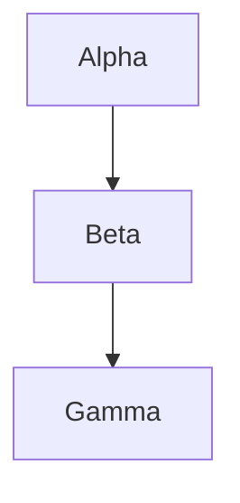

### F02 — `flowchart` keyword, chained nodes

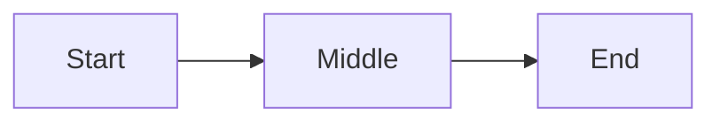

### F03 — Top to bottom (TB / TD)

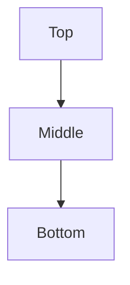

### F04 — Left to right (LR)

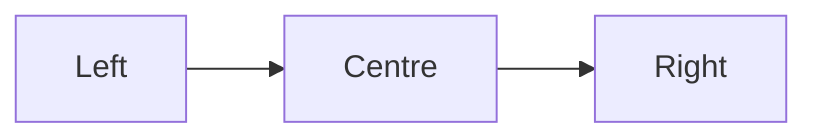

### F05 — Bottom to top (BT)

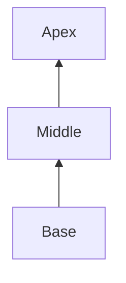

### F06 — Right to left (RL)

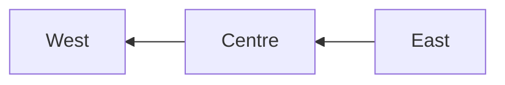

### F07 — Single node (no edges)

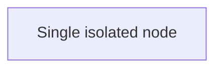

### F08 — Two nodes, one edge

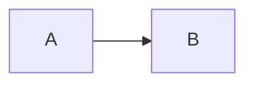

### F09 — Node IDs without labels (ID as text)

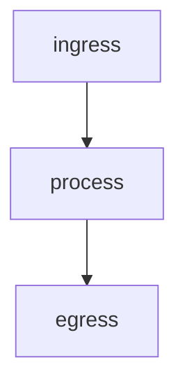

### F10 — Quoted node labels

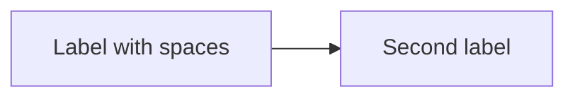

---

## Level 2 — Node shapes

### F11 — Basic shapes (rectangle, rounded, diamond, circle)

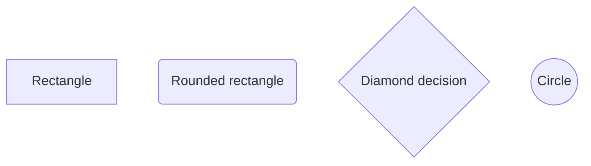

### F12 — Stadium and subroutine


### F13 — Cylinder and database-style

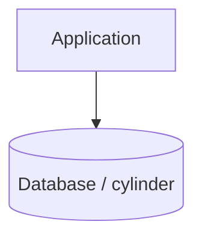

### F14 — Hexagon


### F15 — Asymmetric (flag) shape

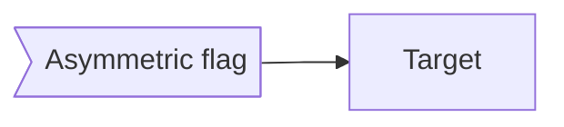

### F16 — Double circle

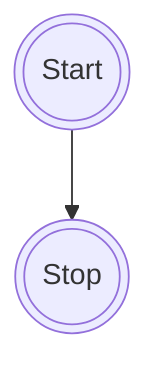

### F17 — Shape catalogue row (smoke test)

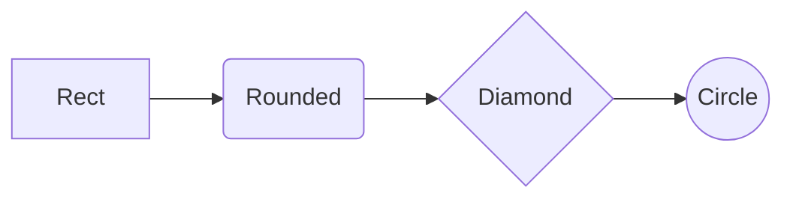

---

## Level 3 — Edge types and arrowheads

### F18 — Solid arrow and open line

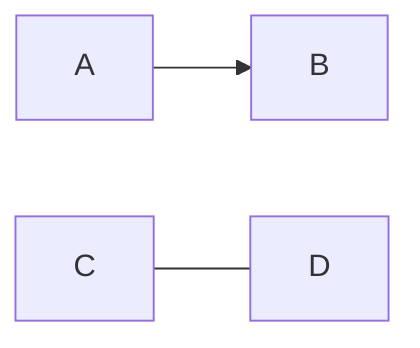

### F19 — Dotted arrow and dotted line

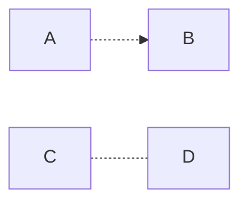

### F20 — Thick arrow and thick line

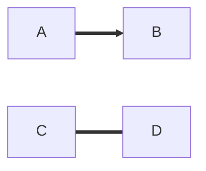

### F21 — Circle end and cross end

```mermaid
flowchart LR
A[A] --o B[B]
C[C] --x D[D]
```

### F22 — Bidirectional arrows

```mermaid
flowchart LR
A[A] <--> B[B]
C[C] o--o D[D]
E[E] x--x F[F]
```

### F23 — All edge styles in one diagram

```mermaid
flowchart LR
A1[A] --> B1[B]
C1[C] --- D1[D]
E1[E] -.-> F1[F]
G1[G] -.- H1[H]
I1[I] ==> J1[J]
K1[K] === L1[L]
M1[M] --o N1[N]
O1[O] --x P1[P]
Q1[Q] <--> R1[R]
```

### F24 — Edge labels (short)

```mermaid
flowchart LR
A[Request] -->|approve| B[Approved]
A -->|reject| C[Rejected]
```

### F25 — Edge labels with spaces and punctuation

```mermaid
flowchart TB
A[Source] -->|"Step 1: validate input"| B[Validator]
B -->|"Step 2: persist (async)"| C[Store]
```

### F26 — Long edge label (wrapping stress)

```mermaid
flowchart LR
A[Producer] -->|"This edge label is intentionally long so wrapping, clearance from arrowheads, and node borders can be verified in Word."| B[Consumer]
```

### F27 — Chained statement on one line

```mermaid
flowchart LR
A[A] --> B[B] --> C[C] --> D[D]
```

### F28 — Min-length / multi-segment link (extra hyphens)

```mermaid
flowchart TB
A[A] --> B[B]
C[C] ---> D[D]
E[E] ----> F[F]
```

---

## Level 4 — Branching, decisions, and flow control

### F29 — Binary decision (Yes / No)

```mermaid
flowchart TD
Start([Start]) --> Check{Valid?}
Check -->|Yes| OK[Accept]
Check -->|No| Fail[Reject]
```

### F30 — Multi-way decision (three branches)

```mermaid
flowchart TD
A[Christmas] -->|Get money| B(Go shopping)
B --> C{Let me think}
C -->|One| D[Laptop]
C -->|Two| E[iPhone]
C -->|Three| F[Other gift]
```

### F31 — Fan-out (one to many)

```mermaid
flowchart TB
Hub[Hub] --> W1[Worker 1]
Hub --> W2[Worker 2]
Hub --> W3[Worker 3]
```

### F32 — Fan-in (many to one)

```mermaid
flowchart BT
W1[Worker 1] --> Agg[Aggregate]
W2[Worker 2] --> Agg
W3[Worker 3] --> Agg
```

### F33 — Parallel workers then join

```mermaid
flowchart LR
A[Ingress] --> B[Enqueue]
B --> C[Worker 1]
B --> D[Worker 2]
C --> E[Aggregate]
D --> E
E --> F[Out]
```

### F34 — Simple cycle (retry loop)

```mermaid
flowchart LR
A[Receive] --> B{OK?}
B -->|Yes| C[Done]
B -->|No| D[Retry]
D --> A
```

### F35 — Diamond with multiple incoming edges

```mermaid
flowchart TB
A[Path A] --> D{Merge?}
B[Path B] --> D
C[Path C] --> D
D -->|yes| E[Continue]
D -->|no| F[Stop]
```

---

## Level 5 — Subgraphs (single level)

### F36 — Single subgraph, default direction

```mermaid
flowchart TB
subgraph SG["Processing"]
  A[Parse] --> B[Transform] --> C[Emit]
end
IN[In] --> A
C --> OUT[Out]
```

### F37 — Subgraph with explicit `direction TB`

```mermaid
flowchart LR
subgraph Box["Vertical stack inside horizontal diagram"]
  direction TB
  S1[Step 1] --> S2[Step 2] --> S3[Step 3]
end
Start[Start] --> S1
S3 --> End[End]
```

### F38 — Subgraph with `direction LR` inside TB diagram

```mermaid
flowchart TB
subgraph Pipeline["Pipeline"]
  direction LR
  P1[Read] --> P2[Map] --> P3[Write]
end
Ingress[Ingress] --> P1
P3 --> Egress[Egress]
```

### F39 — Subgraph with titled label in brackets

```mermaid
flowchart LR
subgraph R0S0["Manifests and checksums"]
  direction TB
  r0n0["Publish a manifest with sizes, hashes, and a completion marker."]
end
IN[In] --> r0n0
r0n0 --> OUT[Out]
```

### F40 — Two sibling subgraphs side by side

```mermaid
flowchart LR
subgraph S0["Stage A"]
  direction TB
  a0[A0] --> a1[A1]
end
subgraph S1["Stage B"]
  direction TB
  b0[B0] --> b1[B1]
end
IN[In] --> a0
a1 --> b0
b1 --> OUT[Out]
```

### F41 — Edge from subgraph member to sibling subgraph member

```mermaid
flowchart LR
subgraph Normaliser["Normaliser"]
  direction TB
  n0[Normalise layout]
end
subgraph Translator["Translator"]
  direction TB
  t0[Translate contract]
end
IN[In] --> n0
n0 --> t0
t0 --> OUT[Out]
```

### F42 — Long wrapping text inside subgraph

```mermaid
flowchart LR
subgraph R0S0["Manifests and checksums"]
  direction TB
  r0n0["Publish a manifest (file list, sizes, hashes) with each drop so the consumer can reject incomplete uploads and detect tampering. Include a stable batch identifier and an explicit completion marker."]
end
IN[In] --> r0n0
r0n0 --> OUT[Out]
```

---

## Level 6 — Nested subgraphs

### F43 — Nested subgraphs (regression: cross-boundary edges, mixed directions)

```mermaid
flowchart TB
subgraph Outer["Outer subgraph"]
  direction TB
  A["Top node"] --> B["Middle node"]
  subgraph Inner["Inner subgraph"]
    direction LR
    C["Left"] --> D["Right"]
  end
  B --> C
  D --> E["Bottom node"]
end
```

### F44 — Nested subgraph with inner `direction TB`

```mermaid
flowchart TB
subgraph Outer["Outer"]
  direction TB
  Start[Start] --> InnerTop
  subgraph Inner["Inner TB"]
    direction TB
    InnerTop[Inner top] --> InnerBottom[Inner bottom]
  end
  InnerBottom --> End[End]
end
```

### F45 — Two levels of nesting

```mermaid
flowchart TB
subgraph L0["Level 0"]
  direction TB
  A[A] --> B[B]
  subgraph L1["Level 1"]
    direction TB
    subgraph L2["Level 2"]
      direction TB
      C[C] --> D[D]
    end
  end
  B --> C
  D --> E[E]
end
```

### F46 — Nested subgraph, outer LR, inner LR

```mermaid
flowchart LR
subgraph OuterLR["Outer LR"]
  direction LR
  O1[O1] --> O2[O2]
  subgraph InnerLR["Inner LR"]
    direction LR
    I1[I1] --> I2[I2]
  end
  O2 --> I1
  I2 --> O3[O3]
end
```

### F47 — Three nodes in nested cluster, chained

```mermaid
flowchart TB
subgraph Root["Root"]
  direction TB
  Entry[Entry] --> K1
  subgraph Core["Core"]
    direction TB
    K1[K1] --> K2[K2] --> K3[K3]
  end
  K3 --> Exit[Exit]
end
```

---

## Level 7 — Labels, text, and special characters

### F48 — Special characters (Mermaid entity codes; use `#quot;`, `#lt;`, `#124;`, not backslash escapes)

```mermaid
flowchart TB
A["Symbols: star#42; underscore#95; backtick#96; brackets#91;#93; pipe A#124;B"] --> B["Quotes: double#quot; and apostrophe#39;s"]
B --> C["Comparison: a#lt; b #38;#38; c#gt; d"]
```

### F49 — Line breaks in labels (`<br/>`)

```mermaid
flowchart TD
A["Line one<br/>Line two"] --> B["Another<br/>multi-line<br/>label"]
```

### F50 — Unicode and symbols

```mermaid
flowchart LR
A["Currency: € £ ¥"] --> B["Arrows: → ← ↑ ↓"]
B --> C["Emoji smoke: ✓ ✗ ⚠"]
```

### F51 — Very long single-node label (wrapping)

```mermaid
flowchart TB
N["This node label is deliberately verbose so the renderer must wrap text inside the node boundary instead of overflowing the subgraph or page margins when embedded in Word."]
```

### F52 — Short labels, tight spacing

```mermaid
flowchart LR
A[A] --> B[B] --> C[C] --> D[D] --> E[E]
```

---

## Level 8 — Styling, classes, and init

### F53 — `style` directive (fill / stroke)

```mermaid
flowchart TD
Start([Start]) --> Process[Process]
Process --> Decision{Valid?}
Decision -->|Yes| Success[Success]
Decision -->|No| Error[Error]
Success --> End([End])
Error --> End

style Start fill:#e1f5e1
style End fill:#e1f5e1
style Error fill:#f8d7da
style Success fill:#d1ecf1
```

### F53A — `style` directive (fill / stroke)

```mermaid
flowchart TD
Success --> End([End])
Error --> End

style End fill:#e1f5e1
style Error fill:#f8d7da
style Success fill:#d1ecf1
```

**Evaluate:** Compare SVG **coordinates** against [mermaid.live](https://mermaid.live) (mermaid.ink reference SVG), **not** PNG pixel diff. SvgHarness extracts node positions and merge-edge path start/end points, normalises shoulder attach offsets relative to the End pill (`endDx` / `endDy`), and gates on coordinate deltas plus geometry invariants (separated shoulders, vertical stub at source X). See `{index}.coordinates.txt` in the harness output folder.

```powershell
dotnet run --project src/SvgHarness/SvgHarness.csproj -c Release -- flow.md out/f53a-coord --reference=mermaid-ink --max-blocks=54 --report=out/f53a-coord/report.md
```

Or isolate F53A only:

```powershell
dotnet run --project src/SvgHarness/SvgHarness.csproj -c Release -- out/f53a-test.md out/f53a-coord --reference=mermaid-ink
```

### F54 — `classDef` and `class`

```mermaid
flowchart LR
A[Good]:::good --> B[Bad]:::bad
classDef good fill:#d4edda,stroke:#28a745
classDef bad fill:#f8d7da,stroke:#dc3545
```

### F55 — `linkStyle` on selected edges

```mermaid
flowchart LR
A[A] --> B[B]
B --> C[C]
C --> D[D]
linkStyle 0 stroke:#ff0000,stroke-width:2px
linkStyle 2 stroke:#0000ff,stroke-dasharray:5 5
```

### F56 — Init: `htmlLabels: false` (native SVG text)

```mermaid
%%{init: {"flowchart": {"htmlLabels": false}} }%%
flowchart TB
A["Native SVG labels"] --> B["Wrap without HTML foreignObject."]
B --> C["Final"]
```

### F57 — Init: spacing overrides

```mermaid
%%{init: {"flowchart": {"nodeSpacing": 80, "rankSpacing": 80, "diagramPadding": 16}} }%%
flowchart TB
A[Wide spacing] --> B[Between ranks]
B --> C[And nodes]
```

---

## Level 9 — Combined stress scenarios

### F58 — Full pipeline (shapes + decisions + labels + cylinder)

```mermaid
flowchart TD
Start([Start]) --> Ingest[Ingest file]
Ingest --> Validate{Valid markdown?}
Validate -->|No| Reject[Reject with error]
Validate -->|Yes| Parse[Parse blocks]
Parse --> HasMermaid{Mermaid fence?}
HasMermaid -->|Yes| Render[Render SVG via Naiad]
HasMermaid -->|No| Word[Build DOCX only]
Render --> Embed[Embed in DOCX]
Embed --> Done([Done])
Word --> Done
Reject --> Done
Persist[(Optional archive)] --> Done
```

### F59 — Subgraph + decision + retry loop

```mermaid
flowchart TB
subgraph Worker["Worker pool"]
  direction TB
  Q[Queue] --> W{Worker free?}
  W -->|Yes| P[Process job]
  W -->|No| Wait[Wait]
  Wait --> Q
end
Client[Client] --> Q
P --> Out[Output]
```

### F60 — LR diagram with nested TB and cross-links (integration)

```mermaid
flowchart LR
subgraph Ingest["Ingest"]
  direction TB
  I1[Receive drop] --> I2[Verify manifest]
end
subgraph Transform["Transform"]
  direction TB
  T1[Normalise] --> T2[Translate]
end
subgraph Publish["Publish"]
  direction TB
  P1[Package] --> P2[Release]
end
Source[Source] --> I1
I2 --> T1
T2 --> P1
P2 --> Sink[Sink]
I2 -.->|audit copy| P2
```

---

## Level 10 — Recognition axes (Naiad contract)

Axes called out in `spec.md` §3–§10 and §5.3 (coverage gaps). Each block should parse into explicit nodes, edges, groups, styles, and diagnostics—not be recognised only by visual similarity to an older scenario id.

### F61 — Grouped vertex expansion (`&`)

Expands `A & B --> C & D` to four edges (complete bipartite 2×2). In TB layout, Naiad routes **same-column** pairs (`A→C`, `B→D`) as vertical drops from the **bottom-centre** of the source to the **top-centre** of the target. **Cross-column** pairs (`A→D`, `B→C`) use **straight** diagonals from the **SE** corner of the source to the **NW** corner of the target, and from the **SW** corner to the **NE** corner respectively.

```mermaid
flowchart TB
A & B --> C & D
```

### F62 — Chained links plus ampersand grouping

```mermaid
flowchart LR
a[a] --> b[b] & c[c] --> d[d]
```

### F63 — User-defined edge id (`e1@-->`)

```mermaid
flowchart LR
A[A] --> B[B]
B e1@--> C[C]
```

### F64 — Edge id with metadata (`e1@{ ... }`)

```mermaid
flowchart LR
A e1@==> B
e1@{ curve: linear }
```

### F65 — Metadata shape catalogue (smoke, remarked)

```mermaid
%% flowchart LR
%% Doc@{ shape: doc }[Document]
%% Hex@{ shape: hex }[Hexagon]
%% Lean@{ shape: lean-r }[Lean right]
```

### F66 — Metadata label override on vertex

```mermaid
flowchart TD
Node@{ label: "Rendered label", shape: rounded }
Node --> Down[Downstream]
```

### F67 — Invisible edge (`~~~`)

```mermaid
flowchart LR
A[A] --> B[B]
B ~~~ C[C]
```

### F68 — `linkStyle default` (all edges)

```mermaid
flowchart LR
A[A] --> B[B] --> C[C]
linkStyle default stroke:#c60,stroke-width:3px
```

### F69 — `linkStyle default interpolate` (curve axis)

```mermaid
flowchart LR
A[A] --> B[B] --> C[C]
linkStyle default interpolate basis stroke:#336,stroke-width:2px
```

### F70 — Comments and semicolon statement boundaries (remarked)

```mermaid
%% flowchart TD
%% %% ingress lane
%% A[Receive]; --> B[Validate] %% hand-off
%% B --> C[Store]
```

### F71 — Interactions (`click` / `href` / `call`)

```mermaid
flowchart LR
Docs[Documentation] --> API[API]
click Docs href "https://example.com/docs" "Open docs" _blank
click API call callback() "Tooltip for callback"
```

### F72 — Accessibility (`accTitle` / `accDescr`)

```mermaid
flowchart LR
accTitle: Batch ingest overview
accDescr: Three-step ingest pipeline for recognition regression.
A[Drop] --> B[Verify] --> C[Publish]
```

### F73 — Subgraph bare title (`subgraph one`)

```mermaid
flowchart TB
subgraph one
  a1[Alpha] --> a2[Beta]
end
subgraph two
  b1[Gamma] --> b2[Delta]
end
Ingress[Ingress] --> a1
b2 --> Egress[Egress]
```

### F74 — Subgraph explicit id and quoted title

```mermaid
flowchart LR
subgraph auditId["Audit / compliance"]
  direction TB
  r1[Record] --> r2[Review]
end
IN[In] --> r1
r2 --> OUT[Out]
```

### F75 — Symbolic diagram direction (`<` → RL)

```mermaid
flowchart <
West[West] --> Centre[Centre] --> East[East]
```

### F76 — Repeated vertex declaration (merge by id)

```mermaid
flowchart TD
A[First label]
A[Second label wins]
A --> B[Downstream]
```

### F77 — `class` with comma-separated node ids

```mermaid
flowchart LR
A[Alpha] --> B[Beta] --> C[Gamma]
classDef lane fill:#eef,stroke:#369
class A,C lane
```

### F78 — `classDef` applied to subgraph id

```mermaid
flowchart TB
subgraph Processing["Processing"]
  direction TB
  P1[Parse] --> P2[Emit]
end
IN[In] --> P1
P2 --> OUT[Out]
classDef cluster fill:#fef3c7,stroke:#d97706
class Processing cluster
```

### F79 — Inline class (`:::`) plus `style` mutation order

```mermaid
flowchart LR
Hot[Hot]:::hot --> Cold[Cold]
classDef hot fill:#fecaca,stroke:#b91c1c
style Hot stroke-width:3px
```

### F80 — `flowchart-elk` header alias

```mermaid
flowchart-elk LR
A[Source] --> B[Sink]
```

### F81 — Legacy trapezoid bracket shapes

```mermaid
flowchart TD
Top[/Wide top/] --> Bottom[\Wide bottom/]
```

### F82 — Trapezoid bracket shape variants

**Pair** (`lean_right` + `inv_trapezoid`):

```mermaid
flowchart TD
Top[/Wide top/] --> Bottom[\Wide bottom/]
```

**All four** legacy delimiters (`lean_right`, `trapezoid`, `inv_trapezoid`, `lean_left`):

```mermaid
flowchart LR
LeanRight[/lean_right/]
Trapezoid[/trapezoid \]
InvTrap[\inv_trapezoid /]
LeanLeft[\lean_left \]
```

### F83 — Edge id on ampersand expansion (id applies to one edge)

```mermaid
flowchart LR
A & B e1@--> C
```

### F84 — Nested subgraph membership (inner vs outer)

Vertical layout with one **external** node above a nested subgraph pair. **Shared node** is a member of **Inner** only; **Outer only** is a direct member of **Outer** (sibling of **Inner**, not inside it). Edges cross subgraph boundaries where shown.

| Node / group | Parent | Notes |
|--------------|--------|--------|
| External | (none) | Above **Outer** |
| Outer | (none) | Top-level subgraph |
| Inner | Outer | Nested subgraph |
| Shared node | Inner | Not also listed on **Outer** |
| Outer only | Outer | Below **Inner**, still inside **Outer** |

```mermaid
flowchart TB
External[External]
subgraph Outer["Outer"]
  direction TB
  subgraph Inner["Inner"]
    direction TB
    Shared[Shared node]
  end
  OuterOnly[Outer only]
end
External --> Shared
Shared --> OuterOnly
```

### F85 — Alternate edge label syntax (`-- text -->`)

```mermaid
flowchart LR
A[Start] -- authorize --> B[End]
```

### F86 — Diagram-level curve via front-matter `config`

```mermaid
---
config:
  flowchart:
    curve: linear
---
flowchart LR
A[A] --> B[B] --> C[C]
```

### F87 — Edge animation metadata by id (remarked)

```mermaid
%% flowchart LR
%% A e1@==> B
%% e1@{ animate: true }
```

### F88 — `classDef` animation styling on edge id (remarked)

```mermaid
%% flowchart LR
%% A e1@--> B
%% classDef animate stroke-dasharray:9,5,stroke-dashoffset:900,animation:dash 25s linear infinite;
%% class e1 animate
```

---

## Scenario index

| ID | Level | Topic |
| --- | --- | --- |
| F01–F10 | 1 | Syntax, direction, basics |
| F11–F17 | 2 | Node shapes (legacy brackets) |
| F18–F28 | 3 | Edge types and labels |
| F29–F35 | 4 | Branching and control flow |
| F36–F42 | 5 | Single-level subgraphs |
| F43–F47 | 6 | Nested subgraphs |
| F48–F52 | 7 | Labels and text stress |
| F53–F57 | 8 | Style, class, init |
| F53A | 8 | Isolated stadium merge (coordinate gate vs mermaid.live) |
| F58–F60 | 9 | Combined integration |
| F61–F62 | 10 | Edge/group expansion (`&`, chains) |
| F63–F64, F83 | 10 | Edge identity and metadata (active) |
| F87–F88 | 10 | Edge animation metadata (**remarked** — render excluded) |
| F65–F66, F81–F82 | 10 | Shapes and label types (F65 **remarked**) |
| F67 | 10 | Invisible edge |
| F68–F69, F86 | 10 | `linkStyle` and curve config |
| F70 | 10 | Comments and statement boundaries (**remarked**) |
| F71–F72 | 10 | Interactions and accessibility |
| F73–F74, F84 | 10 | Subgraph forms and membership |
| F75 | 10 | Symbolic direction |
| F76 | 10 | Vertex declaration merge |
| F77–F79 | 10 | Class/style mutations |
| F80 | 10 | `flowchart-elk` header |
| F85 | 10 | Edge label syntax variant |

---

## Optional batch commands

Render only this file:

```powershell
dotnet run --project src/md2docx/md2docx.csproj -- flow.md flow.docx
```

Compare with `test.md` flowchart section for overlapping coverage; use **flow.md** when iterating specifically on flowchart layout.

# **Level 12 — Advanced HTML & Markdown Labels**

These tests cover HTML labels, Markdown labels, mixed content, multi‑line HTML, and label rendering interactions.

---

### **F89 — Multi‑element HTML label**
```mermaid
flowchart LR
A["<b>Bold</b> <i>Italic</i> <span style='color:red'>Red</span>"] --> B[Next]
```

### **F90 — HTML table inside label**
```mermaid
flowchart TB
A["<table><tr><td>A</td><td>B</td></tr><tr><td>C</td><td>D</td></tr></table>"] --> B[Out]
```

### **F91 — Mixed Markdown + HTML**
```mermaid
flowchart LR
A["**Bold** and <i>italic</i> and `code`"] --> B[Next]
```

### **F92 — Multi‑line HTML label (divs)**
```mermaid
flowchart TD
A["<div>Line 1</div><div>Line 2</div><div>Line 3</div>"] --> B[Done]
```

### **F93 — Markdown list inside label**
```mermaid
flowchart LR
A["- Item 1<br/>- Item 2<br/>- Item 3"] --> B[Next]
```

---

# **Level 13 — Edge Label Edge‑Cases**

These tests cover multi‑line edge labels, HTML/Markdown in labels, labels on invisible edges, labels on grouped edges, and labels on ID’d edges.

---

### **F94 — Multi‑line edge label**
```mermaid
flowchart LR
A[A] -->|"Line 1<br/>Line 2<br/>Line 3"| B[B]
```

### **F95 — HTML in edge label**
```mermaid
flowchart LR
A -->|"<b>Approve</b> or <i>Reject</i>"| B
```

### **F96 — Markdown in edge label**
```mermaid
flowchart LR
A -->|"**Strong** / *emphasis* / `code`"| B
```

### **F97 — Edge label on invisible edge**
```mermaid
flowchart LR
A[A] ~~~|skip| B[B]
```

### **F98 — Edge label on grouped edge**
```mermaid
flowchart LR
A & B -->|"fan-out"| C
```

### **F99 — Edge label on ID’d edge**
```mermaid
flowchart LR
A[A] e1@-->|"via e1"| B[B]
```

---

# **Level 14 — ELK‑Specific Flowchart Features**

flow.md only has a smoke test for `flowchart-elk`.  
These scenarios exercise ELK‑only behaviour.

---

### **F100 — ELK orthogonal routing**
```mermaid
flowchart-elk LR
A[A] --> B[B]
linkStyle default routing orthogonal
```

### **F101 — ELK polyline routing**
```mermaid
flowchart-elk LR
A --> B
linkStyle default routing polyline
```

### **F102 — ELK spacing parameters (valid)**
```mermaid
%%{init: {"elk": {"spacing.nodeNode": 80}} }%%
flowchart-elk LR
A --> B
```

### **F103 — ELK layered layout (valid)**
```mermaid
%%{init: {"elk": {"algorithm": "layered"}} }%%
flowchart-elk TB
A --> B --> C
```

### **F104 — ELK stress: feedback loop**
```mermaid
flowchart-elk TB
A[A] --> B[B]
B --> A
```

### **F105 — ELK stress: multi‑segment routing**
```mermaid
flowchart-elk LR
A[A] --> B[B]
B --> C[C]
linkStyle default routing orthogonal
```

---

# **Level 15 — Performance & Scaling Stress Tests**

These are not about correctness of syntax but about layout stability under load.

---

### **F110 — 50‑node linear chain**
```mermaid
flowchart LR
A0 --> A1 --> A2 --> A3 --> A4 --> A5 --> A6 --> A7 --> A8 --> A9
A9 --> A10 --> A11 --> A12 --> A13 --> A14 --> A15 --> A16 --> A17 --> A18
A18 --> A19 --> A20 --> A21 --> A22 --> A23 --> A24 --> A25 --> A26 --> A27
A27 --> A28 --> A29 --> A30 --> A31 --> A32 --> A33 --> A34 --> A35 --> A36
A36 --> A37 --> A38 --> A39 --> A40 --> A41 --> A42 --> A43 --> A44 --> A45
A45 --> A46 --> A47 --> A48 --> A49 --> A50
```

### **F111 — Dense bipartite graph**
```mermaid
flowchart TB
subgraph L["Left"]
  L1[L1]
  L2[L2]
  L3[L3]
end
subgraph R["Right"]
  R1[R1]
  R2[R2]
  R3[R3]
end
L1 --> R1
L1 --> R2
L1 --> R3
L2 --> R1
L2 --> R2
L2 --> R3
L3 --> R1
L3 --> R2
L3 --> R3
```

### **F112 — Deeply nested subgraphs (5 levels)**
```mermaid
flowchart TB
subgraph L0
  subgraph L1
    subgraph L2
      subgraph L3
        subgraph L4
          A[A] --> B[B]
        end
      end
    end
  end
end
```

### **F113 — 20 parallel branches**
```mermaid
flowchart LR
Start[Start]
End[End]
Start --> B1 --> End
Start --> B2 --> End
Start --> B3 --> End
Start --> B4 --> End
Start --> B5 --> End
Start --> B6 --> End
Start --> B7 --> End
Start --> B8 --> End
Start --> B9 --> End
Start --> B10 --> End
Start --> B11 --> End
Start --> B12 --> End
Start --> B13 --> End
Start --> B14 --> End
Start --> B15 --> End
Start --> B16 --> End
Start --> B17 --> End
Start --> B18 --> End
Start --> B19 --> End
Start --> B20 --> End
```
