# Flowchart regression catalogue

Progressive Mermaid **flowchart** scenarios for Markdown → DOCX conversion. Each section increases complexity; scenarios within a section are ordered from simplest to hardest.

## How to use

This file is the **complete** flowchart regression catalogue: **60 isolated diagrams (F01–F60)**, one capability per scenario. A single combined diagram cannot exercise every axis (conflicting directions, init blocks, nested layout pairs, and isolated baselines).

### Mandatory gate (mermaid.ink / Mermaid Live)

Every scenario must pass **structural** (labels, edge count, clusters) **and** **visual** (PNG) comparison against mermaid.ink:

```powershell
dotnet build extern/Naiad/src/Naiad/Naiad.csproj -c Release
dotnet run --project src/SvgHarness/SvgHarness.csproj -c Release -- flow.md out/flow-mermaid-ink --reference=mermaid-ink --parallel 2 --report=out/flow-mermaid-ink/report.md
```

Exit code **0** only when all 60 scenarios PASS. Review `out/flow-mermaid-ink/report.md` and side-by-side artefacts (`NNN.naiad.svg` vs `NNN.reference.svg`).

Structural-only check (no reference download):

```powershell
dotnet run --project src/SvgHarness/SvgHarness.csproj -c Release -- flow.md out/harness --no-reference
```

### DOCX visual review

```powershell
dotnet run --project src/md2docx/md2docx.csproj -- flow.md flow.docx
```

**Checklist per scenario**

- Nodes and edges present (nothing missing or duplicated)
- Labels readable (wrap, punctuation, edge labels)
- Subgraph boxes align with member nodes (no overlap on borders)
- Arrowheads and line styles match Mermaid

**Nested subgraph note:** Nested clusters honour their declared `direction` (e.g. inner `direction LR` inside an outer `direction LR` subgraph).

---

## Level 1 — Syntax and direction

### F01 — `graph` keyword (alias for flowchart)

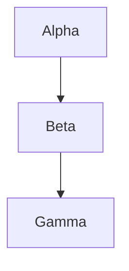

### F02 — `flowchart` keyword, chained nodes

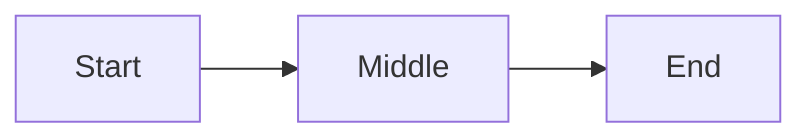

### F03 — Top to bottom (TB / TD)

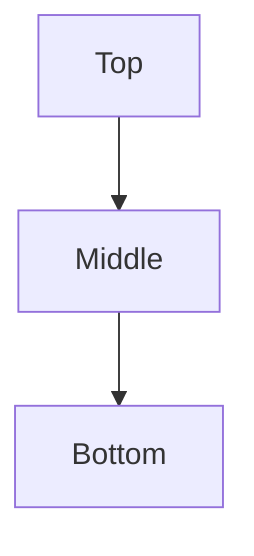

### F04 — Left to right (LR)

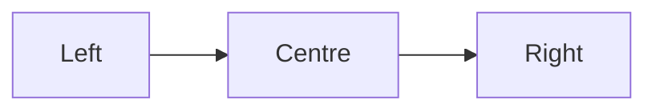

### F05 — Bottom to top (BT)

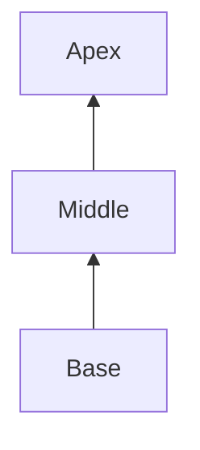

### F06 — Right to left (RL)

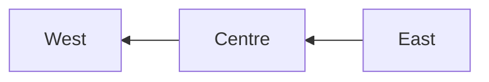

### F07 — Single node (no edges)

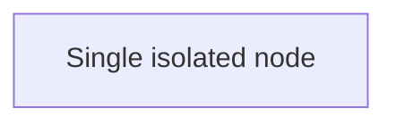

### F08 — Two nodes, one edge

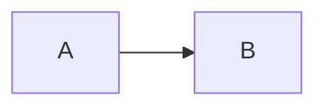

### F09 — Node IDs without labels (ID as text)

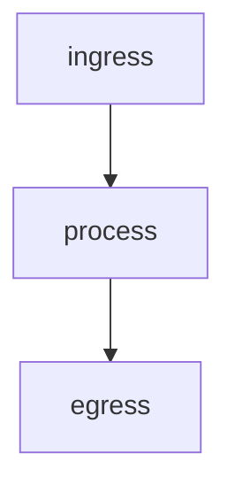

### F10 — Quoted node labels

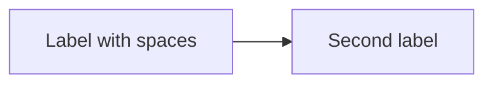

---

## Level 2 — Node shapes

### F11 — Basic shapes (rectangle, rounded, diamond, circle)

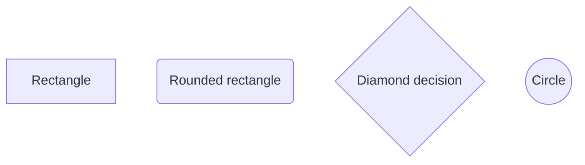

### F12 — Stadium and subroutine

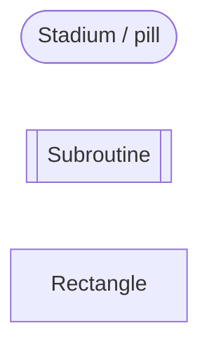

### F13 — Cylinder and database-style

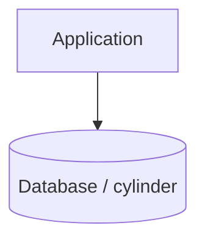

### F14 — Hexagon

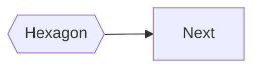

### F15 — Asymmetric (flag) shape


### F16 — Double circle

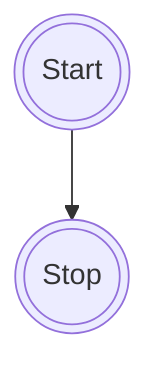

### F17 — Shape catalogue row (smoke test)

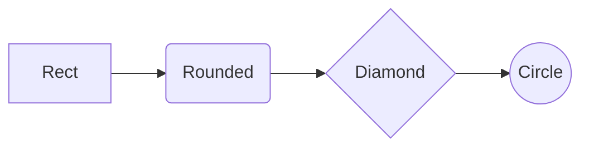

---

## Level 3 — Edge types and arrowheads

### F18 — Solid arrow and open line

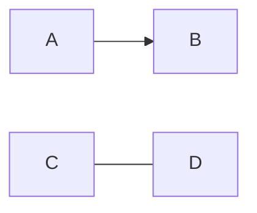

### F19 — Dotted arrow and dotted line

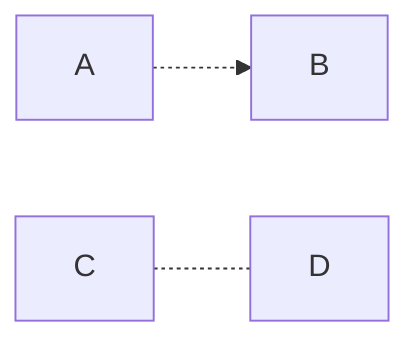

### F20 — Thick arrow and thick line

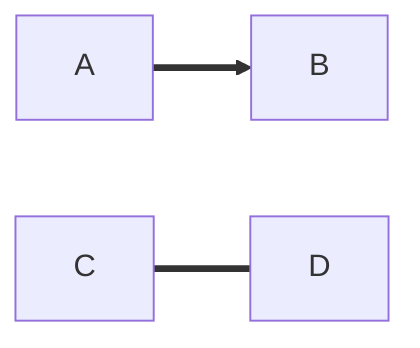

### F21 — Circle end and cross end

```mermaid
flowchart LR
A[A] --o B[B]
C[C] --x D[D]
```

### F22 — Bidirectional arrows

```mermaid
flowchart LR
A[A] <--> B[B]
C[C] o--o D[D]
E[E] x--x F[F]
```

### F23 — All edge styles in one diagram

```mermaid
flowchart LR
A1[A] --> B1[B]
C1[C] --- D1[D]
E1[E] -.-> F1[F]
G1[G] -.- H1[H]
I1[I] ==> J1[J]
K1[K] === L1[L]
M1[M] --o N1[N]
O1[O] --x P1[P]
Q1[Q] <--> R1[R]
```

### F24 — Edge labels (short)

```mermaid
flowchart LR
A[Request] -->|approve| B[Approved]
A -->|reject| C[Rejected]
```

### F25 — Edge labels with spaces and punctuation

```mermaid
flowchart TB
A[Source] -->|"Step 1: validate input"| B[Validator]
B -->|"Step 2: persist (async)"| C[Store]
```

### F26 — Long edge label (wrapping stress)

```mermaid
flowchart LR
A[Producer] -->|"This edge label is intentionally long so wrapping, clearance from arrowheads, and node borders can be verified in Word."| B[Consumer]
```

### F27 — Chained statement on one line

```mermaid
flowchart LR
A[A] --> B[B] --> C[C] --> D[D]
```

### F28 — Min-length / multi-segment link (extra hyphens)

```mermaid
flowchart TB
A[A] --> B[B]
C[C] ---> D[D]
E[E] ----> F[F]
```

---

## Level 4 — Branching, decisions, and flow control

### F29 — Binary decision (Yes / No)

```mermaid
flowchart TD
Start([Start]) --> Check{Valid?}
Check -->|Yes| OK[Accept]
Check -->|No| Fail[Reject]
```

### F30 — Multi-way decision (three branches)

```mermaid
flowchart TD
A[Christmas] -->|Get money| B(Go shopping)
B --> C{Let me think}
C -->|One| D[Laptop]
C -->|Two| E[iPhone]
C -->|Three| F[Other gift]
```

### F31 — Fan-out (one to many)

```mermaid
flowchart TB
Hub[Hub] --> W1[Worker 1]
Hub --> W2[Worker 2]
Hub --> W3[Worker 3]
```

### F32 — Fan-in (many to one)

```mermaid
flowchart BT
W1[Worker 1] --> Agg[Aggregate]
W2[Worker 2] --> Agg
W3[Worker 3] --> Agg
```

### F33 — Parallel workers then join

```mermaid
flowchart LR
A[Ingress] --> B[Enqueue]
B --> C[Worker 1]
B --> D[Worker 2]
C --> E[Aggregate]
D --> E
E --> F[Out]
```

### F34 — Simple cycle (retry loop)

```mermaid
flowchart LR
A[Receive] --> B{OK?}
B -->|Yes| C[Done]
B -->|No| D[Retry]
D --> A
```

### F35 — Diamond with multiple incoming edges

```mermaid
flowchart TB
A[Path A] --> D{Merge?}
B[Path B] --> D
C[Path C] --> D
D -->|yes| E[Continue]
D -->|no| F[Stop]
```

---

## Level 5 — Subgraphs (single level)

### F36 — Single subgraph, default direction

```mermaid
flowchart TB
subgraph SG["Processing"]
  A[Parse] --> B[Transform] --> C[Emit]
end
IN[In] --> A
C --> OUT[Out]
```

### F37 — Subgraph with explicit `direction TB`

```mermaid
flowchart LR
subgraph Box["Vertical stack inside horizontal diagram"]
  direction TB
  S1[Step 1] --> S2[Step 2] --> S3[Step 3]
end
Start[Start] --> S1
S3 --> End[End]
```

### F38 — Subgraph with `direction LR` inside TB diagram

```mermaid
flowchart TB
subgraph Pipeline["Pipeline"]
  direction LR
  P1[Read] --> P2[Map] --> P3[Write]
end
Ingress[Ingress] --> P1
P3 --> Egress[Egress]
```

### F39 — Subgraph with titled label in brackets

```mermaid
flowchart LR
subgraph R0S0["Manifests and checksums"]
  direction TB
  r0n0["Publish a manifest with sizes, hashes, and a completion marker."]
end
IN[In] --> r0n0
r0n0 --> OUT[Out]
```

### F40 — Two sibling subgraphs side by side

```mermaid
flowchart LR
subgraph S0["Stage A"]
  direction TB
  a0[A0] --> a1[A1]
end
subgraph S1["Stage B"]
  direction TB
  b0[B0] --> b1[B1]
end
IN[In] --> a0
a1 --> b0
b1 --> OUT[Out]
```

### F41 — Edge from subgraph member to sibling subgraph member

```mermaid
flowchart LR
subgraph Normaliser["Normaliser"]
  direction TB
  n0[Normalise layout]
end
subgraph Translator["Translator"]
  direction TB
  t0[Translate contract]
end
IN[In] --> n0
n0 --> t0
t0 --> OUT[Out]
```

### F42 — Long wrapping text inside subgraph

```mermaid
flowchart LR
subgraph R0S0["Manifests and checksums"]
  direction TB
  r0n0["Publish a manifest (file list, sizes, hashes) with each drop so the consumer can reject incomplete uploads and detect tampering. Include a stable batch identifier and an explicit completion marker."]
end
IN[In] --> r0n0
r0n0 --> OUT[Out]
```

---

## Level 6 — Nested subgraphs

### F43 — Nested subgraphs (regression: cross-boundary edges)

Reference fixture for nested layout, mixed directions, and member ownership.

```mermaid
flowchart TB
subgraph Outer["Outer subgraph"]
  direction TB
  A["Top node"] --> B["Middle node"]
  subgraph Inner["Inner subgraph"]
    direction LR
    C["Left"] --> D["Right"]
  end
  B --> C
  D --> E["Bottom node"]
end
```

### F44 — Nested subgraph with inner `direction TB`

```mermaid
flowchart TB
subgraph Outer["Outer"]
  direction TB
  Start[Start] --> InnerTop
  subgraph Inner["Inner TB"]
    direction TB
    InnerTop[Inner top] --> InnerBottom[Inner bottom]
  end
  InnerBottom --> End[End]
end
```

### F45 — Two levels of nesting

```mermaid
flowchart TB
subgraph L0["Level 0"]
  direction TB
  A[A] --> B[B]
  subgraph L1["Level 1"]
    direction TB
    subgraph L2["Level 2"]
      direction TB
      C[C] --> D[D]
    end
  end
  B --> C
  D --> E[E]
end
```

### F46 — Nested subgraph, outer LR, inner LR

```mermaid
flowchart LR
subgraph OuterLR["Outer LR"]
  direction LR
  O1[O1] --> O2[O2]
  subgraph InnerLR["Inner LR"]
    direction LR
    I1[I1] --> I2[I2]
  end
  O2 --> I1
  I2 --> O3[O3]
end
```

### F47 — Three nodes in nested cluster, chained

```mermaid
flowchart TB
subgraph Root["Root"]
  direction TB
  Entry[Entry] --> K1
  subgraph Core["Core"]
    direction TB
    K1[K1] --> K2[K2] --> K3[K3]
  end
  K3 --> Exit[Exit]
end
```

---

## Level 7 — Labels, text, and special characters

### F48 — Special characters (Mermaid entity codes)

Markdown-style backslash escapes (`\\*`, `\"`, …) are **not** valid in Mermaid node labels. Use [entity codes](https://mermaid.js.org/syntax/flowchart.html#entity-codes-to-escape-characters) instead (`#quot;`, `#lt;`, `#124;`, …).

```mermaid
flowchart TB
A["Symbols: star#42; underscore#95; backtick#96; brackets#91;#93; pipe A#124;B"] --> B["Quotes: double#quot; and apostrophe#39;s"]
B --> C["Comparison: a#lt; b #38;#38; c#gt; d"]
```

### F49 — Line breaks in labels (`<br/>`)

```mermaid
flowchart TD
A["Line one<br/>Line two"] --> B["Another<br/>multi-line<br/>label"]
```

### F50 — Unicode and symbols

```mermaid
flowchart LR
A["Currency: € £ ¥"] --> B["Arrows: → ← ↑ ↓"]
B --> C["Emoji smoke: ✓ ✗ ⚠"]
```

### F51 — Very long single-node label (wrapping)

```mermaid
flowchart TB
N["This node label is deliberately verbose so the renderer must wrap text inside the node boundary instead of overflowing the subgraph or page margins when embedded in Word."]
```

### F52 — Short labels, tight spacing

```mermaid
flowchart LR
A[A] --> B[B] --> C[C] --> D[D] --> E[E]
```

---

## Level 8 — Styling, classes, and init

### F53 — `style` directive (fill / stroke)

```mermaid
flowchart TD
Start([Start]) --> Process[Process]
Process --> Decision{Valid?}
Decision -->|Yes| Success[Success]
Decision -->|No| Error[Error]
Success --> End([End])
Error --> End

style Start fill:#e1f5e1
style End fill:#e1f5e1
style Error fill:#f8d7da
style Success fill:#d1ecf1
```

### F53A — `style` directive (fill / stroke)

```mermaid
flowchart TD
Success --> End([End])
Error --> End

style End fill:#e1f5e1
style Error fill:#f8d7da
style Success fill:#d1ecf1
```

**Evaluate:** Compare SVG **coordinates** against [mermaid.live](https://mermaid.live) (mermaid.ink reference SVG), **not** PNG pixel diff. SvgHarness extracts node positions and merge-edge path start/end points, normalises shoulder attach offsets relative to the End pill (`endDx` / `endDy`), and gates on coordinate deltas plus geometry invariants (separated shoulders, vertical stub at source X). See `{index}.coordinates.txt` in the harness output folder.

```powershell
dotnet run --project src/SvgHarness/SvgHarness.csproj -c Release -- flow.md out/f53a-coord --reference=mermaid-ink --max-blocks=54 --report=out/f53a-coord/report.md
```

Or isolate F53A only:

```powershell
dotnet run --project src/SvgHarness/SvgHarness.csproj -c Release -- out/f53a-test.md out/f53a-coord --reference=mermaid-ink
```

### F54 — `classDef` and `class`

```mermaid
flowchart LR
A[Good]:::good --> B[Bad]:::bad
classDef good fill:#d4edda,stroke:#28a745
classDef bad fill:#f8d7da,stroke:#dc3545
```

### F55 — `linkStyle` on selected edges

```mermaid
flowchart LR
A[A] --> B[B]
B --> C[C]
C --> D[D]
linkStyle 0 stroke:#ff0000,stroke-width:2px
linkStyle 2 stroke:#0000ff,stroke-dasharray:5 5
```

### F56 — Init: `htmlLabels: false` (native SVG text)

```mermaid
%%{init: {"flowchart": {"htmlLabels": false}} }%%
flowchart TB
A["Native SVG labels"] --> B["Wrap without HTML foreignObject."]
B --> C["Final"]
```

### F57 — Init: spacing overrides

```mermaid
%%{init: {"flowchart": {"nodeSpacing": 80, "rankSpacing": 80, "diagramPadding": 16}} }%%
flowchart TB
A[Wide spacing] --> B[Between ranks]
B --> C[And nodes]
```

---

## Level 9 — Combined stress scenarios

### F58 — Full pipeline (shapes + decisions + labels + cylinder)

```mermaid
flowchart TD
Start([Start]) --> Ingest[Ingest file]
Ingest --> Validate{Valid markdown?}
Validate -->|No| Reject[Reject with error]
Validate -->|Yes| Parse[Parse blocks]
Parse --> HasMermaid{Mermaid fence?}
HasMermaid -->|Yes| Render[Render SVG via Naiad]
HasMermaid -->|No| Word[Build DOCX only]
Render --> Embed[Embed in DOCX]
Embed --> Done([Done])
Word --> Done
Reject --> Done
Persist[(Optional archive)] --> Done
```

### F59 — Subgraph + decision + retry loop

```mermaid
flowchart TB
subgraph Worker["Worker pool"]
  direction TB
  Q[Queue] --> W{Worker free?}
  W -->|Yes| P[Process job]
  W -->|No| Wait[Wait]
  Wait --> Q
end
Client[Client] --> Q
P --> Out[Output]
```

### F60 — LR diagram with nested TB and cross-links (integration)

```mermaid
flowchart LR
subgraph Ingest["Ingest"]
  direction TB
  I1[Receive drop] --> I2[Verify manifest]
end
subgraph Transform["Transform"]
  direction TB
  T1[Normalise] --> T2[Translate]
end
subgraph Publish["Publish"]
  direction TB
  P1[Package] --> P2[Release]
end
Source[Source] --> I1
I2 --> T1
T2 --> P1
P2 --> Sink[Sink]
I2 -.->|audit copy| P2
```

---

## Scenario index

| ID | Level | Topic |
| --- | --- | --- |
| F01–F10 | 1 | Syntax, direction, basics |
| F11–F17 | 2 | Node shapes |
| F18–F28 | 3 | Edge types and labels |
| F29–F35 | 4 | Branching and control flow |
| F36–F42 | 5 | Single-level subgraphs |
| F43–F47 | 6 | Nested subgraphs |
| F48–F52 | 7 | Labels and text stress |
| F53–F57 | 8 | Style, class, init |
| F53A | 8 | Isolated stadium merge (coordinate gate vs mermaid.live) |
| F58–F60 | 9 | Combined integration |

---

## Optional batch commands

Render only this file:

```powershell
dotnet run --project src/md2docx/md2docx.csproj -- flow.md flow.docx
```

Compare with `test.md` flowchart section for overlapping coverage; use **flow.md** when iterating specifically on flowchart layout.
