# Routing intent torture test

This Markdown fixture exercises generic flowchart routing behaviours for the routing-intent diagnostic layer.
Each diagram is preceded by a `DiagramId` HTML comment used by the test runner and `ruleset.json`.

---

## Regression — full pipeline stress (F58)

<!-- DiagramId: RegressionFlow001 -->

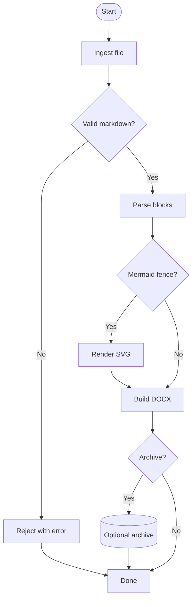

---

## Straight centre-spine flow

<!-- DiagramId: CentreSpineLinear -->

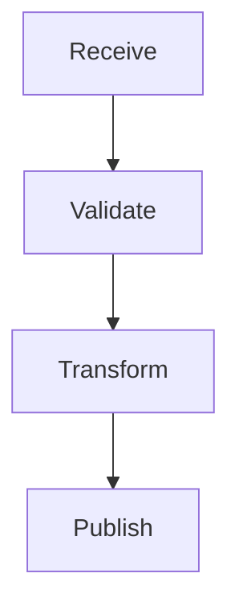

---

## Single decision branch

<!-- DiagramId: SingleDecisionBranch -->

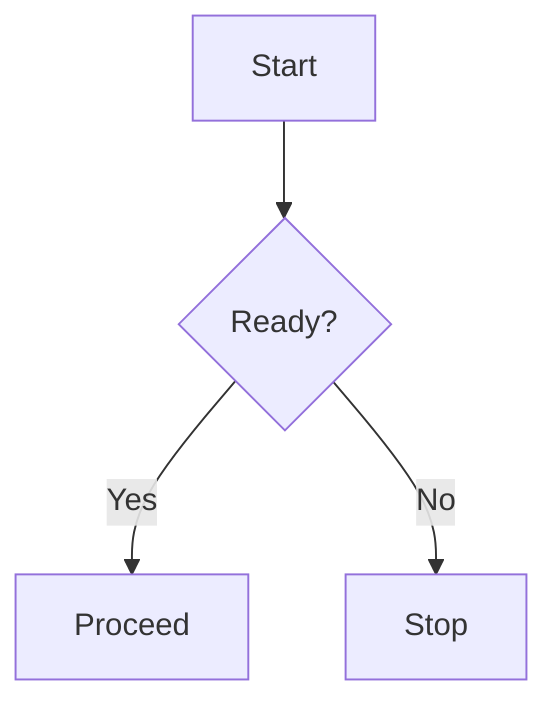

---

## Nested decision branches

<!-- DiagramId: NestedDecisionBranch -->

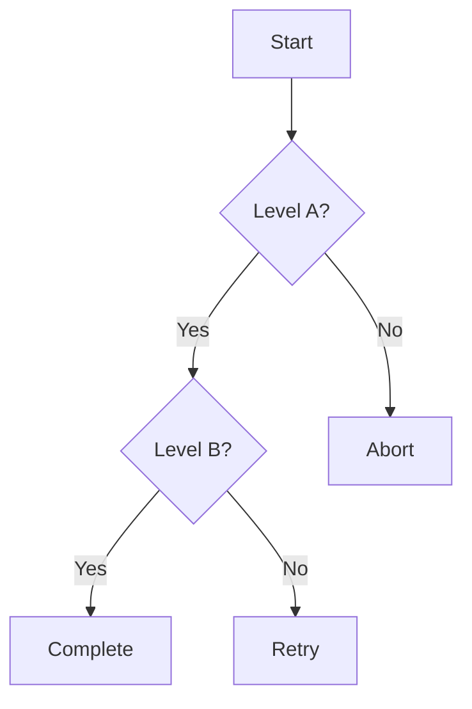

---

## Multiple branches merging into one node

<!-- DiagramId: MultiMergeCollector -->

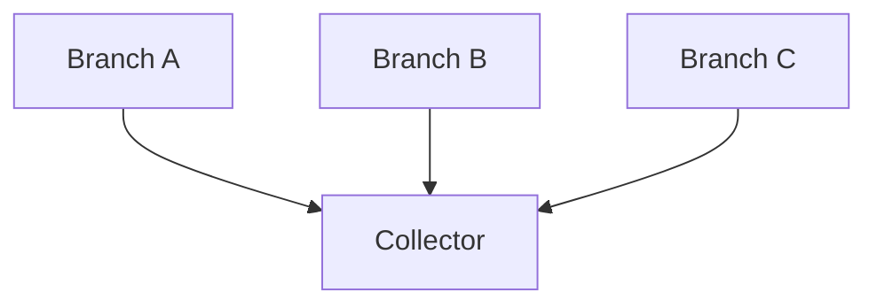

---

## Long bypass over several ranks

<!-- DiagramId: LongBypassSkip -->

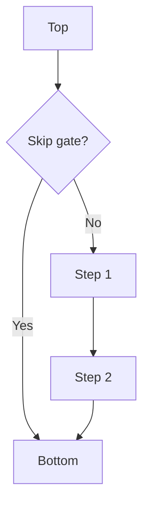

---

## Exception path around spine

<!-- DiagramId: LongExceptionPath -->

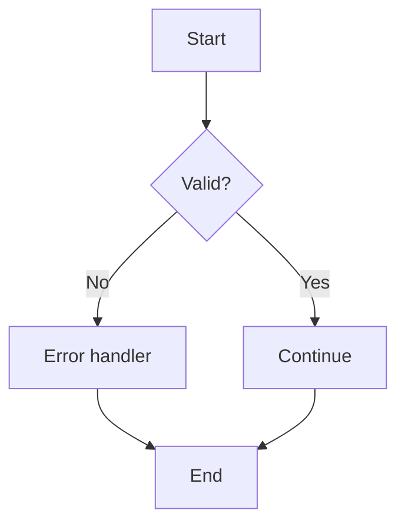

---

## Cross-lane link

<!-- DiagramId: CrossLaneLink -->

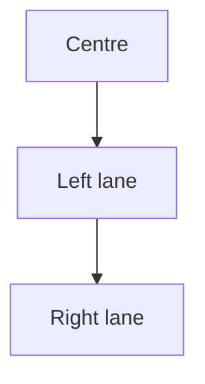

---

## Dense local branches

<!-- DiagramId: DenseLocalBranches -->

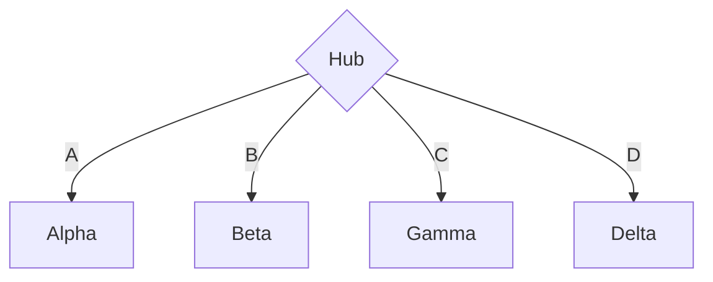

---

## Labels on short and long edges

<!-- DiagramId: LabelledEdges -->

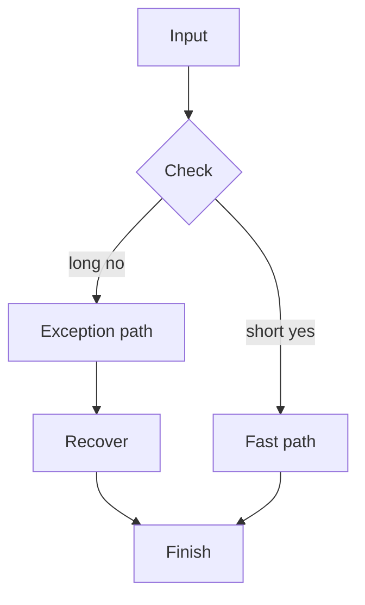

---

## Multiple incoming and outgoing edges

<!-- DiagramId: MultiFanInOut -->

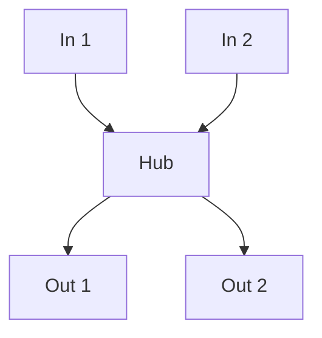

---

## Left-to-right direction

<!-- DiagramId: DirectionLR -->

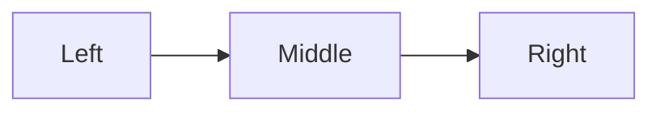

---

## Bottom-to-top direction

<!-- DiagramId: DirectionBT -->

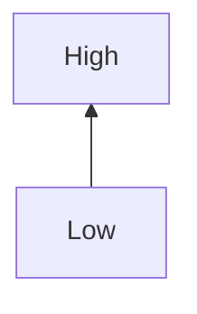

---

## Right-to-left direction

<!-- DiagramId: DirectionRL -->

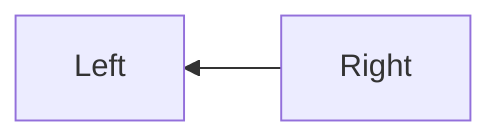
