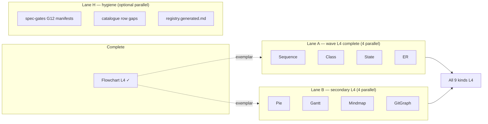
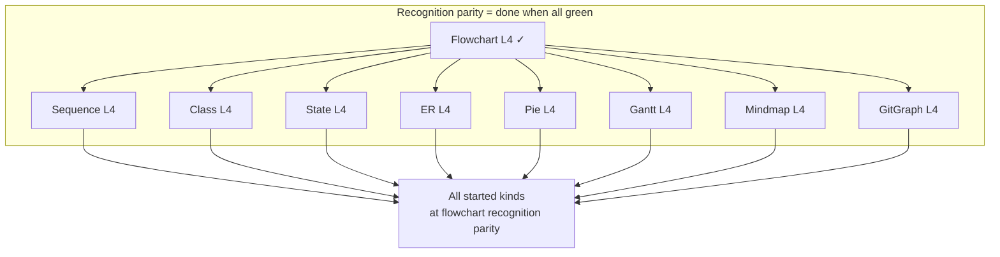

# Diagram parity roadmap — parallel paths to completion

**Authority:** normative gate definitions remain in [`spec.md`](spec.md) §7.4 and §11.1.14.  
**Progress:** [`status.md`](status.md) gate registry.  
**Last updated:** 2026-10-07 (all started kinds at L4 on `master`)

---

## G12 requirement layer (exact path scope)

Each parallel path’s **exact requirements** live in three linked artefacts:

| Layer | Location | Answers |
| --- | --- | --- |
| **Normative exit** | `spec.md` §11.1.14.x L3/L4 exit criteria | What “done” means in prose |
| **Inventory** | [`spec-gates/{kind}-g12.md`](spec-gates/g12-backlog-template.md) | Upstream test → line type → fixture → status |
| **Evidence** | `*Recognition/` fixtures + `*L4AxisGateTests` | Machine-verifiable completion |

**Template and column schema:** [`spec-gates/g12-backlog-template.md`](spec-gates/g12-backlog-template.md)  
**Flowchart exemplar (complete):** [`spec-gates/flowchart-g12.md`](spec-gates/flowchart-g12.md)

**Promotion rule:** manifest `GateLevel: L4` only when every row in the kind’s **minimum L4 slice** is status **transcribed** (no **planned** rows in that slice).

---

## Completion definition

**Recognition parity with flowchart** (this roadmap’s goal): every **started** diagram kind reaches gate **L4** — L2 catalogue complete, L3 entity model (G4–G9), L4 parser parity (G12), with manifests, verified JSON, and `*L4AxisGateTests` matching the flowchart exemplar.

**Not in scope here:** product parity (render adapters, §11.B–11.E, default DOCX path, `pie.md`-style visual catalogues). Those paths are listed in [Product parity path](#product-parity-path-separate-programme) and must not block recognition L4 work.

---

## Current snapshot (`master`, 2026-10-07)

| Kind | Gate level | L4 status | Parallel path |
| --- | --- | --- | --- |
| Flowchart / graph | **L4** | **Complete** (recognition) | Native Sugiyama render (maintenance) |
| Sequence | **L4** | Minimum G12 slice complete | [Path S](#path-s-sequence) |
| Class | **L4** | Minimum G12 slice complete | [Path C](#path-c-class) |
| State | **L4** | Minimum G12 slice complete | [Path ST](#path-st-state) |
| ER | **L4** | Minimum G12 slice complete | [Path E](#path-e-er) |
| Pie | **L4** | Minimum G12 slice complete | [Path P](#path-p-pie) |
| Gantt | **L4** | Minimum G12 slice complete | [Path G](#path-g-gantt) |
| Mindmap | **L4** | Minimum G12 slice complete | [Path M](#path-m-mindmap) |
| Git graph | **L4** | Minimum G12 slice complete | [Path GG](#path-gg-git-graph) |

**Suite:** 932 tests in `MermaidRecognition.Tests` (921 passing on Linux CI as of 2026-10-07). Native render: flowcharts only; other kinds still use Naiad. Grid layout and rounded-corner grid routing remain on open branches, not on `master`.

---

## Serial ancestor chain (every kind)

Every path shares the same **level order**; kinds at different levels run different **phases** in parallel.

```text
L1  detect + smoke + diagnostics          [all started kinds: done]
  └─► L2  G2 catalogue + G3 per line type   [all started kinds: done]
        └─► L3  *ContractMapper + G4–G9 + *L3AxisGateTests
              └─► L4  G12 fixtures + *L4AxisGateTests + manifest GateLevel L4
```

**Cross-cutting rules (all parallel paths):**

1. Spec catalogue row (§11.1.14.x) before adding a fixture for that line type.
2. `.mmd` + `.verified.json` on disk before manifest lists the fixture name.
3. `DiagramGateManifestTests` green after manifest edits.
4. Full test suite green before promoting `GateLevel` (especially `L4 partial` → `L4`).

---

## Parallel lanes (how work splits today)

After pass 18, recognition parity completion is **eight independent kind paths** plus optional **programme hygiene**. No kind path blocks another except the shared test suite.



| Lane | Kinds | Can start now? | Blocks |
| --- | --- | --- | --- |
| **A — Wave L4** | Sequence, class, state, ER | Yes | Nothing cross-kind; only shared CI |
| **B — Secondary L4** | Pie, gantt, mindmap, gitGraph | Yes (L3 done) | Nothing cross-kind; only shared CI |
| **H — Hygiene** | All | Yes | None |
| **Flowchart** | Flowchart | N/A | Done |

**Maximum safe parallelism:** up to **8 kind agents** (one per incomplete kind) + **1 hygiene agent**, provided each touches disjoint fixture directories and merges reconcile verified JSON conflicts.

---

## Per-kind parallel paths

Each path is **self-contained**: follow steps in order within the path; paths do not depend on each other.

### Flowchart (done)

| Step | Status | Evidence |
| --- | --- | --- |
| L3 G4–G11 | Done | `FlowchartL3AxisGateTests`, 32 fixtures |
| L4 G12 | Done | `FlowchartL4AxisGateTests`, manifest `L4` |
| Optional maintenance | Open | Broader front-matter keys beyond theme/spacing (§11.1.14.1) |

---

### Path S — Sequence

```text
[L4 partial] ──► G12 backlog ──► manifest L4
     ✓                  │              │
  L4AxisGateTests        │              └── promotion when G12 slice complete
  init-leading G12       │
                         ▼
              spec-gates/sequence-g12.md (upstream test ids)
              + fixtures: par_over, remaining §11.1.14.2 gaps
              + SequenceL4AxisGateTests per cluster
```

| Step | Deliverable | Spec ref |
| --- | --- | --- |
| S1 | Document G12 backlog from vendored `sequenceDiagram` `*.spec.js` | §11.1.14.2 |
| S2 | Add fixtures for open catalogue rows (e.g. `par_over` scenario) | [`sequence.md`](sequence.md) |
| S3 | Expand `SequenceL4AxisGateTests` (one test per G12 cluster) | §7.4.2 L4 |
| S4 | Promote `sequence.gate-manifest.json` → `GateLevel: L4` | manifest |

---

### Path C — Class

```text
[L4 partial] ──► G12 backlog ──► manifest L4
     ✓                  │
  init-leading G12       ▼
              classDiagram.init.leading fixture in catalogue table (§11.1.14.3)
              + classApply split if G12 requires it
              + ClassL4AxisGateTests clusters
```

| Step | Deliverable | Spec ref |
| --- | --- | --- |
| C1 | `init-leading` fixture listed in §11.1.14.3 if missing from spec table | §11.1.14.3 |
| C2 | G12 backlog → `spec-gates/class-g12.md` | vendored class parser tests |
| C3 | G12 fixtures from [`class.md`](class.md) gaps (C24 remarked excluded) | §9.1 |
| C4 | Promote `class.gate-manifest.json` → `L4` | manifest |

---

### Path ST — State

```text
[L4 partial] ──► G12 backlog ──► manifest L4
     ✓                  │
  init-leading G12       ▼
              fork/join/choice G12 axes, composite depth
              + StateL4AxisGateTests clusters
```

| Step | Deliverable | Spec ref |
| --- | --- | --- |
| ST1 | G12 backlog → `spec-gates/state-g12.md` | §11.1.14.4 |
| ST2 | Fixtures for any §11.1.14.4 row without G12 coverage | [`state.md`](state.md) |
| ST3 | Expand `StateL4AxisGateTests` | §7.4.2 L4 |
| ST4 | Promote `state.gate-manifest.json` → `L4` | manifest |

---

### Path E — ER

```text
[L4 partial] ──► G12 backlog ──► manifest L4
     ✓                  │
  init-leading G12       ▼
              relationship/cardinality G12 axes
              + ErL4AxisGateTests clusters
```

| Step | Deliverable | Spec ref |
| --- | --- | --- |
| E1 | G12 backlog → `spec-gates/er-g12.md` | §11.1.14.5 |
| E2 | Fixtures for §11.1.14.5 G12 gaps | [`entityrelationship.md`](entityrelationship.md) |
| E3 | Expand `ErL4AxisGateTests` | §7.4.2 L4 |
| E4 | Promote `er.gate-manifest.json` → `L4` | manifest |

---

### Path P — Pie

```text
[L3] ──► L3 depth ──► G12 backlog ──► manifest L4
  ✓         │              │
PieContractMapper   deepen G4–G9    spec-gates/pie-g12.md
PieL3AxisGateTests  (a11y, showData)  + PieL4AxisGateTests
```

| Step | Deliverable | Spec ref |
| --- | --- | --- |
| P1 | Deepen L3: G9 if grammar supports `accTitle`; richer slice metadata | §11.1.14.6 |
| P2 | Add `PieL4AxisGateTests` scaffold | new |
| P3 | G12 fixtures from vendored pie parser tests | §3.18 |
| P4 | Promote `pie.gate-manifest.json` → `L4` | manifest |

---

### Path G — Gantt

```text
[L3] ──► L3 depth ──► G12 backlog ──► manifest L4
  ✓         │              │
GanttContractMapper  milestones, excludes variants  GanttL4AxisGateTests
GanttL3AxisGateTests  task date axes
```

| Step | Deliverable | Spec ref |
| --- | --- | --- |
| G1 | Deepen L3: milestone lines, `excludes` variants, section nesting | §11.1.14.7 |
| G2 | `GanttL4AxisGateTests` scaffold | new |
| G3 | G12 fixtures | vendored gantt tests |
| G4 | Promote `gantt.gate-manifest.json` → `L4` | manifest |

---

### Path M — Mindmap

```text
[L3] ──► L3 depth ──► G12 backlog ──► manifest L4
  ✓         │              │
MindmapContractMapper  deeper tree / shapes   MindmapL4AxisGateTests
MindmapL3AxisGateTests
```

| Step | Deliverable | Spec ref |
| --- | --- | --- |
| M1 | Deepen L3: multi-level indent, shape suffixes if in grammar | §11.1.14.8 |
| M2 | `MindmapL4AxisGateTests` scaffold | new |
| M3 | G12 fixtures | vendored mindmap tests |
| M4 | Promote `mindmap.gate-manifest.json` → `L4` | manifest |

---

### Path GG — Git graph

```text
[L3] ──► L3 depth ──► G12 backlog ──► manifest L4
  ✓         │              │
GitGraphContractMapper  checkout/merge tags   GitGraphL4AxisGateTests
GitGraphL3AxisGateTests  if grammar adds line types
```

| Step | Deliverable | Spec ref |
| --- | --- | --- |
| GG1 | Deepen L3: extend line patterns if vendored grammar has `checkout`, `merge`, etc. | §11.1.14.9 |
| GG2 | `GitGraphL4AxisGateTests` scaffold | new |
| GG3 | G12 fixtures | vendored gitGraph tests |
| GG4 | Promote `gitGraph.gate-manifest.json` → `L4` | manifest |

---

## Recommended parallel batches

### Documentation batch (complete)

| Task | Deliverable | Status |
| --- | --- | --- |
| D0 | [`g12-backlog-template.md`](spec-gates/g12-backlog-template.md) + flowchart exemplar | Done |
| D1 | §11.1.14.x L4 exit criteria (all kinds) | Done |
| D2–D9 | `{kind}-g12.md` for 8 incomplete kinds | Done |

### Implementation batch 19 (parallel execution)

Run **one agent per kind path** (S, C, ST, E, P, G, M, GG). Each agent:

1. Works from the kind’s [`spec-gates/{kind}-g12.md`](spec-gates/g12-backlog-template.md) **minimum L4 slice** (secondary kinds: close L3 section first).
2. Adds fixtures + verified JSON via `*FixtureWriter` tests.
3. Expands `*L4AxisGateTests`.
4. Runs `dotnet test tests/MermaidRecognition.Tests/MermaidRecognition.Tests.csproj`.
5. Updates row status **transcribed** in `{kind}-g12.md`; promotes manifest when minimum slice complete.

**Merge rule:** integrate one kind at a time if CI conflicts; paths touch different directories (`SequenceRecognition/` vs `PieRecognition/`, etc.).

### How many parallel tasks?

| Phase | Parallel tasks | Serial prerequisites |
| --- | --- | --- |
| **G12 documentation** | **10** (D0 template+flowchart, D1 spec L4 criteria, D2–D9 × 8 backlogs) | None — can run D2–D9 concurrently after D0 defines schema |
| **L4 implementation (wave)** | **4** (sequence, class, state, ER) | Each reads its `{kind}-g12.md`; no cross-kind deps |
| **L4 implementation (secondary)** | **4** (pie, gantt, mindmap, gitGraph) | Close L3 rows in `{kind}-g12.md` first; then L4 slice |
| **Maximum safe parallelism** | **8** kind agents + **1** hygiene (registry / spec table sync) | Shared test suite only |

**Minimum to start implementation:** **1** task per kind you are completing (8 total for full programme). Documentation is now unblocking all eight paths.

### Batch 20 (programme completion)

When **all eight paths** promote to manifest `L4`:

| Check | Criterion |
| --- | --- |
| Recognition parity | All 9 started kinds at manifest `GateLevel: L4` |
| Spec alignment | Every §11.1.14.x row for started kinds has fixture column filled |
| Tests | Full suite green; `CatalogueScenarioCoverageTests` still passes for S/C/ST/E |
| Status | [`status.md`](status.md) pass bump; truthfulness table updated |

---

## Completion dependency graph



Edges are **exemplar only** (flowchart defines the pattern); there is **no hard technical dependency** between S4, C4, P4, etc.

---

## Exit checklists (updated pass 18)

### Flowchart — L4 complete

- [x] `FlowchartL4AxisGateTests.cs` with G12 assertions
- [x] Manifest `GateLevel: L4`
- [x] Front-matter theme + spacing + F87/F88 axes
- [ ] Optional: remaining §11.1.14.1 front-matter keys (maintenance)

### Wave kinds — L4 partial → L4

- [x] `*L4AxisGateTests.cs` exists with manifest parse + init-leading G12
- [x] Manifest `GateLevel: L4 partial`
- [ ] G12 backlog documented per kind ([`spec-gates/{kind}-g12.md`](spec-gates/g12-backlog-template.md))
- [ ] Minimum L4 slice rows **transcribed**
- [ ] All §11.1.14.x catalogue rows have fixtures
- [ ] Manifest promoted to `L4`

### Secondary kinds — L3 → L4

- [x] `*ContractMapper.cs` wired
- [x] `*L3AxisGateTests.cs`
- [x] Manifest `GateLevel: L3`
- [ ] `*L4AxisGateTests.cs`
- [ ] G12 fixtures + manifest `L4`

---

## Product parity path (native render — separate programme)

Runs **after** recognition L4. **Naiad is not a product option** — legacy output under `extern/Naiad` is used only for side-by-side comparison during transition (§12).

```text
Recognition L4 (all started kinds)
  └─► Native render: DiagramContract → per-kind adapter + layout (src/)
        └─► Visual catalogues (pie.md, gantt.md, …) + FixtureProbe / Converter export
              └─► MDConverter default: MermaidRecognizer + native adapters
                    └─► §11.E Mermaid.js fallback where native render is not yet available
```

Do **not** block recognition tracks on this path. Do **not** extend `extern/Naiad` for product features.

---

## Workstream ID map (historical)

| ID | Stream | Pass 18 result | Next step |
| --- | --- | --- | --- |
| P1 | Flowchart L4 | **Done** | Maintenance |
| P2 | Sequence L4 | L4 partial | Path S steps S1–S4 |
| P3 | Class L4 | L4 partial | Path C steps C1–C4 |
| P4 | State L4 | L4 partial | Path ST steps ST1–ST4 |
| P5 | ER L4 | L4 partial | Path E steps E1–E4 |
| P6 | Pie L3 | **Done** | Path P steps P1–P4 |
| P7 | Gantt L3 | **Done** | Path G steps G1–G4 |
| P8 | Mindmap L3 | **Done** | Path M steps M1–M4 |
| P9 | GitGraph L3 | **Done** | Path GG steps GG1–GG4 |
| P10 | Docs / gates | Roadmap + status | Lane H; batch 19 coordination |

---

## Execution log

| Pass | Date | Parallel work | Outcome |
| --- | --- | --- | --- |
| 18 | 2026-05-31 | P1–P9 (4 agents) | Flowchart L4; wave L4 partial; secondary L3; 702 tests |
| 19 | 2026-05-31 | Batch 19 (8 agents) | All 8 kind paths → L4; 786 tests |
| 20 | 2026-05-31 | Truthfulness + render pilot | `FlowchartRouter`, native flowchart SVG pilot, checklist tests; 797 tests |
