# Sequence diagram regression catalogue

Progressive Mermaid **sequenceDiagram** scenarios for recognition and render regression (Markdown → DOCX). Each section increases complexity; scenarios within a section are ordered from simplest to hardest.

**Spec mapping:** line types in `spec.md` §11.1.14.2; recognition fixtures in `tests/MermaidRecognition.Tests/SequenceRecognition/`.

**Programme note:** Naiad is an interim render baseline only. Recognition truth lives in `MermaidRecognition`; eventual render must not depend on extending Naiad sequence parsers.

## Scenario index (complete)

| Id | Level | Line types / axis | Recognition fixture | Naiad sample |
| --- | --- | --- | --- | --- |
| S01 | 1 | header, message | `simple` | Simple |
| S02 | 1 | implicit participants | `implicit-participants` | — |
| S03 | 1 | multi-hop messages | `multi-hop` | — |
| S04 | 2 | participant | `participants` | Participants |
| S05 | 2 | actor, participant | `actor-participant` | Actors |
| S06 | 2 | participant order | `participant-order` | — |
| S07 | 3 | solid/dotted closed arrows | `closed-arrows` | — |
| S08 | 3 | open/cross arrows | `open-cross-arrows` | DifferentArrows |
| S09 | 4 | message activation `+`/`-` | `activation` | Activation |
| S10 | 4 | activate, deactivate | `activate-deactivate` | — |
| S11 | 5 | note (left/right/over) | `notes` | Notes |
| S12 | 6 | title | `title` | Title |
| S13 | 6 | autonumber | `autonumber` | AutoNumber |
| S14 | 7 | alt, else, end | `alt-else-blocks` | AltElseBlocks |
| S15 | 7 | loop, end | `loop-control` | — |
| S16 | 7 | opt, end | `opt-block` | — |
| S17 | 7 | par, and, end | `par-block` | — |
| S18 | 7 | critical, option, end | `critical-block` | — |
| S19 | 8 | box | `box-rgb` | — |
| S20 | 8 | create, destroy | `lifecycle-create` | — |
| S21 | 8 | accTitle, accDescr | `sequence-accessibility` | — |
| S22 | 8 | comment | `comment` | — |
| S23 | 8 | combined render smoke | `auth-smoke` | Complex |
| S24 | 8 | init (G1) | `init-leading` | — |
| S25 | 8 | break, end | `break-block` | — |
| S26 | 8 | rect, end | `rect-block` | — |
| S27 | 8 | nested blocks | `nested-blocks` | — |
| S28 | 8 | accDescr block | `accDescr-block` | — |
| S29 | 3 | self-message | `self-message` | — |
| S30 | 3 | long message label | `long-message-label` | — |
| S31 | 3 | quoted message label | `quoted-message-label` | — |
| S32 | 7 | else-only branch | `else-only` | — |

**§11.1.14.2 line-type coverage:** every row is **parsed** except `sequence.body` (must not appear in catalogue scenarios).

## How to use

This file is the **complete** sequence regression catalogue: **isolated diagrams (S01–S32)**. Levels 1–7 cover visual/render smoke aligned with `extern/Naiad/src/test-renders/Sequence.md`. Level 8 adds remaining recognition axes from §11.1.14.2.

### Remarked scenarios (`%%`)

Diagrams that **do not render** on [mermaid.live](https://mermaid.live) remain in this file with **every source line prefixed by `%%`**. That marks them as **considered but rejected** for the render gate — **do not re-add** them because the catalogue looks incomplete. DOCX visual review skips remarked blocks. See §9.1 in `spec.md`.

**Currently remarked:** *(none yet — add ids here when you remark a scenario.)*

### Visual export (Windows `Converter.exe`)

Export a single diagram block from this catalogue to PNG or SVG (use `-index N` for the Nth ` ```mermaid ` block):

```text
Converter.exe -in sequence.md -png out/sequence/S01.png -index 1
Converter.exe -in sequence.md -svg out/sequence/S01.svg -index 1
```

### Recognition contract gate

```powershell
dotnet test tests/MermaidRecognition.Tests/MermaidRecognition.Tests.csproj --filter "FullyQualifiedName~SequenceRecognition"
```

Official catalogue scenarios must not produce silent `sequence.body` fallback (see `SequenceRecognitionFixtureTests`).

### DOCX visual review

```powershell
dotnet run --project src/md2docx/md2docx.csproj -- sequence.md sequence.docx
```

**Checklist per scenario**

- All declared participants appear on lifelines (none missing or duplicated)
- Message order matches source (including autonumber when enabled)
- Activation bars align with `+`/`-` message markers or explicit activate/deactivate
- Notes and block frames (`alt`, `loop`, `par`, …) visible and readable
- Arrow style (solid, dotted, open, cross) matches Mermaid

---

## Level 1 — Header and basic messages

### S01 — Minimal header and solid messages

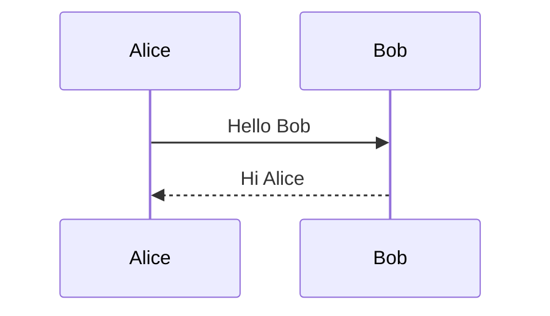

*Maps:* `sequence.header`, `sequence.message` · fixture: `simple` · Naiad: Simple*

### S02 — Implicit participants (first use in message)

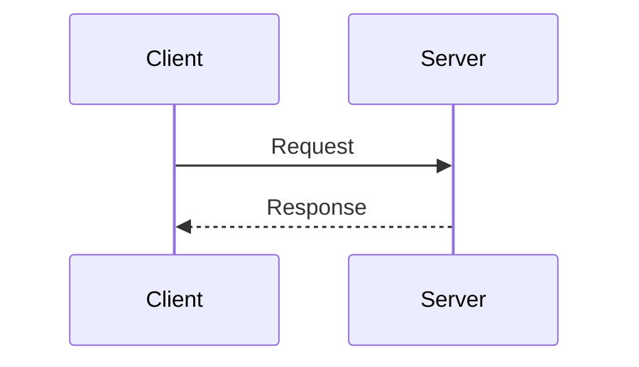

### S03 — Three-party chain

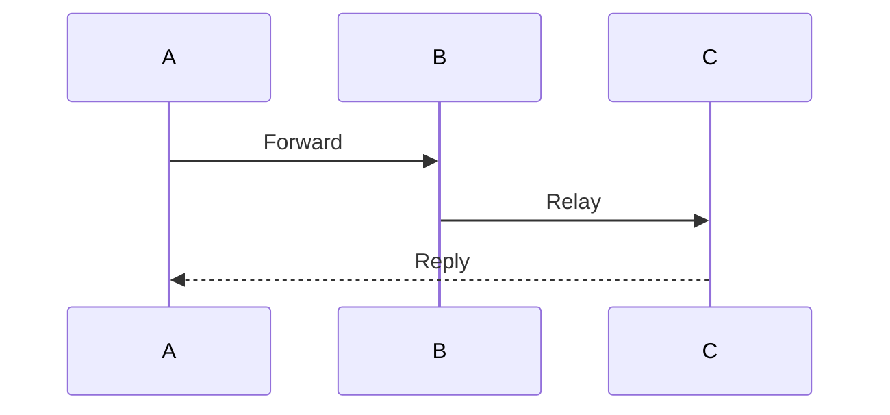

---

## Level 2 — Participants and actors

### S04 — Named participants

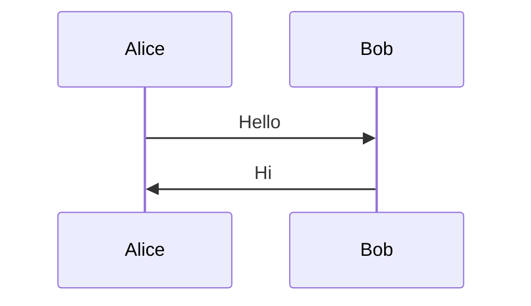

*Fixture:* `participants` · Naiad: Participants*

### S05 — Actor lifeline

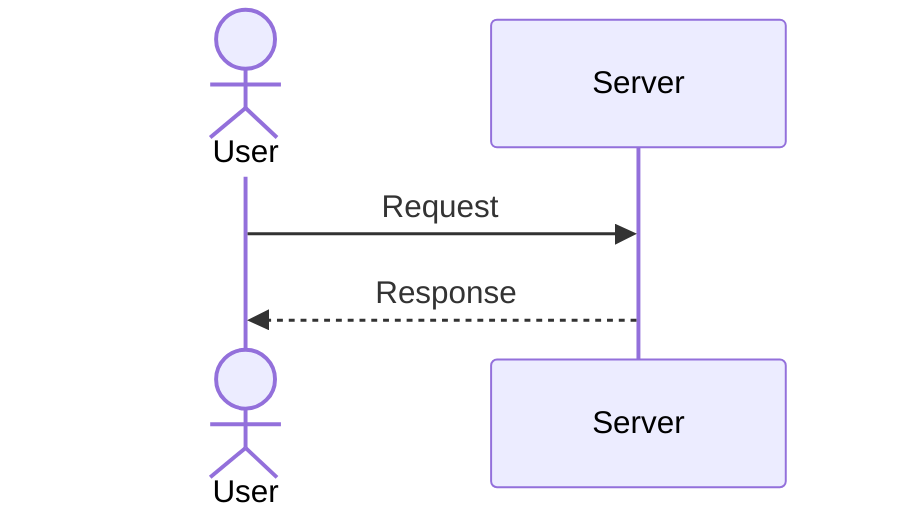

*Naiad: Actors*

### S06 — Mixed actor and participant order

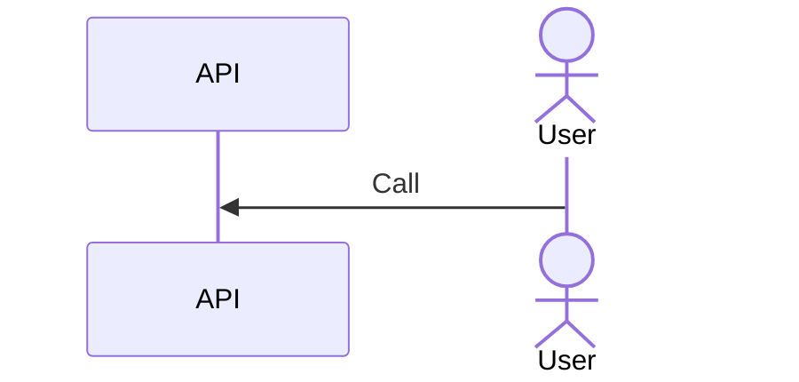

---

## Level 3 — Message arrow variants and labels

### S07 — Solid and dotted (closed)

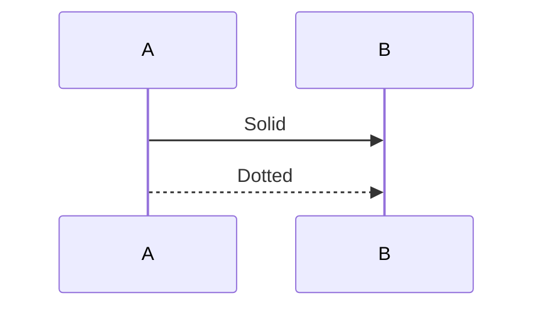

### S08 — Open and cross endings

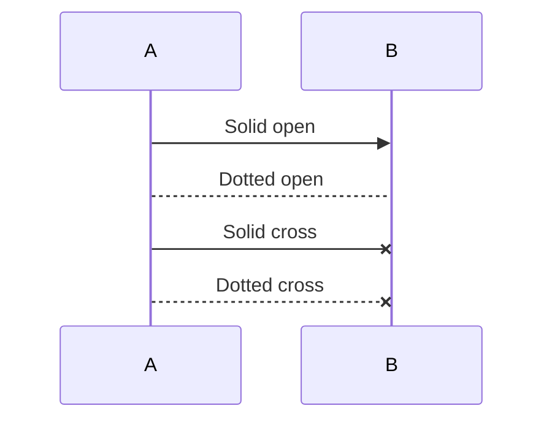

*Naiad: DifferentArrows*

### S29 — Self-message

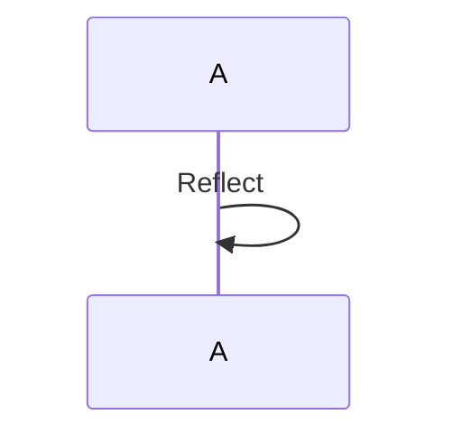

### S30 — Long message label

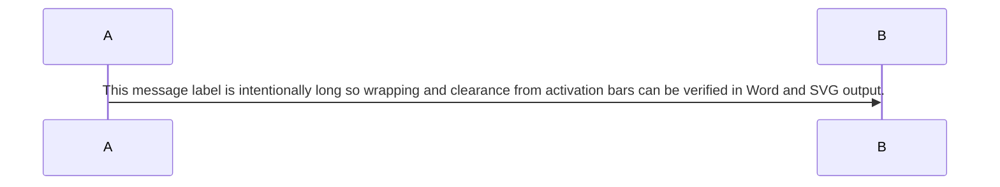

### S31 — Quoted message label

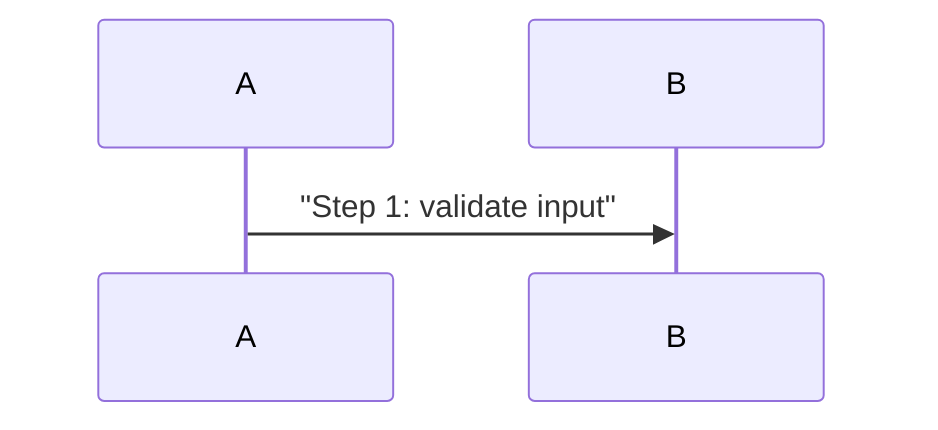

---

## Level 4 — Activation

### S09 — Inline activation markers

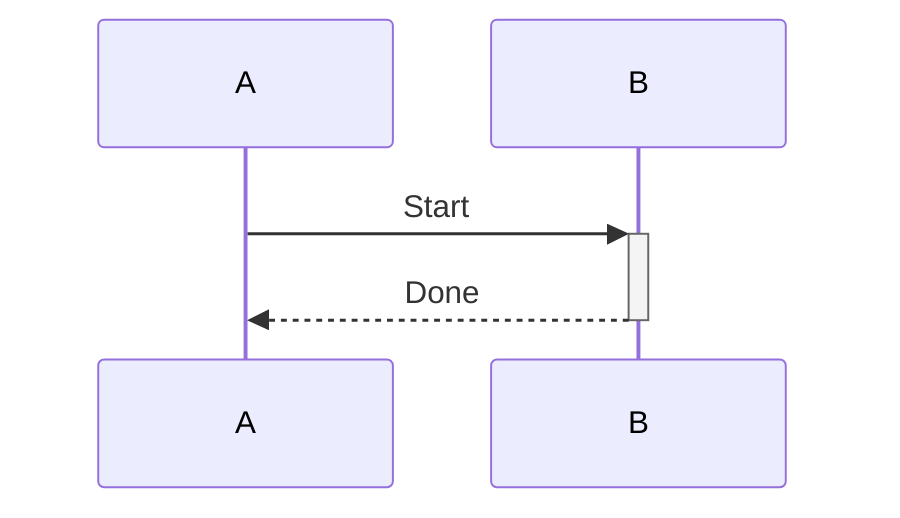

*Fixture:* `activation` · Naiad: Activation*

### S10 — Explicit activate / deactivate

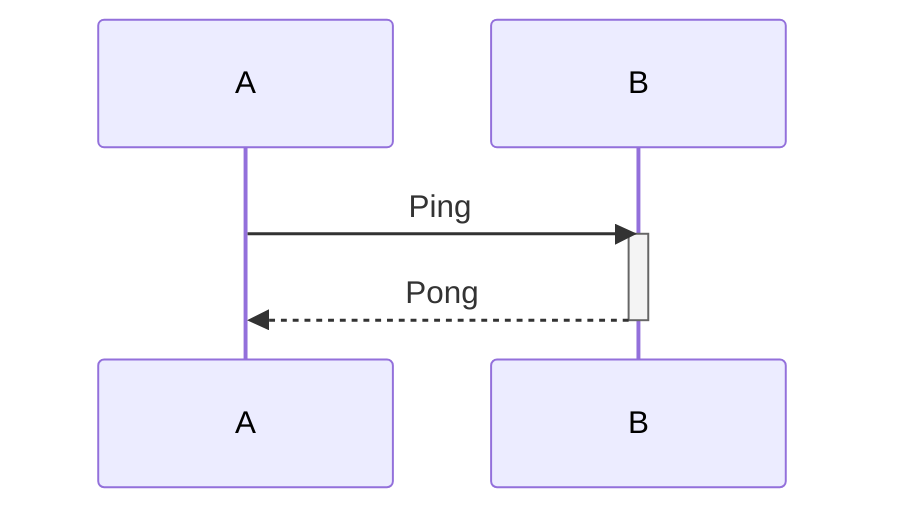

*Fixture:* `activate-deactivate`*

---

## Level 5 — Notes

### S11 — Note positions

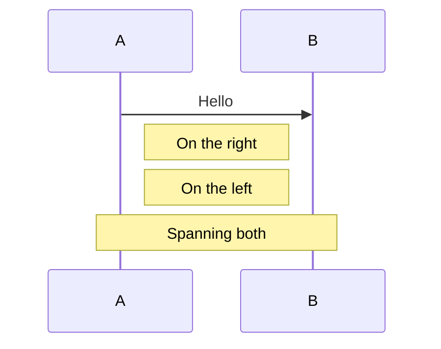

*Fixture:* `notes` · Naiad: Notes*

---

## Level 6 — Title and autonumber

### S12 — Diagram title

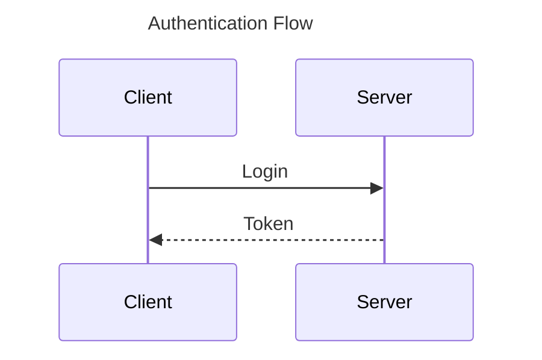

*Fixture:* `title` · Naiad: Title*

### S13 — Autonumber

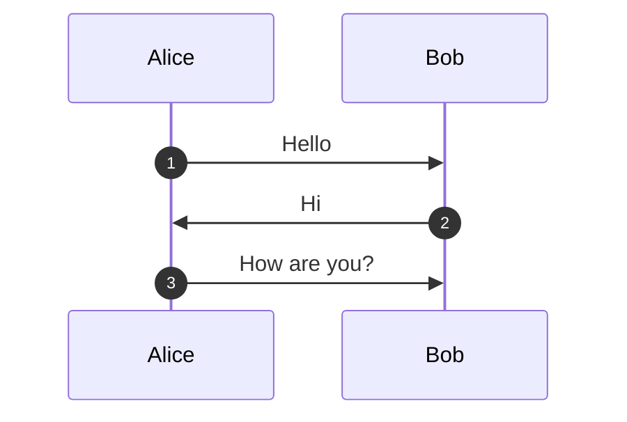

*Fixture:* `autonumber` · Naiad: AutoNumber*

---

## Level 7 — Control blocks

### S14 — Alt / else

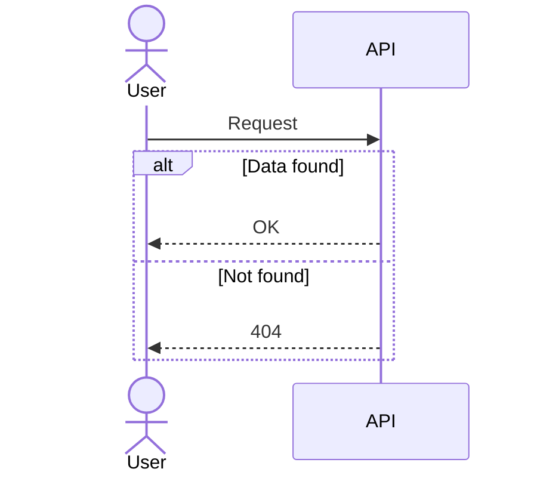

*Maps:* `sequence.block`, `sequence.end` · fixture: `alt-else-blocks` · Naiad: AltElseBlocks*

### S15 — Loop

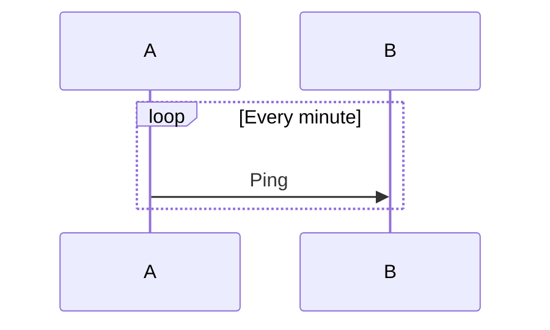

*Fixture:* `loop-control`*

### S16 — Opt

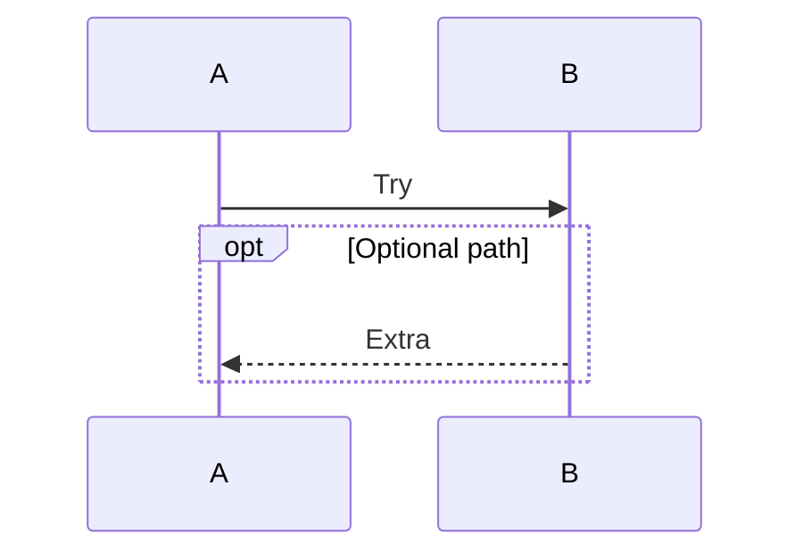

*Fixture:* `opt-block`*

### S17 — Par / and

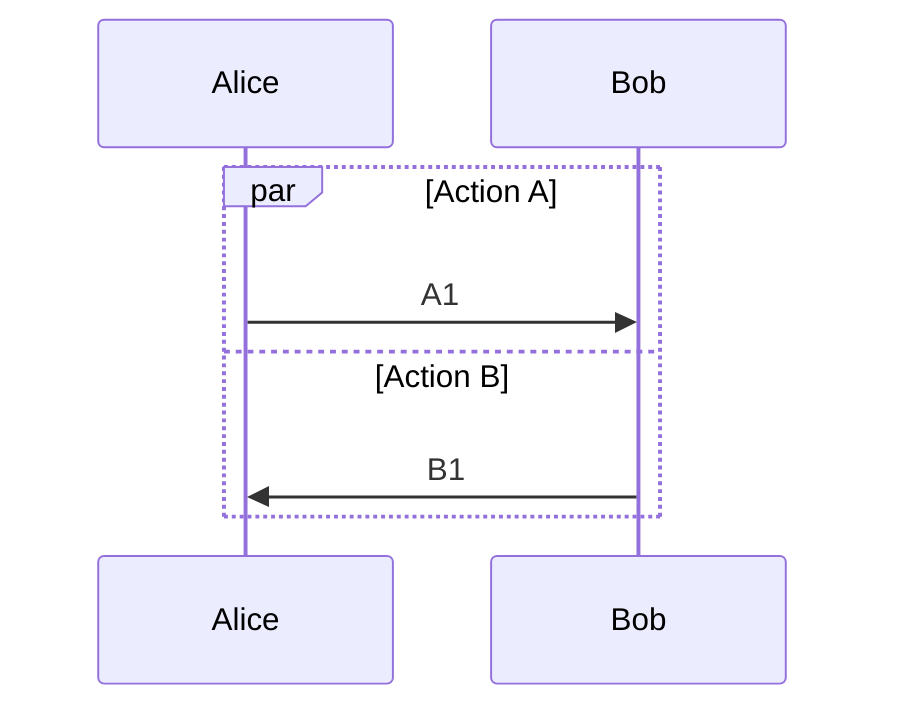

*Fixture:* `par-block`*

### S18 — Critical / option

```mermaid
sequenceDiagram
    critical Establish connection
        A->>B: Connect
    option Failure
        B-->>A: Error
    end
```

*Fixture:* `critical-block`*

### S25 — Break

```mermaid
sequenceDiagram
    A->>B: Start
    break On error
        B-->>A: Abort
    end
    A->>B: Continue
```

*Maps:* `sequence.block` (break)*

### S26 — Rect framing

```mermaid
sequenceDiagram
    rect rgb(240, 240, 240)
        A->>B: Inside rect
    end
```

*Maps:* `sequence.block` (rect)*

### S27 — Nested alt inside loop

```mermaid
sequenceDiagram
    loop Retry up to 3
        A->>B: Attempt
        alt Success
            B-->>A: OK
        else Failure
            B-->>A: Retry
        end
    end
```

### S32 — Else-only (single branch label)

```mermaid
sequenceDiagram
    A->>B: Check
    alt OK
        B-->>A: Proceed
    end
```

---

## Level 8 — Recognition axes (contract / render)

### S19 — Participant box (rgb)

```mermaid
sequenceDiagram
    box rgb(200,200,200) Internal
        participant A
        participant B
    end
    A->>B: Hi
```

*Fixture:* `box-rgb`*

### S20 — Create / destroy lifecycle

```mermaid
sequenceDiagram
    participant A
    create participant B
    A->>B: Hello
    destroy B
```

*Fixture:* `lifecycle-create`*

### S21 — Accessibility (inline accDescr)

```mermaid
sequenceDiagram
    accTitle: Auth
    accDescr: Login flow
    Client->>Server: Login
```

*Fixture:* `sequence-accessibility`*

### S28 — Accessibility (accDescr block)

```mermaid
sequenceDiagram
    accTitle: Order flow
    accDescr {
        Multi-line description
        for screen readers
    }
    A->>B: Place order
```

*Maps:* `sequence.accDescr` (block form)*

### S22 — Comment lines (no model fact)

```mermaid
sequenceDiagram
    %% This is a comment
    A->>B: Visible message
```

*Maps:* `sequence.comment`*

### S24 — Init block (leading config)

```mermaid
%%{init: {'theme': 'base'}}%%
sequenceDiagram
    A->>B: Themed message
```

*Maps:* G1 config*

### S23 — Combined smoke (Naiad Complex sample)

```mermaid
sequenceDiagram
    title Complete Authentication Flow
    autonumber
    actor User
    participant Client as Web Client
    participant Auth as Auth Service
    participant DB as Database
    participant Email as Email Service
    User->>+Client: Enter credentials
    Client->>+Auth: POST /login
    Auth->>+DB: Query user
    DB-->>-Auth: User data
    Note right of Auth: Validate credentials
    Auth->>Auth: Generate JWT
    Note right of Auth: Token expires in 24h
    Auth-->>-Client: 200 OK + Token
    Client->>+Email: Send welcome email
    Email-->>-Client: Email sent
    Client-->>-User: Show dashboard
    Note over User,DB: Session established
```

*Render regression only; combines many axes. Omit `Email` participant declaration is intentional implicit-participant stress (add if harness requires explicit declare).*

---

## Catalogue maintenance

| Column | Rule |
| --- | --- |
| Scenario id | `S` + two digits; stable once published |
| New scenario | Must map to a row in §11.1.14.2 or add that row first |
| Recognition | Every `SequenceRecognition/*.mmd` fixture must appear in the index table |
| Render | Visual export succeeds against mermaid.ink for **active** scenarios only (remarked `%%` blocks excluded) |
| Remarked `%%` | Considered but rejected on mermaid.live; do not treat as missing |

Do not treat this file as the recognition specification — it samples axes from `spec.md`. Machine-readable truth remains `*.verified.json` under `SequenceRecognition/`.
