# Diagram Recognition Specification

Status: critical draft  
Scope: recognising the individual aspects involved in turning text into diagrams without naming every scenario as a separate case  
Primary input studied: `flow.md`  
Primary implementation inspiration: Mermaid flowchart parser/database/render pipeline under `mermaid/packages/mermaid/src/diagrams/flowchart/`

---

## 1. Finding

`flow.md` is a useful regression catalogue, but it is not a recognition strategy.

It names examples (`F01` to `F60`) and groups them by topic. That is good for humans checking regressions. It is bad as an implementation basis because it tempts the renderer to recognise examples by scenario shape:

```text
if this looks like F43, handle nested subgraphs
if this looks like F26, handle long labels
if this looks like F53A, special-case stadium merge geometry
```

That approach will collapse as soon as two axes combine in an unlisted way.

The correct unit of recognition is not the scenario. It is the smallest semantic fact the source text contributes to the diagram model:

- this line declares a diagram family
- this token sets direction
- this statement defines or mutates a vertex
- this bracket pair chooses a shape
- this link token expands to one or more edges
- this edge has stroke, arrowheads, length, label, id, classes and style
- this subgraph establishes containment and maybe direction
- this directive mutates style, class, link style, interaction, config, or accessibility metadata

Mermaid's own flowchart code is built this way. The parser calls methods such as `addVertex`, `addLink`, `addSubGraph`, `setDirection`, `addClass`, `setClass`, `updateLink`, and `updateLinkInterpolate`; the renderer later consumes a normalised graph model. It does not have a `renderFanOutScenario` or `renderNestedSubgraphScenario`.

---

## 2. Recognition Principle

The recogniser must emit a compositional diagram contract, not a scenario id.

For every Mermaid block, recognition must produce:

```text
Diagram
  kind
  aliases
  effectiveConfig
  direction
  declarations[]
  vertices[]
  edges[]
  groups[]
  styles[]
  classes[]
  interactions[]
  diagnostics[]
```

Every item must preserve both:

- the source-level fact, such as `A --> B`
- the normalised rendering-level effect, such as one edge from `A` to `B` with `stroke=normal`, `arrowTypeEnd=point`, `minlen=1`

This dual representation is non-negotiable. Source text is needed for diagnostics and round-tripping. Normalised facts are needed for layout and rendering.

---

## 3. Required Recognition Axes

### 3.1 Diagram Header

Recognise:

| Source aspect | Normalised fact |
| --- | --- |
| `graph` | flowchart-compatible diagram |
| `flowchart` | flowchart-compatible diagram |
| `flowchart-elk` | flowchart family with ELK renderer intent |
| omitted direction after header | `TB` |
| `TD` | `TB` |
| symbolic direction `<`, `>`, `^`, `v` | `RL`, `LR`, `BT`, `TB` |

Critical point: direction is not a visual hint. It changes layout rank direction, edge routing expectations, cluster placement, label clearance, and the meaning of spacing.

### 3.2 Statement Boundaries

Recognise statements independently of whether they end with:

- newline
- semicolon
- EOF
- blank space around tokens

Do not encode "one line equals one operation". Mermaid allows chains and grouped node expressions on one statement, and comments/blank lines should not become model facts.

### 3.3 Vertex Identity

Recognise vertex identity separately from visible label.

```text
id: stable graph reference
label: rendered text, defaulting to id only if no label is supplied
labelType: text | string | markdown
shape: explicit, bracket-derived, metadata-derived, or default
classes: zero or more
styles: zero or more
metadata: optional shape-data object
```

Critical point: the same vertex can be declared repeatedly. Later statements can add label, shape, classes, styles, metadata or interactions. The recogniser must merge declarations, not duplicate nodes.

### 3.4 Vertex Label Forms

Recognise label source and label type:

| Form | Required distinction |
| --- | --- |
| unlabelled id | label defaults to id |
| bracket text | labelType `text` unless quoted/markdown syntax changes it |
| quoted text | labelType `string`; outer quotes stripped |
| markdown string | labelType `markdown` |
| `@{ label: ... }` | metadata label overrides default/id label |
| entity codes | decoded/sanitised downstream, but source must be preserved |
| `<br/>` | explicit line break intent |
| unicode | accepted content, not a special scenario |

Critical point: label parsing is not just visual wrapping. The label type affects sanitisation, HTML/SVG rendering, measurement, and sometimes escaping validity.

### 3.5 Vertex Shape

Recognise shape as a fact, not as a scenario.

Legacy bracket syntax must map to canonical shape intent:

| Syntax family | Shape fact |
| --- | --- |
| `A[text]` | square/rect |
| `A(text)` | round/rounded rectangle |
| `A([text])` | stadium |
| `A[[text]]` | subroutine/framed rectangle |
| `A[(text)]` | cylinder |
| `A((text))` | circle |
| `A(((text)))` | double circle |
| `A{text}` | diamond |
| `A{{text}}` | hexagon |
| `A>text]` | odd/asymmetric flag |
| trapezoid/lean syntaxes | trapezoid / inverted trapezoid / lean variants |
| `A@{ shape: ... }` | metadata shape, with validation |

Critical point: `flow.md` covers only a small subset of the current Mermaid shape surface. It exercises the old common shapes but not the large modern shape catalogue available through `@{ shape: ... }`. A renderer claiming "Mermaid flowchart shapes" from `flow.md` alone is overclaiming.

### 3.6 Edge Expansion

Recognise source expressions that expand into multiple edges.

Examples:

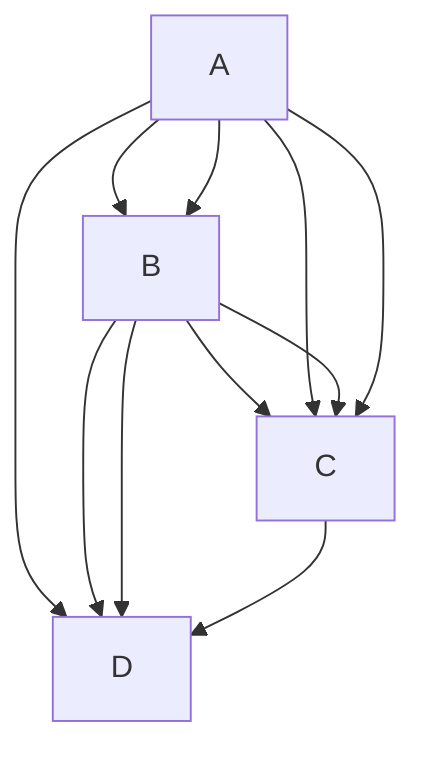

The recogniser must emit every edge produced by the Cartesian expansion and chaining rules. It must not store the chain as a single edge-like object.

Critical point: grouped/chained edges are not "fan-out scenarios". They are grammar expansions. The visual fan-out is a consequence of expanded edges plus layout.

### 3.7 Edge Identity

Recognise edge id as independent from endpoints.

```text
source syntax: e1@-->
normalised edge id: e1 for only the grammar-selected edge
fallback id: deterministic generated id
```

When a grouped statement has an edge id, Mermaid applies the user id only to a specific generated edge and auto-generates ids for the rest. Duplicate user ids do not silently overwrite all edges. This is a subtle source-level rule and must be tested.

Critical point: `flow.md` mostly tests visual edges, not edge identity. That is insufficient for style, animation, metadata, and linkStyle targeting.

### 3.8 Edge Token Decomposition

Recognise each edge token as a tuple:

```text
startArrow: none | point | circle | cross
endArrow: none | point | circle | cross
directionality: one-ended | double-ended
stroke: normal | dotted | thick | invisible
minlen: integer, capped at 10
label: optional
labelType: text | string | markdown
```

Examples:

| Token | Facts |
| --- | --- |
| `---` | open line, normal stroke, no markers |
| `-->` | point at end, normal stroke, `minlen=1` |
| `--->` | point at end, normal stroke, `minlen=2` |
| `-.->` | point at end, dotted stroke |
| `==>` | point at end, thick stroke |
| `--o` | circle at end |
| `x--x` | cross at both ends |
| `<-->` | point at both ends |
| `~~~` | invisible edge |

Critical point: edge recognition must not conflate "arrow" with "edge". Arrowheads, stroke pattern, thickness, length and label are separate axes.

### 3.9 Edge Labels

Recognise both label syntaxes:

```text
A -->|label| B
A -- label --> B
```

Then preserve:

```text
edge.label
edge.labelType
source span
layout measurement requirement
```

Critical point: a long edge label is not a different edge kind. It is an edge with a label whose measured dimensions affect layout. `flow.md` correctly stresses this, but the implementation must not respond by deriving `minlen` from text width. Mermaid derives `minlen` from token length, not label length.

### 3.10 Subgraphs

Recognise subgraph declaration as group creation plus membership.

```text
group.id
group.title
group.labelType
group.children[]
group.direction?
group.classes[]
parentGroup?
```

Supported source forms include:

```text
subgraph Title
subgraph id[Title]
subgraph id["Title"]
subgraph
```

Direction inside a subgraph is a group-local fact. It must be attached to the group, not applied globally.

Critical point: nested subgraphs are not a special diagram kind. They are ordinary groups whose child list contains other group ids and node ids. Cross-boundary edges are ordinary edges whose endpoints happen to live in different containment contexts. Layout/routing must handle that later.

### 3.11 Membership and Uniqueness

Recognise that a node should have one effective parent group.

Mermaid removes members from later/outer group lists when they already belong to another subgraph. This is not intuitive, and it is easy to get wrong if group parsing is modelled as simple "append all descendants".

Critical point: containment is a graph fact with ownership rules, not indentation decoration.

### 3.12 Styling

Recognise style declarations as mutations:

```text
style <id> <style-list>
classDef <class-id> <style-list>
class <id-list> <class-id>
<vertex>:::<class-id>
linkStyle <edge-index-list | default> <style-list>
linkStyle <edge-index-list | default> interpolate <curve> [style-list]
```

Styles can target:

- vertices
- edges, by generated or user id through class assignment
- subgraphs
- default edge style
- numbered edge positions

Critical point: `flow.md` barely touches style order, default link style, curve interpolation, style targeting errors, comma escaping, and classes on subgraphs/edges. A recogniser must still model them because they mutate the same graph contract.

### 3.13 Metadata Shape Data

Recognise `@{ ... }` as metadata that can apply to:

- a vertex
- an existing edge id

For vertices, supported facts include at least:

```text
shape
label
labelType
icon
form
pos
img
constraint
w
h
```

For edges, supported facts include at least:

```text
animate
animation
curve
```

Critical point: this is missing from `flow.md` except indirectly through style/init coverage. Mermaid's source tests cover it heavily. Without metadata recognition, the renderer will be frozen at an older flowchart syntax surface.

### 3.14 Interactions and Links

Recognise:

```text
click <id> <callback>
click <id> call <callback>(args)
click <id> href "url"
click <id> "url"
tooltip text
target: _self | _blank | _parent | _top
```

Even if DOCX output cannot preserve runtime click callbacks, the recogniser should record them and emit a diagnostic or downgrade. Silently dropping them makes the conversion non-auditable.

### 3.15 Accessibility and Title

Recognise:

```text
accTitle:
accDescr:
accDescr { ... }
```

Critical point: accessibility metadata is part of the diagram source. It may not affect geometry, but it affects the conversion contract and should be exposed to downstream document generation.

### 3.16 Init and Configuration

Recognise `%%{init: ...}%%` before diagram parsing and record effective overrides.

At minimum:

```text
flowchart.htmlLabels
flowchart.nodeSpacing
flowchart.rankSpacing
flowchart.diagramPadding
flowchart.wrappingWidth
flowchart.curve
look
theme/themeVariables
securityLevel
```

Critical point: config is not merely rendering polish. It changes text measurement mode, layout spacing, curve generation, marker variants and security behaviour.

### 3.17 Mermaid Default Styling and Text Rendering Constants (pinned)

This specification is pinned to the vendored Mermaid version declared in §11.0. All recognition and rendering behaviour must be compatible with the defaults and override rules in that version.

This section exists because “diagram correctness” for DOCX export includes the **textual representation inside shapes and on edges**, which depends on default typography, padding, colours, spacing, and wrapping behaviour. These values must be **specified**, not guessed.

#### 3.17.1 Source of truth (vendored files in this repo)

Defaults and override rules are derived from these vendored Mermaid files:

- `mermaid/packages/mermaid/src/schemas/config.schema.yaml`
  - All JSON-schema default values (including flowchart spacing, curve defaults, and global font settings).
- `mermaid/packages/mermaid/src/defaultConfig.ts`
  - Non-JSON defaults (for example `themeVariables` initialisation).
- `mermaid/packages/mermaid/src/config.ts`
  - Directive precedence and `themeVariables` merge rules.
- `mermaid/packages/mermaid/src/themes/theme-default.js`
  - Theme-default variables, including baseline colours and font settings used by default theming.

If any of these vendored defaults change, this section and the recognition fixtures must be updated together with the compatibility pin.

#### 3.17.2 Global typography defaults (when not overridden)

From `mermaid/packages/mermaid/src/schemas/config.schema.yaml`:

```text
fontFamily default: '"trebuchet ms", verdana, arial, sans-serif;'  (config.schema.yaml:171-177)
fontSize default: 16  (config.schema.yaml:345-347)
htmlLabels: configured globally (see §3.17.4); precedence is root-level htmlLabels over diagram-specific htmlLabels
```

From `mermaid/packages/mermaid/src/themes/theme-default.js` (theme variables baseline):

```text
themeVariables.fontFamily default: '"trebuchet ms", verdana, arial, sans-serif'  (theme-default.js:36-37)
themeVariables.fontSize default: '16px'  (theme-default.js:36-38)
themeVariables.fontWeight default: 'normal' (when present; theme sets normal if not otherwise defined)
```

Contract requirement:

- The recogniser must record the **effective** values for `fontFamily`, `fontSize`, and `htmlLabels` that apply to the diagram after directive merging (§3.17.4), even if they are defaults.
- The contract must also preserve **user-specified overrides** separately (source-level facts), so diagnostics can explain why effective values differ from defaults.

#### 3.17.3 Flowchart layout and text-box related defaults (when not overridden)

From `mermaid/packages/mermaid/src/schemas/config.schema.yaml` `FlowchartDiagramConfig` defaults:

```text
flowchart.titleTopMargin default: 25  (config.schema.yaml:2125-2128)
flowchart.subGraphTitleMargin default: { top: 0, bottom: 0 }  (config.schema.yaml:2128-2141)
flowchart.diagramPadding default: 8  (config.schema.yaml:2144-2147)
flowchart.nodeSpacing default: 50  (config.schema.yaml:2159-2167)
flowchart.rankSpacing default: 50  (config.schema.yaml:2168-2176)
flowchart.curve default: 'basis'  (config.schema.yaml:2177-2197)
flowchart.wrappingWidth default: 200  (config.schema.yaml:2208-2215)
flowchart.defaultRenderer default: 'dagre-wrapper'  (config.schema.yaml:2205-2207)
flowchart.inheritDir default: false  (config.schema.yaml:2217-2219)

flowchart.padding default: 15
  note: “Only used in new experimental rendering.” Still must be recognised as a config fact.  (config.schema.yaml:2198-2204)
```

Contract requirement:

- These values must appear in `effectiveConfig` for flowcharts, with explicit indication of whether each value was defaulted or overridden.
- `wrappingWidth` and `fontSize` together define label measurement and wrapping behaviour; the recogniser must preserve them as first-class facts.

#### 3.17.4 Directive/config precedence and theme variable merging (observable behaviour)

From `mermaid/packages/mermaid/src/config.ts`:

- Directives are merged onto site/default config, then theme variables are recomputed when a theme is selected.
- If a directive sets `fontFamily` but not `themeVariables.fontFamily`, Mermaid injects it into `themeVariables.fontFamily`.  (config.ts:197-206)
- `flowchart.htmlLabels` exists but is deprecated; effective value is computed as:

```text
effectiveHtmlLabels = evaluate(config.htmlLabels ?? config.flowchart?.htmlLabels ?? true)  (config.ts:282-288)
```

Contract requirement:

- The recogniser must implement the same precedence rules so that `effectiveConfig` matches Mermaid’s effective configuration.
- The contract must preserve both:
  - **raw directive payload(s)** (source-level)
  - **effective merged config** (normalised)

#### 3.17.5 Theme-default colour and styling baselines (used unless overridden)

From `mermaid/packages/mermaid/src/themes/theme-default.js` (theme variable baseline, including derived flowchart defaults):

```text
background: 'white'  (theme-default.js:28-29)
lineColor: '#333333'  (theme-default.js:31-32)
textColor: '#333'  (theme-default.js:38-40)
arrowheadColor: '#333333'  (theme-default.js:34-36)
labelBackground: 'rgba(232,232,232, 0.8)'  (theme-default.js:37-39)

Flowchart-derived theme variables (after updateColors):
nodeBkg: mainBkg ('#ECECFF')  (theme-default.js:29-31)
clusterBkg: secondBkg ('#ffffde')  (theme-default.js:29-31)
defaultLinkColor: lineColor ('#333333')  (theme-default.js:31-32)
edgeLabelBackground: labelBackground ('rgba(232,232,232, 0.8)')  (theme-default.js:37-39)
nodeBorder: border1 ('#9370DB')  (theme-default.js:31-33)
clusterBorder: border2 ('#aaaa33')  (theme-default.js:33-35)
```

Contract requirement:

- The recogniser must capture any user overrides to theme variables (`themeVariables`) and theme selection (`theme`).
- The rendering pipeline must treat theme variables as part of the **diagram contract inputs** that determine:
  - text colour and background (node + edge label)
  - stroke colours (borders and edges)
  - arrowhead colours

DOCX requirement:

- If the DOCX exporter cannot preserve a recognised theme variable (for example a font family not available at render time, or a colour not representable in the chosen export mode), it must emit a diagnostic rather than silently substituting values.

#### 3.17.6 All diagram families (including experimental): required config defaults and overrides

This specification covers **all Mermaid diagram families present in the pinned Mermaid version**, including experimental/beta diagrams (`wardley-beta`). For each family, defaults and overrides are defined in the vendored Mermaid configuration schema and theme implementation. **Every default value in sections 3.17.7 through 3.17.39 includes a source file reference.**

Regenerate the machine-readable tables when the Mermaid pin changes:

```text
powershell -File tools/Generate-MermaidDefaultsMarkdown.ps1
```

Contract requirements (all diagram kinds):

- The recogniser must emit `effectiveConfig` for the diagram kind that includes global defaults, diagram-specific defaults, directive overrides, and resolved `themeVariables`.
- The recogniser must preserve raw directive payload and source spans.
- For experimental/beta families, recognise config using schema defaults and emit diagnostics for unsupported native render/export features (see section 7.3).
- The renderer/exporter must treat `effectiveConfig` + `themeVariables` as inputs for fonts, colours, spacing, padding, and label measurement.
- Silent substitution without diagnostics is not acceptable for DOCX export.

<!-- Generated tables: tools/Generate-MermaidDefaultsMarkdown.ps1 — regenerate when Mermaid pin changes -->

#### 3.17.7 Global root configuration defaults (pinned Mermaid 11.14.0)

| Config key | Default | Reference |
| --- | --- | --- |
| theme | 'default' | `mermaid/packages/mermaid/src/schemas/config.schema.yaml:83` |
| look | 'classic' | `mermaid/packages/mermaid/src/schemas/config.schema.yaml:96` |
| handDrawnSeed | 0 | `mermaid/packages/mermaid/src/schemas/config.schema.yaml:101` |
| layout | 'dagre' | `mermaid/packages/mermaid/src/schemas/config.schema.yaml:106` |
| maxTextSize | 50000 | `mermaid/packages/mermaid/src/schemas/config.schema.yaml:110` |
| maxEdges | 500 | `mermaid/packages/mermaid/src/schemas/config.schema.yaml:115` |
| darkMode | false | `mermaid/packages/mermaid/src/schemas/config.schema.yaml:163` |
| fontFamily | "trebuchet ms", verdana, arial, sans-serif; | `mermaid/packages/mermaid/src/schemas/config.schema.yaml:177` |
| fontSize | 16 | `mermaid/packages/mermaid/src/schemas/config.schema.yaml:347` |
| markdownAutoWrap | true | `mermaid/packages/mermaid/src/schemas/config.schema.yaml:350` |
| securityLevel | strict | `mermaid/packages/mermaid/src/schemas/config.schema.yaml:224` |
| startOnLoad | true | `mermaid/packages/mermaid/src/schemas/config.schema.yaml:228` |
| arrowMarkerAbsolute | false | `mermaid/packages/mermaid/src/schemas/config.schema.yaml:235` |
| htmlLabels | true (effective when unset; see `getEffectiveHtmlLabels`) | `mermaid/packages/mermaid/src/schemas/config.schema.yaml:164-170`; `mermaid/packages/mermaid/src/config.ts:282-288` |
| logLevel | 5 (fatal) | `mermaid/packages/mermaid/src/schemas/config.schema.yaml:181-207` |

ELK (`elk` object):

| Config key | Default | Reference |
| --- | --- | --- |
| elk.mergeEdges | false | `mermaid/packages/mermaid/src/schemas/config.schema.yaml:124` |
| elk.nodePlacementStrategy | BRANDES_KOEPF | `mermaid/packages/mermaid/src/schemas/config.schema.yaml:134` |
| elk.cycleBreakingStrategy | GREEDY_MODEL_ORDER | `mermaid/packages/mermaid/src/schemas/config.schema.yaml:145` |
| elk.forceNodeModelOrder | false | `mermaid/packages/mermaid/src/schemas/config.schema.yaml:150` |
| elk.considerModelOrder | 'NODES_AND_EDGES' | `mermaid/packages/mermaid/src/schemas/config.schema.yaml:160` |

#### 3.17.8 Top-level `%%{init}%%` diagram config keys

| Init key | Schema `$defs` | Reference |
| --- | --- | --- |
| c4 | C4DiagramConfig | `mermaid/packages/mermaid/src/schemas/config.schema.yaml:373-874` |
| gitGraph | GitGraphDiagramConfig | `mermaid/packages/mermaid/src/schemas/config.schema.yaml:875-922` |
| requirement | RequirementDiagramConfig | `mermaid/packages/mermaid/src/schemas/config.schema.yaml:936-972` |
| architecture | ArchitectureDiagramConfig | `mermaid/packages/mermaid/src/schemas/config.schema.yaml:973-1002` |
| mindmap | MindmapDiagramConfig | `mermaid/packages/mermaid/src/schemas/config.schema.yaml:1003-1025` |
| ishikawa | IshikawaDiagramConfig | `mermaid/packages/mermaid/src/schemas/config.schema.yaml:1026-1042` |
| kanban | KanbanDiagramConfig | `mermaid/packages/mermaid/src/schemas/config.schema.yaml:1043-1059` |
| pie | PieDiagramConfig | `mermaid/packages/mermaid/src/schemas/config.schema.yaml:1060-1073` |
| quadrantChart | QuadrantChartConfig | `mermaid/packages/mermaid/src/schemas/config.schema.yaml:1074-1193` |
| xyChart | XYChartConfig | `mermaid/packages/mermaid/src/schemas/config.schema.yaml:1264-1328` |
| er | ErDiagramConfig | `mermaid/packages/mermaid/src/schemas/config.schema.yaml:1329-1405` |
| state | StateDiagramConfig | `mermaid/packages/mermaid/src/schemas/config.schema.yaml:1406-1497` |
| class | ClassDiagramConfig | `mermaid/packages/mermaid/src/schemas/config.schema.yaml:1498-1552` |
| journey | JourneyDiagramConfig | `mermaid/packages/mermaid/src/schemas/config.schema.yaml:1553-1693` |
| timeline | TimelineDiagramConfig | `mermaid/packages/mermaid/src/schemas/config.schema.yaml:1694-1821` |
| gantt | GanttDiagramConfig | `mermaid/packages/mermaid/src/schemas/config.schema.yaml:1822-1943` |
| sequence | SequenceDiagramConfig | `mermaid/packages/mermaid/src/schemas/config.schema.yaml:1944-2107` |
| flowchart | FlowchartDiagramConfig | `mermaid/packages/mermaid/src/schemas/config.schema.yaml:2108-2223` |
| sankey | SankeyDiagramConfig | `mermaid/packages/mermaid/src/schemas/config.schema.yaml:2267-2330` |
| packet | PacketDiagramConfig | `mermaid/packages/mermaid/src/schemas/config.schema.yaml:2331-2367` |
| block | BlockDiagramConfig | `mermaid/packages/mermaid/src/schemas/config.schema.yaml:2368-2379` |
| eventmodeling | EventModelingDiagramConfig | `mermaid/packages/mermaid/src/schemas/config.schema.yaml:2380-2395` |
| treeView | TreeViewDiagramConfig | `mermaid/packages/mermaid/src/schemas/config.schema.yaml:2396-2423` |
| radar | RadarDiagramConfig | `mermaid/packages/mermaid/src/schemas/config.schema.yaml:2424-2477` |
| venn | VennDiagramConfig | `mermaid/packages/mermaid/src/schemas/config.schema.yaml:2478-2502` |
| wardley-beta | WardleyDiagramConfig | `mermaid/packages/mermaid/src/schemas/config.schema.yaml:2503-2549` |

#### 3.17.9 BaseDiagramConfig (init key: (all diagrams via BaseDiagramConfig))

| Property | Default | Reference |
| --- | --- | --- |
| useMaxWidth | `true` | `mermaid/packages/mermaid/src/schemas/config.schema.yaml:372` |

#### 3.17.10 C4DiagramConfig (init key: c4)

| Property | Default | Reference |
| --- | --- | --- |
| diagramMarginX | `50` | `mermaid/packages/mermaid/src/schemas/config.schema.yaml:395` |
| diagramMarginY | `10` | `mermaid/packages/mermaid/src/schemas/config.schema.yaml:401` |
| c4ShapeMargin | `50` | `mermaid/packages/mermaid/src/schemas/config.schema.yaml:406` |
| c4ShapePadding | `20` | `mermaid/packages/mermaid/src/schemas/config.schema.yaml:411` |
| width | `216` | `mermaid/packages/mermaid/src/schemas/config.schema.yaml:416` |
| height | `60` | `mermaid/packages/mermaid/src/schemas/config.schema.yaml:421` |
| boxMargin | `10` | `mermaid/packages/mermaid/src/schemas/config.schema.yaml:426` |
| c4ShapeInRow | `4` | `mermaid/packages/mermaid/src/schemas/config.schema.yaml:431` |
| nextLinePaddingX | `0` | `mermaid/packages/mermaid/src/schemas/config.schema.yaml:436` |
| c4BoundaryInRow | `2` | `mermaid/packages/mermaid/src/schemas/config.schema.yaml:440` |
| personFontSize | `14` | `mermaid/packages/mermaid/src/schemas/config.schema.yaml:449` |
| personFontFamily | `'"Open Sans", sans-serif'` | `mermaid/packages/mermaid/src/schemas/config.schema.yaml:453` |
| personFontWeight | `normal` | `mermaid/packages/mermaid/src/schemas/config.schema.yaml:457` |
| external_personFontSize | `14` | `mermaid/packages/mermaid/src/schemas/config.schema.yaml:461` |
| external_personFontFamily | `'"Open Sans", sans-serif'` | `mermaid/packages/mermaid/src/schemas/config.schema.yaml:465` |
| external_personFontWeight | `normal` | `mermaid/packages/mermaid/src/schemas/config.schema.yaml:469` |
| systemFontSize | `14` | `mermaid/packages/mermaid/src/schemas/config.schema.yaml:473` |
| systemFontFamily | `'"Open Sans", sans-serif'` | `mermaid/packages/mermaid/src/schemas/config.schema.yaml:477` |
| systemFontWeight | `normal` | `mermaid/packages/mermaid/src/schemas/config.schema.yaml:481` |
| external_systemFontSize | `14` | `mermaid/packages/mermaid/src/schemas/config.schema.yaml:485` |
| external_systemFontFamily | `'"Open Sans", sans-serif'` | `mermaid/packages/mermaid/src/schemas/config.schema.yaml:489` |
| external_systemFontWeight | `normal` | `mermaid/packages/mermaid/src/schemas/config.schema.yaml:493` |
| system_dbFontSize | `14` | `mermaid/packages/mermaid/src/schemas/config.schema.yaml:497` |
| system_dbFontFamily | `'"Open Sans", sans-serif'` | `mermaid/packages/mermaid/src/schemas/config.schema.yaml:501` |
| system_dbFontWeight | `normal` | `mermaid/packages/mermaid/src/schemas/config.schema.yaml:505` |
| external_system_dbFontSize | `14` | `mermaid/packages/mermaid/src/schemas/config.schema.yaml:509` |
| external_system_dbFontFamily | `'"Open Sans", sans-serif'` | `mermaid/packages/mermaid/src/schemas/config.schema.yaml:513` |
| external_system_dbFontWeight | `normal` | `mermaid/packages/mermaid/src/schemas/config.schema.yaml:517` |
| system_queueFontSize | `14` | `mermaid/packages/mermaid/src/schemas/config.schema.yaml:521` |
| system_queueFontFamily | `'"Open Sans", sans-serif'` | `mermaid/packages/mermaid/src/schemas/config.schema.yaml:525` |
| system_queueFontWeight | `normal` | `mermaid/packages/mermaid/src/schemas/config.schema.yaml:529` |
| external_system_queueFontSize | `14` | `mermaid/packages/mermaid/src/schemas/config.schema.yaml:533` |
| external_system_queueFontFamily | `'"Open Sans", sans-serif'` | `mermaid/packages/mermaid/src/schemas/config.schema.yaml:537` |
| external_system_queueFontWeight | `normal` | `mermaid/packages/mermaid/src/schemas/config.schema.yaml:541` |
| boundaryFontSize | `14` | `mermaid/packages/mermaid/src/schemas/config.schema.yaml:545` |
| boundaryFontFamily | `'"Open Sans", sans-serif'` | `mermaid/packages/mermaid/src/schemas/config.schema.yaml:549` |
| boundaryFontWeight | `normal` | `mermaid/packages/mermaid/src/schemas/config.schema.yaml:553` |
| messageFontSize | `12` | `mermaid/packages/mermaid/src/schemas/config.schema.yaml:557` |
| messageFontFamily | `'"Open Sans", sans-serif'` | `mermaid/packages/mermaid/src/schemas/config.schema.yaml:561` |
| messageFontWeight | `normal` | `mermaid/packages/mermaid/src/schemas/config.schema.yaml:565` |
| containerFontSize | `14` | `mermaid/packages/mermaid/src/schemas/config.schema.yaml:570` |
| containerFontFamily | `'"Open Sans", sans-serif'` | `mermaid/packages/mermaid/src/schemas/config.schema.yaml:574` |
| containerFontWeight | `normal` | `mermaid/packages/mermaid/src/schemas/config.schema.yaml:578` |
| external_containerFontSize | `14` | `mermaid/packages/mermaid/src/schemas/config.schema.yaml:582` |
| external_containerFontFamily | `'"Open Sans", sans-serif'` | `mermaid/packages/mermaid/src/schemas/config.schema.yaml:586` |
| external_containerFontWeight | `normal` | `mermaid/packages/mermaid/src/schemas/config.schema.yaml:590` |
| container_dbFontSize | `14` | `mermaid/packages/mermaid/src/schemas/config.schema.yaml:595` |
| container_dbFontFamily | `'"Open Sans", sans-serif'` | `mermaid/packages/mermaid/src/schemas/config.schema.yaml:599` |
| container_dbFontWeight | `normal` | `mermaid/packages/mermaid/src/schemas/config.schema.yaml:603` |
| external_container_dbFontSize | `14` | `mermaid/packages/mermaid/src/schemas/config.schema.yaml:607` |
| external_container_dbFontFamily | `'"Open Sans", sans-serif'` | `mermaid/packages/mermaid/src/schemas/config.schema.yaml:611` |
| external_container_dbFontWeight | `normal` | `mermaid/packages/mermaid/src/schemas/config.schema.yaml:615` |
| container_queueFontSize | `14` | `mermaid/packages/mermaid/src/schemas/config.schema.yaml:620` |
| container_queueFontFamily | `'"Open Sans", sans-serif'` | `mermaid/packages/mermaid/src/schemas/config.schema.yaml:624` |
| container_queueFontWeight | `normal` | `mermaid/packages/mermaid/src/schemas/config.schema.yaml:628` |
| external_container_queueFontSize | `14` | `mermaid/packages/mermaid/src/schemas/config.schema.yaml:632` |
| external_container_queueFontFamily | `'"Open Sans", sans-serif'` | `mermaid/packages/mermaid/src/schemas/config.schema.yaml:636` |
| external_container_queueFontWeight | `normal` | `mermaid/packages/mermaid/src/schemas/config.schema.yaml:640` |
| componentFontSize | `14` | `mermaid/packages/mermaid/src/schemas/config.schema.yaml:645` |
| componentFontFamily | `'"Open Sans", sans-serif'` | `mermaid/packages/mermaid/src/schemas/config.schema.yaml:649` |
| componentFontWeight | `normal` | `mermaid/packages/mermaid/src/schemas/config.schema.yaml:653` |
| external_componentFontSize | `14` | `mermaid/packages/mermaid/src/schemas/config.schema.yaml:657` |
| external_componentFontFamily | `'"Open Sans", sans-serif'` | `mermaid/packages/mermaid/src/schemas/config.schema.yaml:661` |
| external_componentFontWeight | `normal` | `mermaid/packages/mermaid/src/schemas/config.schema.yaml:665` |
| component_dbFontSize | `14` | `mermaid/packages/mermaid/src/schemas/config.schema.yaml:670` |
| component_dbFontFamily | `'"Open Sans", sans-serif'` | `mermaid/packages/mermaid/src/schemas/config.schema.yaml:674` |
| component_dbFontWeight | `normal` | `mermaid/packages/mermaid/src/schemas/config.schema.yaml:678` |
| external_component_dbFontSize | `14` | `mermaid/packages/mermaid/src/schemas/config.schema.yaml:682` |
| external_component_dbFontFamily | `'"Open Sans", sans-serif'` | `mermaid/packages/mermaid/src/schemas/config.schema.yaml:686` |
| external_component_dbFontWeight | `normal` | `mermaid/packages/mermaid/src/schemas/config.schema.yaml:690` |
| component_queueFontSize | `14` | `mermaid/packages/mermaid/src/schemas/config.schema.yaml:695` |
| component_queueFontFamily | `'"Open Sans", sans-serif'` | `mermaid/packages/mermaid/src/schemas/config.schema.yaml:699` |
| component_queueFontWeight | `normal` | `mermaid/packages/mermaid/src/schemas/config.schema.yaml:703` |
| external_component_queueFontSize | `14` | `mermaid/packages/mermaid/src/schemas/config.schema.yaml:707` |
| external_component_queueFontFamily | `'"Open Sans", sans-serif'` | `mermaid/packages/mermaid/src/schemas/config.schema.yaml:711` |
| external_component_queueFontWeight | `normal` | `mermaid/packages/mermaid/src/schemas/config.schema.yaml:715` |
| wrap | `true` | `mermaid/packages/mermaid/src/schemas/config.schema.yaml:720` |
| wrapPadding | `10` | `mermaid/packages/mermaid/src/schemas/config.schema.yaml:724` |
| person_bg_color | `'#08427B'` | `mermaid/packages/mermaid/src/schemas/config.schema.yaml:731` |
| person_border_color | `'#073B6F'` | `mermaid/packages/mermaid/src/schemas/config.schema.yaml:734` |
| external_person_bg_color | `'#686868'` | `mermaid/packages/mermaid/src/schemas/config.schema.yaml:737` |
| external_person_border_color | `'#8A8A8A'` | `mermaid/packages/mermaid/src/schemas/config.schema.yaml:740` |
| system_bg_color | `'#1168BD'` | `mermaid/packages/mermaid/src/schemas/config.schema.yaml:743` |
| system_border_color | `'#3C7FC0'` | `mermaid/packages/mermaid/src/schemas/config.schema.yaml:746` |
| system_db_bg_color | `'#1168BD'` | `mermaid/packages/mermaid/src/schemas/config.schema.yaml:749` |
| system_db_border_color | `'#3C7FC0'` | `mermaid/packages/mermaid/src/schemas/config.schema.yaml:752` |
| system_queue_bg_color | `'#1168BD'` | `mermaid/packages/mermaid/src/schemas/config.schema.yaml:755` |
| system_queue_border_color | `'#3C7FC0'` | `mermaid/packages/mermaid/src/schemas/config.schema.yaml:758` |
| external_system_bg_color | `'#999999'` | `mermaid/packages/mermaid/src/schemas/config.schema.yaml:761` |
| external_system_border_color | `'#8A8A8A'` | `mermaid/packages/mermaid/src/schemas/config.schema.yaml:764` |
| external_system_db_bg_color | `'#999999'` | `mermaid/packages/mermaid/src/schemas/config.schema.yaml:767` |
| external_system_db_border_color | `'#8A8A8A'` | `mermaid/packages/mermaid/src/schemas/config.schema.yaml:770` |
| external_system_queue_bg_color | `'#999999'` | `mermaid/packages/mermaid/src/schemas/config.schema.yaml:773` |
| external_system_queue_border_color | `'#8A8A8A'` | `mermaid/packages/mermaid/src/schemas/config.schema.yaml:776` |
| container_bg_color | `'#438DD5'` | `mermaid/packages/mermaid/src/schemas/config.schema.yaml:779` |
| container_border_color | `'#3C7FC0'` | `mermaid/packages/mermaid/src/schemas/config.schema.yaml:782` |
| container_db_bg_color | `'#438DD5'` | `mermaid/packages/mermaid/src/schemas/config.schema.yaml:785` |
| container_db_border_color | `'#3C7FC0'` | `mermaid/packages/mermaid/src/schemas/config.schema.yaml:788` |
| container_queue_bg_color | `'#438DD5'` | `mermaid/packages/mermaid/src/schemas/config.schema.yaml:791` |
| container_queue_border_color | `'#3C7FC0'` | `mermaid/packages/mermaid/src/schemas/config.schema.yaml:794` |
| external_container_bg_color | `'#B3B3B3'` | `mermaid/packages/mermaid/src/schemas/config.schema.yaml:797` |
| external_container_border_color | `'#A6A6A6'` | `mermaid/packages/mermaid/src/schemas/config.schema.yaml:800` |
| external_container_db_bg_color | `'#B3B3B3'` | `mermaid/packages/mermaid/src/schemas/config.schema.yaml:803` |
| external_container_db_border_color | `'#A6A6A6'` | `mermaid/packages/mermaid/src/schemas/config.schema.yaml:806` |
| external_container_queue_bg_color | `'#B3B3B3'` | `mermaid/packages/mermaid/src/schemas/config.schema.yaml:809` |
| external_container_queue_border_color | `'#A6A6A6'` | `mermaid/packages/mermaid/src/schemas/config.schema.yaml:812` |
| component_bg_color | `'#85BBF0'` | `mermaid/packages/mermaid/src/schemas/config.schema.yaml:815` |
| component_border_color | `'#78A8D8'` | `mermaid/packages/mermaid/src/schemas/config.schema.yaml:818` |
| component_db_bg_color | `'#85BBF0'` | `mermaid/packages/mermaid/src/schemas/config.schema.yaml:821` |
| component_db_border_color | `'#78A8D8'` | `mermaid/packages/mermaid/src/schemas/config.schema.yaml:824` |
| component_queue_bg_color | `'#85BBF0'` | `mermaid/packages/mermaid/src/schemas/config.schema.yaml:827` |
| component_queue_border_color | `'#78A8D8'` | `mermaid/packages/mermaid/src/schemas/config.schema.yaml:830` |
| external_component_bg_color | `'#CCCCCC'` | `mermaid/packages/mermaid/src/schemas/config.schema.yaml:833` |
| external_component_border_color | `'#BFBFBF'` | `mermaid/packages/mermaid/src/schemas/config.schema.yaml:836` |
| external_component_db_bg_color | `'#CCCCCC'` | `mermaid/packages/mermaid/src/schemas/config.schema.yaml:839` |
| external_component_db_border_color | `'#BFBFBF'` | `mermaid/packages/mermaid/src/schemas/config.schema.yaml:842` |
| external_component_queue_bg_color | `'#CCCCCC'` | `mermaid/packages/mermaid/src/schemas/config.schema.yaml:845` |
| external_component_queue_border_color | `'#BFBFBF'` | `mermaid/packages/mermaid/src/schemas/config.schema.yaml:848` |

#### 3.17.11 GitGraphDiagramConfig (init key: gitGraph)

| Property | Default | Reference |
| --- | --- | --- |
| titleTopMargin | `25` | `mermaid/packages/mermaid/src/schemas/config.schema.yaml:889` |
| diagramPadding | `8` | `mermaid/packages/mermaid/src/schemas/config.schema.yaml:893` |
| mainBranchName | `'main'` | `mermaid/packages/mermaid/src/schemas/config.schema.yaml:904` |
| mainBranchOrder | `0` | `mermaid/packages/mermaid/src/schemas/config.schema.yaml:907` |
| showCommitLabel | `true` | `mermaid/packages/mermaid/src/schemas/config.schema.yaml:910` |
| showBranches | `true` | `mermaid/packages/mermaid/src/schemas/config.schema.yaml:913` |
| rotateCommitLabel | `true` | `mermaid/packages/mermaid/src/schemas/config.schema.yaml:916` |
| parallelCommits | `false` | `mermaid/packages/mermaid/src/schemas/config.schema.yaml:919` |

#### 3.17.12 RequirementDiagramConfig (init key: requirement)

| Property | Default | Reference |
| --- | --- | --- |
| rect_fill | `'#f9f9f9'` | `mermaid/packages/mermaid/src/schemas/config.schema.yaml:947` |
| text_color | `'#333'` | `mermaid/packages/mermaid/src/schemas/config.schema.yaml:950` |
| rect_border_size | `'0.5px'` | `mermaid/packages/mermaid/src/schemas/config.schema.yaml:953` |
| rect_border_color | `'#bbb'` | `mermaid/packages/mermaid/src/schemas/config.schema.yaml:956` |
| rect_min_width | `200` | `mermaid/packages/mermaid/src/schemas/config.schema.yaml:959` |
| rect_min_height | `200` | `mermaid/packages/mermaid/src/schemas/config.schema.yaml:962` |
| fontSize | `14` | `mermaid/packages/mermaid/src/schemas/config.schema.yaml:965` |
| rect_padding | `10` | `mermaid/packages/mermaid/src/schemas/config.schema.yaml:968` |
| line_height | `20` | `mermaid/packages/mermaid/src/schemas/config.schema.yaml:971` |

#### 3.17.13 ArchitectureDiagramConfig (init key: architecture)

| Property | Default | Reference |
| --- | --- | --- |
| padding | `40` | `mermaid/packages/mermaid/src/schemas/config.schema.yaml:988` |
| iconSize | `80` | `mermaid/packages/mermaid/src/schemas/config.schema.yaml:991` |
| fontSize | `16` | `mermaid/packages/mermaid/src/schemas/config.schema.yaml:994` |
| randomize | `false` | `mermaid/packages/mermaid/src/schemas/config.schema.yaml:1001` |

#### 3.17.14 MindmapDiagramConfig (init key: mindmap)

| Property | Default | Reference |
| --- | --- | --- |
| padding | `10` | `mermaid/packages/mermaid/src/schemas/config.schema.yaml:1017` |
| maxNodeWidth | `200` | `mermaid/packages/mermaid/src/schemas/config.schema.yaml:1020` |
| layoutAlgorithm | `'cose-bilkent'` | `mermaid/packages/mermaid/src/schemas/config.schema.yaml:1024` |

#### 3.17.15 IshikawaDiagramConfig (init key: ishikawa)

| Property | Default | Reference |
| --- | --- | --- |
| diagramPadding | `20` | `mermaid/packages/mermaid/src/schemas/config.schema.yaml:1037` |
| useMaxWidth | `false` | `mermaid/packages/mermaid/src/schemas/config.schema.yaml:1041` |

#### 3.17.16 KanbanDiagramConfig (init key: kanban)

| Property | Default | Reference |
| --- | --- | --- |
| padding | `8` | `mermaid/packages/mermaid/src/schemas/config.schema.yaml:1052` |
| sectionWidth | `200` | `mermaid/packages/mermaid/src/schemas/config.schema.yaml:1055` |
| ticketBaseUrl | `''` | `mermaid/packages/mermaid/src/schemas/config.schema.yaml:1058` |

#### 3.17.17 PieDiagramConfig (init key: pie)

| Property | Default | Reference |
| --- | --- | --- |
| textPosition | `0.75` | `mermaid/packages/mermaid/src/schemas/config.schema.yaml:1072` |

#### 3.17.18 QuadrantChartConfig (init key: quadrantChart)

| Property | Default | Reference |
| --- | --- | --- |
| chartWidth | `500` | `mermaid/packages/mermaid/src/schemas/config.schema.yaml:1104` |
| chartHeight | `500` | `mermaid/packages/mermaid/src/schemas/config.schema.yaml:1109` |
| titleFontSize | `20` | `mermaid/packages/mermaid/src/schemas/config.schema.yaml:1114` |
| titlePadding | `10` | `mermaid/packages/mermaid/src/schemas/config.schema.yaml:1119` |
| quadrantPadding | `5` | `mermaid/packages/mermaid/src/schemas/config.schema.yaml:1124` |
| xAxisLabelPadding | `5` | `mermaid/packages/mermaid/src/schemas/config.schema.yaml:1129` |
| yAxisLabelPadding | `5` | `mermaid/packages/mermaid/src/schemas/config.schema.yaml:1134` |
| xAxisLabelFontSize | `16` | `mermaid/packages/mermaid/src/schemas/config.schema.yaml:1139` |
| yAxisLabelFontSize | `16` | `mermaid/packages/mermaid/src/schemas/config.schema.yaml:1144` |
| quadrantLabelFontSize | `16` | `mermaid/packages/mermaid/src/schemas/config.schema.yaml:1149` |
| quadrantTextTopPadding | `5` | `mermaid/packages/mermaid/src/schemas/config.schema.yaml:1154` |
| pointTextPadding | `5` | `mermaid/packages/mermaid/src/schemas/config.schema.yaml:1159` |
| pointLabelFontSize | `12` | `mermaid/packages/mermaid/src/schemas/config.schema.yaml:1164` |
| pointRadius | `5` | `mermaid/packages/mermaid/src/schemas/config.schema.yaml:1169` |
| xAxisPosition | `top` | `mermaid/packages/mermaid/src/schemas/config.schema.yaml:1176` |
| yAxisPosition | `left` | `mermaid/packages/mermaid/src/schemas/config.schema.yaml:1183` |
| quadrantInternalBorderStrokeWidth | `1` | `mermaid/packages/mermaid/src/schemas/config.schema.yaml:1188` |
| quadrantExternalBorderStrokeWidth | `2` | `mermaid/packages/mermaid/src/schemas/config.schema.yaml:1193` |

#### 3.17.19 XYChartAxisConfig (init key: (xyChart.xAxis / xyChart.yAxis))

| Property | Default | Reference |
| --- | --- | --- |
| showLabel | `true` | `mermaid/packages/mermaid/src/schemas/config.schema.yaml:1215` |
| labelFontSize | `14` | `mermaid/packages/mermaid/src/schemas/config.schema.yaml:1219` |
| labelPadding | `5` | `mermaid/packages/mermaid/src/schemas/config.schema.yaml:1224` |
| titleFontSize | `16` | `mermaid/packages/mermaid/src/schemas/config.schema.yaml:1233` |
| titlePadding | `5` | `mermaid/packages/mermaid/src/schemas/config.schema.yaml:1238` |
| showTick | `true` | `mermaid/packages/mermaid/src/schemas/config.schema.yaml:1243` |
| tickLength | `5` | `mermaid/packages/mermaid/src/schemas/config.schema.yaml:1247` |
| tickWidth | `2` | `mermaid/packages/mermaid/src/schemas/config.schema.yaml:1252` |
| showAxisLine | `true` | `mermaid/packages/mermaid/src/schemas/config.schema.yaml:1257` |
| axisLineWidth | `2` | `mermaid/packages/mermaid/src/schemas/config.schema.yaml:1261` |

#### 3.17.20 XYChartConfig (init key: xyChart)

| Property | Default | Reference |
| --- | --- | --- |
| width | `700` | `mermaid/packages/mermaid/src/schemas/config.schema.yaml:1284` |
| height | `500` | `mermaid/packages/mermaid/src/schemas/config.schema.yaml:1289` |
| titleFontSize | `20` | `mermaid/packages/mermaid/src/schemas/config.schema.yaml:1294` |
| titlePadding | `10` | `mermaid/packages/mermaid/src/schemas/config.schema.yaml:1299` |
| showDataLabel | `false` | `mermaid/packages/mermaid/src/schemas/config.schema.yaml:1304` |
| showDataLabelOutsideBar | `false` | `mermaid/packages/mermaid/src/schemas/config.schema.yaml:1308` |
| showTitle | `true` | `mermaid/packages/mermaid/src/schemas/config.schema.yaml:1309-1312` |
| xAxis | `{ '$ref': '#/$defs/XYChartAxisConfig' }` | `mermaid/packages/mermaid/src/schemas/config.schema.yaml:1315` |
| yAxis | `{ '$ref': '#/$defs/XYChartAxisConfig' }` | `mermaid/packages/mermaid/src/schemas/config.schema.yaml:1318` |
| chartOrientation | `'vertical'` | `mermaid/packages/mermaid/src/schemas/config.schema.yaml:1322` |
| plotReservedSpacePercent | `50` | `mermaid/packages/mermaid/src/schemas/config.schema.yaml:1326` |

#### 3.17.21 ErDiagramConfig (init key: er)

| Property | Default | Reference |
| --- | --- | --- |
| titleTopMargin | `25` | `mermaid/packages/mermaid/src/schemas/config.schema.yaml:1349` |
| diagramPadding | `20` | `mermaid/packages/mermaid/src/schemas/config.schema.yaml:1355` |
| layoutDirection | `TB` | `mermaid/packages/mermaid/src/schemas/config.schema.yaml:1366` |
| minEntityWidth | `100` | `mermaid/packages/mermaid/src/schemas/config.schema.yaml:1370` |
| minEntityHeight | `75` | `mermaid/packages/mermaid/src/schemas/config.schema.yaml:1375` |
| entityPadding | `15` | `mermaid/packages/mermaid/src/schemas/config.schema.yaml:1382` |
| nodeSpacing | `140` | `mermaid/packages/mermaid/src/schemas/config.schema.yaml:1386` |
| rankSpacing | `80` | `mermaid/packages/mermaid/src/schemas/config.schema.yaml:1390` |
| stroke | `gray` | `mermaid/packages/mermaid/src/schemas/config.schema.yaml:1395` |
| fill | `honeydew` | `mermaid/packages/mermaid/src/schemas/config.schema.yaml:1399` |
| fontSize | `12` | `mermaid/packages/mermaid/src/schemas/config.schema.yaml:1403` |

#### 3.17.22 StateDiagramConfig (init key: state)

| Property | Default | Reference |
| --- | --- | --- |
| titleTopMargin | `25` | `mermaid/packages/mermaid/src/schemas/config.schema.yaml:1419` |
| dividerMargin | `10` | `mermaid/packages/mermaid/src/schemas/config.schema.yaml:1425` |
| sizeUnit | `5` | `mermaid/packages/mermaid/src/schemas/config.schema.yaml:1428` |
| padding | `8` | `mermaid/packages/mermaid/src/schemas/config.schema.yaml:1431` |
| textHeight | `10` | `mermaid/packages/mermaid/src/schemas/config.schema.yaml:1434` |
| titleShift | `-15` | `mermaid/packages/mermaid/src/schemas/config.schema.yaml:1437` |
| noteMargin | `10` | `mermaid/packages/mermaid/src/schemas/config.schema.yaml:1440` |
| forkWidth | `70` | `mermaid/packages/mermaid/src/schemas/config.schema.yaml:1453` |
| forkHeight | `7` | `mermaid/packages/mermaid/src/schemas/config.schema.yaml:1456` |
| miniPadding | `2` | `mermaid/packages/mermaid/src/schemas/config.schema.yaml:1460` |
| fontSizeFactor | `5.02` | `mermaid/packages/mermaid/src/schemas/config.schema.yaml:1467` |
| fontSize | `24` | `mermaid/packages/mermaid/src/schemas/config.schema.yaml:1470` |
| labelHeight | `16` | `mermaid/packages/mermaid/src/schemas/config.schema.yaml:1473` |
| edgeLengthFactor | `'20'` | `mermaid/packages/mermaid/src/schemas/config.schema.yaml:1476` |
| compositTitleSize | `35` | `mermaid/packages/mermaid/src/schemas/config.schema.yaml:1479` |
| radius | `5` | `mermaid/packages/mermaid/src/schemas/config.schema.yaml:1482` |
| defaultRenderer | `dagre-wrapper` | `mermaid/packages/mermaid/src/schemas/config.schema.yaml:1492` |

#### 3.17.23 ClassDiagramConfig (init key: class)

| Property | Default | Reference |
| --- | --- | --- |
| titleTopMargin | `25` | `mermaid/packages/mermaid/src/schemas/config.schema.yaml:1510` |
| dividerMargin | `10` | `mermaid/packages/mermaid/src/schemas/config.schema.yaml:1515` |
| padding | `5` | `mermaid/packages/mermaid/src/schemas/config.schema.yaml:1518` |
| textHeight | `10` | `mermaid/packages/mermaid/src/schemas/config.schema.yaml:1521` |
| defaultRenderer | `dagre-wrapper` | `mermaid/packages/mermaid/src/schemas/config.schema.yaml:1524` |
| htmlLabels | `false` | `mermaid/packages/mermaid/src/schemas/config.schema.yaml:1539` |
| hideEmptyMembersBox | `false` | `mermaid/packages/mermaid/src/schemas/config.schema.yaml:1542` |
| hierarchicalNamespaces | `true` | `mermaid/packages/mermaid/src/schemas/config.schema.yaml:1545` |

#### 3.17.24 JourneyDiagramConfig (init key: journey)

| Property | Default | Reference |
| --- | --- | --- |
| diagramMarginX | `50` | `mermaid/packages/mermaid/src/schemas/config.schema.yaml:1580` |
| diagramMarginY | `10` | `mermaid/packages/mermaid/src/schemas/config.schema.yaml:1583` |
| leftMargin | `150` | `mermaid/packages/mermaid/src/schemas/config.schema.yaml:1587` |
| maxLabelWidth | `360` | `mermaid/packages/mermaid/src/schemas/config.schema.yaml:1592` |
| width | `150` | `mermaid/packages/mermaid/src/schemas/config.schema.yaml:1596` |
| height | `50` | `mermaid/packages/mermaid/src/schemas/config.schema.yaml:1601` |
| boxMargin | `10` | `mermaid/packages/mermaid/src/schemas/config.schema.yaml:1606` |
| boxTextMargin | `5` | `mermaid/packages/mermaid/src/schemas/config.schema.yaml:1611` |
| noteMargin | `10` | `mermaid/packages/mermaid/src/schemas/config.schema.yaml:1616` |
| messageMargin | `35` | `mermaid/packages/mermaid/src/schemas/config.schema.yaml:1621` |
| messageAlign | `center` | `mermaid/packages/mermaid/src/schemas/config.schema.yaml:1630` |
| bottomMarginAdj | `1` | `mermaid/packages/mermaid/src/schemas/config.schema.yaml:1637` |
| rightAngles | `false` | `mermaid/packages/mermaid/src/schemas/config.schema.yaml:1646` |
| taskFontSize | `14` | `mermaid/packages/mermaid/src/schemas/config.schema.yaml:1649` |
| taskFontFamily | `'"Open Sans", sans-serif'` | `mermaid/packages/mermaid/src/schemas/config.schema.yaml:1652` |
| taskMargin | `50` | `mermaid/packages/mermaid/src/schemas/config.schema.yaml:1655` |
| activationWidth | `10` | `mermaid/packages/mermaid/src/schemas/config.schema.yaml:1659` |
| textPlacement | `fo` | `mermaid/packages/mermaid/src/schemas/config.schema.yaml:1665` |
| actorColours | `['#8FBC8F', '#7CFC00', '#00FFFF', '#20B2AA', '#B0E0E6', '#FFFFE0']` | `mermaid/packages/mermaid/src/schemas/config.schema.yaml:1670` |
| sectionFills | `['#191970', '#8B008B', '#4B0082', '#2F4F4F', '#800000', '#8B4513', '#00008B']` | `mermaid/packages/mermaid/src/schemas/config.schema.yaml:1675` |
| sectionColours | `['#fff']` | `mermaid/packages/mermaid/src/schemas/config.schema.yaml:1680` |
| titleColor | `''` | `mermaid/packages/mermaid/src/schemas/config.schema.yaml:1684` |
| titleFontFamily | `'"trebuchet ms", verdana, arial, sans-serif'` | `mermaid/packages/mermaid/src/schemas/config.schema.yaml:1688` |
| titleFontSize | `'4ex'` | `mermaid/packages/mermaid/src/schemas/config.schema.yaml:1692` |

#### 3.17.25 TimelineDiagramConfig (init key: timeline)

| Property | Default | Reference |
| --- | --- | --- |
| diagramMarginX | `50` | `mermaid/packages/mermaid/src/schemas/config.schema.yaml:1716` |
| diagramMarginY | `10` | `mermaid/packages/mermaid/src/schemas/config.schema.yaml:1719` |
| leftMargin | `150` | `mermaid/packages/mermaid/src/schemas/config.schema.yaml:1723` |
| width | `150` | `mermaid/packages/mermaid/src/schemas/config.schema.yaml:1728` |
| height | `50` | `mermaid/packages/mermaid/src/schemas/config.schema.yaml:1733` |
| boxMargin | `10` | `mermaid/packages/mermaid/src/schemas/config.schema.yaml:1742` |
| boxTextMargin | `5` | `mermaid/packages/mermaid/src/schemas/config.schema.yaml:1747` |
| noteMargin | `10` | `mermaid/packages/mermaid/src/schemas/config.schema.yaml:1752` |
| messageMargin | `35` | `mermaid/packages/mermaid/src/schemas/config.schema.yaml:1757` |
| messageAlign | `center` | `mermaid/packages/mermaid/src/schemas/config.schema.yaml:1766` |
| bottomMarginAdj | `1` | `mermaid/packages/mermaid/src/schemas/config.schema.yaml:1773` |
| rightAngles | `false` | `mermaid/packages/mermaid/src/schemas/config.schema.yaml:1782` |
| taskFontSize | `14` | `mermaid/packages/mermaid/src/schemas/config.schema.yaml:1785` |
| taskFontFamily | `'"Open Sans", sans-serif'` | `mermaid/packages/mermaid/src/schemas/config.schema.yaml:1788` |
| taskMargin | `50` | `mermaid/packages/mermaid/src/schemas/config.schema.yaml:1791` |
| activationWidth | `10` | `mermaid/packages/mermaid/src/schemas/config.schema.yaml:1795` |
| textPlacement | `fo` | `mermaid/packages/mermaid/src/schemas/config.schema.yaml:1801` |
| actorColours | `['#8FBC8F', '#7CFC00', '#00FFFF', '#20B2AA', '#B0E0E6', '#FFFFE0']` | `mermaid/packages/mermaid/src/schemas/config.schema.yaml:1806` |
| sectionFills | `['#191970', '#8B008B', '#4B0082', '#2F4F4F', '#800000', '#8B4513', '#00008B']` | `mermaid/packages/mermaid/src/schemas/config.schema.yaml:1811` |
| sectionColours | `['#fff']` | `mermaid/packages/mermaid/src/schemas/config.schema.yaml:1816` |
| disableMulticolor | `false` | `mermaid/packages/mermaid/src/schemas/config.schema.yaml:1820` |

#### 3.17.26 GanttDiagramConfig (init key: gantt)

| Property | Default | Reference |
| --- | --- | --- |
| titleTopMargin | `25` | `mermaid/packages/mermaid/src/schemas/config.schema.yaml:1846` |
| barHeight | `20` | `mermaid/packages/mermaid/src/schemas/config.schema.yaml:1850` |
| barGap | `4` | `mermaid/packages/mermaid/src/schemas/config.schema.yaml:1855` |
| topPadding | `50` | `mermaid/packages/mermaid/src/schemas/config.schema.yaml:1861` |
| rightPadding | `75` | `mermaid/packages/mermaid/src/schemas/config.schema.yaml:1867` |
| leftPadding | `75` | `mermaid/packages/mermaid/src/schemas/config.schema.yaml:1873` |
| gridLineStartPadding | `35` | `mermaid/packages/mermaid/src/schemas/config.schema.yaml:1878` |
| fontSize | `11` | `mermaid/packages/mermaid/src/schemas/config.schema.yaml:1883` |
| sectionFontSize | `11` | `mermaid/packages/mermaid/src/schemas/config.schema.yaml:1890` |
| numberSectionStyles | `4` | `mermaid/packages/mermaid/src/schemas/config.schema.yaml:1895` |
| axisFormat | `'%Y-%m-%d'` | `mermaid/packages/mermaid/src/schemas/config.schema.yaml:1903` |
| topAxis | `false` | `mermaid/packages/mermaid/src/schemas/config.schema.yaml:1919` |
| displayMode | `''` | `mermaid/packages/mermaid/src/schemas/config.schema.yaml:1929` |
| weekday | `sunday` | `mermaid/packages/mermaid/src/schemas/config.schema.yaml:1942` |

#### 3.17.27 SequenceDiagramConfig (init key: sequence)

| Property | Default | Reference |
| --- | --- | --- |
| hideUnusedParticipants | `false` | `mermaid/packages/mermaid/src/schemas/config.schema.yaml:1983` |
| activationWidth | `10` | `mermaid/packages/mermaid/src/schemas/config.schema.yaml:1987` |
| diagramMarginX | `50` | `mermaid/packages/mermaid/src/schemas/config.schema.yaml:1992` |
| diagramMarginY | `10` | `mermaid/packages/mermaid/src/schemas/config.schema.yaml:1997` |
| actorMargin | `50` | `mermaid/packages/mermaid/src/schemas/config.schema.yaml:2002` |
| width | `150` | `mermaid/packages/mermaid/src/schemas/config.schema.yaml:2006` |
| height | `65` | `mermaid/packages/mermaid/src/schemas/config.schema.yaml:2009` |
| boxMargin | `10` | `mermaid/packages/mermaid/src/schemas/config.schema.yaml:2012` |
| boxTextMargin | `5` | `mermaid/packages/mermaid/src/schemas/config.schema.yaml:2015` |
| noteMargin | `10` | `mermaid/packages/mermaid/src/schemas/config.schema.yaml:2018` |
| messageMargin | `35` | `mermaid/packages/mermaid/src/schemas/config.schema.yaml:2021` |
| messageAlign | `center` | `mermaid/packages/mermaid/src/schemas/config.schema.yaml:2024` |
| mirrorActors | `true` | `mermaid/packages/mermaid/src/schemas/config.schema.yaml:2029` |
| forceMenus | `false` | `mermaid/packages/mermaid/src/schemas/config.schema.yaml:2034` |
| bottomMarginAdj | `1` | `mermaid/packages/mermaid/src/schemas/config.schema.yaml:2037` |
| rightAngles | `false` | `mermaid/packages/mermaid/src/schemas/config.schema.yaml:2040` |
| showSequenceNumbers | `false` | `mermaid/packages/mermaid/src/schemas/config.schema.yaml:2044` |
| actorFontSize | `14` | `mermaid/packages/mermaid/src/schemas/config.schema.yaml:2048` |
| actorFontFamily | `'"Open Sans", sans-serif'` | `mermaid/packages/mermaid/src/schemas/config.schema.yaml:2052` |
| actorFontWeight | `400` | `mermaid/packages/mermaid/src/schemas/config.schema.yaml:2056` |
| noteFontSize | `14` | `mermaid/packages/mermaid/src/schemas/config.schema.yaml:2061` |
| noteFontFamily | `'"trebuchet ms", verdana, arial, sans-serif'` | `mermaid/packages/mermaid/src/schemas/config.schema.yaml:2065` |
| noteFontWeight | `400` | `mermaid/packages/mermaid/src/schemas/config.schema.yaml:2069` |
| noteAlign | `'center'` | `mermaid/packages/mermaid/src/schemas/config.schema.yaml:2074` |
| messageFontSize | `16` | `mermaid/packages/mermaid/src/schemas/config.schema.yaml:2079` |
| messageFontFamily | `'"trebuchet ms", verdana, arial, sans-serif'` | `mermaid/packages/mermaid/src/schemas/config.schema.yaml:2083` |
| messageFontWeight | `400` | `mermaid/packages/mermaid/src/schemas/config.schema.yaml:2087` |
| wrap | `false # different from C4 Diagram` | `mermaid/packages/mermaid/src/schemas/config.schema.yaml:2092` |
| wrapPadding | `10` | `mermaid/packages/mermaid/src/schemas/config.schema.yaml:2095` |
| labelBoxWidth | `50` | `mermaid/packages/mermaid/src/schemas/config.schema.yaml:2099` |
| labelBoxHeight | `20` | `mermaid/packages/mermaid/src/schemas/config.schema.yaml:2103` |

#### 3.17.28 FlowchartDiagramConfig (init key: flowchart)

| Property | Default | Reference |
| --- | --- | --- |
| titleTopMargin | `25` | `mermaid/packages/mermaid/src/schemas/config.schema.yaml:2127` |
| diagramPadding | `8` | `mermaid/packages/mermaid/src/schemas/config.schema.yaml:2146` |
| htmlLabels | `null` | `mermaid/packages/mermaid/src/schemas/config.schema.yaml:2158` |
| nodeSpacing | `50` | `mermaid/packages/mermaid/src/schemas/config.schema.yaml:2166` |
| rankSpacing | `50` | `mermaid/packages/mermaid/src/schemas/config.schema.yaml:2175` |
| curve | `'basis'` | `mermaid/packages/mermaid/src/schemas/config.schema.yaml:2197` |
| padding | `15` | `mermaid/packages/mermaid/src/schemas/config.schema.yaml:2204` |
| defaultRenderer | `dagre-wrapper` | `mermaid/packages/mermaid/src/schemas/config.schema.yaml:2207` |
| wrappingWidth | `200` | `mermaid/packages/mermaid/src/schemas/config.schema.yaml:2215` |
| inheritDir | `false` | `mermaid/packages/mermaid/src/schemas/config.schema.yaml:2219` |
| subGraphTitleMargin | `{ top: 0, bottom: 0 }` | ``mermaid/packages/mermaid/src/schemas/config.schema.yaml:2139-2141`` |

#### 3.17.29 SankeyDiagramConfig (init key: sankey)

| Property | Default | Reference |
| --- | --- | --- |
| width | `600` | `mermaid/packages/mermaid/src/schemas/config.schema.yaml:2276` |
| height | `400` | `mermaid/packages/mermaid/src/schemas/config.schema.yaml:2279` |
| linkColor | `gradient` | `mermaid/packages/mermaid/src/schemas/config.schema.yaml:2287` |
| nodeAlignment | `justify` | `mermaid/packages/mermaid/src/schemas/config.schema.yaml:2290` |
| useMaxWidth | `false` | `mermaid/packages/mermaid/src/schemas/config.schema.yaml:2293` |
| showValues | `true` | `mermaid/packages/mermaid/src/schemas/config.schema.yaml:2298` |
| prefix | `''` | `mermaid/packages/mermaid/src/schemas/config.schema.yaml:2303` |
| suffix | `''` | `mermaid/packages/mermaid/src/schemas/config.schema.yaml:2308` |
| nodeWidth | `10` | `mermaid/packages/mermaid/src/schemas/config.schema.yaml:2313` |
| nodePadding | `12` | `mermaid/packages/mermaid/src/schemas/config.schema.yaml:2318` |
| labelStyle | `legacy` | `mermaid/packages/mermaid/src/schemas/config.schema.yaml:2323` |

#### 3.17.30 PacketDiagramConfig (init key: packet)

| Property | Default | Reference |
| --- | --- | --- |
| rowHeight | `32` | `mermaid/packages/mermaid/src/schemas/config.schema.yaml:2342` |
| bitWidth | `32` | `mermaid/packages/mermaid/src/schemas/config.schema.yaml:2347` |
| bitsPerRow | `32` | `mermaid/packages/mermaid/src/schemas/config.schema.yaml:2352` |
| showBits | `true` | `mermaid/packages/mermaid/src/schemas/config.schema.yaml:2356` |
| paddingX | `5` | `mermaid/packages/mermaid/src/schemas/config.schema.yaml:2361` |
| paddingY | `5` | `mermaid/packages/mermaid/src/schemas/config.schema.yaml:2366` |

#### 3.17.31 BlockDiagramConfig (init key: block)

| Property | Default | Reference |
| --- | --- | --- |
| padding | `8` | `mermaid/packages/mermaid/src/schemas/config.schema.yaml:2378` |

#### 3.17.32 EventModelingDiagramConfig (init key: eventmodeling)

| Property | Default | Reference |
| --- | --- | --- |
| padding | `30` | `mermaid/packages/mermaid/src/schemas/config.schema.yaml:2390` |
| rowHeight | `32` | `mermaid/packages/mermaid/src/schemas/config.schema.yaml:2395` |

#### 3.17.33 TreeViewDiagramConfig (init key: treeView)

| Property | Default | Reference |
| --- | --- | --- |
| rowIndent | `10` | `mermaid/packages/mermaid/src/schemas/config.schema.yaml:2407` |
| paddingX | `5` | `mermaid/packages/mermaid/src/schemas/config.schema.yaml:2412` |
| paddingY | `5` | `mermaid/packages/mermaid/src/schemas/config.schema.yaml:2417` |
| lineThickness | `1` | `mermaid/packages/mermaid/src/schemas/config.schema.yaml:2422` |

#### 3.17.34 RadarDiagramConfig (init key: radar)

| Property | Default | Reference |
| --- | --- | --- |
| width | `600` | `mermaid/packages/mermaid/src/schemas/config.schema.yaml:2435` |
| height | `600` | `mermaid/packages/mermaid/src/schemas/config.schema.yaml:2440` |
| marginTop | `50` | `mermaid/packages/mermaid/src/schemas/config.schema.yaml:2445` |
| marginRight | `50` | `mermaid/packages/mermaid/src/schemas/config.schema.yaml:2450` |
| marginBottom | `50` | `mermaid/packages/mermaid/src/schemas/config.schema.yaml:2455` |
| marginLeft | `50` | `mermaid/packages/mermaid/src/schemas/config.schema.yaml:2460` |
| axisScaleFactor | `1` | `mermaid/packages/mermaid/src/schemas/config.schema.yaml:2465` |
| axisLabelFactor | `1.05` | `mermaid/packages/mermaid/src/schemas/config.schema.yaml:2470` |
| curveTension | `0.17` | `mermaid/packages/mermaid/src/schemas/config.schema.yaml:2476` |

#### 3.17.35 VennDiagramConfig (init key: venn)

| Property | Default | Reference |
| --- | --- | --- |
| width | `800` | `mermaid/packages/mermaid/src/schemas/config.schema.yaml:2489` |
| height | `450` | `mermaid/packages/mermaid/src/schemas/config.schema.yaml:2494` |
| padding | `8` | `mermaid/packages/mermaid/src/schemas/config.schema.yaml:2498` |
| useDebugLayout | `false` | `mermaid/packages/mermaid/src/schemas/config.schema.yaml:2501` |

#### 3.17.36 WardleyDiagramConfig (init key: wardley-beta)

| Property | Default | Reference |
| --- | --- | --- |
| width | `900` | `mermaid/packages/mermaid/src/schemas/config.schema.yaml:2514` |
| height | `600` | `mermaid/packages/mermaid/src/schemas/config.schema.yaml:2519` |
| padding | `48` | `mermaid/packages/mermaid/src/schemas/config.schema.yaml:2524` |
| nodeRadius | `6` | `mermaid/packages/mermaid/src/schemas/config.schema.yaml:2529` |
| nodeLabelOffset | `8` | `mermaid/packages/mermaid/src/schemas/config.schema.yaml:2534` |
| axisFontSize | `12` | `mermaid/packages/mermaid/src/schemas/config.schema.yaml:2539` |
| labelFontSize | `10` | `mermaid/packages/mermaid/src/schemas/config.schema.yaml:2544` |
| showGrid | `false` | `mermaid/packages/mermaid/src/schemas/config.schema.yaml:2548` |

#### 3.17.37 Treemap configuration (non-schema defaults)

Treemap is not exposed as a top-level key in `config.schema.yaml` properties, but defaults exist in `defaultConfig.ts`:

| Property | Default | Reference |
| --- | --- | --- |
| useMaxWidth | true | `mermaid/packages/mermaid/src/defaultConfig.ts:284` |
| padding | 10 | `mermaid/packages/mermaid/src/defaultConfig.ts:285` |
| diagramPadding | 8 | `mermaid/packages/mermaid/src/defaultConfig.ts:286` |
| showValues | true | `mermaid/packages/mermaid/src/defaultConfig.ts:287` |
| nodeWidth | 100 | `mermaid/packages/mermaid/src/defaultConfig.ts:288` |
| nodeHeight | 40 | `mermaid/packages/mermaid/src/defaultConfig.ts:289` |
| borderWidth | 1 | `mermaid/packages/mermaid/src/defaultConfig.ts:290` |
| valueFontSize | 12 | `mermaid/packages/mermaid/src/defaultConfig.ts:291` |
| labelFontSize | 14 | `mermaid/packages/mermaid/src/defaultConfig.ts:292` |
| valueFormat | ',' | `mermaid/packages/mermaid/src/defaultConfig.ts:293` |

#### 3.17.38 Flowchart edge / line token decoding (implementation constants)

These are not JSON-schema defaults; they are parser/database behaviour that must be reproduced for flowchart recognition:

| Rule | Behaviour | Reference |
| --- | --- | --- |
| minlen cap | edge.length = min(type.length, 10) | `mermaid/packages/mermaid/src/diagrams/flowchart/flowDb.ts:304` |
| Start link markers | less-than to point, x to cross, o to circle | `mermaid/packages/mermaid/src/diagrams/flowchart/flowDb.ts:817-829` |
| End link markers | suffix greater-than, x, o with double-ended variants | `mermaid/packages/mermaid/src/diagrams/flowchart/flowDb.ts:861-882` |
| Stroke from tokens | equals thick, dot dotted (length = dot count), tilde invisible | `mermaid/packages/mermaid/src/diagrams/flowchart/flowDb.ts:834-901` |
| Normalised arrow types | arrow_point, arrow_circle, arrow_cross, none, double-ended | `mermaid/packages/mermaid/src/diagrams/flowchart/flowDb.ts:998-1011` |

#### 3.17.39 Theme variable baselines (`theme: default`)

Resolved from `mermaid/packages/mermaid/src/themes/theme-default.js` after `updateColors()` (lines 193-200 for flowchart-related derived variables):

| Theme variable | Effective default | Reference |
| --- | --- | --- |
| fontFamily | "trebuchet ms", verdana, arial, sans-serif | `mermaid/packages/mermaid/src/themes/theme-default.js:36-37` |
| fontSize | '16px' | `mermaid/packages/mermaid/src/themes/theme-default.js:37-38` |
| fontWeight | 'normal' | `mermaid/packages/mermaid/src/themes/theme-default.js:116-117` |
| background | 'white' | `mermaid/packages/mermaid/src/themes/theme-default.js:28-29` |
| mainBkg | '#ECECFF' | `mermaid/packages/mermaid/src/themes/theme-default.js:29-30` |
| secondBkg | '#ffffde' | `mermaid/packages/mermaid/src/themes/theme-default.js:30-31` |
| lineColor | '#333333' | `mermaid/packages/mermaid/src/themes/theme-default.js:31-32` |
| textColor | '#333' | `mermaid/packages/mermaid/src/themes/theme-default.js:39-40` |
| arrowheadColor | '#333333' | `mermaid/packages/mermaid/src/themes/theme-default.js:35-36` |
| labelBackground | 'rgba(232,232,232, 0.8)' | `mermaid/packages/mermaid/src/themes/theme-default.js:38-39` |
| radius | 5 | `mermaid/packages/mermaid/src/themes/theme-default.js:41-42` |
| strokeWidth | 1 | `mermaid/packages/mermaid/src/themes/theme-default.js:42-43` |
| nodeBkg | mainBkg | `mermaid/packages/mermaid/src/themes/theme-default.js:194-195` |
| nodeBorder | border1 (#9370DB) | `mermaid/packages/mermaid/src/themes/theme-default.js:195-196` |
| clusterBkg | secondBkg | `mermaid/packages/mermaid/src/themes/theme-default.js:196-197` |
| clusterBorder | border2 (#aaaa33) | `mermaid/packages/mermaid/src/themes/theme-default.js:197-198` |
| defaultLinkColor | lineColor | `mermaid/packages/mermaid/src/themes/theme-default.js:198-199` |
| edgeLabelBackground | labelBackground | `mermaid/packages/mermaid/src/themes/theme-default.js:199-200` |
| actorTextColor | 'black' (constructor) | `mermaid/packages/mermaid/src/themes/theme-default.js:57-58` |
| noteBkgColor | '#fff5ad' | `mermaid/packages/mermaid/src/themes/theme-default.js:66-67` |

Other themes (`dark`, `forest`, `neutral`, `neo`, `redux`, etc.) override these via their theme files under `mermaid/packages/mermaid/src/themes/`; when `init.theme` is set, effective colours must be recomputed using the same merge rules as Mermaid (`mermaid/packages/mermaid/src/config.ts:24-52`, `70-81`).

Theme file references (vendored):

| Theme id | Source file |
| --- | --- |
| default | `mermaid/packages/mermaid/src/themes/theme-default.js` |
| base | `mermaid/packages/mermaid/src/themes/theme-base.js` |
| dark | `mermaid/packages/mermaid/src/themes/theme-dark.js` |
| forest | `mermaid/packages/mermaid/src/themes/theme-forest.js` |
| neutral | `mermaid/packages/mermaid/src/themes/theme-neutral.js` |
| neo | `mermaid/packages/mermaid/src/themes/theme-neo.js` |
| neo-dark | `mermaid/packages/mermaid/src/themes/theme-neo-dark.js` |
| redux | `mermaid/packages/mermaid/src/themes/theme-redux.js` |
| redux-dark | `mermaid/packages/mermaid/src/themes/theme-redux-dark.js` |
| redux-color | `mermaid/packages/mermaid/src/themes/theme-redux-color.js` |
| redux-dark-color | `mermaid/packages/mermaid/src/themes/theme-redux-dark-color.js` |

#### 3.17.40 Diagram-specific line, connector, and stroke defaults (summary)

Where a diagram family does not use flowchart edge tokens, spacing and stroke behaviour is still specified by config defaults and theme variables. The recogniser must preserve these as `effectiveConfig` facts.

| Diagram family | Line / connector concept | Default / behaviour | Reference |
| --- | --- | --- | --- |
| flowchart | edge tokens (arrows, stroke, minlen) | see sections 3.8 and 3.17.38 | `mermaid/packages/mermaid/src/diagrams/flowchart/flowDb.ts:304`, `813-1011` |
| sequence | message spacing and label boxes | `messageMargin` 35, `labelBoxWidth` 50, `labelBoxHeight` 20 | `mermaid/packages/mermaid/src/schemas/config.schema.yaml:2018-2103` |
| sequence | activation bar width | `activationWidth` 10 | `mermaid/packages/mermaid/src/schemas/config.schema.yaml:1983-1987` |
| gantt | bar geometry | `barHeight` 20, `barGap` 4 | `mermaid/packages/mermaid/src/schemas/config.schema.yaml:1850-1855` |
| gantt | grid / axis | `gridColor` lightgrey (theme-derived in renderer) | `config.schema.yaml:1878+`; `theme-default.js` gantt vars |
| er | entity border stroke / fill | `stroke` gray, `fill` honeydew | `mermaid/packages/mermaid/src/schemas/config.schema.yaml:1390-1399` |
| sankey | link colour mode | `linkColor` gradient; enum source/target/gradient | `mermaid/packages/mermaid/src/schemas/config.schema.yaml:2280-2287`, `2236`, `2265` |
| sankey | link label style | `labelStyle` legacy | `mermaid/packages/mermaid/src/schemas/config.schema.yaml:2318-2323`, `2247` |
| architecture | diagram edge width | theme `archEdgeWidth` `'3'` | `mermaid/packages/mermaid/src/schemas/config.schema.yaml:988-991`; `theme-default.js:126-127` |
| gitGraph | branch/commit colours | `git0`..`git7` theme variables | `mermaid/packages/mermaid/src/themes/theme-default.js:361-403` |
| eventmodeling | swimlane / relation strokes | `emRelationStroke`, `emArrowhead` from theme | `mermaid/packages/mermaid/src/themes/theme-default.js:416-429` |
| radar | axis and curve stroke | `axisStrokeWidth` 2, `curveStrokeWidth` 2 | `mermaid/packages/mermaid/src/schemas/config.schema.yaml:2458-2476` |
| treeView | connector line thickness | `lineThickness` 1 | `mermaid/packages/mermaid/src/schemas/config.schema.yaml:2417-2422` |
| packet | bit row geometry | `rowHeight` 32, `bitWidth` 32 | `mermaid/packages/mermaid/src/schemas/config.schema.yaml:2342-2352` |
| wardley-beta (experimental) | axis and node labels | `axisFontSize` 12, `labelFontSize` 10 | `mermaid/packages/mermaid/src/schemas/config.schema.yaml:2534-2544` |

---

## 4. Recognition Contract

The parser should emit a typed contract similar to this:

```text
DiagramContract
  SourceHash
  Kind
  Header
  Direction
  Config
  Nodes: NodeContract[]
  Edges: EdgeContract[]
  Groups: GroupContract[]
  Classes: ClassContract[]
  Styles: StyleMutation[]
  Interactions: InteractionContract[]
  Accessibility: AccessibilityContract
  Diagnostics: Diagnostic[]
```

### 4.1 NodeContract

```text
Id
Declarations[]
Label
LabelType
Shape
ShapeSource
ParentGroupId?
Classes[]
InlineStyles[]
Metadata
DomIdPolicy
```

### 4.2 EdgeContract

```text
Id
IsUserDefinedId
SourceId
TargetId
SourceGroupContext?
TargetGroupContext?
Stroke
ArrowStart
ArrowEnd
MinLength
Label
LabelType
Classes[]
Styles[]
Curve?
Animation?
SourceExpansionTrace
```

### 4.3 GroupContract

```text
Id
Title
LabelType
ParentGroupId?
ChildNodeIds[]
ChildGroupIds[]
Direction?
Classes[]
Styles[]
```

### 4.4 Diagnostic

```text
Severity
Code
Message
SourceSpan
AffectedModelId?
DowngradeBehaviour?
```

Diagnostics are required for unsupported but recognised constructs. "Unknown" and "unsupported" are different:

- unknown means the recogniser cannot parse the source
- unsupported means the recogniser parsed the source but the renderer/exporter cannot reproduce it yet

---

## 5. Critical Assessment of `flow.md`

### 5.1 What It Does Well

`flow.md` gives a good progressive visual smoke suite for:

- header aliases
- basic directions
- common legacy node shapes
- common edge strokes and markers
- labels and long wrapping text
- fan-in/fan-out/cycles as layout consequences
- single-level and nested subgraphs
- some styling directives
- some init overrides
- DOCX embedding review

It is especially useful because it isolates one visible pressure per scenario. That makes regressions easier to localise.

### 5.2 What It Gets Wrong As a Specification

It is scenario-led instead of grammar-led.

The file says "one capability per scenario", but many scenarios are not one capability:

- `F30` combines decision shape, multiple edge labels, fan-out, and mixed node shapes.
- `F43` combines nested containment, group directions, chained edges, and cross-boundary membership.
- `F58` combines shape variation, decision branches, persistence edge, and multiple terminal paths.
- `F60` combines sibling subgraphs, internal direction, cross-links, dotted labelled edge, and integration layout.

That is fine for regression. It is dangerous for recognition because it hides the actual independent variables.

### 5.3 Major Coverage Gaps

`flow.md` does not sufficiently cover:

- grouped vertex expansion with `&`
- user-defined edge ids
- metadata shape data `@{ ... }`
- edge metadata mutation by id
- invisible edges
- default `linkStyle`
- edge curve interpolation
- comments
- interactions/click/href/tooltips
- accessibility metadata
- subgraph id/title variants beyond a narrow bracketed form
- malformed syntax and expected diagnostics
- duplicate declarations and merge rules
- class application to comma-separated ids and subgraphs
- class/style mutation order
- modern shape catalogue through metadata
- `htmlLabels` true/false interaction with measurement and wrapping
- security-level effects
- unsupported-feature downgrades for DOCX

The consequence is severe: a renderer could pass `flow.md` while still failing ordinary Mermaid source from the upstream test suite.

### 5.4 False Confidence Risks

The visual gate against mermaid.ink is necessary but not sufficient.

PNG comparison can miss:

- wrong internal ids
- wrong class assignments
- wrong edge indices
- dropped accessibility metadata
- dropped interactions
- incorrect source expansion trace
- styles that appear equivalent in one theme but fail in another
- label type mistakes hidden by identical visible text

Structural comparison must include the recognised contract, not only extracted SVG shapes.

---

## 6. Mermaid-Inspired Architecture

The implementation should copy Mermaid's separation of concerns, not necessarily its code.

```text
source text
  -> lexical/parser events
  -> diagram database mutations
  -> normalised diagram contract
  -> layout input
  -> layout output
  -> SVG/render primitives
  -> DOCX embedding/export
```

The most important design move is the mutable diagram database. Source statements do not directly draw. They mutate facts:

```text
addVertex
addLink
addSubGraph
setDirection
addClass
setClass
updateLink
setClickEvent
setLink
setAccTitle
setAccDescription
```

Only after parsing should the system ask how to lay out and render.

Critical point: if recognition and rendering are coupled, every missing syntax path becomes a rendering bug. Keep them separate so unsupported render features can still be recognised, diagnosed, and tested.

---

## 7. Acceptance Criteria

### 7.1 Recognition Acceptance

For every Mermaid block, tests must compare the emitted contract against expected facts:

- diagram kind and direction
- node ids, labels, label types, shapes and classes
- group ids, titles, directions and parent/child relationships
- edge count after expansion
- edge ids, endpoints, arrows, stroke, minlen, labels and label types
- styles/classes/link styles/config/accessibility/interactions
- diagnostics for unsupported features

This must run independently of SVG/DOCX rendering.

### 7.1.1 Implementation-Critical Invariants (must be locked first)

The following invariants are **implementation-critical** because they are observable in the contract and directly affect later mutations (especially `linkStyle`), metadata targeting, and auditability. These must be locked down in verified contract fixtures before any routing or visual parity work claims correctness.

- **Edge expansion produces concrete edges**
  - Grouped and chained syntax must expand into the full set of edges. The recogniser must not store a grouped/chained link as a single edge-like object.

- **Edge creation order is stable and Mermaid-aligned**
  - Edge creation order is observable and must be recorded as a first-class fact (for example `EdgeContract.CreationIndex`).
  - `linkStyle <index>` targets edges by this order. If expansion order differs, style attaches to the wrong edge even when pictures look plausible.

- **Required expansion order fixtures**

```text
A --> B --> C
  edges: A->B, B->C

A & B --> C
  edges: A->C, B->C

A --> B & C
  edges: A->B, A->C

A & B --> C & D
  edges (order): A->C, A->D, B->C, B->D

A --> B & C --> D
  edges (order): A->B, A->C, B->D, C->D
```

- **Grouped user-defined edge id placement (`e1@-->`) is exact**
  - User-defined edge id is independent from endpoints.
  - When a grouped expansion has a user edge id, Mermaid applies that id to **only one** of the generated edges (the grammar-selected edge; documented in vendored Mermaid source). The remaining edges must receive auto-generated ids.
  - Duplicate user ids must not silently overwrite or collapse edges. If a user id is already used, later edges must still exist with generated ids and should be diagnosable.

- **`linkStyle default` versus indexed `linkStyle N` is modelled explicitly**
  - Default link style must be captured separately from indexed mutations.
  - Indexed link style must target edges by creation order (`CreationIndex`), not by incidental list position after later filtering, sorting, routing, or dummy-edge insertion.

- **Node identity merge rules are enforced**
  - Repeated node declarations must merge into one node with a preserved `Declarations[]` history, not duplicate nodes.

- **Subgraph membership uniqueness is enforced**
  - A node should have one effective parent group. Nested subgraphs must establish containment with ownership rules, not “append all descendants”.

- **Label types are preserved as contract facts**
  - `text` versus `string` versus `markdown` must be preserved because it affects sanitisation/escaping, measurement/wrapping, and downstream rendering behaviour.

- **Diagnostics and downgrade policy are non-optional**
  - Recognised-but-unsupported constructs must emit diagnostics (unknown and unsupported are different).
  - Silent loss (especially in DOCX export) is not acceptable.

### 7.2 Rendering Acceptance

Rendering tests may still use visual comparison, but only after recognition has passed.

Rendering comparison should include:

- node positions and dimensions
- group bounds
- edge paths and marker assignment
- label positions and wrapping
- resolved styles
- SVG viewBox
- raster output where DOCX embedding is involved

### 7.3 Downgrade Acceptance

If the DOCX path cannot preserve a recognised feature, it must emit a diagnostic.

Examples:

| Recognised feature | Acceptable downgrade |
| --- | --- |
| click callback | ignored in DOCX with diagnostic |
| href | converted to hyperlink if possible, else diagnostic |
| animation | ignored with diagnostic |
| unsupported shape | fallback shape with diagnostic, or hard failure if fidelity mode is strict |
| unsupported curve | fallback curve with diagnostic, or hard failure if fidelity mode is strict |

Silent loss is not acceptable.

---

## 8. Replacement for Scenario Thinking

Instead of maintaining only scenario names, maintain a capability matrix keyed by axes.

Example:

```text
Header:
  graph
  flowchart
  flowchart-elk

Direction:
  TB
  TD -> TB
  BT
  LR
  RL
  symbolic

Vertex:
  id-only
  label
  quoted-label
  markdown-label
  shape-bracket
  shape-metadata
  repeated-declaration

Edge:
  token decomposition
  chain expansion
  grouped expansion
  user id
  label
  metadata
  minlen

Group:
  title-only
  id-title
  nested
  local direction
  membership uniqueness

Mutation:
  style
  classDef
  class
  inline class
  linkStyle
  interpolate
  click
  href
  init
```

Then keep `flow.md` as one fixture file that samples combinations from this matrix. Do not let it become the matrix.

---

## 9. Minimum Next Fixtures

Add or generate fixtures that are not named after scenarios but after capability axes:

```text
recognition-edge-expansion.md
recognition-edge-identity.md
recognition-shape-metadata.md
recognition-style-mutations.md
recognition-subgraph-membership.md
recognition-interactions.md
recognition-accessibility.md
recognition-config.md
recognition-errors.md
```

Each fixture should have expected contract output in a machine-readable form.

Markdown examples alone are not enough. They are input, not expected truth.

---

## 10. Bottom Line

The hard problem is not recognising "a flowchart scenario".

The hard problem is recognising a stream of declarations and mutations that together define a diagram. Mermaid's source strongly supports this model: parse text into a graph database, normalise it into nodes/edges/groups/styles/config, then render.

`flow.md` should remain a regression catalogue. It should not become the specification for recognition.

The specification for recognition must be the compositional contract above, tested axis-by-axis and combination-by-combination. Anything else will look complete right up until an ordinary Mermaid diagram combines two unsupported axes and slips straight through the cracks.

---

## 11. Proposed Future-State Migration Plan

Section 11 is not yet an authoritative implementation specification. It is the proposed future-state migration plan. It becomes authoritative only after the compatibility pin, evidence baseline, and Stage 11.A contract fixtures are in place.

This migration plan is derived from:

- Mermaid 11.14.0 source behaviour, especially the flowchart parser/database tests.
- The current modified Naiad source tree, which already renders `flow.md` with acceptable visual parity.
- Known gaps observed while comparing Naiad behaviour against Mermaid parser/render expectations.

It is not a speculative design document. Claims in this section should be traceable to those sources or marked `provisional`, `unknown`, or `not-native`.

### 11.0 Compatibility Pin, Evidence, and Phasing

Target Mermaid compatibility:

```text
Mermaid package version: 11.14.0
Vendored source commit: 1bb6ba52937c21999e9ac89d11b82b0c56fd2739
Vendored source state: dirty at time of this spec update
Minimum feature context: edge-level curve styling via edge ids exists in Mermaid v11.10.0+
```

All parser-contract expectations must be derived from this vendored Mermaid version unless explicitly marked `future`, `unknown`, or `not-native`. If the vendored Mermaid source changes, the recognition fixtures and this pin must be updated together.

The dirty source state is acceptable only for draft migration analysis. Before verified fixtures become authoritative, the source baseline must be captured by commit, branch, patch file, or archive hash.

Baseline evidence table:

| Claim | Evidence | File | Method/area | Test/grep |
| --- | --- | --- | --- | --- |
| Routing currently branches on English decision labels | `StartsWith("Yes"` and `StartsWith("No"` are present | `extern/Naiad/src/Naiad/Layout/CoordinateAssignment.cs` | `TryGetFlowchartHorizontalDecisionBranchEndpoints` | Label-invariance test should fail before migration |
| Renderer also has label-semantic handling | `StartsWith("Yes"` and `StartsWith("No"` are present | `extern/Naiad/src/Naiad/Diagrams/Flowchart/FlowchartRenderer.cs` | decision label rendering/curve handling area | Static grep gate |
| Routing contains fixture-shaped helpers | `IsFlowchartTbStadiumDualFanInMergeTarget`, `IsFlowchartTbStadiumTerminalCollectorTarget` | `CoordinateAssignment.cs`, `FlowchartRenderer.cs` | stadium/terminal collector routing | Route-kind migration table |
| Code comments encode fixture identities | comments reference `F53`, `F58`, etc. | `CoordinateAssignment.cs` | constants and helper comments | Allowed in comments; not allowed as active selector names long term |
| Current parser is thinner than Mermaid parser facts | no edge id, label type, metadata DTO, grouped edge expansion contract | `FlowchartParser.cs`, `Node.cs`, `Edge.cs`, `FlowchartModel.cs` | parser/model | Stage 11.A recognition JSON |

Migration risk register:

| Risk | Mitigation |
| --- | --- |
| Parser drift from Mermaid | Pin Mermaid version; derive fixtures from upstream parser tests or parser dump. |
| Visual parity regression | Keep legacy routing fallback until each route kind passes SvgHarness/coordinate gates. |
| Fallback security | Use local pinned official Mermaid only; no default network rendering; sandbox callbacks. |
| Performance regression | Add parser/render timing budgets before enabling the new path by default. |
| Public API breakage | Add recognition fields without removing existing render fields; use feature flags. |

Performance acceptance criteria:

```text
Recognition parser: must parse flow.md plus recognition fixtures within an agreed local budget before default enablement.
Native rendering: must not regress current flow.md render time by more than an agreed threshold.
Fallback rendering: must record timing and renderer version; fallback must be opt-in or policy-controlled.
```

Phasing:

This section describes the future state, but it must be implemented as a strangler migration. The current Naiad code contains a lot of hard-won visual parity. Deleting the existing repair chain before the replacement router proves equivalence would trade a recognition problem for a regression problem.

Use these stages:

| Stage | Goal | Exit criterion |
| --- | --- | --- |
| 11.A | Contract and parser facts | New recognition fixtures pass without rendering; existing SVG output unchanged. |
| 11.B | Remove label semantics | Static gate proves routing no longer branches on `"Yes"`, `"No"`, `"Done"`, `"End"`, etc.; label-invariance tests produce the same port roles. |
| 11.C | Router strangler | `FlowchartRouter` handles one route kind at a time; old route/repair path remains fallback until each topology class passes SvgHarness and coordinate gates. |
| 11.D | Shrink `CoordinateAssignment` | `IsFlowchart*` scenario predicates trend down; remaining code is generic layout, route, or shape geometry. |
| 11.E | Fallback and diagnostics | `CanRender` is wired into MDConverter/Converter behaviour with strict/pragmatic modes and user-visible diagnostics. |

Stage 11.A is the immediate priority and the only stage that should start now:

```text
Build the recognition contract and verified JSON fixtures without changing the default visual render path.
```

The parser contract can be made much stronger without disturbing the current renderer. Stage 11.C is deliberately incremental: every old helper must either be mapped to a structural route kind, retained temporarily as `Legacy*`, or deleted only after parity is proven.

### 11.0.1 Executive summary (for reviewers and project managers)

This subsection explains **what we are changing**, **why**, and **how we will not break what already works**.

| Question | Short answer |
| --- | --- |
| What works today? | The modified Naiad tree already converts most of `flow.md` (F01–F60) to DOCX/SVG with acceptable visual parity using Dagre layout plus many hand-tuned edge repairs. |
| What is weak today? | The parser does not record everything Mermaid records (grouped nodes `&`, edge ids `e1@-->`, metadata `@{ ... }`, accessibility, and more). Some routing still looks at English words on edges (`Yes` / `No`). |
| What are we building? | A **recognition contract** (structured facts from source text) first, then safer routing driven by graph structure—not by scenario names or label wording. |
| What are we **not** doing now? | A big-bang rewrite of layout, native **ELK** layout for `flowchart-elk`, or claiming “any Mermaid diagram” without diagnostics or fallback. |
| What starts first? | **Stage 11.A only:** parser contract + machine-readable tests. **Default pictures in Word stay on the current render path.** |

**Product path (unchanged during Stage 11.A):**

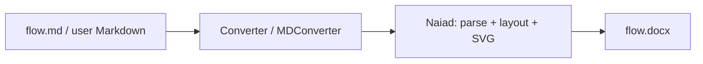

**Delivery path (migration stages):**

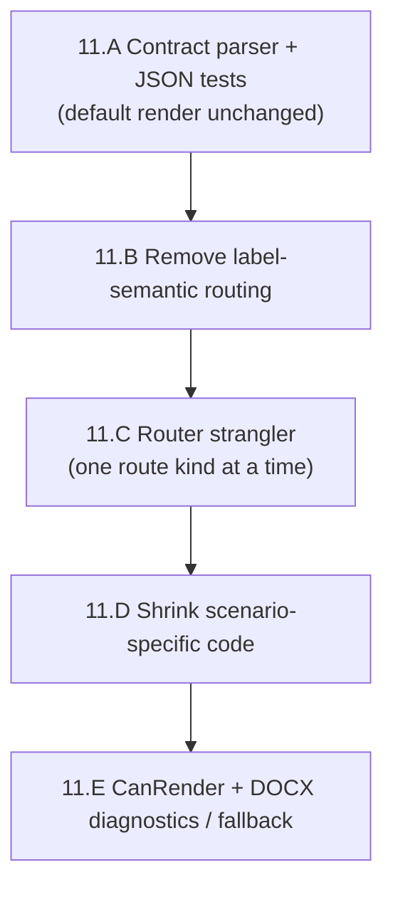

Stages **B–E** must not all start at once. Each stage has exit criteria in the table in §11.0.

### 11.0.2 Reference model: how official Mermaid handles flowcharts

Mermaid does **not** draw from the text in one step. It builds an in-memory **diagram database** (`flowDb`), then lays out, then renders. That separation is the reference for Naiad.

Official documentation: [Flowcharts syntax](https://mermaid.js.org/syntax/flowchart.html) (Mermaid 11.x).

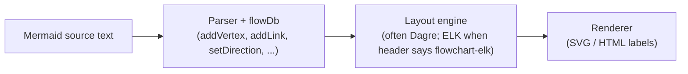

**Source of truth in this repo (vendored Mermaid 11.14.0):**

| Responsibility | File (under repo root) |
| --- | --- |
| Diagram database (`addVertex`, `addLink`, `setDirection`, styles) | `mermaid/packages/mermaid/src/diagrams/flowchart/flowDb.ts` |
| Parser grammar (JISON) | `mermaid/packages/mermaid/src/diagrams/flowchart/parser/flow.jison` |
| Behaviour tests (edge expansion, chaining) | `mermaid/packages/mermaid/src/diagrams/flowchart/parser/flow-vertice-chaining.spec.js` |
| Grouped links + edge ids (`A & B e1@--> C & D`) | `mermaid/packages/mermaid/src/diagrams/flowchart/parser/flow-node-data.spec.js` (lines 347–362) |
| Edge id on grouped links (implementation rule) | `flowDb.ts` — `addLink` (see comment at lines 349–360) |
| Symbolic directions `<` `>` `^` `v` | `flowDb.ts` — `setDirection` (lines 436–449) |

**Grouped node expansion (Cartesian product)** — when the user writes `A & B --> C & D`, Mermaid creates **four** edges, not one “fan” object:

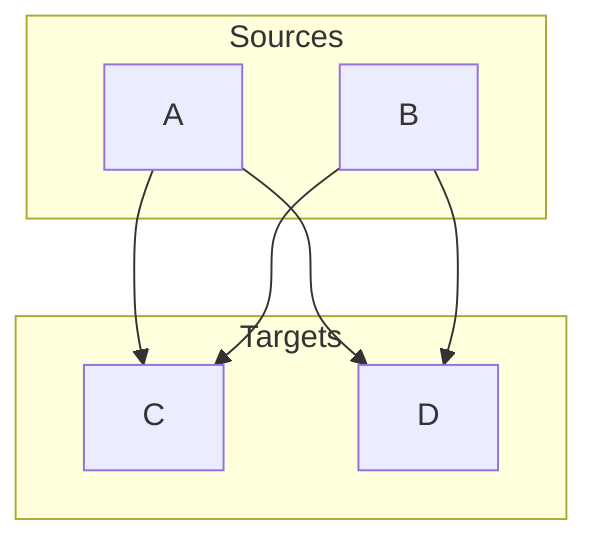

Verified by upstream test `A & B --> C` (two edges) in `flow-vertice-chaining.spec.js` (lines 38–58). The full `A & B --> C & D` expansion (four edges) and `A & B e1@--> C & D` (six edges; user id `e1` on **B→C** only) are exercised in `flow-node-data.spec.js` and `flow-vertice-chaining.spec.js`. Naiad must lock the same facts in verified JSON (§11.11) **before** they are treated as authoritative.

**User-defined edge id on a group** — Mermaid applies the user id only to **one** generated edge in a group (last source × first target in the cross product). This is **confirmed in source**, not guessed (`mermaid/packages/mermaid/src/diagrams/flowchart/flowDb.ts`, `addLink`, lines 349–360):

```typescript
// for a group syntax like A e1@--> B & C, only the first edge should have a userDefined id
// the rest of the edges should have auto generated ids
for (const start of _start) {
  for (const end of _end) {
    const isLastStart = start === _start[_start.length - 1];
    const isFirstEnd = end === _end[0];
    if (isLastStart && isFirstEnd) {
      this.addSingleLink(start, end, linkData, id);
    } else {
      this.addSingleLink(start, end, linkData, undefined);
    }
  }
}
```

Naiad must reproduce this rule in Stage 11.A and tag the result in verified JSON. Until Naiad tests pass, treat the table row for `A & B e1@--> C & D` as `implementation-critical-unverified` in §11.4.

**Why edge order matters:** `linkStyle 0` and `linkStyle default` refer to edges by **creation order** in the database. If Naiad expands `&` differently from Mermaid, styles attach to the wrong arrows even when the picture “looks fine”.

### 11.0.3 Current Naiad behaviour (modified tree, today)

Naiad’s flowchart path **already produces good pictures** for the regression catalogue, but it uses a **simpler parser** and a **long repair chain** after Dagre layout.

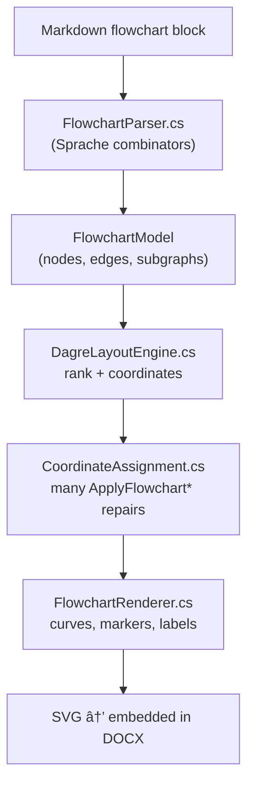

**Entry point:** `extern/Naiad/src/Naiad/Mermaid.cs` dispatches `DiagramType.Flowchart` to `RenderFlowchart` (see switch around lines 70–72).

**Parser today** (`extern/Naiad/src/Naiad/Diagrams/Flowchart/FlowchartParser.cs`):

| Capability | Mermaid 11.14 | Naiad today (verified in tree) |
| --- | --- | --- |
| Chained edges `A --> B --> C` on one line | Yes | Yes — `StatementParser` (from line 271) builds a node list and edge list |
| Grouped nodes `A & B --> C` | Yes | **No** — `&` is not part of the statement grammar |
| Edge id `e1@-->` | Yes | **No** — no edge id field on `Edge` model |
| Metadata `@{ shape: doc }` | Yes | **No** |
| `linkStyle default` | Yes | Partial — indexed `linkStyle` exists; “default” semantics must match Mermaid |
| `click` / `accTitle` | Stored in flowDb | **Accepted but discarded** — `clickDirective` and `initDirective` parse and ignore content (lines 333–349) |
| `flowchart-elk` header | Uses ELK in Mermaid.js | **Not implemented in Naiad** — no ELK references under `extern/Naiad` (see §11.0.10) |

**Edge model today** (`extern/Naiad/src/Naiad/Models/Edge.cs`): has `SourceId`, `TargetId`, `Label`, arrow style, `MinRankSpan`, layout `Points` — but **no** `Id`, `CreationIndex`, `IsUserDefinedId`, or metadata fields. That gap is what Stage 11.A fills.

**Post-layout repairs today** (`extern/Naiad/src/Naiad/Layout/DagreLayoutEngine.cs`): after layout, Naiad calls helpers such as:

- `ApplyFlowchartDiagramConnectorEndpointSnapping` (e.g. lines 49, 341, 378, 1193)
- `ApplyFlowchartTbUpwardLoopEdgeOrthogonalSnapping` (e.g. lines 51, 343, 380)

Those live in `CoordinateAssignment.cs` and are selected with many `IsFlowchart*` predicates (dozens of occurrences — see baseline table in §11.0). Comments often name regression scenarios (`F53`, `F58`). That approach saved visual parity but is what §11.C will replace gradually.

**Label-semantic routing (problem to remove in 11.B)** — still present in layout code (`extern/Naiad/src/Naiad/Layout/CoordinateAssignment.cs`, `TryGetFlowchartHorizontalDecisionBranchEndpoints`, lines 2825–2835):

```csharp
if (label.StartsWith("Yes", StringComparison.OrdinalIgnoreCase))
{
    sourceAttach = new Position(centreX + half, centreY);
    exitRole = FlowchartDecisionBranchExitRole.SideRight;
}
else if (label.StartsWith("No", StringComparison.OrdinalIgnoreCase))
{
    sourceAttach = new Position(centreX + (half / 2.0), centreY - (half / 2.0));
    exitRole = FlowchartDecisionBranchExitRole.SideLeft;
}
```

Similar checks exist in `FlowchartRenderer.cs` (grep `StartsWith("Yes"`). A diagram labelled `True` / `False` should use the **same ports** as `Yes` / `No` when topology is identical.

### 11.0.4 Target behaviour after migration

The target is **not** “rewrite SVG from scratch.” It is:

1. **Parse** into a contract as complete as practical (Mermaid-aligned facts + diagnostics).
2. **Layout** with Dagre (unchanged engine family for this migration).
3. **Route** edges using **structure** (topology, shape, direction, ports)—§11.6–11.8 are **Naiad-native routing strategies**, not copies of `flowDb` fields.
4. **Render** with existing curve/marker/label code where possible.

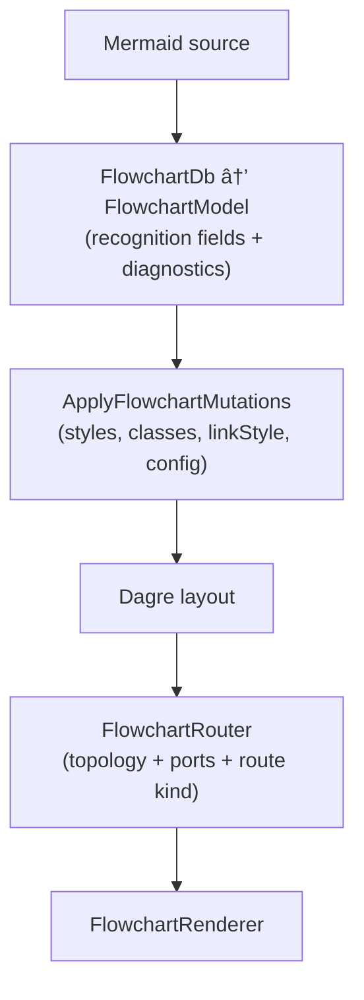

**Planned types and files (not all implemented yet):**

| Piece | Status | Where specified |
| --- | --- | --- |
| `FlowchartDb` parse database | **Planned** | §11.4, §11.10 |
| Recognition fields on `Node` / `Edge` / `FlowchartModel` | **Planned** | §11.3, §11.10 |
| `FlowchartRouter.cs` | **Planned** | §11.7, §11.10 |
| `FlowchartRecognition/*.verified.json` tests | **Planned** | §11.11 |
| `UseFlowchartRecognitionParser` feature flag | **Planned** | §11.10 |

Until Stage 11.A lands, treat this diagram as the **target architecture**, not a description of the running binary.

### 11.0.5 Strangler migration: parallel paths during transition

A **strangler** keeps the old path alive while the new path proves itself. That avoids breaking `flow.docx` while parser work proceeds.

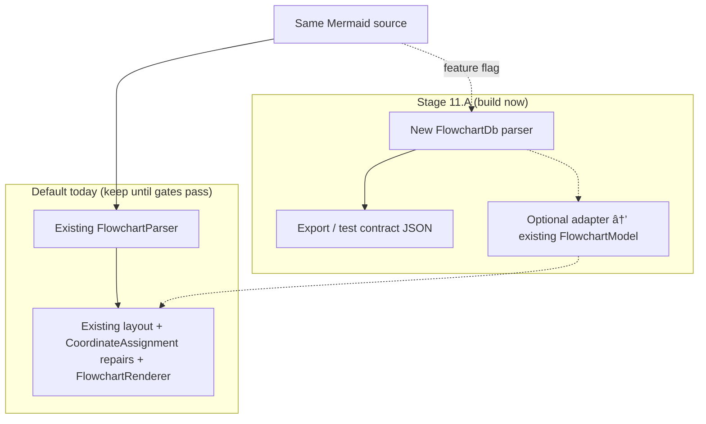

**Rules during transition:**

- **Default for MDConverter / Converter:** old parse → old render (no change to embedded images in Stage 11.A).
- **CI for recognition:** new parser only; compare JSON to Mermaid-derived expectations; **no PNG comparison required** for those tests.
- **CI for visual regression:** existing SvgHarness on `flow.md` F01–F60 (and F53A coordinate gate); do not delete scenarios because the contract parser exists.

### 11.0.6 What each stage changes (detail)

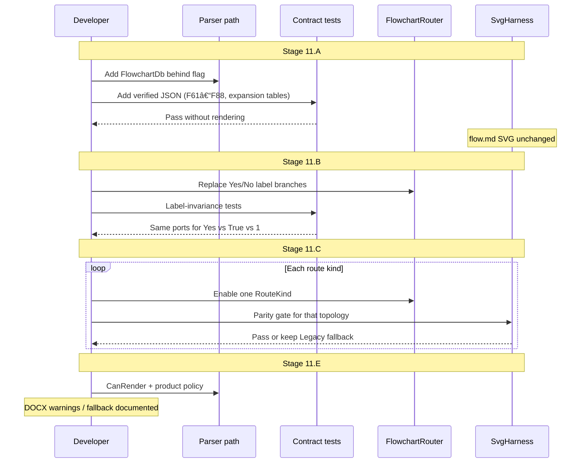

| Stage | Parser / contract | Layout / routing | Visual output | Product (DOCX) |
| --- | --- | --- | --- | --- |
| **11.A** | New facts, diagnostics, JSON tests | No change to default | **Unchanged** | **Unchanged** |
| **11.B** | Same | Remove label semantics | Should match prior (tests) | Unchanged |
| **11.C** | Same | Strangler router per route kind | Gated per kind | Unchanged unless gate fails |
| **11.D** | Same | Delete `IsFlowchart*` as parity proven | Stable | Unchanged |
| **11.E** | `CanRender` | Same | Native or fallback | Warnings / policy |

### 11.0.7 Recognition vs rendering vs routing (three layers)

Project managers often conflate “parse”, “layout”, and “draw”. This project treats them separately:

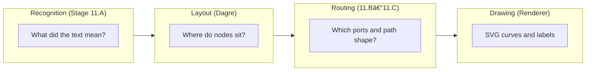

| Layer | Question it answers | Wrong approach |
| --- | --- | --- |
| Recognition | How many edges after `A & B --> C`? What is edge id `e1`? | Guessing from PNG |
| Layout | Rank and node positions | Hard-coding F05 as a special case |
| Routing | Which side of the diamond, loop outside cluster | Reading `"Yes"` on the label |
| Drawing | curveBasis vs straight line | Changing parser because a curve looks wrong |

### 11.0.8 Code reference map (quick navigation)

| Topic | Naiad (modified tree) | Mermaid 11.14 (vendored) |
| --- | --- | --- |
| Parse flowchart | `extern/Naiad/src/Naiad/Diagrams/Flowchart/FlowchartParser.cs` | `mermaid/.../flowchart/parser/` + `flowDb.ts` |
| Flowchart model | `extern/Naiad/src/Naiad/Diagrams/Flowchart/FlowchartModel.cs`, `Models/Node.cs`, `Models/Edge.cs` | `flowDb.ts` vertices/edges |
| Layout | `extern/Naiad/src/Naiad/Layout/DagreLayoutEngine.cs` | `mermaid/.../flowRenderer-v3-unified.ts` (and related) |
| Endpoint repairs / routing | `extern/Naiad/src/Naiad/Layout/CoordinateAssignment.cs` | Renderer + layout adapters in Mermaid.js |
| SVG / curves | `extern/Naiad/src/Naiad/Diagrams/Flowchart/FlowchartRenderer.cs` | `packages/mermaid/src/diagrams/flowchart/` |
| Public API | `extern/Naiad/src/Naiad/Mermaid.cs` | N/A (library is consumer) |
| Regression catalogue | `flow.md` (F01–F88, F53A) | Upstream tests under `mermaid/.../parser/*.spec.js` |
| Visual gate tool | `src/SvgHarness/Program.cs` | [Mermaid Live Editor](https://mermaid.live) / mermaid.ink (project policy) |
| DOCX pipeline | `src/MDConverter/`, `Converter/` | N/A |

**Online references (external):**

- [Mermaid flowchart syntax](https://mermaid.js.org/syntax/flowchart.html)
- [Mermaid configuration / `%%{init}%%`](https://mermaid.js.org/config/configuration.html)
- [Edge IDs and curve (v11.10+)](https://mermaid.js.org/syntax/flowchart.html) — see “Attaching an ID to Edges”
- [Dagre layout](https://github.com/dagrejs/dagre) — same family Naiad already uses
- [ELK layout](https://eclipse.dev/elk/) — used by Mermaid for `flowchart-elk` only; **not** Naiad’s current engine (§11.0.10)

### 11.0.9 ELK and `flowchart-elk` (explicitly deferred)

Mermaid supports a separate header form, `flowchart-elk`, that uses the **Eclipse Layout Kernel (ELK)** instead of Dagre for layout. That is a different layout engine with different routing behaviour.

| Topic | Mermaid.js | Naiad (this repo, verified) |
| --- | --- | --- |
| Default `flowchart` / `graph` | Dagre-based layout in practice | Dagre via `DagreLayoutEngine.cs` |
| `flowchart-elk` | ELK-based layout | **Not supported** — no ELK integration under `extern/Naiad` |
| Naiad ER / other diagrams | N/A | Separate parsers; no ELK dependency found in flowchart path |

**Migration decision (locked for this plan):**

1. **Stage 11.A–11.E** target **Dagre-based** flowcharts only (the common `flowchart` / `graph` headers).
2. If the parser sees `flowchart-elk`, it should still **recognise** the header and emit diagnostic `flowchart.elk-not-native` (see §11.14).
3. **Do not** schedule ELK porting, ELK routing, or ELK parity work in this migration. ELK remains a **future** programme after Dagre-path recognition and structural routing are stable.
4. Product behaviour for `flowchart-elk` in DOCX: official Mermaid fallback (when §11.E is implemented) or a clear “unsupported” message—not silent wrong layout.

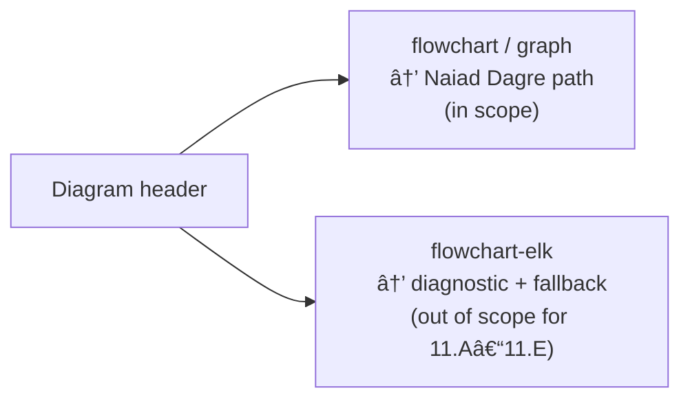

### 11.0.10 Truthfulness checklist (for reviewers)

Use this when judging whether §11 matches the repository:

| Statement | True today? | Notes |
| --- | --- | --- |
| `flow.md` visual catalogue is valuable | Yes | F01–F60 visual; F61–F88 recognition-oriented per `flow.md` |
| Naiad renders most F01–F60 acceptably | Largely yes | Project claim; gated by SvgHarness policy |
| Parser matches Mermaid `flowDb` | No | No `&`, no edge ids, many directives swallowed |
| `FlowchartDb` / `FlowchartRouter` exist | **No** | Planned in §11.4–§11.10 |
| Mermaid `addLink` grouped id rule documented | Yes | `flowDb.ts` lines 349–360 |
| Label `Yes`/`No` affects routing | Yes | `CoordinateAssignment.cs` ~2825+ |
| ELK in scope for this migration | **No** | Explicitly deferred §11.0.9, §11.14 |
| Stage 11.A changes default DOCX images | **No** | Explicit requirement §11.0, §11.10 |

If implementation diverges from this table, update §11.0.10 and the pin in §11.0—not only the code.

### 11.1 Current Problem in Naiad

Naiad already renders many flowcharts well. The weak point is not SVG drawing quality; it is the determination model.

The current flowchart path is roughly:

```text
FlowchartParser.cs
  parses a simplified statement model into FlowchartModel

FlowchartRenderer.cs
  measures nodes/labels
  calls DagreLayoutEngine
  chooses curve/render helpers

DagreLayoutEngine.cs / CoordinateAssignment.cs
  layout and many flowchart-specific endpoint repairs
```

This has two different recognition problems.

First, `FlowchartParser.cs` does not yet produce a Mermaid-equivalent contract:

- no label type (`text`, `string`, `markdown`)
- no source spans or declaration records
- no user-defined edge ids (`e1@-->`)
- no grouped `&` expansion
- no metadata shape data `@{ ... }`
- no edge metadata mutation by id
- no `linkStyle default`
- no interaction model
- no accessibility directives in the flowchart parser
- no diagnostics for recognised-but-unsupported features
- init is mostly handled outside the parser and accepted/stripped rather than represented as a source fact

Second, layout/routing contains many case recognisers. Some are structural enough, but the overall approach is still fixture-shaped. Methods and comments refer to `F34`, `F53`, `F58`, "terminal collector", "stadium merge", "retry loop", and some decisions depend directly on labels such as `"Yes"` / `"No"`.

The most concerning example is:

```text
TryGetFlowchartHorizontalDecisionBranchEndpoints(...)
  if label starts with "Yes" => right vertex
  else if label starts with "No" => upper-right slope
```

That is exactly the failure mode described earlier. The words on an edge are not semantics. They are labels. A diagram using `"True"`, `"OK"`, `"Pass"`, `"1"`, `"Approved"`, or translated text can have the same topology and should receive the same structural treatment.

### 11.2 Non-Negotiable Target

Naiad should parse Mermaid into a complete recognition contract, then layout and render from that contract.

The renderer must never choose behaviour because a visible label equals `"Yes"`, `"No"`, `"Done"`, `"End"`, `"Retry"`, `"Success"`, `"Error"`, or any other scenario word.

Allowed decision inputs:

- parsed syntax facts
- node ids
- edge ids
- graph topology
- node shapes
- edge styles and arrowheads
- label presence and measured dimensions
- declared direction
- subgraph containment
- source order
- layout positions
- explicit config
- explicit metadata

Disallowed decision inputs:

- semantic guesses from rendered label text
- fixture names
- scenario names
- English words in node labels

### 11.3 Data Model Changes

Add recognition-level model types instead of overloading the render model.

Pseudo code:

```csharp
enum MermaidLabelType
{
    Text,
    String,
    Markdown
}

enum MermaidDiagnosticSeverity
{
    Info,
    Warning,
    Error
}

sealed record MermaidSourceSpan(
    int StartOffset,
    int EndOffset,
    int StartLine,
    int StartColumn,
    int EndLine,
    int EndColumn);

sealed record MermaidDiagnostic(
    MermaidDiagnosticSeverity Severity,
    string Code,
    string Message,
    MermaidSourceSpan? SourceSpan,
    string? AffectedId);

sealed record MermaidDeclaration(
    string Kind,
    string RawText,
    MermaidSourceSpan SourceSpan);

abstract record MermaidMetadataValue;
sealed record ShapeMetadata(NodeShape Shape) : MermaidMetadataValue;
sealed record LabelMetadata(string Text, MermaidLabelType LabelType) : MermaidMetadataValue;
sealed record CurveMetadata(string Curve) : MermaidMetadataValue;
sealed record AnimationMetadata(bool? Animate, string? Animation) : MermaidMetadataValue;
sealed record RawMetadata(string Key, string RawValue) : MermaidMetadataValue;

sealed record EdgeExpansionTrace(
    MermaidSourceSpan StatementSpan,
    int LinkOrdinalInStatement,
    int StartOrdinal,
    int EndOrdinal,
    IReadOnlyList<string> StartSet,
    IReadOnlyList<string> EndSet,
    string RawLinkToken);

sealed class Node
{
    string Id;
    string? Label;
    MermaidLabelType LabelType;
    NodeShape Shape;
    string? ShapeSource;          // "default", "legacy-bracket", "metadata"
    List<MermaidDeclaration> Declarations;
    Dictionary<string, MermaidMetadataValue> Metadata;
    List<string> ClassNames;
    Style InlineStyle;
    string? ParentId;
    bool IsGroup;
}

sealed class Edge
{
    string Id;
    bool IsUserDefinedId;
    string SourceId;
    string TargetId;
    EdgeEndpointMarker MarkerStart; // None, Point, Circle, Cross
    EdgeEndpointMarker MarkerEnd;
    EdgeStyle LineStyle;            // Solid, Dotted, Thick, Invisible
    int MinRankSpan;
    string? Label;
    MermaidLabelType LabelType;
    List<string> ClassNames;
    Style InlineStyle;
    string? Curve;
    bool? Animate;
    string? Animation;
    MermaidSourceSpan SourceSpan;
    EdgeExpansionTrace ExpansionTrace;
    int CreationIndex;            // Mermaid parse-order index; required for linkStyle N
}

sealed class Subgraph
{
    string Id;
    string? Title;
    MermaidLabelType LabelType;
    string? ParentId;
    Direction? DeclaredDirection;
    Direction EffectiveDirection;
    string? DirectionIgnoredReason;
    List<string> NodeIds;
    List<string> ChildSubgraphIds;
    List<string> ClassNames;
    Style InlineStyle;
}

sealed class FlowchartModel : GraphDiagramBase
{
    List<MermaidDeclaration> Declarations;
    List<MermaidDiagnostic> Diagnostics;
    Dictionary<string, Style> ClassDefinitions;
    List<LinkStyleDirective> LinkStyles; // index list OR default
    List<InteractionDirective> Interactions;
    FlowchartConfig EffectiveConfig;
}
```

Do not remove the existing render fields immediately. Add the recognition fields first, then migrate call sites. The current renderer can keep consuming `Node.Shape`, `Node.Label`, `Edge.LineStyle`, etc. while the richer facts are introduced.

Implementation should follow the existing C# conventions in the Naiad source. The pseudo-code in this document names concepts, not final public API casing.

Metadata may be stored internally as raw parsed YAML/JSON while parsing, but the contract emitted for tests should use typed values like `ShapeMetadata`, `LabelMetadata`, `CurveMetadata`, and `AnimationMetadata`. Stable verified JSON is impossible if everything is an unstructured `Dictionary<string, object?>`.

`EdgeExpansionTrace` is required because Mermaid edge order is observable. `linkStyle 0`, generated edge ids, user-defined edge ids, and grouped `&` expansion all depend on the exact creation sequence. Every edge must record its parse-order `CreationIndex` and the source statement/link/set positions that produced it.

Subgraph membership must also be explicit. Mermaid gives each node one effective parent. When a node is encountered inside a subgraph, add it to the current subgraph only if it has no parent yet. When a nested subgraph owns a node, do not also leave that node as a direct member of the outer group.

Subgraph direction has two states:

```text
DeclaredDirection: the direction statement written inside the subgraph, if any.
EffectiveDirection: the direction the renderer should actually use.
DirectionIgnoredReason: why a declared direction was not applied.
```

Mermaid has a cross-boundary caveat: when subgraph members are linked to nodes outside the subgraph, local subgraph direction can be ignored and the parent graph direction effectively wins. Naiad must therefore preserve the declared fact for recognition while computing an effective direction for layout.

Pseudo code:

```csharp
ResolveSubgraphEffectiveDirection(subgraph, parentDirection, topology)
{
    if (subgraph.DeclaredDirection is null)
    {
        subgraph.EffectiveDirection = parentDirection;
        return;
    }

    if (HasExternalEdges(subgraph, topology))
    {
        subgraph.EffectiveDirection = parentDirection;
        subgraph.DirectionIgnoredReason = "external-edge-crosses-subgraph-boundary";
        return;
    }

    subgraph.EffectiveDirection = subgraph.DeclaredDirection.Value;
}
```

Pseudo code:

```csharp
AddNodeToCurrentSubgraphOnce(nodeId)
{
    if (SubgraphStack.Count == 0)
        return;

    if (ParentSubgraphByNodeId.ContainsKey(nodeId))
        return;

    Subgraph current = SubgraphStack.Peek();
    current.NodeIds.Add(nodeId);
    ParentSubgraphByNodeId[nodeId] = current.Id;
    NodesById[nodeId].ParentId = current.Id;
}

AddNestedSubgraph(parent, child)
{
    parent.ChildSubgraphIds.Add(child.Id);
    child.ParentId = parent.Id;
}
```

### 11.4 Parser Replacement

Replace the current simplified `StatementParser` in `FlowchartParser.cs` with a Mermaid-style parse database.

The parser should not directly build final layout behaviour. It should mutate a `FlowchartDb` that mirrors Mermaid's `flowDb.ts` responsibilities.

Pseudo code:

```csharp
sealed class FlowchartDb
{
    Dictionary<string, Node> NodesById = new(StringComparer.Ordinal);
    List<Edge> Edges = [];
    List<Subgraph> RootSubgraphs = [];
    Stack<Subgraph> SubgraphStack = [];
    Dictionary<string, Subgraph> SubgraphById = [];
    Dictionary<string, Style> ClassDefinitions = [];
    Dictionary<string, List<string>> ClassesById = [];
    List<LinkStyleDirective> LinkStyles = [];
    List<MermaidDiagnostic> Diagnostics = [];
    Direction Direction = Direction.TopToBottom;

    Node AddOrUpdateNode(NodeDeclaration decl)
    {
        Node node = GetOrCreateNode(decl.Id);

        node.Declarations.Add(decl.ToMermaidDeclaration());

        if (decl.LabelWasPresent)
        {
            node.Label = decl.Label;
            node.LabelType = decl.LabelType;
        }
        else if (node.Label is null)
        {
            node.Label = decl.Id;
            node.LabelType = MermaidLabelType.Text;
        }

        if (decl.ShapeWasPresent)
        {
            node.Shape = decl.Shape;
            node.ShapeSource = decl.ShapeSource;
        }

        foreach (string className in decl.InlineClasses)
        {
            AddClass(node.Id, className);
        }

        if (SubgraphStack.Count > 0)
        {
            AddNodeToCurrentSubgraphOnce(node.Id);
        }

        return node;
    }

    void AddLink(NodeSet starts, NodeSet ends, LinkToken token, MermaidSourceSpan span)
    {
        for each start in starts.Items:
            for each end in ends.Items:
                Edge edge = BuildEdge(start.Id, end.Id, token, span);

                if (token.UserDefinedId is not null
                    && start == starts.Last
                    && end == ends.First
                    && !Edges.Any(e => e.Id == token.UserDefinedId))
                {
                    edge.Id = token.UserDefinedId;
                    edge.IsUserDefinedId = true;
                }
                else
                {
                    edge.Id = GenerateMermaidEdgeId(edge.SourceId, edge.TargetId);
                }

                Edges.Add(edge);
    }

    void ApplyMetadata(string id, MetadataObject metadata)
    {
        Edge? edge = Edges.FirstOrDefault(e => e.Id == id);
        if (edge is not null)
        {
            edge.Animate = metadata.GetBool("animate");
            edge.Animation = metadata.GetString("animation");
            edge.Curve = metadata.GetString("curve");
            return;
        }

        Node node = GetOrCreateNode(id);
        if (metadata.TryGetShape(out NodeShape shape))
        {
            node.Shape = shape;
            node.ShapeSource = "metadata";
        }
        if (metadata.TryGetLabel(out string label, out MermaidLabelType labelType))
        {
            node.Label = label;
            node.LabelType = labelType;
        }

        node.Metadata.Merge(metadata.RawValues);
    }
}
```

The parser grammar must recognise at least these top-level statement kinds:

```csharp
ParseFlowchart()
{
    ParseLeadingInitBlocksIntoModelConfig();
    ParseHeaderAndDirection();

    while (!EndOfInput)
    {
        if (TryParseCommentOrBlankLine()) continue;
        if (TryParseAccessibility()) continue;
        if (TryParseSubgraphStart()) continue;
        if (TryParseSubgraphEnd()) continue;
        if (TryParseSubgraphDirection()) continue;
        if (TryParseStyle()) continue;
        if (TryParseClassDef()) continue;
        if (TryParseClass()) continue;
        if (TryParseLinkStyle()) continue;
        if (TryParseClickOrHref()) continue;
        if (TryParseVertexOrEdgeStatement()) continue;

        AddDiagnostic("flowchart.unrecognised-statement", currentLine);
        if (StrictMode) throw;
        SkipLine();
    }

    return db.ToFlowchartModel();
}
```

Parser technology is an implementation choice, but it must be deliberate. The current `FlowchartParser.cs` uses parser combinators; a full Mermaid-compatible grammar could be reached by expanding that parser, porting the upstream JISON grammar, or introducing a generated lexer/parser. The chosen approach must be judged by edge-order fidelity and diagnostics, not by short-term ease.

Default parsing mode for MDConverter should be lenient:

```csharp
ParseOptions.Default = new ParseOptions
{
    Strict = false,
    AccumulateDiagnostics = true,
    ContinueAfterUnsupportedStatement = true
};
```

Strict mode should exist for test and fidelity gates, but the DOCX product path usually needs a model plus diagnostics rather than a first-error throw.

`TryParseVertexOrEdgeStatement` must parse the general grammar, not only a chain of single nodes:

```csharp
ParseVertexOrEdgeStatement()
{
    NodeSet current = ParseNodeSet();       // A or A & B or A@{...} & B[...]

    while (TryParseLink(out LinkToken link))
    {
        NodeSet next = ParseNodeSet();
        db.AddLink(current, next, link, link.SourceSpan);
        current = next;
    }
}

ParseNodeSet()
{
    List<NodeDeclaration> nodes = [];
    nodes.Add(ParseNodeDeclaration());

    while (TryConsume("&"))
    {
        nodes.Add(ParseNodeDeclaration());
    }

    foreach (node in nodes)
    {
        db.AddOrUpdateNode(node);
    }

    return new NodeSet(nodes);
}
```

`ParseLink` must decompose syntax into facts:

```csharp
ParseLink()
{
    optionalUserId = TryParseEdgeIdPrefix(); // e1@
    startToken = TryParseStartLink();        // <, o, x plus -- / == / -.
    embeddedText = TryParseEmbeddedEdgeText();
    endToken = ParseEndLink();
    pipeLabelBeforeOrAfter = TryParsePipeLabel();

    return new LinkToken
    {
        UserDefinedId = optionalUserId,
        MarkerStart = DecodeStartMarker(startToken, endToken),
        MarkerEnd = DecodeEndMarker(startToken, endToken),
        LineStyle = DecodeStroke(startToken, endToken),
        MinRankSpan = DecodeMinlen(endToken),
        Label = embeddedText ?? pipeLabelBeforeOrAfter?.Text,
        LabelType = embeddedText?.Type ?? pipeLabelBeforeOrAfter?.Type ?? MermaidLabelType.Text
    };
}
```

This is the core fix. Once edges are decomposed this way, every later stage can reason from edge facts rather than from labels or fixture cases.

Edge expansion and edge-id order must be copied from Mermaid's upstream parser tests, not re-derived from intuition. In particular, use the local Mermaid files under:

```text
mermaid/packages/mermaid/src/diagrams/flowchart/parser/flow-vertice-chaining.spec.js
mermaid/packages/mermaid/src/diagrams/flowchart/parser/flow-node-data.spec.js
mermaid/packages/mermaid/src/diagrams/flowchart/parser/flow-edges.spec.js
mermaid/packages/mermaid/src/diagrams/flowchart/parser/flow-lines.spec.js
```

The grouped edge-id placement rule is **implementation-critical** and must be confirmed against the pinned Mermaid parser source (tests or parser dump) before it becomes a locked fixture. Until then, tag verified JSON and contract tests with `implementation-critical-unverified` rather than treating this document as the oracle.

The recognition tests should include an explicit expansion table:

| Source | Edge creation order | Fixture status |
| --- | --- | --- |
| `A --> B --> C` | `A->B`, `B->C` | locked (derive from upstream tests) |
| `A & B --> C` | `A->C`, `B->C` | locked (derive from upstream tests) |
| `A --> B & C` | `A->B`, `A->C` | locked (derive from upstream tests) |
| `A & B --> C & D` | `A->C`, `A->D`, `B->C`, `B->D` | locked (derive from upstream tests) |
| `A --> B & C --> D` | `A->B`, `A->C`, `B->D`, `C->D` | locked (derive from upstream tests) |
| `A & B e1@--> C & D` | target: auto `A->C`, auto `A->D`, user `e1` on `B->C`, auto `B->D` | `implementation-critical-unverified` |

The final row is deliberately strange because Mermaid applies a user-defined edge id only to the grammar-selected generated edge. That exact behaviour is required for `linkStyle`, metadata mutation, and class assignment by edge id. Keep the rule in the plan; do not remove it. Verify it, then lock it.

Config parsing must include `%%{init: ...}%%` now. YAML front matter (`---`) should be either parsed into the same effective config pipeline or recognised with a diagnostic:

```text
flowchart.frontmatter-recognised-but-not-applied
```

Do not silently discard front matter once the recogniser claims Mermaid compatibility.

### 11.5 Style and Config Application

Change style application from "nodes plus linkStyle index" to a Mermaid-style mutation pass.

Pseudo code:

```csharp
ApplyFlowchartMutations(model)
{
    foreach (ClassDef def in model.ClassDefinitions)
        RegisterClass(def);

    foreach (ClassAssignment assignment in model.ClassAssignments)
        foreach (id in assignment.TargetIds)
            ApplyClassToNodeEdgeOrSubgraph(id, assignment.ClassName);

    foreach (InlineClass inline in model.InlineClasses)
        ApplyClassToNodeEdgeOrSubgraph(inline.TargetId, inline.ClassName);

    foreach (StyleDirective style in model.StyleDirectives)
        ApplyStyleToNodeEdgeOrSubgraph(style.TargetId, style.Style);

    foreach (LinkStyleDirective linkStyle in model.LinkStyles)
    {
        if (linkStyle.IsDefault)
            model.DefaultEdgeStyle.Merge(linkStyle.Style);
        else
            foreach (int index in linkStyle.EdgeIndexes)
                model.Edges[index].Style.Merge(linkStyle.Style);

        if (linkStyle.Curve is not null)
            ApplyCurveToDefaultOrIndexedEdges(linkStyle);
    }
}
```

`RenderOptions` should not be the only home for effective config. `FlowchartModel.EffectiveConfig` should be populated before rendering:

```csharp
FlowchartConfig BuildEffectiveConfig(initBlocks, defaults)
{
    return new FlowchartConfig
    {
        NodeSpacing = init.flowchart.nodeSpacing ?? 50,
        RankSpacing = init.flowchart.rankSpacing ?? 50,
        DiagramPadding = init.flowchart.diagramPadding ?? 8,
        WrappingWidth = init.flowchart.wrappingWidth ?? 200,
        HtmlLabels = init.flowchart.htmlLabels ?? global.htmlLabels ?? true,
        Curve = init.flowchart.curve ?? "basis",
        Padding = init.flowchart.padding ?? 8,
        Look = init.look ?? "classic",
        Theme = init.theme ?? options.Theme
    };
}
```

Edge-indexed style depends on exact Mermaid creation order. Therefore style application must use `Edge.CreationIndex`, not list position after any later filtering, dummy-edge insertion, sorting, or routing transformation.

Pseudo code:

```csharp
ApplyIndexedLinkStyle(model, directive)
{
    IEnumerable<Edge> targets = directive.IsDefault
        ? model.Edges
        : model.Edges.Where(e => directive.Indexes.Contains(e.CreationIndex));

    foreach (Edge edge in targets)
    {
        edge.Style.Merge(directive.Style);
        if (directive.Curve is not null)
            edge.Curve = directive.Curve;
    }
}
```

Verified contract JSON must include `CreationIndex` for every edge so failures in expansion order are obvious before rendering.

### 11.6 Replace Label-Based Routing

The routing algorithms in Sections 11.6–11.8 are **Naiad-native structural routing strategies**. They are intended to replace fixture-specific repair logic while preserving existing `flow.md` visual parity. They are **not** parser facts and must not be confused with Mermaid `flowDb` recognition output.

Remove all direct semantic label tests from routing.

Specifically, replace logic shaped like this:

```csharp
if (edge.Label.StartsWith("Yes")) useRightPort();
else if (edge.Label.StartsWith("No")) useUpperPort();
else sortByTargetPosition();
```

with structural branch allocation:

```csharp
ResolveDecisionBranchPorts(decisionNode, outgoingEdges, diagramDirection)
{
    ordered = outgoingEdges
        .OrderBy(edge => PrimaryCoordinateOfTarget(edge, diagramDirection))
        .ThenBy(edge => edge.SourceSpan.StartOffset)
        .ToList();

    for i in 0..ordered.Count-1:
        role = AllocateDecisionExitRole(i, ordered.Count, diagramDirection);
        ordered[i].PortHint = role;
}

AllocateDecisionExitRole(index, count, direction)
{
    if (direction is TopToBottom or BottomToTop)
    {
        if (count == 1) return BottomVertex;
        if (count == 2) return index == 0 ? SideLeft : SideRight;
        if (count == 3) return index == 0 ? SideLeft
                         : index == 1 ? BottomVertex
                         : SideRight;
        return EvenlySpacedPerimeterPort(index, count, preferredFace: Bottom);
    }

    if (direction is LeftToRight or RightToLeft)
    {
        if (count == 1) return RightVertex;
        if (count == 2) return index == 0 ? UpperRightSlope : RightVertex;
        if (count == 3) return index == 0 ? UpperRightSlope
                         : index == 1 ? RightVertex
                         : LowerRightSlope;
        return EvenlySpacedPerimeterPort(index, count, preferredFace: Right);
    }
}
```

Labels may still affect layout clearance because they have dimensions:

```csharp
if (edge.Label is not null)
{
    MeasureLabel(edge);
    ReserveLabelSpace(edge);
}
```

But labels must not determine branch meaning.

The branch roles above are still Mermaid-version-sensitive geometry choices. They are acceptable only because they are derived from branch count, source order, rank, relative target position, and direction. They must never be derived from English words on the edge.

Incoming edges need the same treatment as outgoing decision branches. Multi-incoming diamonds, stadium/pill fan-in, and collector-like joins should be handled by target-side port allocation first, then optional shape-specific attach modification. The hook may be shape-specific, but it must not be scenario-specific:

```csharp
ShapeRouteModifier? modifier = ShapeRouteModifiers.For(target.Shape);
modifier?.AdjustTargetPort(edge, target, allocatedPort, topology);
```

Label bounding boxes are layout inputs only:

```text
edge.Label text -> measure -> reserve clearance -> render label
edge.Label text -> route semantic choice    // forbidden
```

### 11.7 Replace Fixture-Specific Endpoint Repairs with Generic Port Allocation

Keep the good geometry functions, but change how they are selected.

Current helpers like these should become implementation details behind generic routing:

```text
TryGetFlowchartVerticalDecisionBranchEndpoints
TryGetFlowchartVerticalDecisionMultiIncomingEndpoints
TryGetFlowchartTbStadiumMergeEndpoints
TryGetFlowchartTbTerminalCollectorEndpoints
IsFlowchartLrRetryLoopEdge
IsFlowchartLrRectangleToDiamondIngressEdge
```

Do not replace all call sites at once. Introduce this general pipeline behind a feature flag and migrate one route kind at a time:

```csharp
RouteAllFlowchartEdges(model, layout)
{
    TopologyIndex topology = BuildTopologyIndex(model);
    PortPlan portPlan = AllocatePorts(model, topology);

    foreach (Edge edge in model.Edges)
    {
        Node source = model.GetNode(edge.SourceId);
        Node target = model.GetNode(edge.TargetId);

        Port sourcePort = portPlan.GetSourcePort(edge);
        Port targetPort = portPlan.GetTargetPort(edge);

        Position sourceAttach = IntersectShape(source, sourcePort, target.Position);
        Position targetAttach = IntersectShape(target, targetPort, source.Position);

        EdgeRouteKind kind = ClassifyRoute(edge, source, target, topology, model.Direction);
        edge.Points.ReplaceWith(BuildRoute(kind, sourceAttach, targetAttach, source, target, model));
    }
}
```

Temporary bridge:

```csharp
RouteEdge(edge)
{
    if (FlowchartRouter.TryRoute(edge, out Route route)
        && RouteParityGate.IsEnabled(route.Kind))
    {
        edge.Points.ReplaceWith(route.Points);
        return;
    }

    LegacyCoordinateAssignment.Route(edge); // existing behaviour
}
```

Each former `IsFlowchart*` helper must be classified before deletion:

| Old helper family | New destination |
| --- | --- |
| decision branch endpoints | `RouteKind.DecisionFanOut` / `RouteKind.DecisionFanIn` |
| hub fan-out/fan-in | generic endpoint-face port allocation |
| stadium dual fan-in | target-side ports + `StadiumShapeRouteModifier` |
| terminal collector | target-side multi-port join + route corridor selection |
| LR retry loop | `RouteKind.BackEdgeLoop` using reachability |
| rectangle-to-diamond ingress | shape intersection + target-side diamond port |
| cross-subgraph boundary | `RouteKind.CrossClusterBoundary` |
| BT stacked/forward column | rank/reachability route classification, not visual `DeltaY` alone |
| helpers with no structural mapping yet | temporary `RouteKind.Legacy*` plus deletion ticket |

Comments may reference historical fixture ids, but routing predicates must not encode scenario identity as their reason to run.

Build topology from graph facts:

```csharp
BuildTopologyIndex(model)
{
    return new TopologyIndex
    {
        IncomingByNode = model.Edges.GroupBy(e => e.TargetId),
        OutgoingByNode = model.Edges.GroupBy(e => e.SourceId),
        ParentByNode = model.Nodes.ToDictionary(n => n.Id, n => n.ParentId),
        SourceOrderByEdge = model.Edges.Select((edge, index) => (edge, index)),
        Reachability = ComputeReachability(model.Edges)
    };
}
```

Allocate ports generically:

```csharp
AllocatePorts(model, topology)
{
    PortPlan plan = new();

    foreach (Node node in model.Nodes)
    {
        List<Edge> incoming = topology.Incoming(node.Id);
        List<Edge> outgoing = topology.Outgoing(node.Id);

        AllocateEndpointGroup(
            node,
            incoming,
            endpointKind: Target,
            direction: model.Direction,
            plan);

        AllocateEndpointGroup(
            node,
            outgoing,
            endpointKind: Source,
            direction: model.Direction,
            plan);
    }

    return plan;
}

AllocateEndpointGroup(node, edges, endpointKind, direction, plan)
{
    groups = edges.GroupBy(edge => FacingFace(node, OtherNode(edge), direction, endpointKind));

    foreach (group in groups)
    {
        ordered = group
            .OrderBy(edge => OrthogonalCoordinate(OtherNode(edge), group.Face))
            .ThenBy(edge => edge.SourceSpan.StartOffset)
            .ToList();

        slots = BuildPerimeterSlots(node.Shape, group.Face, ordered.Count);

        for i in 0..ordered.Count-1:
            plan.Set(edge: ordered[i], endpointKind, slots[i]);
    }
}
```

This replaces hard-coded cases such as "dual fan-in stadium", "terminal collector", and "hub fan-out" with the same underlying rule: multiple edges sharing a face need stable, ordered ports on that face.

The special geometry functions are still useful:

```csharp
IntersectShape(node, port, toward)
{
    switch (node.Shape)
    {
        case Diamond:
            return IntersectDiamondAtPortOrRay(node, port, toward);
        case Stadium:
            return IntersectStadiumAtPortOrRay(node, port, toward);
        case Cylinder:
            return IntersectCylinderAtPortOrRay(node, port, toward);
        case Circle:
        case DoubleCircle:
            return IntersectCircleAtPortOrRay(node, port, toward);
        default:
            return IntersectRectangleAtPortOrRay(node, port, toward);
    }
}
```

The difference is that shape geometry is selected by shape, and route pattern is selected by topology. Neither is selected by label text.

Polyline ownership must be explicit:

- layout engine owns initial rank/order and a candidate polyline
- router owns endpoint ports, route classification, shape/subgraph clipping, and any replacement guide points
- renderer owns curve interpolation (`basis`, `linear`, `rounded`, etc.), markers, marker offsets, and label drawing

When `RouteKind.DefaultDagreSpline` is selected, the router should preserve the layout polyline and only clip/normalise endpoints. When a structural route kind is selected, the router may replace guide points, but it must record the route kind in diagnostics/debug output for parity review.

### 11.8 Generic Route Classification

Route classification should be structural:

```csharp
ClassifyRoute(edge, source, target, topology, direction)
{
    if (IsInvisible(edge))
        return Invisible;

    if (IsSelfLoop(edge))
        return SelfLoop;

    if (CrossesSubgraphBoundary(source, target))
        return CrossClusterBoundary;

    if (IsBackEdge(edge, topology.Reachability))
        return BackEdgeLoop;

    if (SharesRank(source, target, direction))
        return SameRank;

    if (HasClearAxisAlignedPath(source, target, direction))
        return AxisAligned;

    if (HasMultipleEdgesOnEndpointFace(edge, topology))
        return PortRoutedSpline;

    return DefaultDagreSpline;
}
```

Classification order is part of the specification. Back-edge detection must use rank plus reachability, not screen-space `DeltaX`/`DeltaY` alone. A geometrically upward edge in `BT` is often a normal forward edge, not a loop.

Required precedence:

```text
1. invisible edge
2. self loop
3. edge crossing subgraph boundary
4. graph-theoretic back edge (rank + reachability, excluding the edge itself)
5. explicit multi-rank/minlen dummy chain
6. same-rank edge
7. multi-edge endpoint-face route
8. simple axis-aligned forward edge
9. default layout polyline
```

If a new rule needs to be inserted into this order, add a regression explaining which older route kind it must beat and why.

Then build points from route kind:

```csharp
BuildRoute(kind, sourceAttach, targetAttach, source, target, model)
{
    switch (kind)
    {
        case AxisAligned:
            return [sourceAttach, targetAttach];

        case SameRank:
            return BuildSameRankRoute(sourceAttach, targetAttach, model.Direction);

        case BackEdgeLoop:
            return BuildLoopOutsideOccupiedBounds(source, target, model.Nodes, model.Direction);

        case CrossClusterBoundary:
            return ClipRouteToClusterBoundaries(
                BuildManhattanOrSpline(sourceAttach, targetAttach, model.Direction),
                source,
                target,
                model.Subgraphs);

        case PortRoutedSpline:
            return BuildOrthogonalStubbedSpline(sourceAttach, targetAttach, model.Direction);

        case DefaultDagreSpline:
            return UseLayoutEnginePolylineThenClipEndpoints(edge);
    }
}
```

Naiad can still match Mermaid closely by using `curveBasis` or the existing curve builders after points are selected. The point is to derive those points from a general topology/port model.

### 11.9 Parser Coverage for "Any Mermaid Diagram"

No native C# renderer will handle "any Mermaid diagram successfully" unless it either:

1. implements every Mermaid grammar and renderer path, or
2. recognises the full input enough to decide whether Naiad can render it, then falls back to official Mermaid for unsupported constructs.

The practical target should be:

```csharp
Render(input, options)
{
    MermaidDocument document = MermaidFrontEnd.Parse(input);

    if (NaiadCapabilities.CanRender(document.Contract))
    {
        return NaiadNativeRenderer.Render(document.Contract, options);
    }

    if (options.AllowOfficialMermaidFallback)
    {
        return OfficialMermaidRenderer.Render(input, options);
    }

    throw new MermaidUnsupportedException(document.Diagnostics);
}
```

`CanRender` must be contract-based:

```csharp
CanRender(contract)
{
    if (contract.Kind not in NativeSupportedDiagramKinds)
        return false;

    if (contract.Flowchart?.UsesUnsupportedShape == true)
        return false;

    if (contract.Flowchart?.UsesUnsupportedCurve == true)
        return false;

    if (contract.Flowchart?.UsesHtmlLabelFeatureNativeCannotMeasure == true
        && !options.AllowApproximateTextMeasurement)
        return false;

    if (contract.Diagnostics.Any(d => d.Severity == Error))
        return false;

    return true;
}
```

This is not a failure of Naiad. It is the only honest way to claim "any Mermaid diagram" without reimplementing all of Mermaid.js.

MDConverter/Converter needs an explicit product policy:

```csharp
enum MermaidRenderFidelityMode
{
    NativeOnlyStrict,   // fail if Naiad cannot render contract faithfully
    PreferNative,       // use Naiad when CanRender, else official Mermaid fallback
    OfficialOnly        // bypass Naiad for debugging/parity
}
```

Fallback implementation may be headless browser, mermaid-cli, a local vendored Mermaid bundle, or a service adapter. The spec does not require one mechanism, but it does require that the mechanism be pinned, repeatable, and visible in diagnostics.

Fallback safety constraints:

```text
Official Mermaid fallback must be local, pinned, deterministic, and non-networked by default.
Do not call mermaid.ink or any external rendering service unless the user explicitly opts in.
Record the Mermaid package version, commit/tag, renderer mode, browser/runtime, and securityLevel used.
Disable or sandbox JavaScript callbacks.
Default securityLevel should be strict unless a caller explicitly requests loose behaviour.
Href/click directives must not execute during batch conversion.
```

This matters because Mermaid interaction behaviour changes with `securityLevel`; strict mode disables callback/link functionality that loose mode may permit. DOCX conversion should treat interactions as recognised metadata, not executable behaviour.

DOCX behaviour:

```csharp
RenderMermaidForDocx(block, options)
{
    MermaidDocument doc = MermaidFrontEnd.Parse(block.Source);
    RenderDecision decision = NaiadCapabilities.Decide(doc.Contract, options.FidelityMode);

    switch (decision.Kind)
    {
        case UseNaiadSvg:
            return EmbedSvg(NaiadNativeRenderer.Render(doc.Contract));

        case UseOfficialMermaid:
            AddConversionWarning(block, decision.Diagnostics);
            return EmbedPngOrSvg(OfficialMermaidRenderer.Render(block.Source));

        case Fail:
            throw new MarkdownToDocxException(decision.Diagnostics.ToUserMessage());

        case Placeholder:
            AddConversionWarning(block, decision.Diagnostics);
            return EmbedDiagnosticPlaceholder(block.Source, decision.Diagnostics);
    }
}
```

The user should never receive silent feature loss. In pragmatic mode, fallback should be recorded as a conversion warning; in strict mode, unsupported native rendering should fail with actionable diagnostics.

DOCX accessibility mapping:

```text
accTitle -> image alt title, where the target DOCX API supports it
accDescr -> image alt description, where the target DOCX API supports it
if either cannot be preserved -> diagnostic flowchart.accessibility-not-preserved
SVG fallback/native render should also include <title>, <desc>, aria-labelledby, and aria-describedby where possible
```

### 11.10 Concrete File-Level Work Plan

Implement this by stage, not as one patch.

Stage 11.A: contract and parser facts.

1. In `extern/Naiad/src/Naiad/Models`, add:

```text
MermaidLabelType
MermaidSourceSpan
MermaidDiagnostic
MermaidDeclaration
EdgeEndpointMarker
EdgeExpansionTrace
FlowchartConfig
InteractionDirective
LinkStyleDirective with Default/Indexes/Curve
```

2. Extend `Node`, `Edge`, `Subgraph`, and `FlowchartModel` with the recognition fields described above.

3. In `FlowchartParser.cs`, introduce the new `FlowchartDb`-backed parser behind a feature flag or parallel parse path. Do not make it the default renderer input until the recognition contract is verified and existing visual output remains unchanged.

The parallel path should contain:

```text
FlowchartDb
ParseHeader
ParseStatementLoop
ParseNodeSet
ParseNodeDeclaration
ParseShapeSuffix
ParseMetadataObject
ParseLinkToken
ParseStyleMutation
ParseSubgraphMutation
ParseInteraction
ParseAccessibility
```

4. Keep the existing parser/render path as the default during Stage 11.A:

```csharp
if (options.UseFlowchartRecognitionParser)
{
    FlowchartContract contract = NewFlowchartParser.ParseToContract(source);
    return ExistingRendererAdapter.Render(contract);
}

return ExistingFlowchartParser.Parse(source);
```

5. In the new parser path, implement Mermaid edge expansion exactly:

```csharp
A & B --> C & D
// produces A->C, A->D, B->C, B->D

A --> B & C --> D
// produces A->B, A->C, B->D, C->D
```

6. In the new parser path, implement Mermaid edge id semantics:

```csharp
Use user id only for last start and first end in grouped edge expansion.
If the id is already used, generate ids for later edges.
```

7. In `FlowchartRenderer.cs`, keep measurement and SVG generation, but consume `model.EffectiveConfig` and `LabelType` only after the parallel parser output has been verified.

Exit criterion: recognition tests pass for edge expansion, edge identity, metadata, subgraphs, styles, config, interactions, accessibility, and unsupported diagnostics; visual rendering remains on the old path.

Stage 11.B: label-semantic removal.

8. Add static and behavioural tests that fail if routing chooses ports by semantic label text.

9. Replace known label branches one by one with structural ordering. The first target should be decision fan-out because it currently contains direct `"Yes"` / `"No"` logic.

Exit criterion: changing branch labels from `"Yes"`/`"No"` to `"True"`/`"False"`/`"1"`/`"0"`/unicode changes only label dimensions and rendered label text, not route classification or port roles.

Stage 11.C: router strangler.

10. In `DagreLayoutEngine.cs`, do not remove the repeated post-layout chain immediately:

```text
ApplyFlowchartLrSimpleRetryCycleNodeLayout
ApplyFlowchartDecisionBranchEndpointSnapping
ApplyFlowchartDiagramConnectorEndpointSnapping
ApplyFlowchartCrossBoundaryEdgeEndpointSnapping
ApplyFlowchartTbUpwardLoopEdgeOrthogonalSnapping
ApplyFlowchartLrRectangleToDiamondIngressEdgeEndpointSnapping
ApplyFlowchartLrRetryLoopEdgeEndpointSnapping
ApplyFlowchartTbStadiumMergeEndpointSnapping
ApplyFlowchartTbTerminalCollectorEndpointSnapping
```

Wrap it:

```csharp
if (!FlowchartRouter.TryRouteAllEdges(model, layoutGraph, layoutOptions, out routed))
{
    LegacyFlowchartRepairs.Apply(model);
}
```

Then migrate one route kind at a time with a parity gate:

```csharp
if (FlowchartRouter.TryRoute(edge, out route)
    && RouteParityGate.Enabled(route.Kind))
{
    edge.Points.ReplaceWith(route.Points);
}
else
{
    LegacyFlowchartRepairs.Apply(edge);
}
```

11. Create `FlowchartRouter.cs`:

```text
BuildTopologyIndex
AllocatePorts
ClassifyRoute
BuildRoute
ClipToShapeBoundaries
ClipToSubgraphBoundaries
ApplyMarkerOffsets
```

12. Move reusable geometry from `CoordinateAssignment.cs` into shape/route helpers:

```text
IntersectDiamond
IntersectStadium
IntersectCylinder
ComputeFlowchartAttachPoint
BuildFlowchartCurveBasisPath
ApplyFlowchartOrthogonalAttachStubs
```

Exit criterion: each route kind has a SvgHarness/coordinate gate before its legacy helper is disabled.

Stage 11.D: shrink scenario predicates.

13. Delete or quarantine label-semantic predicates. If a method reads `edge.Label` for anything other than measuring or rendering text, it should be considered suspect.

Pseudo-code test:

```csharp
AssertNoRoutingCodeUsesLabelSemantics()
{
    foreach (method in FlowchartRoutingMethods)
    {
        Assert.False(method.Source.Contains("StartsWith(\"Yes\""));
        Assert.False(method.Source.Contains("StartsWith(\"No\""));
        Assert.False(method.Source.Contains("== \"Done\""));
        Assert.False(method.Source.Contains("== \"End\""));
    }
}
```

Also track scenario-shaped routing selectors. Comments can mention `F53` or `F58`; active predicates should not need names like `IsFlowchartTbStadiumTerminalCollectorTarget` as the reason to run. Either map them to structural route kinds or mark them temporary `Legacy*`.

Stage 11.E: fallback and diagnostics.

14. Wire `CanRender` and `MermaidRenderFidelityMode` into `Mermaid.Render`, MDConverter, and Converter.

15. Ensure DOCX output records warnings when official fallback or placeholder rendering occurs.

### 11.11 Required Tests

Add parser contract tests before visual tests:

```text
FlowchartRecognitionTests.EdgeExpansion
FlowchartRecognitionTests.EdgeIdentity
FlowchartRecognitionTests.MetadataShapeData
FlowchartRecognitionTests.EdgeMetadataMutation
FlowchartRecognitionTests.LabelTypes
FlowchartRecognitionTests.SubgraphMembership
FlowchartRecognitionTests.LinkStyleDefaultAndIndexed
FlowchartRecognitionTests.Accessibility
FlowchartRecognitionTests.Interactions
FlowchartRecognitionTests.UnsupportedButRecognisedDiagnostics
```

Each recognition test should have a machine-readable expected contract:

```text
extern/Naiad/src/Tests/FlowchartRecognition/edge-expansion.verified.json
extern/Naiad/src/Tests/FlowchartRecognition/edge-identity.verified.json
extern/Naiad/src/Tests/FlowchartRecognition/metadata-shape-data.verified.json
extern/Naiad/src/Tests/FlowchartRecognition/subgraph-membership.verified.json
extern/Naiad/src/Tests/FlowchartRecognition/config-init.verified.json
```

The JSON must include node ids, labels, label types, shapes, subgraph parentage, edge creation indexes, edge ids, endpoints, marker facts, minlen, styles, metadata, and diagnostics. Rendering is not part of these tests.

Add label-invariance rendering tests:

```csharp
Render("A{Check} -->|Yes| B; A -->|No| C")
Render("A{Check} -->|True| B; A -->|False| C")
Render("A{Check} -->|1| B; A -->|0| C")
Render("A{Check} -->|Approved| B; A -->|Rejected| C")

AssertSamePortRolesIgnoringRenderedLabelText();
```

Add topology-invariance tests:

```csharp
For each finite topology fixture from the capability matrix:
    vary labels across empty, English, punctuation, unicode, long text
    assert same edge classification and same port allocation
    assert only label dimensions and label positions may change
```

Do not promise literal coverage of every possible graph topology. Use a finite set from the §8 matrix and optionally add a bounded property-based generator:

```text
nodes: 1..8
edges: 0..12
directions: TB, BT, LR, RL
shapes: rectangle, diamond, stadium, cylinder
labels: empty, short, long, unicode
```

Visual migration rules:

- no SvgHarness scenario is deleted because the contract parser exists
- no legacy route helper is disabled until the corresponding route kind has a visual or coordinate parity gate
- the F53A coordinate gate remains mandatory for stadium/pill merge geometry
- `flow.md` remains the visual catalogue; recognition-only additions should live in separate fixtures until native rendering catches up

If future `flow.md` blocks such as F61-F88 are added for recognition gaps, classify them explicitly:

```text
recognition-only until native render support exists
visual-gated once native support is implemented
fallback-gated when official Mermaid is intentionally used
```

### 11.12 Definition of Done

This work is done only when:

- flowchart parsing emits a contract rich enough to compare against Mermaid parser facts, exported as verified JSON
- routing does not branch on semantic label text
- every route decision can be explained by topology, shape, direction, style, config, containment, or source order
- unsupported Mermaid constructs produce diagnostics or official-renderer fallback
- `flow.md` still passes as a visual regression catalogue
- the new recognition fixtures pass without rendering
- label-invariance tests prove that changing `"Yes"`/`"No"` to other labels does not change branch semantics

The comparison mechanism should be one of:

```text
1. verified JSON generated from Naiad's recognition contract and reviewed against Mermaid upstream parser tests
2. a local Mermaid parser dump tool that serialises flowDb nodes/edges/subgraphs for the same fixture
3. a curated subset of upstream flow-*.spec.js expectations transcribed into Naiad verified JSON
```

Do not claim parser parity from PNG or SVG output alone.

Done for native rendering and done for recognition are separate:

```text
Recognition done: contract fixtures pass, including unsupported diagnostics.
Native render done: matching route kind passes SvgHarness/coordinate gates.
Product done: MDConverter either embeds native output or deterministic official fallback with warnings.
```

The key shift is simple: Naiad should keep its geometry work, but the trigger for that geometry must be a Mermaid-like diagram contract, not a catalogue of visual scenarios.

### 11.13 Review Acceptance (Working Specification)

With the source basis, dirty-tree controls, tagged edge-id rule, and Naiad-native routing label above, treat Section 11 as a **strong working specification** for the next migration phase. It does not need to be perfect before work starts. It needs to prevent the wrong work from happening, and it largely does that:

- no big-bang rewrite of the existing repair chain
- no label-semantic routing
- no scenario-led parser
- no silent DOCX feature loss
- no unsupported Mermaid claims without diagnostics or fallback
- no visual regression without parity gates

**Best practical next step:** proceed with **Stage 11.A** first, exactly as phrased in §11.0 and §11.10: build the recognition contract and verified JSON fixtures **without changing the default visual render path**. That is the safest high-value move because it yields an auditable contract before touching the fragile geometry that already renders `flow.md` reasonably well.

### 11.14 Explicit Non-Goals for the First Migration

These are not first-migration requirements:

- full visual parity for every modern `@{ shape: ... }` shape
- unifying ER, state, class, sequence, and other Naiad parsers under the new flowchart contract
- perfect mermaid.ink PNG matching for constructs Naiad recognises but deliberately routes to fallback
- replacing every existing `CoordinateAssignment` helper before the router has parity gates
- supporting `flowchart-elk` natively

`flowchart-elk` should still be recognised at the header level. Until Naiad has an ELK-compatible native layout path, emit a diagnostic such as:

```text
flowchart.elk-not-native; fallback required unless strict native mode is disabled
```
