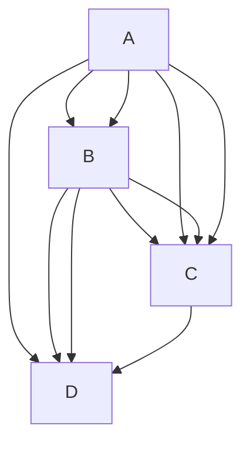

# Diagram Recognition Specification

Status: critical draft  
Scope: recognising the individual aspects involved in turning text into diagrams without naming every scenario as a separate case  
Primary input studied: `flow.md`  
Primary implementation inspiration: Mermaid flowchart parser/database/render pipeline under `mermaid/packages/mermaid/src/diagrams/flowchart/`

---

## 1. Finding

`flow.md` is a useful regression catalogue, but it is not a recognition strategy.

It names examples (`F01` to `F60`) and groups them by topic. That is good for humans checking regressions. It is bad as an implementation basis because it tempts the renderer to recognise examples by scenario shape:

```text
if this looks like F43, handle nested subgraphs
if this looks like F26, handle long labels
if this looks like F53A, special-case stadium merge geometry
```

That approach will collapse as soon as two axes combine in an unlisted way.

The correct unit of recognition is not the scenario. It is the smallest semantic fact the source text contributes to the diagram model:

- this line declares a diagram family
- this token sets direction
- this statement defines or mutates a vertex
- this bracket pair chooses a shape
- this link token expands to one or more edges
- this edge has stroke, arrowheads, length, label, id, classes and style
- this subgraph establishes containment and maybe direction
- this directive mutates style, class, link style, interaction, config, or accessibility metadata

Mermaid's own flowchart code is built this way. The parser calls methods such as `addVertex`, `addLink`, `addSubGraph`, `setDirection`, `addClass`, `setClass`, `updateLink`, and `updateLinkInterpolate`; the renderer later consumes a normalised graph model. It does not have a `renderFanOutScenario` or `renderNestedSubgraphScenario`.

---

## 2. Recognition Principle

The recogniser must emit a compositional diagram contract, not a scenario id.

For every Mermaid block, recognition must produce:

```text
Diagram
  kind
  aliases
  effectiveConfig
  direction
  declarations[]
  vertices[]
  edges[]
  groups[]
  styles[]
  classes[]
  interactions[]
  diagnostics[]
```

Every item must preserve both:

- the source-level fact, such as `A --> B`
- the normalised rendering-level effect, such as one edge from `A` to `B` with `stroke=normal`, `arrowTypeEnd=point`, `minlen=1`

This dual representation is non-negotiable. Source text is needed for diagnostics and round-tripping. Normalised facts are needed for layout and rendering.

---

## 3. Required Recognition Axes

### 3.1 Diagram Header

Recognise:

| Source aspect | Normalised fact |
| --- | --- |
| `graph` | flowchart-compatible diagram |
| `flowchart` | flowchart-compatible diagram |
| `flowchart-elk` | flowchart family with ELK renderer intent |
| omitted direction after header | `TB` |
| `TD` | `TB` |
| symbolic direction `<`, `>`, `^`, `v` | `RL`, `LR`, `BT`, `TB` |

Critical point: direction is not a visual hint. It changes layout rank direction, edge routing expectations, cluster placement, label clearance, and the meaning of spacing.

### 3.2 Statement Boundaries

Recognise statements independently of whether they end with:

- newline
- semicolon
- EOF
- blank space around tokens

Do not encode "one line equals one operation". Mermaid allows chains and grouped node expressions on one statement, and comments/blank lines should not become model facts.

### 3.3 Vertex Identity

Recognise vertex identity separately from visible label.

```text
id: stable graph reference
label: rendered text, defaulting to id only if no label is supplied
labelType: text | string | markdown
shape: explicit, bracket-derived, metadata-derived, or default
classes: zero or more
styles: zero or more
metadata: optional shape-data object
```

Critical point: the same vertex can be declared repeatedly. Later statements can add label, shape, classes, styles, metadata or interactions. The recogniser must merge declarations, not duplicate nodes.

### 3.4 Vertex Label Forms

Recognise label source and label type:

| Form | Required distinction |
| --- | --- |
| unlabelled id | label defaults to id |
| bracket text | labelType `text` unless quoted/markdown syntax changes it |
| quoted text | labelType `string`; outer quotes stripped |
| markdown string | labelType `markdown` |
| `@{ label: ... }` | metadata label overrides default/id label |
| entity codes | decoded/sanitised downstream, but source must be preserved |
| `<br/>` | explicit line break intent |
| unicode | accepted content, not a special scenario |

Critical point: label parsing is not just visual wrapping. The label type affects sanitisation, HTML/SVG rendering, measurement, and sometimes escaping validity.

### 3.5 Vertex Shape

Recognise shape as a fact, not as a scenario.

Legacy bracket syntax must map to canonical shape intent:

| Syntax family | Shape fact |
| --- | --- |
| `A[text]` | square/rect |
| `A(text)` | round/rounded rectangle |
| `A([text])` | stadium |
| `A[[text]]` | subroutine/framed rectangle |
| `A[(text)]` | cylinder |
| `A((text))` | circle |
| `A(((text)))` | double circle |
| `A{text}` | diamond |
| `A{{text}}` | hexagon |
| `A>text]` | odd/asymmetric flag |
| trapezoid/lean syntaxes | trapezoid / inverted trapezoid / lean variants |
| `A@{ shape: ... }` | metadata shape, with validation |

Critical point: `flow.md` covers only a small subset of the current Mermaid shape surface. It exercises the old common shapes but not the large modern shape catalogue available through `@{ shape: ... }`. A renderer claiming "Mermaid flowchart shapes" from `flow.md` alone is overclaiming.

### 3.6 Edge Expansion

Recognise source expressions that expand into multiple edges.

Examples:



The recogniser must emit every edge produced by the Cartesian expansion and chaining rules. It must not store the chain as a single edge-like object.

Critical point: grouped/chained edges are not "fan-out scenarios". They are grammar expansions. The visual fan-out is a consequence of expanded edges plus layout.

### 3.7 Edge Identity

Recognise edge id as independent from endpoints.

```text
source syntax: e1@-->
normalised edge id: e1 for only the grammar-selected edge
fallback id: deterministic generated id
```

When a grouped statement has an edge id, Mermaid applies the user id only to a specific generated edge and auto-generates ids for the rest. Duplicate user ids do not silently overwrite all edges. This is a subtle source-level rule and must be tested.

Critical point: `flow.md` mostly tests visual edges, not edge identity. That is insufficient for style, animation, metadata, and linkStyle targeting.

### 3.8 Edge Token Decomposition

Recognise each edge token as a tuple:

```text
startArrow: none | point | circle | cross
endArrow: none | point | circle | cross
directionality: one-ended | double-ended
stroke: normal | dotted | thick | invisible
minlen: integer, capped at 10
label: optional
labelType: text | string | markdown
```

Examples:

| Token | Facts |
| --- | --- |
| `---` | open line, normal stroke, no markers |
| `-->` | point at end, normal stroke, `minlen=1` |
| `--->` | point at end, normal stroke, `minlen=2` |
| `-.->` | point at end, dotted stroke |
| `==>` | point at end, thick stroke |
| `--o` | circle at end |
| `x--x` | cross at both ends |
| `<-->` | point at both ends |
| `~~~` | invisible edge |

Critical point: edge recognition must not conflate "arrow" with "edge". Arrowheads, stroke pattern, thickness, length and label are separate axes.

### 3.9 Edge Labels

Recognise both label syntaxes:

```text
A -->|label| B
A -- label --> B
```

Then preserve:

```text
edge.label
edge.labelType
source span
layout measurement requirement
```

Critical point: a long edge label is not a different edge kind. It is an edge with a label whose measured dimensions affect layout. `flow.md` correctly stresses this, but the implementation must not respond by deriving `minlen` from text width. Mermaid derives `minlen` from token length, not label length.

### 3.10 Subgraphs

Recognise subgraph declaration as group creation plus membership.

```text
group.id
group.title
group.labelType
group.children[]
group.direction?
group.classes[]
parentGroup?
```

Supported source forms include:

```text
subgraph Title
subgraph id[Title]
subgraph id["Title"]
subgraph
```

Direction inside a subgraph is a group-local fact. It must be attached to the group, not applied globally.

Critical point: nested subgraphs are not a special diagram kind. They are ordinary groups whose child list contains other group ids and node ids. Cross-boundary edges are ordinary edges whose endpoints happen to live in different containment contexts. Layout/routing must handle that later.

### 3.11 Membership and Uniqueness

Recognise that a node should have one effective parent group.

Mermaid removes members from later/outer group lists when they already belong to another subgraph. This is not intuitive, and it is easy to get wrong if group parsing is modelled as simple "append all descendants".

Critical point: containment is a graph fact with ownership rules, not indentation decoration.

### 3.12 Styling

Recognise style declarations as mutations:

```text
style <id> <style-list>
classDef <class-id> <style-list>
class <id-list> <class-id>
<vertex>:::<class-id>
linkStyle <edge-index-list | default> <style-list>
linkStyle <edge-index-list | default> interpolate <curve> [style-list]
```

Styles can target:

- vertices
- edges, by generated or user id through class assignment
- subgraphs
- default edge style
- numbered edge positions

Critical point: `flow.md` barely touches style order, default link style, curve interpolation, style targeting errors, comma escaping, and classes on subgraphs/edges. A recogniser must still model them because they mutate the same graph contract.

### 3.13 Metadata Shape Data

Recognise `@{ ... }` as metadata that can apply to:

- a vertex
- an existing edge id

For vertices, supported facts include at least:

```text
shape
label
labelType
icon
form
pos
img
constraint
w
h
```

For edges, supported facts include at least:

```text
animate
animation
curve
```

Critical point: this is missing from `flow.md` except indirectly through style/init coverage. Mermaid's source tests cover it heavily. Without metadata recognition, the renderer will be frozen at an older flowchart syntax surface.

### 3.14 Interactions and Links

Recognise:

```text
click <id> <callback>
click <id> call <callback>(args)
click <id> href "url"
click <id> "url"
tooltip text
target: _self | _blank | _parent | _top
```

Even if DOCX output cannot preserve runtime click callbacks, the recogniser should record them and emit a diagnostic or downgrade. Silently dropping them makes the conversion non-auditable.

### 3.15 Accessibility and Title

Recognise:

```text
accTitle:
accDescr:
accDescr { ... }
```

Critical point: accessibility metadata is part of the diagram source. It may not affect geometry, but it affects the conversion contract and should be exposed to downstream document generation.

### 3.16 Init and Configuration

Recognise `%%{init: ...}%%` before diagram parsing and record effective overrides.

At minimum:

```text
flowchart.htmlLabels
flowchart.nodeSpacing
flowchart.rankSpacing
flowchart.diagramPadding
flowchart.wrappingWidth
flowchart.curve
look
theme/themeVariables
securityLevel
```

Critical point: config is not merely rendering polish. It changes text measurement mode, layout spacing, curve generation, marker variants and security behaviour.

---

## 4. Recognition Contract

The parser should emit a typed contract similar to this:

```text
DiagramContract
  SourceHash
  Kind
  Header
  Direction
  Config
  Nodes: NodeContract[]
  Edges: EdgeContract[]
  Groups: GroupContract[]
  Classes: ClassContract[]
  Styles: StyleMutation[]
  Interactions: InteractionContract[]
  Accessibility: AccessibilityContract
  Diagnostics: Diagnostic[]
```

### 4.1 NodeContract

```text
Id
Declarations[]
Label
LabelType
Shape
ShapeSource
ParentGroupId?
Classes[]
InlineStyles[]
Metadata
DomIdPolicy
```

### 4.2 EdgeContract

```text
Id
IsUserDefinedId
SourceId
TargetId
SourceGroupContext?
TargetGroupContext?
Stroke
ArrowStart
ArrowEnd
MinLength
Label
LabelType
Classes[]
Styles[]
Curve?
Animation?
SourceExpansionTrace
```

### 4.3 GroupContract

```text
Id
Title
LabelType
ParentGroupId?
ChildNodeIds[]
ChildGroupIds[]
Direction?
Classes[]
Styles[]
```

### 4.4 Diagnostic

```text
Severity
Code
Message
SourceSpan
AffectedModelId?
DowngradeBehaviour?
```

Diagnostics are required for unsupported but recognised constructs. "Unknown" and "unsupported" are different:

- unknown means the recogniser cannot parse the source
- unsupported means the recogniser parsed the source but the renderer/exporter cannot reproduce it yet

---

## 5. Critical Assessment of `flow.md`

### 5.1 What It Does Well

`flow.md` gives a good progressive visual smoke suite for:

- header aliases
- basic directions
- common legacy node shapes
- common edge strokes and markers
- labels and long wrapping text
- fan-in/fan-out/cycles as layout consequences
- single-level and nested subgraphs
- some styling directives
- some init overrides
- DOCX embedding review

It is especially useful because it isolates one visible pressure per scenario. That makes regressions easier to localise.

### 5.2 What It Gets Wrong As a Specification

It is scenario-led instead of grammar-led.

The file says "one capability per scenario", but many scenarios are not one capability:

- `F30` combines decision shape, multiple edge labels, fan-out, and mixed node shapes.
- `F43` combines nested containment, group directions, chained edges, and cross-boundary membership.
- `F58` combines shape variation, decision branches, persistence edge, and multiple terminal paths.
- `F60` combines sibling subgraphs, internal direction, cross-links, dotted labelled edge, and integration layout.

That is fine for regression. It is dangerous for recognition because it hides the actual independent variables.

### 5.3 Major Coverage Gaps

`flow.md` does not sufficiently cover:

- grouped vertex expansion with `&`
- user-defined edge ids
- metadata shape data `@{ ... }`
- edge metadata mutation by id
- invisible edges
- default `linkStyle`
- edge curve interpolation
- comments
- interactions/click/href/tooltips
- accessibility metadata
- subgraph id/title variants beyond a narrow bracketed form
- malformed syntax and expected diagnostics
- duplicate declarations and merge rules
- class application to comma-separated ids and subgraphs
- class/style mutation order
- modern shape catalogue through metadata
- `htmlLabels` true/false interaction with measurement and wrapping
- security-level effects
- unsupported-feature downgrades for DOCX

The consequence is severe: a renderer could pass `flow.md` while still failing ordinary Mermaid source from the upstream test suite.

### 5.4 False Confidence Risks

The visual gate against mermaid.ink is necessary but not sufficient.

PNG comparison can miss:

- wrong internal ids
- wrong class assignments
- wrong edge indices
- dropped accessibility metadata
- dropped interactions
- incorrect source expansion trace
- styles that appear equivalent in one theme but fail in another
- label type mistakes hidden by identical visible text

Structural comparison must include the recognised contract, not only extracted SVG shapes.

---

## 6. Mermaid-Inspired Architecture

The implementation should copy Mermaid's separation of concerns, not necessarily its code.

```text
source text
  -> lexical/parser events
  -> diagram database mutations
  -> normalised diagram contract
  -> layout input
  -> layout output
  -> SVG/render primitives
  -> DOCX embedding/export
```

The most important design move is the mutable diagram database. Source statements do not directly draw. They mutate facts:

```text
addVertex
addLink
addSubGraph
setDirection
addClass
setClass
updateLink
setClickEvent
setLink
setAccTitle
setAccDescription
```

Only after parsing should the system ask how to lay out and render.

Critical point: if recognition and rendering are coupled, every missing syntax path becomes a rendering bug. Keep them separate so unsupported render features can still be recognised, diagnosed, and tested.

---

## 7. Acceptance Criteria

### 7.1 Recognition Acceptance

For every Mermaid block, tests must compare the emitted contract against expected facts:

- diagram kind and direction
- node ids, labels, label types, shapes and classes
- group ids, titles, directions and parent/child relationships
- edge count after expansion
- edge ids, endpoints, arrows, stroke, minlen, labels and label types
- styles/classes/link styles/config/accessibility/interactions
- diagnostics for unsupported features

This must run independently of SVG/DOCX rendering.

### 7.2 Rendering Acceptance

Rendering tests may still use visual comparison, but only after recognition has passed.

Rendering comparison should include:

- node positions and dimensions
- group bounds
- edge paths and marker assignment
- label positions and wrapping
- resolved styles
- SVG viewBox
- raster output where DOCX embedding is involved

### 7.3 Downgrade Acceptance

If the DOCX path cannot preserve a recognised feature, it must emit a diagnostic.

Examples:

| Recognised feature | Acceptable downgrade |
| --- | --- |
| click callback | ignored in DOCX with diagnostic |
| href | converted to hyperlink if possible, else diagnostic |
| animation | ignored with diagnostic |
| unsupported shape | fallback shape with diagnostic, or hard failure if fidelity mode is strict |
| unsupported curve | fallback curve with diagnostic, or hard failure if fidelity mode is strict |

Silent loss is not acceptable.

---

## 8. Replacement for Scenario Thinking

Instead of maintaining only scenario names, maintain a capability matrix keyed by axes.

Example:

```text
Header:
  graph
  flowchart
  flowchart-elk

Direction:
  TB
  TD -> TB
  BT
  LR
  RL
  symbolic

Vertex:
  id-only
  label
  quoted-label
  markdown-label
  shape-bracket
  shape-metadata
  repeated-declaration

Edge:
  token decomposition
  chain expansion
  grouped expansion
  user id
  label
  metadata
  minlen

Group:
  title-only
  id-title
  nested
  local direction
  membership uniqueness

Mutation:
  style
  classDef
  class
  inline class
  linkStyle
  interpolate
  click
  href
  init
```

Then keep `flow.md` as one fixture file that samples combinations from this matrix. Do not let it become the matrix.

---

## 9. Minimum Next Fixtures

Add or generate fixtures that are not named after scenarios but after capability axes:

```text
recognition-edge-expansion.md
recognition-edge-identity.md
recognition-shape-metadata.md
recognition-style-mutations.md
recognition-subgraph-membership.md
recognition-interactions.md
recognition-accessibility.md
recognition-config.md
recognition-errors.md
```

Each fixture should have expected contract output in a machine-readable form.

Markdown examples alone are not enough. They are input, not expected truth.

---

## 10. Bottom Line

The hard problem is not recognising "a flowchart scenario".

The hard problem is recognising a stream of declarations and mutations that together define a diagram. Mermaid's source strongly supports this model: parse text into a graph database, normalise it into nodes/edges/groups/styles/config, then render.

`flow.md` should remain a regression catalogue. It should not become the specification for recognition.

The specification for recognition must be the compositional contract above, tested axis-by-axis and combination-by-combination. Anything else will look complete right up until an ordinary Mermaid diagram combines two unsupported axes and slips straight through the cracks.

---

## 11. Naiad Source Changes Required

### 11.1 Current Problem in Naiad

Naiad already renders many flowcharts well. The weak point is not SVG drawing quality; it is the determination model.

The current flowchart path is roughly:

```text
FlowchartParser.cs
  parses a simplified statement model into FlowchartModel

FlowchartRenderer.cs
  measures nodes/labels
  calls DagreLayoutEngine
  chooses curve/render helpers

DagreLayoutEngine.cs / CoordinateAssignment.cs
  layout and many flowchart-specific endpoint repairs
```

This has two different recognition problems.

First, `FlowchartParser.cs` does not yet produce a Mermaid-equivalent contract:

- no label type (`text`, `string`, `markdown`)
- no source spans or declaration records
- no user-defined edge ids (`e1@-->`)
- no grouped `&` expansion
- no metadata shape data `@{ ... }`
- no edge metadata mutation by id
- no `linkStyle default`
- no interaction model
- no accessibility directives in the flowchart parser
- no diagnostics for recognised-but-unsupported features
- init is mostly handled outside the parser and accepted/stripped rather than represented as a source fact

Second, layout/routing contains many case recognisers. Some are structural enough, but the overall approach is still fixture-shaped. Methods and comments refer to `F34`, `F53`, `F58`, "terminal collector", "stadium merge", "retry loop", and some decisions depend directly on labels such as `"Yes"` / `"No"`.

The most concerning example is:

```text
TryGetFlowchartHorizontalDecisionBranchEndpoints(...)
  if label starts with "Yes" => right vertex
  else if label starts with "No" => upper-right slope
```

That is exactly the failure mode described earlier. The words on an edge are not semantics. They are labels. A diagram using `"True"`, `"OK"`, `"Pass"`, `"1"`, `"Approved"`, or translated text can have the same topology and should receive the same structural treatment.

### 11.2 Non-Negotiable Target

Naiad should parse Mermaid into a complete recognition contract, then layout and render from that contract.

The renderer must never choose behaviour because a visible label equals `"Yes"`, `"No"`, `"Done"`, `"End"`, `"Retry"`, `"Success"`, `"Error"`, or any other scenario word.

Allowed decision inputs:

- parsed syntax facts
- node ids
- edge ids
- graph topology
- node shapes
- edge styles and arrowheads
- label presence and measured dimensions
- declared direction
- subgraph containment
- source order
- layout positions
- explicit config
- explicit metadata

Disallowed decision inputs:

- semantic guesses from rendered label text
- fixture names
- scenario names
- English words in node labels

### 11.3 Data Model Changes

Add recognition-level model types instead of overloading the render model.

Pseudo code:

```csharp
enum MermaidLabelType
{
    Text,
    String,
    Markdown
}

enum MermaidDiagnosticSeverity
{
    Info,
    Warning,
    Error
}

sealed record MermaidSourceSpan(
    int StartOffset,
    int EndOffset,
    int StartLine,
    int StartColumn,
    int EndLine,
    int EndColumn);

sealed record MermaidDiagnostic(
    MermaidDiagnosticSeverity Severity,
    string Code,
    string Message,
    MermaidSourceSpan? SourceSpan,
    string? AffectedId);

sealed record MermaidDeclaration(
    string Kind,
    string RawText,
    MermaidSourceSpan SourceSpan);

sealed class Node
{
    string Id;
    string? Label;
    MermaidLabelType LabelType;
    NodeShape Shape;
    string? ShapeSource;          // "default", "legacy-bracket", "metadata"
    List<MermaidDeclaration> Declarations;
    Dictionary<string, object?> Metadata;
    List<string> ClassNames;
    Style InlineStyle;
    string? ParentId;
    bool IsGroup;
}

sealed class Edge
{
    string Id;
    bool IsUserDefinedId;
    string SourceId;
    string TargetId;
    EdgeEndpointMarker MarkerStart; // None, Point, Circle, Cross
    EdgeEndpointMarker MarkerEnd;
    EdgeStyle LineStyle;            // Solid, Dotted, Thick, Invisible
    int MinRankSpan;
    string? Label;
    MermaidLabelType LabelType;
    List<string> ClassNames;
    Style InlineStyle;
    string? Curve;
    bool? Animate;
    string? Animation;
    MermaidSourceSpan SourceSpan;
    EdgeExpansionTrace ExpansionTrace;
}

sealed class Subgraph
{
    string Id;
    string? Title;
    MermaidLabelType LabelType;
    string? ParentId;
    Direction? Direction;
    List<string> NodeIds;
    List<string> ChildSubgraphIds;
    List<string> ClassNames;
    Style InlineStyle;
}

sealed class FlowchartModel : GraphDiagramBase
{
    List<MermaidDeclaration> Declarations;
    List<MermaidDiagnostic> Diagnostics;
    Dictionary<string, Style> ClassDefinitions;
    List<LinkStyleDirective> LinkStyles; // index list OR default
    List<InteractionDirective> Interactions;
    FlowchartConfig EffectiveConfig;
}
```

Do not remove the existing render fields immediately. Add the recognition fields first, then migrate call sites. The current renderer can keep consuming `Node.Shape`, `Node.Label`, `Edge.LineStyle`, etc. while the richer facts are introduced.

### 11.4 Parser Replacement

Replace the current simplified `StatementParser` in `FlowchartParser.cs` with a Mermaid-style parse database.

The parser should not directly build final layout behaviour. It should mutate a `FlowchartDb` that mirrors Mermaid's `flowDb.ts` responsibilities.

Pseudo code:

```csharp
sealed class FlowchartDb
{
    Dictionary<string, Node> NodesById = new(StringComparer.Ordinal);
    List<Edge> Edges = [];
    List<Subgraph> RootSubgraphs = [];
    Stack<Subgraph> SubgraphStack = [];
    Dictionary<string, Subgraph> SubgraphById = [];
    Dictionary<string, Style> ClassDefinitions = [];
    Dictionary<string, List<string>> ClassesById = [];
    List<LinkStyleDirective> LinkStyles = [];
    List<MermaidDiagnostic> Diagnostics = [];
    Direction Direction = Direction.TopToBottom;

    Node AddOrUpdateNode(NodeDeclaration decl)
    {
        Node node = GetOrCreateNode(decl.Id);

        node.Declarations.Add(decl.ToMermaidDeclaration());

        if (decl.LabelWasPresent)
        {
            node.Label = decl.Label;
            node.LabelType = decl.LabelType;
        }
        else if (node.Label is null)
        {
            node.Label = decl.Id;
            node.LabelType = MermaidLabelType.Text;
        }

        if (decl.ShapeWasPresent)
        {
            node.Shape = decl.Shape;
            node.ShapeSource = decl.ShapeSource;
        }

        foreach (string className in decl.InlineClasses)
        {
            AddClass(node.Id, className);
        }

        if (SubgraphStack.Count > 0)
        {
            AddNodeToCurrentSubgraphOnce(node.Id);
        }

        return node;
    }

    void AddLink(NodeSet starts, NodeSet ends, LinkToken token, MermaidSourceSpan span)
    {
        for each start in starts.Items:
            for each end in ends.Items:
                Edge edge = BuildEdge(start.Id, end.Id, token, span);

                if (token.UserDefinedId is not null
                    && start == starts.Last
                    && end == ends.First
                    && !Edges.Any(e => e.Id == token.UserDefinedId))
                {
                    edge.Id = token.UserDefinedId;
                    edge.IsUserDefinedId = true;
                }
                else
                {
                    edge.Id = GenerateMermaidEdgeId(edge.SourceId, edge.TargetId);
                }

                Edges.Add(edge);
    }

    void ApplyMetadata(string id, MetadataObject metadata)
    {
        Edge? edge = Edges.FirstOrDefault(e => e.Id == id);
        if (edge is not null)
        {
            edge.Animate = metadata.GetBool("animate");
            edge.Animation = metadata.GetString("animation");
            edge.Curve = metadata.GetString("curve");
            return;
        }

        Node node = GetOrCreateNode(id);
        if (metadata.TryGetShape(out NodeShape shape))
        {
            node.Shape = shape;
            node.ShapeSource = "metadata";
        }
        if (metadata.TryGetLabel(out string label, out MermaidLabelType labelType))
        {
            node.Label = label;
            node.LabelType = labelType;
        }

        node.Metadata.Merge(metadata.RawValues);
    }
}
```

The parser grammar must recognise at least these top-level statement kinds:

```csharp
ParseFlowchart()
{
    ParseLeadingInitBlocksIntoModelConfig();
    ParseHeaderAndDirection();

    while (!EndOfInput)
    {
        if (TryParseCommentOrBlankLine()) continue;
        if (TryParseAccessibility()) continue;
        if (TryParseSubgraphStart()) continue;
        if (TryParseSubgraphEnd()) continue;
        if (TryParseSubgraphDirection()) continue;
        if (TryParseStyle()) continue;
        if (TryParseClassDef()) continue;
        if (TryParseClass()) continue;
        if (TryParseLinkStyle()) continue;
        if (TryParseClickOrHref()) continue;
        if (TryParseVertexOrEdgeStatement()) continue;

        AddDiagnostic("flowchart.unrecognised-statement", currentLine);
        if (StrictMode) throw;
        SkipLine();
    }

    return db.ToFlowchartModel();
}
```

`TryParseVertexOrEdgeStatement` must parse the general grammar, not only a chain of single nodes:

```csharp
ParseVertexOrEdgeStatement()
{
    NodeSet current = ParseNodeSet();       // A or A & B or A@{...} & B[...]

    while (TryParseLink(out LinkToken link))
    {
        NodeSet next = ParseNodeSet();
        db.AddLink(current, next, link, link.SourceSpan);
        current = next;
    }
}

ParseNodeSet()
{
    List<NodeDeclaration> nodes = [];
    nodes.Add(ParseNodeDeclaration());

    while (TryConsume("&"))
    {
        nodes.Add(ParseNodeDeclaration());
    }

    foreach (node in nodes)
    {
        db.AddOrUpdateNode(node);
    }

    return new NodeSet(nodes);
}
```

`ParseLink` must decompose syntax into facts:

```csharp
ParseLink()
{
    optionalUserId = TryParseEdgeIdPrefix(); // e1@
    startToken = TryParseStartLink();        // <, o, x plus -- / == / -.
    embeddedText = TryParseEmbeddedEdgeText();
    endToken = ParseEndLink();
    pipeLabelBeforeOrAfter = TryParsePipeLabel();

    return new LinkToken
    {
        UserDefinedId = optionalUserId,
        MarkerStart = DecodeStartMarker(startToken, endToken),
        MarkerEnd = DecodeEndMarker(startToken, endToken),
        LineStyle = DecodeStroke(startToken, endToken),
        MinRankSpan = DecodeMinlen(endToken),
        Label = embeddedText ?? pipeLabelBeforeOrAfter?.Text,
        LabelType = embeddedText?.Type ?? pipeLabelBeforeOrAfter?.Type ?? MermaidLabelType.Text
    };
}
```

This is the core fix. Once edges are decomposed this way, every later stage can reason from edge facts rather than from labels or fixture cases.

### 11.5 Style and Config Application

Change style application from "nodes plus linkStyle index" to a Mermaid-style mutation pass.

Pseudo code:

```csharp
ApplyFlowchartMutations(model)
{
    foreach (ClassDef def in model.ClassDefinitions)
        RegisterClass(def);

    foreach (ClassAssignment assignment in model.ClassAssignments)
        foreach (id in assignment.TargetIds)
            ApplyClassToNodeEdgeOrSubgraph(id, assignment.ClassName);

    foreach (InlineClass inline in model.InlineClasses)
        ApplyClassToNodeEdgeOrSubgraph(inline.TargetId, inline.ClassName);

    foreach (StyleDirective style in model.StyleDirectives)
        ApplyStyleToNodeEdgeOrSubgraph(style.TargetId, style.Style);

    foreach (LinkStyleDirective linkStyle in model.LinkStyles)
    {
        if (linkStyle.IsDefault)
            model.DefaultEdgeStyle.Merge(linkStyle.Style);
        else
            foreach (int index in linkStyle.EdgeIndexes)
                model.Edges[index].Style.Merge(linkStyle.Style);

        if (linkStyle.Curve is not null)
            ApplyCurveToDefaultOrIndexedEdges(linkStyle);
    }
}
```

`RenderOptions` should not be the only home for effective config. `FlowchartModel.EffectiveConfig` should be populated before rendering:

```csharp
FlowchartConfig BuildEffectiveConfig(initBlocks, defaults)
{
    return new FlowchartConfig
    {
        NodeSpacing = init.flowchart.nodeSpacing ?? 50,
        RankSpacing = init.flowchart.rankSpacing ?? 50,
        DiagramPadding = init.flowchart.diagramPadding ?? 8,
        WrappingWidth = init.flowchart.wrappingWidth ?? 200,
        HtmlLabels = init.flowchart.htmlLabels ?? global.htmlLabels ?? true,
        Curve = init.flowchart.curve ?? "basis",
        Padding = init.flowchart.padding ?? 8,
        Look = init.look ?? "classic",
        Theme = init.theme ?? options.Theme
    };
}
```

### 11.6 Replace Label-Based Routing

Remove all direct semantic label tests from routing.

Specifically, replace logic shaped like this:

```csharp
if (edge.Label.StartsWith("Yes")) useRightPort();
else if (edge.Label.StartsWith("No")) useUpperPort();
else sortByTargetPosition();
```

with structural branch allocation:

```csharp
ResolveDecisionBranchPorts(decisionNode, outgoingEdges, diagramDirection)
{
    ordered = outgoingEdges
        .OrderBy(edge => PrimaryCoordinateOfTarget(edge, diagramDirection))
        .ThenBy(edge => edge.SourceSpan.StartOffset)
        .ToList();

    for i in 0..ordered.Count-1:
        role = AllocateDecisionExitRole(i, ordered.Count, diagramDirection);
        ordered[i].PortHint = role;
}

AllocateDecisionExitRole(index, count, direction)
{
    if (direction is TopToBottom or BottomToTop)
    {
        if (count == 1) return BottomVertex;
        if (count == 2) return index == 0 ? SideLeft : SideRight;
        if (count == 3) return index == 0 ? SideLeft
                         : index == 1 ? BottomVertex
                         : SideRight;
        return EvenlySpacedPerimeterPort(index, count, preferredFace: Bottom);
    }

    if (direction is LeftToRight or RightToLeft)
    {
        if (count == 1) return RightVertex;
        if (count == 2) return index == 0 ? UpperRightSlope : RightVertex;
        if (count == 3) return index == 0 ? UpperRightSlope
                         : index == 1 ? RightVertex
                         : LowerRightSlope;
        return EvenlySpacedPerimeterPort(index, count, preferredFace: Right);
    }
}
```

Labels may still affect layout clearance because they have dimensions:

```csharp
if (edge.Label is not null)
{
    MeasureLabel(edge);
    ReserveLabelSpace(edge);
}
```

But labels must not determine branch meaning.

### 11.7 Replace Fixture-Specific Endpoint Repairs with Generic Port Allocation

Keep the good geometry functions, but change how they are selected.

Current helpers like these should become implementation details behind generic routing:

```text
TryGetFlowchartVerticalDecisionBranchEndpoints
TryGetFlowchartVerticalDecisionMultiIncomingEndpoints
TryGetFlowchartTbStadiumMergeEndpoints
TryGetFlowchartTbTerminalCollectorEndpoints
IsFlowchartLrRetryLoopEdge
IsFlowchartLrRectangleToDiamondIngressEdge
```

Replace call sites with this general pipeline:

```csharp
RouteAllFlowchartEdges(model, layout)
{
    TopologyIndex topology = BuildTopologyIndex(model);
    PortPlan portPlan = AllocatePorts(model, topology);

    foreach (Edge edge in model.Edges)
    {
        Node source = model.GetNode(edge.SourceId);
        Node target = model.GetNode(edge.TargetId);

        Port sourcePort = portPlan.GetSourcePort(edge);
        Port targetPort = portPlan.GetTargetPort(edge);

        Position sourceAttach = IntersectShape(source, sourcePort, target.Position);
        Position targetAttach = IntersectShape(target, targetPort, source.Position);

        EdgeRouteKind kind = ClassifyRoute(edge, source, target, topology, model.Direction);
        edge.Points.ReplaceWith(BuildRoute(kind, sourceAttach, targetAttach, source, target, model));
    }
}
```

Build topology from graph facts:

```csharp
BuildTopologyIndex(model)
{
    return new TopologyIndex
    {
        IncomingByNode = model.Edges.GroupBy(e => e.TargetId),
        OutgoingByNode = model.Edges.GroupBy(e => e.SourceId),
        ParentByNode = model.Nodes.ToDictionary(n => n.Id, n => n.ParentId),
        SourceOrderByEdge = model.Edges.Select((edge, index) => (edge, index)),
        Reachability = ComputeReachability(model.Edges)
    };
}
```

Allocate ports generically:

```csharp
AllocatePorts(model, topology)
{
    PortPlan plan = new();

    foreach (Node node in model.Nodes)
    {
        List<Edge> incoming = topology.Incoming(node.Id);
        List<Edge> outgoing = topology.Outgoing(node.Id);

        AllocateEndpointGroup(
            node,
            incoming,
            endpointKind: Target,
            direction: model.Direction,
            plan);

        AllocateEndpointGroup(
            node,
            outgoing,
            endpointKind: Source,
            direction: model.Direction,
            plan);
    }

    return plan;
}

AllocateEndpointGroup(node, edges, endpointKind, direction, plan)
{
    groups = edges.GroupBy(edge => FacingFace(node, OtherNode(edge), direction, endpointKind));

    foreach (group in groups)
    {
        ordered = group
            .OrderBy(edge => OrthogonalCoordinate(OtherNode(edge), group.Face))
            .ThenBy(edge => edge.SourceSpan.StartOffset)
            .ToList();

        slots = BuildPerimeterSlots(node.Shape, group.Face, ordered.Count);

        for i in 0..ordered.Count-1:
            plan.Set(edge: ordered[i], endpointKind, slots[i]);
    }
}
```

This replaces hard-coded cases such as "dual fan-in stadium", "terminal collector", and "hub fan-out" with the same underlying rule: multiple edges sharing a face need stable, ordered ports on that face.

The special geometry functions are still useful:

```csharp
IntersectShape(node, port, toward)
{
    switch (node.Shape)
    {
        case Diamond:
            return IntersectDiamondAtPortOrRay(node, port, toward);
        case Stadium:
            return IntersectStadiumAtPortOrRay(node, port, toward);
        case Cylinder:
            return IntersectCylinderAtPortOrRay(node, port, toward);
        case Circle:
        case DoubleCircle:
            return IntersectCircleAtPortOrRay(node, port, toward);
        default:
            return IntersectRectangleAtPortOrRay(node, port, toward);
    }
}
```

The difference is that shape geometry is selected by shape, and route pattern is selected by topology. Neither is selected by label text.

### 11.8 Generic Route Classification

Route classification should be structural:

```csharp
ClassifyRoute(edge, source, target, topology, direction)
{
    if (IsInvisible(edge))
        return Invisible;

    if (IsSelfLoop(edge))
        return SelfLoop;

    if (CrossesSubgraphBoundary(source, target))
        return CrossClusterBoundary;

    if (IsBackEdge(edge, topology.Reachability))
        return BackEdgeLoop;

    if (SharesRank(source, target, direction))
        return SameRank;

    if (HasClearAxisAlignedPath(source, target, direction))
        return AxisAligned;

    if (HasMultipleEdgesOnEndpointFace(edge, topology))
        return PortRoutedSpline;

    return DefaultDagreSpline;
}
```

Then build points from route kind:

```csharp
BuildRoute(kind, sourceAttach, targetAttach, source, target, model)
{
    switch (kind)
    {
        case AxisAligned:
            return [sourceAttach, targetAttach];

        case SameRank:
            return BuildSameRankRoute(sourceAttach, targetAttach, model.Direction);

        case BackEdgeLoop:
            return BuildLoopOutsideOccupiedBounds(source, target, model.Nodes, model.Direction);

        case CrossClusterBoundary:
            return ClipRouteToClusterBoundaries(
                BuildManhattanOrSpline(sourceAttach, targetAttach, model.Direction),
                source,
                target,
                model.Subgraphs);

        case PortRoutedSpline:
            return BuildOrthogonalStubbedSpline(sourceAttach, targetAttach, model.Direction);

        case DefaultDagreSpline:
            return UseLayoutEnginePolylineThenClipEndpoints(edge);
    }
}
```

Naiad can still match Mermaid closely by using `curveBasis` or the existing curve builders after points are selected. The point is to derive those points from a general topology/port model.

### 11.9 Parser Coverage for "Any Mermaid Diagram"

No native C# renderer will handle "any Mermaid diagram successfully" unless it either:

1. implements every Mermaid grammar and renderer path, or
2. recognises the full input enough to decide whether Naiad can render it, then falls back to official Mermaid for unsupported constructs.

The practical target should be:

```csharp
Render(input, options)
{
    MermaidDocument document = MermaidFrontEnd.Parse(input);

    if (NaiadCapabilities.CanRender(document.Contract))
    {
        return NaiadNativeRenderer.Render(document.Contract, options);
    }

    if (options.AllowOfficialMermaidFallback)
    {
        return OfficialMermaidRenderer.Render(input, options);
    }

    throw new MermaidUnsupportedException(document.Diagnostics);
}
```

`CanRender` must be contract-based:

```csharp
CanRender(contract)
{
    if (contract.Kind not in NativeSupportedDiagramKinds)
        return false;

    if (contract.Flowchart?.UsesUnsupportedShape == true)
        return false;

    if (contract.Flowchart?.UsesUnsupportedCurve == true)
        return false;

    if (contract.Flowchart?.UsesHtmlLabelFeatureNativeCannotMeasure == true
        && !options.AllowApproximateTextMeasurement)
        return false;

    if (contract.Diagnostics.Any(d => d.Severity == Error))
        return false;

    return true;
}
```

This is not a failure of Naiad. It is the only honest way to claim "any Mermaid diagram" without reimplementing all of Mermaid.js.

### 11.10 Concrete File-Level Work Plan

1. In `extern/Naiad/src/Naiad/Models`, add:

```text
MermaidLabelType
MermaidSourceSpan
MermaidDiagnostic
MermaidDeclaration
EdgeEndpointMarker
EdgeExpansionTrace
FlowchartConfig
InteractionDirective
LinkStyleDirective with Default/Indexes/Curve
```

2. Extend `Node`, `Edge`, `Subgraph`, and `FlowchartModel` with the recognition fields described above.

3. In `FlowchartParser.cs`, replace the simplified `StatementParser` with:

```text
FlowchartDb
ParseHeader
ParseStatementLoop
ParseNodeSet
ParseNodeDeclaration
ParseShapeSuffix
ParseMetadataObject
ParseLinkToken
ParseStyleMutation
ParseSubgraphMutation
ParseInteraction
ParseAccessibility
```

4. In `FlowchartParser.cs`, implement Mermaid edge expansion exactly:

```csharp
A & B --> C & D
// produces A->C, A->D, B->C, B->D

A --> B & C --> D
// produces A->B, A->C, B->D, C->D
```

5. In `FlowchartParser.cs`, implement Mermaid edge id semantics:

```csharp
Use user id only for last start and first end in grouped edge expansion.
If the id is already used, generate ids for later edges.
```

6. In `FlowchartRenderer.cs`, keep measurement and SVG generation, but consume `model.EffectiveConfig` and `LabelType`.

7. In `DagreLayoutEngine.cs`, remove the repeated post-layout chain of fixture-specific flowchart repairs:

```text
ApplyFlowchartLrSimpleRetryCycleNodeLayout
ApplyFlowchartDecisionBranchEndpointSnapping
ApplyFlowchartDiagramConnectorEndpointSnapping
ApplyFlowchartCrossBoundaryEdgeEndpointSnapping
ApplyFlowchartTbUpwardLoopEdgeOrthogonalSnapping
ApplyFlowchartLrRectangleToDiamondIngressEdgeEndpointSnapping
ApplyFlowchartLrRetryLoopEdgeEndpointSnapping
ApplyFlowchartTbStadiumMergeEndpointSnapping
ApplyFlowchartTbTerminalCollectorEndpointSnapping
```

Replace it with:

```csharp
FlowchartRouter.RouteAllEdges(model, layoutGraph, layoutOptions);
```

8. Create `FlowchartRouter.cs`:

```text
BuildTopologyIndex
AllocatePorts
ClassifyRoute
BuildRoute
ClipToShapeBoundaries
ClipToSubgraphBoundaries
ApplyMarkerOffsets
```

9. Move reusable geometry from `CoordinateAssignment.cs` into shape/route helpers:

```text
IntersectDiamond
IntersectStadium
IntersectCylinder
ComputeFlowchartAttachPoint
BuildFlowchartCurveBasisPath
ApplyFlowchartOrthogonalAttachStubs
```

10. Delete or quarantine label-semantic predicates. If a method reads `edge.Label` for anything other than measuring or rendering text, it should be considered suspect.

Pseudo-code test:

```csharp
AssertNoRoutingCodeUsesLabelSemantics()
{
    foreach (method in FlowchartRoutingMethods)
    {
        Assert.False(method.Source.Contains("StartsWith(\"Yes\""));
        Assert.False(method.Source.Contains("StartsWith(\"No\""));
        Assert.False(method.Source.Contains("== \"Done\""));
        Assert.False(method.Source.Contains("== \"End\""));
    }
}
```

### 11.11 Required Tests

Add parser contract tests before visual tests:

```text
FlowchartRecognitionTests.EdgeExpansion
FlowchartRecognitionTests.EdgeIdentity
FlowchartRecognitionTests.MetadataShapeData
FlowchartRecognitionTests.EdgeMetadataMutation
FlowchartRecognitionTests.LabelTypes
FlowchartRecognitionTests.SubgraphMembership
FlowchartRecognitionTests.LinkStyleDefaultAndIndexed
FlowchartRecognitionTests.Accessibility
FlowchartRecognitionTests.Interactions
FlowchartRecognitionTests.UnsupportedButRecognisedDiagnostics
```

Add label-invariance rendering tests:

```csharp
Render("A{Check} -->|Yes| B; A -->|No| C")
Render("A{Check} -->|True| B; A -->|False| C")
Render("A{Check} -->|1| B; A -->|0| C")
Render("A{Check} -->|Approved| B; A -->|Rejected| C")

AssertSamePortRolesIgnoringRenderedLabelText();
```

Add topology-invariance tests:

```csharp
For every graph topology:
    vary labels across empty, English, punctuation, unicode, long text
    assert same edge classification and same port allocation
    assert only label dimensions and label positions may change
```

### 11.12 Definition of Done

This work is done only when:

- flowchart parsing emits a contract rich enough to compare against Mermaid parser facts
- routing does not branch on semantic label text
- every route decision can be explained by topology, shape, direction, style, config, containment, or source order
- unsupported Mermaid constructs produce diagnostics or official-renderer fallback
- `flow.md` still passes as a visual regression catalogue
- the new recognition fixtures pass without rendering
- label-invariance tests prove that changing `"Yes"`/`"No"` to other labels does not change branch semantics

The key shift is simple: Naiad should keep its geometry work, but the trigger for that geometry must be a Mermaid-like diagram contract, not a catalogue of visual scenarios.
