# State diagram regression catalogue

Progressive Mermaid **stateDiagram** scenarios for recognition and render regression (Markdown → DOCX). Each section increases complexity; scenarios within a section are ordered from simplest to hardest.

**Spec mapping:** line types in `spec.md` §11.1.14.4; recognition fixtures in `new_src/MermaidRecognition.Tests/StateRecognition/`.

**Programme note:** Naiad is an interim render baseline only. L2 recognition classifies lines in `StateKindRecognizer`; L3 entity mapping and non-Naiad render are planned in `MermaidRecognition` (see §11.1.14.4).

## Scenario index (complete)

| Id | Level | Line types / axis | Recognition fixture | Naiad sample |
| --- | --- | --- | --- | --- |
| ST01 | 1 | header, transition | `simple` | Simple |
| ST02 | 1 | multiple states | `multiple-states` | MultipleStates |
| ST03 | 1 | header `stateDiagram` (v1) | `header-v1` | StateDiagramV1 |
| ST04 | 2 | transition labels | `transition-labels` | TransitionLabels |
| ST05 | 2 | transition to `[*]` with label | `transition-labels` | — |
| ST06 | 2 | state cycle (loop) | `simple` | — |
| ST07 | 3 | `[*]` start and end | `simple` | Simple |
| ST08 | 3 | multiple `[*]` exits | `multiple-terminators` | MultipleStates |
| ST09 | 4 | composite state | `composite` | — |
| ST10 | 4 | state description `state "..." as id` | `state-description` | Description |
| ST11 | 4 | structOpen (standalone `{`) | `struct-open` | — |
| ST12 | 5 | note right | `note` | StateWithNote |
| ST13 | 5 | note left | `note-left` | Complex |
| ST14 | 6 | fork `<<fork>>` | `fork-join` | ForkJoinState |
| ST15 | 6 | join `<<join>>` | `fork-join` | Complex |
| ST16 | 6 | choice `<<choice>>` | `choice` | ChoiceState |
| ST17 | 7 | classDef, class apply | `classDef-style` | — |
| ST18 | 7 | style | `inline-style` | — |
| ST19 | 7 | cssClass (**remarked**) | — | — |
| ST20 | 7 | direction | `direction` | — |
| ST21 | 7 | click / href | `click-href` | — |
| ST22 | 7 | accTitle, accDescr inline | `accessibility` | — |
| ST23 | 7 | accDescr block | `accDescr-block` | — |
| ST24 | 7 | comment | `comment` | — |
| ST25 | 7 | hide empty description | `hide-empty-description` | — |
| ST26 | 8 | init (G1) | `init-leading` | — |
| ST27 | 8 | combined render smoke | `complex-smoke` | Complex |

**§11.1.14.4 line-type coverage:** every row is **parsed**; `stateDiagram.body` must not appear in catalogue scenarios.

## How to use

This file is the **complete** state diagram regression catalogue: **isolated diagrams (ST01–ST27)**. Levels 1–6 align with `extern/Naiad/src/test-renders/State.md`. Levels 7–8 add remaining §11.1.14.4 axes and the Naiad Complex sample.

### Remarked scenarios (`%%`)

Diagrams that **do not render** on [mermaid.live](https://mermaid.live) remain in this file with **every source line prefixed by `%%`**. That marks them as **considered but rejected** for the render gate — **do not re-add** them because the catalogue looks incomplete. SvgHarness and DOCX visual review skip remarked blocks. See §9.1 in `spec.md`.

**Currently remarked:** ST19 (`cssClass`).

### SvgHarness (visual / structural gate)

```powershell
dotnet build extern/Naiad/src/Naiad/Naiad.csproj -c Release
dotnet run --project src/SvgHarness/SvgHarness.csproj -c Release -- state.md out/state-mermaid-ink --reference=mermaid-ink --parallel 2 --report=out/state-mermaid-ink/report.md
```

Structural-only (no reference download):

```powershell
dotnet run --project src/SvgHarness/SvgHarness.csproj -c Release -- state.md out/state-harness --no-reference
```

Exit code **0** only when all **active** (non-remarked) scenarios PASS.

### Recognition contract gate

```powershell
dotnet test new_src/MermaidRecognition.Tests/MermaidRecognition.Tests.csproj --filter "FullyQualifiedName~StateRecognition"
```

Catalogue scenarios must not produce silent `stateDiagram.body` fallback (see `StateRecognitionFixtureTests`).

### DOCX visual review

```powershell
dotnet run --project src/md2docx/md2docx.csproj -- state.md state.docx
```

**Checklist per scenario**

- All declared states present (none missing or duplicated)
- Transitions and labels match source order and text
- `[*]` start/end nodes visible where declared
- Composite state boundaries contain nested transitions
- Notes, fork/join/choice pseudo-states readable
- Styles / classDef applied when declared

---

## Level 1 — Header and basic transitions

### ST01 — Minimal header and transitions

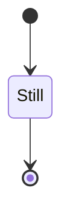

*Maps:* `stateDiagram.header`, `stateDiagram.transition` · fixture: `simple` · Naiad: Simple*

### ST02 — Multiple states

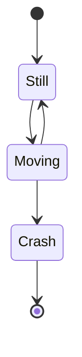

*Naiad: MultipleStates*

### ST03 — stateDiagram v1 header


*Maps:* `stateDiagram.header` (v1) · Naiad: StateDiagramV1*

---

## Level 2 — Transitions and labels

### ST04 — Transition labels

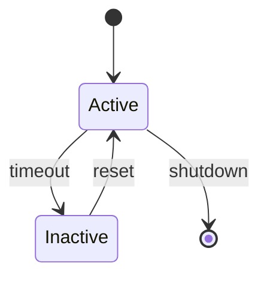

*Naiad: TransitionLabels*

### ST05 — Label on terminate transition

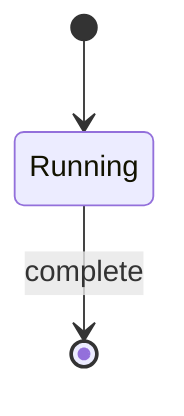

### ST06 — State cycle (recognition fixture)

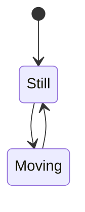

*Fixture:* `simple`*

---

## Level 3 — Start and end (`[*]`)

### ST07 — Entry and exit only

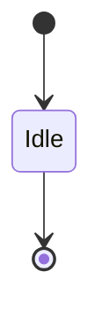

### ST08 — Multiple paths to `[*]`

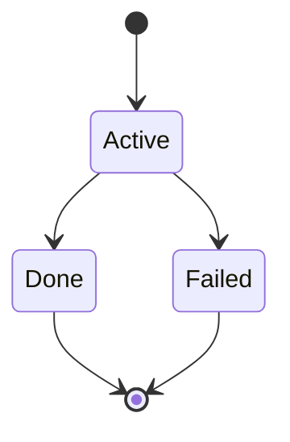

*Naiad: MultipleStates (terminate paths)*

---

## Level 4 — Composite states and state declarations

### ST09 — Composite state with nested transitions

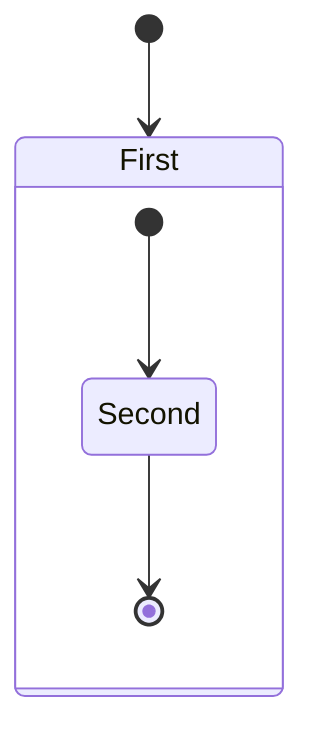

*Fixture:* `composite` · maps: `stateDiagram.state`, `stateDiagram.structClose`*

### ST10 — State with description alias

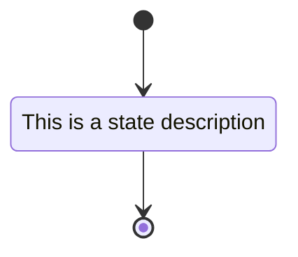

*Maps:* `stateDiagram.state` · Naiad: Description*

### ST11 — Standalone struct open brace

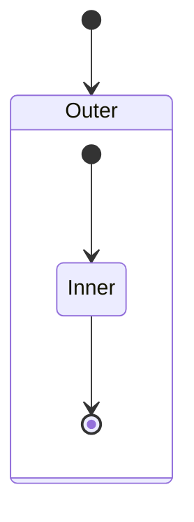

*Maps:* `stateDiagram.structOpen` (brace on own line after `state Id`; rare vs inline `state Id {`)*

---

## Level 5 — Notes

### ST12 — Note right of state

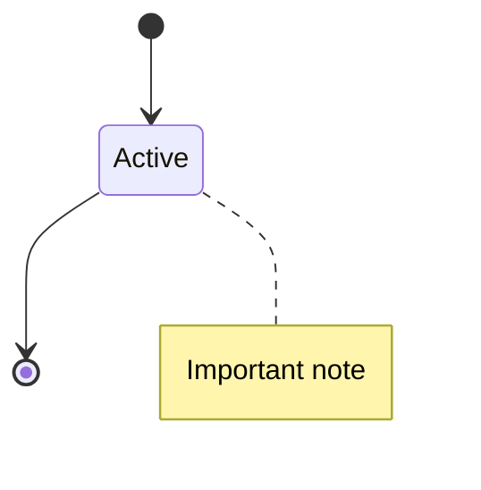

*Fixture:* `note` · Naiad: StateWithNote*

### ST13 — Note left of state

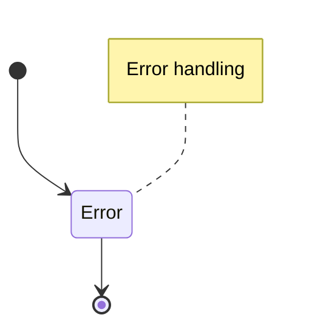

*Naiad: Complex (note left of Error)*

---

## Level 6 — Fork, join, and choice pseudo-states

### ST14 — Fork pseudo-state

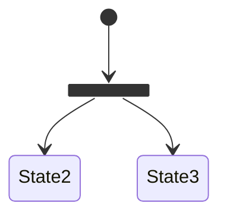

*Maps:* `stateDiagram.state` (`<<fork>>`) · Naiad: ForkJoinState*

### ST15 — Join pseudo-state

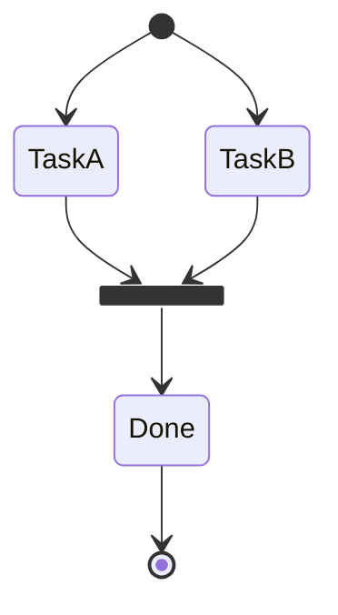

*Maps:* `stateDiagram.state` (`<<join>>`) · Naiad: Complex*

### ST16 — Choice pseudo-state

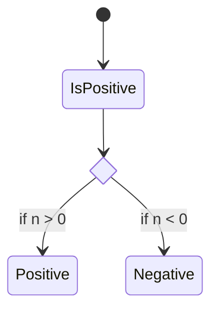

*Maps:* `stateDiagram.state` (`<<choice>>`) · Naiad: ChoiceState*

---

## Level 7 — Styles, layout, interactions, accessibility, metadata

### ST17 — classDef and class apply

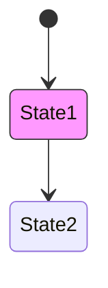

*Maps:* `stateDiagram.classDef`, `stateDiagram.cssClass` (apply via `class` token)*

### ST18 — Inline style directive

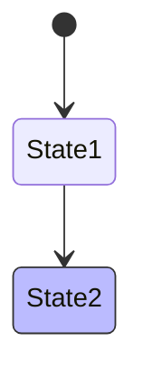

*Maps:* `stateDiagram.style`*

### ST19 — cssClass directive (remarked)

```mermaid
%%     stateDiagram-v2
%%     [*] --> State1
%%     classDef highlight fill:#f9f
%%     cssClass State1 highlight
```

*Maps:* `stateDiagram.cssClass` · **remarked** — does not render on mermaid.live; recognition axis may still be tracked in spec/fixtures.*

### ST20 — Direction

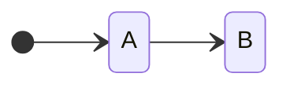

*Maps:* `stateDiagram.direction`*

### ST21 — Click / hyperlink

```mermaid
stateDiagram-v2
    [*] --> State1
    click State1 href "https://example.com" "Docs"
```

*Maps:* `stateDiagram.click` · callback forms emit diagnostic at render policy; href is recognition target.*

### ST22 — Accessibility (inline)

```mermaid
stateDiagram-v2
    accTitle: Process lifecycle
    accDescr: Core state transitions
    [*] --> Idle
    Idle --> [*]
```

*Maps:* `stateDiagram.accTitle`, `stateDiagram.accDescr`*

### ST23 — Accessibility (accDescr block)

```mermaid
stateDiagram-v2
    accTitle: Process lifecycle
    accDescr {
        Describes core
        state transitions
    }
    [*] --> Idle
    Idle --> [*]
```

*Maps:* `stateDiagram.accDescr` (block form)*

### ST24 — Comment lines (no model fact)

```mermaid
stateDiagram-v2
    %% lifecycle diagram
    [*] --> Active
    Active --> [*]
```

*Maps:* `stateDiagram.comment`*

### ST25 — Hide empty description

```mermaid
stateDiagram-v2
    hide empty description
    [*] --> Active
    Active --> [*]
```

*Maps:* `stateDiagram.hideEmpty`*

---

## Level 8 — Init and combined smoke

### ST26 — Init block (leading config)

```mermaid
%%{init: {'theme': 'base'}}%%
stateDiagram-v2
    [*] --> Active
    Active --> [*]
```

*Maps:* G1 config · `stateDiagram.init.leading`*

### ST27 — Combined render smoke (Naiad Complex sample)

```mermaid
stateDiagram-v2
    [*] --> Idle

    state "Processing State" as Processing
    state fork_state <<fork>>
    state join_state <<join>>
    state choice_state <<choice>>

    Idle --> Processing : start
    Processing --> fork_state
    fork_state --> TaskA
    fork_state --> TaskB
    TaskA --> join_state
    TaskB --> join_state
    join_state --> choice_state
    choice_state --> Success : if valid
    choice_state --> Error : if invalid
    Success --> Idle : reset
    Error --> Idle : retry
    Success --> [*] : complete

    note right of Processing : This is a processing note
    note left of Error : Error handling
```

*Naiad: Complex · render regression; many axes combined.*

---

## Catalogue maintenance

| Column | Rule |
| --- | --- |
| Scenario id | `ST` + two digits; stable once published |
| New scenario | Must map to a row in §11.1.14.4 or add that row first |
| Recognition | Every `StateRecognition/*.mmd` fixture must appear in the index table |
| Render | SvgHarness PASS against mermaid.ink for **active** scenarios only (remarked `%%` blocks excluded) |
| Remarked `%%` | Considered but rejected on mermaid.live; do not treat as missing |

Do not treat this file as the recognition specification — it samples axes from `spec.md`. Machine-readable truth remains `*.verified.json` under `StateRecognition/`. Do not extend Naiad `StateParser` to close recognition gaps — extend `MermaidRecognition` and this catalogue instead.
