# Markdown to DOCX Supported Examples

This document exercises the Markdown features currently supported by the converter. It favours examples that should render intentionally in DOCX rather than raw conformance edge cases that only make sense when comparing Markdown to HTML.

## Paragraphs and line breaks

This is a normal paragraph with plain text. It should wrap naturally in Word without manual line breaks.

This is a second paragraph after a blank line.

This line is followed by a soft line break in the source
and should remain part of the same paragraph.

This line ends with two spaces for a hard break.  
The next line should appear below it.

This line ends with a backslash hard break.\
The next line should also appear below it.

Escaped punctuation should remain literal: \*asterisks\*, \_underscores\_, \[brackets\], \`backticks\`, and \\ backslash.

---

## Headings

# Heading Level 1

## Heading Level 2

### Heading Level 3

#### Heading Level 4

##### Heading Level 5

###### Heading Level 6

Setext Heading Level 1
======================

Setext Heading Level 2
----------------------

### Heading with **bold**, *italic*, `code`, and [a link](https://example.com)

---

## Inline formatting

Plain inline styles: **bold**, *italic*, ***bold italic***, `inline code`, and ~~strikethrough~~.

Nested inline styles: **bold with *italic inside***, *italic with **bold inside***, and **bold with `inline code` inside**.

Inline code preserves Markdown-looking text: `**not bold**`, `[not a link](https://example.com)`, `a < b && c > d`, and `A | B`.

Formatting beside punctuation: **bold**, *italic*, `code`, ~~strike~~.

---

## Links

Direct link: [Example](https://example.com).

Direct link with title: [Example with title](https://example.com "Example title").

Reference-style link: [CommonMark spec][commonmark].

Collapsed reference link: [CommonMark][].

Repeated reference link: [the same spec][commonmark].

Autolink URL: <https://example.com/autolink>.

Autolink email: <person@example.com>.

[commonmark]: https://commonmark.org
[CommonMark]: https://commonmark.org

---

## Blockquotes

Single paragraph quote:

> A simple quoted paragraph.

Multi-paragraph quote:

> First quoted paragraph.
>
> Second quoted paragraph with **bold**, *italic*, `code`, and [link](https://example.com).

Nested quote:

> Outer quote.
>
> > Inner quote.
>
> Back to the outer quote.

Quote containing a list:

> - Quoted bullet one
> - Quoted bullet two
> 1. Quoted number one
> 2. Quoted number two

Quote containing a heading and code:

> #### Quoted heading
>
>     quoted code line one
>     quoted code line two

---

## Unordered lists

Hyphen list:

- First item.
- Second item with **bold** and `code`.
- Third item.

Asterisk list:

* Alpha
* Beta
* Gamma

Plus list:

+ One
+ Two
+ Three

Nested unordered list:

- Parent A
  - Child A1
    - Grandchild A1a
  - Child A2
- Parent B

Loose unordered list:

- First loose item.

  Continuation paragraph for the first item.

- Second loose item.

  Continuation paragraph with [a link](https://example.com).

---

## Ordered lists

Normal ordered list:

1. First step.
2. Second step.
3. Third step.

Ordered list starting at 3:

3. Start from three.
4. Then four.
5. Then five.

Ordered list starting at 10:

10. Ten.
11. Eleven.
12. Twelve.

Nested ordered list:

1. Parent one
   1. Child one
   2. Child two
2. Parent two
   1. Child three
      1. Grandchild three-a
      2. Grandchild three-b

Ordered list with nested bullets:

1. First parent
   - Sub bullet A
   - Sub bullet B
2. Second parent
   - Sub bullet C

Bullet list with nested ordered items:

- Parent one
  1. Nested ordered A
  2. Nested ordered B
- Parent two
  1. Nested ordered C

---

## Task lists

- [ ] Unchecked task.
- [x] Checked task.
- [X] Checked task with uppercase marker.
- [ ] Task with **bold**, *italic*, `code`, and [link](https://example.com).
  - [ ] Nested unchecked task.
  - [x] Nested checked task.

---

## Multi-block list items

List item with continuation paragraph:

- Item with an opening paragraph.

  Continuation paragraph inside the same item.

- Next item.

List item with indented code:

- Item before code.

      code line one
      code line two

- Item after code.

List item with fenced code:

- Fenced code item:

  ```text
  code inside a list
  second code line
  ```

- Item after fenced code.

---

## Code blocks

Indented code block:

    def hello():
        print("Hello, world.")

Fenced code block without language:

```
plain fenced code
with multiple lines
```

Fenced C# code block:

```csharp
public void Method()
{
    return;
}
```

Fenced JSON code block:

```json
{
  "key": "value",
  "markdown": "**not bold inside code**",
  "pipe": "A | B"
}
```

Fenced Markdown-looking code:

```markdown
# Not a heading inside code
- Not a list inside code
[Not a link](https://example.com)
```

---

## Mermaid diagrams

Flowchart, standard backtick fence:

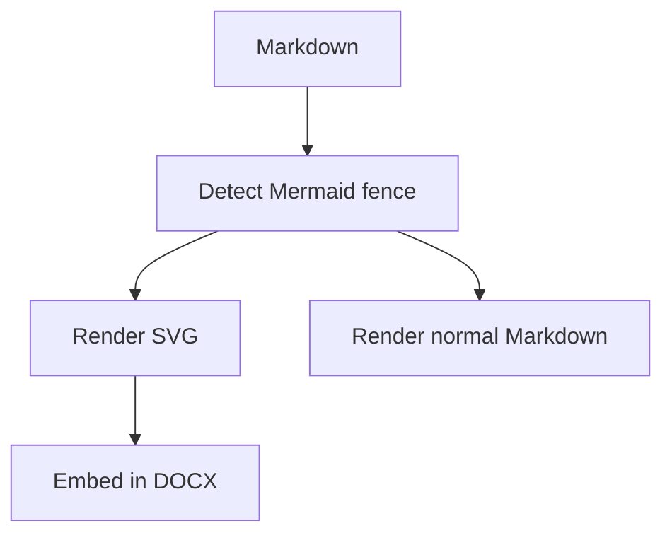

Flowchart: same edge type, different **source** hyphen lengths (compare DOCX vs VS Code reference layout):

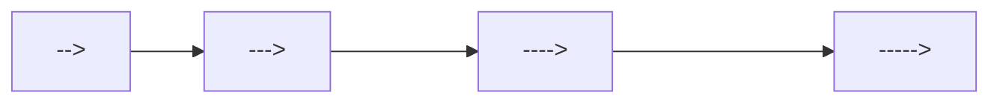

Flowchart: all supported line / arrow types (exercise Naiad `EdgeType` parsing):

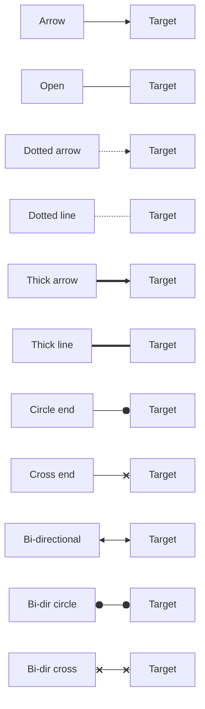

Sequence diagram, colon fence:

:::mermaid
sequenceDiagram
    participant User
    participant Converter
    participant Naiad
    User->>Converter: Open Markdown
    Converter->>Naiad: Render Mermaid source
    Naiad-->>Converter: SVG
    Converter-->>User: DOCX with diagram
:::

Class diagram:

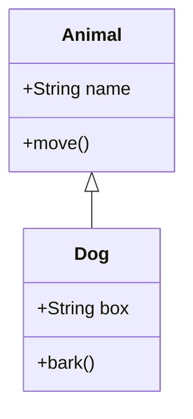

State diagram:

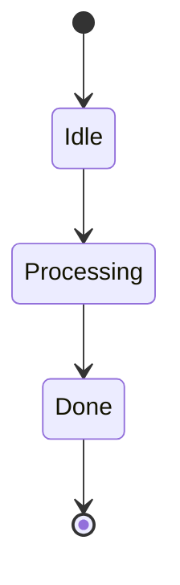

Entity relationship diagram:

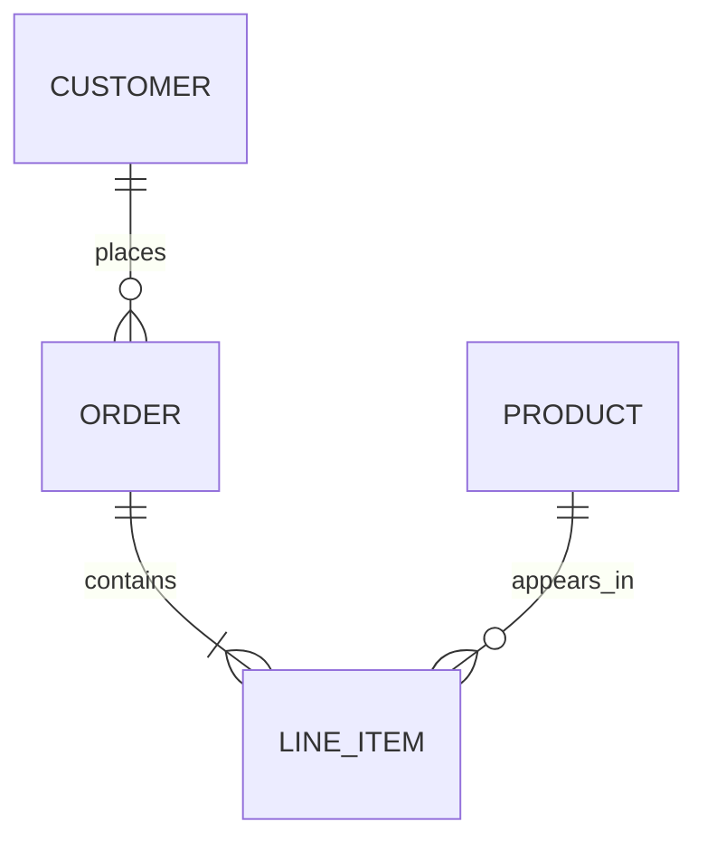

Entity relationship diagram: cardinality + identifying/non-identifying line style matrix:

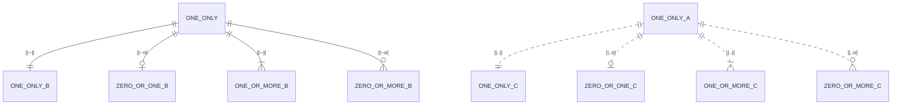

Entity relationship diagram: stress fixtures (fan-in to one entity)

These are intended to be copied 1:1 into `mermaid.live` for reference output comparison.

1:1 (single incoming relationship):

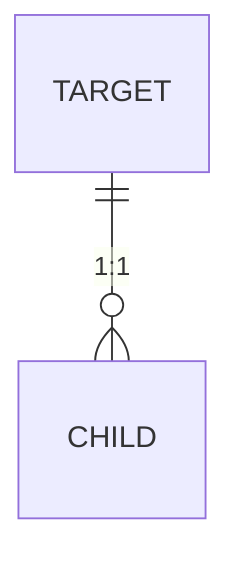

1:2 (two incoming relationships):

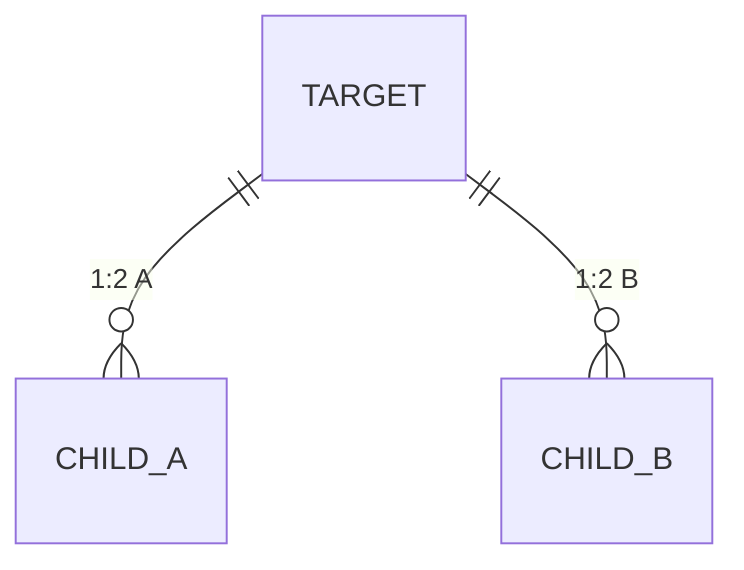

1:3 (three incoming relationships):

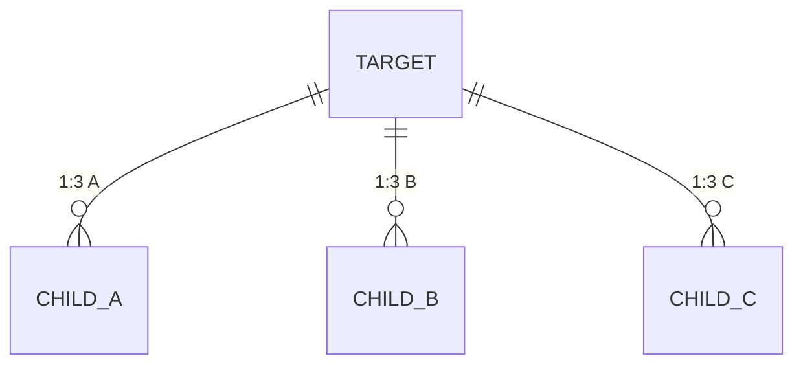

1:8 (eight incoming relationships):

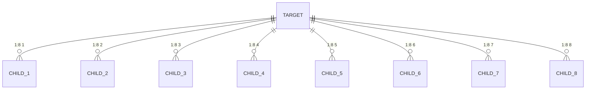

1:10 (ten incoming relationships):

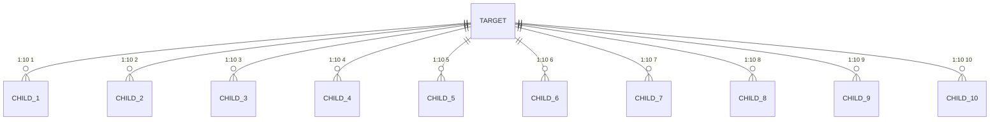

1:12 (twelve incoming relationships):

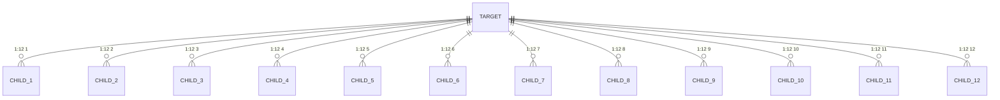

1:16 (sixteen incoming relationships):

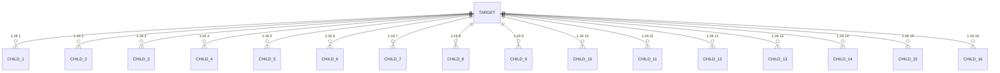

Entity relationship diagram: stress fixtures (fan-out from one entity)

These are intended to be copied 1:1 into `mermaid.live` for reference output comparison.

1:1 (single outgoing relationship):

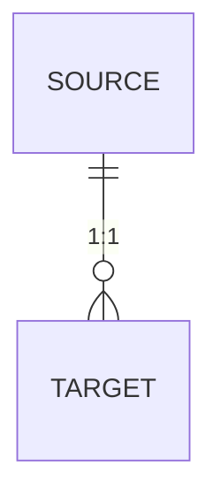

1:2 (two outgoing relationships):

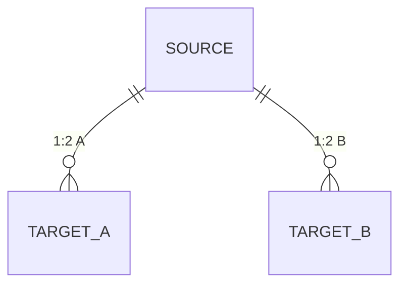

1:3 (three outgoing relationships):

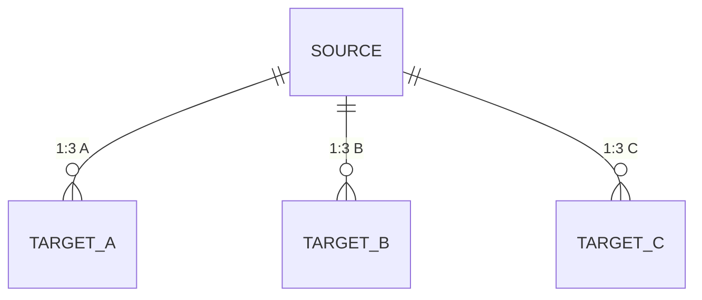

1:8 (eight outgoing relationships):

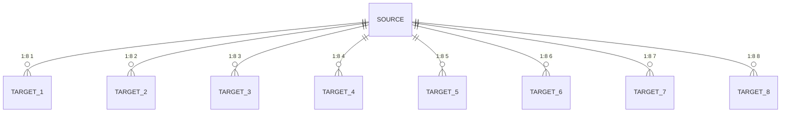

1:10 (ten outgoing relationships):

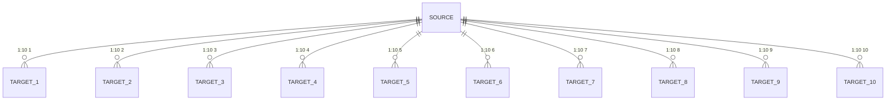

1:12 (twelve outgoing relationships):

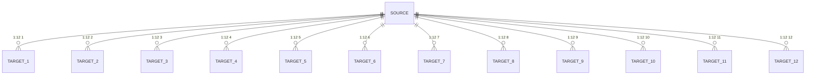

1:16 (sixteen outgoing relationships):

```mermaid
erDiagram
    SOURCE ||--o{ TARGET_1 : "1:16 1"
    SOURCE ||--o{ TARGET_2 : "1:16 2"
    SOURCE ||--o{ TARGET_3 : "1:16 3"
    SOURCE ||--o{ TARGET_4 : "1:16 4"
    SOURCE ||--o{ TARGET_5 : "1:16 5"
    SOURCE ||--o{ TARGET_6 : "1:16 6"
    SOURCE ||--o{ TARGET_7 : "1:16 7"
    SOURCE ||--o{ TARGET_8 : "1:16 8"
    SOURCE ||--o{ TARGET_9 : "1:16 9"
    SOURCE ||--o{ TARGET_10 : "1:16 10"
    SOURCE ||--o{ TARGET_11 : "1:16 11"
    SOURCE ||--o{ TARGET_12 : "1:16 12"
    SOURCE ||--o{ TARGET_13 : "1:16 13"
    SOURCE ||--o{ TARGET_14 : "1:16 14"
    SOURCE ||--o{ TARGET_15 : "1:16 15"
    SOURCE ||--o{ TARGET_16 : "1:16 16"
```

Gantt chart:

```mermaid
gantt
    title Gantt defaults probe (colours, sizes, grid)
    dateFormat  YYYY-MM-DD
    axisFormat  %d
    %% Exclusions (supported by Naiad + Mermaid): enables exclude shading and date adjustment.
    excludes weekends

    %% Keep the range short so we see the default tick/grid behaviour clearly.
    %% Include every built-in status to capture default colours and strokes.

    section Section banding (look for alternating row backgrounds)
    Done task (done)                 :done,    a1, 2026-04-01, 3d
    Active task (active)             :active,  a2, after a1, 3d
    Normal task (default)            :         a3, after a2, 2d

    section Critical variants (crit + combinations)
    Critical task (crit)             :crit,    c1, 2026-04-01, 2d
    Critical + done (crit, done)     :crit, done, c2, after c1, 2d
    Critical + active (crit, active) :crit, active, c3, after c2, 2d

    section Markers (today + vert + milestone)
    Vertical marker (vert)           :vert,    v1, 2026-04-05, 1d
    Milestone (milestone)            :milestone, m1, 2026-04-07, 0d
    Tail task (default)              :         t1, after m1, 2d
```

Gantt chart: longer period + more milestones (YYYY-MM-DD)

```mermaid
gantt
    title Long range probe (milestones + dependencies)
    dateFormat  YYYY-MM-DD
    axisFormat  %d

    section Phase 1
    Kick-off               :milestone, k1, 2026-01-02, 0d
    Planning               :done,      p1, 2026-01-03, 14d
    Design                 :done,      p2, after p1, 21d

    section Phase 2
    Implementation         :active,    i1, after p2, 45d
    Feature freeze         :milestone, f1, after i1, 0d
    Stabilisation          :           s1, after f1, 14d
    Release                :milestone, r1, after s1, 0d
```

Gantt chart: alternate input date format (DD-MM-YYYY)

```mermaid
gantt
    title Date format probe (DD-MM-YYYY)
    dateFormat  DD-MM-YYYY
    axisFormat  %d-%m

    section DD-MM-YYYY inputs
    Task A                 :done,   d1, 01-04-2026, 5d
    Task B                 :active, d2, after d1, 4d
    Milestone              :milestone, dm1, 15-04-2026, 0d
    Task C                 :        d3, after d2, 7d
```

Gantt chart: alternate input date format (MM-DD-YYYY)

```mermaid
gantt
    title Date format probe (MM-DD-YYYY)
    dateFormat  MM-DD-YYYY
    axisFormat  %m/%d

    section MM-DD-YYYY inputs
    Task A                 :done,   m1, 04-01-2026, 5d
    Task B                 :active, m2, after m1, 4d
    Milestone              :milestone, mm1, 04-15-2026, 0d
    Task C                 :        m3, after m2, 7d
```

Gantt chart: axisFormat probe (%m)

```mermaid
gantt
    title Axis format probe (%m = month number)
    dateFormat  YYYY-MM-DD
    axisFormat  %m

    section Month boundary
    Late April task         :done,   am1, 2026-04-25, 6d
    Early May task          :active, am2, after am1, 8d
    Mid May milestone       :milestone, am3, 2026-05-15, 0d
    Late May task           :        am4, after am2, 10d
```

Gantt chart: axisFormat probe (%y)

```mermaid
gantt
    title Axis format probe (%y = 2-digit year)
    dateFormat  YYYY-MM-DD
    axisFormat  %y

    section Year boundary
    Finish 2025              :done,   yy1, 2025-12-15, 14d
    Start 2026               :active, yy2, after yy1, 21d
    New year milestone       :milestone, yy3, 2026-01-01, 0d
    January follow-up        :        yy4, after yy2, 10d
```

Additional Mermaid Gantt directives (supported upstream, not yet supported by Naiad’s Gantt parser):

- `topAxis` (currently triggers `TopAxis is not a function` in `mermaid.live` — omit for now)
- `tickInterval 1day` (or `1week`, `1month`, etc)
- `weekday monday` (tick interval alignment)
- `weekend friday` (weekend start day)
- `inclusiveEndDates`
- `includes 2026-04-04`
- `todayMarker off` or `todayMarker stroke: red, stroke-width: 2px`
- `click <taskId> href "https://example.com"`

Pie chart:

```mermaid
pie showData
    title Markdown features
    "Text" : 35
    "Tables" : 20
    "Images" : 20
    "Mermaid" : 25
```

Git graph:

```text
gitGraph
    commit id: "start"
    branch diagrams
    checkout diagrams
    commit id: "svg"
    checkout main
    merge diagrams id: "merge"
```

Mindmap:

```text
mindmap
  MarkdownToDocX
    Markdown
      Tables
      Lists
    Diagrams
      Mermaid
      SVG
```

Timeline:

```text
timeline
    title Converter milestones
    Markdown parsing : CommonMark examples
    DOCX writing : Tables : Images
    Mermaid : SVG embedding
```

User journey:

```text
journey
    title Document export
    section Author
      Write Markdown: 5: User
      Add Mermaid: 4: User
    section Export
      Convert to DOCX: 5: Converter
      Review document: 4: User
```

Quadrant chart:

```text
quadrantChart
    title Feature priority
    x-axis Low effort --> High effort
    y-axis Low impact --> High impact
    quadrant-1 Strategic
    quadrant-2 Quick wins
    quadrant-3 Maybe later
    quadrant-4 Major bets
    Mermaid SVG: [0.7, 0.8]
    Tables: [0.3, 0.7]
```

Requirement diagram:

```text
requirementDiagram
requirement render_mermaid {
id: 1
text: Mermaid diagrams render as SVG
risk: medium
verifymethod: test
}
```

C4 diagram:

```text
C4Context
    title System context
    Person(user, "User", "Writes Markdown")
    System(converter, "MarkdownToDocX", "Creates DOCX files")
    Rel(user, converter, "Exports")
```

Kanban:

```text
kanban
todo[To do]
docs[Add docs]
doing[Doing]
mermaid[Render Mermaid]
done[Done]
tables[Tables]
```

XY chart:

```text
xychart
    title "Converter throughput"
    x-axis [1, 2, 3, 4, 5]
    y-axis "Docs/min" 0 --> 10
    bar [2, 4, 6, 7, 9]
    line [1, 3, 5, 6, 8]
```

C4 diagrams (all supported entry keywords):

```text
C4Context
    title System context
    Person(user, "User", "Writes Markdown")
    System(converter, "MarkdownToDocX", "Creates DOCX files")
    Rel(user, converter, "Exports")
```

```text
C4Container
    title Containers
    Person(user, "User", "Writes Markdown")
    System_Boundary(converter, "MarkdownToDocX") {
        Container(cli, "md2docx", "Dotnet CLI", "Converts Markdown to DOCX")
        Container(naiad, "Naiad", "C# library", "Renders Mermaid to SVG")
    }
    Rel(user, cli, "Runs")
    Rel(cli, naiad, "Renders Mermaid with")
```

```text
C4Component
    title Components
    Container_Boundary(md2docx, "md2docx") {
        Component(parser, "Markdown parser", "C#", "Finds Mermaid blocks")
        Component(writer, "DocxWriter", "C#", "Embeds SVG into DOCX")
    }
    Rel(parser, writer, "Provides document model to")
```

```text
C4Deployment
    title Deployment
    Deployment_Node(pc, "Developer PC", "Windows") {
        Deployment_Node(word, "Microsoft Word", "Desktop") {
            Container(wordApp, "Word", "Desktop app", "Views DOCX")
        }
        Deployment_Node(dotnet, ".NET runtime", "Desktop") {
            Container(cli, "md2docx", "Dotnet CLI", "Generates DOCX")
        }
    }
    Rel(cli, wordApp, "Produces DOCX for")
```

### Additional Mermaid feature coverage (styles, subregions, text, line ends, combinations)

Flowchart: subgraphs + labelled edges + styles (`classDef`, `class`, `style`, `linkStyle`):

```mermaid
%%{init: {"flowchart": {"htmlLabels": false}} }%%
flowchart TB
    subgraph Region_A["Region A (subgraph)"]
        direction LR
        A1["Start\n(two lines)"] -->|"labelled edge"| A2["Process"]
        A2 -. dotted .-> A3{"Decision?"}
        A3 -->|Yes| A4["Yes path"]
        A3 -->|No| A5["No path"]
    end

    subgraph Region_B["Region B"]
        direction TB
        B1["Left"] --- B2["Right"]
        B2 ==> B3["Thick"]
    end

    Region_A -->|"cross-region link"| Region_B

    classDef Critical fill:#ffdddd,stroke:#cc0000,stroke-width:2px,color:#000000;
    classDef Calm fill:#ddffdd,stroke:#00aa00,stroke-width:2px;
    class A1,A3 Critical;
    class B1,B2,B3 Calm;

    style Region_A fill:#f3f3ff,stroke:#9370db,stroke-width:1px
    linkStyle 0 stroke:#333333,stroke-width:2px
    linkStyle 1 stroke:#333333,stroke-dasharray:3 3
```

Sequence diagram: notes + autonumber (exercise text placement):

::::mermaid
sequenceDiagram
    autonumber
    participant User
    participant Converter
    participant Naiad
    Note over User,Converter: DOCX path uses Naiad (C#), preview uses Mermaid.js
    User->>Converter: Open Markdown
    Converter->>Naiad: Render Mermaid source
    Naiad-->>Converter: SVG
    Converter-->>User: DOCX with diagram
::::

Requirement diagram: multiple requirements + relationship:

```text
requirementDiagram
    requirement render_mermaid {
        id: 1
        text: Mermaid diagrams render as SVG in DOCX
        risk: medium
        verifymethod: test
    }
    requirement parity {
        id: 2
        text: Word output matches VS Code Mermaid preview defaults
        risk: high
        verifymethod: inspection
    }
    render_mermaid - satisfies -> parity
```

State diagram v2: composite states + forks/joins + notes:

```mermaid
stateDiagram-v2
    [*] --> Idle
    note right of Idle
      Waiting for input
    end note

    Idle --> Active

    state Active {
        [*] --> Step1
        Step1 --> Step2
        Step2 --> [*]
    }

    Active --> Done
    Done --> [*]
```

Class diagram: interfaces, generics, and different relationship types:

```mermaid
classDiagram
    class IRepository~T~ {
        +GetById(Id) T
        +Save(Item) void
    }
    class SqlRepository~T~ {
        +GetById(Id) T
        +Save(Item) void
    }
    class User {
        +int Id
        +string Name
    }
    IRepository~T~ <|.. SqlRepository~T~
    SqlRepository~User~ o-- User : caches
```

### Future (beta / experimental Mermaid diagrams and features)

These fixtures are Mermaid-supported but are treated as **Future** targets for DOCX parity work. Keep them grouped here.

Flowchart: `@{ shape: ... }` expanded shape catalogue (not supported by VS Code Mermaid extension or `mermaid.live`):

```mermaid
flowchart LR
    Rect@{ shape: rect }[rect]
    Rounded@{ shape: rounded }[rounded]
    Stadium@{ shape: stadium }[stadium]
    Subroutine@{ shape: fr-rect }[fr-rect]
    Cylinder@{ shape: cyl }[cyl]
    Circle@{ shape: circle }[circle]
    SmallCircle@{ shape: sm-circ }[sm-circ]
    DoubleCircle@{ shape: dbl-circ }[dbl-circ]
    FramedCircle@{ shape: fr-circ }[fr-circ]
    Diamond@{ shape: diam }[diam]
    Hex@{ shape: hex }[hex]
    LeanR@{ shape: lean-r }[lean-r]
    LeanL@{ shape: lean-l }[lean-l]
    TrapB@{ shape: trap-b }[trap-b]
    TrapT@{ shape: trap-t }[trap-t]
    Card@{ shape: notch-rect }[notch-rect]
    Lined@{ shape: lin-rect }[lin-rect]
    Delay@{ shape: delay }[delay]
    Tri@{ shape: tri }[tri]
    FlipTri@{ shape: flip-tri }[flip-tri]
    WinPane@{ shape: win-pane }[win-pane]
    Tagged@{ shape: tag-rect }[tag-rect]
    Doc@{ shape: doc }[doc]
    Docs@{ shape: docs }[docs]
    LinDoc@{ shape: lin-doc }[lin-doc]
    Bolt@{ shape: bolt }[bolt]
    Hourglass@{ shape: hourglass }[hourglass]
    Odd@{ shape: odd }[odd]
    Bang@{ shape: bang }[bang]
    Text@{ shape: text }[text]
```

Block diagram (beta):

```text
block-beta
    columns 3
    md["Markdown"] render["Renderer"] docx["DOCX"]
```

Radar chart (beta):

```text
radar-beta
    title Converter capabilities
    axis Markdown, Tables, Images, Mermaid
    curve Current{4, 4, 3, 3}
    curve Target{5, 5, 5, 5}
```

Sankey diagram (beta):

```text
sankey-beta
Markdown,Parser,10
Parser,DOCX Writer,8
Parser,Mermaid Renderer,2
Mermaid Renderer,DOCX Writer,2
```

Packet diagram (beta):

```text
packet-beta
    0-7: "Header"
    8-15: "Flags"
    16-31: "Length"
```

Architecture diagram (beta):

```text
architecture-beta
    service user(internet)[User]
    service app(server)[md2docx]
    service render(server)[Naiad]
    user --> app
    app --> render
```

Treemap (beta):

```text
treemap-beta
    title "MarkdownToDocX components"
    "MDConverter" : 50
    "Naiad" : 35
    "md2docx" : 15
```

Wardley map (beta):

```text
wardley-beta
    title Wardley sample
    anchor user [User]
    component docx [DOCX] label [DOCX Output]
    component preview [Preview] label [VS Code Mermaid Preview]
    user -> preview
    user -> docx
```

Venn diagram (Mermaid supported; drives Naiad parity work):

```text
venn
    title Venn example
    A : 10
    B : 12
    C : 8
    A&B : 4
    A&C : 2
    B&C : 3
    A&B&C : 1
```

Ishikawa (fishbone) diagram (Mermaid supported; drives Naiad parity work):

```text
ishikawa
    title "DOCX parity issues"
    "Word SVG" ["Filters", "CSS partial support"]
    "Text metrics" ["Baseline", "Wrapping"]
    "Layout" ["Dagre", "ELK"]
    "Markers" ["Offsets", "Margin variants"]
```

TreeView diagram (Mermaid supported; drives Naiad parity work):

```text
treeView
    root((MarkdownToDocX))
        md2docx
            Program.cs
        MDConverter
            DocxWriter.cs
        Naiad
            Mermaid.cs
            MermaidStyles.cs
```

ZenUML (Mermaid supported; drives Naiad parity work):

```text
zenuml
    title Mermaid ZenUML sample
    @startuml
    Alice->Bob: Hello
    Bob-->Alice: OK
    @enduml
```

Sequence diagram: combined fragments (alt/opt/loop/par) and activation bars:

```mermaid
sequenceDiagram
    participant A as Client
    participant B as Service
    A->>+B: Request
    alt Success
        B-->>-A: 200 OK
    else Failure
        B-->>-A: 500 Error
    end
    opt Retry enabled
        loop Up to 2 retries
            A->>+B: Retry request
            B-->>-A: Result
        end
    end
    par Background work
        A->>B: Fire-and-forget
    and Observability
        B-->>A: Event
    end
```

## Tables

Header row only:

| A | B | C |
| --- | --- | --- |

Table with body:

| Name | Value | Notes |
| --- | --- | --- |
| Foo | 1 | First |
| Bar | 2 | Second |
| Baz | 3 | Third |

Table with explicit alignment:

| Left | Center | Right |
| :--- | :---: | ---: |
| L1 | C1 | R1 |
| L2 | C2 | R2 |

Table with empty cells:

| Col A | Col B | Col C |
| --- | --- | --- |
| A1 | | C1 |
| A2 | B2 | |

Table with inline formatting:

| **Bold header** | *Italic header* | `Code header` |
| --- | --- | --- |
| Cell with [link](https://example.com) | Cell with `code` | Plain cell |
| Strong **cell** | Emphasis *cell* | Strike ~~cell~~ |

Table with escaped pipe:

| Label | Value |
| --- | --- |
| Literal pipe | A \| B |

Table with image in a cell:

| Description | Preview |
| --- | --- |
| Logo |  |
| Missing icon |  |

---

## Images

Local image with alt text:


Local image with title:


Reference-style local image:

![Reference logo][logo-ref]

Missing local image placeholder:


Remote image placeholder:


[logo-ref]: images/logo.png

---

## Footnotes

Footnote markers are supported as preserved document text.[^one]

Another paragraph can refer to the same area of the document with a second note.[^two]

[^one]: First footnote body text.

[^two]: Second footnote body with **formatting** and `code`.

---

## Horizontal rules

Hyphen rule:

---

Asterisk rule:

***

Underscore rule:

___

---

## Mixed supported nesting

Blockquote containing tasks:

> - [ ] Quoted unchecked task
> - [x] Quoted checked task

Blockquote containing nested ordered content:

> 1. First quoted step
>    - Sub bullet in quote
> 2. Second quoted step

Ordered item with continuation and nested bullet:

1. Numbered item with continuation.

   Continuation paragraph belongs to the first item.

   - Nested bullet in continuation.

2. Second numbered item.

Table near the end:

| Feature | Expected DOCX behaviour |
| --- | --- |
| Links | Real Word hyperlinks |
| Lists | Native Word numbering or bullets |
| Code | Monospace shaded paragraphs |
| Images | Embedded when local file exists |

End of supported examples.

---

## Mermaid stress suite (in-scope diagram types)

This section deliberately exercises many scenarios for these diagram types:

- Flowchart
- Sequence
- Class
- State
- Entity relationship
- Gantt
- Pie

### Flowchart stress suite

Flowchart: LR + subgraph (direction TB) + long wrapping node text + simple in/out.

```mermaid
flowchart LR
subgraph R0S0["Manifests and checksums"]
  direction TB
  r0n0["Publish a manifest (file list, sizes, hashes) with each drop so the consumer can reject incomplete uploads and detect tampering. Include a stable batch identifier and an explicit completion marker."]
end
IN[In] --> r0n0
r0n0 --> OUT[Out]
```

Flowchart: LR + two vertical subgraphs + edge between interior nodes (common failure case).

```mermaid
flowchart LR
subgraph R2S0["Normaliser"]
  direction TB
  r2n0["At ingest, map partner-specific layouts into one internal shape or directly into the hub model so downstream logic stays stable as partners change over time."]
end
subgraph R2S1["Message Translator"]
  direction TB
  r2n1["Translate from the internal shape into a specific consumer contract, including versioning, optional fields, and any required value normalisation."]
end
IN[In] --> r2n0
r2n0 --> r2n1
r2n1 --> OUT[Out]
```

Flowchart: nested subgraphs + mixed directions.

```mermaid
flowchart TB
subgraph Outer["Outer subgraph"]
  direction TB
  A["Top node"] --> B["Middle node"]
  subgraph Inner["Inner subgraph"]
    direction LR
    C["Left"] --> D["Right"]
  end
  B --> C
  D --> E["Bottom node"]
end
```

Flowchart: decision diamonds + labelled edges + multiple outgoing edges.

```mermaid
flowchart LR
Start([Start]) --> Validate{"Valid input?"}
Validate -->|Yes| Transform["Transform payload"]
Validate -->|No| Reject["Reject with an error"]
Transform --> Persist[("Persist")]
Persist --> Done([Done])
Reject --> Done
```

Flowchart: all edge styles + labelled edges + short nodes.

```mermaid
flowchart LR
A["A"] -->|solid arrow| B["B"]
C["C"] ---|solid line| D["D"]
E["E"] -.->|dotted arrow| F["F"]
G["G"] -.-|dotted line| H["H"]
I["I"] ==>|thick arrow| J["J"]
K["K"] ===|thick line| L["L"]
M["M"] --o|circle end| N["N"]
O["O"] --x|cross end| P["P"]
Q["Q"] <--> R["R"]
```

Flowchart: special characters, punctuation, and quotes in labels.

```mermaid
flowchart TB
A["Escapes: \\* \\_ \\` \\[ \\] and a literal pipe A | B"] --> B["Quotes: \"double\" and 'single'"]
B --> C["Math-ish: a < b && c > d"]
```

Flowchart: cycles + parallel branches + joins.

```mermaid
flowchart LR
A["Ingress"] --> B["Enqueue"]
B --> C["Worker 1"]
B --> D["Worker 2"]
C --> E["Aggregate"]
D --> E
E --> F{"Succeeded?"}
F -->|Yes| G["Ack"]
F -->|No| H["Retry later"]
H --> B
```

Flowchart: long edge labels + close nodes (stress label placement).

```mermaid
flowchart LR
A["Producer"] -->|"A long edge label should not collide with arrowheads or node borders (placement and wrapping are important)."| B["Consumer"]
B -->|"Another long label with punctuation, commas, and parentheses (including dates like 2026-04-16) to force wrapping."| C["Downstream"]
```

Flowchart: init block + htmlLabels false (native SVG text path).

```mermaid
%%{init: {"flowchart": {"htmlLabels": false}} }%%
flowchart TB
A["Native SVG labels"] --> B["This label should wrap as needed without HTML foreignObject."]
B --> C["Final node"]
```

### Sequence stress suite

Sequence: notes, activation, self-message, and wrapping message text.

```mermaid
sequenceDiagram
participant User as User
participant Converter as MarkdownToDocX
participant Naiad as Naiad Renderer

User->>Converter: Convert a Markdown file that includes Mermaid diagrams
activate Converter
Converter->>Naiad: Render Mermaid source to SVG
activate Naiad
Note over Naiad: Scheduled or triggered pickup
Naiad-->>Converter: SVG output
deactivate Naiad

Converter->>Converter: Validate, translate, load
Converter-->>User: DOCX with embedded SVG diagrams
deactivate Converter
```

Sequence: alt/opt/loop/par (layout + vertical spacing + labels).

```mermaid
sequenceDiagram
participant A as Producer
participant B as Broker
participant C as Consumer

A->>B: Publish message
par Fan-out
  B-->>C: Deliver
  B-->>C: Deliver (duplicate for idempotency test)
end

alt Consumer accepts
  C-->>B: Ack
else Consumer rejects
  C-->>B: Nack (reason)
  loop Retry policy
    B-->>C: Redeliver
  end
end

opt Telemetry
  C-->>A: Emit metrics and traces
end
```

Sequence: long participant names + multi-line messages.

```mermaid
sequenceDiagram
participant LongParticipantNameA as Long participant name A (should not break layout)
participant LongParticipantNameB as Long participant name B (should not overlap)

LongParticipantNameA->>LongParticipantNameB: First line of message\nSecond line of message\nThird line of message
LongParticipantNameB-->>LongParticipantNameA: Response with a long label that should wrap rather than overflow the page width.
```

Sequence: notes left/right + overlapping risks.

```mermaid
sequenceDiagram
participant Client
participant API
participant DB

Note left of Client: Client-side note with enough text to wrap to multiple lines in the note box.
Client->>API: Request
Note right of API: API note (right) that should not collide with lifelines.
API->>DB: Query
DB-->>API: Rows
API-->>Client: Response
```

### Class diagram stress suite

Class: attributes + methods + inheritance + associations + multiplicities.

```mermaid
classDiagram
  class Message {
    +String Id
    +String Type
    +String Payload
    +Validate() bool
  }
  class Queue {
    +String Name
    +Enqueue(Message) void
    +Dequeue() Message
  }
  class DeadLetterQueue {
    +String Name
  }

  Queue <|-- DeadLetterQueue
  Queue "1" o-- "*" Message : holds
```

Class: long member names + generics-like text (wrapping).

```mermaid
classDiagram
  class Normaliser {
    +MapPartnerSpecificLayoutIntoInternalShapeOrHubModel(Input) Output
    +NormaliseIdentifiersAndTimestamps(Input) Output
  }
  class Translator {
    +TranslateInternalShapeIntoConsumerContractIncludingVersioningAndOptionalFields(Input) Output
  }

  Normaliser --> Translator : produces input for
```

### State diagram stress suite

State: branching, nested states, and notes.

```mermaid
stateDiagram-v2
  [*] --> Idle
  Idle --> Receiving : file arrives
  Receiving --> Validating : manifest read
  Validating --> Translating : ok
  Validating --> Rejected : invalid

  state Translating {
    [*] --> Map
    Map --> Convert
    Convert --> [*]
  }

  Translating --> Done
  Rejected --> [*]
  Done --> [*]
```

State: choice and guards.

```mermaid
stateDiagram-v2
  [*] --> Ingest
  Ingest --> Choice
  state Choice <<choice>>
  Choice --> Process : valid
  Choice --> Reject : invalid
  Process --> [*]
  Reject --> [*]
```

### Entity relationship (ER) stress suite

ER: entities with attributes + relationship labels.

```mermaid
erDiagram
  CUSTOMER {
    string customer_id PK
    string name
    string email
  }
  ORDER {
    string order_id PK
    string customer_id FK
    date created_date
  }
  LINE_ITEM {
    string line_item_id PK
    string order_id FK
    string product_id FK
    int quantity
  }
  PRODUCT {
    string product_id PK
    string name
  }

  CUSTOMER ||--o{ ORDER : places
  ORDER ||--|{ LINE_ITEM : contains
  PRODUCT ||--o{ LINE_ITEM : appears_in
```

ER: long relationship labels + many relationships around one entity.

```mermaid
erDiagram
  HUB ||--o{ PARTNER_A : "publishes batches with manifests and checksums"
  HUB ||--o{ PARTNER_B : "publishes batches with manifests and checksums"
  HUB ||--o{ PARTNER_C : "publishes batches with manifests and checksums"
  HUB ||--o{ PARTNER_D : "publishes batches with manifests and checksums"
```

### Gantt stress suite

Gantt: compact range + dependencies + milestones + excludes.

```mermaid
gantt
  title Conversion pipeline (stress suite)
  dateFormat  YYYY-MM-DD
  axisFormat  %d
  excludes weekends

  section Ingest
  Drop arrives                  :done,    a1, 2026-04-01, 1d
  Publish manifest              :active,  a2, after a1, 2d

  section Process
  Validate + translate           :         b1, after a2, 3d
  Load to target                 :         b2, after b1, 2d
  Release marker                 :milestone, m1, after b2, 0d
```

### Pie stress suite

Pie: many slices + long labels + small values (label layout).

```mermaid
pie showData
  title Pattern mix (stress suite)
  "File Transfer (drop zone) with manifest + checksums" : 28
  "Message Translator (consumer-specific contract mapping)" : 19
  "Normaliser (partner-specific to internal shape)" : 17
  "Telemetry and monitoring" : 9
  "Retries, dead-lettering, and idempotency" : 15
  "Other" : 12
```
