# Markdown to DOCX Supported Examples

This document exercises the Markdown features currently supported by the converter. It favours examples that should render intentionally in DOCX rather than raw conformance edge cases that only make sense when comparing Markdown to HTML.

## Paragraphs and line breaks

This is a normal paragraph with plain text. It should wrap naturally in Word without manual line breaks.

This is a second paragraph after a blank line.

This line is followed by a soft line break in the source
and should remain part of the same paragraph.

This line ends with two spaces for a hard break.  
The next line should appear below it.

This line ends with a backslash hard break.\
The next line should also appear below it.

Escaped punctuation should remain literal: \*asterisks\*, \_underscores\_, \[brackets\], \`backticks\`, and \\ backslash.

---

## Headings

# Heading Level 1

## Heading Level 2

### Heading Level 3

#### Heading Level 4

##### Heading Level 5

###### Heading Level 6

Setext Heading Level 1
======================

Setext Heading Level 2
----------------------

### Heading with **bold**, *italic*, `code`, and [a link](https://example.com)

---

## Inline formatting

Plain inline styles: **bold**, *italic*, ***bold italic***, `inline code`, and ~~strikethrough~~.

Nested inline styles: **bold with *italic inside***, *italic with **bold inside***, and **bold with `inline code` inside**.

Inline code preserves Markdown-looking text: `**not bold**`, `[not a link](https://example.com)`, `a < b && c > d`, and `A | B`.

Formatting beside punctuation: **bold**, *italic*, `code`, ~~strike~~.

---

## Links

Direct link: [Example](https://example.com).

Direct link with title: [Example with title](https://example.com "Example title").

Reference-style link: [CommonMark spec][commonmark].

Collapsed reference link: [CommonMark][].

Repeated reference link: [the same spec][commonmark].

Autolink URL: <https://example.com/autolink>.

Autolink email: <person@example.com>.

[commonmark]: https://commonmark.org
[CommonMark]: https://commonmark.org

---

## Blockquotes

Single paragraph quote:

> A simple quoted paragraph.

Multi-paragraph quote:

> First quoted paragraph.
>
> Second quoted paragraph with **bold**, *italic*, `code`, and [link](https://example.com).

Nested quote:

> Outer quote.
>
> > Inner quote.
>
> Back to the outer quote.

Quote containing a list:

> - Quoted bullet one
> - Quoted bullet two
> 1. Quoted number one
> 2. Quoted number two

Quote containing a heading and code:

> #### Quoted heading
>
>     quoted code line one
>     quoted code line two

---

## Unordered lists

Hyphen list:

- First item.
- Second item with **bold** and `code`.
- Third item.

Asterisk list:

* Alpha
* Beta
* Gamma

Plus list:

+ One
+ Two
+ Three

Nested unordered list:

- Parent A
  - Child A1
    - Grandchild A1a
  - Child A2
- Parent B

Loose unordered list:

- First loose item.

  Continuation paragraph for the first item.

- Second loose item.

  Continuation paragraph with [a link](https://example.com).

---

## Ordered lists

Normal ordered list:

1. First step.
2. Second step.
3. Third step.

Ordered list starting at 3:

3. Start from three.
4. Then four.
5. Then five.

Ordered list starting at 10:

10. Ten.
11. Eleven.
12. Twelve.

Nested ordered list:

1. Parent one
   1. Child one
   2. Child two
2. Parent two
   1. Child three
      1. Grandchild three-a
      2. Grandchild three-b

Ordered list with nested bullets:

1. First parent
   - Sub bullet A
   - Sub bullet B
2. Second parent
   - Sub bullet C

Bullet list with nested ordered items:

- Parent one
  1. Nested ordered A
  2. Nested ordered B
- Parent two
  1. Nested ordered C

---

## Task lists

- [ ] Unchecked task.
- [x] Checked task.
- [X] Checked task with uppercase marker.
- [ ] Task with **bold**, *italic*, `code`, and [link](https://example.com).
  - [ ] Nested unchecked task.
  - [x] Nested checked task.

---

## Multi-block list items

List item with continuation paragraph:

- Item with an opening paragraph.

  Continuation paragraph inside the same item.

- Next item.

List item with indented code:

- Item before code.

      code line one
      code line two

- Item after code.

List item with fenced code:

- Fenced code item:

  ```text
  code inside a list
  second code line
  ```

- Item after fenced code.

---

## Code blocks

Indented code block:

    def hello():
        print("Hello, world.")

Fenced code block without language:

```
plain fenced code
with multiple lines
```

Fenced C# code block:

```csharp
public void Method()
{
    return;
}
```

Fenced JSON code block:

```json
{
  "key": "value",
  "markdown": "**not bold inside code**",
  "pipe": "A | B"
}
```

Fenced Markdown-looking code:

```markdown
# Not a heading inside code
- Not a list inside code
[Not a link](https://example.com)
```

---

## Mermaid diagrams

Flowchart, standard backtick fence:

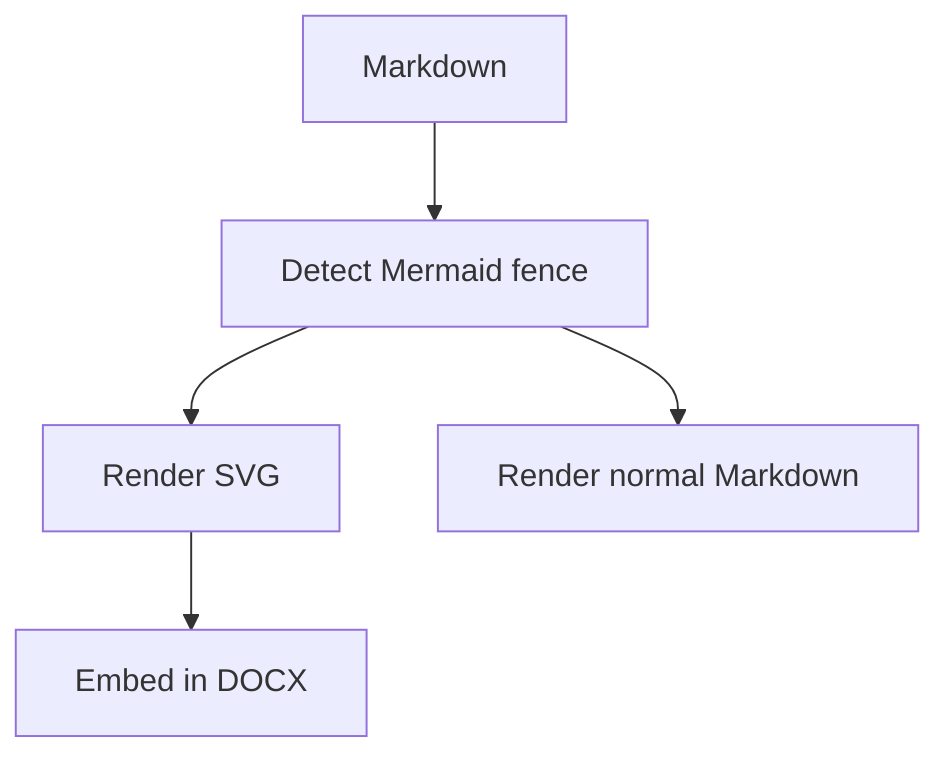

Flowchart: same edge type, different **source** hyphen lengths (compare DOCX vs VS Code reference layout):

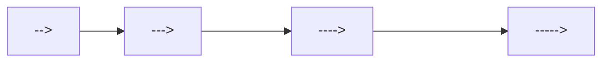

Flowchart: all supported line / arrow types (exercise Naiad `EdgeType` parsing):

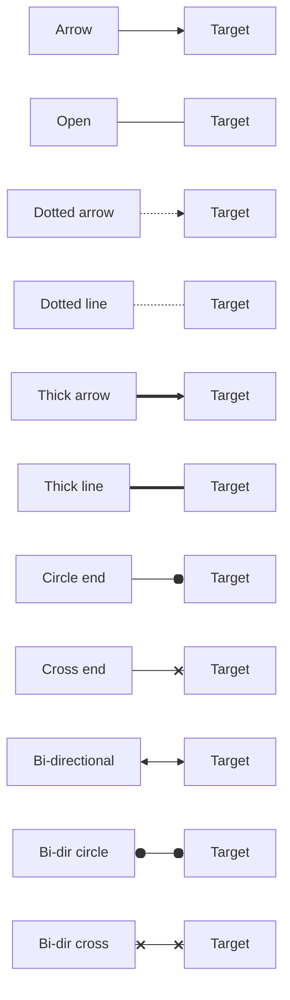

Sequence diagram, colon fence:

:::mermaid
sequenceDiagram
    participant User
    participant Converter
    participant Naiad
    User->>Converter: Open Markdown
    Converter->>Naiad: Render Mermaid source
    Naiad-->>Converter: SVG
    Converter-->>User: DOCX with diagram
:::

Class diagram:

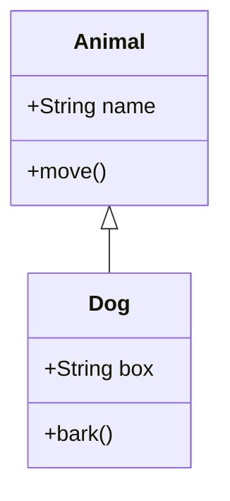

State diagram:

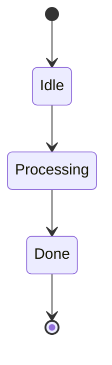

Entity relationship diagram:

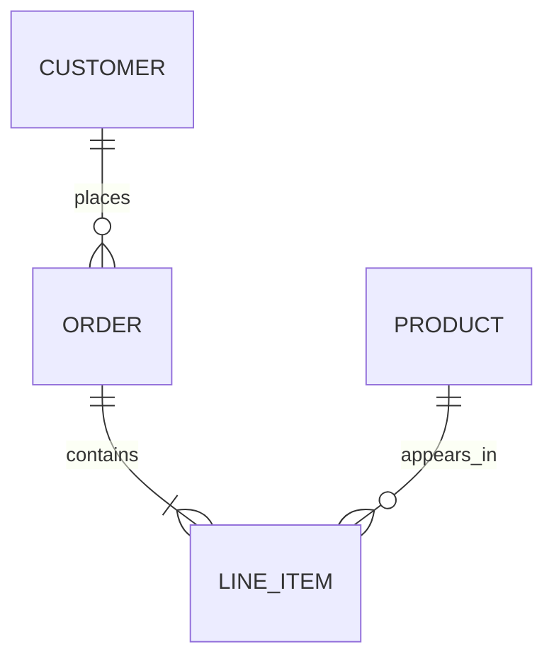

Entity relationship diagram: cardinality + identifying/non-identifying line style matrix:

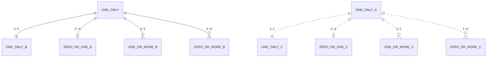

Entity relationship diagram: stress fixtures (fan-in to one entity)

These are intended to be copied 1:1 into `mermaid.live` for reference output comparison.

1:1 (single incoming relationship):

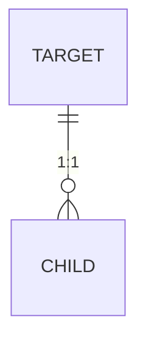

1:2 (two incoming relationships):

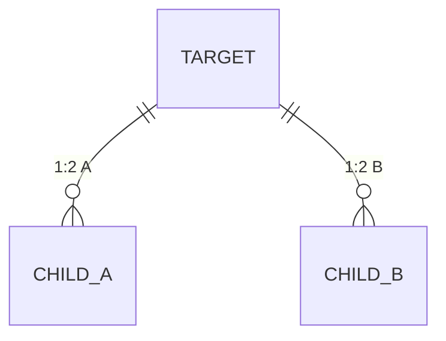

1:3 (three incoming relationships):

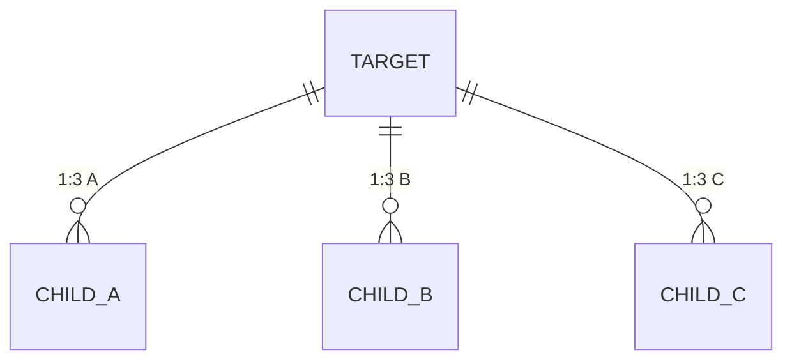

1:8 (eight incoming relationships):

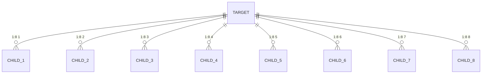

Entity relationship diagram: stress fixtures (fan-out from one entity)

These are intended to be copied 1:1 into `mermaid.live` for reference output comparison.

1:1 (single outgoing relationship):

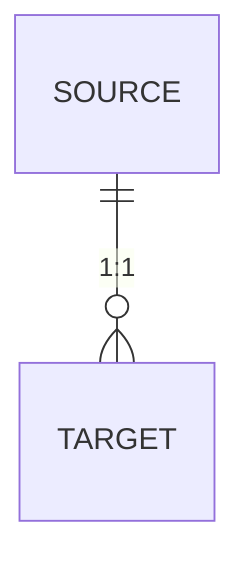

1:2 (two outgoing relationships):

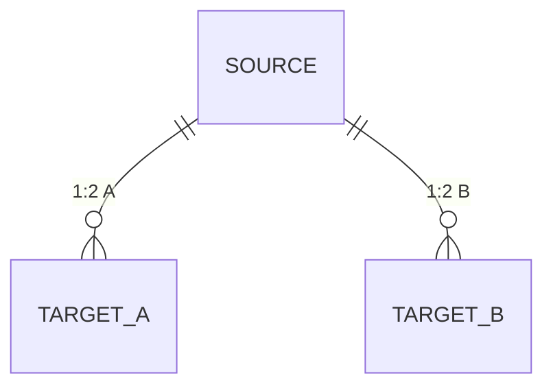

1:3 (three outgoing relationships):

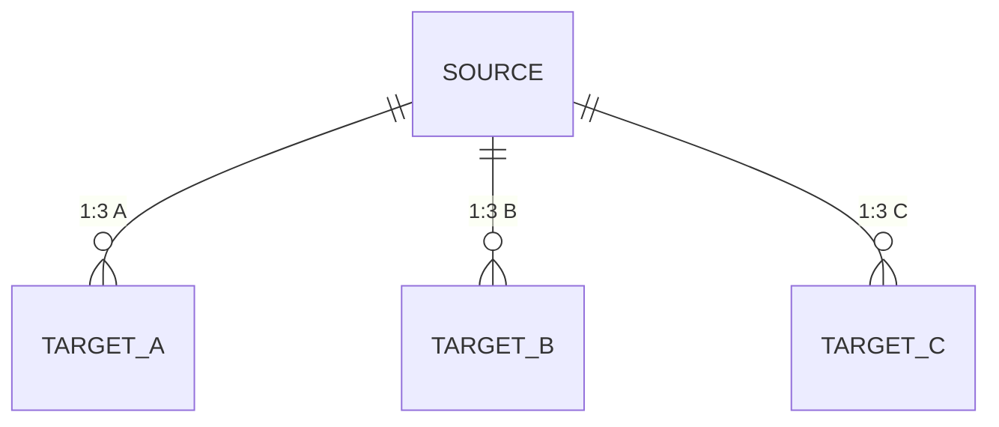

1:8 (eight outgoing relationships):

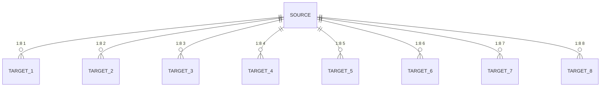

Gantt chart:

```mermaid
gantt
    title Gantt defaults probe (colours, sizes, grid)
    dateFormat  YYYY-MM-DD
    axisFormat  %d
    topAxis
    tickInterval 1day
    weekday monday
    inclusiveEndDates

    %% Exclusions / includes (default exclude shading + date adjustment):
    excludes weekends
    %% Mermaid v11+: configure weekend start day (Friday+Saturday rather than Saturday+Sunday).
    weekend friday
    %% Override exclusions for a specific date (keeps it as a working day even if excluded).
    includes 2026-04-04

    %% Today marker: empty = default; "off" disables. Any other value is treated as a CSS style string.
    todayMarker stroke: red, stroke-width: 2px, stroke-dasharray: 3 3

    %% Keep the range short so we see the default tick/grid behaviour clearly.
    %% Include every built-in status to capture default colours and strokes.

    section Section banding (look for alternating row backgrounds)
    Done task (done)                 :done,    a1, 2026-04-01, 3d
    Active task (active)             :active,  a2, after a1, 3d
    Normal task (default)            :         a3, after a2, 2d

    section Critical variants (crit + combinations)
    Critical task (crit)             :crit,    c1, 2026-04-01, 2d
    Critical + done (crit, done)     :crit, done, c2, after c1, 2d
    Critical + active (crit, active) :crit, active, c3, after c2, 2d

    section Markers (today + vert + milestone)
    Vertical marker (vert)           :vert,    v1, 2026-04-04, 1d
    Milestone (milestone)            :milestone, m1, 2026-04-07, 0d
    Tail task (default)              :         t1, after m1, 2d

    %% Interactivity (SVG links). Mermaid uses 'click <taskId> href "<url>"'.
    click a2 href "https://example.com"
```

Pie chart:

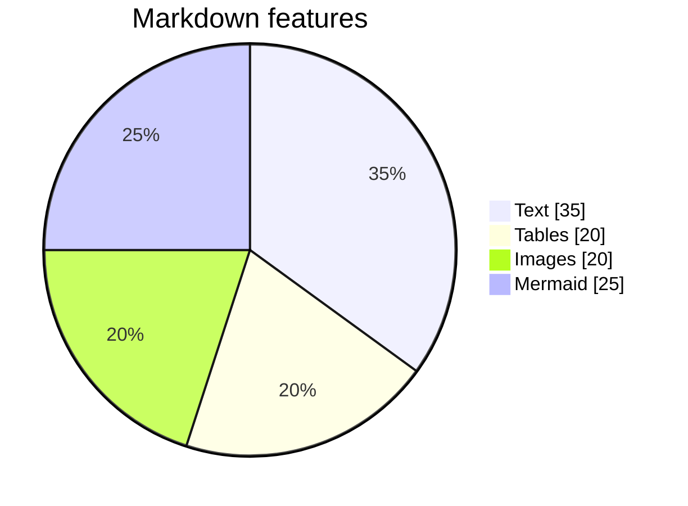

Git graph:

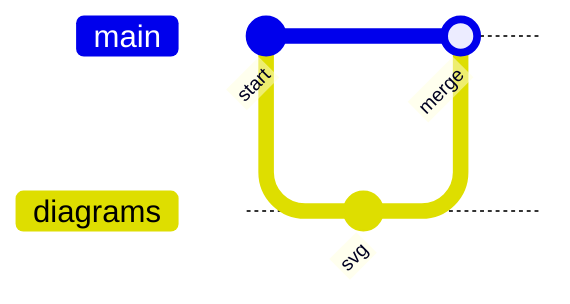

Mindmap:

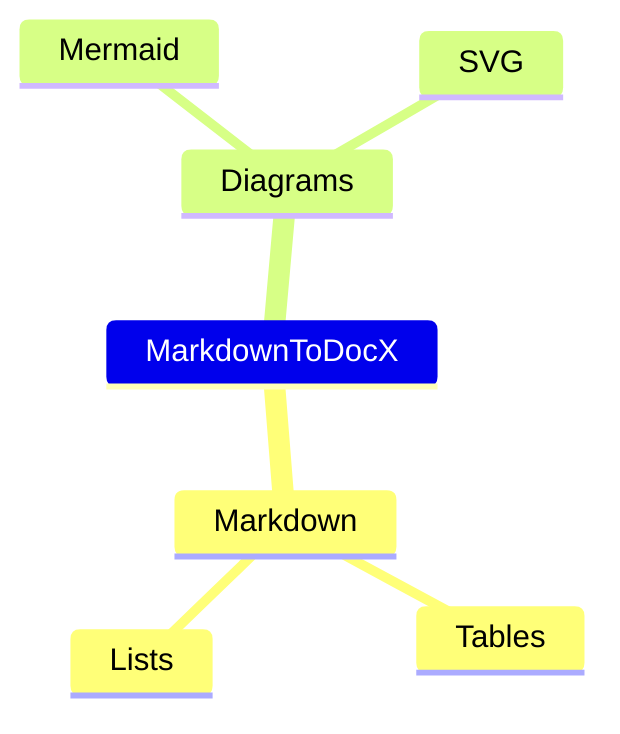

Timeline:

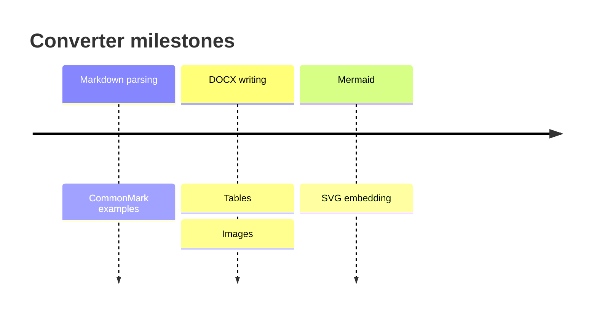

User journey:

```mermaid
journey
    title Document export
    section Author
      Write Markdown: 5: User
      Add Mermaid: 4: User
    section Export
      Convert to DOCX: 5: Converter
      Review document: 4: User
```

Quadrant chart:

```mermaid
quadrantChart
    title Feature priority
    x-axis Low effort --> High effort
    y-axis Low impact --> High impact
    quadrant-1 Strategic
    quadrant-2 Quick wins
    quadrant-3 Maybe later
    quadrant-4 Major bets
    Mermaid SVG: [0.7, 0.8]
    Tables: [0.3, 0.7]
```

Requirement diagram:

```mermaid
requirementDiagram
requirement render_mermaid {
id: 1
text: Mermaid diagrams render as SVG
risk: medium
verifymethod: test
}
```

C4 diagram:

```mermaid
C4Context
    title System context
    Person(user, "User", "Writes Markdown")
    System(converter, "MarkdownToDocX", "Creates DOCX files")
    Rel(user, converter, "Exports")
```

Kanban:

```mermaid
kanban
todo[To do]
docs[Add docs]
doing[Doing]
mermaid[Render Mermaid]
done[Done]
tables[Tables]
```

XY chart:

```mermaid
xychart
    title "Converter throughput"
    x-axis [1, 2, 3, 4, 5]
    y-axis "Docs/min" 0 --> 10
    bar [2, 4, 6, 7, 9]
    line [1, 3, 5, 6, 8]
```

C4 diagrams (all supported entry keywords):

```mermaid
C4Context
    title System context
    Person(user, "User", "Writes Markdown")
    System(converter, "MarkdownToDocX", "Creates DOCX files")
    Rel(user, converter, "Exports")
```

```mermaid
C4Container
    title Containers
    Person(user, "User", "Writes Markdown")
    System_Boundary(converter, "MarkdownToDocX") {
        Container(cli, "md2docx", "Dotnet CLI", "Converts Markdown to DOCX")
        Container(naiad, "Naiad", "C# library", "Renders Mermaid to SVG")
    }
    Rel(user, cli, "Runs")
    Rel(cli, naiad, "Renders Mermaid with")
```

```mermaid
C4Component
    title Components
    Container_Boundary(md2docx, "md2docx") {
        Component(parser, "Markdown parser", "C#", "Finds Mermaid blocks")
        Component(writer, "DocxWriter", "C#", "Embeds SVG into DOCX")
    }
    Rel(parser, writer, "Provides document model to")
```

```mermaid
C4Deployment
    title Deployment
    Deployment_Node(pc, "Developer PC", "Windows") {
        Deployment_Node(word, "Microsoft Word", "Desktop") {
            Container(wordApp, "Word", "Desktop app", "Views DOCX")
        }
        Deployment_Node(dotnet, ".NET runtime", "Desktop") {
            Container(cli, "md2docx", "Dotnet CLI", "Generates DOCX")
        }
    }
    Rel(cli, wordApp, "Produces DOCX for")
```

### Additional Mermaid feature coverage (styles, subregions, text, line ends, combinations)

Flowchart: subgraphs + labelled edges + styles (`classDef`, `class`, `style`, `linkStyle`):

```mermaid
%%{init: {"flowchart": {"htmlLabels": false}} }%%
flowchart TB
    subgraph Region_A["Region A (subgraph)"]
        direction LR
        A1["Start\n(two lines)"] -->|"labelled edge"| A2["Process"]
        A2 -. dotted .-> A3{"Decision?"}
        A3 -->|Yes| A4["Yes path"]
        A3 -->|No| A5["No path"]
    end

    subgraph Region_B["Region B"]
        direction TB
        B1["Left"] --- B2["Right"]
        B2 ==> B3["Thick"]
    end

    Region_A -->|"cross-region link"| Region_B

    classDef Critical fill:#ffdddd,stroke:#cc0000,stroke-width:2px,color:#000000;
    classDef Calm fill:#ddffdd,stroke:#00aa00,stroke-width:2px;
    class A1,A3 Critical;
    class B1,B2,B3 Calm;

    style Region_A fill:#f3f3ff,stroke:#9370db,stroke-width:1px
    linkStyle 0 stroke:#333333,stroke-width:2px
    linkStyle 1 stroke:#333333,stroke-dasharray:3 3
```

Sequence diagram: notes + autonumber (exercise text placement):

::::mermaid
sequenceDiagram
    autonumber
    participant User
    participant Converter
    participant Naiad
    Note over User,Converter: DOCX path uses Naiad (C#), preview uses Mermaid.js
    User->>Converter: Open Markdown
    Converter->>Naiad: Render Mermaid source
    Naiad-->>Converter: SVG
    Converter-->>User: DOCX with diagram
::::

Requirement diagram: multiple requirements + relationship:

```mermaid
requirementDiagram
    requirement render_mermaid {
        id: 1
        text: Mermaid diagrams render as SVG in DOCX
        risk: medium
        verifymethod: test
    }
    requirement parity {
        id: 2
        text: Word output matches VS Code Mermaid preview defaults
        risk: high
        verifymethod: inspection
    }
    render_mermaid - satisfies -> parity
```

State diagram v2: composite states + forks/joins + notes:

```mermaid
stateDiagram-v2
    [*] --> Idle
    note right of Idle
      Waiting for input
    end note

    Idle --> Active

    state Active {
        [*] --> Step1
        Step1 --> Step2
        Step2 --> [*]
    }

    Active --> Done
    Done --> [*]
```

Class diagram: interfaces, generics, and different relationship types:

```mermaid
classDiagram
    class IRepository~T~ {
        +GetById(Id) T
        +Save(Item) void
    }
    class SqlRepository~T~ {
        +GetById(Id) T
        +Save(Item) void
    }
    class User {
        +int Id
        +string Name
    }
    IRepository~T~ <|.. SqlRepository~T~
    SqlRepository~User~ o-- User : caches
```

### Future (beta / experimental Mermaid diagrams and features)

These fixtures are Mermaid-supported but are treated as **Future** targets for DOCX parity work. Keep them grouped here.

Flowchart: `@{ shape: ... }` expanded shape catalogue (not supported by VS Code Mermaid extension or `mermaid.live`):

```mermaid
flowchart LR
    Rect@{ shape: rect }[rect]
    Rounded@{ shape: rounded }[rounded]
    Stadium@{ shape: stadium }[stadium]
    Subroutine@{ shape: fr-rect }[fr-rect]
    Cylinder@{ shape: cyl }[cyl]
    Circle@{ shape: circle }[circle]
    SmallCircle@{ shape: sm-circ }[sm-circ]
    DoubleCircle@{ shape: dbl-circ }[dbl-circ]
    FramedCircle@{ shape: fr-circ }[fr-circ]
    Diamond@{ shape: diam }[diam]
    Hex@{ shape: hex }[hex]
    LeanR@{ shape: lean-r }[lean-r]
    LeanL@{ shape: lean-l }[lean-l]
    TrapB@{ shape: trap-b }[trap-b]
    TrapT@{ shape: trap-t }[trap-t]
    Card@{ shape: notch-rect }[notch-rect]
    Lined@{ shape: lin-rect }[lin-rect]
    Delay@{ shape: delay }[delay]
    Tri@{ shape: tri }[tri]
    FlipTri@{ shape: flip-tri }[flip-tri]
    WinPane@{ shape: win-pane }[win-pane]
    Tagged@{ shape: tag-rect }[tag-rect]
    Doc@{ shape: doc }[doc]
    Docs@{ shape: docs }[docs]
    LinDoc@{ shape: lin-doc }[lin-doc]
    Bolt@{ shape: bolt }[bolt]
    Hourglass@{ shape: hourglass }[hourglass]
    Odd@{ shape: odd }[odd]
    Bang@{ shape: bang }[bang]
    Text@{ shape: text }[text]
```

Block diagram (beta):

```mermaid
block-beta
    columns 3
    md["Markdown"] render["Renderer"] docx["DOCX"]
```

Radar chart (beta):

```mermaid
radar-beta
    title Converter capabilities
    axis Markdown, Tables, Images, Mermaid
    curve Current{4, 4, 3, 3}
    curve Target{5, 5, 5, 5}
```

Sankey diagram (beta):

```mermaid
sankey-beta
Markdown,Parser,10
Parser,DOCX Writer,8
Parser,Mermaid Renderer,2
Mermaid Renderer,DOCX Writer,2
```

Packet diagram (beta):

```mermaid
packet-beta
    0-7: "Header"
    8-15: "Flags"
    16-31: "Length"
```

Architecture diagram (beta):

```mermaid
architecture-beta
    service user(internet)[User]
    service app(server)[md2docx]
    service render(server)[Naiad]
    user --> app
    app --> render
```

Treemap (beta):

```mermaid
treemap-beta
    title "MarkdownToDocX components"
    "MDConverter" : 50
    "Naiad" : 35
    "md2docx" : 15
```

Wardley map (beta):

```mermaid
wardley-beta
    title Wardley sample
    anchor user [User]
    component docx [DOCX] label [DOCX Output]
    component preview [Preview] label [VS Code Mermaid Preview]
    user -> preview
    user -> docx
```

Venn diagram (Mermaid supported; drives Naiad parity work):

```mermaid
venn
    title Venn example
    A : 10
    B : 12
    C : 8
    A&B : 4
    A&C : 2
    B&C : 3
    A&B&C : 1
```

Ishikawa (fishbone) diagram (Mermaid supported; drives Naiad parity work):

```mermaid
ishikawa
    title "DOCX parity issues"
    "Word SVG" ["Filters", "CSS partial support"]
    "Text metrics" ["Baseline", "Wrapping"]
    "Layout" ["Dagre", "ELK"]
    "Markers" ["Offsets", "Margin variants"]
```

TreeView diagram (Mermaid supported; drives Naiad parity work):

```mermaid
treeView
    root((MarkdownToDocX))
        md2docx
            Program.cs
        MDConverter
            DocxWriter.cs
        Naiad
            Mermaid.cs
            MermaidStyles.cs
```

ZenUML (Mermaid supported; drives Naiad parity work):

```mermaid
zenuml
    title Mermaid ZenUML sample
    @startuml
    Alice->Bob: Hello
    Bob-->Alice: OK
    @enduml
```

Sequence diagram: combined fragments (alt/opt/loop/par) and activation bars:

```mermaid
sequenceDiagram
    participant A as Client
    participant B as Service
    A->>+B: Request
    alt Success
        B-->>-A: 200 OK
    else Failure
        B-->>-A: 500 Error
    end
    opt Retry enabled
        loop Up to 2 retries
            A->>+B: Retry request
            B-->>-A: Result
        end
    end
    par Background work
        A->>B: Fire-and-forget
    and Observability
        B-->>A: Event
    end
```

## Tables

Header row only:

| A | B | C |
| --- | --- | --- |

Table with body:

| Name | Value | Notes |
| --- | --- | --- |
| Foo | 1 | First |
| Bar | 2 | Second |
| Baz | 3 | Third |

Table with explicit alignment:

| Left | Center | Right |
| :--- | :---: | ---: |
| L1 | C1 | R1 |
| L2 | C2 | R2 |

Table with empty cells:

| Col A | Col B | Col C |
| --- | --- | --- |
| A1 | | C1 |
| A2 | B2 | |

Table with inline formatting:

| **Bold header** | *Italic header* | `Code header` |
| --- | --- | --- |
| Cell with [link](https://example.com) | Cell with `code` | Plain cell |
| Strong **cell** | Emphasis *cell* | Strike ~~cell~~ |

Table with escaped pipe:

| Label | Value |
| --- | --- |
| Literal pipe | A \| B |

Table with image in a cell:

| Description | Preview |
| --- | --- |
| Logo |  |
| Missing icon |  |

---

## Images

Local image with alt text:


Local image with title:


Reference-style local image:

![Reference logo][logo-ref]

Missing local image placeholder:


Remote image placeholder:


[logo-ref]: images/logo.png

---

## Footnotes

Footnote markers are supported as preserved document text.[^one]

Another paragraph can refer to the same area of the document with a second note.[^two]

[^one]: First footnote body text.

[^two]: Second footnote body with **formatting** and `code`.

---

## Horizontal rules

Hyphen rule:

---

Asterisk rule:

***

Underscore rule:

___

---

## Mixed supported nesting

Blockquote containing tasks:

> - [ ] Quoted unchecked task
> - [x] Quoted checked task

Blockquote containing nested ordered content:

> 1. First quoted step
>    - Sub bullet in quote
> 2. Second quoted step

Ordered item with continuation and nested bullet:

1. Numbered item with continuation.

   Continuation paragraph belongs to the first item.

   - Nested bullet in continuation.

2. Second numbered item.

Table near the end:

| Feature | Expected DOCX behaviour |
| --- | --- |
| Links | Real Word hyperlinks |
| Lists | Native Word numbering or bullets |
| Code | Monospace shaded paragraphs |
| Images | Embedded when local file exists |

End of supported examples.
